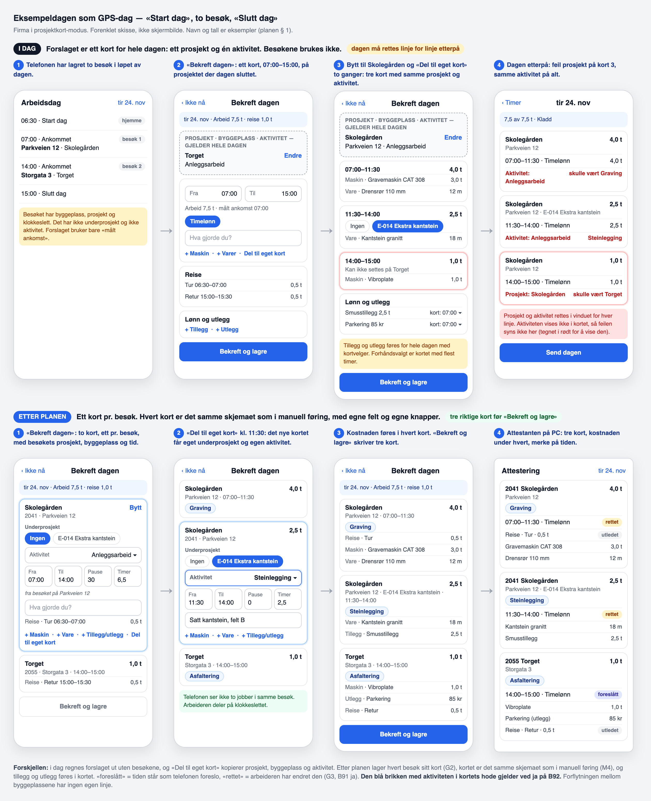
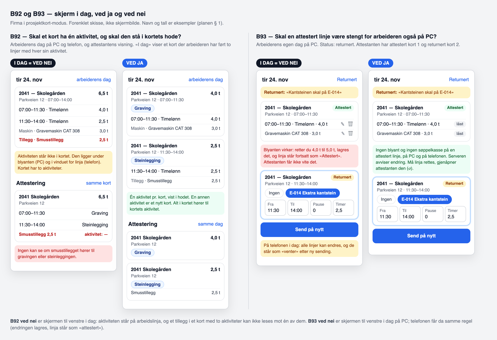

# Timeføring på telefonen — likt med web, og GPS-veien som lager kort (FORSLAG, fase 1, revisjon 2)

> **Bestilt av Kenneth 2026-11-24, ordrett:** *«fabel kan fortsette med planlegging av mobilapp slik at den fungerer
> likt med denne nye timeregistreringen på server. Jeg ønsker funksjoner så tet opp til web sin måte å gjøre ting på
> som mulig for alle manuelle registreringer. vi må i tillegg tilpasse gps veien slik at den også oppretter "prosjekt"
> kort slik at de treffer serveren og kan attesteres der likt med webregistreringen»*
>
> **Kenneth om revisjon 1, 2026-11-24, ordrett:** *«med "likt" mener jeg at kortene pr prosjekt skilles. ved arbeid på
> 3 ulike (prosjekt/byggeplass/underprosjekt), så må maskin, varer, tillegg/utlegg føres på rett
> (prosjekt/byggeplass/underprosjekt -> aktivitet). Man må dele opp prosjektene i kort, slik at vi kan se at vi fører
> informasjon mot rett aktivitet. det går ikke å registere alt i en lang linje, og etterpå føre kostnad på en
> aktivitet. Be fabel utlede planen med minst to forskjellige aktiviteter samme dag.»*

Begrepene er de samme som i [web-timeforing-plan.md § 0](web-timeforing-plan.md): **dagskortet** er dagen,
**prosjektkort = kort = jobb** er én registrering i dagen. **Denne planen gjelder firma i prosjektkort-modus**
(`timerRegistreringsmodus`). Dagskort-modus røres bare der det står uttrykkelig (M3, maskin uten fra–til).

**«Aktivitet»** er lest som feltet Aktivitet på arbeidslinja (firmaets liste, f.eks. «Anleggsarbeid», «Graving»).
Kortet er stedet (prosjekt, byggeplass, underprosjekt), og aktiviteten er hva som ble gjort der.

## 0. Kort fortalt

1. **Et kort er prosjekt + byggeplass + underprosjekt.** Det er regelen på begge flater og på serveren (MK1).
   Aktiviteten står på arbeidslinja og er ikke del av kortet. Maskin, varer, tillegg og utlegg har ikke aktivitet;
   de hører til en aktivitet bare gjennom kortet de står i (MK2, MK3).
2. **Web fører kostnaden på rett kort.** Hvert kort har egne knapper for maskin, vare, reise og tillegg/utlegg, og
   web sender kortets id med hver linje (MW6). Et nytt kort er forhåndsutfylt, ikke tomt (MW1–MW4).
3. **Telefonen gjør det ikke likt.** Et nytt kort føres i skjemaet «Bekreft dagen», der prosjekt, byggeplass og
   aktivitet «gjelder hele dagen» (MK6). Tillegg, utlegg og varer uten timelinje lagres uten kortets id og legges på
   det eldste kortet med samme sted (MK5). Har dagen to kort på samme sted med ulik aktivitet, havner kostnaden på
   feil kort.
4. **Ingen flate viser aktiviteten i kortet,** og et kort kan ha arbeidslinjer med to aktiviteter (MK2, MK4). Da kan
   ingen se hvilken aktivitet et tillegg eller et utlegg hører til. **Spørsmål B92.**
5. **GPS-veien lager ett kort for hele dagen.** Besøkene telefonen lagrer («Start dag», «Ankommet», «Bytt
   byggeplass») brukes ikke i forslaget (MG2). «Del til eget kort» deler bare på klokkeslett; det nye kortet får
   samme prosjekt, byggeplass og aktivitet (MG10). Eksempeldagen kan ikke føres riktig i «Bekreft dagen» i dag.
6. **Serveren og attesteringen skiller kostnad pr. kort i dag, også for dager fra telefonen** (MK7). De skiller ikke
   pr. aktivitet (MK3).
7. **Rettelse av revisjon 1:** PC-en stopper ikke endring av en attestert linje. Jobbskjemaet stopper, men blyanten
   på linja lagrer endringen, og linja står fortsatt som «attestert» (MP8). **Spørsmål B93.**

**Kenneths svar 2026-11-24:** B89 ja, B90 ja for alle fem regler, B91 ja. De er ført inn i § 3, § 4 og § 6.
**Anbefaling:** B92 ja, B93 ja (§ 5).

## 1. Eksempeldagen — brukes i hele planen

Én arbeider, tirsdag 24. november, tre kort på tre steder og tre aktiviteter. Navn, tider og tall er eksempler.
Firmaets arbeidstid er 07:00–15:00 med 30 min pause, og normen er 7,5 t.

| | Kort 1 | Kort 2 | Kort 3 |
|---|---|---|---|
| **Prosjekt** | 2041 Skolegården | 2041 Skolegården | 2055 Torget |
| **Byggeplass** | Parkveien 12 | Parkveien 12 | Storgata 3 |
| **Underprosjekt** | — | E-014 Ekstra kantstein | — |
| **Aktivitet** | Graving | Steinlegging | Asfaltering |
| **Tid** | 07:00–11:30, pause 30 min = 4,0 t | 11:30–14:00 = 2,5 t | 14:00–15:00 = 1,0 t |
| **Hva gjorde du?** | Gravd grøft for drensrør | Satt kantstein, felt B | Lappet asfalt ved kum |
| **Maskin** | Gravemaskin CAT 308 · 3,0 t | — | Vibroplate · 1,0 t |
| **Varer** | Drensrør 110 mm · 12 m | Kantstein granitt · 18 m | — |
| **Tillegg / utlegg** | — | Smusstillegg · 2,5 t | Parkering · 85 kr (utlegg) |
| **Reise** | Tur 06:30–07:00 | — | Retur 15:00–15:30 |

Sum arbeid 7,5 t, reise 1,0 t. Kort 1 og 2 har samme prosjekt og byggeplass og skilles av underprosjektet.

**Varianten** brukes der den gir et annet utfall: kort 2 er uten underprosjekt. Da har kort 1 og 2 samme sted og
skilles bare av aktiviteten (Graving og Steinlegging).

**Som GPS-dag:** «Start dag» 06:30 hjemme · «Ankommet» Parkveien 12 kl. 07:00 · «Ankommet» Storgata 3 kl. 14:00 ·
«Slutt dag» 15:00. Telefonen har da to besøk: Parkveien 12 kl. 07:00–14:00 og Storgata 3 kl. 14:00–15:00.

## 2. Målt mot koden

Develop @ `bcf29423` (MP1–MP22 og MG1–MG8 er målt @ `4a126ed2`; MP8, MP10 og MP11 er rettet nå). Alt er lest, ikke
kjørt. Det som er antatt, står som **ANTATT**. Forkortelser:
`D` = `apps/api/src/routes/timer/dagsseddel.ts` · `P` = `apps/web/src/app/dashbord/timer/[id]/page.tsx` ·
`J` = `apps/web/src/app/dashbord/timer/[id]/JobbSkjema.tsx` · `C` = `apps/web/src/components/timer/` ·
`M` = `apps/mobile/` · `TD` = `apps/mobile/src/components/timer-detalj/` · `PK` = `TD/prosjektkort/` ·
`BD` = `apps/mobile/app/timer/bekreft-dag.tsx` · `SK` = `packages/shared/src/utils/`.

### 2.1 Hva web fyller inn i et nytt kort (svar på B89: «det er jo ikke tomt når vi åpner på server»)

| Nr. | Funn | Kode |
|---|---|---|
| **MW1** | **Ny dag, ett trykk.** «+ Registrer timer» sender dato (i dag), prosjektet som er valgt øverst på siden, byggeplassen som er valgt øverst (bare når den hører til prosjektet) og aktiviteten «Anleggsarbeid» (ellers firmaets første aktive). Klokkeslett, pause og beskrivelse sendes ikke. Er ikke noe prosjekt valgt øverst, spør et vindu om prosjektet. | `C/RegistrerTimerKnapp.tsx:101-136`; `apps/web/src/lib/registrerTimer.ts:73-96`; `P:987-990` |
| **MW2** | **Serveren fyller resten og lagrer første linje med en gang.** Dagens ramme og linjas fra–til er firmaets arbeidstid for datoen (07:00–15:00, sommertid når firmaet bruker kalender). Pausen er firmaets (30 min) når spennet er langt nok. Lønnsarten er firmaets standard. Timene regnes ut (7,5 t). Underprosjekt og beskrivelse er tomme. Kort-id-en utledes av sted. Uten standard lønnsart lages ingen linje. | `D:4539-4544, 4551-4577, 4581-4592`; `D:2982-3056`; `apps/api/src/services/timer/arbeidstid.ts:45-134` |
| **MW3** | **Kortet på skjermen rett etter trykket:** åpent, med prosjekt og byggeplass, 07:00–15:00, pause 30, 7,5 t, standard lønnsart og merket «fra firmaets arbeidstid». Tomt: underprosjekt og «Hva gjorde du?». | `P:995-1031`; `J:556-575`; `packages/shared/src/i18n/nb.json:6042` |
| **MW4** | **Kort nr. 2 og 3.** Knappen «+ Registrer timer» under kortene («neste jobb, samme eller annet prosjekt»). Forhåndsutfylt: prosjektet øverst på siden (ellers spørres det), fra = dagens seneste til-tid, til = firmaets slutt når den er senere (ellers tom), pause 0, firmaets standard lønnsart, dagens aktivitet, uten underprosjekt, merket «fra slutten på forrige jobb». Kortet får en ny id fra nettleseren, også når stedet er likt et kort som finnes. Ingenting lagres før Til er fylt. | `P:2702-2711, 964-990, 1242-1279`; `apps/web/src/lib/jobbSkjema.ts:55-64`; `J:338-371`; `nb.json:5925-5926, 6043, 6048` |
| **MW5** | **Antall timer kan skrives direkte.** Kortet har feltene Fra, Til, Pause og Timer. Skriver du 4 i Timer, regnes Til ut: Fra + timer + pause. Fra og til er likevel alltid lagret: serveren krever dem på alle arbeidslinjer, og det finnes ingen firmainnstilling som slår kravet av. | `J:538-544, 694-735`; `jobbSkjema.ts:86-91`; `D:4740-4745, 5237-5242`; `packages/db/prisma/schema.prisma:376+` (søk `kreverFraTil\|visFraTil\|fraTilValgfri\|utenKlokkeslett`: 0 treff) |
| **MW6** | **Kostnad på rett kort.** Hvert kort har «+ Maskin», «+ Vare», «+ Reise» og «+ Tillegg/Utlegg». Web sender kortets id og sted med linja, og feltene for byggeplass og underprosjekt er skjult når vinduet åpnes fra et kort. Serveren kontrollerer at id-en hører til dagen og at stedet stemmer. | `P:2446-2508, 2547-2618, 5861-5891, 7100-7113`; `C/KortVareforbrukModal.tsx:110-122`; `apps/api/src/services/timer/kortId.ts:382-403` |
| **MW7** | **Kortets hode** viser prosjekt, byggeplass, klokke fra–til, underprosjekt og merkene «Returnert», «Attestert» og «Mangler beskrivelse». **Aktiviteten vises ikke.** Den velges under blyanten «Sted og aktivitet». Underprosjektet velges med knapper i kortet. | `P:2811-3013` (søk `aktivitet`: 0 treff); `J:577-691`; `P:5351-5368` |
| **MW8** | En enkelt maskin-, vare-, tillegg- eller utleggslinje kan ikke flyttes til et annet kort. Bare hele jobben flyttes («Flytt til …»). | `D:5888, 5952`; søk `flytt(Linje\|Tillegg\|Utlegg\|Maskin\|Vare)…Kort` i `apps/web`: 0 treff |

### 2.2 Kort, aktivitet og kostnad

| Nr. | Funn | Kode |
|---|---|---|
| **MK1** | **Kortets nøkkel er prosjekt, byggeplass og underprosjekt.** Aktivitet og lønnsart er ikke med. To kort samme dag kan ha samme nøkkel; de skilles da bare av kort-id-en. Linjer med samme kort-id må ha samme nøkkel, ellers avvises de (`kortUlikeRader`). | `SK/kortId.ts:127-128, 150-161, 190-201, 269-274`; `apps/api/src/services/timer/kortId.ts:77-81, 360-366` |
| **MK2** | **Et kort kan ha arbeidslinjer med ulik aktivitet.** Ingenting sperrer det: PC-en tar imot en hvilken som helst aktivitet sammen med en kort-id, og telefonen velger aktivitet pr. linje. Bare overtidslinja arver aktiviteten fra linje 1. | `D:4697, 4922, 5828`; `TD/TimerSeksjon.tsx:2081-2090` |
| **MK3** | **Bare arbeidslinja har aktivitet.** Maskin, tillegg, utlegg og varer har egne felt for prosjekt, byggeplass, underprosjekt og kort-id, men ikke aktivitet. Det gjelder på serveren og på telefonen. | `packages/db-timer/prisma/schema.prisma:236, 324, 418-441, 496-519, 596-623`; `packages/db-varelager/prisma/schema.prisma:77-91`; `M/src/db/schema.ts:164, 215-274, 339-360, 1093-1117` |
| **MK4** | **Attesteringen viser kortet, ikke aktiviteten, for kostnaden.** Kortets hode har prosjekt, byggeplass og underprosjekt. Aktiviteten står bare på timelinjene. En maskin eller vare vises på timelinja når den er koblet til den; ellers er den en egen linje uten aktivitet. Tillegg og utlegg er alltid egne linjer uten aktivitet. | `apps/web/src/components/attestering/attestering-tabell.ts:347-353, 425, 534-541, 576`; `SK/kortGruppering.ts:102-111, 172-185` |
| **MK5** | **Telefonen lagrer tillegg, utlegg og varer uten timelinje uten kortets id.** Kortskjermen sender bare kortets byggeplass og underprosjekt. Linja får da det eldste kortet på dagen med samme prosjekt, byggeplass og underprosjekt (regel 3). **ANTATT, ikke kjørt:** i eksempeldagen (tre ulike steder) havner alt riktig; i varianten havner smusstillegget på kort 1 (Graving) i stedet for kort 2 (Steinlegging). Maskin og varer som er koblet til en timelinje, følger linja og havner riktig. | `M/app/timer/[id]/kort/[projectId].tsx:576-597`; `M/src/services/tilleggUtleggSkriv.ts:40-43`; `M/src/services/vareforbrukSync.ts:205-222`; `PK/KortVareforbrukModal.tsx:148-149`; `M/src/utils/kortIdNormalisering.ts:65-143` |
| **MK6** | **Telefonens vei til kort nr. 2 og 3 i dag.** «+ Nytt prosjektkort» åpner «Bekreft dagen» med datoen låst. Skjemaet har én boks «Prosjekt · byggeplass · aktivitet — gjelder hele dagen». Forhåndsutfylt: appens valgte prosjekt, fra = dagens seneste til-tid (ellers firmaets start), til = firmaets slutt, firmaets pause når dagen ikke har pause, firmaets standard lønnsart, aktiviteten «Anleggsarbeid». Kortet får en id som aldri slås sammen med et kort som finnes. Ingenting lagres før «Bekreft og lagre». | `M/app/timer/[id]/prosjektkort.tsx:378-385`; `BD:1453-1513, 228-233`; `M/src/utils/kortIdForslag.ts:48-53, 155-164`; `M/src/utils/manuellDag.ts:18-24, 89-125`; `M/src/utils/dagsforslag.ts:1168-1183`; `M/src/utils/bekreftDag.ts:184-328` |
| **MK7** | **Serveren skiller kostnad pr. kort for dager fra telefonen.** Telefonen sender kort-id på arbeid, maskin, tillegg og utlegg; serveren godtar den når den hører til dagen og stedet stemmer, og fyller inn manglende id med regel 3. Attesteringen grupperer på kort-id uansett hvor dagen kom fra. En kostnadslinje med en kort-id ingen arbeidslinje har, blir et eget kort; uten kort-id havner den i «Uten kort». | `M/src/services/timerSync.ts:952, 1000, 1015, 1034`; `D:11457-11461, 11700`; `apps/api/src/services/timer/kortId.ts:101-106, 278-290`; `SK/kortGruppering.ts:127-158`; `attestering-tabell.ts:553-559` |
| **MK8** | **Telefonens kort i dagsoversikten** viser prosjekt, timer, byggeplass, underprosjekt og antall tillegg og utlegg. Aktiviteten vises ikke. Linjene er «07:00–11:30 · 4,0 t · Timelønn». Tillegg og utlegg føres ikke her, men på en egen kortskjerm. | `PK/ProsjektkortDagsoversikt.tsx:721-734, 778-849` (toppkommentar `:105-111`) |
| **MK9** | **Maskin på telefonen** føres som en linje i timelinjas vindu (utstyr, timer, mengde), uten fra–til. «+ Legg til maskin» på et tomt kort åpner samme vindu. Det gamle maskinvinduet med fra–til-felt åpnes bare for en maskin som finnes. | `TD/TimerSeksjon.tsx:2213-2338`; `PK/ProsjektkortDagsoversikt.tsx:870-895, 740-746`; `TD/MaskinSeksjon.tsx:921-927` |
| **MK10** | **Antall timer på telefonen.** Timelinjas vindu har feltet «Antall timer» og regner Til ut som på PC. «Bekreft dagen» har ikke feltet: der vises «Arbeid X t» utregnet, og bare fra og til kan endres. Fra og til er påkrevd, som på PC. | `TD/TimerSeksjon.tsx:2092-2103, 1416-1464, 1801-1806`; `BD:2281-2295` |

### 2.3 Lagring og veien til serveren

| Nr. | Funn | Kode |
|---|---|---|
| **MP1** | Samme datamodell på begge flater. Arbeid, maskin, tillegg, utlegg og varer har `kortId`. Ingen rad har et felt som sier om den kom fra PC, telefon eller GPS. | `packages/db-timer/prisma/schema.prisma:324, 441, 519, 623`; `packages/db-varelager/prisma/schema.prisma:91`; lokalt `M/src/db/schema.ts:146, 219, 258, 343, 1097` |
| **MP2** | PC-en skriver rad for rad: `opprett`, `tilfoyTimerRad`, `lagreJobbTid`, `flyttJobb`, `slettKort`, `send` og egne prosedyrer for maskin, tillegg og utlegg. | `D:4475, 4689, 5642, 5952, 7379, 7151, 11963, 6643, 6927` |
| **MP3** | Telefonen skriver arbeid, reise, maskin, tillegg og utlegg **bare** gjennom `syncBatch` (hele dagen i én pakke, høyst 100 dager pr. firma). Varer går i egne kall etter at dagen er synket. | `D:10371-11951`; `M/src/services/timerSync.ts:413, 897-1073, 1082-1085`; `M/src/services/vareforbrukSync.ts:51-54, 125` |
| **MP4** | Kort-id har én felles regel. Telefonen regner den lokalt før sending, serveren kontrollerer og retter i synken, og serverens id skrives tilbake til telefonen. Brudd gir «avvist». | `M/src/utils/kortIdNormalisering.ts:65-143`; `M/src/services/kortIdLokal.ts:27-155`; `D:11457-11470, 11700, 11715-11717`; `timerSync.ts:507-540` |
| **MP5** | **Reisen.** Telefonen gir aldri reisen kort-id lokalt og sender `null`. Serveren velger kortet (`velgReiseKort`: samme prosjekt **og** samme byggeplass, utreise i første jobb, retur i siste). PC-en viser reisen i jobbens kort. Telefonen viser den i en egen seksjon «Dagen». | `kortIdNormalisering.ts:106-111`; `timerSync.ts:951-952`; `SK/reiseKort.ts:112-141`; `PK/DagSeksjon.tsx:104-167`; `apps/web/src/app/dashbord/timer/[id]/ReiseKort.tsx:556-569` |
| **MP6** | **Kontroller PC-veien har og synken mangler.** (a) Dag eldre enn firmaets grense: 14 kall til `sjekkAldersgrense` i PC-veiene, 0 i synken. (b) Fra og til er påkrevd: synken avstår. (c) Byggeplass eller underprosjekt som ikke hører til prosjektet: PC-en får feil, synken nuller feltet stille. (d) Fravær over dagsnormen: PC-en får feil, synken lagrer og svarer med et flagg. (e) Timetall som ikke stemmer med fra–til og pause: PC-en får feil, synken regner om. | (a) `D:2114-2135` (b) `D:4740-4745` mot `D:11565-11570` (c) `D:4795-4797` mot `D:10965-11050` (d) `D:4812-4817` mot `D:11777-11785` (e) `D:4897-4905` mot `D:11069-11101` |
| **MP7** | **Sending.** `send` krever minst én arbeidslinje og «Hva gjorde du?» pr. jobb, og setter returnerte linjer tilbake til «venter». Attesterte linjer beholder «attestert». Telefonen kaller ikke `send`: den setter status lokalt, og synken tar statusen som den er. Appen har egne sperrer for arbeidslinje og beskrivelse, men serveren kontrollerer dem ikke. | `D:7156-7231`, `D:11100-11105`; `PK/useProsjektkortSedel.ts:630-663`; `PK/ProsjektkortDagsoversikt.tsx:1024-1061` |
| **MP8** | **Attestert linje på en returnert dag (rettet 2026-11-24).** **PC:** jobbskjemaet avviser («Jobben har attesterte timer og kan ikke endres»), kortet kan ikke slettes, og jobben kan ikke flyttes. Men blyanten og søppelkassa på linja vises etter dagens status alene, og `oppdaterTimerRad` har ingen sperre på linjas status: endringen lagres, og linja står fortsatt som «attestert». Det samme gjelder sletting av en linje og endring og sletting av tillegg og maskin. Den eneste sperren i `oppdaterTimerRad` er at en attestert **reise** ikke kan flyttes til et annet prosjekt. **Telefon:** synken sletter linjene og lager dem på nytt uten status, så de får «venter». Timelinjer skrives bare når telefonens versjon er lik serverens; tillegg, maskin og utlegg skrives alltid. Telefonen lagrer ikke linjas status. **ANTATT, ikke kjørt:** en returnert dag som sendes på nytt fra telefonen, mister «attestert» på alle maskin- og tilleggslinjer og på timelinjene telefonen skriver, også de arbeideren ikke har rørt. | PC: `D:5710-5715`; `D:4120-4124, 4130`; `SK/returSedel.ts:95-101`; `P:3641-3655, 3863-3881, 3980, 4093`; `D:5192-5545` (sperrene `:5245`, `:5309`; skrivingen `:5496-5499`); `D:5563, 6732, 6795, 12094, 12180`; `apps/web/src/lib/jobbSkjema.ts:27`. Telefon: `D:11441-11443, 11478-11496, 11571, 11629, 11646, 11678` (siste treff på `attestertStatus` i fila er `:10166`); `apps/api/src/routes/timer/sync-versjon.ts:100-116`; `M/src/lib/prosjektkortMobil.ts:7` |
| **MP9** | Telefonen har to veier for samme dag, styrt av firmavalget. Dagskort-modus bruker `M/app/timer/[id].tsx`. Prosjektkort-modus sendes videre til `M/app/timer/[id]/prosjektkort.tsx`. Lagringskoden finnes i to kopier med en test som skal feile hvis bare den ene endres. | `SK/prosjektkort.ts:13-15`; `M/app/timer/[id].tsx:602-607`; `M/app/timer/[id]/prosjektkort.tsx:73-75`; `PK/radLagring.ts:17-27` |

### 2.4 Skjermene

| Nr. | Funn | Kode |
|---|---|---|
| **MP10** | **Ny dag.** PC: ett trykk lager dagen og et forhåndsutfylt kort (MW1–MW3). Telefon: «+» åpner skjemaet «Bekreft dagen» uten GPS, forhåndsutfylt som i MK6. Ingenting skrives før «Bekreft og lagre»; går du ut, ligger dagen som «Ikke bekreftet». | `C/RegistrerTimerKnapp.tsx:139-152`; `M/src/components/DagsseddelListe.tsx:124-140, 352-361`; `M/src/utils/bekreftDag.ts:184-301` |
| **MP11** | **Kortet.** PC: kortet er skjemaet (fra, til, pause, timer, lønnsart, «Hva gjorde du?»), og hvert felt lagres når du går ut av det. Telefon: kortet viser linjer, og hver linje åpner et vindu (`TimerRadModal`) med ti felt og «Lagre». En ny jobb føres altså i ett skjema og rettes i et annet. | `J:338-371, 693-868`; `TD/TimerSeksjon.tsx:1043-2468`; `PK/ProsjektkortDagsoversikt.tsx:778-849, 1094-1221` |
| **MP12** | **Maskin.** PC: antall timer, aldri fra–til, «høyst» jobbens arbeidstimer. Telefon: ny maskin føres uten fra–til (MK9), men vinduet for en maskin som finnes, har fortsatt fra–til-felt. | `P:7097-7114`; `TD/MaskinSeksjon.tsx:588-623, 921-927, 744-790` |
| **MP13** | **Varer.** Begge flater fører varer bare i prosjektkort-modus. Telefonen sender ikke kort-id; serveren finner den fra arbeidslinja, ellers med regel 3 (MK5). Å endre, slette eller flytte en vare som alt er på serveren, krever nett på telefonen. | `C/KortVareforbrukModal.tsx:85, 93`; `apps/api/src/routes/vareforbruk.ts:443, 516-525`; `M/src/services/vareforbrukSync.ts:192-211`; `PK/kortRadFlytt.ts:316, 534-535, 549` |
| **MP14** | **Tillegg og utlegg.** Like felt på begge flater. Telefonen krever kvitteringsbilde for nytt utlegg og legger bildet i kø; PC-en laster opp direkte og merker «mangler kvittering». | `P:5927-6220, 6590-6881`; `TD/TilleggSeksjon.tsx:395-640`; `TD/UtleggSeksjon.tsx:488-700, 602-619` |
| **MP15** | **Del opp.** PC: serveren deler linja (`splittRadEier`) og kontrollerer. Telefon: delingen er en ren lokal skriving, og delene arver kort-id. «Del til eget kort» finnes bare i «Bekreft dagen». | `D:9654`; `P:2045-2119`; `TD/SplittRadModal.tsx:1-9, 249-308`; `TD/DelKortModal.tsx:7-13` |
| **MP16** | **Flytt.** PC: `flyttJobb` og `flyttJobbEco` på serveren. Telefon: «Endre kort» flytter alt i kortet; «Flytt raden» flytter linja med koblet maskin og varer, men ikke tillegg og utlegg. Bare i prosjektkort-modus. | `D:5888, 5952`; `J:415-502`; `PK/kortRadFlytt.ts:106, 139, 374-384, 461-530, 628-719` |
| **MP17** | **Fravær.** Telefonen har eget fraværskort (art, timer, beskrivelse) i prosjektkort-modus. På PC er det ikke funnet noen føring av fravær (søk `utenProsjekt\|fravaerKort` i timer-sidene og `C`: bare visning og attestantens retting). | `PK/FravaerKortModal.tsx:201-297`; `PK/fravaerKortLagring.ts:39-114` |
| **MP18** | **Merker.** PC viser «returnert» og «attestert» på kortet, «Korrigert av [navn]» og lenken «Slettet og korrigert». Telefonen har ingen av dem (søk `korrigert`, `attestertStatus` i `M/app/timer` og `TD`: 0 treff i visningen). Den viser bare attestantens kommentar for hele dagen. Pull-svaret bærer heller ikke «korrigert av». | `C/KorrigertMerke.tsx:93-131`; `apps/web/src/app/dashbord/timer/mine/page.tsx:307-312`; `M/app/timer/[id].tsx:1056-1073`; `D:10110-10371` |
| **MP19** | **Slett.** PC viser først hva som blir slettet (`slettOversikt`, `slettKortOversikt`). Telefonen spør med en bekreftelse uten oversikt. En returnert dag kan bare slettes med nett. I dagskort-modus slettes en kladd uten at serveren får beskjed, mens prosjektkort-veien legger en slettemarkør. | `D:7337, 7364, 7379`; `C/SlettDagModal.tsx:39, 43`; `PK/kortRadFlytt.ts:539-604`; `M/app/timer/[id].tsx:860-881`; `PK/useProsjektkortSedel.ts:687-720` |
| **MP20** | **Retur og gjenåpning.** Begge viser gult banner med attestantens kommentar og «Send på nytt». Begge gjenåpner en sendt dag med `gjenaapneDagsseddel`; telefonen trenger nett. | `P:1493-1506, 1455-1474`; `M/app/timer/[id]/prosjektkort.tsx:147-157`; `D:7253` |
| **MP21** | **Attestering på telefonen** er en egen, enklere flate: flat liste, kryss av linjer, «Attester» eller «Returner valgte». Ingen kort, ingen retting, ingen uke. Ikke med i denne planen. | `M/src/components/timer-attestering/AttesteringDetaljMobil.tsx:49-52, 72-91` |
| **MP22** | **Krever nett på telefonen:** gjenåpne sendt dag · slette returnert dag · endre, slette og flytte vare som er sendt · sammenligningen ved konflikt · miniatyr av opplastet vedlegg · hele attesteringen. | `PK/useProsjektkortSedel.ts:196-208, 698-705`; `PK/kortRadFlytt.ts:549, 659`; `TD/TilleggSeksjon.tsx:353` |

### 2.5 GPS-veien

| Nr. | Funn | Kode |
|---|---|---|
| **MG1** | Telefonen har ingen posisjon i bakgrunnen. «Start dag» lagrer en arbeidsdag og et besøk lokalt. «Ankommet»-banneret og «Bytt byggeplass» lagrer nye besøk. Ingenting av dette sendes til serveren. | `M/app.json:25-28`; `M/src/services/arbeidsdagBesok.ts:60-93, 252-320`; `M/src/db/schema.ts:451-494` |
| **MG2** | Forslaget i «Bekreft dagen» har **ett prosjekt** (byggeplassen dagen sluttet på, ellers appens valgte prosjekt), **én byggeplass** og **én aktivitet** («Anleggsarbeid») for hele dagen. Besøkene brukes ikke i utregningen (søk `besok` i `dagsforslag.ts`, `dagsforslagAnvend.ts`, `kortIdForslag.ts` og `dagsforslagInput.ts`: 0 treff); de vises bare som «målt ankomst». | `M/src/utils/dagsforslag.ts:1168-1183, 1388-1394`; `M/src/services/dagsforslagInput.ts:192-203`; `BD:659-662` |
| **MG3** | Hver arbeidslinje i forslaget får kort-id fra prosjekt og byggeplass (underprosjektet er alltid tomt i forslaget), den samme id-en ved hver omregning. Reisen får ingen. | `M/src/utils/kortIdForslag.ts:40-57, 114-116`; `dagsforslag.ts:1506-1511` |
| **MG4** | Linjene oppstår først når arbeideren trykker «Bekreft og lagre». Dagen blir en kladd som sendes til serveren ved neste synk, og arbeideren sender den til attestering etterpå som en vanlig dag. «Slutt dag» alene skriver ingenting. | `BD:1015`; `bekreftDag.ts:289-326`; `M/src/utils/dagsforslagAnvend.ts:194-303`; `M/src/services/sluttDag.ts:26, 42-59` |
| **MG5** | Arbeidslinja arver dagens byggeplass (fra «Start dag»). Reiselinja bærer byggeplassen den reiste til. Serveren legger reisen i jobbens kort bare når de to er like. **ANTATT, ikke kjørt:** er de ulike, blir reisen en egen registrering på serveren. | `dagsforslag.ts:1386-1394, 1928-1949, 1978-1995`; `dagsforslagAnvend.ts:235, 270`; `SK/reiseKort.ts:112-141` |
| **MG6** | **Eksisterende rader.** Tre migreringer har fylt kort-id på alle rader som fantes: arbeid, maskin, tillegg og utlegg 16.11, reise 20.11 og 21.11. De skiller ikke på kanal, så GPS-rader er med. Om de er kjørt i prod, er ikke målt (Kenneth kjører migreringer). | `packages/db-timer/prisma/migrations/20261116120000_kortid_fravaer_normtak`, `20261120120000_w12_reise_kortid`, `20261121120000_w15c_reise_kort` |
| **MG7** | Attesteringen henter flate rader og grupperer dem på kort-id i nettleseren, uansett kanal. En GPS-dag vises derfor som kort i A1–A4b i dag. | `D:7867-8149`; `attestering-tabell.ts:347, 553-559`; `SK/kortGruppering.ts:113-158` |
| **MG8** | Attestanten ser ikke på en arbeidslinje at tiden kommer fra GPS-dagen: linja har `tidKilde: null`, og feltet `autoGenerert` sendes aldri. Reiselinja har merke («utledet», kilde og retning). Dagen har merke når slutten er satt av systemet. | `dagsforslag.ts:1947`; `M/src/db/schema.ts:103-106`; `C/ReiseRadMerke.tsx:71-78`; `C/AttesteringDetalj.tsx:269-316` |
| **MG9** | **Besøket** har byggeplass, byggeplassens prosjekt, ankomst, avreise og kilde. Det har ikke underprosjekt og ikke aktivitet. Ved «Bytt byggeplass» velger arbeideren bare byggeplass; prosjektet følger byggeplassen. Når et nytt besøk lagres, får det forrige avreise = det nyes ankomst. To besøk etter hverandre kan ikke ha samme byggeplass, men A → B → A gir tre besøk. | `M/src/db/schema.ts:482-494`; `arbeidsdagBesok.ts:72-76, 85, 257, 333`; `M/src/components/AnkommetHvorModal.tsx:78-91` |
| **MG10** | **«Del til eget kort» deler bare på klokkeslett.** Det nye kortet får ny id, egen beskrivelse og kan få eget underprosjekt. Prosjekt, byggeplass og aktivitet kopieres og kan ikke endres pr. kort (søk `prosjektPerKort\|byggeplassPerKort\|aktivitetPerKort` i `apps/mobile`: 0 treff). | `TD/DelKortModal.tsx:33, 41-55`; `kortIdForslag.ts:82-107, 125-131`; `BD:598-606, 1576, 1585-1587` |
| **MG11** | **Maskin og varer i «Bekreft dagen» føres pr. kort.** Hvert kort har sin egen seksjon med «+ Maskin» og «+ Varer», og linjene kobles til kortets arbeidslinje og får kortets id. | `BD:1630-1648`; `M/src/utils/tilleggPaaKort.ts:100-116`; `dagsforslagAnvend.ts:305-314, 475-533`; `kortIdNormalisering.ts:124-128` |
| **MG12** | **Tillegg og utlegg i «Bekreft dagen»** føres i en egen seksjon for hele dagen. Har dagen flere kort, velger arbeideren kort pr. linje; forhåndsvalgt er kortet med flest timer på prosjektet. | `BD:1807-1819`; `TD/BekreftDagLonnUtlegg.tsx:62, 68-93`; `M/src/utils/beskrivelseKort.ts:236-257`; `M/src/utils/lonnUtleggKort.ts:46-58` |
| **MG13** | **Forslaget gjenbruker et kort som alt står på dagen** med samme prosjekt og byggeplass. **ANTATT, ikke kjørt:** har arbeideren ført et kort for hånd tidligere samme dag på samme sted og uten underprosjekt, skrives GPS-linjene inn i det kortet, også når aktiviteten er en annen. Det bryter med at registreringer aldri slås sammen. | `kortIdForslag.ts:54-55`; `dagsforslagInput.ts:431-447`; `dagsforslag.ts:271-275`; `dagsforslagAnvend.ts:169-189` |
| **MG14** | **Forflytning mellom byggeplasser** har ingen linje i forslaget (bare tur og retur). Mellom-raden er spesifisert i L4-B og L4-C og ikke bygget. | `dagsforslag.ts:307`; `timer-gps-lag3-4-spec.md:466-471` |

## 3. Del M — eksempeldagen ført for hånd

Skisse: [`skisser-mobil-timeforing/b89-ny-dag.png`](skisser-mobil-timeforing/b89-ny-dag.png) (i dag øverst, etter
planen nederst; kilde `skisser-b89.html`, felles stil i `skisser.css`).

### 3.1 Steg for steg

| Steg | Web i dag | Telefon i dag | Telefon etter planen | Leveranse |
|---|---|---|---|---|
| **1. Ny dag, kort 1 åpnes** | Ett trykk. Dagen er lagret, og kort 1 står åpent med Skolegården, Parkveien 12, 07:00–15:00, pause 30, 7,5 t, standard lønnsart og «fra firmaets arbeidstid» (MW1–MW3) | «+» åpner «Bekreft dagen» med de samme verdiene, men ingenting er lagret (MP10, MK6) | Som web: ett trykk, dagen er lagret på telefonen, kort 1 står åpent med de samme verdiene og samme merke. Prosjektet er det som er valgt i appen; er ingen valgt, spør telefonen | **M4** (B89 ja) |
| **2. Kort 1: 4 timer** | Skriv 4 i Timer; Til blir 11:30 (MW5) | «Bekreft dagen» har ikke Timer-feltet; Til må settes til 11:30 (MK10) | Feltene Fra, Til, Pause og Timer, som web. 4 i Timer gir Til 11:30 | **M4** |
| **3. Kort 1: aktivitet Graving** | Under blyanten «Sted og aktivitet» (MW7) | I boksen «gjelder hele dagen» (MK6) | I kortets hode, ved B92 ja. Ved nei: i kortet under «Mer», som web under blyanten | **M4**, **AK1** |
| **4. Kort 1: «Hva gjorde du?»** | Felt i kortet, lagres når du går ut | Felt i skjemaet | Felt i kortet, lagres når du går ut | **M4** |
| **5. Kort 1: gravemaskin 3,0 t** | «+ Maskin» i kortet: utstyr og timer (MW6) | En maskinlinje i vinduet for timelinja (MK9) | «+ Maskin» i kortet: utstyr og timer, aldri fra–til. Sendes med kortets id | **M4**, **M3** |
| **6. Kort 1: drensrør 12 m** | «+ Vare» i kortet (MW6) | «+ Vare» under timelinja (MK8) | «+ Vare» i kortet. Lagres med kortets id | **M8** |
| **7. Kort 1: reise Tur** | «+ Reise» i kortet (MP5) | Seksjonen «Dagen» | «+ Reise» i kortet | **M3** (= w12m) |
| **8. Kort 2 åpnes** | «+ Registrer timer»: fra 11:30, til 15:00, pause 0, «fra slutten på forrige jobb». Lagres når Til er fylt (MW4) | «+ Nytt prosjektkort» → «Bekreft dagen» på nytt, fra 11:30 (MK6) | «+ Registrer timer» under kortene: fra 11:30, til 15:00, pause 0, samme merke. Ny kort-id, aldri sammenslått med kort 1 | **M4** |
| **9. Kort 2: underprosjekt E-014** | Knapper i kortet (MW7) | Brikker i «Bekreft dagen» (MG10) | Knapper i kortet | **M4** |
| **10. Kort 2: Steinlegging, 2,5 t, kantstein** | Som steg 2–6 | Som steg 2–6 | Som steg 2–6 | **M4**, **M8** |
| **11. Kort 2: smusstillegg 2,5 t** | «+ Tillegg/Utlegg» i kortet, med kortets id (MW6) | På kortskjermen, uten kortets id (MK5). I varianten havner det på kort 1 | «+ Tillegg/utlegg» i kortet. Lagres med kortets id | **M8** |
| **12. Kort 3: Torget, Asfaltering, 1,0 t** | «+ Registrer timer», velg prosjekt i kortet (MW4) | «+ Nytt prosjektkort», velg prosjekt i «Bekreft dagen» | «+ Registrer timer», velg prosjekt og byggeplass i kortet | **M4** |
| **13. Kort 3: vibroplate, parkering 85 kr, reise Retur** | Knappene i kort 3 | Maskin i linjevinduet, utlegg på kortskjermen, reise i «Dagen» | Knappene i kort 3 | **M4**, **M8**, **M3** |
| **14. Dagen sett under ett** | Tre kort. Hodet: prosjekt, byggeplass, underprosjekt. Ikke aktivitet (MW7) | Tre kort. Hodet: prosjekt, byggeplass, underprosjekt, «Tillegg 1». Ikke aktivitet (MK8) | Tre kort med alt i kortet. Hodet viser også aktiviteten ved B92 ja | **M4**, **AK1** |
| **15. Send dagen** | «Send dagen (7,5 t · reise 1,0 t)»; serveren kontrollerer (MP7) | «Send dagen»; bare appen kontrollerer | Samme knapp og tekst; serveren kontrollerer det samme som for PC | **M1** (B90 ja) |
| **16. Attestanten** | Tre kort, kostnaden under hvert kort (MK7) | Samme visning for en dag fra telefonen (MK7) | Uendret. Aktiviteten i kortets hode ved B92 ja | **AK1** |

**Varianten** (kort 2 uten underprosjekt): web fører riktig, fordi kort 2 har egen id og web sender den med hver
linje. Telefonen i dag legger smusstillegget og en vare uten timelinje på kort 1 (MK5, antatt). M8 retter det.

### 3.2 Resten av de manuelle funksjonene

| Funksjon | Web i dag | Telefon i dag | Avvik | Leveranse |
|---|---|---|---|---|
| **Timer-lista** | Periode og filtre, status, «Korrigert av», «Slettet og korrigert», kladd-påminnelse | Dagsliste med status, synk-merke, «Ikke bekreftet», kladd-påminnelse | Telefonen mangler «Korrigert av» | M2 |
| **Dagens ramme** | «Dagens ramme» med «Endre»; pausen utledes av linjene | Samme vindu fra sumkortet | Ingen | Uendret |
| **Del opp** | Serveren deler og kontrollerer; begge kortene vises | Lokal deling i samme kort (MP15) | Ulikt vindu og ulik kontroll | M5 |
| **Flytt jobb** | «Flytt til …» i kortet; hele jobben med alt i (MW8) | «Endre kort» og «Flytt raden»; «Flytt raden» tar ikke med tillegg og utlegg (MP16) | Ulike ord, og tillegg og utlegg kan bli stående igjen | M5 |
| **Fravær** | Ingen føring funnet (MP17) | Eget fraværskort | Telefonen har mer enn PC | Uendret. Meldt til web-planen |
| **Gjenåpne sendt dag** | «Gjenåpne» | «Gjenåpne», krever nett | Ingen | Uendret |
| **Slett linje, kort, dag** | Viser hva som blir slettet først | Bekreftelse uten oversikt (MP19) | Ingen oversikt på telefonen | M6 |
| **Retting etter retur** | Gult banner, «returnert» og «attestert» på kortet. Jobbskjemaet er stengt for et attestert kort, men blyanten på linja virker (MP8) | Gult banner for hele dagen; ingen merke pr. kort; alle linjer kan endres og mister «attestert» (MP8) | Telefonen kjenner ikke linjas status; PC-en har et hull | M2, M1, **B93** |
| **Merker og varsler** | «Mangler beskrivelse», «returnert», «attestert», «Korrigert av», overlappvarsel, maskinførerbevis | «Mangler beskrivelse», overlappvarsel, maskinførerbevis, synk-merker | Mangler «returnert», «attestert», «Korrigert av» (MP18) | M2 (= w15gm) |
| **Overlapp PC ↔ telefon** | Banner; forslag fra telefonen kan velges | Konflikt-banner med sammenligning | Ingen | Uendret |
| **Varer uten nett** | — | Endre, slette og flytte en sendt vare krever nett (MP13) | Bryter «må virke uten nett» | M7 |

Dagskort-modus er ikke i tabellene. Planen endrer den ikke, bortsett fra maskin uten fra–til (M3).

### 3.3 Reglene serveren skal bruke for telefonen (B90 ja, alle fem)

| Regel | PC i dag | Telefon i dag | Etter M1 |
|---|---|---|---|
| 1. Dagen er eldre enn firmaets grense for etterføring | Stoppes | Lagres | Synken avviser dagen |
| 2. Sending uten arbeidslinje eller uten «Hva gjorde du?» | Serveren stopper | Bare appen stopper | Synken avviser sendingen |
| 3. Fravær over dagsnormen | Stoppes | Lagres, appen får et flagg | Synken avviser dagen |
| 4. Endring av en linje attestanten har attestert | Jobbskjemaet stopper. Blyanten på linja lagrer, og linja står som «attestert» (MP8) | Linja skrives på nytt og står som «venter»; maskin og tillegg mister «attestert» ved hver ny sending (MP8, antatt) | Synken skriver aldri om en attestert linje. Hva som skjer når arbeideren har endret den, følger **B93** |
| 5. Ny sending etter retur | Returnerte linjer settes til «venter»; attesterte beholdes | Linjene telefonen skriver, blir «venter» uansett; de den ikke skriver, beholder «returnert» (MP8, antatt) | Som `send`: returnerte linjer til «venter», attesterte beholdes |

En avvist dag står som kladd på telefonen med rødt banner «Avvist» og grunnen (banneret finnes,
`M/app/timer/[id].tsx:1096-1108`). Eldre app-versjoner får samme avvisning. En dag ført uten nett og synket etter
firmaets grense (regel 1) blir også avvist; lederen må da øke grensen eller føre dagen selv.

## 4. Del G — eksempeldagen som GPS-dag

Skisse: [`skisser-mobil-timeforing/gps-dag.png`](skisser-mobil-timeforing/gps-dag.png) (i dag øverst, etter planen
nederst; kilde `skisser-gps.html`).

### 4.1 Hva som skjer i dag

Arbeideren har to besøk på telefonen: Parkveien 12 kl. 07:00–14:00 og Storgata 3 kl. 14:00–15:00 (MG9). «Bekreft
dagen» viser likevel **ett kort**: hele dagen 07:00–15:00 på **ett prosjekt** (Torget, der dagen sluttet) med **én
aktivitet**, «Anleggsarbeid» (MG2). For å få eksempeldagen må arbeideren:

1. Bytte prosjektet for hele dagen til Skolegården og trykke «Del til eget kort» to ganger (kl. 11:30 og 14:00). De
   nye kortene får samme prosjekt, byggeplass og aktivitet (MG10).
2. Velge underprosjekt E-014 på kort 2. Det går.
3. Føre maskin og varer i hvert korts seksjon. Det går, og de får kortets id (MG11).
4. Føre smusstillegget og parkeringen i seksjonen for hele dagen og velge kort pr. linje. Forhåndsvalget er kortet
   med flest timer, altså kort 1 (MG12).
5. **Det som ikke går:** dagen har ett prosjekt, så kort 3 kan ikke settes på Torget når resten står på Skolegården,
   og kort 1 og 2 kan ikke få hver sin aktivitet. Det må rettes etter «Bekreft og lagre», linje for linje, i
   dagsoversikten.

GPS-dagen lager altså kort (MG3, MG7), men ikke kortene arbeideren faktisk jobbet på.

### 4.2 Besøk, kort og aktivitet — avklaringen

- **Et besøk er en byggeplass i et tidsrom.** Prosjektet følger byggeplassen. Telefonen vet ikke underprosjektet og
  ikke aktiviteten (MG9); det vet bare arbeideren.
- **Forslaget lager ett kort pr. besøk** (G2). Kortet får besøkets prosjekt, byggeplass og tid. Underprosjektet er
  tomt, og aktiviteten er forhåndsvalgt som på web («Anleggsarbeid»). Arbeideren retter begge i kortet.
- **To besøk på samme prosjekt** (to byggeplasser på Skolegården, eller A → B → A) blir to kort, hvert med sin
  aktivitet. De slås aldri sammen.
- **To jobber i samme besøk** (kort 1 og 2 i eksempelet: samme byggeplass, ulik aktivitet og ulikt underprosjekt)
  kan ikke telefonen se. Arbeideren deler kortet med «Del til eget kort» på klokkeslettet, og det nye kortet får
  egne felt for underprosjekt og aktivitet.
- **Et kort fra GPS-dagen gjenbruker aldri et kort som alt står på dagen** (MG13 rettes i G2). Hvert besøk får sin
  egen kort-id.

### 4.3 Eksempeldagen etter planen

1. «Slutt dag» åpner «Bekreft dagen» med **to kort**: A = Skolegården · Parkveien 12 · 07:00–14:00, pause 30 = 6,5 t,
   og B = Torget · Storgata 3 · 14:00–15:00 = 1,0 t. Hvert kort er det samme skjemaet som i § 3 (M4): hode med
   prosjekt, byggeplass, underprosjekt og aktivitet, feltene Fra, Til, Pause og Timer, lønnsart, «Hva gjorde du?»
   og knappene «+ Maskin», «+ Vare» og «+ Tillegg/utlegg». Reisen står i kortet (G1): Tur i kort A, Retur i kort B.
2. Arbeideren trykker «Del til eget kort» på kort A og velger 11:30. Kort A blir 07:00–11:30 (4,0 t), og det nye
   kortet 11:30–14:00 (2,5 t) står åpent med underprosjekt og aktivitet å velge. Han velger E-014 og Steinlegging.
3. Han setter aktiviteten Graving på kort 1 og Asfaltering på kort 3, skriver «Hva gjorde du?» i hvert kort og fører
   gravemaskin og drensrør i kort 1, kantstein og smusstillegg i kort 2, vibroplate og parkering i kort 3.
4. «Bekreft og lagre» skriver de tre kortene. Dagen ser ut som i § 3 steg 14 og sendes med samme knapp.
5. Attestanten ser tre kort med kostnaden under hvert, og merket for tid foreslått av telefonen (G3, B91 ja):
   «foreslått» på linjer der tiden står som telefonen foreslo, «rettet» der arbeideren har endret den.

Forflytningen mellom byggeplassene får ingen egen linje (MG14); tiden står i kortet arbeideren dro fra, og han kan
rette den.

### 4.4 Hvor kortet oppstår, og eksisterende rader

**Kortet oppstår på telefonen når arbeideren trykker «Bekreft og lagre», som i dag** (MG3, MG4). Serveren
kontrollerer kort-id-en når dagen synkes (MP4). Grunnen er premisset om at telefonen må virke uten nett.

Forkastet: å lage kortet på serveren ved «Start dag». Det krever nett eller en halvferdig linje uten til-tid, PC-veien
krever fra og til (MP6 b), og arbeidsdagen sendes ikke til serveren etter vedtak («GPS-loggen ligger bare på
telefonen», web-planen § 2).

**Eksisterende GPS-rader trenger ingenting.** De skilles ikke fra andre rader (MP1), fikk kort-id i utfyllingen
16.–21.11 (MG6) og grupperes som kort i attesteringen (MG7). Det som må bekreftes før G1 bestilles, er at de tre
migreringene er kjørt i prod.

### 4.5 Utenfor denne planen

- Posisjon i bakgrunnen og automatisk avreise og ankomst
  ([timer-geofence-avreise-ankomst-spec.md](timer-geofence-avreise-ankomst-spec.md), utkast). Krever ny app-versjon.
- En egen knapp for «ny jobb» underveis i dagen uten å bytte byggeplass. Delingen gjøres i «Bekreft dagen» (§ 4.2).
- Mellom-raden for forflytning (L4-B og L4-C, MG14).

## 5. Spørsmål til Kenneth

### Besvart 2026-11-24

| Spørsmål | Svar | Ført inn |
|---|---|---|
| **B89** — ny dag og ny jobb på telefonen som på PC | **Ja.** Kortet er ikke tomt: telefonen fyller inn det samme som web (MW1–MW4) | § 3.1 steg 1 og 8; M4 |
| **B90** — serveren stopper telefonen på de samme reglene som PC-en | **Ja, alle fem** | § 3.3; M1. Regel 4 er rettet (MP8) og følger B93 |
| **B91** — merke for tid foreslått av telefonen og rettet av arbeideren | **Ja** | § 4.3 punkt 5; G3 |

**Lesning, ikke spørsmål — si fra hvis du mente noe annet:** «Jeg kan ikke føre på 4 timer» er lest som at du skal
kunne skrive 4 i et Timer-felt, og at Til da regnes ut. Slik gjør PC-en (MW5), og slik blir kortet på telefonen
(§ 3.1 steg 2). Fra og til lagres fortsatt på linja; PC-en krever det også. Mente du timer helt uten klokkeslett,
er det en ny regel for begge flater.

### B92 — Skal et kort ha én aktivitet, og skal den stå i kortets hode?

Gjelder firma i prosjektkort-modus: arbeiderens dag på PC og telefon (kladd eller returnert), og attestantens visning.
Bilde: [`skisser-mobil-timeforing/b92-b93.png`](skisser-mobil-timeforing/b92-b93.png), venstre halvdel.

- **I dag:** kortets hode viser prosjekt, byggeplass og underprosjekt. Aktiviteten står ikke i kortet: på PC ligger
  den under blyanten, på telefonen i vinduet for timelinja, og i attesteringen i en kolonne på timelinja. Et kort
  kan ha to arbeidslinjer med hver sin aktivitet. Maskin, varer, tillegg og utlegg har ikke aktivitet (MK2–MK4).
- **Ved ja:** kortets hode viser «2041 Skolegården · Parkveien 12 · E-014 Ekstra kantstein · Steinlegging» på PC, på
  telefonen og i attesteringen. Aktiviteten velges i kortet og gjelder alle arbeidslinjene i det. En annen aktivitet
  føres som et nytt kort («+ Registrer timer»). Serveren avviser en arbeidslinje med en annen aktivitet enn kortets,
  fra PC og fra telefonen. Alt som står i kortet — maskin, varer, tillegg og utlegg — hører da til kortets
  aktivitet. Det trengs ingen migrering: kort som alt har to aktiviteter, står urørt, og hodet viser begge.
- **Ved nei:** som i dag. Aktiviteten står på arbeidslinja. Har et kort to aktiviteter, kan ingen se hvilken av dem
  et tillegg, et utlegg eller en maskin uten timelinje hører til.

**Anbefaling: ja.** Det er det du beskriver («prosjekt/byggeplass/underprosjekt → aktivitet»), og det gjør
kostnaden lesbar pr. aktivitet uten nytt felt i databasen. Leveransen heter AK1 (§ 6) og rører PC, telefon og server.

### B93 — Skal en attestert linje være stengt for arbeideren også på PC?

Gjelder arbeiderens egen dag med status returnert, der attestanten har attestert noen linjer og returnert andre.
Bilde: samme fil, høyre halvdel.

- **I dag, PC:** kortet med en attestert linje vises som linjer i stedet for skjema. Blyanten og søppelkassa står på
  den attesterte linja. Retter du tiden med blyanten, lagres endringen, og linja står fortsatt som «attestert».
  Attestanten får ikke vite det (MP8). Det gjelder timelinjer, reise, maskin og tillegg. Varer er stengt.
- **I dag, telefon:** alle linjer kan endres, og ved ny sending står de som «venter» (MP8, antatt).
- **Ved ja:** en attestert linje har ingen blyant og ingen søppelkasse, på PC og på telefonen. Serveren avviser
  endring og sletting fra begge. Arbeideren retter de returnerte og ventende linjene. Må en attestert linje
  rettes, gjenåpner attestanten den (↺ finnes), og da er den ventende. Dette er regel 4 i B90.
- **Ved nei:** PC som i dag. Regel 4 blir da for telefonen det PC-en gjør: endringen lagres, og linja står som
  «attestert».

**Anbefaling: ja.** En attestert linje som endres uten at attestanten ser det, er lønn utbetalt på noe annet enn det
som ble attestert.

## 6. Rekkefølge

Ingenting er bestilt. «Mobil venter på web» står til Kenneth har godkjent timeføringen på PC.

| Leveranse | Innhold, vist på eksempeldagen | Rører | Avhenger av | Migrering | App |
|---|---|---|---|---|---|
| **M8** | **Kostnad på rett kort.** Tillegg, utlegg og varer lagres med id-en til kortet de føres i (smusstillegget på kort 2, parkeringen på kort 3, også i varianten). Test: to kort på samme sted, tillegg ført i kort 2 står i kort 2 etter synk | `apps/mobile` | — | Ingen | OTA |
| **M2** | Telefonen kjenner linjas status: «returnert» og «attestert» på kortet, «Korrigert av [navn]» (= **w15gm**). Pull-svaret må bære «korrigert av» | `apps/mobile`, `apps/api` (bare lesing) | w15g (merget) | Ingen på server. Én ny kolonne i telefonens lokale database | OTA |
| **M1** | Serveren bruker de fem reglene i § 3.3 for telefonen, synken skriver aldri om en attestert linje, og dagens statusoverganger får én felles tabell for `send` og synken. Ved B93 ja: PC-prosedyrene avviser endring og sletting av attestert linje | `apps/api`, `packages/shared`, `apps/web` (blyanten, ved B93 ja) | **B93.** Slippes sammen med M2, ellers får arbeideren «Avvist» uten å se hvorfor | Ingen | Ingen ny app; eldre apper tåler svaret |
| **M3** | Reisen i jobbens kort på telefonen (= **w12m**): Tur i kort 1, Retur i kort 3. Deling over midnatt. Maskinvinduet uten fra–til, i begge moduser (vedtak 2026-11-21) | `apps/mobile` | w12 og w15c (merget) | Ingen | OTA |
| **G1** | GPS-forslaget legger reisen i jobbens kort lokalt, med test for lik byggeplass | `apps/mobile` | M3 (samme filer). Migreringene i MG6 kjørt i prod | Ingen | OTA |
| **M4** | **Kortet som skjema** (B89 ja), § 3.1 steg 1–14: ny dag med ett trykk og forhåndsutfylt kort 1 (MW1–MW3); «+ Registrer timer» for kort 2 og 3 med fra = forrige til og ny kort-id (MW4); feltene Fra, Til, Pause og Timer (MW5); underprosjekt i kortet; knappene «+ Reise», «+ Maskin», «+ Vare» og «+ Tillegg/utlegg» i hvert kort (MW6). Egen detaljspec med bilder før bestilling | `apps/mobile` | M3, M8 | Ingen | OTA |
| **AK1** | **Kortets aktivitet** (B92 ja): aktiviteten i kortets hode på PC, telefon og i attesteringen; én aktivitet pr. kort, kontrollert på serveren | `apps/web`, `apps/api`, `apps/mobile` | **B92.** Telefondelen går med M4 | Ingen | OTA |
| **M5** | «Del opp» og «Flytt til …» med web sine ord og vinduer; flytting tar med tillegg og utlegg | `apps/mobile` | M4 | Ingen | OTA |
| **M6** | Slett viser hva som blir slettet. Kladd i dagskort-modus legger slettemarkør (funn, MP19) | `apps/mobile` | M4 | Ingen | OTA |
| **M7** | Varer uten nett: endre, slette og flytte legges i kø | `apps/mobile` | — | Ingen | OTA |
| **G2** | **GPS-dagen som kort**, § 4.3: ett kort pr. besøk med besøkets prosjekt, byggeplass og tid (= L4-B); hvert kort i «Bekreft dagen» er M4-skjemaet med egne felt for prosjekt, byggeplass, underprosjekt og aktivitet og egne knapper for maskin, vare og tillegg/utlegg; «Del til eget kort» gir det nye kortet egne felt; et GPS-kort gjenbruker aldri et kort som står på dagen (MG13). Egen detaljspec med bilder før bestilling | `apps/mobile` | M4, G1 | Ingen | OTA |
| **G3** | Merke i attesteringen for tid foreslått av telefonen og tid rettet av arbeideren (B91 ja). Feltet finnes (`tidKilde`); linjer ført før leveransen får ikke merket | `apps/mobile`, `apps/web` | G2 | Ingen | OTA |

- **Ingen leveranse krever migrering på serveren.** Kolonnene finnes (`kortId`, `attestertStatus`, `tidKilde`,
  `aktivitetId`).
- **Ingen leveranse krever nytt app-bygg (EAS).** Alt er TypeScript og går som OTA så lenge det native laget ikke
  endres (`apps/mobile/app.config.js:59-77`). Telefonens lokale database endres av kode i appen
  (`M/src/db/migreringer.ts`).
- **M1 og AK1 krever server-deploy.** M1 bør følges av en OTA med M2 samme dag.
- **Rekkefølgen M8 → M2 + M1 → M3 + G1 → M4 (+ AK1) → M5, M6 → M7 → G2 → G3.** M8 står først fordi den retter at
  kostnad kan havne på feil kort, og den er liten. G2 står etter M4 fordi kortene i «Bekreft dagen» skal være det
  samme skjemaet.

## 7. Forholdet til eldre planer

| Eldre punkt | Her |
|---|---|
| **w12m** (web-planen § 9) | M3. Uendret innhold |
| **w15gm** («Korrigert av» i appen) | M2, utvidet med linjas status |
| **w9m** (maskin «høyst» på telefonen) | Merget. Fra–til-feltet som står igjen i vinduet for en maskin som finnes, tas i M3 |
| **H1m** (helg, helligdag og overtid på telefonen) | Ikke med her; følger H1a–H1c i web-planen |
| **L3-B** (manuell dag gjennom «Bekreft dagen») | Bygget (ORDRE 36c, `M/src/components/DagsseddelListe.tsx:124-140`). Snus i M4 (B89 ja) |
| **L3-D** (maskin og varer i «Bekreft dagen») | Bygget pr. kort (MG11). Beholdes; knappene flyttes inn i M4-skjemaet i G2 |
| **L4-B** (forslag fra besøkene) | G2. `timer-gps-lag3-4-spec.md` § 3.5 sier «én linje pr. prosjekt» for maskin og varer; koden fører dem pr. kort (MG11), og G2 følger koden |
| **«A → A slås sammen»** (`timer-gps-lag3-4-spec.md:391`) | To like besøk etter hverandre lagres aldri (MG9). A → B → A gir tre besøk og tre kort |
| **M4** i [paritet-web-server-mobil-2026-08-20.md](paritet-web-server-mobil-2026-08-20.md) (overtid deles bare på telefonen) | Utgått: PC deler også (`P:5449-5466`) |
| **M5, M6** samme sted (attestering på telefonen er bare beslutning) | Står. Ikke med her (MP21) |
| **M7** samme sted (deling på telefonen går utenom serveren) | Står (MP15). M5, og kontrollen i M1 |
| **M8** samme sted (dagsnorm) | Ikke målt på nytt. Navnet M8 i denne planen er en annen leveranse |

To premisser fra den første ordren stemmer ikke med koden: `isValidStatusTransition()` gjelder dokumentflytens
statuser (`SK/index.ts:508-520`) og brukes ikke i noen timer-rute (forslag i M1), og seks handlinger på telefonen
krever nett (MP22; forslag i M7).

## 8. Ikke målt

- Om migreringene i MG6 er kjørt i prod.
- Følgene i MP8, MK5, MG5 og MG13 er lest ut av koden, ikke kjørt. De bør dekkes av en test før M1, M8, G1 og G2
  bestilles.
- Om lønns- og kostnadseksporten skiller på aktivitet.
- Hvor mange kort i prod som har arbeidslinjer med to aktiviteter (gjelder B92).
- Dagsnormen på de to flatene.
- `ReiseKort.tsx` på web fra linje 940 og `MaskinVelger.tsx`.
- Hvordan skjermene ser ut på en telefon. Skissene er tegnet etter koden, ikke etter skjermbilder.
- Reiseknappen i dagskort-modus på telefonen.

**Funn utenfor ordren, ikke rettet:** `apps/mobile/src/db/CLAUDE.md:24-26` sier «last-write-wins» for timer; koden
har versjon pr. rad og forsoning (`timerSync.ts:551-739`). PC-en har ingen føring av fravær (MP17).
`timer-gps-lag3-4-spec.md` § 3.5 er ikke oppdatert etter at maskin og varer ble ført pr. kort (MG11).
