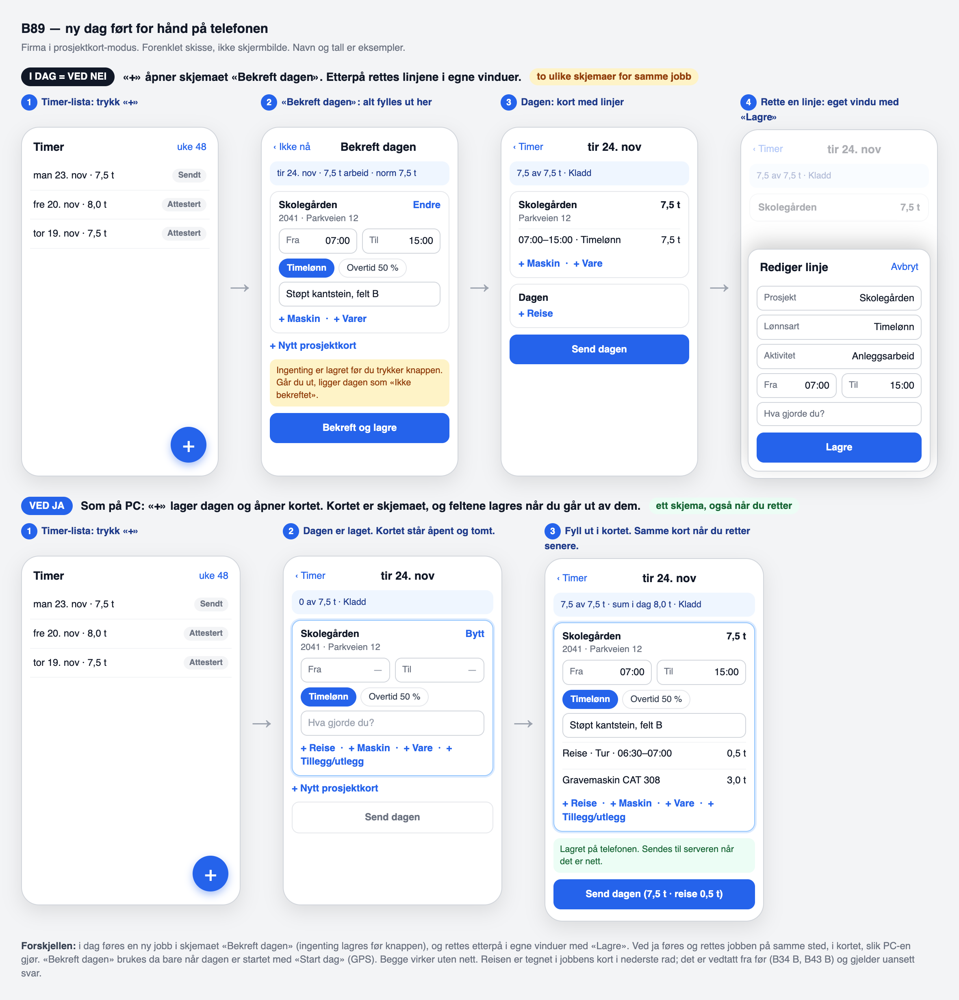

# Timeføring på telefonen — likt med web, og GPS-veien som lager kort (FORSLAG, fase 1)

> **Bestilt av Kenneth 2026-11-24, ordrett:** *«fabel kan fortsette med planlegging av mobilapp slik at den fungerer
> likt med denne nye timeregistreringen på server. Jeg ønsker funksjoner så tet opp til web sin måte å gjøre ting på
> som mulig for alle manuelle registreringer. vi må i tillegg tilpasse gps veien slik at den også oppretter "prosjekt"
> kort slik at de treffer serveren og kan attesteres der likt med webregistreringen»*

Begrepene er de samme som i [web-timeforing-plan.md § 0](web-timeforing-plan.md): **dagskortet** er dagen,
**prosjektkort = kort = jobb** er én registrering i dagen. «Dagskort-modus» og «prosjektkort-modus» er firmavalget
(`timerRegistreringsmodus`). **Denne planen gjelder prosjektkort-modus.** Dagskort-modus røres bare der det står
uttrykkelig (M3, maskin uten fra–til).

## 0. Kort fortalt

1. **Telefonen og PC-en lagrer det samme.** Samme tabeller, samme kort-id, samme regel for hvilket kort en linje
   hører til (MP1, MP4). En dag ført på telefonen vises som kort i attesteringen (A1–A4b) i dag.
2. **Veien inn er forskjellig.** PC-en lagrer felt for felt gjennom prosedyrer med kontroller. Telefonen sender hele
   dagen i én pakke (`syncBatch`), og den pakken har færre kontroller (MP6–MP8). Fem regler PC-en stoppes av, stoppes
   ikke for telefonen.
3. **Skjermene er forskjellige.** På PC er kortet selve skjemaet og lagres fortløpende. På telefonen føres en ny jobb
   i skjemaet «Bekreft dagen», og rettes etterpå i egne vinduer (MP10, MP11).
4. **Telefonen henger etter på fire vedtatte ting:** reisen står ikke i jobbens kort (MP5), maskin har fortsatt
   fra–til (MP12), arbeideren ser ikke hvilke linjer som er returnert eller attestert, og ser ikke «Korrigert av»
   (MP18).
5. **GPS-veien lager allerede kort.** Arbeidslinjene får kort-id når arbeideren trykker «Bekreft og lagre», og de
   attesteres som andre kort (MG3, MG4, MG7). Det som mangler: reisen legges i kortet først på serveren (MG5), og
   hele GPS-dagen blir **ett** kort selv om arbeideren har vært på flere byggeplasser (MG2).
6. **Eksisterende GPS-rader trenger ingenting.** De har kort-id fra utfyllingen 16.–21.11 (MG6).

**Anbefaling:** B89 ja, B90 ja, B91 nei (§ 5). Rekkefølge i § 6: M2 og M1 først (linjestatus på telefonen og samme
regler på serveren), så M3 med G1 (reisen i kortet, maskin uten fra–til), så M4 (kortet som skjema).

## 1. Faste premisser

Fra ordren, vedtatt og ikke spørsmål: telefonen må virke uten nett · omdøpt tRPC-ruter beholdes som alias i minst én
uke · maskin er antall timer etter skjønn, aldri fra–til · registreringer slås aldri sammen, heller ikke på samme
prosjekt · tilstedeværelse og GPS kan foreslå tider, arbeideren velger og retter, overlapp gir varsel · endringer i
«Bekreft dagen» og prosjektkortet skal ikke påvirke dagskort-modus utilsiktet · attestering er ikke godkjenning ·
telefonen verifiseres med rene tester og Kenneth på telefon.

**To premisser stemmer ikke med koden i dag:**

- **«Statusoverganger via `isValidStatusTransition()`».** Funksjonen gjelder dokumentflytens statuser
  (`packages/shared/src/utils/index.ts:508-520`) og brukes i `oppgave.ts`, `sjekkliste.ts` og `flytMatrise.ts`.
  Ingen timer-rute bruker den. Dagsseddelens status (`draft`, `sent`, `returned`, `accepted`) har ingen felles
  overgangstabell: PC-en går gjennom `send`, og telefonen sender statusen i pakken (MP7). Forslag i M1.
- **«Telefonen må virke uten nett».** Seks handlinger krever nett i dag (MP22). Den som bryter mest med premisset, er
  varer: å endre, slette eller flytte en vare som alt er sendt, virker ikke uten nett. Forslag i M7.

## 2. Målt mot koden

Develop @ `4a126ed2`. Alt er lest, ikke kjørt. Det som er antatt, står som **ANTATT**. Forkortelser:
`D` = `apps/api/src/routes/timer/dagsseddel.ts` · `P` = `apps/web/src/app/dashbord/timer/[id]/page.tsx` ·
`J` = `apps/web/src/app/dashbord/timer/[id]/JobbSkjema.tsx` · `C` = `apps/web/src/components/timer/` ·
`M` = `apps/mobile/` · `TD` = `apps/mobile/src/components/timer-detalj/` · `PK` = `TD/prosjektkort/`.

### 2.1 Lagring og veien til serveren

| Nr. | Funn | Kode |
|---|---|---|
| **MP1** | Samme datamodell på begge flater. Arbeid, maskin, tillegg, utlegg og varer har `kortId`. Ingen rad har et felt som sier om den kom fra PC, telefon eller GPS. | `packages/db-timer/prisma/schema.prisma:324, 441, 519, 623`; `packages/db-varelager/prisma/schema.prisma:91`; lokalt `M/src/db/schema.ts:146, 219, 258, 343, 1097` |
| **MP2** | PC-en skriver rad for rad: `opprett`, `tilfoyTimerRad`, `lagreJobbTid`, `flyttJobb`, `slettKort`, `send` og egne prosedyrer for maskin, tillegg og utlegg. | `D:4475, 4689, 5642, 5952, 7379, 7151, 11963, 6643, 6927` |
| **MP3** | Telefonen skriver arbeid, reise, maskin, tillegg og utlegg **bare** gjennom `syncBatch` (hele dagen i én pakke, høyst 100 dager pr. firma). Varer går i egne kall etter at dagen er synket. | `D:10371-11951`; `M/src/services/timerSync.ts:413, 897-1073, 1082-1085`; `M/src/services/vareforbrukSync.ts:51-54, 125` |
| **MP4** | Kort-id har én felles regel. Telefonen regner den lokalt før sending, serveren kontrollerer og retter i synken, og serverens id skrives tilbake til telefonen. Brudd gir «avvist». | `M/src/utils/kortIdNormalisering.ts:65-143`; `M/src/services/kortIdLokal.ts:27-155`; `D:11457-11470, 11700, 11715-11717`; `timerSync.ts:507-540` |
| **MP5** | **Reisen.** Telefonen gir aldri reisen kort-id lokalt og sender `null`. Serveren velger kortet (`velgReiseKort`: samme prosjekt **og** samme byggeplass, utreise i første jobb, retur i siste). PC-en viser reisen i jobbens kort. Telefonen viser den i en egen seksjon «Dagen». | `kortIdNormalisering.ts:106-111`; `timerSync.ts:951-952`; `packages/shared/src/utils/reiseKort.ts:112-141`; `PK/DagSeksjon.tsx:104-167`; `apps/web/src/app/dashbord/timer/[id]/ReiseKort.tsx:556-569` |
| **MP6** | **Kontroller PC-veien har og synken mangler.** (a) Dag eldre enn firmaets grense: 14 kall til `sjekkAldersgrense` i PC-veiene, 0 i synken. (b) Fra og til er påkrevd: synken avstår. (c) Byggeplass eller underprosjekt som ikke hører til prosjektet: PC-en får feil, synken nuller feltet stille. (d) Fravær over dagsnormen: PC-en får feil, synken lagrer og svarer med et flagg. (e) Timetall som ikke stemmer med fra–til og pause: PC-en får feil, synken regner om. | (a) `D:2114-2135` (b) `D:4740-4745` mot `D:11565-11570` (c) `D:4795-4797` mot `D:10965-11050` (d) `D:4812-4817` mot `D:11777-11785` (e) `D:4897-4905` mot `D:11069-11101` |
| **MP7** | **Sending.** `send` krever minst én arbeidslinje og «Hva gjorde du?» pr. jobb, og setter returnerte linjer tilbake til «venter». Telefonen kaller ikke `send`: den setter status lokalt, og synken tar statusen som den er. Appen har egne sperrer for arbeidslinje og beskrivelse, men serveren kontrollerer dem ikke. | `D:7163-7231`, `D:11100-11105`; `PK/useProsjektkortSedel.ts:630-663`; `PK/ProsjektkortDagsoversikt.tsx:1024-1061` |
| **MP8** | **Attestert linje.** PC-veien avviser endring av en linje som er attestert. Synken leser og skriver ikke `attestertStatus` på linjene (søk i `D:10371-11951`: 0 treff), og linjer den skriver på nytt, får standardverdien «venter». Telefonen lagrer ikke linjas status. **ANTATT følge, ikke kjørt:** på en returnert dag kan arbeideren rette en attestert linje på telefonen, og linja står da som ikke attestert. Linjer arbeideren ikke rører, skrives ikke på nytt, så en returnert linje han lar stå, beholder «returnert» etter ny sending. | `D:5309`; `D:11441-11452, 11571-11620`; `schema.prisma:271`; `M/src/lib/prosjektkortMobil.ts:7-8` |
| **MP9** | Telefonen har to veier for samme dag, styrt av firmavalget. Dagskort-modus bruker `M/app/timer/[id].tsx`. Prosjektkort-modus sendes videre til `M/app/timer/[id]/prosjektkort.tsx`. Lagringskoden finnes i to kopier med en test som skal feile hvis bare den ene endres. | `packages/shared/src/utils/prosjektkort.ts:13-15`; `M/app/timer/[id].tsx:602-607`; `M/app/timer/[id]/prosjektkort.tsx:73-75`; `PK/radLagring.ts:17-27` |

### 2.2 Skjermene

| Nr. | Funn | Kode |
|---|---|---|
| **MP10** | **Ny dag.** PC: ett trykk på «+ Registrer timer» lager dagen og åpner en tom jobb. Telefon: «+» åpner skjemaet «Bekreft dagen» uten GPS. Ingenting skrives før «Bekreft og lagre»; går du ut, ligger dagen som «Ikke bekreftet». «+ Nytt prosjektkort» på en dag som finnes, går samme vei. | `C/RegistrerTimerKnapp.tsx:139-152`; `apps/web/src/lib/registrerTimer.ts:73-119`; `M/src/components/DagsseddelListe.tsx:124-140, 352-361`; `M/src/utils/bekreftDag.ts:184-301`; `M/app/timer/[id]/prosjektkort.tsx:378-385` |
| **MP11** | **Kortet.** PC: kortet er skjemaet, og hvert felt lagres når du går ut av det. Telefon: kortet viser linjer, og hver linje åpner et vindu (`TimerRadModal`) med ti felt og «Lagre». En ny jobb føres altså i ett skjema og rettes i et annet. | `J:338-371, 693-868`; `TD/TimerSeksjon.tsx:1043-2468`; `PK/ProsjektkortDagsoversikt.tsx:778-849, 1094-1221` |
| **MP12** | **Maskin.** PC: antall timer, aldri fra–til, «høyst» jobbens arbeidstimer. Telefon: maskinvinduet har fortsatt fra–til-felt, og timene regnes fra dem. | `P:7097-7114`; `TD/MaskinSeksjon.tsx:588-623, 921-927, 744-790` |
| **MP13** | **Varer.** Begge flater fører varer bare i prosjektkort-modus. Telefonen sender ikke kort-id; serveren finner den fra arbeidslinja. Å endre, slette eller flytte en vare som alt er på serveren, krever nett på telefonen. | `C/KortVareforbrukModal.tsx:85, 93`; `apps/api/src/routes/vareforbruk.ts:443, 516-519`; `M/src/services/vareforbrukSync.ts:192-211`; `PK/kortRadFlytt.ts:316, 534-535, 549` |
| **MP14** | **Tillegg og utlegg.** Like felt på begge flater. Telefonen krever kvitteringsbilde for nytt utlegg og legger bildet i kø; PC-en laster opp direkte og merker «mangler kvittering». | `P:5927-6220, 6590-6881`; `TD/TilleggSeksjon.tsx:395-640`; `TD/UtleggSeksjon.tsx:488-700, 602-619` |
| **MP15** | **Del opp.** PC: serveren deler linja (`splittRadEier`) og kontrollerer. Telefon: delingen er en ren lokal skriving, og delene arver kort-id. «Del til eget kort» finnes bare i «Bekreft dagen». | `D:9654`; `P:2045-2119`; `TD/SplittRadModal.tsx:1-9, 249-308`; `TD/DelKortModal.tsx:7-13` |
| **MP16** | **Flytt.** PC: `flyttJobb` og `flyttJobbEco` på serveren. Telefon: «Endre kort» og «Flytt raden» lokalt, med kollisjonssjekk. Bare i prosjektkort-modus. | `D:5888, 5952`; `J:415-502`; `PK/kortRadFlytt.ts:106, 139, 461-530, 628-700` |
| **MP17** | **Fravær.** Telefonen har eget fraværskort (art, timer, beskrivelse) i prosjektkort-modus. På PC er det ikke funnet noen føring av fravær (søk `utenProsjekt|fravaerKort` i timer-sidene og `C`: bare visning og attestantens retting). | `PK/FravaerKortModal.tsx:201-297`; `PK/fravaerKortLagring.ts:39-114` |
| **MP18** | **Merker.** PC viser «returnert» og «attestert» på kortet, «Korrigert av [navn]» og lenken «Slettet og korrigert». Telefonen har ingen av dem (søk `korrigert`, `attestertStatus` i `M/app/timer` og `TD`: 0 treff i visningen). Den viser bare attestantens kommentar for hele dagen. Pull-svaret bærer heller ikke «korrigert av». | `C/KorrigertMerke.tsx:93-131`; `apps/web/src/app/dashbord/timer/mine/page.tsx:307-312`; `M/app/timer/[id].tsx:1056-1073`; `D:10110-10371` |
| **MP19** | **Slett.** PC viser først hva som blir slettet (`slettOversikt`, `slettKortOversikt`). Telefonen spør med en bekreftelse uten oversikt. En returnert dag kan bare slettes med nett. I dagskort-modus slettes en kladd uten at serveren får beskjed, mens prosjektkort-veien legger en slettemarkør. | `D:7337, 7364, 7379`; `C/SlettDagModal.tsx:39, 43`; `PK/kortRadFlytt.ts:539-604`; `M/app/timer/[id].tsx:860-881`; `PK/useProsjektkortSedel.ts:687-720` |
| **MP20** | **Retur og gjenåpning.** Begge viser gult banner med attestantens kommentar og «Send på nytt». Begge gjenåpner en sendt dag med `gjenaapneDagsseddel`; telefonen trenger nett. | `P:1493-1506, 1455-1474`; `M/app/timer/[id]/prosjektkort.tsx:147-157`; `D:7253` |
| **MP21** | **Attestering på telefonen** er en egen, enklere flate: flat liste, kryss av linjer, «Attester» eller «Returner valgte». Ingen kort, ingen retting, ingen uke. Ikke med i denne planen. | `M/src/components/timer-attestering/AttesteringDetaljMobil.tsx:49-52, 72-91` |
| **MP22** | **Krever nett på telefonen:** gjenåpne sendt dag · slette returnert dag · endre, slette og flytte vare som er sendt · sammenligningen ved konflikt · miniatyr av opplastet vedlegg · hele attesteringen. | `PK/useProsjektkortSedel.ts:196-208, 698-705`; `PK/kortRadFlytt.ts:549, 659`; `TD/TilleggSeksjon.tsx:353` |

### 2.3 GPS-veien

| Nr. | Funn | Kode |
|---|---|---|
| **MG1** | Telefonen har ingen posisjon i bakgrunnen. «Start dag» lagrer en arbeidsdag og et besøk lokalt. «Ankommet»-banneret og «Bytt byggeplass» lagrer nye besøk. Ingenting av dette sendes til serveren. | `M/app.json:25-28`; `M/src/services/arbeidsdagBesok.ts:60-93, 252-320`; `M/src/db/schema.ts:451-494` |
| **MG2** | Forslaget i «Bekreft dagen» har **ett prosjekt** for hele dagen. Besøkene brukes ikke i utregningen (søk `besok` i `dagsforslag.ts` og `dagsforslagInput.ts`: 0 treff); de vises bare som «målt ankomst». | `M/src/utils/dagsforslag.ts:422, 1929, 1979`; `M/app/timer/bekreft-dag.tsx:659-662` |
| **MG3** | Hver arbeidslinje i forslaget får kort-id fra prosjekt og byggeplass, den samme id-en ved hver omregning. Et kort som alt står på dagen med samme prosjekt og byggeplass, gjenbrukes. Reisen får ingen. | `M/src/utils/kortIdForslag.ts:38-58, 114-116`; `dagsforslag.ts:1506-1511` |
| **MG4** | Linjene oppstår først når arbeideren trykker «Bekreft og lagre». Dagen blir en kladd som sendes til serveren ved neste synk, og arbeideren sender den til attestering etterpå som en vanlig dag. «Slutt dag» alene skriver ingenting. | `bekreft-dag.tsx:1015`; `bekreftDag.ts:289-326`; `M/src/utils/dagsforslagAnvend.ts:194-303`; `M/src/services/sluttDag.ts:26, 42-59` |
| **MG5** | Arbeidslinja arver dagens byggeplass (fra «Start dag»). Reiselinja bærer byggeplassen den reiste til. Serveren legger reisen i jobbens kort bare når de to er like. **ANTATT, ikke kjørt:** er de ulike, blir reisen en egen registrering på serveren. | `dagsforslag.ts:1386-1394, 1928-1949, 1978-1995`; `dagsforslagAnvend.ts:235, 270`; `reiseKort.ts:112-141` |
| **MG6** | **Eksisterende rader.** Tre migreringer har fylt kort-id på alle rader som fantes: arbeid, maskin, tillegg og utlegg 16.11, reise 20.11 og 21.11. De skiller ikke på kanal, så GPS-rader er med. Om de er kjørt i prod, er ikke målt (Kenneth kjører migreringer). | `packages/db-timer/prisma/migrations/20261116120000_kortid_fravaer_normtak`, `20261120120000_w12_reise_kortid`, `20261121120000_w15c_reise_kort` |
| **MG7** | Attesteringen henter flate rader og grupperer dem på kort-id i nettleseren, uansett kanal. En GPS-dag vises derfor som kort i A1–A4b i dag. | `D:7867-8149`; `apps/web/src/components/attestering/attestering-tabell.ts:347, 553-559`; `packages/shared/src/utils/kortGruppering.ts:113-158` |
| **MG8** | Attestanten ser ikke på en arbeidslinje at tiden kommer fra GPS-dagen: linja har `tidKilde: null`, og feltet `autoGenerert` sendes aldri. Reiselinja har merke («utledet», kilde og retning). Dagen har merke når slutten er satt av systemet. | `dagsforslag.ts:1947`; `M/src/db/schema.ts:103-106`; `C/ReiseRadMerke.tsx:71-78`; `C/AttesteringDetalj.tsx:269-316` |

## 3. Del M — paritetstabell for manuelle registreringer

Prosjektkort-modus på begge flater. «Server-vei» er veien fra flaten til databasen.

| Funksjon | Web i dag | Mobil i dag | Server-vei | Avvik | Forslag |
|---|---|---|---|---|---|
| **Timer-lista** | Periode og filtre, status, «Korrigert av», lenke «Slettet og korrigert», kladd-påminnelse | Dagsliste med status, synk-merke, «Ikke bekreftet», kladd-påminnelse. «Mine timer» har tre faste perioder | Web: `list`. Mobil: leser lokalt | Mobil mangler «Korrigert av» og «Slettet og korrigert» | «Korrigert av» i M2. Resten uendret |
| **Ny dag** | Ett trykk: dagen lages, tom jobb står åpen (MP10) | «+» åpner «Bekreft dagen»; ingenting lagres før knappen | Web: `opprett`. Mobil: lokalt → `syncBatch` | Annet handlingsmønster | **B89.** Ved ja: M4 |
| **Dagens ramme (start, slutt, pause)** | «Dagens ramme» med «Endre»; pausen utledes av linjene | Samme vindu fra sumkortet; pausen utledes; spør ved over 5,5 t uten pause | Web: `oppdater`. Mobil: lokalt → `syncBatch` | Ingen | Uendret |
| **Kortet (jobben)** | Kortet er skjemaet; lagres felt for felt (MP11) | Kortet viser linjer; hver linje åpner et vindu med «Lagre» | Web: `tilfoyTimerRad`, `lagreJobbTid`. Mobil: lokalt → `syncBatch` | To skjemaer for samme jobb på telefonen | **B89.** Ved ja: M4 |
| **Arbeid** | Fra, til, lønnsart, aktivitet, «Hva gjorde du?», overtid deles av seg selv | Samme felt i vinduet; overtid foreslås som deling | Som over | Kontrollene i MP6 gjelder bare PC | M1 |
| **Reise** | I jobbens kort: Tur, Retur, annet oppmøtested, deling over midnatt | Egen seksjon «Dagen»: Tur, Retur, overføring. Deling over midnatt er ikke funnet | Web: `tilfoyTimerRad`, `tilfoyDeltReise`. Mobil: `syncBatch` (serveren velger kortet) | Reisen står ikke i kortet på telefonen (MP5). Delt reise mangler | M3 (= w12m) |
| **Maskin** | Antall timer, «høyst» jobbens arbeid, sist brukte øverst | Fra–til-felt står fortsatt (MP12) | Web: `maskin.tilfoy`. Mobil: `syncBatch` | Bryter vedtaket «aldri fra–til» | M3 |
| **Varer** | Linje under jobben, eget vindu | Linje under raden, eget vindu | Begge: `vareforbruk.opprett` | Endre, slette og flytte krever nett på telefonen (MP13) | M7 |
| **Tillegg** | Eget vindu, vedlegg | Eget vindu, vedlegg i kø | Web: `tilleggRad.*`. Mobil: `syncBatch` | Ingen som brukeren ser | Uendret |
| **Utlegg** | Eget vindu, merker «mangler kvittering» | Eget vindu, kvittering påkrevd | Web: `utleggRad.*`. Mobil: `syncBatch` | Telefonen er strengere på kvittering | Uendret |
| **Del opp** | Serveren deler og kontrollerer; begge kortene vises | Lokal deling i samme kort; «Del til eget kort» bare i «Bekreft dagen» (MP15) | Web: `splittRadEier`. Mobil: lokalt → `syncBatch` | Ulikt vindu og ulik kontroll | M5 |
| **Flytt jobb** | «Flytt til …» i kortet | «Endre kort» og «Flytt raden» (MP16) | Web: `flyttJobb`, `flyttJobbEco`. Mobil: lokalt → `syncBatch` | Samme resultat, ulike ord og vindu | M5 |
| **Fravær** | Ingen føring funnet (MP17) | Eget fraværskort | Mobil: `syncBatch` | Telefonen har mer enn PC | Uendret på telefonen. Meldt som funn til web-planen |
| **Send dagen** | «Send dagen (X t · reise Y t)»; serveren kontrollerer (MP7) | «Send dagen»; appen kontrollerer, serveren ikke | Web: `send`. Mobil: status i `syncBatch` | Serveren stoler på appen | M1 |
| **Gjenåpne sendt dag** | «Gjenåpne» | «Gjenåpne», krever nett | Begge: `gjenaapneDagsseddel` | Ingen | Uendret |
| **Slett linje, kort, dag** | Viser hva som blir slettet før du bekrefter | Bekreftelse uten oversikt; returnert dag krever nett (MP19) | Web: `slettKort`, `slett`. Mobil: slettemarkører → `syncBatch`, `slett` | Ingen oversikt på telefonen | M6 |
| **Retting etter retur** | Gult banner, «returnert» på kortet, «Send på nytt» setter linjene til «venter» | Gult banner for hele dagen; ingen merke pr. kort; alle linjer kan endres, også attesterte (MP8) | Web: `send`. Mobil: `syncBatch` | Telefonen kjenner ikke linjas status | M2 og M1 |
| **Merker og varsler** | «Mangler beskrivelse», «returnert», «attestert», «Korrigert av», overlappvarsel, maskinførerbevis | «Mangler beskrivelse», overlappvarsel, maskinførerbevis, synk-merker («Avvist», konflikt, venter) | — | Mangler «returnert», «attestert», «Korrigert av» (MP18) | M2 (= w15gm) |
| **Overlapp PC ↔ telefon** | Banner; forslag fra telefonen kan velges | Konflikt-banner med sammenligning | Begge: `forsonDagskort` | Ingen | Uendret |

Dagskort-modus er ikke i tabellen. Den har ikke fravær, flytt eller varer på telefonen, og sletter linjer uten
bekreftelse (`TD/TimerSeksjon.tsx:877-900`). Planen endrer den ikke, bortsett fra maskin uten fra–til (M3).

## 4. Del G — GPS-veien som lager prosjektkort

### 4.1 Hvor kortet oppstår

**Forslag: kortet oppstår på telefonen når arbeideren trykker «Bekreft og lagre», som i dag (MG3, MG4).** Serveren
kontrollerer kort-id-en når dagen synkes (MP4). Grunnen er premisset om at telefonen må virke uten nett: en GPS-dag
bekreftet uten dekning skal ha kortene sine før den når serveren.

Forkastet: å lage kortet på serveren ved «Start dag». Det krever nett eller en halvferdig linje uten til-tid, PC-veien
krever fra og til (MP6 b), og arbeidsdagen sendes ikke til serveren etter vedtak («GPS-loggen ligger bare på
telefonen», web-planen § 2).

### 4.2 Hva som mangler for at GPS-dagen er lik en dag ført på PC

1. **Reisen står ikke i jobbens kort på telefonen.** Serveren legger den der ved synk når byggeplassene er like
   (MG5). Forslag **G1**: forslaget i «Bekreft dagen» bruker den delte regelen (`velgReiseKort`) lokalt, og reiselinja
   får samme byggeplass som arbeidslinja den hører til. En test skal feile hvis en GPS-dag med én byggeplass gir
   reisen et annet kort enn jobben. G1 bygges sammen med M3.
2. **Hele GPS-dagen blir ett kort.** Forslaget kjenner ett prosjekt, og besøkene brukes ikke (MG2). En arbeider som
   starter dagen på én byggeplass og bytter til en annen, får ett kort og må dele det selv med «Del til eget kort».
   Forslag **G2**: forslaget bygges fra besøkene, ett kort pr. besøk med besøkets byggeplass, prosjekt og tid. Dette er
   L4-B i [timer-gps-helhetsplan.md](timer-gps-helhetsplan.md) og [timer-gps-lag3-4-spec.md](timer-gps-lag3-4-spec.md),
   vedtatt 2026-11-06 og ikke bygget. Kortene slås aldri sammen: to besøk på samme byggeplass blir to kort.
3. **Attestanten ser ikke at tiden er foreslått av telefonen** (MG8). Spørsmål **B91**; ved ja: **G3**.
4. **Serveren kontrollerer mindre for telefonen** (MP6–MP8). Det gjelder GPS-dagen som alle andre dager fra
   telefonen. Løses i M1.

### 4.3 Eksisterende GPS-rader

**Ingenting må gjøres.** Radene skilles ikke fra andre rader i databasen (MP1), de fikk kort-id i utfyllingen
16.–21.11 (MG6), og attesteringen grupperer dem som kort (MG7). En gammel GPS-dag der reisen har en annen byggeplass
enn jobben, står med reisen som egen registrering; det er regelen fra w15c og endres ikke av denne planen. Det som må
bekreftes før G1 bestilles, er at de tre migreringene er kjørt i prod.

### 4.4 Utenfor denne planen

Posisjon i bakgrunnen og automatisk avreise og ankomst står i
[timer-geofence-avreise-ankomst-spec.md](timer-geofence-avreise-ankomst-spec.md) (utkast, egne åpne spørsmål). Den
krever ny app-versjon. G1–G3 bruker bare det telefonen alt lagrer.

## 5. Spørsmål til Kenneth

Tre spørsmål. Alle gjelder firma i prosjektkort-modus og arbeiderens egen dag med status kladd eller returnert.

### B89 — Skal en ny dag og en ny jobb føres på telefonen slik de føres på PC?

- **I dag:** «+» i timer-lista åpner skjemaet «Bekreft dagen». Du fyller ut tid, lønnsart, «Hva gjorde du?», maskin og
  varer der, og ingenting er lagret før du trykker «Bekreft og lagre». Etterpå vises dagen som kort med linjer, og en
  linje rettes i et eget vindu med «Lagre». «+ Nytt prosjektkort» går også gjennom «Bekreft dagen».
- **Ved ja:** «+» lager dagen og åpner et tomt kort, som på PC. Kortet er skjemaet: fra, til, lønnsart, «Hva gjorde
  du?», og under det reise, maskin, varer, tillegg og utlegg. Hvert felt lagres på telefonen når du går ut av det.
  Samme kort brukes når du retter. «Bekreft dagen» brukes bare når dagen er startet med «Start dag». Vedtaket om
  manuell dag gjennom «Bekreft dagen» (ORDRE 36c, L3-B) snus.
- **Ved nei:** som i dag. De andre leveransene (reisen i kortet, merker, regler) bygges inn i begge skjemaene.

**Anbefaling: ja.** Det er det du ba om, det gir ett skjema i stedet for to, og reglene trenger bare ett sted. Det er
den største leveransen i planen (M4) og får egne bilder før noe bestilles.

### B90 — Skal serveren stoppe telefonen på de samme reglene som PC-en?

Gjelder fem regler (MP6–MP8):

| Regel | PC i dag | Telefon i dag |
|---|---|---|
| 1. Dagen er eldre enn firmaets grense for etterføring | Stoppes | Lagres |
| 2. Sending uten arbeidslinje eller uten «Hva gjorde du?» | Serveren stopper | Bare appen stopper; serveren tar imot |
| 3. Fravær over dagsnormen | Stoppes | Lagres, appen får et flagg |
| 4. Endring av en linje attestanten har attestert | Stoppes | Linja skrives på nytt og står som ikke attestert (ANTATT, ikke kjørt) |
| 5. Ny sending etter retur | Returnerte linjer settes til «venter» | Linjer arbeideren ikke har rørt, beholder «returnert» (ANTATT, ikke kjørt) |

- **I dag:** en dag fra telefonen som bryter regel 1–4, lagres på serveren og når attestanten.
- **Ved ja:** serveren avviser dagen. På telefonen står dagen som kladd med rødt banner «Avvist» og grunnen
  (banneret finnes, `M/app/timer/[id].tsx:1096-1108`). Attestanten ser den ikke før den er rettet og sendt på nytt.
  En dag ført uten nett og synket etter firmaets grense (regel 1) blir også avvist; lederen må da øke grensen eller
  føre dagen selv. Eldre app-versjoner får samme avvisning.
- **Ved nei:** telefonen og PC-en har fortsatt ulike regler. En attestert linje kan endres fra telefonen.

**Anbefaling: ja for alle fem.** Regel 4 og 5 bør måles med en test uansett svar; er antakelsen riktig, er det en feil
i dag og ikke et valg.

### B91 — Skal attestanten se på linja at tiden kommer fra «Start dag» og «Slutt dag»?

- **I dag:** en arbeidslinje fra GPS-dagen ser lik ut som en linje ført for hånd. Reiselinja har merket «utledet».
- **Ved ja:** arbeidslinja får et lite merke i attesteringen når tiden er foreslått av telefonen, og et annet når
  arbeideren har rettet den. Feltet finnes (`tidKilde`), så det trengs ingen migrering. Linjer ført før leveransen
  får ikke merket.
- **Ved nei:** ingen merke. En GPS-dag og en dag ført for hånd attesteres likt.

**Anbefaling: nei.** Du ba om at GPS-dagen attesteres likt med web, og merket er ett element til i en tabell du har
bedt om å holde ren. Sier du ja senere, gjelder merket bare linjer ført etter den dagen.

## 6. Rekkefølge

Ingenting er bestilt. «Mobil venter på web» står til Kenneth har godkjent timeføringen på PC.

| Leveranse | Innhold | Rører | Avhenger av | Migrering | App |
|---|---|---|---|---|---|
| **M2** | Telefonen kjenner linjas status: «returnert» og «attestert» på kortet, attestert linje kan ikke endres, «Korrigert av [navn]» (= **w15gm**). Pull-svaret må bære «korrigert av» | `apps/mobile`, `apps/api` (bare lesing) | w15g (merget) | Ingen på server. Én ny kolonne i telefonens lokale database | OTA |
| **M1** | Serveren bruker de samme reglene for telefonen som for PC (B90), og dagsseddelens statusoverganger får én felles tabell for `send` og synken | `apps/api`, `packages/shared` | **B90.** Slippes sammen med M2, ellers får arbeideren «Avvist» uten å se hvorfor | Ingen | Ingen ny app; eldre apper tåler svaret |
| **M3** | Reisen i jobbens kort på telefonen (= **w12m**, regelen i web-planen § 4.15 del E) og deling over midnatt. Maskin uten fra–til, i begge moduser (vedtak 2026-11-21) | `apps/mobile` | w12 og w15c (merget) | Ingen | OTA |
| **G1** | GPS-forslaget legger reisen i jobbens kort lokalt, med test for lik byggeplass | `apps/mobile` | M3 (samme filer). Migreringene i MG6 kjørt i prod | Ingen | OTA |
| **M4** | Ny dag med ett trykk, og kortet som skjema (B89 ja). Egen detaljspec med bilder først | `apps/mobile` | **B89.** M3 | Ingen | OTA |
| **M5** | «Del opp» og «Flytt til …» med web sine ord og vinduer | `apps/mobile` | M4 | Ingen | OTA |
| **M6** | Slett viser hva som blir slettet. Kladd i dagskort-modus legger slettemarkør (funn, MP19) | `apps/mobile` | M4 | Ingen | OTA |
| **M7** | Varer uten nett: endre, slette og flytte legges i kø | `apps/mobile` | — | Ingen | OTA |
| **G2** | Ett kort pr. besøk i «Bekreft dagen» (= **L4-B**) | `apps/mobile` | G1 | Ingen | OTA |
| **G3** | Merke for tid foreslått av telefonen (B91 ja) | `apps/mobile`, `apps/web` | **B91** | Ingen | OTA |

- **Ingen leveranse krever migrering på serveren.** Kolonnene finnes (`kortId`, `attestertStatus`, `tidKilde`).
- **Ingen leveranse krever nytt app-bygg (EAS).** Alt er TypeScript og går som OTA så lenge det native laget ikke
  endres (`apps/mobile/app.config.js:59-77`). Telefonens lokale database endres av kode i appen
  (`M/src/db/migreringer.ts`).
- **M1 krever server-deploy** og bør følges av en OTA med M2 samme dag.
- **Rekkefølgen M2 + M1 → M3 + G1 → M4 → M5, M6 → M7 → G2 → G3** setter datafeil og vedtatte etterslep foran den store
  ombyggingen. M7 og G2 er uavhengige av M4 og kan gå når det passer.

## 7. Forholdet til eldre planer

| Eldre punkt | Her |
|---|---|
| **w12m** (web-planen § 9) | M3. Uendret innhold |
| **w15gm** («Korrigert av» i appen) | M2, utvidet med linjas status |
| **w9m** (maskin «høyst» på telefonen) | Merget. Fra–til-feltet som står igjen, tas i M3 |
| **H1m** (helg, helligdag og overtid på telefonen) | Ikke med her; følger H1a–H1c i web-planen |
| **L3-B** (manuell dag gjennom «Bekreft dagen») | Bygget (ORDRE 36c, `M/src/components/DagsseddelListe.tsx:124-140`). Snus ved B89 ja |
| **L3-D** (maskin og varer i «Bekreft dagen») | Bygget (`M/src/utils/dagsforslagAnvend.ts:475-533`). Beholdes for GPS-dagen |
| **L4-B** (forslag fra besøkene) | G2 |
| **M4** i [paritet-web-server-mobil-2026-08-20.md](paritet-web-server-mobil-2026-08-20.md) (overtid deles bare på telefonen) | Utgått: PC deler også (`P:5449-5466`) |
| **M5, M6** samme sted (attestering på telefonen er bare beslutning) | Står. Ikke med her (MP21) |
| **M7** samme sted (deling på telefonen går utenom serveren) | Står (MP15). M5, og kontrollen i M1 |
| **M8** samme sted (dagsnorm) | Ikke målt på nytt |

## 8. Ikke målt

- Om migreringene i MG6 er kjørt i prod.
- Følgene i MP8 og MG5 er lest ut av koden, ikke kjørt. De bør dekkes av en test før M1 og G1 bestilles.
- Dagsnormen på de to flatene (M8 fra august).
- `ReiseKort.tsx` på web fra linje 940 og `MaskinVelger.tsx`.
- Hvordan skjermene ser ut på en telefon. Skissen til B89 er tegnet etter koden, ikke etter et skjermbilde.
- Reiseknappen i dagskort-modus på telefonen.

**Funn utenfor ordren, ikke rettet:** `apps/mobile/src/db/CLAUDE.md:24-26` sier «last-write-wins» for timer; koden
har versjon pr. rad og forsoning (`timerSync.ts:551-739`). PC-en har ingen føring av fravær (MP17).
