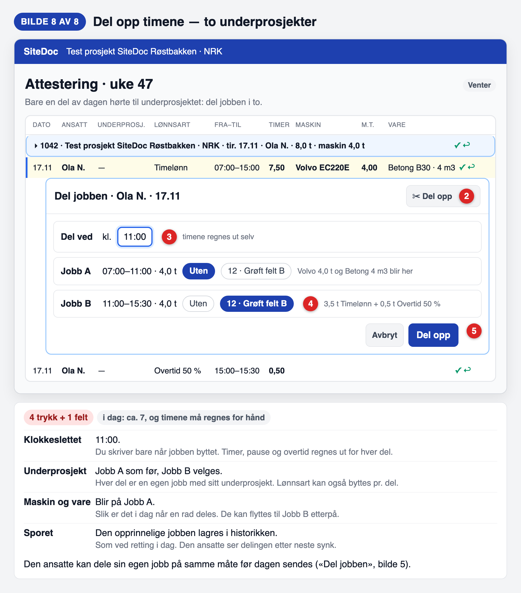

# Timeføring på web — plan med bilder (FORSLAG)

> **Bestilt av Kenneth 2026-11-17** etter test av develop `3b0f1abb` på test.sitedoc.no: *«hvorfor er ikke arbeidstimer
> og maskintimer som hører sammen på samme linje? maskintimer registreringen fra til trengs ikke … registrering av
> dagseddel på web er jo ikke slik vi har det på mobilen … Du må levere ny plan med bilder i strukturert rekkefølge!
> WEB-> registrering av timer. Bilde 1->Bilde2 ....til registrering er ferdig. registrering skal være minimum trykk og
> valg. Skriv tekst sammen med bildet for hvor vi henter preutfylt informasjon og hvorfor.»*
>
> **Scenario:** en arbeider jobber 07:00–15:30, bruker Volvo i 4 timer og 4 m3 betong.
>
> **Bildene:** [`skisser-web-timeforing/`](skisser-web-timeforing/) — `bilde-1.png` … `bilde-8.png`, og alle åtte
> samlet i `oversikt.png`. Kilde: `skisser.html`. Bildene er skisser av forslaget, ikke skjermbilder av noe som er bygget.
>
> **Vedtak som står:** spec `prosjektkort-kortid-spec.md` § 12 — R3 (én linje), R24 (sperren), G5, H12 og H13, og B4 i
> § 10 (maskin-tak pr. kort i skjermen). Planen bygger på dem. Der planen går lenger, står det som spørsmål i § 8.

## 1. Kenneths føringer (2026-11-17, ordrett)

> *«Alt 1. benytt GPS logg for å bestemme prosjektene og byggeplasser*
> *alt:2 benytt innlogget byggeplass Prosjekt/byggeplass*
>
> *registrering av timer*
> *fra/til*
> *lønnsart*
> *hva gjorde du*
> *hvilken(e) maskin(er)? hvor mange timer(for hver enkelt maskin spesifiseert (ikke fra/til)*
> *hvilke varer (vare og enhet og mengde)*
> *tillegg?*
> *utlegg*
>
> *Dette er informasjon som hører sammen og kan ikke vises hver for seg. Det skal tydelig komme frem i timelisten hvem
> kjørte maskinen og hvor mange timer. Arbeidstimene er allerede spesifisert for denne arbeideren, vi trenger ikke
> spesifisere hvilke minutter mannen var i maskinen eller når han jobbet uten maskinen så lenge han er på samme "jobb" i
> prosjektet»*

| Føring | Slik følger planen den |
|---|---|
| **Prosjekt og byggeplass utledes** — Alt 1 GPS-logg, Alt 2 innlogget prosjekt og byggeplass | Bilde 1 og 2. Rekkefølgen er telefonens dag → innsjekk-loggen → prosjektet og byggeplassen i toppen → skjema. Telefonens GPS-logg finnes ikke på serveren (WM23); se B2 og B3. |
| **Én samlet registrering** i rekkefølgen fra/til · lønnsart · hva gjorde du · maskiner · varer · tillegg · utlegg | Bilde 2–5. Jobben er én flate med sju faste deler, i denne rekkefølgen. Ingen egne vinduer. |
| **Alt hører sammen og vises sammen** | Jobben er prosjektkortet. Føringen (bilde 5) og timelista (bilde 6) viser samme enhet. |
| **Hvem kjørte maskinen, og hvor mange timer** | Bilde 6: ansatt, maskin og maskintimer på samme linje. |
| **Maskin har timer, ikke klokkeslett.** Timene deles ikke i «med maskin» og «uten» | Bilde 3: maskin = utstyr + timer, høyst jobbens timer. Det som må endres, står i § 5. |

### 1.1 Kenneths svar på versjon 2 (2026-11-17, ordrett)

> *«hva skjer hvis det inngår overtid i denne perioden? hvordan viser vi det*
>
> *kun en ting savnes -> hva om timer tilhører underprosjekt?*
>
> *Atttestering -> viktig å vise kjærneinformasjon #2-> trykk på #2 og da vises registreringen#3 -> i attestering så må
> den som attesterer kunne dele opp timer lett dersom noe er feil registrert. f.eks underprosjekt mangler eller ikke
> riktig registrert. feil lønnsart med mere»*

«#2» er attesteringslinja og «#3» er jobben, etter utsnittene Kenneth markerte (`relay/kenneth-2026-11-17-timer/93`
og `94`). Lest slik: linja viser kjernen, og et trykk på linja åpner registreringen slik den ble ført.

| Spørsmål | Svar i planen |
|---|---|
| **Overtid i perioden** | Bilde 2 og 6. Tiden etter dagsnormen får egen linje med firmaets overtidsart, i jobben og i attesteringen. Maskinen fordeles av systemet. |
| **Timer som tilhører underprosjekt** | Bilde 2 og 5. Underprosjektet står i jobbens hode. Én jobb har ett underprosjekt; to underprosjekter er to jobber («Del jobben»). |
| **Attesteringen: kjernen på linja, trykk åpner registreringen, del opp lett** | Bilde 6, 7 og 8. Det som avviker fra vedtak i kort-id-specen § 12, står i § 4.1. |

## 2. Svar til Kenneth

- **Telefonen er ikke bygget om.** I prosjektkort-modus fører du i Bekreft dag: tid, lønnsart, beskrivelse, «+ Maskin»,
  «+ Varer», tillegg og utlegg på én skjerm. Det eneste nye i dag er at en maskin som selges pr. time, må kobles til
  en timerad (d2c-2, merget 17.11 kl. 10:16).
- **Web har aldri fått den flyten.** Web har to skjermer før første rad og fem egne vinduer (timerad, maskin, vare,
  tillegg, utlegg), og viser maskiner etter timeradene og varer i en egen liste.
- **Bildene du fikk 6. og 7. november, viste telefonen.** Web er ikke tegnet før nå.
- **Linjene du så i attesteringen 07.11, er ført før koblingen fantes på PC** (16.11 kl. 23:14). En maskin ført på PC i
  dag havner på timeradens linje. En **vare** ført på PC gjør det fortsatt ikke.
- **GPS-loggen ligger bare på telefonen.** Den sendes aldri til serveren, etter vedtak. Web kan lese innsjekken på
  byggeplassen og prosjektet du står i.
- **Forslaget:** «Ny dag» med ett trykk, og jobben føres på én flate i din rekkefølge. 6 trykk og 4–5 felt, mot 10
  trykk og 3 felt i dag. Overtid står som egen linje, og underprosjektet velges i jobbens hode.

## 3. Målt mot koden (develop @ 3b0f1abb)

Forkortelser: `NY` = `apps/web/src/app/dashbord/timer/ny/page.tsx`, `WS` = `apps/web/src/app/dashbord/timer/[id]/page.tsx`,
`D` = `apps/api/src/routes/timer/dagsseddel.ts`, `M` = `apps/mobile/src`, `PS` = `packages/db/prisma/schema.prisma`,
`ST` = `packages/db-timer/prisma/schema.prisma`, `BD` = `apps/mobile/app/timer/bekreft-dag.tsx`.

**Web i dag**

| # | Funn | Referanse |
|---|---|---|
| WM1 | **To skjermer før første rad.** «Ny dagsseddel» på Mine timer åpner et skjema (dato, prosjekt, aktivitet, arbeidstid, kommentar). «Opprett dagsseddel» lager sedelen og åpner dagssiden. Det finnes ingen vei med ett trykk. | `apps/web/src/app/dashbord/timer/mine/page.tsx:313`; `NY:190–203`; `apps/web/src/app/dashbord/[prosjektId]/timer/ny/page.tsx:10` |
| WM2 | **Fra, til og pause i skjemaet kommer fra firmaets arbeidstid:** `OrganizationSetting.standardStartTid`, `standardSluttTid` og `standardPauseMin`. Standard i databasen er 07:00, 15:00 og 30. Firmaet endrer dem i Firma → Innstillinger. Bruker firmaet kalender som normkilde, kan kalenderen overstyre. | `NY:116`, `:124–126`; `apps/api/src/services/timer/arbeidstid.ts:49–70`; `PS:434–436`; `apps/web/src/app/dashbord/firma/innstillinger/page.tsx:953`, `:985` |
| WM3 | **Lønnsarten bærer ingen arbeidstid.** `Lonnsart` har ingen felt for fra, til eller timer pr. dag. Dagsnormen (7,5) er en egen firmainnstilling, `OrganizationSetting.dagsnorm`. | `ST:22–57`; `PS:408` |
| WM4 | **Serveren lager første timerad selv** når prosjektet er sendt med: firmaets standard-lønnsart (`erStandardvalg`), tidene fra skjemaet, og pausen trukket når dagen er over 5,5 timer. Byggeplass sendes ikke, så raden får «Ingen byggeplass» selv om toppen viser en. | `D:3859–3869`, `:2534–2538`; `packages/shared/src/utils/pauseBeregning.ts:30`; `NY:190–203` |
| WM5 | **Prosjekt, aktivitet og dato i skjemaet:** prosjektet fra toppen av siden, aktiviteten «Anleggsarbeid» hvis den finnes og ellers den første, datoen i dag. | `NY:108–113`, `:152–162`, `:46` |
| WM6 | **Vinduet «Legg til timer-rad»:** Fra er siste til-tid på dagen, ellers firmaets start. Derfor sto det 15:00 med tom Til hos Kenneth. Lønnsart er alltid standardvalget. Vinduet har en sammenleggbar del «Maskin (valgfritt)». **Vare finnes ikke i vinduet.** | `WS:693–706`, `:2840–2850`, `:3658–3724`, `:3350–3368` |
| WM7 | **Vinduet «Legg til maskinbruk»** har Utstyr, Timerad, Byggeplass, Antall timer, Fra kl., Til kl., Mengde, Enhet, Underprosjekt og en infolinje. Fra og til er merket valgfritt og er ikke påkrevd noe sted, verken i skjermen eller på serveren. De fylles ut med dagens ramme, og antallet regnes av dem. | `WS:4798–5308`, `:1030–1037`, `:4874–4886`, `:5166–5194`, `:5075`; `D:10033` |
| WM8 | **«Timerad (Valgfritt)»:** merkelappen «Valgfritt» står så lenge utstyr ikke er valgt. Velger du en maskin som krever timerad, forsvinner den, og lagring stoppes uten rad. Timeraden er forvalgt når kortet har én arbeidsrad. Serveren håndhever det samme (R24). | `WS:4925`, `:5113–5121`, `:5036–5043`, `:4917–4922`; `D:2195–2201`; `packages/shared/src/utils/maskinKobling.ts:19–21` |
| WM9 | **«Arbeid i gruppen: 7,5 t · ledig: 8 t»:** ledig er arbeid **pluss pausen**, minus maskintimer som alt er ført. 7,5 + 0,5 = 8. Teksten sier ikke det. | `packages/shared/src/utils/maskinKapasitet.ts:72–73`; `WS:4988–4992`; `packages/shared/src/i18n/nb.json:604` |
| WM10 | **Maskinens fra–til brukes ikke videre.** Rapport og eksport tar dem ikke med. Attesteringens redigering bærer dem bare videre. | `packages/shared/src/utils/timerDetaljRader.ts:223`; `apps/api/src/routes/timer/rapport.ts:697–714`; `apps/web/src/components/timer/AttesteringDetalj_Edit.tsx:174` |
| WM11 | 🔴 **Varen kobles ikke til timeraden på web.** Vinduet for vareforbruk sender bare dagen. Kolonnen for kobling finnes, og serveren tar imot den. Varen blir derfor en egen linje i attesteringen. | `apps/web/src/components/timer/KortVareforbrukModal.tsx` (0 treff på `sheetTimerId`); `apps/api/src/routes/vareforbruk.ts:75–84`; `packages/db-varelager/prisma/schema.prisma:85–88` |
| WM12 | **I kortet på dagssiden står maskinene etter timeradene, og varene i en egen liste under.** Ikke på raden. | `WS:2173–2194`, `:1699–1715` |
| WM13 | **Dagens web, talt for scenarioet: 10 trykk og 3 felt.** Ny dagsseddel · Til 15:30 · Opprett · + Maskin · åpne velger · Volvo · antall 4 · Lagre · + Vareforbruk · betong · antall 4 · Lagre · Send dagen. Talt i koden, ikke klikket i nettleser. | WM1–WM11 |

**Telefonen i dag**

| # | Funn | Referanse |
|---|---|---|
| WM14 | **To moduser, styrt av firmaet:** dagskort (standard) og prosjektkort. I prosjektkort-modus åpner «+» Bekreft dag. | `PS:495`; `packages/shared/src/utils/prosjektkort.ts:13–14`; `M/components/DagsseddelListe.tsx:136–138` |
| WM15 | **Bekreft dag er én skjerm:** prosjekt, tid, lønnsartlinjer og pause, «+ Maskin» og «+ Varer», tillegg og utlegg, beskrivelse, «Bekreft og lagre». Så «Send dagen». | `BD:1454–1506`, `:2279–2292`, `:1805`; `M/components/timer-detalj/BekreftDagRadTillegg.tsx:119`, `:127` |
| WM16 | **Maskin på telefonen har ikke fra–til når den føres fra en rad** — bare timer, mengde og enhet. Timene er forhåndsutfylt med radens timer. Fra Bekreft dag lagres maskinen uten fra–til. Dagskort-modusens maskinvindu har fortsatt fra–til. | `M/components/timer-detalj/BekreftDagRadTillegg.tsx:271`; `M/utils/dagsforslagAnvend.ts:503–504`; `M/components/timer-detalj/MaskinSeksjon.tsx:928` |
| WM17 | **Forhåndsutfylling på telefonen:** start er siste til-tid på dagen, ellers firmaets start; slutt er firmaets slutt; pausen er firmaets. Sist brukte maskiner står øverst i velgeren (fem). | `M/utils/manuellDag.ts:44–51`; `M/utils/nyRadTider.ts:23–24`; `M/services/nyTimerRad.ts:130` |
| WM18 | **I kortet står maskin og vare under raden sin:** «Volvo EC220E · 4 t» og «Betong 4 m3». | `M/components/timer-detalj/prosjektkort/ProsjektkortDagsoversikt.tsx:741`, `:755` |

**Attesteringen (bilde 84)**

| # | Funn | Referanse |
|---|---|---|
| WM19 | **En maskin står på timeradens linje bare når den er koblet** til en timerad i samme kort. Ellers er den egen linje med Type «Maskin». Kolonnene Maskin og Maskintimer er på som standard. Sortering endrer ikke dette. | `packages/shared/src/utils/kortGruppering.ts:156–157`; `packages/shared/src/utils/timerDetaljRader.ts:736–742`; `apps/web/src/components/timer/TimerRadTabell.tsx:166–169` |
| WM20 | **PC sendte ikke koblingen før d2c-1,** som ble merget 2026-11-16 kl. 23:14. Telefonen fikk sperren 2026-11-17 kl. 10:16. Rader ført 07.11 på PC har derfor ingen kobling. **Ikke målt:** databasen — jeg har ikke lest radene til Kenneth. | `git show 274e7fb2^1` (0 treff på `sheetTimerId` i `WS`); `git log -1 274e7fb2`, `338de16a` |
| WM21 | **Hvorfor maskinlinjene er høye — mest sannsynlig Avvik-cellen.** Alle celler kuttes med «…», unntatt Beskrivelse og Avvik, som brytes over flere linjer. En egen maskinlinje får to setninger i Avvik: «Maskin uten arbeidstimer» og «Maskinarbeid uten registrert maskinførerbevis — flagget for synlighet.» Kolonnen er minst 180 px bred. Rundt 95 tegn i 180 px gir fem–seks tekstlinjer. **Lest i koden, ikke målt i nettleser.** | `apps/web/src/components/attestering/AttesteringTabell.tsx:259–262`; `apps/web/src/components/attestering/attestering-tabell.ts:300–306`; `packages/shared/src/utils/timerDetaljRader.ts:755`; `packages/shared/src/i18n/nb.json:5064`, `:4607` |
| WM22 | **Merket heter «Maskin uten arbeidstimer» i tabellen.** Specen (G5, R24) sier «Maskin uten timerad». | `packages/shared/src/i18n/nb.json:5064` |

**Prosjekt og byggeplass: hva web kan utlede (føring 1)**

| # | Funn | Referanse |
|---|---|---|
| WM23 | 🔴 **Telefonens GPS-logg sendes aldri til serveren.** Arbeidsdagen og besøkene pr. byggeplass ligger bare i telefonens lokale database. Serveren har ingen modell for dem og får bare den ferdige dagsseddelen. Det er et vedtak, ikke en mangel: «synkes ALDRI». | `M/db/schema.ts:447`; `docs/claude/timer-gps-helhetsplan.md:52`; `docs/claude/timer-gps-lag3-4-spec.md:131` |
| WM24 | **Det serveren har, er innsjekk-loggen:** `PsiTilstedevarelse` med prosjekt, byggeplass, bruker, innsjekk-tid, utsjekk-tid og kilde (manuell, QR, geofence, HMS-kort, app). Den finnes bare når PSI-modulen er på. Klokkeslettene er firma-isolert. | `PS:2436–2454`; `apps/api/src/routes/mannskap.ts:166` |
| WM25 | **Ingen prosedyre gir «mine innsjekker for en dato».** `minStatus` gir bare den åpne innsjekken nå, for ett prosjekt. `hentForProsjekt` gir alle personer på prosjektet. | `apps/api/src/routes/mannskap.ts:269`, `:319` |
| WM26 | **Prosjektet og byggeplassen i toppen av siden («innlogget»):** prosjektet huskes i nettleseren. Byggeplassen huskes i nettleseren og på serveren. En innsjekk som er nyere enn det manuelle valget, går foran. Timer-sidene leser begge. | `apps/web/src/kontekst/prosjekt-kontekst.tsx:15`; `apps/web/src/kontekst/byggeplass-kontekst.tsx:22`, `:152`; `packages/shared/src/utils/standardByggeplass.ts:87`; `NY:108–113`; `apps/web/src/components/timer/RadByggeplassFelt.tsx:19–41` |
| WM27 | **Vedtak 2026-11-15:** målte tidspunkter fra geofence og innsjekk **kan** foreslås som tider; arbeideren bestemmer og retter. Innsjekk som tidskilde er en egen ordre som ikke er bygget. | `docs/claude/timer-gps-lag3-4-spec.md:133` |
| WM28 | **Telefonens dagsforslag er ren regning, men bor i mobilappen** og leser telefonens lokale database. Web har ikke noe tilsvarende. GPS i nettleseren på PC er et eget BACKLOG-punkt som ikke er gjort. | `M/utils/dagsforslag.ts:10`; `M/services/dagsforslagInput.ts:86`; `docs/claude/BACKLOG.md:4412` |

**Tillegg, utlegg og beskrivelse (føring 2 og 3)**

| # | Funn | Referanse |
|---|---|---|
| WM29 | **Tillegg og utlegg på web går gjennom en velger og så et eget vindu hver.** Antallet er forhåndsutfylt med 1. Kvittering kan bare legges ved etter at raden er lagret. De hører til kortet (`kortId`), ikke til en timerad. Web sender ikke `kortId`; serveren finner kortet selv. | `WS:4300`, `:3842`, `:4503`, `:3870`, `:4106`; `ST:435`, `:513`; `D:5178`, `:5227` |
| WM30 | **På telefonen står tillegg og utlegg i Bekreft dag,** på samme skjerm som resten, pr. kort. | `BD:1805`; `M/components/timer-detalj/BekreftDagLonnUtlegg.tsx:18` |
| WM31 | **«Hva gjorde du?» er valgfritt på web og påkrevd på telefonen.** På telefonen er regelen én tekst pr. kort. Teksten lagres på kortets arbeidsrader. | `WS:3638`; `BD:998`; `M/utils/bekreftDag.ts:116`; `ST:251`; `docs/claude/prosjektkort-kortid-spec.md:529` |

**Maskintimene (føring 4)**

| # | Funn | Referanse |
|---|---|---|
| WM32 | **Maskintaket finnes i tre lag.** Serveren: maskintimer ≤ arbeidstimer + pause pr. bøtte (prosjekt + underprosjekt), kontrollert åtte steder. Telefonen pr. rad: hver maskin ≤ radens timer. Bekreft dag: pr. kort i skjermen. | `packages/shared/src/utils/maskinKapasitet.ts:42`, `:54`; `D:2806`, `:3287`, `:4135`, `:4389`, `:4818`, `:9252`, `:10079`, `:10212`; `M/services/kobledeMaskiner.ts:56–58`; `BD:1645` |
| WM33 | **Bekreft dag fordeler kortets maskiner og varer på kortets timerader selv.** Varene går til første rad. Maskinene fyller første rad og renner over til neste. En maskin på 9 timer på en jobb med 7,5 t ordinært og 1,5 t overtid blir to maskinrader. De lagres uten fra–til. | `M/utils/tilleggPaaKort.ts:80–81`, `:109`; `M/utils/dagsforslagAnvend.ts:503–504` |
| WM34 | **På web kan maskintimene ikke settes i timerad-vinduet** — maskinen får radens timer. I maskinvinduet er taket pr. bøtte en hard sperre. | `WS:3361`; `WS:5299` |
| WM35 | **Pausen i taket er begrunnet med døgn-maskiner.** Dokumentasjonen sier at den ikke er ment for timeleide maskiner. Koden legger den likevel til alle. Vedtak 2026-11-16 (B4): «maskin-tak som i dag på server, pr. kort i skjermen». | `docs/claude/fase-0-beslutninger.md:2112–2116`; `docs/claude/prosjektkort-kortid-spec.md:606` |
| WM36 | **I attesteringen står ansatt, maskin og maskintimer på samme linje.** I timerapportens Detaljer står maskinnavnet som et tillegg i Betegnelse, uten egen maskinkolonne. Egen kolonne hører til ordre d3 i kort-id-specen, som ikke er bygget. | `packages/shared/src/utils/timerDetaljRader.ts:736–742`; `apps/web/src/lib/timer-rapport-eksport.ts:420` |

**Overtid (Kenneths svar på versjon 2)**

| # | Funn | Referanse |
|---|---|---|
| WM37 | **Én regel avgjør overtid:** resten av dagsnormen er dagsnormen minus arbeid som alt er ført på datoen. Jobben får normaltid opp til resten, deretter overtid. Reise og fravær teller ikke. Det er dagsnormen som gjelder, ikke ukenormen. Bare 50 % er bygget. | `docs/claude/prosjektkort-kortid-spec.md:333–340`; `packages/shared/src/utils/lonnsregel.ts:10`, `:65`, `:114` |
| WM38 | **Telefonen viser overtid som egen linje** i Bekreft dag: «07:00–15:00 · 7,5 t · Timelønn ▾» og «15:00–15:30 · 0,5 t · Overtid 50 % ▾». Lønnsarten kan byttes pr. linje. Det lagres som to timerader i samme kort. | `docs/claude/prosjektkort-kortid-spec.md:355–362`; `M/utils/dagsforslag.ts:1888–1950`; `BD:2294–2310`; `packages/shared/src/i18n/nb.json:5776` |
| WM39 | **Web viser overtid som et forslag med knappen «Del raden»** i timerad-vinduet. Trykket lager to rader. Serveren lager aldri en overtidsrad selv. | `packages/shared/src/utils/overtidForslag.ts:74`; `WS:3101–3160`, `:3178–3250`, `:3538–3540`; `packages/shared/src/i18n/nb.json:631–633`; `D:2534–2538` |
| WM40 | **Mulig feil, lest og ikke kjørt:** når en rad deles i normal og overtid på web, får en ny maskin **hele** radens timer på normal-delen. | `WS:3236–3240` |
| WM41 | **«Sum i dag X t av Y t»:** prikken blir gul når X er over Y. Ingen tekst sier hvorfor. | `packages/shared/src/utils/prosjektkort.ts:173–180`; `WS:1822–1832` |
| WM42 | **Fordelingen med overtid:** en maskin på 4 t på en jobb med 7,5 t ordinært og 0,5 t overtid havner i sin helhet på den ordinære linja. En maskin på 8 t blir 7,5 + 0,5. Den ordinære er først fordi den lages først, ikke fordi radene sorteres på tid. | `M/utils/tilleggPaaKort.ts:76–88`; `packages/shared/src/utils/lonnsregel.ts:65` |
| WM43 | **I attesteringen blir ordinær tid og overtid to linjer i samme kort,** sortert på fra-tid. Varen står på linja den er koblet til. | `packages/shared/src/utils/kortGruppering.ts:147`, `:155–164` |

**Underprosjekt**

| # | Funn | Referanse |
|---|---|---|
| WM44 | **Et kort har ett prosjekt, ett underprosjekt og én byggeplass** (K2–K4). To kort kan ha like verdier (K7). | `docs/claude/prosjektkort-kortid-spec.md:107–109`, `:113` |
| WM45 | **Telefonen velger underprosjekt med knapper pr. kort,** «Uten» først. De vises bare når prosjektet har åpne underprosjekter, og ingenting er forhåndsvalgt utover «Uten». Valget skrives på kortets arbeidsrader, maskin, varer, tillegg og utlegg. «Sist brukt underprosjekt» finnes ikke. | `BD:1573`, `:667–679`; `M/utils/dagsforslagAnvend.ts:349–355`, `:497`, `:525`; `docs/claude/prosjektkort-kortid-spec.md:265–266` |
| WM46 | **Web velger underprosjekt i en nedtrekksliste i hvert vindu** (timerad, maskin, tillegg, utlegg). Lista er prosjektets aktive underprosjekter som er åpne for timer. Kortet på dagssiden er pr. prosjekt, med en undergruppe pr. underprosjekt. | `WS:3570–3590`, `:5238–5252`, `:593–657`, `:2129–2140`; `apps/api/src/routes/eksternKostObjekt.ts:69–89` |
| WM47 | **Web kan ikke lage et nytt kort på et prosjekt som alt har kort.** «+ Nytt prosjektkort» tilbyr bare prosjekter uten kort. Kort-id-specen § 5.4 sier at det skal gå. | `WS:680–682`, `:992` |
| WM48 | **Dele en jobb:** telefonen har «Del til eget kort» ved et klokkeslett. Web har «Del opp» pr. rad, der delene kan få ulikt underprosjekt. Valget «eget kort» finnes ikke i web-vinduet, selv om serveren støtter det. | `M/utils/kortIdForslag.ts:125`; `BD:1614`; `apps/web/src/components/timer/SplittRadModal.tsx` (0 treff på `egetKort`); `D:2612` |

**Attesteringen: linja, retting og oppdeling**

| # | Funn | Referanse |
|---|---|---|
| WM49 | **Et trykk på en linje gjør ingenting.** Lenken til detaljsiden står bare på dagens sumrad. | `apps/web/src/components/timer/TimerRadTabell.tsx:310–316`; `apps/web/src/components/attestering/AttesteringTabell.tsx:411` |
| WM50 | **Linja har 26 kolonner som standard og er minst 2 814 punkter bred.** Maskin begynner om lag 1 340 punkter inn, Vare om lag 1 700. På en skjerm på 1 440 må attestanten rulle sidelengs for å se dem. Regnet fra koden, ikke målt i nettleser. | `packages/shared/src/utils/timerDetaljRader.ts:736–742`, `:745–755`; `apps/web/src/components/timer/TimerRadTabell.tsx:192–194`; `apps/web/src/components/attestering/AttesteringTabell.tsx:75` |
| WM51 | **Retting i cellen er bygget:** fra, til, timer, pause, lønnsart og aktivitet på timeraden; maskin, maskintimer, mengde og enhet; antall på tillegg. Ikke prosjekt, underprosjekt, byggeplass, beskrivelse eller vare. Cellen viser «var …» etter retting. | `apps/web/src/components/attestering/AttesteringTabell.tsx:196–218`, `:239`, `:271–287` |
| WM52 | 🔴 **Underprosjekt kan ikke rettes fra tabellen.** «Flytt underprosjekt» finnes på serveren (`flyttTimerRadEco`), men **ingen skjerm kaller den** — 0 treff i `apps/web` og `apps/mobile`. Den flytter bare timer- og tilleggsrader; maskinens underprosjekt oppdateres ikke. Eneste vei i dag er detaljsiden → «Rediger hele sedelen» → nedtrekk → Lagre, om lag fire trykk. R14 og R21 i kort-id-specen forutsetter handlingen. | `D:6627`; `apps/web/src/components/timer/AttesteringDetalj.tsx:494–497`; `apps/web/src/components/timer/AttesteringDetalj_Edit.tsx:218` |
| WM53 | **«Del opp» (✂):** pr. del kan prosjekt, lønnsart, aktivitet, underprosjekt, fra, til og timer settes. Timene regnes ikke ut av klokkeslettene. Å dele 8 t i to med ulikt underprosjekt er om lag sju handlinger. Koblede maskiner og varer blir på første del. | `apps/web/src/components/timer/SplittRadModal.tsx:210–224`, `:280`; `apps/web/src/components/timer/RedigerTimerRad.tsx:63–147`; `D:7591` |
| WM54 | **Hvem får rette:** retting i cellen, pennen og ✂ krever firmaadministrator og firmavalget «rediger ved attestering». «Flytt underprosjekt» krever bare attesteringsrett. Skjermen viser ✂ og pennen uten å sjekke firmavalget; serveren avviser. | `D:7251`, `:2998`, `:7497`, `:6658`; `apps/web/src/components/attestering/AttesteringTabell.tsx:418`, `:431` |
| WM55 | **Mulig feil, lest og ikke kjørt:** vinduet bak pennen sender `byggeplassId: null` for alle radene det lagrer. | `apps/web/src/components/attestering/RedigerRadModal.tsx:403`, `:414`, `:435`, `:450` |
| WM56 | **Telefonens attestering kan ikke rette eller dele.** | `apps/mobile/src/components/timer-attestering/AttesteringDetaljMobil.tsx:52` |

## 4. Forslaget — bilde for bilde

Røde tall i bildene er trykk og felt i rekkefølge: 1 til 9 i føringen (bilde 1–5), og fra 1 igjen i attesteringen (bilde 6–8). Gult er felt som er fylt ut for brukeren. De grå tallene 1–7
er de sju delene i Kenneths rekkefølge.

### Bilde 1 — Mine timer → «Ny dag»

**1 trykk.** I dag: 2 trykk og et skjema imellom (WM1).

**Prosjekt og byggeplass velges ikke. De hentes i denne rekkefølgen:**

| | Kilde | Finnes i dag? | Hvorfor denne plassen |
|---|---|---|---|
| 1 | **Dagen fra telefonen.** Arbeideren har alt bekreftet GPS-forslaget på telefonen. | Ja. Dagen er på serveren og åpnes. | Da er jobben alt ført, med prosjekt og byggeplass fra GPS-loggen. |
| 2 | **Alt 1 — innsjekk-loggen.** Hvor arbeideren var sjekket inn i dag, og når. | Dataene finnes (WM24). Leseren mangler (WM25), og innsjekk som tidskilde er ikke bygget (WM27). | Den er målt på stedet, som GPS-loggen, og ligger alt på serveren. |
| 3 | **Alt 2 — prosjektet og byggeplassen i toppen.** | Ja (WM26). | Det er der brukeren står nå. En nyere innsjekk går alt foran der. |
| 4 | **Skjemaet «Ny dagsseddel».** | Ja. | Bare når ingenting er kjent. |

- **Telefonens GPS-logg er ikke i lista,** fordi den ikke finnes på serveren (WM23). Skal web bruke selve loggen, må
  den sendes til serveren. Det er B3.
- Finnes dagen fra før, åpnes den. Skjemaet består bak «Annen dato eller annet prosjekt». Ingenting fjernes.

### Bilde 2 — jobben åpnes: underprosjekt, tid, lønnsart og overtid

**1 felt** (teksten). Alt 2: 2 felt (Til og teksten).

| Fylt ut | Verdi | Hentes fra | Hvorfor |
|---|---|---|---|
| Prosjekt, byggeplass | Røstbakken · NRK | Alt 1: innsjekken (WM24). Alt 2: toppen av siden (WM26). | Føring 1. «Endre» hvis det er feil. |
| Underprosjekt | «Uten» | Ingen kilde. Knappene er prosjektets åpne underprosjekter (WM46). | Som telefonen, og vedtatt i kort-id-specen § 5.1 (WM45). Det gjettes ikke: feil underprosjekt gir feil faktura. Se B11. |
| Fra–til | 07:00–15:30 | Alt 1: innsjekk 06:58 og utsjekk 15:34, rundet til firmaets steg (`OrganizationSetting.tidsrundingMinutter`, `PS:422`). Alt 2: firmaets arbeidstid (WM2). | Målt tid kan foreslås; arbeideren retter (WM27). |
| Pause | 30 | Firmaets arbeidstid (WM2). Trekkes når dagen er over 5,5 timer (WM4). | Som i dag. |
| Lønnsart | Timelønn · 07:00–15:00 · 7,5 t | Lønnsarten firmaet har merket som standardvalg (`D:2534–2538`), opp til dagsnormen (WM37). | Den brukes på de fleste jobber. |
| Overtid | Overtid 50 % · 15:00–15:30 · 0,5 t | Regelen i WM37: firmaets dagsnorm (7,5) minus det som alt er ført i dag. Arten er firmaets overtidsart. | Tiden over normen skal ha egen lønnsart. Arbeideren kan bytte lønnsart på linja. |

- **De sju delene står alltid i samme rekkefølge:** 1 Fra–til · 2 Lønnsart · 3 Hva gjorde du? · 4 Maskiner · 5 Varer ·
  6 Tillegg · 7 Utlegg. **Underprosjektet står i jobbens hode,** sammen med prosjekt og byggeplass: det sier *hvor*
  jobben hører til, og gjelder alt i jobben (K3).
- **Overtid vises som egen linje med én gang,** slik telefonen gjør (WM38). I dag viser web et forslag med knappen
  «Del raden» (WM39). Se B8. Går dagen ikke over normen, er det én linje.
- Underprosjekt-raden vises bare når prosjektet har åpne underprosjekter.

### Bilde 3 — 4 · Maskiner → Volvo, 4 timer

**2 trykk + 1 felt.** I dag: 4 trykk + 1 felt, i eget vindu (WM7).

| Fylt ut | Verdi | Hentes fra | Hvorfor |
|---|---|---|---|
| Sist brukt | De fem sist brukte maskinene | Brukerens egne dagssedler (`WS:261`, finnes i dag) | De fleste kjører samme maskin flere dager. |
| Timer | 8,0 — brukeren skriver 4 | Jobbens arbeidstimer (WM16, WM32) | Hver maskin har egne timer. Ingen maskin kan ha flere timer enn jobben (B4 i kort-id-specen, vedtatt). |
| Hvem kjørte | Den som fører | Jobben | Føring 3. Navnet står på samme linje i timelista. |

- **Ingen fra–til, ingen «Timerad», ingen «ledig: 8 t».** Brukeren sier ikke når på dagen maskinen gikk (føring 4).
- **Overtid:** brukeren fordeler ikke maskinen på ordinær tid og overtid. Systemet fyller den ordinære linja først
  (WM42). 4 timer havner på den ordinære.
- Flere maskiner: «+ Maskin» igjen, hver med sine timer.

### Bilde 4 — 5 · Varer → betong, 4 m3

**2 trykk + 2 felt.** I dag: 3 trykk + 1 felt, og varen står alene i attesteringen (WM11).

| Fylt ut | Verdi | Hentes fra | Hvorfor |
|---|---|---|---|
| Enhet | m3 | Varen i varelageret | Brukeren velger den aldri selv. |
| Jobben | Varen lagres på jobben | Jobben | Føring 3. I dag lagres varen bare på dagen. |

- Vare, enhet og mengde står side om side.
- En «Sist brukt»-liste for varer ville spart søket. Den finnes ikke i dag og er ikke med.

### Bilde 5 — 6–7 · Tillegg og utlegg → «Send dagen»

**1 trykk.** Som i dag. Scenarioet har verken tillegg eller utlegg.

- **Tillegg og utlegg føres på jobben,** etter varene, uten velger og uten egne vinduer. Tillegget står med antall 1,
  som i dag (WM29). Utlegg får kategori, beløp og kvittering.
- **Alt på jobben står samlet:** tid, lønnsart, tekst, maskin, vare, tillegg og utlegg (føring 3).
- **Timer på to underprosjekter:** én jobb har ett underprosjekt (K3). «✂ Del jobben» deler ved et klokkeslett: tiden
  før blir i jobben, tiden etter blir en ny jobb på samme prosjekt, med eget underprosjekt. Det er telefonens «Del til
  eget kort» (WM48). «+ Ny jobb på samme prosjekt» lager en tom jobb. Web kan ikke dette i dag (WM47).
- «Sum i dag 8,0 t av 7,5 t · 0,5 t overtid»: prikken er gul over normen (WM41), og linja sier nå hvorfor.

### Bilde 6 — attesteringen: kjernen på linja

**1 trykk åpner registreringen.** I dag gjør et trykk på linja ingenting (WM49).

- **Kjernen på linja:** dato · ansatt · underprosjekt · lønnsart · fra–til · timer · maskin · maskintimer · vare med
  mengde. Prosjektet står i kortets linje over, og Prosjektnr og Avvik hører også med i kjernen (ikke tegnet, for
  plassens skyld). Knappene ✓ og ↩ står fast til høyre (R22).
- **Hvorfor:** i dag har linja 26 kolonner og er minst 2 814 punkter bred. Maskin og Vare ligger utenfor skjermen
  (WM50). De andre kolonnene kan slås på med «Velg parameter», som i dag. Se B9.
- **Overtid:** ordinær tid og overtid er to linjer i samme kort (WM43). De er to lønnsarter og attesteres hver for
  seg. Kortets linje viser summen.
- **Maskin og overtid:** nederst i bildet står samme jobb med Volvo i 8 timer. Maskinen står da på begge linjene, med
  7,50 og 0,50. Summen, «maskin 8,0 t», står i kortets linje.
- **Er det lesbart?** Ja, så lenge kortets linje viser summen. Uten den ser 7,50 og 0,50 ut som to føringer. Den som
  førte, har bare skrevet «8». Alternativet er å la alle maskintimene stå på den ordinære linja; det bryter telefonens
  grense «maskin høyst radens timer» (WM32) og er ikke foreslått.

### Bilde 7 — trykk på linja → registreringen · rett underprosjekt

**2 trykk:** åpne, og velg underprosjekt. I dag: om lag fire trykk via en egen side, og ikke fra lista (WM52).

- **Registreringen åpnes under linja,** slik den ble ført: samme sju deler, samme rekkefølge. Attestanten ser alt uten
  å forlate lista.
- **Underprosjekt mangler eller er feil:** trykk på riktig underprosjekt. Det gjelder hele jobben — timene, maskinen,
  varen, tillegg og utlegg flyttes sammen (K3). Linja viser det nye, og «var: Uten» blir stående, som ved retting i
  cellen i dag (WM51).
- **Feil lønnsart:** velg ny lønnsart på linja i registreringen. Det finnes alt som retting i cellen (WM51).
- **Timer, maskintimer og mengde** rettes i feltene, som i cellen i dag.
- **Hver retting lagres med en gang.** Etterpå godkjennes linja med ✓, som i dag (R21).
- **Hvem:** i dag firmaadministrator, når firmaet har «rediger ved attestering» på (WM54). Se B10.

### Bilde 8 — del opp timene: to underprosjekter

**4 trykk + 1 felt:** åpne · «Del opp» · klokkeslettet · underprosjekt på del B · «Del opp». I dag: om lag sju
handlinger, og timene må regnes for hånd (WM53).

| Fylt ut | Verdi | Hentes fra | Hvorfor |
|---|---|---|---|
| Timer pr. del | 4,0 og 4,0 | Regnes ut av klokkeslettet, pausen og dagsnormen | I dag må attestanten skrive timene selv (WM53). |
| Lønnsart pr. del | Del B: 3,5 t Timelønn + 0,5 t Overtid 50 % | Samme regel som ved føring (WM37) | Overtiden følger tiden på dagen. |
| Underprosjekt, del A | Som før | Jobben | Bare del B endres. |
| Maskin og vare | Blir på del A | Slik serveren gjør i dag når en rad deles (WM53) | De kan flyttes til del B etterpå. |

- **Hver del er en egen jobb** (eget kort), med sitt underprosjekt. Serveren støtter «eget kort» ved deling; web-vinduet
  bruker det ikke (WM48).
- **Den opprinnelige jobben lagres i historikken,** som ved retting i dag. Den ansatte ser delingen etter neste synk.
- **Den ansatte kan dele sin egen jobb på samme måte** før dagen sendes («✂ Del jobben», bilde 5).
- ✂ på linja kan bestå for å dele én rad; «Del opp» i registreringen deler hele jobben.

**I alt for føringen (bilde 1–5): 6 trykk og 4–5 felt, én flate, ingen egne vinduer.** I dag: 10 trykk og 3 felt, to
skjermer før første rad og tre vinduer — uten «Hva gjorde du?», og med varen alene (WM13). Overtidslinja og
underprosjektet «Uten» koster ingen trykk.

Alle åtte samlet: [`oversikt.png`](skisser-web-timeforing/oversikt.png).

### 4.1 Det som avviker fra vedtak i kort-id-specen

Avvikene er forslag. Ingenting er skrevet inn i kort-id-specen.

| Vedtak | Det sier | Forslaget | Grunn |
|---|---|---|---|
| **R2** (§ 12) | Linja bærer alt, 26 kolonner i standardrekkefølge. «Ingenting ligger bak innrykk, tooltip, hover eller klikk.» | Linja viser kjernen. Resten ligger i registreringen, ett trykk unna, og kan slås på som kolonner. | Kenneth 2026-11-17: *«viktig å vise kjærneinformasjon … trykk på #2 og da vises registreringen»*. Det snur ordene fra 16.11 («ingen ting kan utelates»). **B9.** |
| **R14** (§ 12) | Detaljsiden består for forslaget, flytt underprosjekt, vedlegg og «rediger sedel». | Registreringen åpnes under linja. Detaljsiden består for forslaget og for redigering av hele sedelen. | Samme ord fra Kenneth. Detaljsiden nås i dag bare fra sumraden (WM49). |
| **R21** (§ 12) | Prosjekt, underprosjekt og byggeplass rettes ikke i cellen; de flyttes med «Flytt underprosjekt». | Fortsatt ikke i cellen. Underprosjektet rettes i den åpne registreringen, for hele jobben. | Ikke et avvik i regelen. Det lukker et hull: «Flytt underprosjekt» har ingen knapp i dag (WM52). |
| **R21** (§ 12) | Retting er for firmaadministrator med «rediger ved attestering» på. | Uendret til Kenneth svarer. | Kenneth: *«den som attesterer må kunne dele opp timer lett»*. **B10.** |
| **R10** (§ 12) | ✂ på hver linje. | ✂ består. I tillegg «Del opp» i registreringen, ved et klokkeslett, for hele jobben. | Kenneth: «dele opp timer lett». Dagens ✂ er sju handlinger (WM53). |
| **§ 5.5** (paritetsmatrisen) | Web: overtid som forslag i rad-vinduet (V21), uendret. | Overtid som egen linje med én gang, som telefonen. | **B8.** |
| **§ 5.4** | Web skal kunne lage nytt kort på et prosjekt som alt har kort. | Uendret vedtak. «+ Ny jobb på samme prosjekt» og «Del jobben» bygger det. | Ikke bygget i dag (WM47). |

Disse står urørt: R3 (én linje pr. timerad med maskin og vare), R22 (faste knapper), R23 (gjenåpne), R24 (sperren),
R25 (underlinjer for flere maskiner og varer), G5 og G6.

## 5. Maskintimer er en del av arbeidstiden — hva som må endres (føring 4)

| Del | I dag | Endring | Fjerner noe? |
|---|---|---|---|
| **Maskinens fra–til** | Felt i PC-ens maskinvindu (WM7). PC-ens timerad-vindu gir maskinen radens fra–til (`WS:3350–3368`). Telefonens dagskort-modus har feltene (WM16). Telefonen ellers lagrer uten, eller med radens tid. | Maskin ført på jobben lagres uten fra–til. | ⚠️ **Ja:** feltene «Fra kl.» og «Til kl.» i PC-ens maskinføring. Lagrede verdier røres ikke. Telefonens dagskort-modus: se B5. |
| **Maskin-taket** (`maskinKapasitet.ts`) | Serveren: pr. bøtte, med pausen lagt til (WM32, WM35). | **Serveren endres ikke** — vedtatt 2026-11-16 (B4), og en eldre app skal ikke avvises strengere enn før. I skjermen: hver maskin høyst jobbens arbeidstimer, uten pausen. | Nei. Skjermen blir strengere enn serveren for timeleide maskiner; døgn-maskiner følger serverens tak som i dag. |
| **«Arbeid i gruppen … ledig: 8 t»** | Infolinje i PC-ens maskinvindu og timerad-vindu (WM9; `WS:3725–3730`). | Erstattes av «høyst 8,0» ved timer-feltet. | ⚠️ **Ja:** infolinja, i føringen på jobben. |
| **Koblingen til timerad (R24)** | Brukeren velger «Timerad» i PC-ens maskinvindu (WM8) og i telefonens dagskort-modus. | Regelen står. Brukeren velger ikke rad: maskinen føres på jobben, og systemet kobler den til jobbens timerader. | ⚠️ **Ja:** feltet «Timerad» i føringen på jobben. Det består i maskinvinduet for en maskin uten jobb (døgn-maskin). |
| **Fordelingen på timerader** | Finnes på telefonen, i Bekreft dag (WM33). Web har den ikke; web gir maskinen radens timer (WM34). | Web bruker **samme fordeling**. Regelen flyttes fra `M/utils/tilleggPaaKort.ts` til `packages/shared`, og begge bruker den. Ingen ny kopi. | Nei. |
| **Maskin med egne timer** | På PC får en maskin ført i timerad-vinduet alltid radens timer (WM34). | Brukeren skriver timene pr. maskin (bilde 3). | Nei. |

- **Det som ikke endres:** R24, G5, taket på serveren, `syncBatch`, og alt som er lagret.
- **Jobb med både ordinær tid og overtid:** systemet fordeler maskintimene på linjene selv, som telefonen gjør. I
  attesteringen står maskinen da på begge linjene, med timene delt. Brukeren har ikke sagt når maskinen gikk.
- **Ikke målt:** om PC-ens retting i attesteringen (`rettRadFelt`) kan gi en maskin flere timer enn raden den står på.

## 6. Funnene fra skjermbildene

| | Funn | Målt | Forslag |
|---|---|---|---|
| **(a)** | Maskinens fra–til trengs ikke (Kenneth). | WM7, WM10, WM16. K19 (2026-11-06) sa det samme for Bekreft dag: «antall, ikke fra/til». | § 5. Omfanget for dagskort-modus er B5. |
| **(b)** | Ny dagsseddel foreslår 07:00–15:00 og pause 30. | Firmaets arbeidstid, med 07:00–15:00–30 som standard i databasen (WM2). Lønnsarten bærer ingen tid (WM3). | Alt 1 gir tiden fra innsjekken. Ellers firmaets arbeidstid, satt til 07:00–15:30 i Firma → Innstillinger. **B4.** |
| **(c)** | «Arbeid i gruppen: 7,5 t · ledig: 8 t». | Ledig = arbeid + pause − ført maskin (WM9). | § 5: grensen er jobbens timer, og infolinja går ut. |
| **(d)** | «Timerad (Valgfritt)» mot R24. | «Valgfritt» står bare til utstyr er valgt; da håndheves R24 (WM8). | På jobben finnes ikke feltet. I maskinvinduet som består, vises ingen merkelapp før utstyr er valgt. |
| **(e)** | Maskinlinjer står alene og er svært høye. | De står alene fordi de ble ført på PC før koblingen fantes (WM19, WM20). De er høye fordi Avvik-teksten brytes over fem–seks linjer (WM21, ikke målt i nettleser). | Gamle rader kobles ikke automatisk (H13). Korte merker på én linje i Avvik. **B7.** Teksten rettes til «Maskin uten timerad» (WM22). |
| **(f)** | To skjermer før første rad. | WM1, WM4. | «Ny dag · i dag» med ett trykk. **B1.** |
| **(g)** | *Ikke i ordren:* varen kobles ikke til raden på web. | WM11. | Bilde 4. Reparasjon mot R3. |
| **(h)** | *Ikke i ordren:* første rad får «Ingen byggeplass» selv om toppen viser NRK. | WM4. Synlig på Kenneths bilde 86. | Byggeplassen følger med når dagen opprettes. |
| **(i)** | *Ikke i ordren:* web sender ikke `kortId` for tillegg og utlegg. | WM29. Serveren finner kortet selv; med to jobber på samme prosjekt kan den velge feil. | Tillegg og utlegg ført på jobben sender jobbens `kortId`. |
| **(j)** | *Ikke i ordren:* «Flytt underprosjekt» har ingen knapp. | WM52. Prosedyren finnes, ingen skjerm kaller den. | Bilde 7. |
| **(k)** | *Ikke i ordren, mulig feil:* ved overtidsdeling på web får en ny maskin hele radens timer på normal-delen. | WM40. Lest i koden, ikke kjørt. | Faller bort når maskinen føres på jobben og fordeles av den delte regelen (§ 5). Bør likevel måles av en koder. |
| **(l)** | *Ikke i ordren, mulig feil:* vinduet bak pennen i attesteringen sender tom byggeplass for alle rader. | WM55. Lest i koden, ikke kjørt. | Måles av en koder. Er det riktig lest, mister rettede rader byggeplassen. |
| **(m)** | *Ikke i ordren:* web kan ikke lage to kort på samme prosjekt. | WM47. Vedtatt i kort-id-specen § 5.4, ikke bygget. | Bilde 5. |

## 7. Funksjonsinventar

Ingen funksjon fjernes uten svar fra Kenneth. Det som foreslås fjernet, er merket ⚠️. **Planen gjelder firma i
prosjektkort-modus.** Dagskort-modus røres ikke (Kenneth 2026-11-07: endringer i prosjektkortet skal aldri påvirke
dagskortet).

| Funksjon | Kode | Forslag |
|---|---|---|
| Skjemaet «Ny dagsseddel» (annen dato, annet prosjekt, kommentar, arbeidstid) | `NY` | **BEVARES**, bak «Annen dato eller annet prosjekt» (B1). |
| Serveren lager første timerad | `D:3859–3869` | **BEVARES.** Får byggeplassen med (h). |
| Vinduet «Legg til timer-rad»: lønnsart, aktivitet, underprosjekt, byggeplass, overtidsforslag, «Maskin (valgfritt)» | `WS:2692–3769` | **ENDRES:** feltene står på jobben (bilde 2). Aktivitet, underprosjekt og byggeplass står i jobbens hode, bak «Endre». Vinduet består i dagskort-modus. |
| Maskinvinduet «Legg til maskinbruk» | `WS:4798–5308` | **BEVARES** for en maskin uten jobb (døgn-maskin) og i dagskort-modus. ⚠️ I føringen på jobben går Fra kl., Til kl., Timerad og infolinja ut (§ 5). |
| Maskin-taket pr. bøtte på serveren | `packages/shared/src/utils/maskinKapasitet.ts` | **BEVARES** uendret. |
| Sperren R24 | `WS:5036–5043`; `D:2195–2201` | **BEVARES.** |
| Vinduet for vareforbruk, vare uten rad | `apps/web/src/components/timer/KortVareforbrukModal.tsx` | **BEVARES** for vare uten jobb. Vare ført på jobben kobles (bilde 4). |
| Velgeren og vinduene for tillegg og utlegg, kvittering | `WS:4300`, `:3842`, `:4503` | **ENDRES:** tillegg og utlegg føres på jobben (bilde 5), med jobbens `kortId`. Alle feltene består. Vinduene består i dagskort-modus. |
| «Hva gjorde du?» valgfritt på web | `WS:3638` | **ENDRES** hvis B6 = ja: påkrevd, som på telefonen. |
| Maskiner etter timeradene og varer i egen liste i kortet | `WS:2173–2194`, `:1699–1715` | **ENDRES:** jobben vises samlet (bilde 5). |
| «+ Reise», «+ Nytt prosjektkort», del opp, slett, dagens ramme, «Send dagen» | `WS` | **BEVARES** uendret. «+ Nytt prosjektkort» tilbyr også prosjekter som alt har kort (§ 5.4, WM47). |
| Overtidsforslaget med knappen «Del raden» i timerad-vinduet (V21) | `WS:3538–3540`, `:3178–3250` | **ENDRES** hvis B8 = ja: overtid står som egen linje i jobben. Regnestykket er det samme (`overtidForslag.ts`). Vinduet består i dagskort-modus. |
| Underprosjekt i nedtrekksliste i hvert vindu | `WS:3570–3590`, `:5238–5252` | **ENDRES:** ett valg i jobbens hode, som gjelder alt i jobben (bilde 2). |
| Attesteringens 26 standardkolonner, «Velg parameter», sortering, filter, bredde, flytting | `packages/shared/src/utils/timerDetaljRader.ts:736–742` | **ENDRES** hvis B9 = ja: standardutvalget blir kjernen. Alle kolonnene finnes fortsatt og kan slås på. Lagrede oppsett pr. bruker røres ikke. |
| Retting i cellen, «var …», ✓, ↩, ✂, penn, gjenåpne | `apps/web/src/components/attestering/AttesteringTabell.tsx` | **BEVARES.** Nytt: trykk på linja åpner registreringen (bilde 7). |
| Detaljsiden for én dag, «Rediger hele sedelen» | `apps/web/src/components/timer/AttesteringDetalj.tsx` | **BEVARES.** |
| «Flytt underprosjekt» på serveren | `D:6627` | **BEVARES.** ⚠️ Må utvides: i dag flytter den bare timer- og tilleggsrader (WM52). Underprosjekt for hele jobben flytter også maskin, vare og utlegg. |
| «Del opp» pr. rad i attesteringen | `apps/web/src/components/timer/SplittRadModal.tsx` | **BEVARES.** Nytt ved siden av: «Del opp» ved klokkeslett for hele jobben (bilde 8). |
| Dagskort-modus på web og telefon | `WS`; `M/components/timer-detalj/MaskinSeksjon.tsx` | **BEVARES** uendret. Fra–til på maskin der: B5. |
| Telefonens Bekreft dag og prosjektkort | `BD` | **BEVARES** uendret. Fordelingen flyttes til delt kode uten endret oppførsel (§ 5). |

## 8. Spørsmål til Kenneth

| # | Spørsmål | Anbefaling |
|---|---|---|
| **B1** | **«Ny dag» med ett trykk** (bilde 1). Knappen oppretter dagens seddel og åpner jobben, uten skjema. Skjemaet ligger bak «Annen dato eller annet prosjekt». A: ja. B: nei, behold skjemaet som eneste vei. | **A.** Skjemaet spør om det systemet alt vet. Ingenting fjernes. |
| **B2** | **Rekkefølgen for prosjekt og byggeplass på web:** 1) dagen fra telefonen, 2) innsjekk-loggen, 3) prosjektet og byggeplassen i toppen, 4) skjemaet. Innsjekk-loggen er det nærmeste web kommer GPS-loggen: den er målt på stedet og ligger alt på serveren. Den finnes bare for firma med PSI-modulen, og det må bygges en leser for «mine innsjekker i dag». A: ja, denne rekkefølgen. B: bare toppen av siden (Alt 2), ingen innsjekk. | **A.** Trinn 3 virker i dag og kan bygges først. Trinn 2 kommer i tillegg, uten ny lagring. |
| **B3** | **Skal telefonens GPS-logg sendes til serveren, så web kan bruke den selv?** I dag ligger den bare på telefonen, etter vedtak («synkes aldri»). A: nei. Web bruker innsjekk-loggen og toppen (B2). B: ja. Telefonen sender dagens besøk — prosjekt, byggeplass, ankomst og avreise, ingen posisjoner — og web foreslår jobben av dem. Det snur vedtaket, krever ny lagring på serveren og en avklaring av personvernet. | **A nå.** En arbeider med telefonen fører alt fra GPS-forslaget der, og dagen er da på web (trinn 1). B er verdt det først hvis mange fører på PC uten å ha bekreftet på telefonen. |
| **B4** | **07:00–15:30 uten innsjekk:** tiden kommer da fra firmaets arbeidstid, som står på 07:00–15:00 med 30 minutter pause. Lønnsarten har ingen arbeidstid. A: firmaets arbeidstid som i dag — du setter 15:30 i Firma → Innstillinger. B: hver lønnsart får egen arbeidstid (nytt felt, migrering, ny innstillingsside). **Og:** 07:00–15:30 med 30 minutter pause er 8,0 timer, men dagsnormen står på 7,5. Er normen 8,0, eller er pausen 60 minutter? | **A.** Den finnes og virker på web og telefon. Dagsnorm og pause setter du selv; si hva som er riktig, så stemmer bildene. |
| **B5** | **Maskinens fra–til i dagskort-modus.** På jobben (prosjektkort-modus) går feltene ut, som du sa. Regelen din fra 07.11 er at dagskortet ikke skal påvirkes av endringer i prosjektkortet. A: dagskort-modus røres ikke; feltene står der. B: feltene går ut der også, på web og telefon. | **A.** Det følger regelen din. Si B hvis «fra–til trengs ikke» gjelder alle firma. |
| **B6** | **«Hva gjorde du?» påkrevd på web,** som i telefonens Bekreft dag. I dag er den valgfri på web. A: ja, påkrevd pr. jobb før «Send dagen». B: nei, valgfri som i dag. | **A.** Da er regelen lik på telefon og PC, og attestanten får alltid teksten. |
| **B7** | **Korte merker i Avvik i attesteringen:** «Uten timerad» · «Uten førerbevis», på én linje. Hele forklaringen flyttes til ?-hjelpen. I dag brytes to setninger over fem–seks linjer og gjør raden høy. A: ja. B: behold setningene og gjør kolonnen bredere. | **A.** Merket leses uten å rulle, og raden blir like høy som de andre. |

| **B8** | **Overtid som egen linje med én gang** (bilde 2), slik telefonen gjør. I dag viser PC et forslag med knappen «Del raden». A: egen linje med én gang; arbeideren kan bytte lønnsart på linja. B: forslag med knapp, som i dag. | **A.** Det er null trykk, og likt på telefon og PC. |
| **B9** | **Kjernen på attesteringslinja** (bilde 6): dato · ansatt · prosjektnr · underprosjekt · lønnsart · fra–til · timer · maskin · maskintimer · vare med mengde · avvik. De andre kolonnene kan slås på. I dag er alle 26 på, og Maskin og Vare ligger utenfor skjermen. A: kjernen som standard. B: behold alle 26, og legg bare til trykket som åpner registreringen. **Mangler noe i kjernen?** | **A.** Det er det du sa i dag. Det snur «ingen ting kan utelates» fra 16.11; alt står fortsatt i registreringen. |
| **B10** | **Hvem får rette og dele opp i attesteringen?** A: alle som kan attestere linja, også en prosjektleder, når firmaet har «rediger ved attestering» på. B: bare firmaadministrator, som i dag. | **A.** Du skrev «den som attesterer». Firmavalget styrer fortsatt av og på. |
| **B11** | **Underprosjekt på jobben:** A: «Uten» er forhåndsvalgt, og arbeideren trykker på underprosjektet når jobben hører til ett — som telefonen. B: sist brukte underprosjekt på prosjektet er forhåndsvalgt. | **A.** Feil underprosjekt gir feil faktura til byggherren. A er vedtatt for telefonen. |

**Følger som ikke er spørsmål, men si fra hvis du mente noe annet:**

1. **Jobben er prosjektkortet.** Én jobb = ett kort. En ny jobb på samme prosjekt er et nytt kort.
2. **Varen, tillegget og utlegget lagres på jobben** når de føres der. I dag står en vare ført på PC alene i
   attesteringen.
3. **Hver maskin kan ha høyst jobbens arbeidstimer,** uten pausen. Det er vedtatt 16.11 (B4 i kort-id-specen: «pr.
   kort i skjermen»). Serveren er som før.
4. **Har jobben både ordinær tid og overtid, fordeler systemet maskintimene på linjene selv,** som telefonen gjør i
   dag. Maskinen står da på begge linjene i attesteringen.
5. **Maskintimer er forhåndsutfylt med jobbens timer,** som på telefonen i dag.
6. **Gamle maskinrader uten kobling blir stående som egne linjer** i attesteringen. De kobles ikke automatisk (H13).
7. **Planen gjelder firma i prosjektkort-modus.** Dagskort-modus er urørt.
8. **Én jobb har ett underprosjekt.** Timer på to underprosjekter er to jobber. Jobben deles ved et klokkeslett.
9. **Retter attestanten underprosjektet, flyttes hele jobben:** timer, maskin, vare, tillegg og utlegg.
10. **Deles en jobb, blir maskin og vare på første del,** som når en rad deles i dag.
11. **Overtid er egen linje i attesteringen** og attesteres for seg. En maskin som går inn i overtiden, står på begge
    linjene.

## 9. Rekkefølge hvis Kenneth sier ja

Dette er forslag til oppdeling, ikke ordrer. Ingen del krever migrering med B3 = A og B4 = A.

| Del | Innhold | Rører | Kenneth ser etterpå |
|---|---|---|---|
| **w1** | Vare ført på PC kobles til jobben (g). Avvik-merkene og teksten «Maskin uten timerad» (B7, WM22). | `apps/web/src/components/timer/KortVareforbrukModal.tsx`, `WS`, `apps/web/src/components/attestering/*`, i18n | Varen står på timeradens linje i attesteringen. Maskinlinjene er like høye som de andre. |
| **w2** | «Ny dag» med ett trykk, prosjekt og byggeplass fra toppen, byggeplass på første rad (B1, B2 trinn 3, h). | `apps/web/src/app/dashbord/timer/mine/page.tsx`, `D` (`opprett`), i18n | Ett trykk fra Mine timer til ferdig utfylt jobb. |
| **w3** | Jobben som én flate med de sju delene (bilde 2–5), fordelingen i delt kode, `kortId` på tillegg og utlegg (§ 5, i). | `WS`, `packages/shared` (fordelingen, flyttet fra `M/utils/tilleggPaaKort.ts`), `M/utils/tilleggPaaKort.ts` (bare byttet til den delte), i18n, hjelpeteksten for siden | Bilde 2–5. |
| **w4** | Innsjekk-loggen som kilde for prosjekt, byggeplass og foreslått tid (B2 trinn 2). | `apps/api/src/routes/mannskap.ts` (ny leser for egen bruker og dato), `WS`, `mine/page.tsx` | Jobben åpnes med stedet og tiden fra innsjekken. |
| **w5** | Attesteringen: kjernelinja, trykk åpner registreringen, underprosjekt for hele jobben, «Del opp» ved klokkeslett (bilde 6–8; B9, B10). | `apps/web/src/components/attestering/*`, `packages/shared/src/utils/timerDetaljRader.ts` (standardutvalget), `D` (`flyttTimerRadEco` utvidet til hele jobben; deling med «eget kort»), i18n, hjelpeteksten | Bilde 6–8. |

w3 bærer også overtidslinja (B8), underprosjektet i hodet og «Del jobben» (bilde 2 og 5). w5 kan gå uavhengig av w2–w4:
den rører attesteringen, ikke føringen.

w1 kan gå først og alene: den retter det Kenneth så i attesteringen i dag, uten å vente på resten.

## 10. Ikke målt

- Databasen: Kenneths rader fra 07.11, firmaets innstillinger i test, og om testfirmaet har PSI-modulen på.
- Nettleseren: høyden på maskinlinjene (WM21) er regnet fra koden. Ingen av dagens skjermer er klikket gjennom; trykkene
  i WM13 er talt i koden.
- Personvern-vurderingen for å bruke innsjekk-tid som forslag (B2) og for å sende telefonens besøk til serveren (B3).
  Vedtaket fra 15.11 åpner for forslag; grunnlaget er ikke lest i detalj her.
- Om en «Sist brukt»-liste for varer finnes på telefonen.
- Om retting i attesteringen kan gi en maskin flere timer enn raden (§ 5).
- De to mulige feilene i WM40 og WM55 er lest i koden og ikke kjørt.
- Hvor bred kjernelinja blir med kolonnebreddene som finnes; bredden i WM50 er regnet, ikke målt.
- Om en prosjektleder uten firmaadministrator-rolle i dag ser pennen og ✂ og får avslag fra serveren (WM54).
- Målingene er gjort av leseagenter; linjehenvisningene i tabellene er stikkprøvd mot koden.
