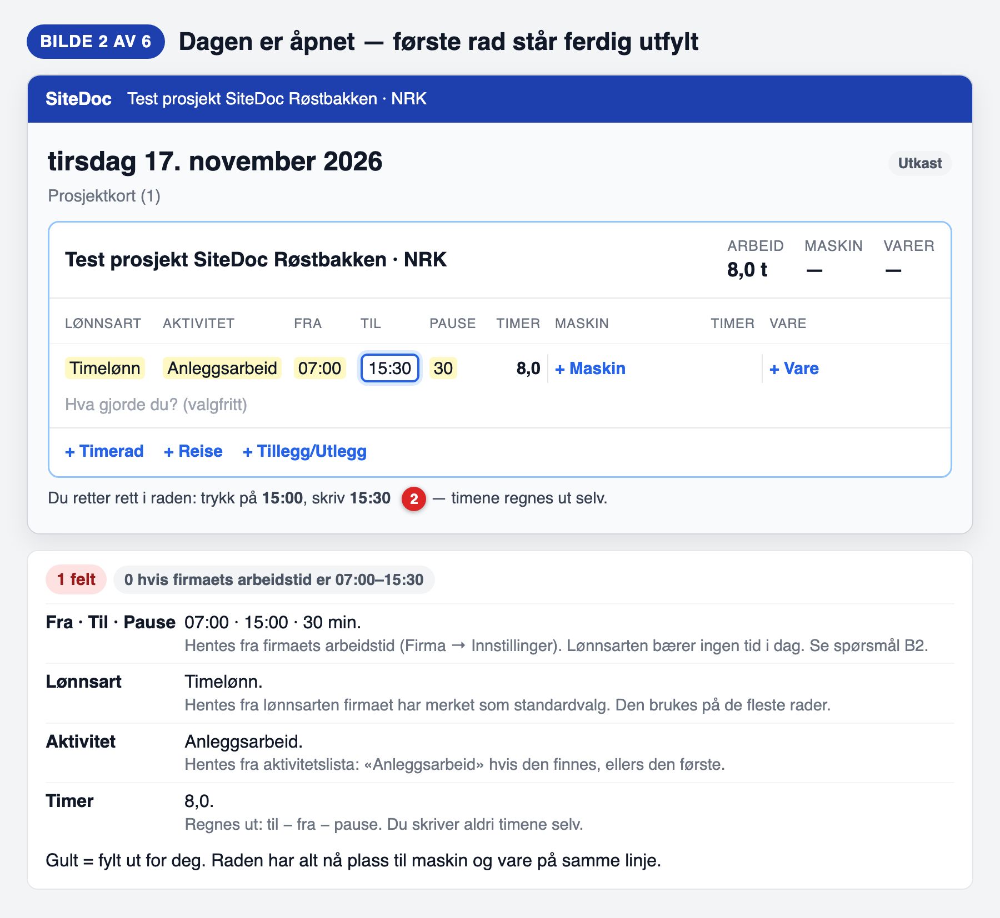
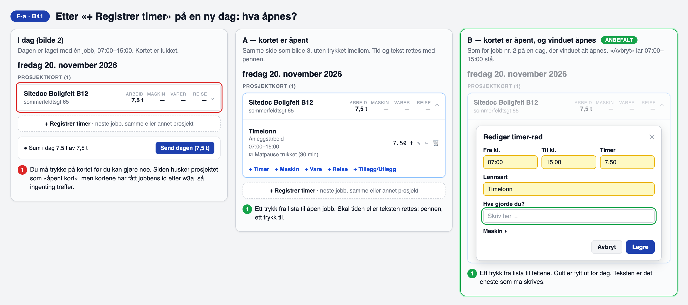
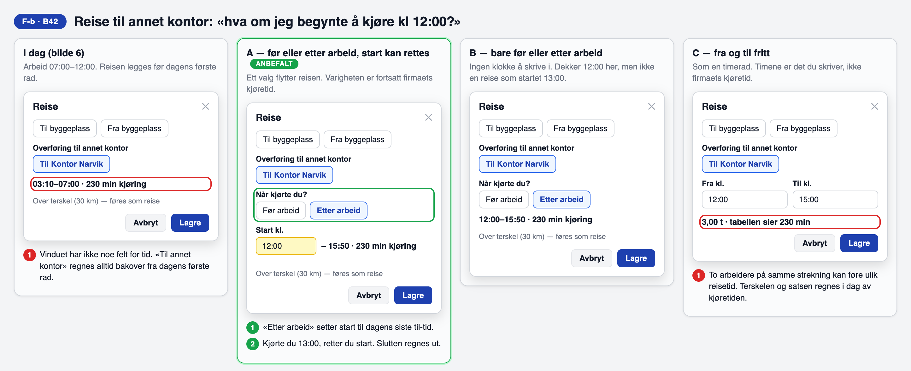
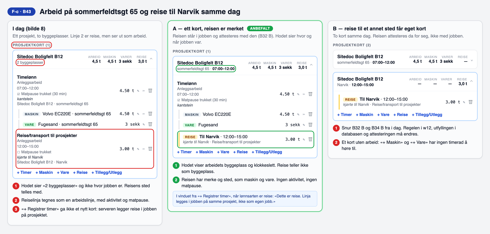
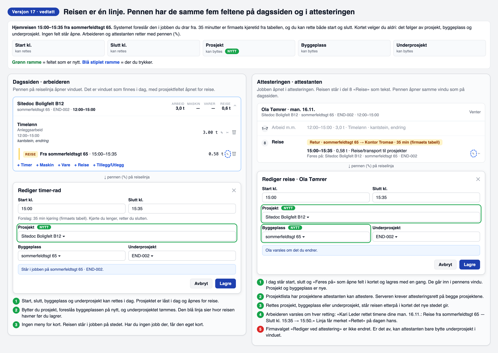
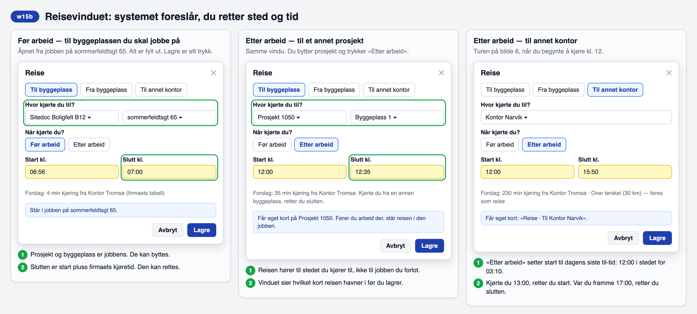
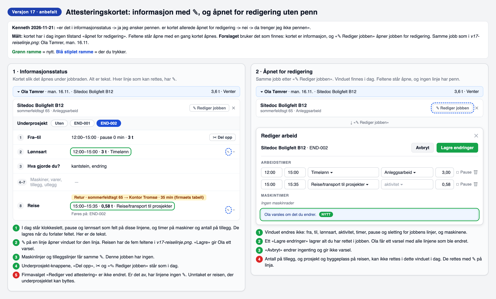
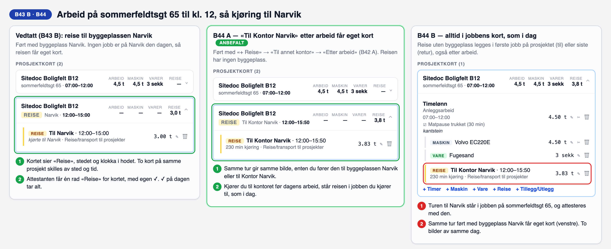

# Timeføring på web — plan med bilder (FORSLAG)

> **Bestilt av Kenneth 2026-11-17** etter test av develop `3b0f1abb` på test.sitedoc.no: *«hvorfor er ikke arbeidstimer
> og maskintimer som hører sammen på samme linje? maskintimer registreringen fra til trengs ikke … registrering av
> dagseddel på web er jo ikke slik vi har det på mobilen … Du må levere ny plan med bilder i strukturert rekkefølge!
> WEB-> registrering av timer. Bilde 1->Bilde2 ....til registrering er ferdig. registrering skal være minimum trykk og
> valg. Skriv tekst sammen med bildet for hvor vi henter preutfylt informasjon og hvorfor.»*
>
> **Scenario:** en arbeider jobber 07:00–15:30, bruker Volvo i 4 timer og 4 m3 betong.
>
> **Bildene:** [`skisser-web-timeforing/`](skisser-web-timeforing/) — `bilde-1.png` … `bilde-9.png`, og alle ni
> samlet i `oversikt.png`. Kilde: `skisser.html`. Bildene er skisser av forslaget, ikke skjermbilder av noe som er bygget.
> Bilde 1–5 er føringen, 6–8 attesteringen, og 9 firmainnstillingene som styrer føringen.
> **Versjon 5:** dagsvisningen i attesteringen (B14) står i `b14-sammenlikning.png` — i dag og alternativ A, B og C
> side om side — og enkeltvis i `b14-idag.png`, `b14-a.png`, `b14-b.png` og `b14-c.png`. Kilde: `skisser-b14.html`.
>
> **Vedtak som står:** spec `prosjektkort-kortid-spec.md` § 12 — R3 (én linje), R24 (sperren), G5, H12 og H13, og B4 i
> § 10 (maskin-tak pr. kort i skjermen). Planen bygger på dem. Der planen går lenger, står avviket i § 4.1 med
> hjemmelen fra Kenneth. Det som fortsatt er åpent, står i § 8.
> **Versjon 6:** Kenneths ord 19.11. om maskintimer (§ 8.6 punkt 2) går lenger enn B4. Forslaget står i § 4.4 (w9).
> **Versjon 7:** bilde 6 og 7 er tegnet før B13 A, B14 A og § 8.6 punkt 1. Slik de gjelder nå, står de i
> `ks-attestering.png` (§ 4.5). Kilde: `skisser-ks.html`.
> **Versjon 8:** `ks-attestering.png` er tegnet om etter Kenneths svar på B24–B28 (§ 8.8) og viser firmaets
> attestering slik en prosjektleder ser den (§ 4.6). Hover-tekstene i venstremargen står i § 4.8.
> **Versjon 9:** `ks-attestering.png` er tegnet om etter svarene på B29–B31 (§ 8.9): «Attestering» finnes bare
> under Firma (§ 4.10), kortet viser alltid beskrivelsen (§ 4.9), og reisen står under prosjektet sitt (§ 4.7).
> **Versjon 10:** `ks-attestering.png` er tegnet om etter svarene på B32–B33 (§ 8.10): reisen ligger i jobbens
> kort og attesteres med jobben (§ 4.11).
> **Versjon 11:** `ks-attestering.png` er tegnet om etter svaret på B34 (§ 8.11): reisen viser underprosjektet
> den er ført på når det avviker fra jobbens, og kortet har «Føres på» under «Reise» (§ 4.11 del C). ⚠️ «Føres på» er tatt ut i w15f; reisen rettes med ✎ (§ 8.20).
> **Versjon 12:** dagssiden på PC etter Kenneths test 20.11. står i `v12-jobbkort.png` (§ 4.13): dagen slik den
> er i dag, og slik den blir med ett kort pr. jobb. Kilde: `skisser-v12.html`. Bildet erstatter bilde 5 for
> dagssiden; bilde 2–5 gjelder som innhold og rekkefølge.
> **Versjon 13:** tilbake-knappene på web er revidert (§ 4.14, w14). Ingen nye bilder.
> **Versjon 14:** testfunnene 20.11. (§ 4.15, w15) står i `v14-fa.png` (kortet etter «+ Registrer timer»),
> `v14-fb.png` (reisevinduet) og `v14-fc.png` (reisen i kortet) — i dag og alternativene side om side.
> Kilde: `skisser-v14.html`.
> **Versjon 15:** etter svarene på B41–B43 (§ 8.18) står de nye valgene i `v15-b44.png` (først reise til annet
> kontor), `v15-b45.png` (kortet med bare reise) og `v15-reisevindu.png` (reisevinduet der systemet foreslår
> og arbeideren retter sted og tid). Etter orkestratorens tillegg samme dag: `v15-b44.png` er returen hjem
> (B44), og reise til annet kontor står i `v15-kontor.png` (⚠️ egen regel for annet kontor er utgått, § 8.22 punkt 2). Kilde: `skisser-v15.html`. Alternativ B i `v14-fc.png` er det som ble
> vedtatt for B43.
> **Versjon 16:** etter svarene på B44–B46 (§ 8.19) står «Flytt til …» på reiselinja i `v16-flytt.png` (⚠️ utgått, § 8.20), og de
> to nye spørsmålene i `v16-b47.png` (firmaets utgangspunkt for returen) og `v16-b48.png` (reise uten
> underprosjekt). Kilde: `skisser-v16.html`. Alternativ A i `v15-b44.png` er utgangspunktet som ble vedtatt
> for B44, og alternativ A i `v15-b45.png` er det som ble vedtatt for B45.
> **Versjon 17:** etter Kenneths forenkling (§ 8.20) står reiselinja i `v17-reiselinje.png`: pennen åpen på
> dagssiden, og samme penn med de samme fem feltene på reiselinja i attesteringen. Kilde: `skisser-v17.html`.
> Attesteringskortets to tilstander (w15g) står i `v17-kortet-to-tilstander.png`, samme kilde. `v16-flytt.png`,
> `v16b-flytt.png` og `v16b-flytt-prosjekt.png` viser «Flytt til …», som er utgått.
> **Versjon 19:** ingen nye bilder. «Varsel» i `v17-kortet-to-tilstander.png` er merket «Korrigert av [navn]»
> hos arbeideren (§ 4.15 del F); bildet er ikke tegnet om.
> **Versjon 20:** rydding etter gjennomgangen (§ 8.22). Ingen nye bilder og ikke noe nytt innhold. Bildene er
> tegnet til ulike tider. Der tekst eller bilde er snudd, står ⚠️ på stedet med henvisning til det som gjelder.

## 0. Begreper (Kenneth 2026-11-21, § 8.22)

| Ord | Betyr |
|---|---|
| **Dagskortet** | Dagen med alle registreringene til én arbeider. |
| **Prosjektkort = kort = jobb = registrering** | Samme ting: én registrering i dagskortet. Alt i den hører sammen og behandles samlet: arbeid, reise, maskin, varer, tillegg og utlegg (§ 8.21). Eldre tekst sier oftest «jobb». |
| **Firmavalget dagskort-modus** | Firmamodusen koden kaller dagskort-modus; den andre er prosjektkort-modus. Planen rører den ikke. «Dagskort-modus» i planen er alltid firmavalget, aldri Kenneths dagskort. |
| **Reise** | Registrert i et kort er den en del av kortet. Registrert på et annet prosjekt eller sted er den en egen registrering med tydelig skille (§ 8.21). Kortet avgjøres av reisens egne felt: prosjekt, byggeplass og underprosjekt (§ 8.22 punkt 3). |
| **«Eget kort»** | Som menyvalg under «Flytt til …» er det utgått (§ 8.20). Der teksten sier at en reise «får eget kort», menes at den står som egen registrering. |
| **Maskin** | Føres bare med antall timer, etter maskinførerens skjønn. Aldri fra–til, heller ikke som firmavalg (§ 8.22 punkt 1). |
| **«Bøtte»** | Historisk ord for serverens gamle maskintak pr. prosjekt og underprosjekt. Erstattet av regelen pr. jobb i w9 (§ 4.4). |
| **«Korrigert av [navn]»** | Merket arbeideren ser når attestanten har rettet en linje. Aldri «Rettet», og ingen e-post (§ 8.20). |
| **Summen** | Bunnlinja viser to tall: arbeid mot normen («8,0 av 7,5») og sum i dag = arbeid + reise. Maskintimer vises, men legges ikke til (§ 8.22). |

## 1. Kenneths føringer (2026-11-17, ordrett)

> *«Alt 1. benytt GPS logg for å bestemme prosjektene og byggeplasser*
> *alt:2 benytt innlogget byggeplass Prosjekt/byggeplass*
>
> *registrering av timer*
> *fra/til*
> *lønnsart*
> *hva gjorde du*
> *hvilken(e) maskin(er)? hvor mange timer(for hver enkelt maskin spesifiseert (ikke fra/til)*
> *hvilke varer (vare og enhet og mengde)*
> *tillegg?*
> *utlegg*
>
> *Dette er informasjon som hører sammen og kan ikke vises hver for seg. Det skal tydelig komme frem i timelisten hvem
> kjørte maskinen og hvor mange timer. Arbeidstimene er allerede spesifisert for denne arbeideren, vi trenger ikke
> spesifisere hvilke minutter mannen var i maskinen eller når han jobbet uten maskinen så lenge han er på samme "jobb" i
> prosjektet»*

| Føring | Slik følger planen den |
|---|---|
| **Prosjekt og byggeplass utledes** — Alt 1 GPS-logg, Alt 2 innlogget prosjekt og byggeplass | Bilde 1 og 2. Rekkefølgen er telefonens dag → innsjekk-loggen → prosjektet og byggeplassen i toppen → arbeideren velger. Telefonens GPS-logg finnes ikke på serveren (WM23) og sendes ikke dit (B2 og B3, vedtatt). |
| **Én samlet registrering** i rekkefølgen fra/til · lønnsart · hva gjorde du · maskiner · varer · tillegg · utlegg | Bilde 2–5. Jobben er én flate med sju faste deler, i denne rekkefølgen. Ingen egne vinduer. ⚠️ Reise er også en del av registreringen (§ 8.21). Føringen bygges på kortet og vinduene som finnes, ikke som ny flate (§ 4.13, A2). |
| **Alt hører sammen og vises sammen** | Jobben er prosjektkortet. Føringen (bilde 5) og timelista (bilde 6) viser samme enhet. |
| **Hvem kjørte maskinen, og hvor mange timer** | Bilde 6: ansatt, maskin og maskintimer på samme linje. |
| **Maskin har timer, ikke klokkeslett.** Timene deles ikke i «med maskin» og «uten» | Bilde 3: maskin = utstyr + timer, høyst jobbens timer. ⚠️ Utgått: firmavalget for fra–til (B5, bilde 9). Maskin føres bare med antall timer (§ 8.14, § 8.22 punkt 1). Det som må endres, står i § 5. |

### 1.1 Kenneths svar på versjon 2 (2026-11-17, ordrett)

> *«hva skjer hvis det inngår overtid i denne perioden? hvordan viser vi det*
>
> *kun en ting savnes -> hva om timer tilhører underprosjekt?*
>
> *Atttestering -> viktig å vise kjærneinformasjon #2-> trykk på #2 og da vises registreringen#3 -> i attestering så må
> den som attesterer kunne dele opp timer lett dersom noe er feil registrert. f.eks underprosjekt mangler eller ikke
> riktig registrert. feil lønnsart med mere»*

«#2» er attesteringslinja og «#3» er jobben, etter utsnittene Kenneth markerte (`relay/kenneth-2026-11-17-timer/93`
og `94`). Lest slik: linja viser kjernen, og et trykk på linja åpner registreringen slik den ble ført.

| Spørsmål | Svar i planen |
|---|---|
| **Overtid i perioden** | Bilde 2 og 6. Tiden etter dagsnormen får egen linje med firmaets overtidsart, i jobben og i attesteringen. Maskinen fordeles av systemet. |
| **Timer som tilhører underprosjekt** | Bilde 2 og 5. Underprosjektet står i jobbens hode. Én jobb har ett underprosjekt; to underprosjekter er to jobber («Del jobben»). |
| **Attesteringen: kjernen på linja, trykk åpner registreringen, del opp lett** | Bilde 6, 7 og 8. Det som avviker fra vedtak i kort-id-specen § 12, står i § 4.1. |

### 1.2 Vedtatt 2026-11-17: B1–B11 som føringer

Kenneths ord står i § 8.1. Her står hva de betyr i planen, og hva som er målt.

| # | Føring | Slik står det i planen | Målt |
|---|---|---|---|
| **B1** | Ikke «Ny dag». Én knapp «+ Registrer timer» åpner en jobb på et prosjekt. Dagen summeres etter hvert. | Bilde 1, 2 og 5. Dagsseddelen lages stille når første jobb føres på en dato. Neste jobb legges på samme seddel. Annen dato og annet prosjekt velges i jobbens hode. «Send dagen» består. | WM57–WM61 |
| **B2** | Rekkefølgen telefonens dag → innsjekk-loggen → toppen → arbeideren velger. | Bilde 1. Siste trinn er ikke lenger et skjema: jobben åpnes med prosjektet tomt. | WM23–WM26 |
| **B3** | GPS-loggen sendes ikke til serveren. | Vedtaket «synkes aldri» står. | WM23 |
| **B4** | Dagsnormen leses fra firmaets innstillinger eller kalender for datoen. 07:00–15:30 med 30 minutter pause er 7,5 t og 0,5 t overtid. | Bilde 2, 5, 8 og 9. Ingen skjerm har 7,5 som fast tall. | WM62–WM65 |
| **B5** | ⚠️ **Utgått** (B38 A, § 8.14; § 8.22 punkt 1): maskin føres bare med antall timer. Sto slik: Firmaet velger om maskin føres med fra–til. Begge moduser. | ⚠️ Bygges ikke. Sto slik: Bilde 9 og § 5. Ny firmainnstilling, som krever en migrering. Hvem som får hvilken verdi ved innføringen, er B12. | WM66–WM67 |
| **B6** | «Hva gjorde du?» er påkrevd på web. | Bilde 2. Kontrolleres pr. jobb før «Send dagen». | WM31 |
| **B7** | Korte merker i Avvik. Forklaringen vises på hover, og ved trykk på berøringsskjerm. | Bilde 6 (B). Bruker `Tooltip`, som finnes. | WM21, WM68 |
| **B8** | Overtid er egen linje med én gang. | Bilde 2 og 6. | WM37–WM39 |
| **B9** | 11 kjernekolonner er standard. «Velg parameter» består. Klikk på linja åpner hele registreringen for inspeksjon og oppdeling. | Bilde 6 og 7. Tall på tilleggs- og utleggslinjer er B13. | WM69–WM71 |
| **Tillegg** | Datoen vises som dd.mm. Året byttes som egen handling. | Bilde 6 (A): årsvelger ved ukevalget. | WM72 |
| **B10** | Alle som kan attestere linja, får rette og dele opp når «rediger ved attestering» er på. | Bilde 7 og 8. Serverens krav endres tre steder. | WM54 |
| **B11** | «Uten» er forhåndsvalgt. Få underprosjekter: knapper. Mange: søkbar nedtrekk. | Bilde 2 og 7. Til og med 6 underprosjekter er knapper. | WM45, WM73 |

## 2. Svar til Kenneth

- **Telefonen er ikke bygget om.** I prosjektkort-modus fører du i Bekreft dag: tid, lønnsart, beskrivelse, «+ Maskin»,
  «+ Varer», tillegg og utlegg på én skjerm. Det eneste nye i dag er at en maskin som selges pr. time, må kobles til
  en timerad (d2c-2, merget 17.11 kl. 10:16).
- **Web har aldri fått den flyten.** Web har to skjermer før første rad og fem egne vinduer (timerad, maskin, vare,
  tillegg, utlegg), og viser maskiner etter timeradene og varer i en egen liste.
- **Bildene du fikk 6. og 7. november, viste telefonen.** Web er ikke tegnet før nå.
- **Linjene du så i attesteringen 07.11, er ført før koblingen fantes på PC** (16.11 kl. 23:14). En maskin ført på PC i
  dag havner på timeradens linje. En **vare** ført på PC gjør det fortsatt ikke.
- **GPS-loggen ligger bare på telefonen.** Den sendes aldri til serveren, etter vedtak. Web kan lese innsjekken på
  byggeplassen og prosjektet du står i.
- **Forslaget:** «+ Registrer timer» med ett trykk, og jobben føres på én flate i din rekkefølge. 6 trykk og 4–5
  felt, mot 10 trykk og 3 felt i dag. Dagen summeres etter hvert. Overtid står som egen linje, og underprosjektet
  velges i jobbens hode.

## 3. Målt mot koden (develop @ 3b0f1abb; WM57–WM73 @ b8b16571)

> ⚠️ **Historisk måling, ikke dagens kode** (versjon 20). WM1–WM108 er målt mot hashene i overskriften og i
> `sist_verifisert_mot_kode`, før w1–w15g ble bygget. Linjenumre og «i dag» gjelder koden den gangen.
> «Bøtte» er serverens gamle maskintak (erstattet i w9, § 4.4). Firmavalget for fra–til på maskin (B5,
> WM66–WM67) er utgått (§ 8.22 punkt 1). Det som gjelder, står i § 8.20–8.22 og § 9.

Timer-koden er lik på de to hashene: `git diff 3b0f1abb b8b16571 -- apps packages` viser bare 3D-filer.

Forkortelser: `NY` = `apps/web/src/app/dashbord/timer/ny/page.tsx`, `WS` = `apps/web/src/app/dashbord/timer/[id]/page.tsx`,
`D` = `apps/api/src/routes/timer/dagsseddel.ts`, `M` = `apps/mobile/src`, `PS` = `packages/db/prisma/schema.prisma`,
`ST` = `packages/db-timer/prisma/schema.prisma`, `BD` = `apps/mobile/app/timer/bekreft-dag.tsx`.

**Web i dag**

| # | Funn | Referanse |
|---|---|---|
| WM1 | **To skjermer før første rad.** «Ny dagsseddel» på Mine timer åpner et skjema (dato, prosjekt, aktivitet, arbeidstid, kommentar). «Opprett dagsseddel» lager sedelen og åpner dagssiden. Det finnes ingen vei med ett trykk. | `apps/web/src/app/dashbord/timer/mine/page.tsx:313`; `NY:190–203`; `apps/web/src/app/dashbord/[prosjektId]/timer/ny/page.tsx:10` |
| WM2 | **Fra, til og pause i skjemaet kommer fra firmaets arbeidstid:** `OrganizationSetting.standardStartTid`, `standardSluttTid` og `standardPauseMin`. Standard i databasen er 07:00, 15:00 og 30. Firmaet endrer dem i Firma → Innstillinger. Bruker firmaet kalender som normkilde, kan kalenderen overstyre. | `NY:116`, `:124–126`; `apps/api/src/services/timer/arbeidstid.ts:49–70`; `PS:434–436`; `apps/web/src/app/dashbord/firma/innstillinger/page.tsx:953`, `:985` |
| WM3 | **Lønnsarten bærer ingen arbeidstid.** `Lonnsart` har ingen felt for fra, til eller timer pr. dag. Dagsnormen (7,5) er en egen firmainnstilling, `OrganizationSetting.dagsnorm`. | `ST:22–57`; `PS:408` |
| WM4 | **Serveren lager første timerad selv** når prosjektet er sendt med: firmaets standard-lønnsart (`erStandardvalg`), tidene fra skjemaet, og pausen trukket når dagen er over 5,5 timer. Byggeplass sendes ikke, så raden får «Ingen byggeplass» selv om toppen viser en. | `D:3859–3869`, `:2534–2538`; `packages/shared/src/utils/pauseBeregning.ts:30`; `NY:190–203` |
| WM5 | **Prosjekt, aktivitet og dato i skjemaet:** prosjektet fra toppen av siden, aktiviteten «Anleggsarbeid» hvis den finnes og ellers den første, datoen i dag. | `NY:108–113`, `:152–162`, `:46` |
| WM6 | **Vinduet «Legg til timer-rad»:** Fra er siste til-tid på dagen, ellers firmaets start. Derfor sto det 15:00 med tom Til hos Kenneth. Lønnsart er alltid standardvalget. Vinduet har en sammenleggbar del «Maskin (valgfritt)». **Vare finnes ikke i vinduet.** | `WS:693–706`, `:2840–2850`, `:3658–3724`, `:3350–3368` |
| WM7 | **Vinduet «Legg til maskinbruk»** har Utstyr, Timerad, Byggeplass, Antall timer, Fra kl., Til kl., Mengde, Enhet, Underprosjekt og en infolinje. Fra og til er merket valgfritt og er ikke påkrevd noe sted, verken i skjermen eller på serveren. De fylles ut med dagens ramme, og antallet regnes av dem. | `WS:4798–5308`, `:1030–1037`, `:4874–4886`, `:5166–5194`, `:5075`; `D:10033` |
| WM8 | **«Timerad (Valgfritt)»:** merkelappen «Valgfritt» står så lenge utstyr ikke er valgt. Velger du en maskin som krever timerad, forsvinner den, og lagring stoppes uten rad. Timeraden er forvalgt når kortet har én arbeidsrad. Serveren håndhever det samme (R24). | `WS:4925`, `:5113–5121`, `:5036–5043`, `:4917–4922`; `D:2195–2201`; `packages/shared/src/utils/maskinKobling.ts:19–21` |
| WM9 | **«Arbeid i gruppen: 7,5 t · ledig: 8 t»:** ledig er arbeid **pluss pausen**, minus maskintimer som alt er ført. 7,5 + 0,5 = 8. Teksten sier ikke det. | `packages/shared/src/utils/maskinKapasitet.ts:72–73`; `WS:4988–4992`; `packages/shared/src/i18n/nb.json:604` |
| WM10 | **Maskinens fra–til brukes ikke videre.** Rapport og eksport tar dem ikke med. Attesteringens redigering bærer dem bare videre. | `packages/shared/src/utils/timerDetaljRader.ts:223`; `apps/api/src/routes/timer/rapport.ts:697–714`; `apps/web/src/components/timer/AttesteringDetalj_Edit.tsx:174` |
| WM11 | 🔴 **Varen kobles ikke til timeraden på web.** Vinduet for vareforbruk sender bare dagen. Kolonnen for kobling finnes, og serveren tar imot den. Varen blir derfor en egen linje i attesteringen. | `apps/web/src/components/timer/KortVareforbrukModal.tsx` (0 treff på `sheetTimerId`); `apps/api/src/routes/vareforbruk.ts:75–84`; `packages/db-varelager/prisma/schema.prisma:85–88` |
| WM12 | **I kortet på dagssiden står maskinene etter timeradene, og varene i en egen liste under.** Ikke på raden. | `WS:2173–2194`, `:1699–1715` |
| WM13 | **Dagens web, talt for scenarioet: 10 trykk og 3 felt.** Ny dagsseddel · Til 15:30 · Opprett · + Maskin · åpne velger · Volvo · antall 4 · Lagre · + Vareforbruk · betong · antall 4 · Lagre · Send dagen. Talt i koden, ikke klikket i nettleser. | WM1–WM11 |

**Telefonen i dag**

| # | Funn | Referanse |
|---|---|---|
| WM14 | **To moduser, styrt av firmaet:** dagskort (standard) og prosjektkort. I prosjektkort-modus åpner «+» Bekreft dag. | `PS:495`; `packages/shared/src/utils/prosjektkort.ts:13–14`; `M/components/DagsseddelListe.tsx:136–138` |
| WM15 | **Bekreft dag er én skjerm:** prosjekt, tid, lønnsartlinjer og pause, «+ Maskin» og «+ Varer», tillegg og utlegg, beskrivelse, «Bekreft og lagre». Så «Send dagen». | `BD:1454–1506`, `:2279–2292`, `:1805`; `M/components/timer-detalj/BekreftDagRadTillegg.tsx:119`, `:127` |
| WM16 | **Maskin på telefonen har ikke fra–til når den føres fra en rad** — bare timer, mengde og enhet. Timene er forhåndsutfylt med radens timer. Fra Bekreft dag lagres maskinen uten fra–til. Dagskort-modusens maskinvindu har fortsatt fra–til. | `M/components/timer-detalj/BekreftDagRadTillegg.tsx:271`; `M/utils/dagsforslagAnvend.ts:503–504`; `M/components/timer-detalj/MaskinSeksjon.tsx:928` |
| WM17 | **Forhåndsutfylling på telefonen:** start er siste til-tid på dagen, ellers firmaets start; slutt er firmaets slutt; pausen er firmaets. Sist brukte maskiner står øverst i velgeren (fem). | `M/utils/manuellDag.ts:44–51`; `M/utils/nyRadTider.ts:23–24`; `M/services/nyTimerRad.ts:130` |
| WM18 | **I kortet står maskin og vare under raden sin:** «Volvo EC220E · 4 t» og «Betong 4 m3». | `M/components/timer-detalj/prosjektkort/ProsjektkortDagsoversikt.tsx:741`, `:755` |

**Attesteringen (bilde 84)**

| # | Funn | Referanse |
|---|---|---|
| WM19 | **En maskin står på timeradens linje bare når den er koblet** til en timerad i samme kort. Ellers er den egen linje med Type «Maskin». Kolonnene Maskin og Maskintimer er på som standard. Sortering endrer ikke dette. | `packages/shared/src/utils/kortGruppering.ts:156–157`; `packages/shared/src/utils/timerDetaljRader.ts:736–742`; `apps/web/src/components/timer/TimerRadTabell.tsx:166–169` |
| WM20 | **PC sendte ikke koblingen før d2c-1,** som ble merget 2026-11-16 kl. 23:14. Telefonen fikk sperren 2026-11-17 kl. 10:16. Rader ført 07.11 på PC har derfor ingen kobling. **Ikke målt:** databasen — jeg har ikke lest radene til Kenneth. | `git show 274e7fb2^1` (0 treff på `sheetTimerId` i `WS`); `git log -1 274e7fb2`, `338de16a` |
| WM21 | **Hvorfor maskinlinjene er høye — mest sannsynlig Avvik-cellen.** Alle celler kuttes med «…», unntatt Beskrivelse og Avvik, som brytes over flere linjer. En egen maskinlinje får to setninger i Avvik: «Maskin uten arbeidstimer» og «Maskinarbeid uten registrert maskinførerbevis — flagget for synlighet.» Kolonnen er minst 180 px bred. Rundt 95 tegn i 180 px gir fem–seks tekstlinjer. **Lest i koden, ikke målt i nettleser.** | `apps/web/src/components/attestering/AttesteringTabell.tsx:259–262`; `apps/web/src/components/attestering/attestering-tabell.ts:300–306`; `packages/shared/src/utils/timerDetaljRader.ts:755`; `packages/shared/src/i18n/nb.json:5064`, `:4607` |
| WM22 | **Merket heter «Maskin uten arbeidstimer» i tabellen.** Specen (G5, R24) sier «Maskin uten timerad». | `packages/shared/src/i18n/nb.json:5064` |

**Prosjekt og byggeplass: hva web kan utlede (føring 1)**

| # | Funn | Referanse |
|---|---|---|
| WM23 | 🔴 **Telefonens GPS-logg sendes aldri til serveren.** Arbeidsdagen og besøkene pr. byggeplass ligger bare i telefonens lokale database. Serveren har ingen modell for dem og får bare den ferdige dagsseddelen. Det er et vedtak, ikke en mangel: «synkes ALDRI». | `M/db/schema.ts:447`; `docs/claude/timer-gps-helhetsplan.md:52`; `docs/claude/timer-gps-lag3-4-spec.md:131` |
| WM24 | **Det serveren har, er innsjekk-loggen:** `PsiTilstedevarelse` med prosjekt, byggeplass, bruker, innsjekk-tid, utsjekk-tid og kilde (manuell, QR, geofence, HMS-kort, app). Den finnes bare når PSI-modulen er på. Klokkeslettene er firma-isolert. | `PS:2436–2454`; `apps/api/src/routes/mannskap.ts:166` |
| WM25 | **Ingen prosedyre gir «mine innsjekker for en dato».** `minStatus` gir bare den åpne innsjekken nå, for ett prosjekt. `hentForProsjekt` gir alle personer på prosjektet. | `apps/api/src/routes/mannskap.ts:269`, `:319` |
| WM26 | **Prosjektet og byggeplassen i toppen av siden («innlogget»):** prosjektet huskes i nettleseren. Byggeplassen huskes i nettleseren og på serveren. En innsjekk som er nyere enn det manuelle valget, går foran. Timer-sidene leser begge. | `apps/web/src/kontekst/prosjekt-kontekst.tsx:15`; `apps/web/src/kontekst/byggeplass-kontekst.tsx:22`, `:152`; `packages/shared/src/utils/standardByggeplass.ts:87`; `NY:108–113`; `apps/web/src/components/timer/RadByggeplassFelt.tsx:19–41` |
| WM27 | **Vedtak 2026-11-15:** målte tidspunkter fra geofence og innsjekk **kan** foreslås som tider; arbeideren bestemmer og retter. Innsjekk som tidskilde er en egen ordre som ikke er bygget. | `docs/claude/timer-gps-lag3-4-spec.md:133` |
| WM28 | **Telefonens dagsforslag er ren regning, men bor i mobilappen** og leser telefonens lokale database. Web har ikke noe tilsvarende. GPS i nettleseren på PC er et eget BACKLOG-punkt som ikke er gjort. | `M/utils/dagsforslag.ts:10`; `M/services/dagsforslagInput.ts:86`; `docs/claude/BACKLOG.md:4412` |

**Tillegg, utlegg og beskrivelse (føring 2 og 3)**

| # | Funn | Referanse |
|---|---|---|
| WM29 | **Tillegg og utlegg på web går gjennom en velger og så et eget vindu hver.** Antallet er forhåndsutfylt med 1. Kvittering kan bare legges ved etter at raden er lagret. De hører til kortet (`kortId`), ikke til en timerad. Web sender ikke `kortId`; serveren finner kortet selv. | `WS:4300`, `:3842`, `:4503`, `:3870`, `:4106`; `ST:435`, `:513`; `D:5178`, `:5227` |
| WM30 | **På telefonen står tillegg og utlegg i Bekreft dag,** på samme skjerm som resten, pr. kort. | `BD:1805`; `M/components/timer-detalj/BekreftDagLonnUtlegg.tsx:18` |
| WM31 | **«Hva gjorde du?» er valgfritt på web og påkrevd på telefonen.** På telefonen er regelen én tekst pr. kort. Teksten lagres på kortets arbeidsrader. | `WS:3638`; `BD:998`; `M/utils/bekreftDag.ts:116`; `ST:251`; `docs/claude/prosjektkort-kortid-spec.md:529` |

**Maskintimene (føring 4)**

| # | Funn | Referanse |
|---|---|---|
| WM32 | **Maskintaket finnes i tre lag.** Serveren: maskintimer ≤ arbeidstimer + pause pr. bøtte (prosjekt + underprosjekt), kontrollert åtte steder. Telefonen pr. rad: hver maskin ≤ radens timer. Bekreft dag: pr. kort i skjermen. | `packages/shared/src/utils/maskinKapasitet.ts:42`, `:54`; `D:2806`, `:3287`, `:4135`, `:4389`, `:4818`, `:9252`, `:10079`, `:10212`; `M/services/kobledeMaskiner.ts:56–58`; `BD:1645` |
| WM33 | **Bekreft dag fordeler kortets maskiner og varer på kortets timerader selv.** Varene går til første rad. Maskinene fyller første rad og renner over til neste. En maskin på 9 timer på en jobb med 7,5 t ordinært og 1,5 t overtid blir to maskinrader. De lagres uten fra–til. | `M/utils/tilleggPaaKort.ts:80–81`, `:109`; `M/utils/dagsforslagAnvend.ts:503–504` |
| WM34 | **På web kan maskintimene ikke settes i timerad-vinduet** — maskinen får radens timer. I maskinvinduet er taket pr. bøtte en hard sperre. | `WS:3361`; `WS:5299` |
| WM35 | **Pausen i taket er begrunnet med døgn-maskiner.** Dokumentasjonen sier at den ikke er ment for timeleide maskiner. Koden legger den likevel til alle. Vedtak 2026-11-16 (B4): «maskin-tak som i dag på server, pr. kort i skjermen». | `docs/claude/fase-0-beslutninger.md:2112–2116`; `docs/claude/prosjektkort-kortid-spec.md:606` |
| WM36 | **I attesteringen står ansatt, maskin og maskintimer på samme linje.** I timerapportens Detaljer står maskinnavnet som et tillegg i Betegnelse, uten egen maskinkolonne. Egen kolonne hører til ordre d3 i kort-id-specen, som ikke er bygget. | `packages/shared/src/utils/timerDetaljRader.ts:736–742`; `apps/web/src/lib/timer-rapport-eksport.ts:420` |

**Overtid (Kenneths svar på versjon 2)**

| # | Funn | Referanse |
|---|---|---|
| WM37 | **Én regel avgjør overtid:** resten av dagsnormen er dagsnormen minus arbeid som alt er ført på datoen. Jobben får normaltid opp til resten, deretter overtid. Reise og fravær teller ikke. Det er dagsnormen som gjelder, ikke ukenormen. Bare 50 % er bygget. | `docs/claude/prosjektkort-kortid-spec.md:333–340`; `packages/shared/src/utils/lonnsregel.ts:10`, `:65`, `:114` |
| WM38 | **Telefonen viser overtid som egen linje** i Bekreft dag: «07:00–15:00 · 7,5 t · Timelønn ▾» og «15:00–15:30 · 0,5 t · Overtid 50 % ▾». Lønnsarten kan byttes pr. linje. Det lagres som to timerader i samme kort. | `docs/claude/prosjektkort-kortid-spec.md:355–362`; `M/utils/dagsforslag.ts:1888–1950`; `BD:2294–2310`; `packages/shared/src/i18n/nb.json:5776` |
| WM39 | **Web viser overtid som et forslag med knappen «Del raden»** i timerad-vinduet. Trykket lager to rader. Serveren lager aldri en overtidsrad selv. | `packages/shared/src/utils/overtidForslag.ts:74`; `WS:3101–3160`, `:3178–3250`, `:3538–3540`; `packages/shared/src/i18n/nb.json:631–633`; `D:2534–2538` |
| WM40 | **Mulig feil, lest og ikke kjørt:** når en rad deles i normal og overtid på web, får en ny maskin **hele** radens timer på normal-delen. | `WS:3236–3240` |
| WM41 | **«Sum i dag X t av Y t»:** prikken blir gul når X er over Y. Ingen tekst sier hvorfor. | `packages/shared/src/utils/prosjektkort.ts:173–180`; `WS:1822–1832` |
| WM42 | **Fordelingen med overtid:** en maskin på 4 t på en jobb med 7,5 t ordinært og 0,5 t overtid havner i sin helhet på den ordinære linja. En maskin på 8 t blir 7,5 + 0,5. Den ordinære er først fordi den lages først, ikke fordi radene sorteres på tid. | `M/utils/tilleggPaaKort.ts:76–88`; `packages/shared/src/utils/lonnsregel.ts:65` |
| WM43 | **I attesteringen blir ordinær tid og overtid to linjer i samme kort,** sortert på fra-tid. Varen står på linja den er koblet til. | `packages/shared/src/utils/kortGruppering.ts:147`, `:155–164` |

**Underprosjekt**

| # | Funn | Referanse |
|---|---|---|
| WM44 | **Et kort har ett prosjekt, ett underprosjekt og én byggeplass** (K2–K4). To kort kan ha like verdier (K7). | `docs/claude/prosjektkort-kortid-spec.md:107–109`, `:113` |
| WM45 | **Telefonen velger underprosjekt med knapper pr. kort,** «Uten» først. De vises bare når prosjektet har åpne underprosjekter, og ingenting er forhåndsvalgt utover «Uten». Valget skrives på kortets arbeidsrader, maskin, varer, tillegg og utlegg. «Sist brukt underprosjekt» finnes ikke. | `BD:1573`, `:667–679`; `M/utils/dagsforslagAnvend.ts:349–355`, `:497`, `:525`; `docs/claude/prosjektkort-kortid-spec.md:265–266` |
| WM46 | **Web velger underprosjekt i en nedtrekksliste i hvert vindu** (timerad, maskin, tillegg, utlegg). Lista er prosjektets aktive underprosjekter som er åpne for timer. Kortet på dagssiden er pr. prosjekt, med en undergruppe pr. underprosjekt. | `WS:3570–3590`, `:5238–5252`, `:593–657`, `:2129–2140`; `apps/api/src/routes/eksternKostObjekt.ts:69–89` |
| WM47 | **Web kan ikke lage et nytt kort på et prosjekt som alt har kort.** «+ Nytt prosjektkort» tilbyr bare prosjekter uten kort. Kort-id-specen § 5.4 sier at det skal gå. | `WS:680–682`, `:992` |
| WM48 | **Dele en jobb:** telefonen har «Del til eget kort» ved et klokkeslett. Web har «Del opp» pr. rad, der delene kan få ulikt underprosjekt. Valget «eget kort» finnes ikke i web-vinduet, selv om serveren støtter det. | `M/utils/kortIdForslag.ts:125`; `BD:1614`; `apps/web/src/components/timer/SplittRadModal.tsx` (0 treff på `egetKort`); `D:2612` |

**Attesteringen: linja, retting og oppdeling**

| # | Funn | Referanse |
|---|---|---|
| WM49 | **Et trykk på en linje gjør ingenting.** Lenken til detaljsiden står bare på dagens sumrad. | `apps/web/src/components/timer/TimerRadTabell.tsx:310–316`; `apps/web/src/components/attestering/AttesteringTabell.tsx:411` |
| WM50 | **Linja har 26 kolonner som standard og er minst 2 814 punkter bred.** Maskin begynner om lag 1 340 punkter inn, Vare om lag 1 700. På en skjerm på 1 440 må attestanten rulle sidelengs for å se dem. Regnet fra koden, ikke målt i nettleser. | `packages/shared/src/utils/timerDetaljRader.ts:736–742`, `:745–755`; `apps/web/src/components/timer/TimerRadTabell.tsx:192–194`; `apps/web/src/components/attestering/AttesteringTabell.tsx:75` |
| WM51 | **Retting i cellen er bygget:** fra, til, timer, pause, lønnsart og aktivitet på timeraden; maskin, maskintimer, mengde og enhet; antall på tillegg. Ikke prosjekt, underprosjekt, byggeplass, beskrivelse eller vare. Cellen viser «var …» etter retting. | `apps/web/src/components/attestering/AttesteringTabell.tsx:196–218`, `:239`, `:271–287` |
| WM52 | 🔴 **Underprosjekt kan ikke rettes fra tabellen.** «Flytt underprosjekt» finnes på serveren (`flyttTimerRadEco`), men **ingen skjerm kaller den** — 0 treff i `apps/web` og `apps/mobile`. Den flytter bare timer- og tilleggsrader; maskinens underprosjekt oppdateres ikke. Eneste vei i dag er detaljsiden → «Rediger hele sedelen» → nedtrekk → Lagre, om lag fire trykk. R14 og R21 i kort-id-specen forutsetter handlingen. | `D:6627`; `apps/web/src/components/timer/AttesteringDetalj.tsx:494–497`; `apps/web/src/components/timer/AttesteringDetalj_Edit.tsx:218` |
| WM53 | **«Del opp» (✂):** pr. del kan prosjekt, lønnsart, aktivitet, underprosjekt, fra, til og timer settes. Timene regnes ikke ut av klokkeslettene. Å dele 8 t i to med ulikt underprosjekt er om lag sju handlinger. Koblede maskiner og varer blir på første del. | `apps/web/src/components/timer/SplittRadModal.tsx:210–224`, `:280`; `apps/web/src/components/timer/RedigerTimerRad.tsx:63–147`; `D:7591` |
| WM54 | **Hvem får rette:** retting i cellen, pennen og ✂ krever firmaadministrator og firmavalget «rediger ved attestering». «Flytt underprosjekt» krever bare attesteringsrett. Skjermen viser ✂ og pennen uten å sjekke firmavalget; serveren avviser. | `D:7251`, `:2998`, `:7497`, `:6658`; `apps/web/src/components/attestering/AttesteringTabell.tsx:418`, `:431` |
| WM55 | **Mulig feil, lest og ikke kjørt:** vinduet bak pennen sender `byggeplassId: null` for alle radene det lagrer. | `apps/web/src/components/attestering/RedigerRadModal.tsx:403`, `:414`, `:435`, `:450` |
| WM56 | **Telefonens attestering kan ikke rette eller dele.** | `apps/mobile/src/components/timer-attestering/AttesteringDetaljMobil.tsx:52` |

**Målt i versjon 4 — «+ Registrer timer» og dagsseddelen (B1)**

| # | Funn | Referanse |
|---|---|---|
| WM57 | **Én dagsseddel pr. arbeider pr. dato, uten prosjekt.** Prosjektet ligger på raden. | `ST:214`; `D:3761–3764` |
| WM58 | **`opprett` er alt «finn eller lag».** Den tar imot dato, aktivitet (påkrevd) og prosjekt (valgfritt). Finnes dagen, returneres den urørt med `eksisterte: true`. Første timerad lages bare når sedelen er tom. | `D:3753–3774`, `:3824–3856`, `:3857–3869`, `:3871–3888`, `:2509–2530` |
| WM59 | **En jobb til på en dag som har rader, er `tilfoyTimerRad` med ny `kortId`.** Serveren tar imot feltet. Web sender det aldri, så raden havner i dagens eldste kort med samme prosjekt, underprosjekt og byggeplass. **Ikke lest:** hvordan `tilfoyTimerRad` behandler en `kortId` serveren ikke kjenner. | `D:3990–3991`; `WS` (0 treff på `kortId`); `docs/claude/prosjektkort-kortid-spec.md:232`, `:244` |
| WM60 | **Låsene.** Rader kan bare føres når dagen er utkast eller returnert. En sendt dag kan arbeideren gjenåpne selv, så lenge ingen rad er attestert. Dager eldre enn firmaets grense avvises. Fra og til er påkrevd på timeraden. | `D:230–233`, `:4009–4014`, `:5745–5790`, `:1531–1552`, `:4000–4006` |
| WM61 | **Knappen på Mine timer heter «Ny dagsseddel» og lenker til skjemaet.** Sedelens kommentar kan rettes på dagssiden etterpå. | `apps/web/src/app/dashbord/timer/mine/page.tsx:311–319`; `packages/shared/src/i18n/nb.json:269`; `WS:5346–5368` |

**Målt i versjon 4 — dagsnormen (B4)**

| # | Funn | Referanse |
|---|---|---|
| WM62 | **Normleseren tar firma og dato.** «Fast»: `dagsnorm`-kolonnen, og sesong ignoreres. «Kalender»: slutt − start − pause, og en dato mellom aktiv `sommertid_start` og `sommertid_slutt` samme år bruker tidene på `sommertid_start`-raden. Standard er «fast». Firmaet velger i Firma → Innstillinger. Leseren bruker altså kalenderens sommertid-markører, men bare når firmaet står på «kalender». | `apps/api/src/services/timer/arbeidstid.ts:45–136`, `:74–76`, `:78–119`, `:123–126`; `PS:485`, `:408`, `:3134–3135`; `apps/web/src/app/dashbord/firma/innstillinger/page.tsx:1135–1153`; `packages/shared/src/i18n/nb.json:2217–2220` |
| WM63 | **I «kalender» finnes ikke et eget normtall.** Normen er arbeidstiden. 7 t vinter og 8 t sommer settes som arbeidstid 07:00–14:30 og en sommertid-rad 07:00–15:30, begge med 30 minutter pause. I «fast» er normen den samme hele året. | `arbeidstid.ts:123–126` |
| WM64 | **Web og server leser normen pr. dato fra samme leser.** | `apps/api/src/routes/organisasjon.ts:1347–1358`; `WS:672–677`; `D:1161`, `:2548`, `:3818`, `:6540` |
| WM65 | **Halvdag og helligdag endrer ikke normen.** Leseren slår bare opp sommertid-radene. Ikke lest: telefonen. | `arbeidstid.ts:17–19`, `:78–106` |

**Målt i versjon 4 — maskin med fra–til som firmavalg (B5; ⚠️ firmavalget er utgått, § 8.22 punkt 1)**

| # | Funn | Referanse |
|---|---|---|
| WM66 | **Maskinradens fra og til er valgfrie kolonner; timer er påkrevd.** Radene trenger ingen skjemaendring. | `ST:593–594`, `:599` |
| WM67 | **Firmainnstillingene er faste kolonner.** Modellen har ikke noe fritt felt. En ny innstilling er en ny kolonne i `packages/db`, altså en migrering. Telefonen speiler firmainnstillingene i en lokal tabell med én kolonne pr. innstilling. | `PS:376`, `:495` (0 treff på `Json` i modellen); `M/services/organizationSettingKatalog.ts:86`; `M/db/schema.ts:783` |

**Målt i versjon 4 — attesteringen (B7, B9, datoen) og underprosjekt (B11)**

| # | Funn | Referanse |
|---|---|---|
| WM68 | **`Tooltip` støtter berøring:** trykk viser, trykk utenfor lukker. Veilederen fraråder nativ `title=`, som ikke vises på berøringsskjerm. | `packages/ui/src/tooltip.tsx:81`, `:175`, `:228`; `docs/claude/retningslinjer/tooltip-hjelpetekst-veileder.md:10`, `:23` |
| WM69 | **Standardutvalget er én liste.** Kolonnevalg, rekkefølge og bredde lagres pr. bruker på serveren. En bruker med lagret oppsett beholder det; ny standard treffer bare den som ikke har lagret noe. Ingen «tilbakestill til standard» er funnet. **Ikke lest:** om oppsettet lagres før brukeren endrer noe. | `packages/shared/src/utils/timerDetaljRader.ts:736–742`; `apps/web/src/hooks/useTabelloppsett.ts:40`, `:89`; `apps/web/src/components/attestering/AttesteringTabell.tsx:72–73`, `:101` |
| WM70 | **De 11 kjernekolonnene er 14 kolonner i koden.** Fra og til er to. Vare, enhet og mengde er tre. Lønnsart er kolonnen `betegnelse`. Minstebreddene summerer til 1 462 punkter, før avkrysning og knapper. Sidemenyen er minst 220 punkter, så om lag 1 220 er ledig på en skjerm på 1 440. Regnet, ikke målt i nettleser. | `timerDetaljRader.ts:700`, `:704–705`, `:712–714`, `:607–636`, `:745–755`; `apps/web/src/components/layout/NavSidebar.tsx:231` |
| WM71 | **Antall og Beløp er egne kolonner,** for tillegg og utlegg. Uten dem viser en tilleggslinje ikke antallet og en utleggslinje ikke beløpet. | `timerDetaljRader.ts:715–716` |
| WM72 | **Datoen skrives `2026-11-17`.** Firmaets attestering viser én uke om gangen, med forrige uke, neste uke og «Denne uka». Året kan bare byttes ved å bla uke for uke. Prosjektets attestering har ikke ukevalg. | `apps/web/src/components/attestering/attestering-tabell.ts:169–172`; `AttesteringTabell.tsx:466`; `apps/web/src/app/dashbord/firma/timer/attestering/page.tsx:159–176`, `:194–199`, `:345–369`; `apps/web/src/app/dashbord/[prosjektId]/timer/attestering/page.tsx` (0 treff på `fraOgMed`) |
| WM73 | **`ui-standarder.md` har ingen grense for knapper mot nedtrekk.** Regelen «adaptiv nedtrekk» gjelder fritekstfelt som lærer av bruk: forslag etter tre bruk, og søkefelt når lista passerer 7. Telefonen har bare knapper (WM45). | `docs/claude/retningslinjer/ui-standarder.md:102–115` |

**Målt i versjon 5 — dagsvisningen i attesteringen (B14), develop @ `ee7146e5`**

`AT` = `apps/web/src/components/attestering/AttesteringTabell.tsx`, `AM` = `apps/web/src/components/attestering/attestering-tabell.ts`,
`TR` = `apps/web/src/components/timer/TimerRadTabell.tsx`.

| # | Funn | Referanse |
|---|---|---|
| WM74 | **En dag har tre radtyper.** For hver jobb (kort): én oversiktsrad, så linjene. Etter dagens siste jobb: én dagsum. «Etter prosjekt» har ingen dagsum. | `AT:532–589`, `:569–570` |
| WM75 | **Samme opplysning står tre steder.** Oversiktsraden viser dato, ansatt, pr.nr., underprosjekt og jobbens sum. Linjene bærer de samme fire feltene. Dagsummen viser «Sum {dato} · {ansatt}» og dagens sum. En dag med én jobb og én linje viser derfor samme timetall tre ganger. | `AT:538–563`, `:578–588`; `AM:272–284`; `packages/shared/src/i18n/nb.json:5057` |
| WM76 | **«Dagen: X t av dagsnorm Y t» bygges pr. jobb, ikke pr. dag.** En dag med to jobber viser setningen to ganger. | `AT:537`, `:556` |
| WM77 | **Dagen har ingen markering der den begynner.** Oversiktsraden har 1 punkt grå strek og lysegrå bunn. Dagsummen har 2 punkter grå strek over seg og står sist i dagen. Linjene veksler mellom hvit og lysegrå etter løpende linjenummer i hele tabellen, uavhengig av dag og jobb. Linjene har ikke innrykk. | `TR:331–342`, `:362–363`, `:208–214`; `AT:695–723` (sender ikke `innrykk`) |
| WM78 | **Cellene kutter tekst.** Etiketten «Sum 17.11. · Ola N.» står i kolonnen Betegnelse (78 punkter som standard), og «Dagen: …» i Avvik (70). Begge tekstene er lengre enn kolonnen. Regnet fra breddene; ikke sett i nettleser. | `TR:349`; `AT:89–105`, `:377–379` |
| WM79 | **«Bare oversiktsrader» skjuler linjene.** Oversiktsradene og dagsummen står. Valget gjelder besøket og lagres ikke. En dag med én jobb er da to rader med samme tall. | `AT:152`, `:564–567`, `:644` |
| WM80 | **Maskin og vare som er koblet til timeraden, står på timeradens linje.** Tillegg og utlegg er egne linjer i jobben. Vare- og utleggslinjer har ingen egen ✓. Reise er en egen blokk først på dagen, og rader uten kort-id samles sist. | `AM:300–413`, `:432–444`; `AT:565` |
| WM81 | **Knappene står på tre nivåer.** Linja: ✓ ↩ ↺ ✂ og penn. Oversiktsraden: ✓ ↩ ↺ for prosjektseddelen. Dagsummen: «Attester» for hele dagsseddelen, ↩ og lenke til sedelen. I prosjektets attestering gjelder dagsummens knapp bare prosjektets del. | `AT:396–415`, `:426–471`, `:473–493` |
| WM82 | **Sorterer brukeren på en kolonne, vises bare linjene,** som flat liste uten oversiktsrader og dagsum. Derfor bærer hver linje dato og ansatt. | `TR:195–206` |
| WM83 | **Tabellen tegner én rad om gangen.** Kolonnene kan flyttes, skjules og endre bredde. Tabellen har en fri rad (`overskrift`) og en sumrad med celler pr. kolonne. En celle kan ikke gå over flere rader. Timerapporten bruker samme tabell. | `TR:36–65`, `:309–357`; `apps/web/src/components/timer/TimerRapportDetaljer.tsx` |
| WM84 | **Radhøydene, målt i nettleser av w5:** oversiktsrad 38, linje 37, dagsum 43. En dag med én jobb og én linje er 118 punkter høy. | w5-leveransen, `relay/inbox-orkestrator.md:33267` |

**Målt i versjon 5 — attestantens egne timer (B15), develop @ `ee7146e5`**

`SK` = `packages/db/prisma/schema.prisma`. `D` er `apps/api/src/routes/timer/dagsseddel.ts`, som ellers i planen.

| # | Funn | Referanse |
|---|---|---|
| WM85 | **Ingen egenskap ved den ansatte sier timelønn eller fastlønn.** Verken brukeren eller ansettelsen har feltet. | `SK:10–80`, `:248–292`. Søkt uten treff: timelonn, fastlonn, lonnstype, lonnsform, maanedslonn, salaryType, payType, ansettelsesform. |
| WM86 | **«Timelønn» og «Fastlønn (månedslønn)» er to lønnsarter av samme type.** Bare navnet skiller dem, og firmaet kan endre navnet. Lønnsarten har ingen kolonne for lønnsform. | `packages/db-timer/prisma/schema.prisma:22–51`; `apps/api/src/services/seed/index.ts:61–62` |
| WM87 | **Modellen peker ikke ut noens leder.** Avdelingen har ikke leder. Stillingen (ansatt, bas, prosjektleder, daglig leder) er en opplysning og gir ingen rett. | `SK:2857–2875`, `:252`. Søkt uten treff: lederId, managerId, naermesteLeder, overordnet, avdelingsleder. |
| WM88 | **Attesteringsrett har firmaadministrator i sedelens firma, og aktiv ansatt som er prosjektadministrator eller har «kan attestere» på radens prosjekt.** Fravær uten prosjekt attesteres av firmaadministrator, og av prosjektleder når firmaet har valgt det. «Firmaansvarlig» gir ingen attesteringsrett. | `D:275–302`, `:332–358`, `:502–540`; `SK:741`, `:744` |
| WM89 | **Ingen prosedyre sammenligner den som attesterer, med den som eier sedelen.** Det gjelder attestering, retur, gjenåpning, retting, deling og flytting av underprosjekt — elleve prosedyrer. Listene tar med attestantens egne sedler. | `D:6018–6188`, `:6203–6500`, `:6791`, `:6917`, `:7121`, `:7315`, `:7422`, `:7515`, `:7529`, `:7695`, `:7802`, `:8287`, `:8465` |
| WM90 | **Kolonnen `tillattSelvAttestering` finnes i firmainnstillingene, med standard «ja». Ingen kode leser eller skriver den.** Den ble lagt inn 01.05. for en plan som ikke er bygget: at en vanlig ansatt kunne attestere egen seddel i stedet for å sende den til leder. | `SK:416–417`; migreringen `20260501200000_add_timer_modul_og_settings`; `timer.md:74`, `:453` |
| WM91 | **Sedelen bærer alt et flagg for retting og en sperretekst til skjermen.** En sperret linje får ✓ slått av med forklaring og sendes ikke med «Attester utvalget». ↩ stoppes ikke av sperren. | `D:6181`, `:6371`, `:6485`; `AM:256–258`, `:586–597`; `AT:405`, `:455`, `:483` |
| WM92 | **Telefonen har attestering for firmaadministrator:** liste, attestering av rader og retur. Den har ikke retting, deling eller gjenåpning. Av firmainnstillingene lagrer den bare «rediger ved attestering» lokalt. | `apps/mobile/app/timer/attestering/index.tsx:72–79`; `apps/mobile/src/components/timer-attestering/AttesteringDetaljMobil.tsx:72–77`; `apps/mobile/src/db/schema.ts:754` |

**Målt i versjon 6 — maskintimer over arbeidstimer (§ 8.6 punkt 2), develop @ `1afb318a`**

Linjene i `D` gjelder `1afb318a` og er forskjøvet fra WM32, som ble målt på en eldre hash. `MK` =
`packages/shared/src/utils/maskinKapasitet.ts`, `KS` = `docs/claude/prosjektkort-kortid-spec.md`.

| # | Funn | Referanse |
|---|---|---|
| WM93 | **Eksempeldagen er lagt rett inn i databasen med SQL. Den er aldri ført gjennom serveren.** Lokal kopi av test-basen (nyeste seddel der er fra 11.07.2026): Ola Tømrer 14.05.2026, pause 30 min, status sendt. Timerad 07–12 med 4,50 t uten underprosjekt, timerad 12–15 med 3,00 t på TILL-001, maskinrad 07–15 med 7,50 t uten underprosjekt. Sedelen og de tre radene har håndlagde ID-er (`22222222-4f4f-2222-2222-…`) og er opprettet 17.05.2026 kl. 10:02:06, i samme sekund. Bøtta var i brudd fra første stund: 4,5 + 0,5 t pause er mindre enn 7,5. Skriptet ligger ikke i repoet. | Lesespørring mot lokal `sitedoc` 19.11. (`timer.daily_sheets`, `sheet_timer`, `sheet_machines`); søk etter ID-en i treet og med `git log --all -S` ga ingen treff |
| WM94 | **Underprosjektet END-002 er satt senere.** I kopien fra 11.07. har 07–12-raden og maskinen ikke underprosjekt; på test 19.11. står begge på END-002. Begge veiene som bytter underprosjekt, skriver uten å sjekke taket (WM97). Hvilken som ble brukt, er ikke målt: test-basen er ikke lest. | WM93; `D:6926–6942`, `D:684–726` |
| WM95 | **Regelen kom dagen før dataene ble lagt inn.** `validerMaskinUnderArbeid` ble innført 16.05.2026, pausen i taket 18.05., og den delte funksjonen 05.07. Seed-koden som lager timer og maskin (`seed-timer-demo.ts`), skriver også rett i databasen, men holder seg under taket. | `git log -S validerMaskinUnderArbeid` → `ff5c90e1`; `731770da`; `docs/claude/fase-0-beslutninger.md:2110–2115`; `packages/db/scripts/seed-timer-demo.ts:162–176` |
| WM96 | **Taket sjekkes åtte steder, alltid mot alle bøttene på sedelen.** Kommentaren sier at bare nye og endrede rader sjekkes, men koden filtrerer ikke. En seddel som alt er i brudd, får derfor avvist enhver skriving som går gjennom sjekken, også i en annen bøtte. Lest i koden, ikke kjørt. | `D:2174–2199`, kommentaren `D:2133–2138`; `MK:80–108`; kallene `D:3000`, `:3501`, `:4354`, `:4608`, `:5037`, `:9680`, `:10507`, `:10640` |
| WM97 | **Sju skriveveier endrer arbeidstimer eller underprosjekt uten å sjekke taket:** (1) ✂ på en timerad — hver del kan få eget underprosjekt, og maskinen blir stående på første del; sjekken gjelder bare ✂ på en maskinrad. (2) Den ansattes egen deling av en timerad. (3) Bytte av underprosjekt på én timerad. (4) Bytte av underprosjekt for hele jobben. (5) «Del opp» (WM98). (6) Sletting av en timerad. (7) Endring av dagens pause i sedelhodet. | (1) `D:2988–3004`, `:7874`; (2) `D:8155`; (3) `D:6926–6942`; (4) `D:684–726`; (5) `D:7052–7074`; (6) `D:4700–4746`; (7) `D:4111–4165` |
| WM98 | **«Del opp» har to egne vakter, og begge har hull.** Vakten mot en maskin som går over klokkeslettet, slipper alle maskiner uten fra–til. Vakten mot for mange maskintimer ser bare på maskiner som er koblet til en rad som deles. En maskin uten klokkeslett som er koblet til en rad før klokkeslettet, eller ikke koblet til noen rad, blir stående på del A med alle timene. Med radene 07–12 og 12–15 og en maskin på 7,5 t uten klokkeslett gir «Del opp» ved 12 nøyaktig eksempelet. | `apps/api/src/routes/timer/jobb-deling.ts:94–98`; `D:7054–7072` |
| WM99 | **Synken sjekker det telefonen sender, ikke det som blir lagret.** Timerader serveren velger å ikke skrive, blir stående som de var. Maskinradene erstattes alltid med telefonens. En telefon med en eldre versjon av dagen kan derfor skrive maskintimene tilbake etter at arbeidstimene er flyttet på serveren. | `D:9671–9690`; `D:9970` og `:10137` (leseagent, ikke stikkprøvd) |
| WM100 | **Synken kan ikke skille en gammel app fra en ny, og den avviser hele sedelen.** Telefonen sender ingen versjon. Koden sier selv at en eldre app aldri skal avvises strengere enn før. En avvist seddel lagres ikke; telefonen viser et rødt felt «Avvist» med serverens tekst, som ikke er oversatt, til brukeren retter og lagrer på nytt. | `D:9683–9694`; `apps/mobile/src/lib/trpc.ts:18–21`; `apps/mobile/src/services/timerSync.ts:714–727`; `packages/shared/src/i18n/nb.json:687–689` |
| WM101 | **Taket ser ikke på hva slags maskin det er.** Døgn-maskiner telles med som alle andre. En Heatwork kan i dag ikke ha flere timer enn arbeidstimene pluss pausen i bøtta. Det er vedtatt slik: taket «gjelder fortsatt alle maskiner, også døgn-maskiner». | `MK:80–108`; `D:2174–2199`; `KS:1580`, `:1706` |
| WM102 | **Maskinen som går uten fører, kjennes igjen på ett felt: enheten maskinen selges i** (`Equipment.utleieEnhet`: «døgn», «time» eller ikke satt). Det er vedtatt som det styrende skillet (18.05. og 01.09.): døgn går uten fører; time og ikke satt krever fører og timerad (H15, 16.11.). Et eget merke for «krever fører» er uttrykkelig avvist. Heatwork-maskinene i seeden er småutstyr merket «Utleieobjekt» med enheten døgn. I den lokale kopien står alle fem Heatwork slik, og gravemaskinen uten enhet. | `packages/db-maskin/prisma/schema.prisma:96–100`; `packages/shared/src/utils/maskinKobling.ts:19–21`; `docs/claude/maskin.md:263–276`; `docs/claude/fase-0-beslutninger.md:2124–2133`; `KS:2085`; `packages/db-maskin/prisma/seed-amarkussen-heatwork.ts:34–72` |
| WM103 | **Enheten kan bare settes når maskinen er merket «Utleieobjekt».** Ny maskin opprettes uten enhet. Utleie pr. time kan ikke skilles fra en egen gravemaskin som selges pr. time: begge har enheten time og krever fører. «Materiell» finnes ikke som eget begrep; utleid materiell må ligge i maskinregisteret for å kjennes igjen. | `apps/web/src/app/dashbord/maskin/[id]/page.tsx:1715–1755`; `apps/api/src/routes/maskin/equipment.ts:250–284`, `:330–333`; `KS:1278` |
| WM104 | **En maskinrad føres alltid i timer.** Enhet og mengde på raden gjelder produsert mengde (m3, stk), ikke leietid. En døgn-maskin føres som timer. | `packages/db-timer/prisma/schema.prisma:577–630` |
| WM105 | **Ingen flate regner pr. jobb.** PC-en har ingen regel pr. rad eller pr. jobb, verken på dagssiden eller i attesteringen: maskinvinduet sperrer pr. bøtte med pausen, og feltet for maskintimer i den åpne registreringen er et fritt tall som bare serverens bøtteregel stopper. Attestanten kan derfor sette maskintimene over jobbens timer, eller kutte arbeidstimene under maskinens, så lenge bøtta har plass. Telefonen sperrer pr. rad (hver maskin høyst radens timer) og i Bekreft dag pr. kort (hver maskin høyst kortets arbeidstimer), begge uten pausen, og i tillegg pr. bøtte med pausen. To ulike maskiner kan hver ha hele kortets timer; bare bøttesummen stopper det. | `WS:5071–5102` (leseagent); `apps/web/src/components/attestering/RegistreringPanel.tsx:102–121`, `:239`; `apps/web/src/components/attestering/RedigerRadModal.tsx:640–661`; `M/services/kobledeMaskiner.ts:56–58`; `BD:1645`; `M/utils/tilleggPaaKort.ts:56–58` |
| WM106 | **Attesteringen har ikke noe avviksmerke for maskin over arbeid, og attestering stoppes ikke av et brudd.** Avvikene som finnes: sperre (normtak og overlapp), ukeavvik, maskin uten timerad, manglende maskinførerbevis, tilleggskrav og normmerket. Jobbraden og dagsraden viser de to summene uten å sammenlikne dem. | `apps/web/src/components/attestering/attestering-tabell.ts:289–363`; `AT:644–724` (leseagent) |
| WM107 | **En jobb ligger alltid i én bøtte; en bøtte kan ha flere jobber.** Kort-id-en utledes av prosjekt, byggeplass og underprosjekt. Eldre rader uten kort-id er ingen jobb: i attesteringen samles de i ett samlekort pr. seddel, og flytting og «Del opp» avvises for dem. | `apps/api/src/services/timer/kortId.ts:1–15`, `:233–254`; `packages/shared/src/utils/kortGruppering.ts:124–142`; `attestering-tabell.ts:438–444` |
| WM108 | **Bekreft dag varsler ikke når arbeidstiden kuttes etter at maskinen er lagt inn.** Bruddet stopper først ved Bekreft, med «For mange maskintimer». | `M/utils/bekreftDag.ts:233–262`; `BD:1064–1068` (leseagent, ikke stikkprøvd) |

## 4. Forslaget — bilde for bilde

Røde tall i bildene er trykk og felt i rekkefølge: 1 til 9 i føringen (bilde 1–5), og fra 1 igjen i attesteringen (bilde 6–8). Gult er felt som er fylt ut for brukeren. De grå tallene 1–7
er de sju delene i Kenneths rekkefølge.

### Bilde 1 — Mine timer → «+ Registrer timer»


**1 trykk.** I dag: 2 trykk og et skjema imellom (WM1).

**Arbeideren fører en jobb på et prosjekt. Dagen er ikke et eget steg** (B1). Slik kartlegges knappen mot
dagsseddelen:

| Når | Det som skjer | Målt |
|---|---|---|
| Dagen finnes ikke | Dagsseddelen lages stille. Serveren lager første timerad med prosjekt, byggeplass, firmaets arbeidstid og standard-lønnsart. | WM58, WM4 |
| Dagen finnes, som utkast eller returnert | Jobben legges til som et nytt kort på samme seddel. Fra er siste til-tid på dagen (WM6). Raden lagres når Til er fylt ut. | WM59, WM60 |
| Dagen er sendt | Jobben kan ikke føres før dagen er gjenåpnet. Knappen tilbyr «Gjenåpne dagen». Har lederen attestert noe, må lederen returnere dagen. Det er dagens regel. | WM60 |
| Annen dato | Datoen velges i jobbens hode (bilde 2). Jobben legges på den datoens seddel, etter de samme tre reglene. Firmaets aldersgrense gjelder. | WM57, WM60 |
| Annet prosjekt | «Endre» i jobbens hode. | — |

**Prosjekt og byggeplass velges ikke. De hentes i denne rekkefølgen** (B2):

| | Kilde | Finnes i dag? | Hvorfor denne plassen |
|---|---|---|---|
| 1 | **Dagen fra telefonen.** Jobbene arbeideren har bekreftet fra GPS-forslaget, står alt på dagen. | Ja. Dagen er på serveren. | De føres ikke på nytt. «+ Registrer timer» legger en jobb til, med Fra etter den siste. |
| 2 | **Alt 1 — innsjekk-loggen.** Hvor arbeideren var sjekket inn i dag, og når. | Dataene finnes (WM24). Leseren mangler (WM25), og innsjekk som tidskilde er ikke bygget (WM27). | Den er målt på stedet, som GPS-loggen, og ligger alt på serveren. |
| 3 | **Alt 2 — prosjektet og byggeplassen i toppen.** | Ja (WM26). | Det er der brukeren står nå. En nyere innsjekk går alt foran der. |
| 4 | **Arbeideren velger prosjekt** i jobbens hode. | Velgeren finnes. | Bare når ingenting er kjent. |

- **Telefonens GPS-logg er ikke i lista,** fordi den ikke finnes på serveren (WM23). Den sendes ikke dit (B3, vedtatt).
- ⚠️ **Skjemaet «Ny dagsseddel» brukes ikke lenger i prosjektkort-modus.** Feltene finnes andre steder: dato,
  prosjekt og aktivitet i jobbens hode, arbeidstiden som jobbens fra–til, og kommentaren på dagssiden (WM61).
  Skjemaet består i dagskort-modus.
- **Samme knapp står nederst på dagen** (bilde 5). Der erstatter den «+ Nytt prosjektkort» og tilbyr også prosjekter
  som alt har et kort (WM47).
- **«Send dagen» består.** Dagsseddelen er fortsatt det som sendes og attesteres.

### Bilde 2 — jobben åpnes: underprosjekt, tid, lønnsart og overtid



**1 felt** (teksten). Alt 2: 2 felt (Til og teksten).

| Fylt ut | Verdi | Hentes fra | Hvorfor |
|---|---|---|---|
| Prosjekt, byggeplass | Røstbakken · NRK | Alt 1: innsjekken (WM24). Alt 2: toppen av siden (WM26). | Føring 1. «Endre» hvis det er feil. |
| Dato | tir. 17.11. | Klokka. | Annen dato velges her, ikke i et skjema først (B1). |
| Underprosjekt | «Uten» | Ingen kilde. Valgene er prosjektets åpne underprosjekter (WM46). Til og med 6: knapper. Flere: søkbar nedtrekk med «Uten» valgt. | Som telefonen, og vedtatt i kort-id-specen § 5.1 (WM45) og av Kenneth (B11). Det gjettes ikke: feil underprosjekt gir feil faktura. |
| Fra–til | 07:00–15:30 | Alt 1: innsjekk 06:58 og utsjekk 15:34, rundet til firmaets steg (`OrganizationSetting.tidsrundingMinutter`, `PS:422`). Alt 2: firmaets arbeidstid (WM2). | Målt tid kan foreslås; arbeideren retter (WM27). |
| Pause | 30 | Firmaets arbeidstid (WM2). Trekkes når dagen er over 5,5 timer (WM4). | Som i dag. |
| Lønnsart | Timelønn · 07:00–15:00 · 7,5 t | Lønnsarten firmaet har merket som standardvalg (`D:2534–2538`), opp til dagsnormen (WM37). | Den brukes på de fleste jobber. |
| Overtid | Overtid 50 % · 15:00–15:30 · 0,5 t | Regelen i WM37: dagsnormen for datoen minus det som alt er ført den dagen. Normen kommer fra normleseren (WM62): 7,5 fast, eller kalenderen. Arten er firmaets overtidsart. | Tiden over normen skal ha egen lønnsart. Arbeideren kan bytte lønnsart på linja. |
| Hva gjorde du? | Tomt | — | Påkrevd pr. jobb før «Send dagen», som på telefonen (B6). |

- **De sju delene står alltid i samme rekkefølge:** 1 Fra–til · 2 Lønnsart · 3 Hva gjorde du? · 4 Maskiner · 5 Varer ·
  6 Tillegg · 7 Utlegg. **Underprosjektet står i jobbens hode,** sammen med prosjekt, byggeplass og dato: det sier
  *hvor* jobben hører til, og gjelder alt i jobben (K3).
- ⚠️ **Reise er også en del av registreringen** (§ 8.21): arbeid, reise, maskin, varer, tillegg og utlegg hører
  sammen i kortet. Bildet er tegnet før reisen kom inn i kortet (w12, w3a).
- **Overtid vises som egen linje med én gang,** slik telefonen gjør (WM38; B8, vedtatt). I dag viser web et forslag
  med knappen «Del raden» (WM39). Går dagen ikke over normen, er det én linje.
- **Regnestykket** (B4): 07:00–15:30 med 30 minutter pause er 8,0 t. Normen 17.11. er 7,5 t, så 0,5 t er overtid.
  Står firmaet på «kalender», og datoen ligger i sommertiden med arbeidstid 07:00–15:30, er normen 8,0 t. Da blir
  det ingen overtidslinje (WM63).
- **Underprosjekt-raden vises bare når prosjektet har åpne underprosjekter.** Nederst i bildet står nedtrekken for
  prosjekter med mange. Grensen 6 er Fabels forslag: «Uten» og 6 knapper er sju valg, og sju er der
  `ui-standarder.md` legger søk på en liste. Den regelen gjelder egentlig fritekstfelt (WM73).

### Bilde 3 — 4 · Maskiner → Volvo, 4 timer


**2 trykk + 1 felt.** I dag: 4 trykk + 1 felt, i eget vindu (WM7).

| Fylt ut | Verdi | Hentes fra | Hvorfor |
|---|---|---|---|
| Sist brukt | De fem sist brukte maskinene | Brukerens egne dagssedler (`WS:261`, finnes i dag) | De fleste kjører samme maskin flere dager. |
| Timer | 8,0 — brukeren skriver 4 | Jobbens arbeidstimer (WM16, WM32) | Hver maskin har egne timer. Ingen maskin kan ha flere timer enn jobben (B4 i kort-id-specen, vedtatt). ⚠️ Regelen gjelder nå også på serveren, pr. jobb og uten pausen; døgn-maskiner er unntatt (w9, § 4.4). |
| Hvem kjørte | Den som fører | Jobben | Føring 3. Navnet står på samme linje i timelista. |
| Fra–til | Vises ikke | ⚠️ Utgått: firmavalget «maskin føres med fra–til» (B5, bilde 9). Maskin har aldri fra–til (§ 8.22 punkt 1). | Kenneth 2026-11-21: maskinførerens skjønn gjelder; han anslår antall timer. |

- **Ingen «Timerad», ingen «ledig: 8 t».** ⚠️ Fra–til vises aldri (B5 er utgått, § 8.22 punkt 1). Brukeren
  sier ikke når på dagen maskinen gikk (føring 4).
- **Overtid:** brukeren fordeler ikke maskinen på ordinær tid og overtid. Systemet fyller den ordinære linja først
  (WM42). 4 timer havner på den ordinære.
- Flere maskiner: «+ Maskin» igjen, hver med sine timer.

### Bilde 4 — 5 · Varer → betong, 4 m3


**2 trykk + 2 felt.** I dag: 3 trykk + 1 felt, og varen står alene i attesteringen (WM11).

| Fylt ut | Verdi | Hentes fra | Hvorfor |
|---|---|---|---|
| Enhet | m3 | Varen i varelageret | Brukeren velger den aldri selv. |
| Jobben | Varen lagres på jobben | Jobben | Føring 3. I dag lagres varen bare på dagen. |

- Vare, enhet og mengde står side om side.
- En «Sist brukt»-liste for varer ville spart søket. Den finnes ikke i dag og er ikke med.

### Bilde 5 — 6–7 · Tillegg og utlegg → «Send dagen»


**1 trykk.** Som i dag. Scenarioet har verken tillegg eller utlegg.

- **Tillegg og utlegg føres på jobben,** etter varene, uten velger og uten egne vinduer. Tillegget står med antall 1,
  som i dag (WM29). Utlegg får kategori, beløp, mva og kvittering (§ 8.21). Tillegg føres uten bilde og kvittering;
  vedlegget som finnes på tillegg i koden, står inntil videre (§ 8.22 punkt 4).
- **Alt på jobben står samlet:** tid, lønnsart, tekst, reise, maskin, vare, tillegg og utlegg (føring 3; reise
  lagt til etter § 8.21).
- **Dagen summeres etter hvert** (B1). Hver jobb legges til «Sum i dag». «Send dagen» sender alle jobbene på datoen
  samlet, som i dag.
- **Neste jobb: «+ Registrer timer»,** samme knapp som på Mine timer. Jobben kan ligge på samme prosjekt eller et
  annet. Web kan ikke lage to kort på samme prosjekt i dag (WM47).
- **Timer på to underprosjekter:** én jobb har ett underprosjekt (K3). «✂ Del jobben» deler ved et klokkeslett: tiden
  før blir i jobben, tiden etter blir en ny jobb på samme prosjekt, med eget underprosjekt. Det er telefonens «Del til
  eget kort» (WM48).
- ⚠️ **Bunnlinja viser to tall (§ 8.22):** arbeid mot normen («8,0 av 7,5» — arbeid uten reise mot dagsnormen
  for datoen, WM64) og «Sum i dag» = arbeid + reise («11 t» når 3 t er reise). Maskintimer vises, men legges ikke
  til. Bildet og teksten «Sum i dag 8,0 t av 7,5 t · 0,5 t overtid» er fra før reisen kom med i summen.
  🟡 Bestilt som sumlinja (§ 9). Prikken er gul over normen (WM41).

### Bilde 6 — attesteringen: de 11 kjernekolonnene


> **Gjelder med endringene i § 4.5** (2026-11-19): dagsrad og jobbrad etter B14 A, 13 kolonner etter B13 A, og
> uke, år og «Attestert» også på prosjektets side. Bildet under er det opprinnelige.

**1 trykk åpner registreringen.** I dag gjør et trykk på linja ingenting (WM49).

- **De 11 kjernekolonnene er standard** (B9): dato · ansatt · prosjektnr · underprosjekt · lønnsart · fra–til ·
  timer · maskin · maskintimer · vare med mengde · avvik. Knappene ✓ og ↩ står fast til høyre (R22).
- **«Velg parameter» består.** Attestanten legger til og fjerner kolonner selv, som i dag. Alle 26 finnes fortsatt.
- **Hvorfor:** i dag har linja 26 kolonner og er minst 2 814 punkter bred. Maskin og Vare ligger utenfor skjermen
  (WM50).
- **Vare med mengde er én kolonne i kjernen:** «Betong · 4 m3», slik telefonen skriver den (WM18). Med de tre
  kolonnene som finnes (vare, enhet, mengde) er kjernen 1 462 punkter bred, mot om lag 1 220 ledig på en skjerm
  på 1 440 (WM70). Med én varekolonne, dd.mm. og litt smalere tekstkolonner er den regnet til om lag 1 140.
  Koderen måler i nettleser; kravet er at kjernen vises uten sidelengs rulling på 1 440.
- **A · Dato og år** (tillegget): datoen skrives «17.11.», ikke «2026-11-17» (WM72). Året står i årsvelgeren ved
  ukevalget og byttes der, så attestanten slipper å bla uke for uke. Prosjektets attestering, som ikke har ukevalg,
  får samme årsvelger.
- **B · Avvik** (B7): korte merker på én linje — «Uten timerad», «Uten førerbevis». Hele forklaringen vises når
  pekeren holdes over merket, og ved trykk på berøringsskjerm (WM68). I dag brytes to setninger over fem–seks
  linjer (WM21).
- **Tall på tillegg og utlegg:** de 11 kolonnene har ingen kolonne for antallet på et tillegg eller beløpet på et
  utlegg (WM71). Se B13.
- **Lagret oppsett:** en attestant som alt har lagret et kolonneoppsett, beholder det (WM69). «Velg parameter» får
  valget «Tilbakestill til standard», så kjernen er ett trykk unna.
- **Overtid:** ordinær tid og overtid er to linjer i samme kort (WM43). De er to lønnsarter og attesteres hver for
  seg. Kortets linje viser summen.
- **Maskin og overtid:** nederst i bildet står samme jobb med Volvo i 8 timer. Maskinen står da på begge linjene, med
  7,50 og 0,50. Summen, «maskin 8,0 t», står i kortets linje.
- **Er det lesbart?** Ja, så lenge kortets linje viser summen. Uten den ser 7,50 og 0,50 ut som to føringer. Den som
  førte, har bare skrevet «8». Alternativet er å la alle maskintimene stå på den ordinære linja; det bryter telefonens
  grense «maskin høyst radens timer» (WM32) og er ikke foreslått.

### Bilde 7 — klikk på linja → hele registreringen · rett underprosjekt


> **Gjelder med endringene i § 4.5** (2026-11-19): den blå linja åpner kortet (§ 8.6 punkt 1), fra–til er felt og
> timene regnes ut, ✂ og «Rediger jobben» står i kortet, og «Endre» øverst i kortet er «Rediger jobben».
> ⚠️ **Etter w15g (§ 8.20):** kortet har ingen åpne felt. Linjene er tekst med ✎, og feltene står i vinduet bak pennen.

**2 trykk:** åpne, og velg underprosjekt. I dag: om lag fire trykk via en egen side, og ikke fra lista (WM52).

- **Hele registreringen åpnes under linja,** slik den ble ført: samme sju deler, samme rekkefølge. Attestanten
  inspiserer og deler opp uten å forlate lista (B9).
- **Underprosjekt mangler eller er feil:** trykk på riktig underprosjekt. Det gjelder hele jobben — timene, maskinen,
  varen, tillegg og utlegg flyttes sammen (K3). Linja viser det nye, og «var: Uten» blir stående, som ved retting i
  cellen i dag (WM51).
- **Feil lønnsart:** velg ny lønnsart på linja i registreringen. Det finnes alt som retting i cellen (WM51).
- ⚠️ **Utgått (w15g, § 8.20; B24 B):** kortet har ingen åpne felt, og en retting lagres med «Lagre» i vinduet bak
  ✎. Jobben attesteres samlet på jobbraden. Sto slik: timer, maskintimer og mengde rettes i feltene, som i cellen i
  dag, og hver retting lagres med en gang; etterpå godkjennes linja med ✓ (R21).
- **Hvem:** alle som kan attestere linja, når firmaet har «rediger ved attestering» på (B10, vedtatt). I dag krever
  serveren firmaadministrator for retting, penn og ✂ (WM54); kravet endres til attesteringsrett de tre stedene.
- Har prosjektet mange underprosjekter, er valget en søkbar nedtrekk, som i bilde 2 (B11).

### Bilde 8 — del opp timene: to underprosjekter


**4 trykk + 1 felt:** åpne · «Del opp» · klokkeslettet · underprosjekt på del B · «Del opp». I dag: om lag sju
handlinger, og timene må regnes for hånd (WM53).

| Fylt ut | Verdi | Hentes fra | Hvorfor |
|---|---|---|---|
| Timer pr. del | 4,0 og 4,0 | Regnes ut av klokkeslettet, pausen og dagsnormen for datoen (WM62) | I dag må attestanten skrive timene selv (WM53). |
| Lønnsart pr. del | Del B: 3,5 t Timelønn + 0,5 t Overtid 50 % | Samme regel som ved føring (WM37) | Overtiden følger tiden på dagen. |
| Underprosjekt, del A | Som før | Jobben | Bare del B endres. |
| Maskin og vare | Blir på del A | Slik serveren gjør i dag når en rad deles (WM53) | De kan flyttes til del B etterpå. ⚠️ § 8.21 punkt 2: maskintimer, varer og resten blir i kortet de ble registrert i, og det nye kortet registrerer sine egne. «Del opp» flytter i dag maskin og vare som er koblet til en rad som går til del B (`delJobb`, `dagsseddel.ts:6871–6895` @ `cbf99013`). 🟡 Måles, ikke bestilt. |

- **Hver del er en egen jobb** (eget kort), med sitt underprosjekt. Serveren støtter «eget kort» ved deling; web-vinduet
  bruker det ikke (WM48).
- **Den opprinnelige jobben lagres i historikken,** som ved retting i dag. Den ansatte ser delingen etter neste synk.
- **Den ansatte kan dele sin egen jobb på samme måte** før dagen sendes («✂ Del jobben», bilde 5).
- ✂ for å dele én rad står i kortet, ved timelinja, ikke på linja i tabellen (§ 4.5 punkt 4, Kenneth 2026-11-19).
  «Del opp» i registreringen deler hele jobben.

### Bilde 9 — firmainnstillingene som styrer føringen


**Oppsett, ikke en del av føringen.** Firmaadministrator setter det én gang i Firma → Innstillinger.

| Innstilling | Finnes? | Hva den styrer | Hentes fra |
|---|---|---|---|
| **Dagsnorm-kilde:** «Fast (7,5 t)» eller «Kalender (sesong)» | Ja (WM62) | Hvor mye av dagen som er normaltid før overtid: overtidslinja (bilde 2), dagens sum (bilde 5) og oppdelingen (bilde 8). | Normleseren, pr. dato. «Fast»: firmaets dagsnorm. «Kalender»: arbeidstiden den datoen, med sommertiden fra firmakalenderen (WM63). |
| ⚠️ **UTGÅTT — bygges ikke** (B38 A, § 8.14; § 8.22 punkt 1). Sto slik: **Maskin føres med fra–til:** «Nei · bare timer» eller «Ja · fra–til» | **Nei — ny** (B5) | Om maskinlinja har klokkeslett. «Nei»: utstyr og timer, forhåndsutfylt med jobbens timer (bilde 3). «Ja»: fra–til, forhåndsutfylt med jobbens start; timene regnes ut av klokkeslettene, som i dagens maskinvindu på PC (WM7). | Ny kolonne i firmainnstillingene. |

- ⚠️ **De tre punktene under om den nye innstillingen er utgått:** B5, B12 og w6 bygges ikke (§ 8.14, § 8.22
  punkt 1). Av bilde 9 gjelder bare dagsnorm-kilden.
- **Den nye innstillingen krever en migrering** (WM67), og telefonen må få en lokal kolonne for den. Maskinradene
  trenger ingen skjemaendring: fra og til er alt valgfrie (WM66).
- **Den gjelder PC og telefon, dagskort og prosjektkort** (B5). Maskinrader som alt er lagret, røres ikke.
- **Hvem som får «Ja» og «Nei» når innstillingen innføres,** er B12.
- **Kenneths tall:** 7 t vinter og 8 t sommer krever «Kalender». Da er normen arbeidstiden, så en sommerdag
  07:00–15:30 har norm 8,0 og gir ingen overtid. Med «Fast» er normen 7,5 hele året, og samme dag gir 0,5 t
  overtid (WM63).

**I alt for føringen (bilde 1–5): 6 trykk og 4–5 felt, én flate, ingen egne vinduer.** I dag: 10 trykk og 3 felt, to
skjermer før første rad og tre vinduer — uten «Hva gjorde du?», og med varen alene (WM13). Overtidslinja og
underprosjektet «Uten» koster ingen trykk.

Alle ni samlet: [`oversikt.png`](skisser-web-timeforing/oversikt.png).

### 4.1 Det som avviker fra vedtak i kort-id-specen

Avvikene har hjemmel i Kenneths svar 2026-11-17 (§ 8.1). Ingenting er skrevet inn i kort-id-specen ennå; det gjøres
i ordren som bygger delen.

| Vedtak | Det sier | Planen | Hjemmel |
|---|---|---|---|
| **R2** (§ 12) | Linja bærer alt, 26 kolonner i standardrekkefølge. «Ingenting ligger bak innrykk, tooltip, hover eller klikk.» | 11 kjernekolonner er standard. Resten ligger i registreringen, ett klikk unna, og kan slås på som kolonner. Avvik-forklaringen ligger bak hover. | **B9 og B7, vedtatt.** Det snur ordene fra 16.11 («ingen ting kan utelates»). |
| **R14** (§ 12) | Detaljsiden består for forslaget, flytt underprosjekt, vedlegg og «rediger sedel». | Registreringen åpnes under linja. Detaljsiden består for forslaget og for redigering av hele sedelen. | **B9, vedtatt.** Detaljsiden nås i dag bare fra sumraden (WM49). |
| **R21** (§ 12) | Prosjekt, underprosjekt og byggeplass rettes ikke i cellen; de flyttes med «Flytt underprosjekt». | Fortsatt ikke i cellen. Underprosjektet rettes i den åpne registreringen, for hele jobben. | Ikke et avvik i regelen. Det lukker et hull: «Flytt underprosjekt» har ingen knapp i dag (WM52). |
| **R21** (§ 12) | Retting er for firmaadministrator med «rediger ved attestering» på. | Alle som kan attestere linja, når «rediger ved attestering» er på. | **B10, vedtatt.** |
| **R10** (§ 12) | ✂ på hver linje. | ✂ består. I tillegg «Del opp» i registreringen, ved et klokkeslett, for hele jobben. ⚠️ **Snudd 2026-11-19 (§ 8.8):** ✂ står ved timelinja i kortet, ikke på linja i tabellen. | Kenneth: «dele opp timer lett». Dagens ✂ er sju handlinger (WM53). |
| **§ 5.5** (paritetsmatrisen) | Web: overtid som forslag i rad-vinduet (V21), uendret. | Overtid som egen linje med én gang, som telefonen. | **B8, vedtatt.** |
| **K19** (2026-11-06) | Maskin i Bekreft dag føres med antall, ikke fra–til. | ⚠️ **Utgått** (§ 8.14, § 8.22 punkt 1): K19 står — antall, ikke fra–til. Sto slik: Firmaet velger. Med «Ja» får også Bekreft dag fra–til på maskin. | B5 er opphevet (B38 A). |
| **Kenneth 2026-11-07** | Endringer i prosjektkortet skal aldri påvirke dagskortet. | ⚠️ Firmavalget for maskin er utgått (§ 8.22 punkt 1). Planen rører ikke firmavalget dagskort-modus. | B5 er opphevet (B38 A, § 8.14). |
| **B4** (§ 10, 2026-11-16) | Maskin-taket er som i dag på serveren (pr. bøtte, med pausen), og pr. kort i skjermen. | Serveren får regelen pr. jobb, uten pausen, og døgn-maskiner tas ut av taket (§ 4.4, w9). | **Kenneth 2026-11-19** (§ 8.6 punkt 2): «det er ikke lov». ✅ Bygget: w9 (`044fac2f`) og w9m (`3225e93c`) er merget; B21–B23 er besvart (§ 8.7). Taket pr. bøtte er historie. |
| **§ 5.4** | Web skal kunne lage nytt kort på et prosjekt som alt har kort. | Uendret vedtak. «+ Ny jobb på samme prosjekt» og «Del jobben» bygger det. | Ikke bygget i dag (WM47). |

Disse står urørt: R3 (én linje pr. timerad med maskin og vare), R23 (gjenåpne), R24 (sperren),
R25 (underlinjer for flere maskiner og varer), G5 og G6.

⚠️ **Snudd av Kenneth 2026-11-19 (§ 8.8), etter test av `eedbc7cd`:** R22 (faste knapper på linja) og «én ✓ pr.
linje» i R3 og R10 gjelder ikke lenger. ✓, ↩ og ↺ står på jobbraden og dagsraden, fordi jobben attesteres samlet
(B24 B). Retting i cellen (R21) går ut; kortet er det ene stedet du retter (B25 A). ⚠️ Etter w15g rettes det bak ✎ på
linjene i kortet eller i «Rediger arbeid»; kortet har ingen åpne felt (§ 8.20). Det gamle står over og i
kort-id-specen § 12 til ordren w10 fører det inn der.

### 4.2 Dagsvisningen i attesteringen (B14) — tre alternativer


Enkeltbilder: [`b14-idag.png`](skisser-web-timeforing/b14-idag.png) · [`b14-a.png`](skisser-web-timeforing/b14-a.png) ·
[`b14-b.png`](skisser-web-timeforing/b14-b.png) · [`b14-c.png`](skisser-web-timeforing/b14-c.png). Alle fire viser de
samme tre dagene: Ola 17.11. (én jobb, tre linjer), Kari 17.11. (to jobber) og Ola 18.11. (én jobb, én linje).
«I dag» er tegnet etter koden, ikke et skjermbilde.

**Kenneths tre krav** (§ 8.2): tydelig skille fra dag til dag · tydelig hvilke registreringer som hører sammen ·
oversiktlig. Flere linjer pr. dag er førstevalget; én rad pr. dag er reserven.

**Slik er det i dag (WM74–WM84):**
- Dagen begynner med en jobbrad som ser ut som alle andre rader. Det eneste dagskillet er en grå strek over
  dagsummen, sist i dagen (WM77).
- Jobbens linjer har verken innrykk, ramme eller egen farge. Annenhver linje er grå gjennom hele tabellen (WM77).
- En dag med én jobb og én linje er tre rader med samme timetall (WM75).

| | I dag | **A — dagen øverst, jobben som blokk** | B — sammenslåtte celler | C — som i dag, tydeliggjort |
|---|---|---|---|---|
| Dagskille | Svakt | **Tydelig:** egen ramme pr. dag, luft imellom, blå dagsrad først | Tydeligst: dagen er én celle over alle radene sine | Bedre: ramme og luft, men dagen har ingen egen overskrift |
| Hører sammen | Svakt | **Tydelig:** farget kant pr. jobb, jobbrad når dagen har flere jobber | Tydeligst: jobben er én celle ved linjene sine | Bedre: blå jobbrad og farget kant; dato og ansatt gjentas |
| Rader for de tre dagene | 14 | **12** | 7 | 12 |
| En dag med én jobb og én linje | 3 rader | **2 rader** | 1 rad, to–tre ganger så høy | 2 rader |
| «Velg parameter», sortering, filter | — | **Urørt** | Dato, ansatt, pr.nr. og underprosjekt kan ikke lenger flyttes, skjules eller sorteres hver for seg | Urørt |
| Rører | — | `AT` (radbyggingen), `TR` (ny valgfri radvariant), i18n, hjelpeteksten | `TR` bygges om så en dag er én enhet (WM83), `AT`, kolonnevelgeren, i18n, hjelpeteksten | `AT`, `TR` (farger), i18n, hjelpeteksten |

**Anbefaling: A.**
- A oppfyller alle tre kravene uten å røre kolonnene. Kolonnevalget ba Kenneth om å beholde (B9).
- B er tydeligst, men bryter med B9 og krever at tabellen bygges om. Knappene havner tre steder i bredden.
- C er billigst, men løser ikke dagskillet: dagen begynner fortsatt med en jobb, og «Attester» for dagen står øverst
  én dag og nederst den neste, etter hvor mange jobber dagen har.
- **Reserven «én rad pr. dag» finnes i A:** «Bare oversiktsrader» skjuler linjene, og en dag med én jobb er da én rad.

**Alternativ A i detalj — det en ordre må bære:**

1. **Dagsraden står først i dagen.** Den viser dato med ukedag, ansatt, dagens timer og maskintimer, dagens avvik og
   dagens knapper («Attester», ↩, lenke til sedelen). Den erstatter dagsummen nederst og har samme innhold og samme
   knapper (WM75, WM81).
2. **Dagen har én jobb:** jobbraden vises ikke. Pr.nr. og underprosjekt står i dagsraden, og jobbens ↺ står der.
   ⚠️ ✓ og ↩ «for prosjektseddelen» vises da ikke som egne knapper; dagens «Attester» og ↩ dekker de samme linjene.
3. **Dagen har flere jobber:** hver jobb får en jobbrad med pr.nr., underprosjekt, jobbens sum og ✓ ↩ ↺, og sin egen
   kantfarge. Reise og rader uten kort er egne blokker, som i dag (WM80).
4. **Dato, ansatt, pr.nr. og underprosjekt skrives ikke på linja når de er like raden over.** Har en linje et annet
   prosjekt eller underprosjekt enn jobben, vises verdien. Ved sortering, i filter og i eksport er alt som i dag
   (WM82).
5. **Dagsnormen står én gang, i dagsraden.** Avviker dagen fra normen, står et merke («+0,5 t»), og hele setningen
   «Dagen: 8,0 t av dagsnorm 7,5 t» vises når pekeren holdes over (mønsteret fra B7). ⚠️ En dag som er lik normen,
   viser ingen normtekst. I dag står setningen én gang pr. jobb og kuttes av kolonnebredden (WM76, WM78).
   ⚠️ § 8.22: tallet mot normen er arbeidstid, uten reise. Summen for dagen er arbeid + reise (sumlinja, § 9).
6. **Hver dag har ramme, og det er luft mellom dagene.** Linjene veksler ikke mellom hvit og grå inne i en dag.
7. **«Bare oversiktsrader» består** og skjuler linjene. Da vises dagsraden, og jobbradene når dagen har flere jobber.
8. **«Etter prosjekt» får ingen dagsrad** (dagens regel: en dagsum der ville villede). Jobbraden bærer dato og
   ansatt som i dag og får dagsradens utseende. I «Etter ansatt» står dagsradene under gruppens overskrift.
9. **I prosjektets attestering gjelder dagsradens knapp bare prosjektets del,** som i dag.
10. **Registreringen åpnes under linja,** som i dag (bilde 7).
11. **Timerapporten bruker samme tabell (WM83) og skal se ut som før.** Det nye utseendet er valgfritt i komponenten.

En dag med én jobb og én linje blir om lag 75 punkter høy, mot 118 i dag (regnet fra WM84).

### 4.3 Attestantens egne timer (B15) — firmavalg

**Kenneth:** *«leder bør attestere attestants timer dersom denne har timelønn. dette bør være et firmavalg i
firmainstillinger.»*

**Målt (WM85–WM92):**
- Systemet vet ikke hvem som har timelønn. Det finnes bare som navn på en lønnsart (WM85, WM86).
- Systemet vet ikke hvem som er noens leder (WM87).
- Ingenting hindrer en attestant i å attestere eller rette egne timer i dag (WM89).
- En ubrukt innstilling for selv-attestering finnes i firmainnstillingene (WM90).

Fordi modellen mangler både «timelønn» og «leder», går fem spørsmål til Kenneth: B16–B20 (§ 8). Forslaget under
bruker de anbefalte svarene.

| Del | Forslag | Spørsmål |
|---|---|---|
| **Firmavalget** | Firma → Innstillinger, ved «Rediger ved attestering»: **«Attestant kan attestere egne timer»** — «Ja» eller «Nei». «Ja» er som i dag. Lagres i kolonnen som finnes (`tillattSelvAttestering`, WM90). | B19 (standardverdi) |
| **Hvem regelen treffer** | Sedler der den som attesterer, selv eier sedelen og har lønnsformen timelønn. Lønnsformen er et nytt felt på den ansatte: «Timelønn» eller «Fastlønn». Innstillingssiden viser firmaets attestanter med lønnsformen, så firmaadministratoren ser hvem valget treffer og kan rette det der. | B17 |
| **Hvem som attesterer i stedet** | Alle andre som har attesteringsrett på raden (WM88): en annen prosjektleder på prosjektet, eller en firmaadministrator. | B16 |
| **Hva som sperres på egne sedler** | ✓, ↩, ↺, penn, ✂, «Del opp», bytte av underprosjekt og retting i celle. Sedelen vises fortsatt i lista, med merket «Egne timer» og forklaringen «Egne timer attesteres av en annen». Registreringen kan åpnes og leses. Egne rettinger gjøres i Mine timer, som for andre ansatte. | B18 |
| **Ingen andre kan attestere** | Timene blir stående som «Venter». Innstillingssiden advarer når valget slås på og en attestant står uten noen andre. Ingen automatisk unntak. | B20 |
| **Serveren** | Sperren håndheves i de elleve prosedyrene (WM89). De tre listene sender et flagg pr. seddel, så PC og telefon skjuler knappene uten å kjenne innstillingen (WM91). Telefonen trenger ingen lokal kolonne (WM92). | — |
| **«Attester utvalget»** | Hopper over egne linjer og melder hvor mange som ble stående. Mekanismen finnes for sperrede linjer (WM91). | — |

**Trengs ny kolonne (migrering, Kenneth)?** Det avhenger av svarene:

| Svar | Ny kolonne | Hvor |
|---|---|---|
| B17 A — lønnsform på den ansatte (anbefalt) | Ja: lønnsform på ansettelsen | `packages/db`. Kan gå i samme migrering som B5 (w6; ⚠️ begge er utgått, og B17 er utsatt, § 8.4). |
| B17 B — valget gjelder alle attestanter | Nei | Firmavalget bruker kolonnen som finnes. |
| B17 C — merke på lønnsarten | Ja | `packages/db-timer`. Egen migrering. |
| B16 C eller D — navngitt leder, eller leder på avdelingen | Ja | `packages/db` |

**Følge, si fra hvis du mente noe annet:** kolonnen `tillattSelvAttestering` ble lagt inn for en annen plan — at en
vanlig ansatt uten attesteringsrett kunne attestere egen seddel (`timer.md:453`). Den er ikke bygget. Tas kolonnen i
bruk for B15, bygges den planen ikke med dette, og `timer.md` rettes i ordren.

### 4.4 Maskintimer høyst jobbens arbeidstimer (w9)

**Kenneth 2026-11-19:** *«arbeid 4,5 timer, maskin 7,5 timer -> det er ikke lov. Kun maskiner som heatwork eller
utleie maskiner/materiell kan ha timer/døgn leie uten at arbeidstimer tilsvarende eller flere er registrert.»*

✅ **Bygget:** w9 (`044fac2f`) og w9m (`3225e93c`) er merget. B21–B23 er besvart (§ 8.7). «I dag» i tabellene
under er koden før w9, og «bøtte» er det gamle taket pr. prosjekt og underprosjekt.

**Slik oppsto eksempelet (WM93–WM98):**
- Dagen ble lagt rett inn i test-basen med SQL 17.05.2026. Den har aldri vært gjennom serverens tak, og var i brudd
  fra første stund.
- Underprosjektet END-002 er satt senere, på en vei som ikke sjekker taket.
- Samme tilstand kan lages i dag uten SQL, på sju veier. Tre av dem gir eksempelet nøyaktig: ✂ på en timerad, bytte
  av underprosjekt på én timerad, og «Del opp» når maskinen er ført uten klokkeslett.
- Taket som finnes, er dessuten slakkere enn regelen: det regnes pr. prosjekt og underprosjekt, ikke pr. jobb, og
  pausen legges til.

**Regelen**

| Del | Forslag | Grunn |
|---|---|---|
| **Hva som sammenliknes** | På hver jobb (kort): summen av timene til maskinene som krever fører, er høyst jobbens arbeidstimer. | Kenneths ord. Én person fører én maskin om gangen. Serveren regner alt summen i dag (WM96). |
| **Arbeidstimer** | Jobbens timerader, ordinær tid og overtid. Reise og erstattede rader teller ikke. | Samme «arbeid» som taket og sperren R24 bruker i dag. |
| **Pausen** | Regnes ikke med. | Pausen ble lagt til 18.05. for døgn-maskiner, som går mens føreren har pause. Når de er unntatt, har den ingen grunn. Skjermen er alt vedtatt uten pausen (§ 8.1, følge 3). |
| **Unntatt** | Maskiner med enheten «døgn» (WM102). De telles ikke med og har ikke noe tak. | Kenneths ord: Heatwork og utleie. ⚠️ Dette endrer dagens regel: i dag kan en Heatwork ikke ha flere timer enn arbeidstimene pluss pausen (WM101). Omfanget er B21. |
| **Maskin uten satt enhet** | Krever fører, og følger regelen. | H15, vedtatt 16.11. |
| **Eldre rader uten jobb** | Følger bøtteregelen som i dag, med pausen. Døgn-maskinene tas ut der også. | De er ingen jobb (WM107), og skal ikke avvises strengere enn da de ble ført. |

Eksempelet etter regelen: END-002 har 4,5 t arbeid og kan ha høyst 4,5 t maskin. De siste 3,0 maskintimene hører til
TILL-001, der arbeidet er ført.

**Hvor regelen må håndheves**

| Lag | I dag | Endring | Fjerner noe? |
|---|---|---|---|
| **Delt regel** (`packages/shared/src/utils/maskinKapasitet.ts`) | Pr. bøtte, pausen lagt til, alle maskiner. | Pr. jobb, uten pausen, døgn-maskiner utenfor. Rader uten jobb som i dag. Server, PC og telefon bruker samme funksjon. | Nei. |
| **Serveren — de åtte stedene som sjekker i dag** (WM96) | Sjekker alle bøttene på sedelen. | Bruker den nye regelen. En skriving avvises bare når den lager eller øker et brudd på en jobb den rører. | Nei. ⚠️ I dag stopper et gammelt brudd all føring på dagen; det gjør det ikke lenger. |
| **Serveren — de sju veiene uten sjekk** (WM97) | Skriver uten å sjekke. | Alle sjekker regelen. ✂ og bytte av underprosjekt på én timerad avvises når maskinen blir stående igjen med flere timer enn arbeidet, med beskjed om å flytte hele jobben eller rette maskintimene først. | ⚠️ Ja: handlinger som går gjennom i dag, avvises. |
| **«Del opp»** (WM98) | To egne vakter med hull. | Regelen sjekkes for begge delene etter delingen. Forhåndsvisningen viser maskintimene pr. del. | Nei. |
| **Synken fra telefonen** (WM99, WM100) | Sjekker det telefonen sender, pr. bøtte med pausen. | Sjekker det som faktisk blir lagret. Om synken får den strengere regelen med en gang, er B22. | Avhenger av B22. |
| **PC — føringen** (dagssiden; jobben i w3) | Maskinvinduet sperrer pr. bøtte med pausen. Timerad-vinduet gir maskinen radens timer uten sjekk (WM105). | Ved timer-feltet: «høyst 4,5» = jobbens arbeidstimer minus de andre maskinene. Døgn-maskin: ingen grense. | Infolinja «Arbeid i gruppen …» går ut, som alt planlagt i § 5. |
| **PC — attesteringen** | Fritt tallfelt for maskintimer og arbeidstimer; bare bøtteregelen stopper (WM105). Intet avviksmerke (WM106). | Samme «høyst» ved feltene i den åpne registreringen. Nytt avviksmerke **«Maskin over arbeid»** på jobben, med «Maskin 7,5 t, arbeid 4,5 t» på hover. | ⚠️ Ja: advarselen «operatør pauser, maskin går videre» i «Rediger sedel» (`timer.rediger.maskinOverstigerMedPause`) går ut for maskiner som krever fører. |
| **Telefonen — Bekreft dag** | Hver maskin høyst kortets arbeidstimer; bøtta med pausen (WM105). Varsler ikke når arbeidstiden kuttes (WM108). | Summen av maskinene som krever fører, høyst jobbens arbeidstimer. Døgn-maskin uten grense. Varselet kommer når arbeidstiden kuttes, ikke først ved Bekreft. | Nei. |
| **Telefonen — dagskort-modus og dagsoversikten** | Pr. rad uten pausen, og pr. bøtte med pausen. | Samme delte regel. Sperren pr. rad står, men gjelder ikke døgn-maskiner. | Nei. Regelen er en regel om dataene og gjelder begge moduser; skjermene i firmavalget dagskort-modus endres ikke utover tallet grensen viser. |

**Det som er lagret (B23)**
- Rader som er attestert, røres ikke.
- Jobber som venter og bryter regelen, får merket «Maskin over arbeid». Forslaget er at de ikke kan attesteres før
  de er rettet eller returnert — samme mekanisme som sperren for normtak (WM106).
- Hvor mange jobber det gjelder i test og prod, er ikke målt. Tellingen må gjøres før delen bygges (§ 10).

**Eldre apper og vedtaket B4 fra 16.11. (B22)**
- B4 i kort-id-specen sier: «maskin-tak som i dag på server, pr. kort i skjermen», fordi et strengere servertak kan
  avvise sedler som er riktige i dag (`KS:591`, `:606`). **Kenneths ord 19.11. sier at slike sedler ikke er riktige.
  Regelen kan ikke holdes uten at serveren endres:** sju veier skriver forbi taket i dag, og PC-en har ingen regel pr.
  jobb. Blir w9 vedtatt, er B4 opphevet for serveren.
- En eldre app sperrer alt hver maskin til kortets timer i Bekreft dag. Den rammes bare i kanttilfeller: to maskiner
  som til sammen har flere timer enn jobben, en maskin som bruker pausen, og dagskort-modus.
- I de tilfellene avviser serveren hele dagen. Arbeideren ser et rødt felt «Avvist» med en tekst som ikke er oversatt,
  og må rette og lagre på nytt (WM100). Ingenting går tapt på telefonen.
- Unntaket for døgn-maskiner er en lettelse og kan gjelde alle veier fra første dag.

**Migrering?** Ingen med anbefalt svar på B21 (A): feltet finnes. Med B21 B trengs en ny kolonne på maskinen i
`packages/db-maskin`, som Kenneth kjører.

**Følger som ikke er spørsmål, men si fra hvis du mente noe annet:**
1. Regelen gjelder summen av maskinene på jobben, ikke hver maskin for seg.
2. Pausen regnes ikke med for maskiner som krever fører.
3. En døgn-maskin føres fortsatt i timer (WM104) og har ingen øvre grense på jobben.
4. Regelen gjelder begge moduser: prosjektkort-modus og firmavalget dagskort-modus.
5. En Heatwork eller et aggregat må stå som «Utleieobjekt» med enheten døgn i maskinregisteret for å være unntatt
   (H15). Står enheten tom, regnes maskinen som en maskin med fører.

### 4.5 KS av attesteringen mot bilde 6–8 (2026-11-19) — avvik, hull og retting (w10)


Kilde: `skisser-web-timeforing/skisser-ks.html`. Bildet er en skisse, ikke et skjermbilde. Det er sist tegnet om i
versjon 11, etter Kenneths svar på B32–B34 (§ 8.10, § 8.11). Det viser firmaets attestering slik en
prosjektleder ser den (§ 4.6), med beskrivelsen i kortet (§ 4.9) og reisen som linje i jobbens kort, med
underprosjektet den er ført på (§ 4.11).

**Kenneth 2026-11-19** (test `eedbc7cd`, prosjektets attestering): *«Koden gjør ikke det Fabels opprinnelige bilder
viser i seksjon 4 bilde 6 … linjeknappenes funksjon (de ekstra ikonene) ble ikke flyttet til topplinja. I stedet ble
det introdusert en ny redigeringsmåte … vi trenger bare å åpne de blå linjene. Det bør åpne hele registreringskortet,
og da kan vi redigere direkte … Jeg kan heller ikke hente tilbake en linje som er attestert feil … Det finnes ingen
perioder å hente frem … Har planen hull, må vi tette dem, ikke rekode noe annet.»*

Målt mot develop @ `eedbc7cd`. `RP` = `apps/web/src/components/attestering/RegistreringPanel.tsx`, `PS` =
`apps/web/src/app/dashbord/[prosjektId]/timer/attestering/page.tsx`, `FS` =
`apps/web/src/app/dashbord/firma/timer/attestering/page.tsx`, `AD` = `apps/web/src/components/timer/AttesteringDetalj.tsx`.

**Er det B-spørsmålene som gjør at koden ikke viser det bildene viser? Bare delvis.** Det er tre årsaker:

1. **Bilde 6 og 7 ble ikke tegnet om etter tre vedtak som endret utseendet:** B13 A (13 kolonner), B14 A (dagsrad
   og jobbrad, med eget bilde `b14-a.png`) og § 8.6 punkt 1 (den blå linja åpner kortet). Der følger koden
   vedtakene, men bildene viser noe annet (K2, K3).
2. **Planen la kortet til som en ny måte å rette på og lot de fire gamle stå** (§ 7: «BEVARES», og § 4.1). Det er
   planens feil, ikke et B-svar. Ingen ba om fem veier (K4, K6, K8).
3. **Noe er ikke bygget, eller ikke synlig hos Kenneth:** prosjektets attestering har ikke uke, år eller
   «Attestert» (K9, K10). Brukeren hans har et lagret kolonneoppsett og ser ikke kjernekolonnene (K1). Testdagene
   er lagt inn med SQL, så maskinen står på egen linje (K12).

**Avvikslista:**

| # | Planen sier | Koden gjør | Kom fra | Vedtatt av Kenneth? | Minst som skal til |
|---|---|---|---|---|---|
| **K1** | Bilde 6: 11 kjernekolonner (13 etter B13 A) er standard. Følge 16: lagret oppsett beholdes. | Lagret oppsett vinner over standarden (`apps/web/src/hooks/useTabelloppsett.ts:56–92`; `AT:153–160`). Kenneths skjerm viser Ansattnr, Prosjekt, Byggeplass, Type, Aktivitet, Fra og Til som egne kolonner; Maskin, Vare og Avvik står utenfor skjermen (bilde 113, 117). | w5 `799ea86c`, retur 1 `9729c584` | Nei. Lagt fram som følge («si fra hvis feil»), ikke som spørsmål. | **B26 → A (§ 8.8):** attesteringslistas lagrede oppsett nullstilles én gang (ny listenøkkel, `AT:78`). |
| **K2** | Bilde 6: jobben er én tekstlinje («▸ 1042 · … · 8,0 t · maskin 4,0 t»), og hver linje gjentar dato, ansatt og pr.nr. | Dagsrad først, jobbrad bare når dagen har flere jobber, og linjene gjentar ikke det raden over viser (`AT:589–596`, `:615–753`). | w5b `4a3d9e3a` | **Ja**, B14 A 17.11. (§ 8.3), valgt etter bildet `b14-a.png`. | Ingen kodeendring. Bildet er tegnet på nytt (over). |
| **K3** | Bilde 7: «klikk på linja». | Jobbraden åpner kortet, eller dagsraden når dagen har én jobb. Timelinjene åpner ingenting (`AT:630–633`, `:664`, `:706`, `:735`). | w5 `799ea86c` → w8 `46076897` | **Ja**, 19.11. (§ 8.6 punkt 1). | Ingen. |
| **K4** | Bildet viser bare ✓ og ↩ på linja. Teksten sier at ✂ består (§ 4.1, R10) og at pennen bevares (§ 7). | ✂ og ✎ står på hver ventende linje (`AT:525–527`). | d2b-1 `ab2f58c5` (R10 og R22 i kort-id-specen). Videreført i ordrene for w5 og w8 («✓/↩/✂/penn står uendret»). | Ja 16.11. (R10: «✂ og penn står synlig»). **Snudd 19.11.:** funksjonen skal til topplinja. | ✂ og ✎ flyttes inn i kortet og tas bort fra linjene. Funksjonene er de samme. **B27 → A:** «Rediger jobben» vises med ✎. |
| **K5** | Bilde 6: ✓ og ↩ på hver linje. | ✓ og ↩ på hver ventende linje (`AT:517–521`). I tillegg ✓ ↩ på jobbraden og «Attester» ↩ på dagsraden (`AT:417–435`, `:457–507`). | d2b-1 `ab2f58c5`, w5b | Ja 16.11. (R10). Kenneths ord 19.11. kan leses begge veier. | ⚠️ **B24 → B (§ 8.8), mot anbefalingen:** ✓, ↩ og ↺ fjernes fra linjene og står bare på jobbraden og dagsraden. Jobben attesteres samlet. |
| **K6** | Bilde 7: «Hele registreringen åpnes … slik den ble ført: samme sju deler». Tegnet med felt for underprosjekt, lønnsart, maskintimer og varemengde. Fra–til er tegnet som tekst. | Kan rettes i kortet: underprosjekt (`RP:169`), lønnsart (`:225`), timer (`:236`), maskintimer (`:263`), antall på tillegg (`:295`) og «Del opp» (`:181`). Kan bare leses: fra–til og pause (`:192–200`), «Hva gjorde du?» (`:250`), hvilken maskin (`:261`), varer (`:273–284`) og utlegg (`:304–315`). Ingenting kan legges til eller slettes. | w5 `799ea86c` | Nei. Koden følger planens punkter. Planen sa ikke at fra–til skal kunne rettes i kortet. **Hull i planen.** | Fra, til og pause blir felt (serveren tar dem alt: `D:7312–7315`). «Rediger jobben» i kortet for resten (B27). ⚠️ Etter w15g (§ 8.20): feltene står i vinduet bak ✎; kortet har ingen åpne felt. |
| **K7** | Bilde 7: «Timer, maskintimer og mengde rettes i feltene, som i cellen i dag.» | Timefeltet sender bare `timer` (`RP:143–145`, `:236–241`). Serveren krever at timene stemmer med fra–til minus pause og avviser (`D:3155–3175`, `:1464–1479`). Feltet blir stående med det som ble skrevet, fordi det bare nullstilles når serveren gir ny verdi (`RP:344–346`, `:126–129`). Bilde 113: feltet viser 8, linja 7,50. Cellen «Timer» på linja går samme vei (`AT:268`, `:304`). | w5 `799ea86c` (kortet), d2b-1 (cellen) | Nei. **Feil.** Planen tok ikke hensyn til serverens regel. | Timefeltet tas ut. Fra og til rettes, timene regnes ut og sendes i samme kall. Avvist retting setter feltet tilbake. |
| **K8** | § 4.1 (R14): detaljsiden består «for redigering av hele sedelen». § 7: retting i cellen, ✂ og penn bevares. Kortet kommer i tillegg. | Fem veier til å rette: cellen (`AT:259–309`), kortet (`RP`), ✎ → vindu (`AT:526–527`, `:907`), ✂ → vindu (`AT:525`, `:903`), og ↗ → detaljsiden → «Rediger sedel» (`AT:444–451`, `AD:495–499`). Tre av dem heter «Rediger sedel»: ↗ og ✎ deler nøkkelen `timer.attestering.meny.rediger`, og knappen har `timer.rediger.knapp`. | T7-2b2 (14.05.), T7-2c2 (16.05.), T7-5d (17.05.), d2b-1 (16.11.), w5 (17.11.) | Hver for seg, ja. At alle fem skulle stå samtidig, er planens «BEVARES», ikke Kenneths valg. | Kortet er stedet å rette (K4, K6, K7). ↗ får eget navn. **B25 → A:** cellene kan bare leses. |
| **K9** | Bilde 6 A er tegnet på et prosjekt, med «Uke 47 · 2026 · Denne uka». Følge 19: prosjektets attestering «får samme årsvelger». | Prosjektets side har ingen verktøy (`PS:118`). Lista tar bare `projectId` og henter alle sendte sedler uansett dato (`D:5765–5777`). Firmaets side har uke, år og «Denne uka» (`FS:160–164`, `:345–385`). | w1 `f0a35019`, ført som «ikke bygget» i § 9.1 | Nei. Meldt i planen, aldri lagt fram for Kenneth. | ⚠️ **Erstattet 19.11. (§ 8.8):** attesteringen samles på firmaets side, som åpnes for prosjektledere (§ 4.6). **B29 → B (§ 8.9):** prosjektets side og menypunktet fjernes (§ 4.10). |
| **K10** | R23 står: gjenåpne på attestert linje og jobb. Bilde 6 har merket «Venter» øverst til høyre. | ↺ finnes på attestert linje, jobb og dag (`AT:438–442`, `:497–503`, `:523–524`, `:994`). Firmaets side har fanene «Venter på attestering» og «Attestert» (`FS:167`, `:197–220`, `:411–446`), men krever firmaadministrator (`D:5979`). Prosjektets side henter bare `status: "sent"` (`D:5776`). Når siste linje på en dag er attestert, forsvinner dagen fra siden, og det finnes ingen liste å hente den fra. | T7-5e (fanene, firma), d2b-1 (↺) | Nei. Planen sa ikke hvor attesterte linjer vises i prosjektet. **Hull i planen.** | ⚠️ **Erstattet 19.11. (§ 8.8):** fanene finnes på firmaets side, som prosjektlederen får (§ 4.6). ↺ står på jobbraden og dagsraden (B24 B). |
| **K11** | R14: detaljsiden tegner radene med samme tabell. | Tabellen ligger i en smalere ramme (`AD:216`, `max-w-6xl`). Kolonner og tekst kuttes («Anleggsarbeic», tomme kolonnehoder; bilde 114, 115, 119). Lest fra bildene og koden, ikke målt i nettleser. | d2b-2 `769e9a49`, breddene fra w5 | Nei. **Feil.** | Tabellen på detaljsiden får full bredde. |
| **K12** | Bilde 6: maskinen står på timelinja, med bare timer. | Koden gjør det for maskiner koblet til en timerad (R3). Testdagene er lagt inn med SQL uten kobling (WM93), så maskinen står på egen linje, med fra–til (bilde 117). Firmavalget for fra–til på maskin (w6) er ikke bygget (⚠️ og bygges ikke: utgått, § 8.22 punkt 1). | Testdata 17.05.; w6 ikke bestilt | — (ikke kode) | Ny testdata gjennom serverens skriveveier (§ 8.7), som nå kan bestilles fordi w9 er merget. w6 for seg. |
| **K13** | Bilde 7 har lenken «Endre» øverst i kortet. Teksten forklarer den ikke. | Finnes ikke. Kortet har bare ✕ (`RP:160–162`). | w5 `799ea86c` | Nei. **Hull i planen.** | «Endre» er «✎ Rediger jobben» (**B27 → A**). |
| **K14** | Bilde 7 viser varemengden som felt. | Varene kan bare leses (`RP:273–284`). `rettRadFelt` har ingen vare (`D:7299–7355`). | w5 `799ea86c` | Nei. Teksten i bilde 7 sa «mengde», som i cellen er maskinens mengde (WM51). **Uklart i planen.** | Ingen endring i w10. Varemengden følger w3, der varen føres på jobben. |

**De fire punktene:**

- **(a) Hvorfor har hver linje knapper og blyant?** ✓ ↩ ✂ ✎ på hver linje ble vedtatt 16.11. (R10 og R22 i
  kort-id-specen) og bygget i d2b-1. Planen videreførte dem i teksten (§ 4.1 og § 7), selv om bilde 6 bare viser
  ✓ og ↩. Kenneths ord 19.11. ble ført som «klikket flyttes til toppraden» (§ 8.6 punkt 1). Ordren for w8 ba
  uttrykkelig om at knappene skulle stå. At knappenes funksjon skulle følge med til toppraden, ble ikke ført noe
  sted. Koden følger altså ordren, og ordren fulgte planen. Det er planen som er feil (K4).
- **(b) Hvorfor åpner ikke den blå linja et kort der alt kan rettes?** Den blå linja åpner kortet (w8). Kortet har
  ikke felt for fra–til og kan ikke legge til eller slette noe (K6). Det eneste stedet som retter alt, er
  detaljsiden → «Rediger sedel». Planen lot den veien stå «for redigering av hele sedelen» (R14). Ikonet ↗ på den
  blå linja heter «Rediger sedel», men åpner bare detaljsiden. Derfor fire trykk (K8).
- **(c) Gjenåpning, oversikt over attesterte linjer og periode.** Gjenåpning er bygget for linje, jobb og dag.
  Oversikten med uke og år finnes bare på firmaets side og krever firmaadministrator. Prosjektets side viser bare
  det som venter, uten periode. Der forsvinner en dag i det siste linje er attestert. Planen tegnet uke og år på
  et prosjekt, men w1 bygde det bare for firmaet og førte resten som «ikke bygget» (K9, K10).
- **(d) Kortet lar deg endre timer uten fra–til.** Feltet finnes, men serveren godtar aldri timer som ikke stemmer
  med klokkeslettene. Rettingen avvises, og feltet blir stående med tallet som ble skrevet (K7).

**Slik gjelder bilde 6–8 fra nå** (hullene tettet; rettet i versjon 8 etter Kenneths svar i § 8.8):

1. **Den blå linja åpner kortet.** Det er jobbraden, eller dagsraden når dagen har én jobb. Timelinjene åpner
   ingenting. Dette er bygget (w8).
2. **Kortet er stedet å rette, og det eneste** (B25 A). ⚠️ **Snudd av w15g (§ 8.20):** kortet har ingen åpne
   felt. Timelinja, maskinlinja, tilleggslinja og reiselinja er tekst med ✎. ✎ åpner et vindu med feltene, og
   «Lagre» lagrer. Underprosjekt-knappene for hele jobben står. Sto slik: underprosjekt, fra, til, pause,
   lønnsart, maskintimer og antall på tillegg er felt i kortet, og hver retting lagres med en gang. Cellene på
   linja kan bare leses.
3. **Timer rettes aldri alene.** Fra og til rettes, og timene regnes ut med samme regel som serveren
   (`effektiveTimerFraSpenn`, `packages/shared/src/utils/pauseBeregning.ts:94`). Timene står som tekst. Avviser
   serveren, går feltet tilbake til det som er lagret, og grunnen står ved feltet (⚠️ etter w15g: i vinduet bak
   ✎, som blir stående).
4. **✂ og ✎ står i kortet, ikke på linjene** (B27 A). ✂ står ved hver timelinje i kortet og deler den linja
   (vinduet som finnes). «✎ Rediger jobben» står øverst i kortet og åpner vinduet pennen åpner i dag, for hele
   jobben: legge til og slette linjer, maskiner og tillegg, bytte maskin og aktivitet. «Del opp» ved klokkeslett
   står som i bilde 8.
5. **Jobben attesteres samlet** (⚠️ B24 B, snur R10 og R22 fra 16.11.). ✓ og ↩ står på jobbraden og på
   dagsraden, ikke på linjene. ↺ følger samme regel: på jobbraden, og som «Gjenåpne» på dagsraden i fanen
   «Attestert». Linjene viser tall og har ingen knapper. Kenneth: «det gir ingen mening å attestere timer dersom
   maskintimene har feil». Følgene:
   - Ordinær tid og overtid på samme jobb kan ikke lenger attesteres eller returneres hver for seg. Er én linje
     feil, rettes den i kortet, eller hele jobben returneres med kommentar.
   - En jobb som alt er delvis attestert (eldre data, eller rader attestert fra telefonen), viser ✓ og ↩
     for linjene som venter og ↺ for dem som er attestert, slik jobbraden gjør i dag (`AT:417–442`).
   - Hver linje hører til en blå rad: jobben (kort-id), blokken «Reise» (§ 4.7) eller blokken for rader uten
     kort-id (`attestering-tabell.ts:490–502`). Ingen linje blir stående uten vei til ✓. ⚠️ Etter w12 og w15c
     står reisen i kortet sitt: i jobben, eller som egen registrering med egen rad «Reise». Den gamle
     reiseblokken har bare reise uten kort-id.
   - En sortert tabell er en flat liste uten blå rader (WM82). Der kan det leses og letes, men ikke attesteres pr.
     jobb. «Attester utvalget» virker der også, og tar da alle jobbene som vises (B30 A).
   - Serverens kall for enkeltrader (`attesterRader`, `returnerRader`, `gjenaapneRader`) står. Telefonen bruker de
     to første (`AttesteringDetaljMobil.tsx:77`, `ReturnerModal.tsx:28`).
   - **Avkrysningen står på de blå radene, ikke på linjene** (B30 A, § 8.9). Den står på jobbraden, på raden
     «Reise» og på dagsraden. Et kryss på dagsraden velger alle jobbene på dagen. «Attester utvalget» tar hele
     jobber: de avkryssede, eller alle jobbene som vises når ingen er krysset av. En jobb der filteret skjuler noen
     linjer, attesteres likevel hel. Knappen teller jobber, ikke linjer. I dag teller og sender den linjer
     (`AT:212–217`, `:866–875`). 🟡 Ikke bygget; w10 del A.
   - **Kvitteringsikonet står på utleggslinja** (B31 B, § 8.9). Det er det eneste på en linje som kan trykkes.
     Kvitteringen vises også i kortet under «Utlegg», med samme komponent (`Kvitteringer`, `AT:1018–1045`).
     🟡 Kortet viser ikke kvitteringen i dag (`RP:304–315`); w10 del A.
6. **Attesteringen ligger på firmaets side, også for prosjektledere** (Kenneth 19.11., § 4.6). Siden har uke, år,
   «Denne uka» og fanene «Venter» og «Attestert». Begge fanene følger uka (B28 A); slik virker firmaets side alt
   (`FS:196–215`).
7. **↗ på den blå linja heter «Åpne dagsseddelen».** Detaljsiden står for forslaget (V19), vedlegg og historikk.
   «Rediger sedel» der står urørt til w3 er bygget.
8. **Beskrivelsen står alltid i kortet** (Kenneth 2026-11-20, § 4.9). Del 3 «Hva gjorde du?» viser det arbeideren
   skrev, aldri aktiviteten i stedet. Mangler teksten, står det «Ikke utfylt». Dagens «Kommentar» vises under.
   Beskrivelsen, varer og utlegg kan leses i kortet, ikke rettes. Varemengden følger w3.
9. **Kjernekolonnene er det attestanten ser** (B26 A). Lagrede oppsett for attesteringslista settes til kjernen
   én gang.
10. **«Attestering» under Prosjekt fjernes** (B29 B, § 8.9). Timer attesteres ett sted på PC: Firma ›
    Attestering. Gamle adresser sender videre dit. Hva som blir dødt, og rekkefølgen, står i § 4.10.
11. ⚠️ **Utgått (B32 B, § 8.10).** Reisen står i kortet sitt (§ 4.11; regelen i § 4.15 del E). Sto slik: reisen
    står som blå rad «Reise» under prosjektet den hører til (§ 4.7); hvordan, er B32.

**Ikke målt:**
- Dagsraden for 13.05. er om lag tre ganger så høy som dagsraden for 14.05., og maskinlinja er dobbelt så høy som
  de andre (bilde 113–115). Årsaken er ikke funnet i koden; koderen måler i nettleser.
- Om en prosjektleder uten firmaadministrator-rolle kan åpne en ferdig attestert seddel på detaljsiden hvis han
  har adressen.
- Om `vareforbruk.oppdater` slipper inn en attestant (K14).
- K7 for cellen på linja og K11 er lest, ikke kjørt.

### 4.6 Én attestering på firmanivå — også for prosjektledere (versjon 8)

**Kenneth 2026-11-19:** *«hvordan er det for prosjektleder for 4 prosjekter -> må han bytte prosjekt for å attestere
andre prosjekter enn der han er innlogget? Hvis svaret er ja -> bør attestering flyttes til firmaattestering der
prosjektleder får opp sine ansatte i sine prosjekter.»*

**Svaret er ja.** En prosjektleder for fire prosjekter må i dag åpne fire sider. Firmaets side er stengt for ham.
Denne delen sier hvordan firmaets side åpnes for prosjektledere. Den erstatter w10 punkt 3 fra versjon 7 (uke, år
og faner på prosjektets side), som ikke bygges.

Målt mot develop @ `57770fc0`. `TK` = `apps/api/src/trpc/tilgangskontroll.ts`, `NS` =
`apps/web/src/components/layout/NavSidebar.tsx`, `SE` = `apps/web/src/components/layout/sidebar-elementer.tsx`, `FN` =
`apps/web/src/components/layout/firma-nav.tsx`.

| # | Målt | Hvor |
|---|---|---|
| **FA1** | Prosjektets liste tar ett prosjekt. Den henter bare sedler som venter, uten periode. | `D:5765–5778` |
| **FA2** | Firmaets liste krever firmaadministrator (eller sitedoc_admin). Den henter firmaets egne sedler, med periode og status. | `D:5954–6021`; `TK:910–931` |
| **FA3** | «Prosjektleder» er ingen rolle. Det er et aktivt prosjektmedlem med rollen admin eller med «kan attestere». Retten gjelder bare timer fra firma der han selv er aktiv ansatt (H1). | `D:246–261`, `:279–306` |
| **FA4** | Ingen funksjon gir «alle prosjekter brukeren kan attestere på». Alle hjelperne tar ett prosjekt om gangen. | `D:246`, `:279`, `:5940–5944` |
| **FA5** | Handlingene krever ikke firmaadministrator. De sjekker retten pr. rad: `attesterRader` (`D:6946`), `returnerRader` (`:7137`), `gjenaapneRader` (`:7500`), `gjenaapneAttestering` (`:7240–7247`), `attester` (`:8143`), `returner` (`:8287–8294`), `rettRadFelt` (`:7370`), `redigerSedelRader` (`:2963`), `splittRad` (`:7612`), `delJobb` (`:6711`) og `flyttTimerRadEco` (`:6581`). Alle har også sperren for egne timer (w7). | Målt av leseagent; `krevAttesteringsrett` (`D:506–544`) er stikkprøvd. |
| **FA6** | Bare to kall er stengt for prosjektlederen: lista `hentTilAttesteringFirma` (`D:5979`) og flagget `kanAttestereFirma` (`D:6257–6266`). Flagget styrer firmaets side (`FS:188`), firmaets detaljside (`firma/timer/attestering/[id]/page.tsx:39`, `AD:81`) og telefonens attestering (`apps/mobile/app/timer/attestering/index.tsx:74`, `mer.tsx:75`). | |
| **FA7** | Firmaets side ligger bak to rammer for firmaadministrator: `apps/web/src/app/dashbord/firma/layout.tsx:23`, og fanene i `firma/timer/layout.tsx:26–36`. | |
| **FA8** | «Attestering» står ikke i venstremargen under Firma. Den er en fane på Firma › Timer. Firma-sonen i margen er tom for den som ikke er firmaadministrator (`FN:82`); bare Maskin vises uten adminrolle (`NS:131`, `:139–141`). | |
| **FA9** | Prosjektets side låser tabellen til ett prosjekt (`prosjektKontekst`). Dagens «Attester» tar da bare linjene på prosjektet, og linjer på andre prosjekter står nedtonet uten knapper. Navnet på et annet prosjekt vises bare når brukeren har tilgang til det (R13). Siden tegner én tabell pr. firma. | `AT:459–480`, `:790`, `:878`; `D:5827–5849`; `PS:35–43` |
| **FA10** | Firmaets side har visningene Sedler, Etter prosjekt og Etter ansatt, og husker visning, uke og fane i adressen. Filtrene i tabellhodet (blant dem pr.nr. og ansatt) ligger ikke i adressen. | `FS:156–179`; `AT:168`, `:757–760` |
| **FA11** | De to listene svarer ulikt. Bare firmalista har ukenorm, overtidsgrunnlag og reisetimer (`D:6233–6246`). Bare prosjektlista skjuler navn og har prosjekt og kort-id på utlegg (`D:5795–5806`, `:5924–5928`). | Målt av leseagent. |
| **FA12** | Ukeavviket regnes i nettleseren av sedlene lista ga. | `FS:224–252` |
| **FA13** | Firmaets innstillinger leses med krav om firmaadministrator (`apps/api/src/routes/organisasjon.ts:1152–1155`, `:47–54`). Tabellen og «Rediger»-vinduet leser tidsrundingen derfra (`AT:227`, `RedigerRadModal.tsx:137`). En prosjektleder får derfor ikke firmaets tidsrunding i dag. Lest, ikke kjørt. | |
| **FA14** | En ansatt uten adminrolle får firmaet sitt valgt automatisk når han er medlem av ett firma. Er han medlem av flere, er ingen firma valgt, og han kan ikke bytte. | `apps/web/src/kontekst/firma-kontekst.tsx:76–88` |
| **FA15** | Telefonen har attestering bare for firmaadministrator, på tvers av prosjekter, med de samme to kallene som i FA6. | `apps/mobile/app/timer/attestering/index.tsx:74–83` |

**Slik skal det være:**

1. **Én side.** Firmaets attestering er stedet der timer attesteres. Alle som kan attestere, bruker den samme
   siden med de samme verktøyene: uke, år, «Denne uka», fanene «Venter» og «Attestert», visningene Sedler, Etter
   prosjekt og Etter ansatt, og «Velg parameter».
2. **Hvem ser hva:**

   | Hvem | Ser | Kan attestere |
   |---|---|---|
   | Firmaadministrator og sitedoc_admin | Alle firmaets sedler i uka, som i dag. | Alt, som i dag. |
   | Prosjektleder (FA3) som er aktiv ansatt i firmaet | Sedlene i firmaet som har minst én rad på et prosjekt han leder. | Radene på prosjektene han leder. Rader på andre prosjekter på de samme sedlene står nedtonet og uten knapper, og prosjektnavnet vises bare når han har tilgang til prosjektet (R13, som på prosjektets side i dag). |
   | Alle andre | Ingenting. Menypunktet vises ikke. | — |

   Fravær uten prosjekt følger F1 som i dag (`D:329–362`): prosjektlederen kan attestere det bare når firmaet har
   slått på valget, og bare på en sedel som har en rad på et av prosjektene hans. En sedel med bare fravær ser han
   ikke. Egne timer følger w7 som i dag.
3. **Firma-grensen håndheves på serveren, på ett sted.** En ny hjelper gir omfanget for (bruker, firma): *alle*,
   eller en liste med prosjekter. Lista er prosjektene der brukeren er aktivt medlem med admin eller «kan
   attestere», firmaet deltar i prosjektet, og brukeren er aktiv ansatt i firmaet. Tom liste betyr ingen tilgang.
   - Hjelperen skal gi samme svar som `attesteringsFirmaer` gir pr. prosjekt (`D:279–306`). En test sammenlikner
     de to for hver rad lista returnerer, så listen og handlingene aldri kan være uenige.
   - `hentTilAttesteringFirma` bruker hjelperen i stedet for `autoriserAdminForFirma`. Med omfang *alle* svarer
     den som i dag. Med en prosjektliste henter den firmaets sedler med rad på et av prosjektene, uten grenen for
     sedler med bare fravær, og med navneskjulet prosjektlista har i dag (`navnSynlighet`, `D:371–384`).
   - Svaret sier hvilke prosjekter som er brukerens. Tabellens `prosjektKontekst` blir en mengde prosjekter i
     stedet for ett.
   - `kanAttestereFirma` beholder betydningen av `kanAttestere` (firmaadministrator). Omfanget kommer i et nytt
     felt. Telefonen og eldre apper leser det gamle feltet og oppfører seg som før (FA15).
4. **Handlingene endres ikke på serveren** (FA5). I tabellen tar dagens «Attester», ↩ og «Gjenåpne» for en
   prosjektleder bare radene på prosjektene hans, slik prosjektets side gjør i dag (`AT:459–480`). Kallene for
   hele sedelen brukes bare med omfang *alle*.
5. **Ukeavvik og ukeoversikt vises ikke for prosjektlederen i w10.** De regnes av sedlene lista ga (FA12).
   Prosjektlederen får ikke den ansattes sedler fra andre prosjekter, så summen for uka ville blitt for lav og
   merket feil. Prosjektets side har dem ikke i dag, så ingenting forsvinner. Om prosjektlederen skal se den
   ansattes hele uke, er et eget spørsmål som ikke stilles nå.
6. **Menyen.** Firma-sonen i venstremargen får punktet **«Attestering»**. Det vises for firmaadministrator og for
   prosjektleder med omfang, når firmaet har timer-modulen. For en prosjektleder uten adminrolle er det eneste
   punkt i Firma-sonen (sammen med Maskin når firmaet har den modulen). Fanen «Attestering» på Firma › Timer står
   for firmaadministrator. Søket (`dype-sider.tsx:43–50`) følger samme vilkår som menypunktet. Menypunktet
   «Attestering» under Prosjekt fjernes (B29 B), så navnet står bare ett sted i margen.
7. **Prosjektlederen slipper bare inn på attesteringen.** Siden ligger bak firmaadministrator-rammen (FA7).
   Kravet er at ingen annen firmaside åpnes for ham, og at han ikke ser fanene Oppsett, Lønnsarter, Aktiviteter,
   Tillegg og Utleggskategorier. Koderen foreslår hvordan i løsningen før kode. Anbefalt: attesteringen får en
   rute utenfor firmaadministrator-rammen, så sperren i `firma/layout.tsx` står urørt, og den gamle adressen
   sender videre. Detaljsiden for én dag følger med (FA6).
8. **Prosjektets side fjernes** (B29 → B, § 8.9). Den, detaljsiden, menypunktet og serverens kall for ett
   prosjekt tas ut, og gamle adresser sender videre til firmaets side. Lista over hva som blir dødt, hva som
   består, og testene som må flyttes, står i § 4.10. Fjerningen gjøres sist i del B, når prosjektlederen har
   firmaets side.
9. **Den som attesterer for flere firma,** ser ett firma om gangen. Er han ikke firmaadministrator, kan han i dag
   ikke velge firma (FA14). Prosjektets side viser i dag én tabell pr. firma (FA9). Kravet er at ingen mister
   tilgang: koderen måler om tilfellet finnes i testdata, og foreslår velger eller én tabell pr. firma.
10. **Firmaets tidsrunding** skal gjelde også når en prosjektleder retter fra–til (FA13). Lista sender den med,
    slik den alt sender «rediger ved attestering» (`redigerTillatt`).
11. **Telefonen røres ikke.** Der er attesteringen fortsatt bare for firmaadministrator. Om prosjektlederen skal
    attestere på telefonen, er ikke en del av w10 (attestering i volum hører på PC, `SAMARBEIDSREGLER.md` § 5).

**Tester som må til** (attestering er lønn; regel 10 kjøres uavhengig):
- Prosjektlederen får ikke en sedel uten rad på prosjektene sine.
- Han får ikke et annet firmas sedler på eget prosjekt (H1), og ingenting fra et firma der han ikke er aktiv ansatt.
- En rad på et prosjekt han ikke leder, kommer uten navn når han ikke har tilgang, og kan ikke attesteres
  (serveren avviser).
- Fravær uten prosjekt følger F1 i begge stillinger av firmavalget.
- Firmaadministrator får nøyaktig samme svar som før endringen.
- Omfanget er likt `attesteringsFirmaer` pr. prosjekt.
- `kanAttestereFirma.kanAttestere` er usann for prosjektlederen (telefonen).

### 4.7 Reise — hører til prosjektet (versjon 9)

**Kenneth 2026-11-19 (B24):** kortet rettes samlet — «… utlegg, tillegg og eventuelt reise».

**Kenneth 2026-11-20, uenig i versjon 8:** *«En reisekostnad knyttes til en kostnad for et prosjekt. Det er
reisekostnaden til/fra et prosjekt og bør knyttes til prosjektet kostnaden tilhører.»*

⚠️ **Versjon 10: Kenneth svarte B32 → B og B33 → A (§ 8.10).** Punkt 2–5 under er snudd: reisen ligger i
jobbens kort. Det som gjelder, står i **§ 4.11**. Punkt 1, 6, 7 og 9 står. FA16–FA33 er målingene, og de står.

⚠️ Versjon 8 sa «reise hører til dagen, ikke til en jobb». Det var bare halve bildet. Målingen under viser at
reiseraden alt bærer et prosjekt, og at kostnaden og attesteringsretten følger det. Det attesteringen mangler, er å
vise det. Målt mot develop @ `a5483f48`. `RK` = `apps/web/src/app/dashbord/timer/[id]/ReiseKort.tsx`.

| # | Målt | Hvor |
|---|---|---|
| **FA16** | Reisetid er en vanlig timerad merket `erReise`. **Den bærer alltid et prosjekt** — en rad uten prosjekt kan ikke være reise. Den bærer også byggeplass, valgfritt underprosjekt, retning (ut eller retur), oppmøtested, kjøretid, avstand og kilde. Den har aldri kort-id. | `ST:241–254`, `:286–307`, `:317–318`; `D:4026–4029`; `prosjektkort-kortid-spec.md` § 2.2 (B1 = A) og G8 (`:1346`); `apps/api/src/services/timer/kortId.ts:231–232`. Skjemaet og `D:4029` er lest av Fabel. |
| **FA17** | Grupperingen legger reise i en egen bøtte før kort-id leses. Reise kan ikke havne i en jobb. | `packages/shared/src/utils/kortGruppering.ts:123–126` |
| **FA18** | ⚠️ Rettet i versjon 9. Attesteringen lager **én reiseblokk pr. dag**, uansett prosjekt. Den blå raden får prosjektnummer, underprosjekt og byggeplass fra den første reiselinja. Den sier ikke «Reise»; teksten finnes (`timer.attestering.tabell.type.reise`), men brukes ikke i tabellen. En dag med reise på to prosjekter viser derfor bare det første prosjektet på den blå raden. | `AM:473–494`; `AT:581–600`, `:724–745`; `AM:126`. Lest av Fabel. |
| **FA19** | Reise teller ikke som arbeid i maskinregelen (w9), i normen eller i taket. | `packages/shared/src/utils/reiseSkille.ts:85–109`; `maskinKapasitet.ts:31–33` |
| **FA20** | **Hvem setter prosjektet på reisen:** På PC står «+ Reise» i prosjektkortet og gir raden kortets prosjekt, med valgfritt underprosjekt. På telefonen føres reise i dag-seksjonen og får prosjektet med flest arbeidstimer den dagen. GPS-forslaget gir ut- og returreisen samme prosjekt: dagens ene destinasjon. Ingen av stedene har prosjektvelger på reisen. Serveren har ingen regel for hvilket prosjekt reisen skal ha. | `RK:171–188`; `apps/mobile/src/components/timer-detalj/prosjektkort/DagSeksjon.tsx:80–96`; `M/utils/dagsforslag.ts:1168–1171` (lest av Fabel), `:1407–1408`, `:1953–1986` (leseagent); `D:4013–4042` |
| **FA21** | I kortet for reiseblokken kan lønnsarten byttes til en hvilken som helst lønnsart, også en arbeidsart. Motsatt kan en arbeidslinje i en jobb byttes til en reiseart. | `RP:225–233`. Hva serveren da gjør med raden, er lest (`D:3185–3200`, `:3286–3287`), ikke kjørt. |
| **FA28** | **Kostnaden følger radens prosjekt i dag.** Timerapporten summerer timer på radens prosjekt og skiller ikke ut reise. Detaljeksporten har én linje pr. reiserad med prosjekt, fra-sted, til-sted, km og minutter. | `apps/api/src/routes/timer/rapport.ts:298–323`, `:631–668`. Målt av leseagent; summeringen er stikkprøvd. |
| **FA29** | **Attesteringsretten følger radens prosjekt, også for reise.** Det finnes ingen særregel for `erReise`. Reisen attesteres altså av lederen for prosjektet reisen står på. | `D:506–544`, `:279–306`, `:6931–6946`. Målt av leseagent; `krevAttesteringsrett` er stikkprøvd tidligere. |
| **FA30** | I visningen «Etter prosjekt» står reisen alt under prosjektet sitt: hvert kort deles på radens prosjekt. | `AM:693–720`. Lest av Fabel. |
| **FA31** | Fra-sted og til-sted er ikke egne felt. De utledes ved visning av retningen, oppmøtestedet og byggeplassen. Ruta vises på reiselinja som merke. | `apps/web/src/components/attestering/ReiseRadMerke.tsx:42–90`; `rapport.ts:635–640`. Målt av leseagent. |
| **FA32** | **Reise mellom to prosjekter finnes ikke i koden.** Retningen er bare ut eller retur. Vedtaket finnes: en mellometappe i ordinær tid er arbeidstid og bæres av prosjektet man kommer til (V9, Kenneth 2026-10-01). Det er ikke bygget. | `packages/shared/src/utils/reise.ts:28–29`; `timer-gps-helhetsplan.md:147`, `:406`; `timer-gps-lag3-4-spec.md` § 4.3 og M6 (`:46`). Vedtaket er lest av Fabel. |
| **FA33** | Reise hjemmefra kompenseres ikke. Reisen regnes fra kontor eller oppmøtested til byggeplass, og mellom byggeplasser. | `fase-0-beslutninger.md:1054` (T.10) |

**Slik gjelder det:**

1. **Reisen hører til prosjektet den går til eller fra.** Kostnaden, rapporten og attesteringsretten følger
   prosjektet på raden (FA28, FA29). Det er slik i dag og endres ikke.
2. ⚠️ **Snudd av B32 B (§ 4.11).** ~~Reisen hører ikke til en jobb.~~ Den har ikke kort-id (B1 = A og G8, Kenneth 2026-11-16). Et prosjekt kan ha
   flere jobber samme dag, og reisen gjelder prosjektet, ikke én av dem. Om dette skal snus, er **B32**.
3. ⚠️ **Utgått (B32 B).** ~~Attesteringen viser én blå rad «Reise» for hvert prosjekt~~ (anbefalt svar på B32). Bygges ikke.
   - Raden sier «Reise» og viser prosjektnummeret, underprosjektet når reisen har ett, og sum reisetimer.
   - Den står rett over den første jobben på samme prosjekt. Har prosjektet ingen jobb den dagen, står den først
     på dagen.
   - En dag med reise på to prosjekter får to rader «Reise», én for hvert prosjekt (i dag én, FA18).
   - Raden har ✓, ↩, ↺ og avkrysning, som en jobbrad (B24 B, B30 A). Reiselinjene under har ingen knapper.
   - En prosjektleder attesterer reisen på prosjektene han leder. Reise på et annet prosjekt står nedtonet og uten
     knapper, som andre rader utenfor omfanget hans (§ 4.6).
4. ⚠️ **Utgått (B32 B).** Reisen er del 8 i jobbens kort (§ 4.11 del C). ~~Den blå raden åpner et eget kort for reisen:~~
   - Hodet viser prosjektet og byggeplassen.
   - Ruta står der «Hva gjorde du?» står i jobbens kort: retning, fra-sted → til-sted, km, minutter og kilde
     (FA31). Reise har ingen beskrivelse; telefonen skriver den aldri (`M/utils/dagsforslagAnvend.ts:284`).
   - Fra og til er felt, og timene regnes ut, som i jobbens kort.
   - Lønnsartvalget tilbyr bare reisearter (punkt 6).
   - Underprosjektet vises, men kan ikke byttes i kortet («flytt hele jobben» tar ikke reise, `D:704`).
   - Maskiner, varer, tillegg og «Del opp» hører ikke hjemme der.
5. ⚠️ **Utgått: w12 er bygget (`c19cad6c`), og reisen står i jobbens kort.** Sto slik: en dag med én jobb og reise har to blå rader under dagsraden. Da åpner dagsraden ingenting; jobbraden åpner
   jobben og reiseraden åpner reisen (`AT:687`, `:705–706`). Slik er det i dag.
6. **Lønnsartvalget i kortet holder reise og arbeid fra hverandre** (FA21). ⚠️ Versjon 10: regelen leser
   linja, ikke kortet — en reiselinje tilbyr bare reisearter, og en arbeidslinje tilbyr ikke reisearter. Det er samme regel som i føringen (V4 og B6 i
   kort-id-specen). 🟡 Ikke bygget; w10 del A punkt A1.
7. **Reise mellom to prosjekter** er vedtatt (V9, FA32): tiden er arbeidstid og bæres av prosjektet man kommer
   til. Når det bygges (timer-GPS lag 4), blir etappen en arbeidslinje i jobben på det prosjektet, ikke en
   reiserad. Til da lager systemet ingen slik rad selv. Fører arbeideren den for hånd, havner den på prosjektet
   han velger. **Krever ikke svar.**
8. **En dag med to prosjekter:** telefonen legger i dag både ut- og returreisen på ett prosjekt (FA20). Etter
   ordene dine hører utreisen til prosjektet du reiser til, og returen til prosjektet du reiser fra. Det er
   **B33**. Det gjelder føringen på telefonen, ikke attesteringen, og ligger utenfor w10. ✅ Besvart A
   (§ 8.10); spesifisert i § 4.11 del G.
9. **Kilometer og kjøregodtgjørelse er ikke reisetid.** De føres som lønnsart pr. km eller som utlegg, og følger
   jobben de er ført på. Målt av leseagent, ikke stikkprøvd.

**Hvis B32 besvares med B** (reisen inn i jobbens kort), må dette til — ✅ besvart B; spesifisert i § 4.11:
- Reise får kort-id. Det snur B1 = A, § 2.2 og G8 i kort-id-specen, og serveren som tømmer kort-id på reise
  (`kortId.ts:231–232`, `D:1058`).
- Reiseradene som finnes, må få kort-id. Det er en migrering med backfill, som Kenneth kjører.
- Telefonens dag-seksjon og GPS-forslaget må velge jobb, ikke bare prosjekt.
- Det må finnes en regel for hvilken jobb reisen havner i når prosjektet har flere jobber samme dag, og for en
  dag der prosjektet har reise, men ingen jobb.
- ✓ på jobben attesterer da også reisen.

### 4.8 Hover-forklaring på menypunktene i venstremargen (versjon 8, w11)

**Hjemmel: Kenneth 2026-11-19** (§ 8.8). Alle menypunktene i venstremargen skal ha en kort forklaring av hva siden
gjør og hvem den er for, særlig der samme navn står både under Prosjekt og Firma.

Målt mot develop @ `57770fc0`:

| # | Målt | Hvor |
|---|---|---|
| **FA22** | Det finnes én venstremarg. Flagget for ny navigasjon er fjernet. Menyen har tre deler: Prosjekt, Firma og «Innstillinger» nederst. | `apps/web/src/app/dashbord/layout.tsx:52`; `NS:249–301` |
| **FA23** | Menypunktene er data, ikke hardkodet: `SidebarElement` (`SE:54–65`, lista `:67–239`) og `FirmaNavElement` (`FN:33–40`, lista `:42–65`). «Innstillinger» er hardkodet (`NS:287–300`). De samme listene brukes av søket og av mobilmenyen (`Toppbar.tsx:46–56`). | Målt av leseagent; `FN:33–65` og `SE:166–190` er stikkprøvd. |
| **FA24** | I full bredde har menypunktene ingen hover-tekst. I smal bredde vises bare ikonet, med navnet som nettleserens `title` (`NS:166`, `:201`, `:290`). | Målt av leseagent. |
| **FA25** | `Tooltip` i `packages/ui/src/tooltip.tsx` har tittel og tekst over flere linjer, forsinkelse, og vises ved tastaturfokus og ved trykk på berøringsskjerm. Den brukes alt i attesteringen (`AT:1059`). | Målt av leseagent. |
| **FA26** | Samme navn står to steder i dag: **Timer** (`nav.timer` under Prosjekt, `firmaNav.timer` under Firma) og **HMS** (`nav.hms`, `firmaNav.hms`). **Attestering** står bare under Prosjekt i margen; under Firma er den en fane (FA8). Med § 4.6 punkt 6 og B29 B (§ 8.9) står den bare under Firma. | `SE:173–187`; `FN:49`, `:58` |
| **FA27** | Bare 8 av sidene har ?-hjelp. To menypunkter heter noe annet enn siden de åpner: «Fakturering» åpner «Lagring», og «Firmaprofil» åpner «Innstillinger» (hardkodet). | Målt av leseagent, ikke stikkprøvd. |

**Regelen for teksten** (føres inn i `tooltip-hjelpetekst-veileder.md` av ordren som bygger den):
- Første setning sier hva siden gjør. Andre setning sier hvem den er for, når det ikke er alle på prosjektet.
- Høyst to korte setninger. Navnet på menypunktet gjentas ikke.
- Står samme navn to steder, sier teksten hva som skiller dem, og peker til det andre stedet.
- «pr.» bare i sats og enhet; ellers «etter» og «for hvert» (veilederen § 5).

**Hvor i koden:**
- Nytt valgfritt felt `hjelpNokkel` ved siden av `labelKey` i `SidebarElement` (`SE:56`) og `FirmaNavElement`
  (`FN:34`).
- Nøklene heter `nav.hjelp.<navn>` og `firmaNav.hjelp.<navn>`, med samme `<navn>` som i `labelKey`. De legges i
  `nb.json` og `en.json` og genereres til de andre språkene med `--only`.
- Raden pakkes i `Tooltip` der den tegnes: `renderRad` (`NS:155–178`), `renderFirmaRad` (`NS:194–211`) og
  «Innstillinger» (`NS:287–300`). Tooltipen står til høyre for menyen. I full bredde viser den teksten. I smal
  bredde viser den navnet som tittel og teksten under, og erstatter `title` (veilederen § 2: `title` skal ut).
- Mobilmenyen (`Toppbar.tsx:259–306`) får ikke hover: et trykk der åpner siden. ❌ med grunn: berøringsskjerm.
- Telefon-appen har egen meny og er ikke med.

**Tekstene.** De to første tabellene er punktene med samme navn to steder. «Kilde» er det teksten bygger på.

| Menypunkt | Nøkkel | Tekst | Kilde |
|---|---|---|---|
| Prosjekt › **Timer** | `nav.hjelp.timer` | Dine egne timer på dette prosjektet. Her registrerer du timer og ser dagene dine. | `[prosjektId]/timer/page.tsx:103–110`; alle prosjektmedlemmer når modulen er på (`SE:173–179`) |
| Firma › **Timer** | `firmaNav.hjelp.timer` | Oppsett for timeføringen i hele firmaet: lønnsarter, aktiviteter og tillegg. For firmaadministrator. Egne timer fører du under Prosjekt › Timer. | `firma/timer/layout.tsx:26–36`, `:83`; `FN:58`, `:82` |
| ~~Prosjekt › **Attestering**~~ | — | ⚠️ Utgår (B29 B, § 8.9): menypunktet fjernes, så det får ingen tekst. Nøkkelen `nav.hjelp.timerAttestering` lages ikke. | § 4.10 |
| Firma › **Attestering** (nytt, § 4.6) | `firmaNav.hjelp.attestering` | Attester timer for alle prosjektene du leder, uke for uke. Firmaadministrator ser hele firmaet. | § 4.6 punkt 2 og 6. Etter B29 B er dette det eneste stedet timer attesteres på PC. |
| Prosjekt › **HMS** | `nav.hjelp.hms` | Meld avvik, SJA og RUH på dette prosjektet, og se det som er meldt. | `[prosjektId]/hms/page.tsx:360–434` |
| Firma › **HMS** | `firmaNav.hjelp.hms` | HMS samlet for alle firmaets prosjekter. For firmaadministrator og HMS-ansvarlig. | `firma/hms/page.tsx:145–148`, `:176–177` |

Resten av Prosjekt-sonen:

| Menypunkt | Nøkkel | Tekst | Kilde |
|---|---|---|---|
| Dashbord | `nav.hjelp.dashbord` | Oversikt over det valgte prosjektet: faggrupper, maler og medlemmer. | `[prosjektId]/page.tsx:218–294` |
| Sjekklister | `nav.hjelp.sjekklister` | Prosjektets sjekklister. Opprett, fyll ut og følg opp. | `sjekklister/page.tsx:430–436` |
| Oppgaver | `nav.hjelp.oppgaver` | Prosjektets oppgaver. Opprett, svar og følg opp. | `oppgaver/page.tsx:325–333` |
| Tegninger | `nav.hjelp.tegninger` | Åpne tegningene, mål på dem, og lag oppgaver og kontrollpunkter rett på tegningen. | `tegninger/page.tsx` |
| 3D | `nav.hjelp.3d` | Prosjektets IFC-modeller i 3D. Klikk på et objekt for å se egenskapene. | `3d-visning/page.tsx:297–298` (sidens egen hjelp) |
| Tegning+3D | `nav.hjelp.tegning3d` | Tegning og 3D-modell side om side. | `tegning-3d/page.tsx` |
| Bilder | `nav.hjelp.bilder` | Prosjektets bilder, plassert på kart og tegning. | `bilder/page.tsx:1097–1136` |
| Mapper | `nav.hjelp.mapper` | Prosjektets dokumenter i mapper. Last opp og last ned. | `mapper/page.tsx:468–493` |
| Kontrollplan | `nav.hjelp.kontrollplan` | Kobler sjekklister til områder, frister og ansvarlig faggruppe, og viser fremdriften. | `kontrollplan/page.tsx:263–265` (sidens egen hjelp) |
| Økonomi | `nav.hjelp.okonomi` | Kontrakter, mengder og notaer for prosjektet. | `okonomi/page.tsx:91–209` |
| Dokumentsøk | `nav.hjelp.sok` | Søk i prosjektets dokumenter, med ord eller med AI. | `sok/page.tsx:15–57` |
| PSI | `nav.hjelp.psi` | Hvem som har signert prosjektets sikkerhetsinstruks. | `psi/page.tsx:95–103` |
| Mannskap | `nav.hjelp.mannskap` | Hvem som er på byggeplassen nå. | `mannskap/page.tsx:88–93` |
| Vareforbruk | `nav.hjelp.vareforbruk` | Varer brukt på dette prosjektet. Registrer og rett. | `vareforbruk/page.tsx:109–267` |
| Papirkurv | `nav.hjelp.papirkurv` | Slettede sjekklister og oppgaver. De kan gjenopprettes i 90 dager. | `papirkurv/page.tsx:176` |
| Kontakter | `nav.hjelp.kontakter` | Personene på prosjektet, gruppert etter faggruppe. | `kontakter/page.tsx:146` |

Resten av Firma-sonen (alle er for firmaadministrator unntatt Maskin; teksten sier det bare der det skiller):

| Menypunkt | Nøkkel | Tekst | Kilde |
|---|---|---|---|
| Oversikt | `firmaNav.hjelp.oversikt` | Nøkkeltall og firmainformasjon. For firmaadministrator. | `firma/page.tsx:62` |
| Prosjekter | `firmaNav.hjelp.prosjekter` | Alle firmaets prosjekter. Her opprettes nye. | `firma/prosjekter/page.tsx:64–141` |
| Ansatte | `firmaNav.hjelp.ansatte` | Firmaets ansatte og tilgangene deres. Inviter og deaktiver. | `firma/ansatte/page.tsx:83–96` |
| Avdelinger | `firmaNav.hjelp.avdelinger` | Firmaets avdelinger. Brukes i ansattlister, eksport og maskinansvar. | `firma/avdelinger/page.tsx:69` |
| Oppmøtesteder | `firmaNav.hjelp.oppmotesteder` | Faste kontorer og verksteder med GPS-radius. Brukes til å kjenne igjen hvor dagen starter. | `firma/oppmotesteder/page.tsx:59–103` |
| Kompetanse | `firmaNav.hjelp.kompetanse` | Sertifikater, kurs og opplæring for hver ansatt. | `firma/kompetanse/page.tsx:94` |
| Moduler | `firmaNav.hjelp.moduler` | Slå firmamoduler av og på. Gjelder alle firmaets prosjekter. | `firma/moduler/page.tsx:140` |
| Malforvaltning | `firmaNav.hjelp.malforvaltning` | Firmaets maler og SiteDocs maler: hva de bygger på, og hva som endres når du redigerer. | `malforvaltning/page.tsx:63` |
| Timer-rapport | `firmaNav.hjelp.timerRapport` | Timer i firmaet etter ansatt, prosjekt og periode. Eksporter til Excel, CSV eller PDF. | `firma/timer/rapport/page.tsx:773–784` |
| Kalender | `firmaNav.hjelp.kalender` | Helligdager, fellesferie og halvdager for firmaet. | `firma/kalender/page.tsx:154` |
| Varelager | `firmaNav.hjelp.varelager` | Firmaets varer og varekategorier. | `firma/varelager/page.tsx:73–83` |
| Fakturering | `firmaNav.hjelp.fakturering` | Lagringsplassen firmaets filer bruker, for hvert prosjekt. Bare for SiteDoc-administrator. | `firma/fakturering/page.tsx:30–32`; `FN:62` |
| Firmaprofil | `firmaNav.hjelp.innstillinger` | Firmainformasjon, arbeidstid, reise og standardtilganger. | `firma/innstillinger/page.tsx:285–349` |
| Integrasjoner | `firmaNav.hjelp.integrasjoner` | Koblinger til eksterne tjenester for firmaet. | `firma/innstillinger/integrasjoner/page.tsx:37` |
| Maskin | `nav.hjelp.maskin` | Firmaets maskiner og utstyr. For alle i firmaet; firmaadministrator legger til. | `maskin/page.tsx:122–259`; `NS:139–141` |
| Innstillinger (nederst) | `nav.hjelp.innstillinger` | Alle innstillinger for firma og prosjekt på ett sted. Du ser bare det du har tilgang til. | `innstillinger/page.tsx:115–120` |

Tekstene for Timer, Attestering og HMS bygger på sider og sperrer som er lest. De andre bygger på leseagentens
gjennomgang av hver side (overskrift, beskrivelse og hva siden lar deg gjøre) og er ikke stikkprøvd. Koderen holder
hver tekst mot siden før nøkkelen legges inn, og melder avvik i stedet for å skrive om.

### 4.9 Beskrivelsen i kortet (versjon 9)

**Kenneth 2026-11-20:** *«Jeg glemte at vi også må ha med beskrivelse i kortet. Denne er svært viktig ved
attestering.»*

Målt mot develop @ `a5483f48`:

| # | Målt | Hvor |
|---|---|---|
| **FA34** | **Det finnes to tekstfelt.** Dagsseddelen har ett for hele dagen, som heter «Kommentar» på skjermen. Hver timerad har ett, som heter «Hva gjorde du?». Begge er valgfrie i databasen. Ingen kode kopierer mellom dem. Maskinraden har ingen tekst. | `ST:191`, `:251`; `packages/shared/src/i18n/nb.json:496` (`timer.felt.beskrivelse`), `:654` (`timer.felt.radBeskrivelse`). Lest av Fabel. |
| **FA35** | **Telefonen skriver «Hva gjorde du?» på timeradene.** I prosjektkort-modus er det én tekst pr. jobb. Den er påkrevd og lagres på alle jobbens arbeidsrader, også overtidsraden. Reiserader får ingen. I dagskort-modus er teksten pr. rad og påkrevd i radvinduet. | `M/utils/dagsforslagAnvend.ts:284`, `M/utils/beskrivelseKort.ts:202–212` (lest av Fabel); `M/components/timer-detalj/prosjektkort/kortBeskrivelse.ts:16–40`, `M/utils/bekreftDag.ts:115–119`, `M/components/timer-detalj/TimerSeksjon.tsx:1751–1761` (leseagent) |
| **FA36** | **Web skriver «Hva gjorde du?» på raden, og feltet er valgfritt.** Teksten kopieres ikke til de andre radene i jobben. B6 (påkrevd pr. jobb) er vedtatt og bygges i w3. | `WS:3758–3771` (lest av Fabel); `WS:3187`, `:3201`, `:3303–3341` (leseagent) |
| **FA37** | **«Kommentar» for dagen skrives et annet sted:** i skjemaet «Ny dagsseddel» og på dagssiden på web, og i vinduet for arbeidstid på telefonen. Returkommentaren har sitt eget felt og blandes ikke inn. | `NY:345–356`; `WS:5562–5570`; `M/components/timer-detalj/ArbeidstidSeksjon.tsx:204`; `ST:192` (`lederKommentar`). Målt av leseagent. |
| **FA38** | **Kortet leser bare radenes tekst.** En rad uten tekst gir aktivitetsnavnet i stedet. Tekstene skjøtes med « · ». En jobb med én rad med tekst og én uten viser «Graving … · Anleggsarbeid». En jobb uten tekst viser bare «Anleggsarbeid», og attestanten ser ikke at beskrivelsen mangler. | `RP:109`, `:250–252`. Lest av Fabel. |
| **FA39** | **Dagens «Kommentar» vises ikke i lista eller i kortet.** Den står bare på detaljsiden. Begge listene sender den til nettleseren. | `AD:454–459` (lest av Fabel); `D:5779–5788`, `:5893`, `:6022–6036`, `:6215` (leseagent) |
| **FA40** | Tabellen har en kolonne «Beskrivelse» som leser radens tekst. Den er ikke blant kjernekolonnene og må slås på med «Velg parameter». | `packages/shared/src/utils/timerDetaljRader.ts:745–751` (lest av Fabel); `AM:391` |
| **FA41** | **Attestanten kan ikke rette beskrivelsen.** Rettekallet har ikke feltet, og «Rediger»-vinduet tar det ikke for nye rader. | `D:7299–7320` (lest av Fabel); `D:2874–2892` |
| **FA42** | **✂ mister beskrivelsen.** Den første delen beholder den, fordi originalraden oppdateres. De andre delene lages uten tekst. «Del opp» ved klokkeslett kopierer teksten. | `D:7722–7748`, `:6813`. Lest av Fabel. |
| **FA43** | **Telefonens attestering viser dagens «Kommentar», men ikke radens «Hva gjorde du?».** | `M/components/timer-attestering/AttesteringDetaljMobil.tsx:268–271` (lest av Fabel), `:300–314` |
| **FA44** | Testdagen 13.05. har teksten i dagens «Kommentar», ikke på radene (målt av orkestrator på test). Dagen ble lagt inn med SQL (WM93). Teksten finnes ikke i noe skript i repoet. Databasen er ikke lest av Fabel. | `relay/inbox-fabel.md` ordre 2026-11-20 (3) |

**Hvorfor kortet viste «Anleggsarbeid»:** testdagen har ingen tekst på radene (FA44), og kortet setter da inn
aktiviteten (FA38). Ekte dager ført på telefonen har teksten på radene (FA35). Feilen i koden er at aktiviteten
tar beskrivelsens plass, og at dagens kommentar ikke vises.

**Slik skal det være** (w10 del A punkt A6):

1. **Del 3 «Hva gjorde du?» viser det arbeideren skrev på jobben.** Det er teksten på jobbens timerader, hver
   tekst én gang, i rekkefølge etter klokkeslett.
2. **Aktiviteten står aldri der beskrivelsen skal stå.** Har ingen av jobbens rader tekst, står det
   **«Ikke utfylt»**, uthevet, så attestanten ser at beskrivelsen mangler og kan returnere jobben.
3. **Aktiviteten flyttes til kortets hode,** ved siden av byggeplassen. Den forsvinner ikke fra kortet.
4. **Dagens «Kommentar» vises i kortet,** under del 3, med ledeteksten «Kommentar til dagen». Den vises i hvert
   kort den dagen, også reisens. Er den tom, vises ingenting.
5. **Beskrivelsen kan leses, ikke rettes, i w10.** Slik er det i dag (FA41). Er den feil eller mangler, returneres
   jobben med kommentar. Retting av teksten følger w3, der jobben føres som én flate.
6. **✂ arver beskrivelsen** (FA42). De nye delene får originalens tekst, slik «Del opp» alt gjør. Det er én linje
   på serveren og lukker et hull: i dag mister de nye delene teksten i rapporten og eksporten.
7. **Kolonnen «Beskrivelse» står som i dag.** Den er ikke i kjernen (B13 A, 13 kolonner), og kan slås på.
8. ⚠️ **Reisens eget kort slik § 4.7 punkt 4 beskrev det, er utgått** (B32 B). Et kort med bare reise viser ikke
   del 3 «Hva gjorde du?» (w10 A6), og ruta står i del 8 «Reise» (§ 4.11 del C).

**Utenfor w10:**
- Telefonens attestering viser ikke radens beskrivelse (FA43). Det bør rettes i en egen liten ordre for
  telefonen. Hjemmelen er Kenneths ord over.
- «Hva gjorde du?» blir påkrevd på web i w3 (B6).
- Ny testdata (§ 8.7) skriver beskrivelsen på radene, gjennom serverens egne skriveveier. Det står alt i kravet.

### 4.10 «Attestering» under Prosjekt fjernes — hva som blir dødt (B29 B, versjon 9)

**Kenneth 2026-11-20:** B29 → B. *«fjern eventuell kode som nå er, eller skal bli død.»*

Lista er målt mot develop @ `a5483f48`. For hver post er kallere søkt i web, telefon, API med tester og
`packages/*`. `PA` = `apps/web/src/app/dashbord/[prosjektId]/timer/attestering`, `BU` =
`apps/web/src/components/attestering/attestering-buckets.tsx`.

**Rekkefølgen er ufravikelig.** Prosjektets side er i dag den eneste veien en prosjektleder har til
attesteringen. Den fjernes derfor **sist i w10 del B**, etter at firmaets side er åpnet for prosjektledere (§ 4.6)
og isolasjonstestene er flyttet og grønne. Fjernes den før, mister prosjektlederen attesteringen.

**A. Blir dødt — fjernes**

| # | Hva | Hvor | Kallere målt |
|---|---|---|---|
| **DK1** | Prosjektets attesteringsside | `PA/page.tsx` (123 linjer) | Eneste inngang er menypunktet (DK4) og omdirigeringen fra `godkjenning` (DK3). Ingen lenker fra Mine timer, dagssiden, rapporten, e-post, varsler eller telefonen. Fila blir en omdirigering (del C). |
| **DK2** | Prosjektets detaljside for én dag | `PA/[id]/page.tsx` (48 linjer) | Lenkes bare fra DK1 (`:120`). Fila blir en omdirigering (del C). |
| **DK3** | Den gamle omdirigeringen fra «godkjenning» | `apps/web/src/app/dashbord/[prosjektId]/timer/godkjenning/page.tsx:8` | Peker til DK1. Pekes rett til firmaets side, så ingen sendes to ganger. |
| **DK4** | Menypunktet «Attestering» under Prosjekt | `SE:180–187` (elementet), `:259–260` (adressen), `:48` (`MODUL_EIERSKAP`) | Margen, mobilmenyen, ⇄-paringen og søket får punktet fra samme liste (`NS:128`, `Toppbar.tsx:46–49`, `KontekstChip.tsx:107`, `hooks/useSokRegistry.ts:111–115`). De trenger ingen egen endring. |
| **DK5** | Feltet `kreverTimerLeder` og sjekken som bruker det | `SE:64`, `:319–322`, `:357–358` | Bare DK4 bruker feltet. |
| **DK6** | Spesialtilfellet for aktiv seksjon, og typen | `apps/web/src/hooks/useAktivSeksjon.ts:60–63`; `apps/web/src/kontekst/navigasjon-kontekst.tsx:27` | Slår bare til for DK4. Kommentaren i `KontekstChip.tsx:117–118` rettes. |
| **DK7** | Serverens liste for ett prosjekt, `hentTilAttestering` | `D:5765–5937` | Web: bare DK1 (`PA/page.tsx:29`). Telefonen: ingen. `packages/*`: ingen. Seks steder i web nullstiller bare hurtiglageret og må fjernes samtidig, ellers feiler typesjekken: `AD:92`, `:614`, `AttesteringDetalj_Edit.tsx:221`, `SplittRadModal.tsx:200`, `AT:232`, `RedigerRadModal.tsx:337`. API-testene står i del D. |
| **DK8** | Serverens flagg for ett prosjekt, `kanAttestere` | `D:5940–5944` | Web: DK1 (`:27`), DK2 (`:18`) og DK5 (`SE:319`). Telefonen: ingen (den bruker `kanAttestereFirma`). Én API-test (del D). |
| **DK9** | Hjelperne `krevProsjektLeder` og `erProsjektLeder` | `D:263`, `:246` | Bare DK7 og DK8 kaller dem. ⚠️ Regelen de bærer (aktivt medlem med admin eller «kan attestere», FA3) flyttes til den nye hjelperen for omfanget (§ 4.6 punkt 3) før de slettes. |
| **DK10** | Hjelperen `dagsnormerFor` | `D:1425` | Bare DK7 (`:5812`). ⚠️ Før sletting: bekreft at firmaets liste gir dagsnormen tabellen viser som merke. |
| **DK11** | Kodeblokkene i DK7 for navneskjul og for prosjekt og kort-id på utlegg | `D:5795–5806`, `:5814–5849`, `:5924–5928` | Bare i DK7. ⚠️ Innholdet flyttes til firmaets liste i del B (FA11). Hjelperen `navnSynlighet` (`D:371–384`) består; detaljkallet bruker den (`D:6421`). |
| **DK12** | i18n: `timer.attestering.beskrivelse` og `timer.attestering.prosjekt.hjelp.laast` | `nb.json:732`, `:5833`, og de 14 andre språkfilene | Bare DK1 (`PA/page.tsx:69`, `:73`). |
| **DK13** | «Én tabell pr. firma» på prosjektets side | `PA/page.tsx:35–42`, `:111–123` | Bare DK1. ⚠️ Se § 4.6 punkt 9: ingen som attesterer for flere firma, skal miste tilgang. |
| **DK14** | **Død i dag, før B29:** `ProsjektSectionAttest`, `EcoBucketAttest` og radkomponentene de alene bruker | `BU:580`, `:693`; `BU:136`, `:160`, `:335`, `:475` | Ingen kallere utenfor fila (søkt av Fabel). En test vokter at de ikke brukes (`attestering-tabell-modell.test.ts:313`). `radIKontekst` (`BU:32–40`) og typene i samme fil er i bruk og består. Koderen måler hver eksport før den slettes. |
| **DK15** | Docs som beskriver prosjektets side som noe som finnes | `hjelpetekster.md:378–384`, `:328`, `:338`; `timer.md:127`, `:750`, `:776`, `:819`, `:1073`, `:1078`; `web.md:56`; `api.md:40`; `arkitektur.md:388`; `redesign-paritetssjekkliste.md:109`, `:222`, `:225`; `prosjektkort-kortid-spec.md:2222`, `:2227` | Rettes i samme commit. `api.md:40` nevner også `hentTilGodkjenning` og `kanGodkjenne`, som ikke finnes i koden. De strykes. |

**B. Ser dødt ut, men består**

| Hva | Hvor | Hvorfor det består |
|---|---|---|
| `prosjektKontekst` i tabellen og detaljsiden, med «dagens Attester tar bare prosjektets del» | `AT:147–150`, `:193–194`, `:217`, `:459–480`, `:753`; `AD:51–58`, `:111`, `:483`, `:683–694`; `BU:32–40`; `AM:640–656` | Bare prosjektets side setter den i dag. **Del B gjør den til en mengde prosjekter** og bruker den for prosjektlederen på firmaets side (§ 4.6 punkt 3 og 4). Den slettes ikke. |
| Teksten «Attester prosjektets del» | `timer.attestering.tabell.attesterProsjektetsDel`, `nb.json:5831`; `AT:469` | Følger grenen over. Teksten må passe flere prosjekter; koderen foreslår ny ordlyd i løsningen før kode. |
| `navnSynlighet`, `prosjekterMedTilgang`, `attesteringsFirmaer`, `kanAttestereFravaer` | `D:371–384`, `:313`, `:279`, `:351–360` | Brukes av detaljkallet, handlingene og den nye hjelperen. |
| `nav.timerAttestering` | `nb.json:30` | Brukes av søket (`dype-sider.tsx:45`). |
| `timer.attestering.tittel`, `.ingenSedler`, `.ingenTilgang` og `timer.attestering.tabell.hjelp.*` | `nb.json:731–734` | Deles med firmaets side og telefonen. |
| Listenøkkelen `"timer-attestering"` for lagret kolonneoppsett | `AT:78` | Har samme navn som menypunktet, men er noe annet. B26 A gir den ny nøkkel i del A. |
| Retten prosjektlederen har på serveren, firmavalget for fravær (F1) og bryteren «kan attestere» på personkortet | `D:297–303`; `firma/innstillinger/page.tsx:997`; `oppsett/brukere/_components/PersonKort.tsx:136` | De er grunnlaget for omfanget i § 4.6. |

**C. Gamle adresser sender videre**

Mønsteret finnes: en `page.tsx` som bare kaller `redirect()` og står for eldre bokmerker
(`apps/web/src/app/dashbord/[prosjektId]/timer/[id]/page.tsx:8–10`; med id: `firma/malarkiv/[malId]/page.tsx:7–9`).

| Gammel adresse | Sender til |
|---|---|
| `/dashbord/[prosjektId]/timer/attestering` | Firmaets attestering (adressen del B velger, § 4.6 punkt 7) |
| `/dashbord/[prosjektId]/timer/attestering/[id]` | Firmaets detaljside for samme dag, med samme id |
| `/dashbord/[prosjektId]/timer/godkjenning` | Firmaets attestering, direkte |

- Prosjektet tas ikke med som filter. Det var alternativ A i B29, og Kenneth valgte B.
- `apps/web/src/hooks/__tests__/sok-dekning.test.ts:70–78` går gjennom alle sider og krever at hver enten er
  søkbar eller står i unntakslista. De to nye omdirigeringene føres i lista, og grunnen for `godkjenning` rettes.
  Ellers feiler testen.

**D. Tester — kravene flyttes, de slettes ikke**

Testene under kaller `hentTilAttestering` eller `kanAttestere`. De som er merket 🔴, bærer isolasjon mellom firma
og prosjekter. Kravet skrives om mot firmaets liste med prosjektleder-omfang, og skal være grønt **før** DK7 og
DK8 slettes. Ingen 🔴-test slettes uten at den nye er vist rød uten sperren.

| Test | Hva den bærer |
|---|---|
| 🔴 `apps/api/src/routes/timer/prosjektliste-isolasjon.test.ts` (hele fila, `:177–229`) | Firmagrensen (lederen i A ser ikke B sin sedel), R13 (rader på prosjekt uten tilgang røper ikke navn eller nummer), feltene tabellen trenger. |
| 🔴 `apps/api/src/routes/timer/attestering-navn-vedlegg.test.ts:196`, `:213`, `:219` | Samme navneskjul for underprosjekt og byggeplass i lista. Testene for detaljen (`:203`, `:229`, `:241–260`) står urørt. |
| 🔴 `apps/api/src/routes/timer/firmagrense-attestering.test.ts:197–200`, `:212–215`, `:306–309` | H1 (A-leder ser ikke B sin sedel), ansattnummer fra sedelens firma (M7). |
| 🔴 `apps/api/src/trpc/firmaadmin-eierfirma.test.ts:117–126` | Firmaadministrator i et deltakerfirma får ikke attesteringsrett. Flyttes til hjelperen for omfanget. |
| 🔴 `apps/api/src/routes/fravaer-uten-prosjekt.integration.test.ts:565–572` (TF5) | F1: fravær uten prosjekt i prosjektlederens kø, i begge stillinger av firmavalget. |
| `apps/api/src/routes/kortid-d2a.integration.test.ts:355`, `:393`, `:456`, `:477` | «Alle tre leserne gir samme kort-id» — blir to lesere, eller tre med prosjektleder-omfanget. |
| `apps/api/src/routes/fravaer-normtak.integration.test.ts:567` (TF18); `apps/api/src/routes/w7-egne-timer.integration.test.ts:381–387` | Normbruddet og «egne timer» vises i lista. Flyttes til firmaets liste. |
| 🔴 `apps/web/src/__tests__/attestering-tabell.test.tsx:300–325`, `:382–390`, `:781`, `:832` | T30/R13: tabellen er låst til prosjektet, dagens «Attester» tar bare prosjektets del, egen sedel er utenfor. Skrives om til en mengde prosjekter. |
| `apps/web/src/__tests__/attestering-tabell-modell.test.ts:127–132` | Et kort på et annet prosjekt kan ikke velges. Skrives om til en mengde. |

**Bakoverkompatibilitet:** telefonen kaller verken `hentTilAttestering` eller `kanAttestere` (søkt av Fabel i
`apps/mobile`). Ingen eldre app mister noe når de to kallene fjernes. Web og API deployes sammen.

**Ikke målt:** `ProsjektSectionAttest` og `EcoBucketAttest` er søkt, ikke bygget uten. Om firmaets liste i dag
har prosjekt på utleggsradene (DK11) er ikke lest til bunns. Linjene i del D er målt av leseagent; stikkprøvd er
alle kallene til `hentTilAttestering` og `kanAttestere`, `SE:178–188`, `:258–261`, `:317–323`, `:355–359`,
omdirigeringen i `godkjenning`, de tre i18n-nøklene, `sok-dekning.test.ts:70–78` og `dype-sider.tsx:43–50`.

### 4.11 Reisen i jobbens kort (B32 B, B34 B) og første og siste prosjekt (B33 A) — w12 og w12m (versjon 11)

**Kenneth 2026-11-20 (§ 8.10):** B32 → B: reisen legges inn i jobbens kort og attesteres sammen med jobben.
B33 → A: utreisen føres på dagens første prosjekt, returen på dagens siste.

**Kenneth 2026-11-20 (§ 8.11), B34:** *«Arbeideren bestemmer hvor reisen føres: prosjekt – underprosjekt eller
prosjekt – byggeplass. Arbeideren bestemmer hvilket valg.»*

Delen heter **w12** (server, delt kode, migrering og web) og **w12m** (telefonen, med B33). ✅ w12 er merget
(`c19cad6c`). ⏸ w12m venter på web (§ 9).

⚠️ **Det som gjelder nå — nyeste først.** Delen er skrevet for w12 og står for sporbarhet. Regelen for hvilket
kort reisen står i, står i § 4.15 del E.

- **§ 8.22 punkt 3 (2026-11-21):** tre særregler er strøket. Reisen flyttes ikke automatisk når en annen
  registrering føres eller slettes (del A punkt 4). Reise uten byggeplass følger ikke klokka. Kortet for reise
  til annet kontor er ikke en egen variant. Kortet avgjøres av reisens egne felt og flyttes bare når noen retter
  dem via ✎. 🟡 Vedtatt, ikke bygget (§ 9).
- **§ 8.22 punkt 2 (2026-11-21):** overføring til annet kontor eller avdeling har ingen egen regel. Kjøring i
  arbeidstiden er arbeid (V9) og føres på kortet for det nye stedet. Kjøring før første sted eller etter siste
  sted er reise. 🟡 Vedtatt, ikke bygget; fjernes i samme leveranse (§ 9).
- **Versjon 17 (§ 8.20):** «Flytt til …» og kolonnen `valgt_kort_id` er utgått. Arbeideren velger ikke kort;
  kortet følger av prosjekt, byggeplass og underprosjekt på reisen. Reisen rettes med ✎ (fem felt, w15f), og
  «Føres på» og de åpne feltene i del 8 er tatt ut. Migreringen i w15c er bare en utfylling.
- **Versjon 16 (§ 8.19, B44):** et underprosjekt arbeideren har valgt på reisen, er et krav. B46 B («Flytt
  til …») fra samme versjon er snudd; se punktet over.
- **Versjon 15 (§ 8.18, B43 B):** reise til en byggeplass ingen jobb på dagen har, får eget kort, og
  byggeplassen kommer før underprosjektet. Utfyllingen i del E her fikk en oppfølger (§ 4.15 del F, w15c).
- **Versjon 11 (§ 8.11, B34 B):** delen er skrevet om etter B34. Reisen beholder underprosjektet og
  byggeplassen arbeideren valgte. Alt som i versjon 10 sto «med B34 A», er tatt ut. Hvordan svaret er lest mot
  koden, står under tabellen. B35 er besvart med A (§ 8.12).

**Dette snus:**
- § 4.7 punkt 2–5 i denne planen: «reisen hører ikke til en jobb», blå rad «Reise» pr. prosjekt og eget reisekort.
- Kort-id-specen: § 2.2 («Reise-rader: alltid `NULL`»), `CHECK`-teksten i § 3.4, G8 og E2 (B1 = A, Kenneth 2026-11-16).
- w10 A10 utgår.

**Dette står:** kostnaden og attesteringsretten følger prosjektet på reiseraden (§ 4.7 punkt 1). Reise er aldri
arbeid i maskinregelen, normen eller overtiden (FA19). Lønnsartvalget holder reise og arbeid fra hverandre
(§ 4.7 punkt 6). Mellometappen er arbeidstid (V9).

Målt mot develop @ `bdf2320f`. `RK` = `apps/web/src/app/dashbord/timer/[id]/ReiseKort.tsx`, `KI` =
`apps/api/src/services/timer/kortId.ts`, `KG` = `packages/shared/src/utils/kortGruppering.ts`.

| # | Målt | Hvor |
|---|---|---|
| **FA45** | **Databasen har ingen sperre mot kort-id på reise.** Kolonnen `kort_id` finnes på timeradene og forslagsradene, kan være tom og har indeks. Den eneste `CHECK`-en gjelder rader uten prosjekt. B32 B trenger derfor ingen ny kolonne, bare utfylling. | `ST:318–321`, `:395–398`; `packages/db-timer/prisma/migrations/20261116120000_kortid_fravaer_normtak/migration.sql:11`, `:14–18`, `:24–30`, `:76–77`, `:95–104`. Søkt av Fabel. |
| **FA46** | **Regelen «reise har aldri kort» bor i koden.** `sikreKortId` tømmer kort-id på reise, holder reise utenfor tildeling og validering, og svarer med tom verdi. Hver skrivevei setter tom verdi selv. | `KI:232`, `:234`, `:298` (lest av Fabel); `D:4142`, `:9787`, `:3287` (lest av Fabel); `D:4375–4379`, `:7662`, `:7931`, `:6609`, `:4881`, `:4905`, `:1049`, `:1058` (leseagent) |
| **FA47** | **Valideringen krever lik nøkkel for alle rader i et kort:** prosjekt, byggeplass og underprosjekt. Reiseraden bærer sin egen byggeplass (stedet det ble reist til) og et valgfritt underprosjekt. Med kort-id ville den blitt avvist i dag. | `packages/shared/src/utils/kortId.ts:233–253` (lest av Fabel) |
| **FA48** | **Attesteringen går på rad-id-er.** `attesterRader`, `returnerRader` og `gjenaapneRader` tar lister med id-er. Serveren har ingen regel om at en jobb attesteres hel. Web bygger lista fra jobbens linjer. Dagsradens ✓ uten prosjektomfang attesterer hele dagsseddelen. | `D:6888`, `:7083`, `:7466`, `:8075` (leseagent); `AT:417–442`, `:482–506` (dagsraden lest av Fabel) |
| **FA49** | **Serverkode som leser jobben på kort-id:** «flytt hele jobben» og «Del opp» holder reise utenfor med eget filter. Maskinregelen gir reise 0 timer, også med samme kort-id. En maskin kan ikke kobles til en reiserad. Oppslaget av timerad for en vare har ikke reisefilter. Sletting av en timerad kjører ikke `sikreKortId`. | `D:704`, `:6699` (lest av Fabel); `packages/shared/src/utils/maskinKapasitet.ts:97–111` (lest av Fabel); `maskinKobling.ts:58–60`; `KI:321`, `:399`; `D:4401–4472` (søkt av Fabel: ingen kall) |
| **FA50** | **Den delte grupperingen** legger reise i egen bøtte før kort-id leses. Kortets hode leses fra første timelinje, og kortenes rekkefølge fra første linjes fra-tid. Bare attesteringen på web kaller den. Telefonen har sin egen gruppering. | `KG:124`, `:170`, `:175–186` (lest av Fabel); `AM:313`; `M/utils/dagsoversiktRader.ts:132` (leseagent) |
| **FA51** | **Attesteringen på web:** reiseblokken er et vanlig kort med egen nøkkel. Summene tar med reise i jobbsum og dagsum. Typekolonnen viser «Arbeid» på reiselinja. Kortet har ingen reisesjekk: fra–til, sum, underprosjekt og beskrivelse regnes fra alle timelinjene i blokken. | `AM:490–494`, `:539–547`; `RP:52–70`, `:105–141` (lest av Fabel); `AT:320–331` (leseagent) |
| **FA52** | **PC-føringen:** «+ Reise» står én gang i hvert prosjektkort, ikke pr. jobb, og sender ingen kort-id. Brukeren kan velge underprosjekt på reisen. Reise under terskelen blir en vanlig arbeidsrad. | `WS:1815–1823`; `RK:87`, `:171–201`, `:354`; `packages/shared/src/utils/reiseManuell.ts:8–15` (leseagent; `RK:87`, `:177`, `:354` søkt av Fabel) |
| **FA53** | **Telefonen tømmer kort-id på reise** etter hver lokal skriving, før hver sending og etter hver henting. En eldre app sender derfor alltid reise uten kort-id, også etter at serveren har satt den. | `M/utils/kortIdNormalisering.ts:86`, `:108`; `M/services/timerSync.ts:951–952` (lest av Fabel); `timerSync.ts:863`, `:1778` (leseagent) |
| **FA54** | **Telefonens føring:** manuell reise får prosjektet med flest arbeidstimer. Brukeren velger tur eller retur, byggeplass når prosjektet har flere, og underprosjekt. GPS-forslaget har én destinasjon pr. økt, og begge reisene får forslagets ene prosjekt. Forslaget kjenner ikke flere opphold; det er lag 4 (L4-B), som er spesifisert og ikke bygget. | `M/components/timer-detalj/prosjektkort/DagSeksjon.tsx:80–96`; `M/components/timer-detalj/ReiseKort.tsx:104`, `:304–309` (søkt av Fabel); `M/utils/dagsforslag.ts:1166–1171`, `:1964–1987` (leseagent); `timer-gps-helhetsplan.md:419` |
| **FA55** | **Retningen kan mangle.** Serveren krever retning bare for reise fra matrisen og for overføring. En manuell reise er gyldig uten. Telefonen fjerner retningen når en reise som ikke kom fra matrisen, redigeres. | `apps/api/src/routes/timer/reise-sporbarhet.ts:314–330`; `M/components/timer-detalj/prosjektkort/radLagring.ts:171–179` (lest av Fabel) |
| **FA56** | **Telefonen: sletting og flytting av en jobb tar ikke reisen med.** Reisen blir stående på prosjektet den er ført på. | `M/components/timer-detalj/prosjektkort/kortRadFlytt.ts:351` (lest av Fabel); `:539–560`, `:600–700` (leseagent) |
| **FA57** | **Rapport og eksport leser ikke kort-id.** Summene følger prosjektet og underprosjektet på raden. | `apps/api/src/routes/timer/rapport.ts` (leseagent: ingen treff); `apps/web/src/lib/timer-rapport-eksport.ts:116` |
| **FA58** | **Telefonens attestering** viser alle timerader i én liste, uten reisemerke, og attesterer pr. rad. | `M/components/timer-attestering/AttesteringDetaljMobil.tsx:141–146`, `:296–320` (leseagent) |
| **FA59** | **Tester som låser «reise har ikke kort»** og må snus. | `apps/api/src/routes/kortid-skriveveier.integration.test.ts:333`, `:492`; `kortid-migrering.integration.test.ts:171`; `packages/shared/src/utils/kortId.test.ts:120`; `kortGruppering.test.ts:193` (leseagent) |
| **FA60** | **Reisevinduet på PC har to uavhengige felt.** Prosjektet kommer fra prosjektkortet «+ Reise» står i; vinduet har ingen prosjektvelger. *Byggeplass:* skjult når prosjektet ikke har noen, tekst når det har én, nedtrekk når det har flere. *Underprosjekt:* valgfri nedtrekk, tom som forvalg, vist når prosjektet har underprosjekter. Det finnes ikke et enten–eller mellom dem. | `WS:1228–1232`; `RK:56`, `:90–91`, `:297–299`, `:347–366`; `apps/web/src/components/timer/RadByggeplassFelt.tsx:49–86`. Lest av Fabel @ `8c260833`. |
| **FA61** | **Reisevinduet på telefonen har de samme to feltene.** Prosjektet gis av «Dagen» (FA54), uten prosjektvelger. Byggeplassen er forvalgt, og lista vises bare når prosjektet har flere. Underprosjekt er et valgfritt felt, tomt som forvalg. | `M/components/timer-detalj/ReiseKort.tsx:66`, `:101–104`, `:127`, `:255–271`, `:304–313`. Lest av Fabel. |
| **FA62** | **Hva reiseraden bærer.** Tur og retur bærer prosjekt, byggeplass og underprosjektet arbeideren valgte, ellers tomt. Uten byggeplass kan reisen ikke lagres: kjøretiden regnes fra oppmøtested × byggeplass. Reise til et annet kontor bærer ingen byggeplass. | `RK:171–188`; `M/components/timer-detalj/ReiseKort.tsx:150–160`; `packages/shared/src/utils/reiseManuell.ts:196`, `:327–329`. Lest av Fabel. |
| **FA63** | **Underprosjektet har ingen byggeplass.** Det hører til prosjektet. Byggeplass (hvor) og underprosjekt (hvilken kostnad) er to uavhengige akser. | `PS:2808–2843`. Søkt av Fabel. |
| **FA64** | **Jobben har de samme tre:** prosjekt, byggeplass og underprosjekt. Telefonens kort viser «byggeplass · underprosjekt» under prosjektnavnet. | `M/components/timer-detalj/prosjektkort/ProsjektkortDagsoversikt.tsx:105–106`, `:721–733`. Lest av Fabel. |
| **FA65** | **Underprosjektet kan byttes på én timerad i attesteringen.** `flyttTimerRadEco` uten `helJobb` tar én rad, og har ikke reisefilter fram til `helJobb`-grenen. «Flytt hele jobben» holder reise utenfor (FA49). | `D:6548–6606`, `:704`. Lest av Fabel til `:6606`; resten av grenen er ikke lest, og ingenting er kjørt. |

#### Svaret på B34 lest mot koden

1. **«Prosjekt – byggeplass» er i koden det samme som reise uten underprosjekt.** Det er ikke et eget valg.
   Reisevinduet har to uavhengige felt på PC og telefon (FA60, FA61): byggeplassen det reises til, og et
   valgfritt underprosjekt.
2. **Hva raden bærer** (FA62):

   | Arbeideren velger | Prosjekt | Byggeplass | Underprosjekt |
   |---|---|---|---|
   | Bare byggeplass — «prosjekt – byggeplass» | ja | ja | tomt |
   | Også underprosjekt — «prosjekt – underprosjekt» | ja | ja, kjøretiden regnes fra den | det valgte |
   | Reise til annet kontor | ja | tomt | det valgte, eller tomt |

3. **Slik leser planen svaret:** reisen føres der arbeideren valgte. Ingenting flytter underprosjektet eller
   byggeplassen på en reiserad av seg selv. Det er alternativ B slik B34 sto. Reisevinduet har alt begge
   valgene, og ingenting bygges der.
4. **Svaret kan leses på en annen måte:** at arbeideren skal velge blant dagens jobber i én liste, eller velge
   prosjektet selv på telefonen. Det er **B35** (§ 8). Reglene under gjelder uansett svar på B35, fordi serveren
   bare leser prosjektet, byggeplassen og underprosjektet på raden.

#### A. Regelen — hvilken jobb reisen står i

1. **Reiseraden bærer alltid en kort-id.** Etter w12 har ingen timerad tom kort-id.
2. **Brukeren velger aldri jobb for reisen.** Én delt funksjon i `packages/shared` regner den ut, og serveren og
   telefonen bruker den samme. Kort-id som klienten sender på en reiserad, leses ikke.
3. ⚠️ **Endret av B43 B (versjon 15, § 4.15 del E):** byggeplassen er et krav og kommer først; uten jobb på
   reisens byggeplass står reisen i eget kort. **Versjon 16 (B44):** et valgt underprosjekt er også
   et krav. ⚠️ «Et kort arbeideren har valgt, går foran regelen» (B46 B) er utgått (§ 8.20). Teksten under er
   regelen slik w12 bygde den.
   **Kandidatene** er jobbene på samme dagsseddel som har arbeid på reisens prosjekt. Reisen står i jobben som
   er ført samme sted som reisen (B34 B). Utvalget snevres inn i tre steg:
   - **Først underprosjektet.** Har prosjektet jobber med samme underprosjekt som reisen, er bare de kandidater.
     «Uten underprosjekt» regnes som en egen verdi. Har ingen jobb samme underprosjekt, er alle prosjektets
     jobber kandidater.
   - **Så byggeplassen.** Har noen av kandidatene samme byggeplass som reisen, er bare de kandidater. Ellers
     står kandidatene fra forrige steg. En reise uten byggeplass (til annet kontor, FA62) hopper over steget.
   - **Så retningen.** Kandidatene ordnes slik kortene vises: første arbeidsrads fra-tid, jobber uten
     klokkeslett sist, deretter eldste rad (FA50).
     - **Utreisen** står i den **første**.
     - **Returen** står i den **siste**.
     - **Uten retning** (FA55): starter reisen før første arbeid blant kandidatene, står den i første jobb.
       Ellers i siste. Har den verken retning eller klokkeslett, står den i første.
   - **Prosjektet har ingen jobb den dagen:** reisen står alene i sitt eget kort på prosjektet. Kort-id-en
     utledes av reisens egen nøkkel, slik `utledKortId` gjør for andre rader.
   - Jobbens underprosjekt og byggeplass leses fra arbeidsradene (punkt 7). Byggeplassen er den effektive,
     slik nøkkelen leser den (FA69).

   **Eksempel.** B12 har to jobber: «Storgata · uten underprosjekt» 07–12 og «Storgata · END-002» 12–16.

   | Reisen er ført på | Står i |
   |---|---|
   | Utreise, uten underprosjekt | Jobben 07–12 |
   | Retur, uten underprosjekt | Jobben 07–12. Den er eneste jobb uten underprosjekt. |
   | Retur, END-002 | Jobben 12–16 |
   | Utreise, TILL-001 (ingen jobb der den dagen) | Jobben 07–12. Linja viser «TILL-001». |
   | Utreise på prosjekt 1050 (ingen jobb der den dagen) | Alene i eget kort på 1050 |

4. ⚠️ **Strøket av Kenneth (§ 8.22 punkt 3):** reisen skal ikke flyttes automatisk når en annen registrering
   føres eller slettes. Kortet avgjøres av reisens egne felt og flyttes bare når noen retter dem via ✎.
   🟡 Vedtatt, ikke bygget: koden gjør fortsatt det punktet beskriver, til leveransen i § 9 er bygget. Sto slik:
   **Regelen kjøres på nytt hver gang dagsseddelen skrives** (i `sikreKortId` på serveren og i
   `sikreLokalKortId` på telefonen). Følgene:
   - Føres en tidligere jobb blant kandidatene, flytter utreisen dit.
   - Slettes jobben, går reisen til en annen jobb på prosjektet. Finnes ingen, står reisen alene. Reisen slettes
     ikke med jobben (som i dag, FA56).
   - Etter «Del opp» står utreisen i første del og returen i siste.
   - Bytter jobben eller reisen underprosjekt, regnes plassen på nytt.
   - **Attesterte og erstattede reiserader flyttes aldri.**
5. **Reisen bytter ikke prosjekt, underprosjekt eller byggeplass av seg selv** (B34 B).
   - Flyttes jobben til et annet prosjekt, blir reisen stående på prosjektet den er ført på (som i dag), og
     punkt 3 kobler den på nytt. Byggeplassen og kjøretiden gjelder det gamle stedet og kan ikke flyttes med.
   - «Flytt hele jobben» til et annet underprosjekt endrer jobbens rader og lar reisen stå (som i dag, FA49).
     Etterpå regnes plassen på nytt: har prosjektet en annen jobb på reisens underprosjekt, står reisen der.
     Ellers blir den i jobben, og linja viser underprosjektet sitt (del C punkt 1).
   - Underprosjektet på reisen endres bare når arbeideren eller attestanten endrer det på reisen (del C punkt 5).
6. **Invariantene i kort-id-specen § 2.3 for en reiserad i et kort:**
   - K1 (samme dagsseddel) og K2 (samme prosjekt) gjelder.
   - K3 (underprosjekt) gjelder ikke reise som krav (B34 B). Regelen foretrekker lik underprosjekt (punkt 3),
     men en reise kan stå i en jobb med et annet underprosjekt når dagen ikke har noen jobb på reisens.
   - K4 (byggeplass) gjelder ikke reise. Reisens byggeplass er stedet det ble reist til eller fra, og brukes
     mot reisematrisen.
   - K5 (beskrivelsen) gjelder ikke reise. K6 står: maskin og vare kan ikke kobles til en reiserad.
   - Reiseraden teller ikke når kortets nøkkel avgjøres. Valideringen sammenlikner bare dagsseddel og prosjekt
     for en reiserad (FA47).
7. **Alt kortet regner, regnes av arbeidsradene:** hodet, klokkeslettene, rekkefølgen, sum arbeidstimer,
   «høyst X t», normen og beskrivelsen. Reise teller aldri som arbeid (FA19, FA49).

#### B. Hvor koblingen settes

| Sted | I dag | Etter w12 | Del |
|---|---|---|---|
| `sikreKortId` (`KI:176–300`) | Tømmer kort-id på reise (FA46). | Kjører regelen i A, og validerer K1 og K2 for reise. Rører ikke attesterte rader. | w12 |
| Skriveveiene i FA46 | Setter tom verdi selv. | Hver vei ender med reisen koblet. Én test pr. vei. | w12 |
| Sletting av timerad (`D:4401–4472`) | Kjører ikke `sikreKortId` (FA49). | Kjører den, så reisen ikke blir hengende på en jobb uten arbeid når prosjektet har en annen jobb. | w12 |
| Vareoppslaget (`KI:399`) | Uten reisefilter. | Finner bare arbeidsrader. | w12 |
| «Del opp» (`D:6699`) | Holder reise utenfor. | Uendret kode. Regelen flytter returen til siste del (A punkt 4). | w12 |
| «Flytt hele jobben» (`D:704`) | Holder reise utenfor. | Uendret kode: reisen beholder underprosjektet sitt (B34 B). `sikreKortId` kjøres etterpå og regner plassen på nytt (A punkt 5). | w12 |
| Bytte av underprosjekt på én rad (`flyttTimerRadEco` uten `helJobb`, FA65) | Tar én timerad. | Brukes for reiseraden fra del 8 i kortet (del C punkt 5). Plassen regnes på nytt etterpå. Koderen måler først at grenen tar en reiserad. | w12 |
| Synken (`D:9671–9675`, `:9787`) | Kort-id fra klienten på reise sjekkes mot andre dagssedler og tømmes så. | Verdien leses ikke og sjekkes ikke. Serveren regner selv. | w12 |
| Forslagsradene (V19, `D:1049–1058`) | Reise uten kort-id. | Uendret i tabellen. Reisen kobles når forslaget forsones (`D:4881–4905`). | w12 |
| PC-føringen (`RK`, `WS:1815–1823`) | «+ Reise» pr. prosjektkort, uten kort-id. Byggeplass og underprosjekt velges i vinduet (FA60). | Uendret. Valgene står (B34 B), og serveren kobler. | w12 |
| Den delte grupperingen (`KG:124`) | Reise i egen bøtte. | Reise med kort-id ligger i kortet, sist. Reise uten kort-id ligger i bøtta som før. Hode og rekkefølge leses fra arbeidsradene. 🟡 Bygget i `feat/web-timer-w12`. | w12 |
| Attesteringen på web | Egen reiseblokk pr. dag (FA51). | Del C. 🟡 Bygget i `feat/web-timer-w12` (timer.md § Reisen i jobbens kort). | w12 |
| Telefonen lokalt (`kortIdNormalisering.ts:86–123`, `dagsforslagAnvend.ts:267–269`, `nyTimerRad.ts:310`) | Tømmer kort-id på reise. | Samme regel som serveren, og lokal utfylling av radene som finnes. | w12m |
| Telefonens kort (`kortRadFlytt.ts:351`, `ProsjektkortDagsoversikt.tsx:315–340`, `DagSeksjon.tsx:119–137`) | Reisen står i «Dagen». | Del D. | w12m |
| Dagsforslaget | Reise uten kort (`dagsforslagAnvend.ts:267`). | Reisen kobles når forslaget lagres. Hvilket prosjekt den får, er del G. | w12m og L4-B |

#### C. Attesteringen på web

1. **Reiselinja står i jobben, sist** — etter utlegg, utreise før retur. Den viser lønnsart, fra–til, timer og
   rutemerket som i dag. Typekolonnen sier «Reise» (teksten finnes, FA51). Linja har ingen knapper og ingen
   avkrysning, som de andre linjene (B24 B, B30 A).
   - **Er reisen ført på et annet underprosjekt enn jobben, står reisens eget på linja** i kolonnen for
     underprosjekt — «Uten» når reisen ikke har noe (B34 B). Det er ikke et avvik og får ikke avviksfarge.
     Ellers står cellen som på de andre linjene.
2. **Reiseblokken forsvinner.** En dag med én jobb og reise har ett kort, og dagsraden åpner det. «N jobber»
   teller jobber, ikke reise.
3. **✓, ↩ og ↺ på jobbraden tar reisen med.** Klienten sender reiseradenes id-er sammen med jobbens (FA48).
   Ingen ny prosedyre på serveren. «Attester utvalget» gjør det samme.
4. **Jobbraden viser arbeidstimene** i «Timer». Reisetimene står på reiselinja, og jobbraden sier
   «reise 1,00 t» i grått. Dagsraden summerer alt, som i dag. Slik stemmer jobbradens tall med «høyst X t».
5. **Kortet får del 8, «Reise»,** som bare vises når jobben har reise. ⚠️ **Endret av w15f (§ 8.20):**
   reiselinja i del 8 er tekst med ✎, og vinduet har fem felt (start, slutt, prosjekt, byggeplass,
   underprosjekt). De åpne feltene og «Føres på» er tatt ut. Punktene under er slik w12 bygde del 8. For hver reiserad:
   - «Utreise», «Retur» eller «Reise», og ruta: fra-sted → til-sted, km, minutter og kilde (FA31).
   - Fra og til som felt. Timene regnes ut, som i del 2 (w10 A1).
   - Lønnsartvalget tilbyr bare reisearter.
   - **«Føres på»:** underprosjektet reisen er ført på, som valg — samme knapper eller nedtrekk som i kortets
     hode (B11), med «Uten» som eget valg. Attestanten kan rette det. Hjemmel: B24, «kortet rettes samlet …
     og eventuelt reise», og B10. Kallet gjelder bare reiseraden (FA65). Byggeplassen står i ruta og kan ikke
     byttes her, fordi kjøretiden hører til stedet.
   - ✂ ved linja, som på en arbeidslinje. Delene av en delt reise følger regelen i A.
   - Ingen beskrivelse, ingen maskiner og ingen varer.
6. **Del 1–7 regnes av arbeidsradene** (A punkt 7). I dag ville en reise i kortet endret fra–til, summen og
   underprosjektet (FA51). Underprosjektvalget i kortets hode gjelder jobben og flytter ikke reisen (A punkt 5).
   Hjelpeteksten for siden sier det.
7. **Reise alene i et kort** vises som en jobbrad med prosjektnummer, reisens underprosjekt og teksten «Reise».
   Kortet har hodet og del 8. Underprosjektvalget i hodet og «Del opp» vises ikke der; underprosjektet rettes
   under «Føres på».
8. **Prosjektlederen** attesterer reisen sammen med jobben. Reisen står på jobbens prosjekt, så omfanget i
   § 4.6 trenger ingen egen regel.
9. **En reiserad uten kort-id** skal ikke finnes etter migreringen. Finnes den likevel, vises den som egen
   blokk som i dag. Den skjules aldri.
10. Den sorterte tabellen, «Etter prosjekt» og ukeoversikten står som i dag.

#### D. Telefonen (w12m)

1. **Samme regel lokalt.** `kortIdNormalisering.ts` bruker den delte funksjonen. Radene som alt ligger på
   telefonen, fylles ut ved første oppstart etter oppdateringen.
2. **Reisen vises i jobbens kort,** nederst, med retning, klokkeslett og timer. «Dagen» beholder «+ Reise» og
   overlappvarselet, men lister ikke reisene en gang til. En reise som står alene, vises som eget kort «Reise»
   med prosjektet. Har reisen et annet underprosjekt enn kortet, står underprosjektet på reiselinja.
   - **Reisevinduet står urørt:** byggeplass og underprosjekt velges som i dag (FA61, B34 B). Om vinduet skal
     få noe mer, er B35.
3. **Sletting av en jobb sletter ikke reisen** (som i dag). Regelen kobler den på nytt.
4. **Bekreft dag står urørt:** én utreise og én retur vises rundt arbeidet (`BD:2221–2247`).
5. **Dagskort-modus står urørt** (regelen fra 07.11.). Radene får kort-id av normaliseringen, og ingenting
   vises annerledes.
6. **Kortets sum, «høyst X t» og beskrivelsen** regnes uten reise, som i dag
   (`ProsjektkortDagsoversikt.tsx:318`, `kortBeskrivelse.ts:25`).
7. Koderen leverer løsning med skjermbilde av kortet før kode. Telefonskjermen er ikke tegnet her.

#### E. Migrering (w12) — Kenneth kjører

Ingen ny kolonne (FA45). Migreringen er en utfylling i `packages/db-timer`. Den følger to-stegs-regelen.

**Steg 1, i w12:**
- **Diskriminerende WHERE:** bare `er_reise = true AND kort_id IS NULL`. Rader som har kort-id, røres ikke.
- **Setning 1 — reise med jobb:** reisen får kort-id-en til en jobb på samme dagsseddel og samme prosjekt, valgt
  etter A punkt 3: lik underprosjekt først, så lik byggeplass, så retningen. I SQL er det én sortering:
  underprosjekt-treff, byggeplass-treff, og så tid — stigende for utreise, synkende for retur. Utfyllingen endrer
  aldri underprosjektet eller byggeplassen på en rad (B34 B).
- **Setning 2 — reise uten jobb:** resten får utledet kort-id av sin egen nøkkel (bruker, dato, prosjekt,
  byggeplass, underprosjekt), med samme formel som kort-id-specen § 3.2. De står alene i sitt kort.
- Attesterte og erstattede rader får også kort-id. Ingen andre felt endres.
- Migreringen skriver ikke `updated_at`. Ingen dagsseddel skal se endret ut for synken.
- Kjørt to ganger gir den samme resultat.
- Forslagstabellen røres ikke (del B).

**Steg 2, neste utgivelse:** samme utfylling én gang til, og så `CHECK (kort_id IS NOT NULL)` på timeradene.
Den erstatter `CHECK`-teksten i kort-id-specen § 3.4, som krevde tom kort-id på reise. Den er ikke lagt på
(FA45), så ingenting må fjernes først.

**Telling før w12 bygges** (bare lesing; Kenneth kjører mot `sitedoc_test` og `sitedoc`):

```sql
with reise as (
  select id, sheet_id, project_id, external_cost_object_id as eco, reise_retning, fra_tid
    from timer.sheet_timer where er_reise = true and kort_id is null
), jobb as (
  select distinct sheet_id, project_id, external_cost_object_id as eco
    from timer.sheet_timer
   where er_reise = false and kort_id is not null and attestert_status is distinct from 'erstattet'
)
select count(*) as reiserader,
  count(*) filter (where r.eco is not null) as med_underprosjekt,
  count(*) filter (where exists (select 1 from jobb j where j.sheet_id = r.sheet_id
     and j.project_id = r.project_id and j.eco is not distinct from r.eco)) as jobb_samme_underprosjekt,
  count(*) filter (where exists (select 1 from jobb j where j.sheet_id = r.sheet_id
     and j.project_id = r.project_id) and not exists (select 1 from jobb j where j.sheet_id = r.sheet_id
     and j.project_id = r.project_id and j.eco is not distinct from r.eco)) as jobb_annet_underprosjekt,
  count(*) filter (where not exists (select 1 from jobb j where j.sheet_id = r.sheet_id
     and j.project_id = r.project_id)) as ingen_jobb,
  count(*) filter (where r.reise_retning is null) as uten_retning,
  count(*) filter (where r.reise_retning is null and r.fra_tid is null) as uten_retning_og_tid
from reise r;
```

- `ingen_jobb` er radene som blir stående alene i eget kort.
- `jobb_annet_underprosjekt` er radene som blir liggende i en jobb med et annet underprosjekt enn sitt eget.
  Attestanten ser underprosjektet på reiselinja (del C punkt 1).
- `med_underprosjekt` sier hvor ofte arbeiderne har brukt valget.

Kolonnenavnene er lest i `ST:232–318`; koderen kjører spørringen mot lokal base før den går til Kenneth.

**Gate-SQL etter migreringen** (1–3 skal gi 0 rett etter kjøringen; 4 er til orientering):

```sql
-- 1) timerad uten kort
select count(*) from timer.sheet_timer where kort_id is null;
-- 2) reise i et kort med arbeid på et annet prosjekt
select count(*) from timer.sheet_timer r join timer.sheet_timer t
    on t.sheet_id = r.sheet_id and t.kort_id = r.kort_id and t.er_reise = false
 where r.er_reise = true and t.project_id is distinct from r.project_id;
-- 3) reise i en jobb med et annet underprosjekt, enda prosjektet har en jobb på reisens underprosjekt
select count(*) from timer.sheet_timer r
 where r.er_reise = true
   and exists (select 1 from timer.sheet_timer t
                where t.sheet_id = r.sheet_id and t.kort_id = r.kort_id and t.er_reise = false
                  and t.attestert_status is distinct from 'erstattet'
                  and t.external_cost_object_id is distinct from r.external_cost_object_id)
   and exists (select 1 from timer.sheet_timer j
                where j.sheet_id = r.sheet_id and j.project_id = r.project_id and j.er_reise = false
                  and j.attestert_status is distinct from 'erstattet'
                  and j.external_cost_object_id is not distinct from r.external_cost_object_id);
-- 4) reise som står alene i kortet sitt
select count(*) from timer.sheet_timer r where r.er_reise = true and not exists (
  select 1 from timer.sheet_timer t where t.sheet_id = r.sheet_id and t.kort_id = r.kort_id and t.er_reise = false);
```

Spørring 1 kjøres en gang til etter at ny server er oppe. Den gamle serveren tømmer kort-id på reise (FA46) og
kan ha skrevet rader i vinduet mellom migrering og oppstart. Er tallet over 0, kjøres utfyllingen på nytt.

**«Stille tomhet er forbudt»:** (a) utfyllingen over, (b) `CHECK` i steg 2, og (c) tester som er røde når
kolonnen er tom — del H punkt 1–3.

#### F. Eldre apper og eldre server

| Situasjon | Hva skjer |
|---|---|
| Eldre app sender reise uten kort-id | Serveren regner kort-id selv (A punkt 2). Reisen står i jobbens kort i attesteringen. Ingenting avvises. |
| Eldre app henter rader med kort-id på reise | Den tømmer verdien lokalt og sender tom verdi neste gang (FA53). Serveren regner samme svar på nytt. Raden skal ikke se endret ut av det; koderen måler det mot radversjonene (V19.9) og melder. |
| Eldre app viser reisen | I «Dagen», som i dag. |
| Eldre app og B33 | Den legger fortsatt ut og retur på prosjektet med flest timer. Serveren flytter ikke reise mellom prosjekter (A punkt 5). |
| Eldre app og B34 B | Underprosjektet og byggeplassen arbeideren valgte i den gamle appen, står. Serveren endrer dem ikke; den velger bare jobben. |
| Ny app mot eldre server | Den gamle serveren tømmer kort-id på reise (FA46). Ingenting feiler. Serveren deployes først. |

Telefonen sender ingen versjon (WM100). Regelen trenger ingen, fordi serveren regner likt for alle.

#### G. B33 A — utreisen på dagens første prosjekt, returen på dagens siste

- **Manuell reise på telefonen** (`DagSeksjon.tsx:80–96`): «flest arbeidstimer» erstattes. Tur får prosjektet
  til dagens første jobb, retur får prosjektet til dagens siste. Rekkefølgen er den samme som i A punkt 3.
  Byggeplassen og kjøretiden regnes mot det prosjektet. Bytter brukeren mellom tur og retur i reisevinduet,
  byttes prosjektet med. Har dagen ett prosjekt, er alt som i dag. Hører til **w12m**: samme fil og samme
  rekkefølgefunksjon som regelen i A.
  - Byggeplass og underprosjekt velger arbeideren i reisevinduet som i dag (B34 B). Prosjektet kan han ikke
    velge på telefonen (FA61). Om han skal kunne det, er B35.
- **Reise ført i Bekreft dag** (`BD:1768–1772`) gjelder ett prosjekt og står uendret.
- **GPS-forslaget** kjenner bare én destinasjon pr. økt (FA54). Regelen kan først bygges når forslaget kjenner
  flere opphold. Det er **L4-B** i timer-GPS-sporet, der den alt er vedtatt: første etappe går til første
  besøk, og returen regnes fra siste besøk (V7, `timer-gps-helhetsplan.md:371–372`). B33 A bekrefter det.
- **PC:** «+ Reise» står i prosjektkortet, og arbeideren velger dermed prosjektet selv. Uendret.
- **Serveren håndhever ikke B33.** Regelen er et forvalg i føringen.
- **Eldre apper:** som i dag, til de er oppdatert (del F). Attestanten ser hvilket prosjekt reisen står på,
  fordi den ligger i jobbens kort.

#### H. Tester som skal feile først

1. **Pr. skrivevei på serveren** (ekte Postgres): etter kallet har ingen reiserad på dagsseddelen tom kort-id.
   Veiene er de i FA46, og sletting av timerad. Rød i dag.
2. **Utfyllingen:** en fast dagsseddel med utreise og retur på et prosjekt med to jobber, reise på et prosjekt
   uten jobb, reise uten retning med og uten klokkeslett, en attestert reise, og en reise med underprosjekt på
   en dag med én jobb på samme underprosjekt og én på et annet. Riktig kort pr. rad, kjørt to ganger gir samme
   svar, `updated_at`, underprosjekt og byggeplass er urørt på alle rader, og gate-SQL 1–3 gir 0.
   - **Samme dagsseddel gjennom den delte regelen og gjennom SQL-utfyllingen gir samme kort pr. reiserad.**
     Regelen finnes to steder, og testen er det som holder dem like.
3. **Telefonen, pr. lokal skrivevei:** ny reise, redigert reise, lagret forslag, og rader hentet fra serveren.
   Reisen har kort-id etterpå. Rød i dag (FA53).
4. **Den delte regelen:** første og siste jobb etter klokkeslett; uten retning; ingen jobb; attestert rad
   flyttes ikke; ny tidligere jobb flytter utreisen; slettet jobb. Etter B34 B også:
   - lik underprosjekt går foran, så lik byggeplass — de fem radene i eksempelet i del A punkt 3;
   - reise uten byggeplass hopper over byggeplass-steget;
   - «flytt hele jobben» endrer ikke reisens underprosjekt, og plassen regnes på nytt;
   - regelen endrer aldri prosjekt, underprosjekt eller byggeplass på reiseraden.
5. **Eldre app:** to synker på rad med reise uten kort-id, og med tom kort-id etter henting. Raden står med
   jobbens kort-id etter hver synk, og ingenting avvises.
6. **Isolasjon:** reisen kobles aldri til en jobb på en annen dagsseddel, et annet prosjekt eller et annet
   firma. En prosjektleder får ikke attestert en reise utenfor omfanget sitt ved å sende id-en.
7. **Maskinregelen:** «høyst X t» og «Maskin over arbeid» er like før og etter at reisen har jobbens kort-id
   (testen finnes, `apps/web/src/__tests__/attestering-tabell-modell.test.ts:379`).
8. **Attesteringen:** reiselinja står sist i jobben uten knapper; ✓ på jobben sender reisens id; jobbradens
   timer er uten reise; kortets del 1–7 er uendret av reisen; del 8 vises; reise alene vises som eget kort.
   Reiselinja viser eget underprosjekt bare når det avviker fra jobbens. «Føres på» i del 8 bytter
   underprosjektet på reiseraden og ingen annen rad.
9. **Lønnsartvalget:** reiselinja tilbyr bare reisearter, arbeidslinja ingen.
10. Testene i FA59 snus.

#### I. Funksjonsinventar

- **BEVARES:** «+ Reise» der den står på PC og telefon, byggeplass- og underprosjektvalget i reisevinduet på PC
  og telefon (B34 B), tur og retur, overføring, reise under terskel som arbeidsrad, rutemerket med km, minutter og kilde, avviksvarselet mot matrisen, klokkevinduet på reise (V8),
  reise utenfor norm, overtid og maskinregel, sletting og deling av en reiserad, ✂ på reiselinja, retting av
  reise i «Rediger jobben», reisekolonnen i rapport og eksport, Bekreft dag, dagskort-modus, telefonens
  attestering, og at reise ikke slettes med jobben.
- **FLYTTES:** reisen fra egen blokk til jobbens kort i attesteringen; fra «Dagen» til jobbens kort på
  telefonen.
- **NYTT:** «Føres på» i kortets del 8 — attestanten kan rette underprosjektet på reisen (B24, B10).
- **FJERNES:** reiseblokkens egne ✓ ↩ ↺ og avkrysning (reisen attesteres med jobben, B32 B). Ingenting annet.
- **Fjerner koderen noe annet: STOPP og meld.**

#### J. Rapport og eksport

Koblingen endrer ingen sum (FA57). Timerapporten og detaljeksporten følger prosjektet og underprosjektet på
raden, som før. Kolonnen «Kort» i eksporten (E2 i kort-id-specen, ikke bygget) skulle stå tom for reise; den
får jobbens nummer. Reisetimene står på underprosjektet arbeideren valgte, som i dag (B34 B). Når reisen ligger
i en jobb med et annet underprosjekt, viser eksporten derfor jobbens nummer og reisens eget underprosjekt på
samme linje. Attesterte rader røres ikke.

### 4.12 Hvor arbeid utføres: prosjekt og byggeplass, eller prosjekt og underprosjekt (versjon 11)

**Kenneth 2026-11-20, presisering til B34:** *«prosjekt og byggeplass eller prosjekt og underprosjekt må være
gyldige valg for hvor arbeid utføres.»* Det gjelder arbeid, ikke bare reise.

Målt mot develop @ `8c260833`. Alt er lest av Fabel. Ingenting er kjørt.

| # | Målt | Hvor |
|---|---|---|
| **FA66** | **Telefonen:** et kort er prosjekt, byggeplass og underprosjekt. «+ Nytt kort» viser byggeplassene som rader, alltid med «Uten byggeplass», og underprosjektene som knapper med «Uten» som forvalg. Har prosjektet høyst én byggeplass og ingen underprosjekter, åpnes kortet direkte. | `M/components/timer-detalj/prosjektkort/KortValgModal.tsx:14–27`, `:33–43`, `:76–84`, `:99–118` |
| **FA67** | **PC:** timerad-vinduet har feltet byggeplass (skjult når prosjektet ikke har noen, tekst når det har én, nedtrekk med «Ingen byggeplass» når det har flere) og et valgfritt underprosjekt. | `WS:2914`, `:3537–3541`, `:3690–3707`; `apps/web/src/components/timer/RadByggeplassFelt.tsx:49–86`; `apps/web/src/lib/timerByggeplass.ts:21–33` |
| **FA68** | **Serveren krever ingen av dem.** Byggeplass og underprosjekt kan begge være tomme på en timerad. Serveren sjekker bare at byggeplassen hører til prosjektet. | `D:3920`, `:3934`, `:4016` |
| **FA69** | **Nøkkelen (K2–K4)** er prosjekt, byggeplass og underprosjekt. Byggeplass og underprosjekt kan være tomme hver for seg. Byggeplassen er den effektive: radens egen, ellers dagsseddelens når den hører til radens prosjekt. | `packages/shared/src/utils/kortId.ts:127–129`, `:132–140` |
| **FA70** | **PC kan ikke alltid føre arbeid uten byggeplass.** Har prosjektet én byggeplass, velges den selv og kan ikke tas bort. Har dagsseddelen en byggeplass på samme prosjekt, arver raden den når brukeren velger «Ingen byggeplass». Telefonen løfter arven ut ved lagring, så «Uten byggeplass» blir stående. PC har ikke den koden. | `apps/web/src/lib/timerByggeplass.ts:21–33`; `kortId.ts:132–140`; `KortValgModal.tsx:24–26`; søk på `loftByggeplassArv` gir bare treff i `apps/mobile` |

**Svaret:**

1. **Begge valgene er gyldige i dag** — på telefon, PC og server.

   | Arbeidet føres på | Telefon | PC | Server og nøkkel |
   |---|---|---|---|
   | Prosjekt og byggeplass | ja | ja | ja |
   | Prosjekt og underprosjekt, uten byggeplass | ja | ikke alltid (FA70) | ja |
   | Prosjekt, byggeplass og underprosjekt | ja | ja | ja |
   | Bare prosjektet | ja | ikke alltid (FA70) | ja |

2. **Hva mangler:** ingenting for gyldigheten. Det ene avviket er FA70: på PC får en jobb på et underprosjekt
   noen ganger en byggeplass med på kjøpet. Kostnaden blir ikke feil av det. Underprosjektet står på raden
   uansett, og rapporten følger prosjektet og underprosjektet (FA57).
3. **Jobbens kort og nøkkelen:** K1–K4 trenger ingen endring. En jobb på «prosjekt og underprosjekt» har nøkkel
   med tom byggeplass, eller med byggeplassen arbeidet sto på. To jobber kan ha lik nøkkel (K7). Regelen for
   reisen (§ 4.11 del A punkt 3) dekker alle fire radene i tabellen.
4. **Er det nytt arbeid?** Ikke i w12 eller w12m. Hva som eventuelt bygges, følger svaret på **B35** (§ 8), som
   nå gjelder både arbeid og reise:
   - **Med A** bygges ingen ny del. FA70 rettes i w3, der jobbens hode på PC bygges: «Ingen byggeplass» blir
     stående, som på telefonen. 🟡 Ikke bygget.
   - **Med B** blir det en egen del, **w13** (§ 9). 🟡 Ikke bygget.

### 4.13 Avviksrunde etter Kenneths test av dagsseddelen på PC (versjon 12)

Kenneths ord står i § 8.13. Bildene hans er `relay/bilder/2026-11-20-dagsseddel/k1.webp`–`k7.webp` (#1–#7).
Målt mot develop @ `d9354caa`. Koden i `apps` og `packages` er lik test `51160003`
(`git diff --stat 51160003 d9354caa -- apps packages` er tom). `WS`, `D` og `KI` som ellers i planen;
`KG` = `packages/shared/src/utils/kortGruppering.ts`, `NB` = `packages/shared/src/i18n/nb.json`.


Kilde: `skisser-web-timeforing/skisser-v12.html`. Skisse av forslaget, ikke bygget. Linjene for vare, reise,
tillegg og utlegg i høyre kort er eksempler for å vise plassen.

**Kravet, slik det er lest.** Én registrering er jobben: arbeideren fører fra–til, og i den samme registreringen
står hvilken maskin og hvor mange timer, varene, reisen, tilleggene og utleggene. Alt vises i ett kort.
«Varer» og «vareforbruk» er lest som det samme: varene som ble brukt på jobben. Kravet er det samme som
føringene i § 1.

**De fire presiseringene samme dag** (§ 8.13) er arbeidet inn slik:

| Presisering | Hvor i runden |
|---|---|
| 1 — lastebilen: 08–10, 2 timer på bilen, 5 m3 grus eller pukk og parkeringsutlegget i samme jobb | Del F: eksempelet ført del for del, med hvor hver del lagres og hva som bryter. Bildet over (høyre kort). Mengden føres som vare på jobben (A4, B37). |
| 2 — maskinen føres i timer, og bare i timer | A3, A4 og del G: hvor mengde og enhet finnes i dag, hva som skjer med lagrede verdier, og spørringen som teller dem. Nedtrekket «Enhet» og feltet «Mengde» går ut av maskinføringen (w3b). |
| 3 — maskinen er eksempelet for alle typene | Del D: hver type målt mot maskin-mønsteret. |
| 4 — attestanten ser alt i sammenheng | Del E: attesteringen målt. |

#### Del A — hva du så på #7, og hvorfor

**Dataene er riktige. Visningen er feil.** 15–16 på TILL-001 er en egen jobb på serveren, og maskinen hører til
den. Dagssiden på PC viser ikke jobber. Den viser ett kort pr. prosjekt, med én boks pr. underprosjekt inni.

| Det du så | Hvorfor | Kode |
|---|---|---|
| 15–16 på TILL-001 ble en egen boks, med eget hode og egen «+ Legg til timer-rad» | Dagssiden deler radene i bøtter pr. prosjekt og underprosjekt. Hver bøtte tegnes som en boks med eget hode, egen sum «Arbeidstimer (1.00 t)» og egen knapp. Raden fikk TILL-001 i vinduet, så den havnet i en ny bøtte. | `WS:662–669`, `:2071–2100`, `:2217–2253` |
| «Prosjektkort (1)», og hodet viser 8,5 t og 1,0 t | Kortene lages pr. prosjekt, ikke pr. jobb. Hodet summerer alle jobbene på prosjektet. Koden sier det selv: «dagssiden grupperer fortsatt pr. prosjekt … til w3». | `WS:1699`, `:1709–1731`, `:741–742` |
| På serveren er 15–16 en egen jobb | «+ Timer» i kortet sender ingen kort-id. En rad med annet underprosjekt enn jobben får et annet kort. Det er vedtatt: én jobb har ett underprosjekt (K3). Attesteringen viser derfor to jobber for denne dagen. | `WS:1087`; `D:4147`, `:4151–4154`; `KI:250–265`; `KG:136–159` |
| «1.00» under maskinen | Det er feltet Mengde, ført uten enhet. Maskindelen i «Legg til timer-rad» har Utstyr, Mengde og Enhet, men ikke noe felt for timer. Maskinen får radens timer. «høyst 1 t» står rett under Mengde, og hjelpeteksten sier «sett lavere timer», men feltet finnes ikke. | `WS:2733–2737`, `:3798–3851`, `:3481`; `NB:604`, `:610` |
| Boksen «Maskin 1.00 t» | Bøttas maskinsum. Den gjentar tallet på linja over. | `WS:2315–2321` |
| Maskinen står etter timeradene, ikke ved raden sin | Bøtta tegner først alle timeradene, så alle maskinene. | `WS:2260–2282` |

**Hva «Rediger timer-rad» (#4) ikke gjør:**

1. **Det viser ikke maskinen.** Maskindelen tegnes bare for en ny rad. Maskinen rettes med pennen på maskinlinja,
   som åpner et annet vindu (`WS:3777`, `:825–826`).
2. **Det viser ikke varer, reise, tillegg eller utlegg.** De har egne vinduer bak lenkene nederst i kortet
   (`WS:1806–1852`).
3. 🔴 **Bytter du underprosjekt eller byggeplass på raden, følger ikke maskinen og varen med.** Serveren
   oppdaterer bare timeraden (`D:4278–4300`, `:4376–4402`). Maskinens kort-id følger raden (`KI:266–269`), men
   maskinens eget underprosjekt blir stående, og valideringen unntar det (`KI:311–323`). Dagssiden lar maskinen
   stå i den gamle boksen (`WS:666–669`). Timerapporten viser maskintimene på det gamle underprosjektet
   (`apps/api/src/routes/timer/rapport.ts:681`, `:705`). Lest i koden, ikke kjørt.
4. **Prosjektet kan ikke byttes** (`WS:3525`). Det er kjent og en egen oppfølger (`WS:2904`).

**De andre vinduene har samme brist:**

- **«Legg til maskinbruk» (#3)** åpnes fra prosjektet, med tomt underprosjekt og dagens ramme som fra–til
  (`WS:1100–1107`). Underprosjektet følger ikke timeraden du velger (`WS:5025–5027`, `:5250–5252`), og serveren
  lagrer det vinduet sender (`D:10109–10110`). Antallet må stemme med fra–til (`WS:5175–5189`). Vinduet krever
  «Timerad» (`WS:5164–5171`), selv om serveren kobler maskinen til jobbens timerad selv når den mangler (`D:2268–2270`).
- **Tillegg og utlegg** åpnes fra prosjektet med tomt underprosjekt og sender ikke kort-id (`WS:3899–3900`, `:1109`,
  `:4114`, `:4773–4782`). De vises under prosjektet eller i underprosjektets boks, aldri i jobben (`WS:2103–2144`,
  `:2287–2310`).
- **Varer** står i en egen liste nederst i prosjektets kort, uten penn og søppelbøtte (`WS:1788–1804`). Varen kan
  ikke rettes eller slettes fra dagen. Prosedyrene finnes (`apps/api/src/routes/vareforbruk.ts:565`, `:740`).
- **Reise:** «+ Reise» åpner timerad-vinduet på prosjektet med tomt underprosjekt (`WS:1097–1099`). Raden står
  blant timeradene i boksen til underprosjektet sitt. Serveren har den i jobbens kort (w12).

**Hva w3 retter slik w3 sto i versjon 11, og hva ingen del retter:**

| Brist | w3 i versjon 11 | Ingen del |
|---|---|---|
| Kortet er pr. prosjekt, ikke pr. jobb | Ja (bilde 5). Men tegnet som en ny flate med sju nummererte deler, ikke kortet du liker (#2). | — |
| Maskin uten timer-felt; «Timerad»; fra–til | Ja (bilde 3, § 5). Fra–til ut (⚠️ w6 er utgått, § 8.14). | — |
| Mengde og enhet på maskin | — | Bilde 3 viser dem ikke, men § 5 og § 7 sier ikke at de går ut. WM104 og H9 A sier at de består. Kenneth 20.11.: de går ut av maskinføringen (A4). |
| Underprosjekt arves i vinduene | Ja, for føring på jobben (underprosjektet i hodet gjelder alt). | Maskinvinduet som består for døgn-maskin. |
| Maskin og vare følger ikke når radens underprosjekt byttes | — | Ingen del rører `oppdaterTimerRad`. |
| Reisen i jobben på dagssiden | — | Bilde 2–5 har sju deler uten reise. § 7 sier «+ Reise … BEVARES uendret», og w12 sier «Reisevinduet på PC står urørt». |
| Tillegg og utlegg uten kort-id | Ja (§ 6 (i)). | — |
| Varen kan ikke rettes eller slettes i kortet | — | Ikke nevnt. |
| «Rediger timer-rad» viser ikke jobbens maskin | w3 erstattet vinduet med flaten. | Når vinduet beholdes (#4 «fungerer bra»), må det sies hvor maskinen rettes. |

#### Del B — avvikslista

| # | Krav | I dag | Planen sa | Avvik | Retting |
|---|---|---|---|---|---|
| **A1** | «Hvis #2 var et sammenhengende kort, så ville dette være perfekt.» | Kort pr. prosjekt, boks pr. underprosjekt (`WS:1709–1713`, `:2071–2100`). Serveren og attesteringen har jobben som enhet (`KG:136–159`). | w3: jobben som én flate (bilde 2–5). Ikke bygget. | Jobben er ikke enheten på dagssiden. | **w3a:** ett kort pr. jobb, med samme gruppering som attesteringen (`grupperPaaKort`). |
| **A2** | «jeg liker hvordan #2 ser ut» · «rediger timer funger bra» | Kortets hode med fire tall, timelinja med lønnsart, tid, pause og tekst (`WS:1733–1782`, `:2483–2560`). | Bilde 2–5: ny flate med nummererte deler og uten vinduer. | Planen tegnet om det som virker. | **w3 skrives om:** kortet og timerad-vinduet beholdes. Bilde 2–5 gjelder som innhold og rekkefølge, ikke som utseende. Bildet over erstatter bilde 5 for dagssiden. |
| **A3** | «hvor mange timer kjørte maskinen og hvilken maskin» | Maskindelen i timerad-vinduet har ikke timer; maskinen får radens (`WS:3798–3843`, `:3481`). «høyst» står under Mengde (`WS:3844–3851`). | § 5: brukeren skriver timene pr. maskin (bilde 3). Ikke bygget. | Timer kan ikke føres der maskinen velges. | **w3b:** maskin = utstyr + antall timer, forhåndsutfylt med jobbens timer, «høyst X t» ved feltet. |
| **A4** | «Enheten må nødvendigvis være timer, ikke kubikk og stykk og kvadrat» · «Mengde og enhet tilhører varer.» | Mengde og Enhet (m, m2, m3, kg, tonn, stk) står i begge maskinvinduene (`WS:87`, `:3810–3843`, `:5343–5370`), lagres på maskinraden (`D:10113–10114`) og vises i attestering, rapport og eksport (`packages/shared/src/utils/timerDetaljRader.ts:715`; `rapport.ts:685`, `:708`). | WM104 og H9 A (kort-id-specen): mengden gjelder produsert mengde og vises i egne kolonner. | Vedtaket er snudd av Kenneth 20.11. | **w3b:** feltene går ut av maskinføringen på PC i prosjektkort-modus. Mengden føres som vare på jobben: «Pukk · 5 m3». **Ingen data slettes:** det som alt er lagret på maskinrader, står og vises som før i attestering, rapport og eksport. Det flyttes ikke til varer, fordi raden ikke sier hvilken vare det var (HM22). **B37** gjelder prosjekter uten varelager. |
| **A5** | «her skal ikke registreres timer fra/til -> kun antall» | Fra og til i maskinvinduet, forhåndsutfylt, og antallet må stemme med dem (`WS:1105–1106`, `:5175–5189`). Timerad-vinduet gir maskinen radens fra–til (`WS:3485–3486`). | B5: firmaet velger. B12 A: prosjektkort-firma får «Nei». w6, ikke bygget. | Feltene står til w6, og B5 lar et firma slå dem på igjen. | **w3b** tar feltene ut på PC i prosjektkort-modus nå. ⚠️ **B38 → A (§ 8.14):** B5 og w6 er utgått. Ingen firma kan slå fra–til på igjen (§ 8.22 punkt 1). |
| **A6** | «Underprosjekt arves fra timerad som standard» | Vinduene for maskin, tillegg, utlegg og reise åpnes fra prosjektet med tomt underprosjekt (`WS:1100–1109`, `:1097–1099`, `:3899–3900`). | § 7: ett valg i jobbens hode gjelder alt i jobben. Ikke bygget. | Ingenting arves. | **w3a:** lenkene står på jobben. Vinduene får jobbens prosjekt, byggeplass, underprosjekt og kort-id, og viser ikke feltene. Unntak: reisen (B34 B). |
| **A7** | «Det er logiske brister i hvordan data knyttes sammen.» | Bytte av underprosjekt eller byggeplass på en timerad flytter ikke koblet maskin og vare (`D:4278–4300`, `:4376–4402`; `KI:311–323`). Maskin lagres med det vinduet sender (`D:10109–10110`). | Ikke nevnt for arbeiderens retting. Attestantens «hele jobben» flytter alt (w5). | Maskintimer kan stå på et annet underprosjekt enn arbeidet, også i timerapporten. | **w3a, serveren:** koblet maskin og vare følger timeraden. En maskin som føres koblet, lagres med timeradens underprosjekt og byggeplass. Bare PC-veiene; synken røres ikke. Rader som alt avviker, telles først (§ 10). ⚠️ § 8.21 punkt 2 (2026-11-21) sier at maskintimer, varer og resten hører til kortet de ble registrert i. A7 er bygget (w3a) og gjelder bytte på en timerad, ikke oppdeling. Ingenting er bestilt endret. |
| **A8** | «har denne jobben reisetid» | Reiseraden står blant timeradene i underprosjektets boks (`WS:662–665`). Kortets hode har tallet «Reise» pr. prosjekt (`WS:1730`). | Føringen har sju deler uten reise. w12 la reisen i jobbens kort i attesteringen. | Reisen mangler i jobben på dagssiden. | **w3a:** reisen vises i jobbens kort etter kort-id-en serveren har satt. «+ Reise» står på jobben, med jobbens byggeplass og underprosjekt forhåndsvalgt. Arbeideren kan endre dem (B34 B). |
| **A9** | «har denne jobben noen utlegg eller tillegg» | Vises under prosjektet eller i underprosjektets boks. Kort-id sendes ikke (`WS:2103–2144`, `:4114`, `:4773–4782`). | § 6 (i): jobbens kort-id sendes. Ikke bygget. | Med to jobber på samme sted velger serveren jobben selv. | **w3a:** føres fra jobben med jobbens kort-id, og vises i jobben. |
| **A10** | «ble det brukt noe varer på denne jobben» | Egen liste nederst i prosjektets kort, uten retting og sletting (`WS:1788–1804`). Varen er koblet til timeraden (w1). | § 7: «jobben vises samlet». | Varen står utenfor jobben og kan ikke rettes. | **w3a:** varen står i jobben, med penn og søppelbøtte. |
| **A11** | Én sammenhengende jobb | To innganger til samme ting: «+ Legg til timer-rad» i hver boks og «+ Timer» nederst (`WS:2247–2252`, `:1808–1814`). «Maskin X t»-boksen (`WS:2315–2321`). «Timerad» i maskinvinduet (`WS:5243–5270`). | § 5: «Timerad» ut av føringen på jobben. | Rester fra bøttevisningen. | **w3a:** én rekke lenker pr. jobb. Boksen og hodet «Arbeidstimer (N t)» går ut i prosjektkort-modus. «Timerad» vises ikke når maskinen føres fra en jobb. |
| **A12** | Én sammenhengende jobb | «+ Timer» i kortet lar deg velge et annet underprosjekt. Da blir raden en ny jobb uten at skjermen sier det (`WS:1087`; `D:4147`). | § 4 bilde 5: ny jobb lages med «+ Registrer timer». | Samme knapp gir to ulike ting. | **w3a:** «+ Timer» i jobben gir en ny linje i samme jobb, med jobbens byggeplass og underprosjekt. Ny jobb er «+ Registrer timer». |
| **A13** | «rediger timer rad i #4 må være mangelfull» | Maskindelen vises bare for ny rad (`WS:3777`). | w3 erstattet vinduet. | Legg til og rediger viser ulikt. | **w3b:** maskindelen er lik i «Legg til» og «Rediger» og viser jobbens maskiner. Resten av jobben står i kortet rett under raden (w3a). |
| **A14** | «mobilappen skal vi vente med» | — | w12m, telefon-delen av w6 (⚠️ utgått, § 8.14) og w9m, og w3s bytte i `M/utils/tilleggPaaKort.ts`. | Planen hadde mobildeler i kø. | § 9: merket «venter på web». Ingenting bestilles på mobil. |

**Det som ikke røres** (ordrens punkt 5): kortets hode og utseende (#2), timelinja, vinduet «Rediger timer-rad» med
feltene det har (#4), «Dagens ramme», «Sum i dag», «Send dagen» og «+ Registrer timer». Dagskort-modus røres
ikke (Kenneth 2026-11-07); `ProsjektGruppe` og `EcoGruppe` brukes av begge moduser og får vakt-test.

#### Del D — hver type målt mot maskin-mønsteret (presisering 3)

Mønsteret: typen henger på jobben, arver jobbens prosjekt, byggeplass og underprosjekt, og har bare feltene
som hører til typen. `RK` = `apps/web/src/app/dashbord/timer/[id]/ReiseKort.tsx`,
`KV` = `apps/web/src/components/timer/KortVareforbrukModal.tsx`.

| Type | Vinduet i dag | Åpnes fra | Felt etter w3a og w3b | Felt som går ut av vinduet |
|---|---|---|---|---|
| **Maskin** | Utstyr, Timerad, Byggeplass, Antall timer, Fra kl., Til kl., Mengde, Enhet, Underprosjekt (`WS:5230–5388`) | Prosjektet (`WS:1100–1107`) | Utstyr · Antall timer | Timerad, Byggeplass, Fra kl., Til kl., Mengde, Enhet, Underprosjekt |
| **Vare** | Prosjekt, Timerad, Byggeplass, Vare, Antall med varens enhet (`KV:96–135`) | Prosjektet (`WS:1111`) | Vare · Antall (enheten følger varen) | Prosjekt, Timerad, Byggeplass |
| **Tillegg** | Tillegg, Antall, Kommentar, Kvittering, Byggeplass, Underprosjekt (`WS:3995`, `:4116–4260`) | Prosjektet (`WS:1109`) | Tillegg · Antall · Kommentar · Kvittering | Byggeplass, Underprosjekt |
| **Utlegg** | Kategori, Beløp, Kommentar, Kvittering, Byggeplass, Underprosjekt (`WS:4645`, `:4790–4920`) | Prosjektet, via velgeren (`WS:1109`) | Kategori · Beløp · Kommentar · Kvittering | Byggeplass, Underprosjekt |
| **Reise** | Tur, Retur eller annet kontor, Byggeplass, Underprosjekt (`RK:177`, `:298`). Tiden regnes av reiseregelen. | Prosjektet (`WS:1228–1243`) | Som i dag, med jobbens byggeplass og underprosjekt forhåndsvalgt | Ingen. Arbeideren bestemmer hvor reisen føres (B34 B). |

**Hvor hver type lagres og kobles i dag.** `ST` = `packages/db-timer/prisma/schema.prisma`,
`VS` = `packages/db-varelager/prisma/schema.prisma`. Alle tabellene har kolonnen `kort_id`.

| Type | Tabell | Kobles til jobben med | Sted på raden | Hvem setter kort-id i dag |
|---|---|---|---|---|
| Arbeid (fra–til) | `timer.sheet_timer` (`ST:230–331`) | `kort_id` (`ST:318`) | prosjekt, byggeplass, underprosjekt (`ST:245`, `:252`) | PC sender den for ny jobb (`WS:746`); ellers serveren, etter stedet (`KI:250–265`) |
| Maskin | `timer.sheet_machines` (`ST:577–628`) | `sheet_timer_id` og `kort_id` (`ST:587`, `:617`) | egne kolonner, kan avvike fra timeraden (`ST:591`, `:598`) | Serveren: timeradens (`KI:266–269`) |
| Vare | `varelager.vareforbruk` (`VS:74–108`) | `sheet_timer_id` og `kort_id` (`VS:88`, `:91`) | egne kolonner (`VS:78–79`) | Serveren: timeradens (`KI:373–410`) |
| Tillegg | `timer.sheet_tillegg` (`ST:407–445`) | `kort_id` (`ST:435`). Ingen kobling til timerad. | egne kolonner (`ST:415–416`) | Serveren, etter stedet: eldste jobb med samme sted (`D:5153`) |
| Utlegg | `timer.sheet_utlegg` (`ST:487–521`) | `kort_id` (`ST:513`). Ingen kobling til timerad. | egne kolonner (`ST:493–494`) | Serveren, etter stedet (`D:5474`) |
| Reise | `timer.sheet_timer`, med reise-merke | `kort_id`, satt av reiseregelen | egne kolonner; arbeideren velger (B34 B) | Serveren (`KI:271–307`) |

**Felt som må velges på nytt i stedet for å arves:** Byggeplass og Underprosjekt i alle fem vinduene, og Timerad
i maskin- og varevinduet. **Felt som ikke hører til typen:** Fra kl., Til kl., Mengde og Enhet på maskin, og
Prosjekt i varevinduet.

- **Alle fem åpnes fra prosjektet i dag, ingen fra jobben.** Det er årsaken til at hvert vindu spør om sted på
  nytt. w3a flytter lenkene til jobben (A6, A11).
- **Feltene som går ut av vinduet, finnes fortsatt:** de står i jobbens hode og gjelder alt i jobben. Ingen
  opplysning forsvinner.
- **Vinduene består som de er i dagskort-modus,** og for en døgn-maskin eller vare som føres uten jobb.
- **Serveren trenger ingen ny lagring.** Alle fem radtypene har alt kort-id, og vare og maskin har kobling til
  timerad. Det som mangler, er at PC sender jobbens kort-id (A9) og at koblet maskin og vare følger timeraden
  (A7).

#### Del E — attesteringen målt mot presisering 4

**Kortet i attesteringen viser allerede alt.** Et klikk på jobbraden åpner jobben med åtte deler: fra–til,
lønnsart, «Hva gjorde du?», maskiner, varer, tillegg, utlegg og reise
(`apps/web/src/components/attestering/RegistreringPanel.tsx:337–469`). Lista viser maskin og vare på
timeradens linje, og tillegg, utlegg og reise som linjer i samme jobb (`KG:136–159`; w10 del B, w12).
Bildet er `ks-attestering.png` (§ 4.5).

**Det attestanten likevel ikke kan stole på, kommer fra føringen på PC:**

| Hull | Årsak | Retting |
|---|---|---|
| Tillegg og utlegg kan stå i feil jobb når dagen har to jobber på samme sted | PC sender ikke kort-id; serveren velger den eldste jobben med samme nøkkel (A9). | w3a |
| Maskintimene kan stå på et annet underprosjekt enn arbeidet i timerapporten, selv om attesteringen viser dem på jobbens linje | A7. | w3a, serveren |
| Mengden på en maskin («1.00») sier ikke hva som er målt | A4, HM22. | w3b: nye føringer er varer. Gamle står som de er. |
| Eldre rader uten kort-id står i et samlekort, ikke i en jobb | WM107. Radene er ført før kort-id fantes. | Ingen. Vedtatt (H13): gamle rader kobles ikke automatisk. |

Attesteringen trenger altså ingen ny del for presisering 4. Den blir riktig når føringen blir det.

**Slik bygges jobben i attesteringen** (`AM` = `apps/web/src/components/attestering/attestering-tabell.ts`):
timelinja bærer maskinene og varene som er koblet til den (`AM:366–367`; `KG:160–184`). Maskin og vare uten
timerad, tillegg og utlegg er egne linjer i samme jobb (`AM:419`, `:435`, `:456`, `:470`). Reisen står sist i
jobben (w12). **Utenfor jobben havner bare** rader uten kort-id, i samlekortet (`KG:141–157`; `AM:520–522`),
og reise uten kort-id, i den gamle reiseblokken (`AM:512–514`). Dagsraden summerer alle jobbene på dagen.

#### Del F — lastebilen som testtilfelle

Jobben 08:00–10:00 → lastebil 2 timer → 5 m3 grus eller pukk → parkeringsutlegg. Ført på PC i dag, på en dag
som alt har en jobb på samme prosjekt:

| Del | Slik føres den i dag | Lagres | Hva som bryter sammenhengen |
|---|---|---|---|
| Jobben 08–10 | «+ Registrer timer» eller «+ Timer», vinduet «Legg til timer-rad» | `timer.sheet_timer`, med kort-id | Med «+ Timer» og samme sted som en annen jobb havner raden i den jobben. Med et annet underprosjekt blir den en ny jobb i en boks (A1, A12). |
| Lastebilen, 2 timer | Maskindelen i samme vindu gir 2 timer av seg selv (radens). Med «+ Maskin» må sjåføren velge timerad og får 07:00–15:00 foreslått som fra–til. | `timer.sheet_machines`, koblet til timeraden | Timer kan ikke skrives der bilen velges (A3). Fra–til og «Timerad» spørres det om (A5, A11). Underprosjektet arves ikke (A6). |
| 5 m3 grus eller pukk | Enten «Mengde 5» og «Enhet m3» i maskindelen, eller «+ Vareforbruk» på prosjekter med varelager. | Maskinraden (`mengde`, `enhet`), eller `varelager.vareforbruk` koblet til timeraden | På maskinraden sier tallet ikke at det er pukk (HM22). Som vare står linja nederst i prosjektets kort, ikke i jobben, og kan ikke rettes (A10). |
| Parkeringen | «+ Tillegg/Utlegg» → velger → utleggsvinduet, med Byggeplass og Underprosjekt | `timer.sheet_utlegg`, kort-id valgt av serveren | Utlegget vises under prosjektet. Har dagen to jobber på samme sted, kan det få den andre jobbens kort-id (A9). |

**I attesteringen** står de fire delene i samme jobb når kort-id-ene stemmer: bilen og varen på timelinja,
utlegget som egen linje, og alle i kortet (del E). «5 m3» ført på maskinen vises i kolonnene «Maskinmengde» og
«Maskinenhet», som ikke er blant kjernekolonnene, og i kortet som et tall bak maskinen
(`RegistreringPanel.tsx:409`). **Etter w3a og w3b** føres alle fire fra jobbens kort, og kortet på dagssiden og
kortet i attesteringen viser det samme. Dette er testtilfellet for begge delene.

#### Del G — maskinens mengde og enhet: hvor de finnes, og hva som skjer med dem

| Lag | Hvor | Etter w3b |
|---|---|---|
| Databasen | `timer.sheet_machines.mengde` og `.enhet` (`ST:600–601`) | Står. Ingen migrering, ingen sletting. |
| PC, føring | Maskindelen i «Legg til timer-rad» (`WS:3810–3843`), «Legg til maskinbruk» (`WS:5343–5370`), enhetslista (`WS:87`) | Feltene går ut i prosjektkort-modus. |
| PC, visning på dagen | Linja under maskinen (`WS:2733–2737`) | Vises fortsatt for rader som har verdien, med ledeteksten «Mengde». |
| Serveren | Tar imot og lagrer (`D:10044–10045`, `:10113–10114`, `:10137`), bærer dem gjennom deling og retting (`D:7699`, `:7947`, `:7243`), synken fra telefonen (`D:8604`, `:9729`) | Urørt. Feltene er valgfrie. |
| Attesteringen | Kolonnene «Maskinmengde» og «Maskinenhet» (`packages/shared/src/utils/timerDetaljRader.ts:715–716`), tallet i kortet (`RegistreringPanel.tsx:409`), retting på detaljsiden (`apps/web/src/components/timer/RedigerMaskinRad.tsx:142–160`), deling (`apps/web/src/components/timer/SplittRadModal.tsx:550–554`) | Står, for det som er lagret. |
| Rapport og eksport | `apps/api/src/routes/timer/rapport.ts:685`, `:708`; `apps/web/src/lib/timer-rapport-eksport.ts:481–482`; `apps/api/src/routes/timer/eksportOppsett.ts:55` | Står. Lagrede maler virker som før. |
| Telefonen | Bekreft dag fører alt maskin uten mengde og enhet (`M/components/timer-detalj/BekreftDagRadTillegg.tsx:251`). Dagskort-modus har feltene (`M/components/timer-detalj/MaskinSeksjon.tsx:582`, `:421–423`). | Urørt. Mobil venter. |

**Lagrede verdier: forslag.** De blir stående på maskinraden og vises som i dag. De flyttes ikke til varer,
fordi raden ikke sier hvilken vare mengden gjaldt. Nye føringer på PC i prosjektkort-modus får ikke mengde på
maskinen.

**Telling.** Ikke talt av Fabel: lesespørringen mot den lokale databasen ble avvist av tillatelsesvakten. Disse
to skrivebeskyttede spørringene gir tallene på test og prod:

```sql
SELECT count(*) AS maskinrader,
       count(mengde) AS med_mengde,
       count(*) FILTER (WHERE mengde IS NOT NULL AND enhet IS NULL) AS mengde_uten_enhet,
       max(created_at) FILTER (WHERE mengde IS NOT NULL) AS sist_fort
FROM timer.sheet_machines;
```

```sql
SELECT count(*) AS koblet_maskin_med_annet_sted
FROM timer.sheet_machines m
JOIN timer.sheet_timer t ON t.id = m.sheet_timer_id
WHERE m.external_cost_object_id IS DISTINCT FROM t.external_cost_object_id
   OR m.byggeplass_id IS DISTINCT FROM t.byggeplass_id;
```

Den første gjelder B37, den andre A7. Kolonnenavnene er lest i `ST:577–628` (`created_at`: `ST:609`).

#### Del H — w3 delt i tre

1. **w3a — kortet pr. jobb.** Visningen og arven. A1, A6–A12. Ingen felt forsvinner fra vinduet «Rediger
   timer-rad». Ingen migrering. Kan bestilles nå.
2. **w3b — maskin er utstyr og antall timer.** A3–A5 og A13. Venter på B37, fordi mengde da bare kan føres
   der prosjektet har varelager. Ingen migrering.
3. **w3c — resten av gamle w3.** Overtid som egen linje med én gang (B8), «Hva gjorde du?» påkrevd (B6),
   underprosjektet i jobbens hode for hele jobben med knapper (B11), «Del jobben», ekte «Ingen byggeplass» (FA70)
   og fordelingen av maskintimer på linjene. Bestilles etter at du har testet w3a og w3b.

**Følger som ikke er spørsmål, men si fra hvis du mente noe annet:**

1. «Underprosjekt arves fra timerad som standard» er lest slik: maskinen, varen, tillegget og utlegget har alltid
   jobbens underprosjekt, og feltet vises ikke. Skal maskinen på et annet underprosjekt, er det en annen jobb
   (K3). Reisen er unntaket: der bestemmer arbeideren (B34 B).
2. Bytter arbeideren underprosjekt på en timerad i «Rediger timer-rad», flytter raden til en annen jobb, og
   maskinen og varen på raden følger med (A7). Tillegg og utlegg blir i den gamle jobben, fordi de hører til
   jobben og ikke til raden. Bytte for hele jobben kommer i w3c. ⚠️ § 8.21 punkt 2 (2026-11-21): ved oppdeling
   blir maskintimer, varer og resten i kortet de ble registrert i. Punktet her gjelder bytte på en timerad
   (bygget i w3a). Ingenting er bestilt endret.
3. Eldre rader uten kort-id vises i ett samlekort sist på dagen, som i attesteringen (WM107).

### 4.14 Tilbake-knappene på web (versjon 13, w14)

> **Kenneth 2026-11-20 (§ 8.15), ordrett:** «#1 timer -> #2 åpne 19.11 -> #3 tilbake til oversikt -> #4 Hvilken side
> gikk jeg tilbake til? denne kommer ikke opp i sidemeny. be fabel sjekke alle tilbake knapper. Sjekk om
> tilbakeknappen "husker" hvilken side som var brukt tidligere slik at tilbake virkelig er tilbake, og ikke en side
> som ikke eksisterer slik som eksemplet over.»

🟡 Revisjon uten kode. Målt mot develop @ `4fe7b0d6`. Ingenting er klikket gjennom i nettleser; alt er lest i koden.
Forkortelser i denne delen: `W/` = `apps/web/src/app/dashbord/`, `K/` = `apps/web/src/components/`,
`L/` = `apps/web/src/lib/`.

#### Del A — svaret på «hvilken side gikk jeg tilbake til?»

Du havnet på **«Mine timer»** (`/dashbord/timer/mine`). Tre ting til sammen ga det du så:

1. **Knappen husker ikke.** «Tilbake til oversikt» på dagen er en fast lenke til Mine timer, uansett hvor du kom
   fra (`W/timer/[id]/page.tsx:1054`). Det samme gjelder etter sletting av dagen (`:462`) og når dagen ikke finnes
   (`:523`).
2. **Mine timer står ikke i sidemenyen.** Den ligger i brukermenyen oppe til høyre (`K/layout/Toppbar.tsx:153–165`)
   og er tatt ut av sidemenyen med vilje (FM5/K2, `K/layout/sidebar-elementer.tsx:210–212`). Siden finnes, men
   ingen rad i sidemenyen lyser når du står på den (`apps/web/src/hooks/useAktivSeksjon.ts:52–56`).
3. **Teksten sier ikke hvor du havner.** «Tilbake til oversikt» (`timer.tilbake`) brukes for Mine timer også når
   du kom fra prosjektets Timer.

Dagen kan åpnes fra fem steder, og bare to av dem er Mine timer: prosjektets Timer (`W/[prosjektId]/timer/page.tsx:204`),
Mine timer (`W/timer/mine/page.tsx:341`, `:583`), «+ Registrer timer» (`L/registrerTimer.ts:64–73`; knappen står
både på prosjektets Timer `:110` og på Mine timer `:321`), skjemaet «Ny dagsseddel» (`W/timer/ny/page.tsx:147`) og
den gamle adressen (`W/[prosjektId]/timer/[id]/page.tsx:9`).

**Menyen:** ordren ba om målet målt med ny navigasjon av og på. Bryteren finnes ikke lenger (migreringen
`20260910120000_drop_ny_navigasjon`; ingen treff på `nyNavigasjon` i `apps/web/src`). Det er én meny, og
tabellen under gjelder den.

#### Del B — alle tilbake-knappene (TK1–TK27)

Målt: 27 filer har ikonet `ArrowLeft` eller `ChevronLeft`. 14 av dem har en knapp som bytter side; resten er steg i
en veiviser, forrige uke, forrige bilde og liknende (del C). `router.back()` finnes fem steder i tre filer.
`TilbakeLenke` brukes ett sted, `Nivaabanner` med tilbake fire steder.

**Fast adresse — knappen går alltid til samme side:**

| # | Knapp | `fil:linje` | Går til | Kan åpnes fra | Riktig tilbake? |
|---|---|---|---|---|---|
| **TK1** | «Tilbake til oversikt» på dagen | `W/timer/[id]/page.tsx:1054` | Mine timer | de fem stedene i del A | 🔴 Nei, når du kom fra prosjektets Timer. Målet står i brukermenyen, ikke i sidemenyen. |
| **TK2** | samme, når dagen ikke finnes | `:523` | Mine timer | som TK1 | 🔴 som TK1 |
| **TK3** | etter «Slett» på dagen | `:462` | Mine timer | som TK1 | 🔴 som TK1 |
| **TK4** | «Tilbake til oversikt» på «Ny dagsseddel» | `W/timer/ny/page.tsx:218` | Mine timer | «+ Ny dagsseddel» på prosjektets Timer og på Mine timer (`K/timer/RegistrerTimerKnapp.tsx:89`), gammel adresse (`W/[prosjektId]/timer/ny/page.tsx:10`) | 🔴 Nei, fra prosjektets Timer |
| **TK5** | «Avbryt» samme sted | `:368` | Mine timer | som TK4 | 🔴 som TK4 |
| **TK6** | pil-knappen i dokumentleseren | `W/[prosjektId]/dokumenter/[dokumentId]/les/page.tsx:133`, `:198` | Mapper, uten valgt mappe | mappen du sto i (`W/[prosjektId]/mapper/page.tsx:762`; mappen ligger i adressen, `:137`) og dokumentsøket med Ctrl+K (`L/dokument-sok-ctrlk.ts:36`) | 🔴 Nei. Fra en mappe havner du på Mapper uten mappen åpnet. Fra søket havner du på en side du ikke var på. |
| **TK7** | «← HMS» på HMS-avvik og RUH | `W/[prosjektId]/oppgaver/[oppgaveId]/page.tsx:701–711` (adressen `:319`) | prosjektets HMS | prosjektets HMS (`W/[prosjektId]/hms/page.tsx:197`, `:487`, `:504`) og **Firma › HMS** (`W/firma/hms/page.tsx:155–162`) | 🔴 Nei, fra Firma › HMS: du havner i prosjektets liste, i en annen del av menyen |
| **TK8** | «← HMS» på SJA | `W/[prosjektId]/sjekklister/[sjekklisteId]/page.tsx:705–715` (adressen `:171`) | prosjektets HMS | prosjektets HMS (`hms/page.tsx:207`, `:495`) og Firma › HMS (`firma/hms/page.tsx:160`) | 🔴 som TK7 |
| **TK9** | etter «Slett» på oppgave | `oppgaver/[oppgaveId]/page.tsx:387` | Oppgaver eller HMS, eller dokumentet oppgaven ble laget fra | lista, HMS, Firma › HMS, en sjekkliste | 🟠 Feil bare fra Firma › HMS |
| **TK10** | etter «Slett» på sjekkliste | `sjekklister/[sjekklisteId]/page.tsx:212` | Sjekklister eller HMS | lista (`sjekklister/page.tsx:304`, `:911`), tegningen (`tegninger/page.tsx:569`, `:2631`), kontrollplanen (`K/kontrollplan/PunktStartHandling.tsx:77`, `:115`), HMS, Firma › HMS | 🟠 Feil fra tegningen, kontrollplanen og Firma › HMS |
| **TK11** | «Tilbake til firmaer» | `W/admin/firmaer/[id]/page.tsx:121`, `:101` | firmalista (SiteDoc-admin) | firmalista (`W/admin/firmaer/page.tsx:168`) og lenken på Mine timer (`W/timer/mine/page.tsx:482`) | 🟠 Feil fra Mine timer |
| **TK12** | pil-knappen på maskinimporten, og «Ferdig» | `W/maskin/import/page.tsx:143`, `:165`, `:527` | Maskin og utstyr | Maskin og utstyr (`W/maskin/page.tsx:128`) og Innstillinger (`L/innstillinger-kort.tsx:196`) | 🟠 Feil fra Innstillinger |
| **TK13** | pil-knappen på vareimporten, og «Ferdig» | `W/firma/varelager/import/page.tsx:156`, `:535` | Varelager | Varelager (`W/firma/varelager/page.tsx:200`) og Innstillinger (`L/innstillinger-kort.tsx:163`) | 🟠 Feil fra Innstillinger |
| **TK14** | «← Maskin og utstyr» på en maskin | `W/maskin/[id]/page.tsx:202`, `:181` | Maskin og utstyr | bare maskinlista (`W/maskin/page.tsx:289`) | ✅ |
| **TK15** | «← Maskin og utstyr» på «Ny maskin», og etter lagring | `W/maskin/nytt/page.tsx:210`, `:232`, `:253`, `:101`, `:110` | Maskin og utstyr | bare maskinlista (`W/maskin/page.tsx:135`, `:261`) | ✅ |
| **TK16** | «Tilbake til firmaarkivet» på en firmamal | `W/firma/innstillinger/malforvaltning/[malId]/page.tsx:41–47` | Malforvaltning | bare Firmaarkiv-fanen (`…/_components/FirmaarkivFane.tsx:180`) | ✅ for firmaadministrator. Fanen ligger ikke i adressen (`…/malforvaltning/page.tsx:35`); for SiteDoc-admin er det ikke målt hvilken fane som åpnes. |
| **TK17** | «Tilbake til HMS-maler» | `W/oppsett/produksjon/hmsmaler/[id]/page.tsx:56–62` | HMS-maler | bare mallista (`W/oppsett/produksjon/_components/MalListe.tsx:425`) | ✅ |
| **TK18** | «Tilbake til oppgavemaler» | `W/oppsett/produksjon/oppgavemaler/[id]/page.tsx:56–62` | Oppgavemaler | som TK17 | ✅ |
| **TK19** | «Tilbake til sjekklistemaler» eller «Tilbake til PSI-oppsett» | `W/oppsett/produksjon/sjekklistemaler/[id]/page.tsx:58–66` | Sjekklistemaler, eller PSI-oppsett når malen er en PSI-mal | mallista og PSI-oppsett (`W/oppsett/produksjon/psi/page.tsx:51`, `:304`) | ✅ Gjetter ut fra maltypen, og gjetningen treffer de to inngangene |
| **TK20** | «Tilbake til dashbord» når prosjektet ikke finnes, og «Til prosjektvelger» | `W/[prosjektId]/layout.tsx:84–89`, `:72–77` | prosjektvelgeren | feilside | ✅ |

**Knappen husker — adressen sier hvor du kom fra:**

| # | Knapp | `fil:linje` | Husker | Uten huskelapp | Riktig tilbake? |
|---|---|---|---|---|---|
| **TK21** | «Tilbake til oversikt» i attesteringen, og etter retur og gjenåpning | `W/attestering/[id]/page.tsx:24–42` → `K/timer/AttesteringDetalj.tsx:216`, `:134`, `:93`, `:564` | visning, uke, fane og firma (`?fraVisning`, `?fraUke`, `?fraFane`, `?firma`), satt av lista (`W/attestering/page.tsx:317`). Lista speiler de samme valgene i adressen (`:177–192`). | Attestering, standardvisning | ✅ Dette er mønsteret som virker. |
| **TK22** | «Tilbake til <dokumentet>» på en oppgave laget fra en sjekkliste | `W/[prosjektId]/oppgaver/[oppgaveId]/page.tsx:689–698` (leser `?returnerTil`, `:312–319`) | sjekklisten oppgaven ble laget fra (`K/OpprettOppgaveModal.tsx:186–194`, `sjekklister/[sjekklisteId]/page.tsx:1259`) | knappen vises ikke | ✅ Vakten er svakere enn i TK23: den godtar alt som starter med `/`, ikke bare `/dashbord/`. |
| **TK23** | «Tilbake til maler» på papirkurven | `W/[prosjektId]/papirkurv/page.tsx:168` (`K/nivaa/TilbakeLenke.tsx:23–45`) | siden du kom fra (`?retur`, bare adresser under `/dashbord/`), tekst fra `?kilde` | knappen vises ikke | ✅ Den delte komponenten. Brukt ett sted (`MalListe.tsx:1299`). |

**Historikk — knappen går ett steg tilbake i nettleseren (`router.back()`):**

| # | Knapp | `fil:linje` | Kan åpnes fra | Riktig tilbake? |
|---|---|---|---|---|
| **TK24** | «Tilbake» på utskrift av sjekklister | `W/[prosjektId]/sjekklister/skriv-ut/page.tsx:80`, `:112` | Sjekklister (`sjekklister/page.tsx:434`) | ✅ fra lista. 🟠 Åpnet i ny fane eller fra bokmerke finnes ingen forrige side i appen: knappen gjør ingenting eller går ut av SiteDoc. |
| **TK25** | «Avbryt» og retur etter valgt punkt i tegningen | `W/[prosjektId]/tegninger/page.tsx:1776`, `:1327` | et tegningsfelt i en sjekkliste eller oppgave (`K/rapportobjekter/TegningPosisjonObjekt.tsx:47`) og et kontrollplanpunkt (`K/kontrollplan/RedigerPunktDialog.tsx:531–533`) | ✅ Historikk er riktig her: du skal tilbake til skjemaet du sto i. 🟠 Siden tåler full innlasting med `?posisjonsvelger` (`:266–279`), og da finnes ingen forrige side. |
| **TK26** | «Avbryt» på «Nytt prosjekt» | `W/nytt-prosjekt/page.tsx:123` | prosjektvelgeren (`W/page.tsx:102`, `:130`), Firma › Prosjekter (`W/firma/prosjekter/page.tsx:66`), firmaoppsettet (`W/firma/oppsett/page.tsx:168`), Kom i gang (`W/kom-i-gang/page.tsx:46`) | ✅ fra alle fire. 🟠 Åpnet direkte: som TK24. |

**Sider uten tilbake-knapp:**

- **TK27.** En vanlig oppgave og en vanlig sjekkliste har ingen tilbake-knapp (bare «← HMS» på HMS-dokumenter og
  TK22). Brukeren går tilbake med sidemenyen eller nettleseren. Sidene åpnes fra lista, tegningen,
  kontrollplanen og Firma › HMS. Ikke med i w14 (del F).

#### Del C — knapper med pil som ikke bytter side

Disse er lest og står som de er. De er steg tilbake i en veiviser, forrige uke eller måned, forrige bilde eller en
visning på samme side:

`W/oppsett/brukere/_components/BrukergruppeFane.tsx:114` (tilbake til gruppelista på samme side) ·
`W/oppsett/byggeplasser/page.tsx:1545` (vis serietabellen igjen) · `W/maskin/import/page.tsx:402`, `:457` ·
`W/firma/varelager/import/page.tsx:403`, `:460` · `W/firma/kompetanse/page.tsx:1462`, `:1521` ·
`K/kontrollplan/ImportFremdriftsplanDialog.tsx:377`, `:558`, `:567` · `K/mengde/import-dialog.tsx:739` ·
`W/[prosjektId]/sjekklister/page.tsx:957` og `W/[prosjektId]/oppgaver/page.tsx:1110` (tilbake i opprett-vinduet) ·
`W/admin/firmaer/[id]/ProsjekterFane.tsx:253` (forrige side i lista) · `W/firma/oppsett/page.tsx:218` og
`W/firma/timer/oppsett/page.tsx:224`, `:239` (forrige steg) · `W/[prosjektId]/timer/page.tsx:115`,
`W/attestering/page.tsx:363`, `W/firma/kalender/page.tsx:166`, `K/kontrollplan/UkeVelger.tsx:126` (forrige uke
eller måned) · `W/[prosjektId]/tegning-3d/page.tsx:764` (forrige PDF-side) · `K/BildeLightbox.tsx:74`,
`K/rapportobjekter/FeltDokumentasjon.tsx:299` (forrige bilde).

#### Del D — knappene som kan sende deg et annet sted enn du kom fra

1. 🔴 **Dagen og «Ny dagsseddel»** (TK1–TK5): fra prosjektets Timer til Mine timer. Det du så.
2. 🔴 **Dokumentleseren** (TK6): fra en mappe til Mapper uten mappen; fra søket til Mapper.
3. 🔴 **HMS-dokumenter åpnet fra Firma › HMS** (TK7, TK8, og etter sletting TK9, TK10): til prosjektets HMS.
4. 🟠 **Sjekkliste slettet fra tegningen eller kontrollplanen** (TK10): til Sjekklister.
5. 🟠 **Firmasiden for SiteDoc-admin åpnet fra Mine timer** (TK11): til firmalista.
6. 🟠 **Importsidene åpnet fra Innstillinger** (TK12, TK13): til Maskin og utstyr eller Varelager.
7. 🟠 **Historikk-knappene åpnet direkte** (TK24–TK26): ingen forrige side å gå til.

**To funn ved siden av knappene:**

- **Prosjektets Timer husker ikke uka.** Uka og statusfilteret ligger bare i siden, ikke i adressen
  (`W/[prosjektId]/timer/page.tsx:55–56`). Kommer du tilbake fra en dag i en tidligere uke, står lista på
  denne uka igjen, uansett hvordan tilbake-knappen bygges. Mine timer husker filteret sitt selv
  (`W/timer/mine/page.tsx:144–153`), og attesteringen har valgene i adressen (TK21).
- **Sidemenyen lyser feil på dagen.** På dagen og på «Ny dagsseddel» lyser «Dashbord» i sidemenyen, fordi
  adressen ikke har et prosjekt i seg (`apps/web/src/hooks/useAktivSeksjon.ts:58–68`). På Mine timer lyser
  ingenting. Lest i koden, ikke sett i nettleser. Spørsmål B40.

#### Del E — én felles løsning: fire alternativer, rangert

| | Løsning | Slik virker den | Styrke | Svakhet |
|---|---|---|---|---|
| **A** (anbefalt) | **Lenken som åpner siden, sier hvor du kom fra.** | Lenken til en underside får med adressen du står på (`?retur=…`). Tilbake-knappen går dit. Mangler den (bokmerke, lenke i e-post, søk), går knappen til en fast reserve. Etter sletting og «Ferdig» brukes samme adresse. | Finnes alt i tre varianter (TK21–TK23), og den delte komponenten har vakten mot adresser utenfor SiteDoc. Husker også i ny fane og etter oppdatering av siden. Knappen kan si hvor den går: «Tilbake til Timer», «Tilbake til Mine timer». Samme oppførsel hver gang; kan testes uten nettleser. | Hver inngang må sende adressen med: om lag 16 lenker for knappene i del D. Adressen blir lengre. Lista står øverst når du kommer tilbake, som i dag. |
| **B** | **Nettleserens historikk, med fast reserve.** | Knappen går ett steg tilbake i nettleseren når forrige side er en side i SiteDoc; ellers til reserven. | Ingen endring i lenkene. Lista står der du rullet til. | Trenger en ny «husker» i rammen for å vite om forrige side er i SiteDoc. Mellomsider havner i historikken: fra «Ny dagsseddel» åpnes dagen med et nytt steg (`W/timer/ny/page.tsx:147`), og tilbake fra dagen ville gått til skjemaet. Ny fane husker ingenting. Teksten kan ikke si hvor knappen går. |
| **C** | **Fast adresse valgt ut fra sammenhengen.** | Dagen går til prosjektets Timer når et prosjekt er valgt i topplinja, ellers til Mine timer. | Én linje pr. knapp. | Gjetter. Kom du fra Mine timer med et prosjekt valgt, havner du feil den andre veien. |
| **D** | **Bare teksten rettes.** | «Tilbake til oversikt» blir «Til Mine timer». | Ærlig tekst, nesten ingen kode. | Tilbake er fortsatt ikke tilbake. |

**Anbefaling: A.** Den gjør det du ba om («husker hvilken side som var brukt»), den er alt i bruk og virker i
attesteringen, og den er den eneste som også husker i ny fane og kan si i teksten hvor du havner. B gir ett
fortrinn (rulleposisjonen), men krever ny mekanisme i rammen og har flere måter å gå feil på.

**A for hver type side:**

| Type side | I dag | Med A |
|---|---|---|
| Underside med flere innganger: dagen, «Ny dagsseddel», dokumentleseren, HMS-dokument, firmasiden for SiteDoc-admin, importsidene (TK1–TK13) | fast adresse | Knappen går til siden du kom fra, med teksten «Tilbake til <siden>». Åpnet direkte: reserven, som er adressen knappen har i dag. Etter sletting, lagring og «Ferdig»: samme sted som knappen. |
| Underside med én inngang (TK14–TK19) | fast adresse, riktig | Uendret. Ingen kode i w14. |
| Sider som alt husker (TK21–TK23) | egne parametre | Uendret oppførsel. Papirkurven bruker alt komponenten. Oppgavens `?returnerTil` får samme vakt som komponenten (bare `/dashbord/…`). Attesteringens lukkede sett står. |
| Historikk-knappene (TK24–TK26) | `router.back()` | Utskrift og «Nytt prosjekt» får `?retur` fra inngangene og går dit; åpnet direkte går de til Sjekklister og prosjektvelgeren. Punktvelgeren i tegningen beholder historikken, fordi skjemaet du kom fra skal stå som du forlot det; ved full innlasting går «Avbryt» til Tegninger. |
| Feilsider (TK2, TK20) | fast adresse | TK2 følger TK1. TK20 uendret. |
| Lista du kommer tilbake til | prosjektets Timer glemmer uka | Uka og statusfilteret på prosjektets Timer legges i adressen, som i attesteringen. Da bærer `?retur` uka med seg. |
| Knappene i del C og sidene uten knapp (TK27) | — | Uendret. |

**Mellomsider:** «Ny dagsseddel» åpner dagen selv (`W/timer/ny/page.tsx:147`). Den sender `?retur` videre, så
«Tilbake» på dagen går til lista du startet fra, ikke til skjemaet. De gamle adressene som videresender
(`W/[prosjektId]/timer/[id]/page.tsx`, `W/[prosjektId]/timer/ny/page.tsx`) sender parametrene videre på samme
måte som attesteringens gjør i dag.

#### Del F — w14, og hva som ikke er med

**Rekkefølge i delen:** (1) den delte komponenten og hjelperen, med tester som feiler først; (2) dagen,
«Ny dagsseddel» og de to listene — Kenneths tilfelle; (3) resten av del D. Delen kan bestilles som to hvis
orkestrator vil ha timeføringen for seg: punkt 1–2 først, punkt 3 etterpå.

**Tester som skal feile først:** vakten avviser adresser utenfor `/dashbord/` og adresser som starter med `//`;
uten `?retur` gir komponenten reserven; lenken fra prosjektets Timer til dagen bærer adressen med uka; etter
sletting av dagen går siden til samme adresse som knappen; «Ny dagsseddel» sender `?retur` videre til dagen.

**Ikke med:**

- Sidene uten tilbake-knapp (TK27) får ingen ny knapp. Det er en ny funksjon, ikke en retting.
- Knappene i del C.
- Hvor «Mine timer» står i menyen, og hva sidemenyen lyser på dagen (B40).
- `apps/api`, `packages/db` og `apps/mobile`. Ingen migrering.

**Mobil (bare målt):** appen bruker stabel-navigasjon, der tilbake er ett steg ned i stabelen. Målt 53 kall til
`router.back()` eller `goBack()` i 27 filer under `apps/mobile/app` og `apps/mobile/src`, og ingen `canGoBack()`.
Fire filer har tilbake-ikon uten slikt kall (`app/timer/index.tsx`, `app/(tabs)/boks.tsx`,
`src/components/IfcViewer.tsx`, `src/components/rapportobjekter/FeltDokumentasjon.tsx`); de er ikke lest. Om
noen knapp på mobil går til en fast side i stedet for tilbake, er ikke klassifisert (§ 10). Ingen mobilkode
foreslås (§ 8.13).

### 4.15 Testfunn 20.11. på test `f529b527`: lukket kort, reisetid og reisens kort (versjon 17, w15)

Kenneths ord står i § 8.17. Bildene hans er `relay/bilder/2026-11-20-test-w3b-w14/1.webp`–`8.webp`
(gitignorert). Målt mot develop @ `30346a95`; koden i `apps` og `packages` er lik test `f529b527`
(`git diff --stat f529b527 30346a95 -- apps packages` er tom). Alt er lest i koden og sett i bildene.
Ingenting er klikket gjennom av Fabel. `WS`, `D`, `KI` og `RK` som ellers i planen. Nye forkortelser:
`RT` = `apps/web/src/lib/registrerTimer.ts`, `MR` = `apps/web/src/hooks/useManuellReiseWeb.ts`,
`RM` = `packages/shared/src/utils/reiseManuell.ts`, `RV` = `packages/shared/src/utils/reiseKort.ts`,
`OP` = `packages/shared/src/utils/oppmote.ts`.

Skissene er forslag, ikke bygget. Kilde: `skisser-web-timeforing/skisser-v14.html`, `skisser-v15.html`,
`skisser-v16.html`, `skisser-v16b.html` og `skisser-v17.html`.

⚠️ **Versjon 20 (§ 8.21–8.22):** w15a, w15b, w15c, w15d, w15f, F68 og w15g er merget (del G). Tre særregler
for reisens kort er strøket av Kenneth og merket der de står: automatisk flytting når en annen registrering
føres eller slettes (§ 4.11 del A punkt 4), regelen etter klokkeslett for reise uten byggeplass (del E
punkt 6), og kortet for reise til annet kontor uten «+ Timer» (del F, B45). Leveransen som fjerner koden, står
i § 9. Overføring til annet kontor har ingen egen regel (Kenneth: «Ja, samme regel», § 8.22 punkt 2): det som er spesielt for den i w15b, utgår i samme leveranse.
Automatisk justering av nabokort (§ 8.21 punkt 1) er utgått og bygges ikke.

⚠️ **Versjon 19:** Kenneth har svart på B49 (§ 8.20, 2026-11-21): *«jeg vil ikke varsle med e-post. Kan vi
ikke varsle i appen/web. Vi varsler at timer er korrigert "Redigert/Korrigert av ...." i timelisten».*
Ordet er **«Korrigert av»**. Ut av planen: e-posten, utløseren ved ✓ og ↩, nettet etter 24 timer og merket
«sendt» i loggen. Inn: merket heter «Korrigert av [navn]» med tidspunkt, i stedet for «Rettet». Del F
(varselet), del G (w15g) og del H (punkt 28–38) er skrevet om. F79–F83 er målt mot develop @ `d4c0eecd`.
Appen får merket som egen leveranse etter web (w15gm, § 9). Ingen nye bilder.

⚠️ **Versjon 17:** Kenneth har forenklet reisen (§ 8.20, 2026-11-21): *«jeg trenger valgmuligheter ->
enkle linjer. vi trenger ikke mange forskjellige varianter av kort.»* Reisen er én linje med fem felt:
start, slutt, prosjekt, byggeplass og underprosjekt. Feltene er de samme i pennen på dagssiden og i
reisedelen i attesteringen. Kortet følger av prosjekt og sted, og arbeideren velger aldri kort. **B46 B er
snudd.** Ut av planen: «Flytt til …», «Eget kort», «Følg forslaget», «Flyttet av deg», kolonnen
`valgt_kort_id` med prosedyren, panel 4 og w15e. Nytt: prosjektet kan byttes på en reise som finnes
(**w15f**). B47 → A og B48 → A er arbeidet inn. Del E–H er skrevet om. Tekst som er snudd, er merket ⚠️ der
den står. F46–F56 er målt mot develop @ `afdaa7ac`. Bildet er `v17-reiselinje.png`.
**Tillegg samme kveld (§ 8.20):** arbeideren varsles om hver retting i attesteringen (del F). Attestanten
retter via pennen (✎) på kortet, og ingen felt står åpne i kortet (del E, F63). Firmavalget
«Rediger ved attestering» er målt (F57–F62) og endres ikke nå. Resten av kortet og varselet er **w15g**.

**Presisert samme dag (§ 8.20):** kortet har to tilstander. I informasjonsstatus er linjene tekst med ✎.
Åpnet for redigering står feltene åpne uten penn. Målt (F64–F68): kortet har i dag ingen egen tilstand for
redigering, så forslaget bruker vinduet bak «✎ Rediger jobben» (del F, `v17-kortet-to-tilstander.png`).

⚠️ **Versjon 16** (⚠️ B46 B, «valgt kort», lagringen av valget og w15e i dette avsnittet er utgått — se
versjon 17 over; B47 og B48 er besvart med A)**:** Kenneth har svart (§ 8.19): **B44 → utgangspunkt A, med valg. B45 → A. B46 → B.** B46
gikk mot anbefalingen. Del E er skrevet om: et valgt underprosjekt er et krav, og et valgt kort går foran
regelen. Del F har nye målinger (F36–F45), lagringen av valget, og to nye spørsmål: **B47** og **B48**.
Del G har fem leveranser (w15e er ny), og del H har testene for valget. De to lesningene fra versjon 15
som var merket «si fra», er besvart med ja (Kenneth 2026-11-21, § 8.19) og står som vedtak i del B og
del E punkt 6. F36–F45 er målt mot
develop @ `88d37194`; koden i `apps` og `packages` er lik `12094b58`
(`git diff --stat 12094b58 88d37194 -- apps packages` er tom). `PS` og `ST` som ellers i planen (§ 3).
w14 leveranse 2 ble merget etterpå (develop @ `d78dfdb1`); den rører ingen av filene F36–F45 viser til
(`git diff --stat 88d37194 d78dfdb1` for de filene er tom).

⚠️ **Versjon 15:** Kenneth har svart (§ 8.18): **B41 → A, B42 → A, B43 → B.** B41 og B43 gikk mot
anbefalingen. Del A–C står som målt, med svaret satt inn. Del D er skrevet om. Del E–H er nye: regelen
etter B43 B, konsekvensen målt i koden (F22–F35), leveransene og testene. Åpent: **B44**, **B45** og
**B46**.
Kenneths presisering av B43 og prinsippet om dynamiske løsninger (§ 8.18, lagt til på develop i
`2c7f3152`, `e70f8bc0` og `43011d2f` mens revisjonen ble skrevet) er arbeidet inn i del B, E og G.
F22–F35 er målt mot develop @ `12094b58`; koden i `apps` og `packages` er lik `30346a95`
(`git diff --stat 30346a95 12094b58 -- apps packages` er tom). `KG`, `AM` og `AT` som ellers i planen
(§ 3, § 4.11). Ny forkortelse: `KS2` = `packages/shared/src/utils/kortId.ts`.

#### Del A — F-a: kortet er lukket etter «+ Registrer timer» (bilde 2)



**Det er en feil, ikke et valg.** w2 lovet at kortet åpnes på en ny dag (`RT:14–15`). Det sluttet å virke
da w3a ga kortene jobbens id.

| # | Målt | Kode |
|---|---|---|
| F1 | Siden åpnes med `?registrer=1&nyttProsjekt=<prosjekt>`. Det åpne kortet settes til **prosjektets** id. | `RT:73–74`; `WS:388–390` |
| F2 | Etter w3a er et kort åpent når nøkkelen er lik **jobbens** kort-id. Prosjekt-id treffer bare et tomt prosjektkort. | `WS:1987`, `:2053` |
| F3 | På en ny dag har serveren alt laget første jobb (WM58), så prosjektet har ikke noe tomt kort. Nøkkelen treffer ingenting. | `WS:936–938` |
| F4 | Regelen «dagen har ett kort, så det er åpent» slår ikke inn, fordi den bare gjelder når ingen nøkkel er satt. | `WS:950–951` |
| F5 | Flyten gjør ingenting i steget «ferdig» (ny dag). For jobb nr. 2 på en dag åpner den vinduet og setter den nye jobbens kort som åpent. | `WS:812–820`, `:785–791` |

**Retting (uansett svar på B41):** jobben som nettopp ble laget, er åpen når siden kommer opp.

**B41 — skal vinduet også åpnes?** I dag er første og andre jobb ulike: jobb nr. 2 åpner vinduet «Legg til
timer-rad» (F5), første jobb åpner ingenting. På bilde 3 og 4 gjorde Kenneth det neste for hånd: åpnet kortet,
trykket på pennen, rettet til 07:00–12:00, skrev «kantstein» og la til maskinen.

| | Etter «+ Registrer timer» på en ny dag | Trykk til feltene |
|---|---|---|
| I dag | Dagen, kortet lukket | 3 (knappen, kortet, pennen) |
| **A** | Dagen, kortet åpent | 2 (knappen, pennen) |
| **B** | Dagen, kortet åpent, og «Rediger timer-rad» åpent på jobben serveren laget. «Avbryt» lar 07:00–15:00 stå. | 1 (knappen) |

Anbefalingen var B. ✅ **Kenneth: A** (§ 8.18): *«hvis jeg trykker knappen +Registrer timer → da må kort A
åpne med en gang åpent.»* Kortet er åpent når dagen vises. Vinduet åpnes ikke av seg selv på dagens første
jobb. Jobb nr. 2 på en dag står som i dag: der er vinduet «Legg til timer-rad» stedet jobben lages (F5), og
kortet er åpent etterpå. Delen heter **w15a** (del G).

#### Del B — F-b: reisen får klokkeslett arbeideren ikke kan endre (bilde 6)



| # | Målt | Kode |
|---|---|---|
| F6 | Reisevinduet har ikke noe felt for tid. Det viser én linje med resultatet. Det er vedtatt slik 2026-11-15: arbeideren velger retning, resten regnes ut. | `RK:312–332`; `RM:193–195` |
| F7 | Tiden regnes fra dagens rader. «Til»: slutt = dagens første fra-tid, start = slutt minus kjøretiden. «Fra»: start = dagens siste til-tid. | `RM:183–184`, `:332–335` |
| F8 | «Til Kontor X» regnes alltid som «til» når X ikke er det faste kontoret, og legges før dagens aller første rad. Med arbeid 07:00–12:00 og 230 minutter til Narvik blir det 03:10–07:00. | `OP:346–348`; `MR:204–221`; `RM:271–304` |
| F9 | Arbeideren kan ikke si «jeg kjørte etter arbeid». Starter dagen før kjøretiden er gått siden midnatt, sperres lagring med «utenfor døgnet». | `RM:336` |
| F10 | Regelen for det midlertidige oppmøtestedet regner alt med at en overføring kan starte etter kl. 12: da gjelder det nye kontoret fra dagen etter. Vinduet kan bare ikke lage en slik reise. | `OP:230–240` |
| F11 | Den eneste veien til egen klokke i dag er en vanlig timerad med reise-lønnsart. Det er det Kenneth gjorde på bilde 8 (12:00–15:00). Raden blir reise av lønnsarten, men får ingen rute, ingen kjøretid og ikke noe midlertidig oppmøtested. Timene er det arbeideren skriver: 3,00 t, mot 230 minutter (3,83 t) i firmaets tabell. | `WS:4265–4278`; `D:4057–4058`; `WS` har `reiseKilde` bare på linje 145, 1449 og 1452 |
| F12 | Telefonen bruker samme regel. | `apps/mobile/src/components/timer-detalj/useManuellReise.ts` |

**Svaret på «hva om jeg begynte å kjøre kl 12:00?»:** det går ikke an å føre i reisevinduet i dag.

**B42 — hvordan skal arbeideren si når han kjørte?**

| | Reisevinduet | Dekker 12:00 | Timene |
|---|---|---|---|
| **A** | «Når kjørte du?» med to knapper: «Før arbeid» og «Etter arbeid». Under: «Start kl.», fylt ut fra valget, kan rettes. Slutten regnes av kjøretiden: «12:00–15:50 · 230 min kjøring». | Ja, med ett trykk. 13:00 med ett felt. | Firmaets kjøretid, som i dag. |
| **B** | Bare de to knappene. | Ja. Ikke 13:00. | Firmaets kjøretid. |
| **C** | Fra og til fritt, som en timerad. | Ja. | Det arbeideren skriver. |

✅ **Kenneth: A** (§ 8.18), som anbefalt. Delen heter **w15b** (del G).

⚠️ **Presisering samme dag (§ 8.18):** *«før prosjekt → kjøretider må kunne redigeres»*, og prinsippet:
systemet foreslår, arbeideren retter hver del. Lest slik: «Start kl.» **og «Slutt kl.»** kan rettes.
Slutten er fylt ut med start pluss firmaets kjøretid, som i A. Retter arbeideren den, er timene det han
fører. Ruta og firmaets kjøretid står på raden som før, så attestanten ser begge. Vinduet får også
«Hvor kjørte du til?» (del E). ✅ **Kenneth: ja** (2026-11-21, § 8.19): «Slutt kl.» kan rettes. Det utvider B42 A.

**Anbefaling: A.** Knappene er forhåndsvalg og dekker det vanlige. Feltet dekker resten. Varigheten er
fortsatt firmaets kjøretid, så terskelen og satsen regnes likt for alle (C bryter det). A endrer vedtaket
fra 2026-11-15 om at vinduet ikke har tidsfelt (F6); derfor er det Kenneths valg. Det følger linja fra
samme dag: tid kan foreslås, arbeideren retter.

**Følger av A, som ikke er spørsmål:**

1. «Før arbeid» og «Etter arbeid» vises for «Til annet kontor». «Til byggeplass» er før arbeid og «Fra
   byggeplass» etter, som i dag. «Start kl.» står for alle tre. ⚠️ Overføring til annet kontor har ingen egen regel (Kenneth: «Ja, samme regel», § 8.22 punkt 2).
   Det som er spesielt for «Til annet kontor» her, utgår. 🟡 Vedtatt, ikke bygget (§ 9).
2. Forvalget er som i dag (F7, F8), så den som ikke rører noe, får samme tid som før.
3. Overlapper reisen arbeid, sier vinduet det før lagring, som for timerader. Det er en sperre: «Lagre» er
   stengt til tidene er rettet, og serveren avviser overlapp (`ReiseKort.tsx:189–211`).
4. Den delte regelen får start som valgfri inngang. Uten den regner den som i dag, så telefonen er urørt
   (F12, § 8.13).
5. Midlertidig oppmøtested følger F10: starter reisen kl. 12 eller senere, gjelder det nye kontoret fra
   dagen etter.

#### Del C — F-c: to prosjekter eller to byggeplasser, og hvorfor ett kort (bilde 8)



**Det er ett prosjekt med to byggeplasser, og den andre linja er reise, ikke arbeid.** Linja sier
«Sitedoc Boligfelt B12 · Narvik»: Narvik er en byggeplass på samme prosjekt. Hodet teller linja som reise
(«Reise 3,0 t»), og summen sier «reise 3 t».

**Veien Kenneth gikk:** «+ Registrer timer» nederst på dagen, lønnsart «Reise/transport til prosjekter»,
byggeplass Narvik, 12:00–15:00, teksten «kjørte til Narvik». Det er lest av resultatet, ikke sett: det er
den eneste knappen som gir en ny linje med annen byggeplass, egen klokke og tekst i ett vindu (F13).
«+ Timer» etterfulgt av pennen gir samme linje med to vinduer.

| # | Målt | Kode |
|---|---|---|
| F13 | «+ Registrer timer» åpner «Legg til timer-rad» med Prosjekt og Byggeplass og en ny kort-id. «+ Timer» i kortet viser ikke feltene. «+ Reise» har verken klokke eller tekst. | `WS:785–791`, `:1478`, `:4233`, `:4255`; `RK` |
| F14 | Lønnsartlista i vinduet har alle firmaets lønnsarter, også reise. | `WS:4265–4278` |
| F15 | Serveren gjør raden til reise ut fra lønnsarten og kaster kort-id-en vinduet sendte. | `D:4057–4058`, `:4171` |
| F16 | Reisen legges så i en jobb på samme prosjekt (w12, B32 B). Ingen jobb er ført på Narvik, så alle jobbene på prosjektet står igjen. Reisen har ingen retning og starter ikke før første arbeid, så den får dagens siste jobb. Dagen har én. | `KI:271–307`; `RV:104–125` |
| F17 | Hadde linja vært arbeid (Timelønn) på Narvik, ville dagen fått to kort. | `D:4171`; `KI:250–265` |
| F18 | Reiselinja tegnes med samme komponent som arbeidslinja: lønnsart i fet skrift, aktivitet, klokke, «☐ Matpause trukket», tekst, sted. Maskin og vare har merke; reise har ikke. | `WS:967–981`, `:2920–2976` |
| F19 | Hodet regner byggeplassen av arbeid, reise og maskin sammen. Reisens Narvik gjør «sommerfeldtsgt 65» om til «2 byggeplasser». Jobben selv har én byggeplass (K4). | `WS:906–910`, `:2239–2243`, `:2257–2261` |
| F20 | Hodet viser ikke jobbens klokkeslett, selv om siden har regnet det ut. To kort på samme prosjekt skilles bare av den grå linja under navnet. | `WS:927–928` |
| F21 | Vinduet sier ikke at en linje med reise-lønnsart legges i en annen jobb. | `WS:4265–4278` |

**Hvorfor du måtte studere kortet:** knappen sa «neste jobb», men ga en linje i jobben du hadde (F15, F16).
Linja ser ut som arbeid (F18). Hodet byttet jobbens sted mot «2 byggeplasser» (F19).

**B43 — hvor skal en reise til et annet sted stå?**

| | Dagen på bilde 8 | Følger |
|---|---|---|
| **A** | Ett kort. Reisen står sist i jobben med merket «Reise», stedet og klokka: «Til Narvik · 12:00–15:00». Ingen aktivitet og ingen matpause på linja. Hodet viser arbeidets byggeplass og klokkeslett: «sommerfeldtsgt 65 · 07:00–12:00». | Bare visningen på dagssiden. Serveren, regelen og attesteringen er urørt. |
| **B** | To kort. Reise ført til et sted ingen jobb har, får eget kort: «Narvik · 12:00–15:00». | Snur B32 B og B34 B (§ 8.10, § 8.11): regelen i w12, utfyllingen i databasen og attesteringen må endres, og reisen attesteres for seg. Kortet har ikke arbeid, så «+ Maskin» og «+ Vare» har ingen timerad å høre til. |

Anbefalingen var A. ✅ **Kenneth: B** (§ 8.18): *«Reise til annet prosjekt må på eget kort.»* På
kontrollspørsmålet om reise til en annen byggeplass på samme prosjekt (Narvik i testen): *«kort b»*.
Reise til et sted ingen jobb på dagen har, får eget kort, også på samme prosjekt. Regelen står i del E,
konsekvensen i del F.

**Fra følgene av A står dette, også med B** (w15d, del G):

1. Hodet viser stedet og klokkeslettet på alle kort, åpne og lukkede. To kort på samme prosjekt skilles
   da av sted og tid (F17, F20).
2. En reise som står i jobbens kort (til og fra jobbens byggeplass), tegnes med merket «Reise», stedet og
   klokka, uten aktivitet og matpause (F18). Reisens underprosjekt vises når det avviker fra jobbens.
3. Hodet regner byggeplassen av arbeidet. Reise teller ikke (F19).
4. Ingen lønnsart tas ut av lista i timerad-vinduet. Teksten under lønnsarten når den er reise, skrives
   om: «Dette er reise. Den står i jobben på byggeplassen du velger. Har du ingen jobb der i dag, får
   reisen eget kort.»
   ⚠️ **Versjon 17 (§ 8.20):** teksten sier hvor regelen legger reisen: «Dette er reise. Den står i jobben
   på {sted}.» eller «Dette er reise. Den får eget kort.» Den regnes av samme funksjon som linja i
   reisevinduet (godkjent for w15d 2026-11-21). Kortet lagres ikke som valgt. Versjon 16 lot veien inn
   («+ Registrer timer» eller «+ Timer») bestemme kortet; det er utgått.
5. Pennen på reiselinja åpner samme vindu som i dag.

#### Del D — det som ikke røres

**Firmavalget dagskort-modus påvirkes ikke.** «+ Reise» og kortet pr. jobb finnes bare i prosjektkort-modus (`WS:1255–1329`).
`RaderTimer` brukes av begge moduser (`WS:971`, `:2725`) og endres ikke: reiselinja får egen tegning i
kortets linjeliste (`WS:963–981`). `dagskort-vakt.test.tsx` står. **Mobil røres ikke** i noen del av w15
(§ 8.13, F32).

#### Del E — reisen er én linje, og regelen for hvilket kort den står i (versjon 17: B43 B, B44, B47 A, B48 A og § 8.20)

⚠️ **Snudd 2026-11-21 (§ 8.20).** Versjon 16 lot arbeideren velge kort med «Flytt til …» og lagret valget i
kolonnen `valgt_kort_id` (B46 B). Kenneth etter skissen: *«nå begynner du å komplisere problemet istedenfor
å forenkle. jeg trenger valgmuligheter -> enkle linjer. vi trenger ikke mange forskjellige varianter av
kort. jeg trenger å kunne endre tider på reisen og jeg trenger å endre prosjektet reisen går til/fra. jeg
trenger mulighet å redigere disse linjene ved attestering».* Ut av planen: «Flytt til …», «Eget kort»,
«Følg forslaget», merket «Flyttet av deg», kolonnen `valgt_kort_id` med prosedyren, panel 4 og w15e.
Slik del E–H sto i versjon 16: `git show cd7fe057:docs/claude/web-timeforing-plan.md`.

**Kenneths krav (§ 8.20):** (1) tidene på reisen kan rettes, (2) prosjektet reisen går til eller fra kan
byttes, (3) begge kan rettes ved attestering.

**Kenneths presisering (§ 8.18), som står:** *«Problemet er at fabel blander kjøring. før prosjekt →
kjøretider må kunne redigeres → prosjektet er det samme som det vi kjører til. etter at en har vært på et
prosjekt → da kjører man til et annet prosjekt → kjøretiden registreres da på et nytt prosjekt.»*

**Kenneth om returen hjem, B44 (§ 8.19), som står:** *«i utgangspunktet fra prosjektet man drar fra. men
kanskje det ikke er slik bedriften ønsker å føre kostnaden. derfor må man kunne velge andre løsninger. →
dersom prosjekt/byggeplass/underprosjekt byttes, da må vi ha nytt kort.»* ⚠️ Fortsettelsen, *«et alternativ
er å velge nytt kort og velge reise der»*, er endret av § 8.20: arbeideren velger ikke kort. Han bytter
prosjekt, byggeplass eller underprosjekt på reisen, og kortet følger.

**Reiselinja: pennen har fem felt, to steder** (forslag til w15f; koderen leverer løsning med skjermbilde før kode):



35 minutter i bildet er firmaets kjøretid fra tabellen. Kilde: `skisser-web-timeforing/skisser-v17.html`.
Kortene i bildet er de som finnes i dag, tegnet med pennen åpen. Versjon 17 legger ikke til kort, paneler
eller visninger (Kenneth 2026-11-21, § 8.20).

**Kenneth 2026-11-21 (§ 8.20):** *«jeg sa at den som attesterer må ha MULIGHET til å redigere. det er ikke
det samme som at alt er redigerbart hele tiden. Derfor skal pennen være der på et kort».* Reiselinja i
attesteringens kort er tekst med ✎. ✎ åpner vinduet med de samme fem feltene som på dagssiden. Ingen felt
står åpne i kortet (informasjonsstatus, del F).

| Felt | Pennen på dagssiden (arbeideren) | Pennen på reiselinja i attesteringen (attestanten) |
|---|---|---|
| Start kl. og Slutt kl. | Finnes (F46). | Står som åpne felt i kortet i dag (F52, F63). Flyttes inn i pennens vindu. Krever firmavalget «Rediger ved attestering». |
| Prosjekt | **Nytt.** Feltet er låst i dag, og serveren tar ikke imot prosjekt (F46, F47). Nedtrekk som i reisevinduet (w15b). Åpnes bare for reiserader. | **Nytt i skjermen.** Serveren tar det imot i dag (F48). Lista har prosjektene attestanten kan attestere (F50). Krever firmavalget. |
| Byggeplass | Finnes (F46). | **Nytt i skjermen.** Serveren tar det imot i dag (F48). Krever firmavalget. |
| Underprosjekt | Finnes (F46). | Står som åpent valg «Føres på» i dag (F52). Flyttes inn i pennens vindu. Krever ikke firmavalget. |

- Bytter han prosjekt, foreslås byggeplassen på nytt for det nye prosjektet, og underprosjektet tømmes, som
  i reisevinduet (`RK:342–350`). Prosjekt, byggeplass og underprosjekt sendes i samme kall.
- Tidene endres ikke når prosjektet byttes. Retningen, oppmøtestedet og firmaets kjøretid står på raden
  slik de var da reisen ble ført (F56). Var turen lengre, retter han slutten.
- En linje under feltene i pennen sier hvor reisen havner før lagring: «Står i jobben på …» eller «Får
  eget kort på …». Det er samme funksjon som i reisevinduet (F55).
- Prosjektfeltet åpnes bare for reise. For arbeid er det låst som i dag.
- En attestert reise kan ikke rettes, som i dag. Overlapp, aldersgrense og låst dagsseddel gjelder som i
  dag.
- Retter attestanten prosjekt, byggeplass eller underprosjekt, står reisen etterpå i kortet det nye stedet
  gir. Kortet han har åpent, mister linja. Koderen viser i løsningen hvordan attestanten ser hvor reisen
  ble av.
- **Firmavalget «Rediger ved attestering» endres ikke nå** (Kenneth 2026-11-21, § 8.20). Er det på, har
  vinduet alle fem feltene. Er det av, er bare underprosjektet åpent i vinduet, som i dag (F52, F57–F59).
  Lagres bare underprosjektet, brukes samme kall som «Føres på» bruker i dag, så ingen firma mister noe.
- **Arbeideren varsles om hver retting i attesteringen** (vedtatt 2026-11-21, § 8.20): hva som ble endret,
  av hvem, og verdien før og etter (del F). Varselet er merket «Korrigert av [navn]» i timelisten. Ingen e-post
  (§ 8.20, svaret på B49).

**Lest mot regelen:**

1. **Reisen hører til stedet man kjører til.** Reise før arbeid står i jobben man kjører til. Reise etter
   arbeid til et annet prosjekt eller en annen byggeplass står på det nye stedet.
2. **Returen hjem hører til jobben man drar fra (B44, B47 A).** På PC er reisevinduet fylt ut fra jobben
   «+ Reise» står i: prosjekt, byggeplass og underprosjekt (F36). Den som ikke rører noe, får returen i
   den jobben. Firmaet har ingen innstilling for dette (B47 A).
3. **Stedet på reisen er prosjekt, byggeplass og underprosjekt.** Bytter arbeideren eller attestanten ett
   av dem, regnes kortet på nytt. Har dagen en jobb på det nye stedet, står reisen i den jobben. Ellers får
   den eget kort.
4. **Arbeideren velger aldri kort (§ 8.20).** Konsekvensen Kenneth har godtatt: hjemreisen står i jobben
   man drar fra. Den kan ikke legges i en annen jobb på samme sted uten å bytte prosjekt, byggeplass eller
   underprosjekt.

| Arbeideren gjør | Versjon 16 | Versjon 17 |
|---|---|---|
| Retter start eller slutt | Reisevinduet (w15b) og pennen. | Står. Attestanten kan også (F52). |
| Bytter prosjekt på en reise som finnes | Gikk ikke: feltet er låst (F46). Planen viste til pennen uten at det var målt. | **Nytt (w15f).** Reisen står i jobben på det nye stedet, ellers i eget kort. |
| Bytter byggeplass | Reisen står i jobben på den byggeplassen, ellers i eget kort (B43 B). | Står. |
| Bytter underprosjekt | Et valgt underprosjekt er et krav (B44). Har ingen jobb på byggeplassen det, får reisen eget kort. | Står. |
| Vil ha reisen i et annet kort uten å bytte sted | «Flytt til …» (B46 B). | **Utgår.** Kortet følger av stedet. |
| Starter et nytt kort med «+ Registrer timer» og fører reisen der | Kortet ble lagret som valgt. | **Utgår.** Reisen står der regelen legger den. Kort-id-en vinduet sender, leses ikke, som i dag (F15). |

**Regelen slik den blir.** Den erstatter § 4.11 del A punkt 3. Resten av § 4.11 del A står. Nummereringen
fra versjon 16 er beholdt, fordi resten av planen viser til punktene.

1. ⚠️ **Utgått (§ 8.20).** Punktet sa at et valgt kort går foran regelen.
2. **Kandidatene** er jobbene på samme dagsseddel med arbeid på reisens prosjekt. Har prosjektet ingen
   jobb den dagen, står reisen i eget kort. *Som i dag.*
3. **Byggeplassen er et krav.** Bare jobber på reisens byggeplass er kandidater. Har ingen jobb den
   byggeplassen, står reisen i eget kort. *Fra versjon 15 (B43 B). I dag er byggeplassen et ønske (F22).*
4. **Underprosjektet:**
   - **Reisen har et underprosjekt:** bare jobber med det samme er kandidater. Har ingen jobb på
     byggeplassen det, står reisen i eget kort. *Fra versjon 16 (B44).*
   - **Reisen har ikke underprosjekt:** jobbene uten underprosjekt går foran. Har ingen jobb på
     byggeplassen «Uten», står alle jobbene på byggeplassen som kandidater, og linja viser «Uten
     underprosjekt». ✅ **Kenneth: A** (B48, § 8.20).
5. **Retningen** velger blant dem som står igjen: utreisen i første jobb, returen i siste, og uten retning
   etter klokka. *Som i dag (`RV:114–125`).*
6. ⚠️ **Strøket av Kenneth (§ 8.22 punkt 3):** reise uten byggeplass følger ikke klokka, og kortet for reise til
   annet kontor er ikke en egen variant. Kortet avgjøres av reisens egne felt. 🟡 Vedtatt, ikke bygget: koden
   følger punktet (w15c) til leveransen i § 9 er bygget. Overføring til annet kontor følger samme regel som all
   annen kjøring (§ 8.22 punkt 2). Sto slik:
   **Reise uten byggeplass** (til annet kontor) følger tiden: før dagens første arbeid på prosjektet står
   den i jobben man kjører til, som i dag; etter at arbeidet er begynt, får den eget kort. Underprosjektet
   følger punkt 4. Bildet er `v15-kontor.png`. *Nytt for reise etter arbeid: i dag står den alltid i en
   jobb (`RV:109`, `:117–118`).* ✅ **Kenneth: ja** (2026-11-21, § 8.19).
7. ⚠️ **Utgått (§ 8.20).** Punktet beskrev valgt kort (B46 B).

Attesterte og erstattede reiser flyttes aldri, som i dag. **Eget kort** får kort-id utledet av reisens egen
nøkkel, som i dag (F24). Reise til annet kontor i eget kort får en id som ikke kan bli lik en jobbs (F25;
⚠️ den egne varianten og id-utledningen er utgått, § 8.22 punkt 2 og 3).

Byggeplassen leses slik nøkkelen leser den (effektiv, FA69), for reisen og for jobben. «Uten byggeplass» er
en egen verdi: på et prosjekt uten byggeplasser står reisen i jobben, som i dag. I dag leser regelen reisens
egen byggeplass (`KI:300`). Koderen måler om byttet gir et annet svar for reise ført som timerad uten
byggeplass, og melder.

**Eksempel.** B12 har byggeplassene sommerfeldtsgt 65 og Narvik. Dagen har jobb 1 «sommerfeldtsgt 65 ·
uten underprosjekt» 07–12 og jobb 2 «sommerfeldtsgt 65 · END-002» 12–15.

| Reisen er ført på | Reisen står i |
|---|---|
| Utreise til sommerfeldtsgt 65, uten underprosjekt | Jobb 1 |
| Retur fra sommerfeldtsgt 65, END-002 (fylt ut fra jobb 2) | Jobb 2 |
| Utreise til sommerfeldtsgt 65, TILL-001 (ingen jobb der) | Eget kort «Reise · sommerfeldtsgt 65 · TILL-001» |
| Reise til Narvik, uten underprosjekt (bilde 8) | Eget kort «Reise · Narvik» |
| Reise til Narvik, END-002 | Eget kort «Reise · Narvik · END-002» |
| Reise på Prosjekt 1050 (ingen jobb der) | Eget kort |
| Dagen har også jobb 3 «Narvik · uten underprosjekt» 15–17: reise til Narvik, END-002 | Eget kort «Reise · Narvik · END-002» |
| Dagen har bare jobb 2: utreise til sommerfeldtsgt 65 uten underprosjekt (ført på telefonen, F37) | Jobb 2. Linja viser «Uten underprosjekt» (B48 A). |
| Returen i jobb 2: arbeideren bytter prosjekt til Prosjekt 1050 med pennen (w15f) | Eget kort på Prosjekt 1050. Har dagen en jobb der på samme byggeplass, står reisen i den. |
| Returen i jobb 2: attestanten tømmer underprosjektet i «Føres på» | Jobb 1 (samme byggeplass, uten underprosjekt) |
| «+ Registrer timer» nederst på dagen, lønnsart reise, sommerfeldtsgt 65 uten underprosjekt | Jobb 1. ⚠️ Versjon 16 sa nytt kort med reisen alene. |

**Reisevinduet** (w15b, merget til develop `cee0c03e`; skjermbilder `w15b-etter-arbeid.png` og
`w15b-byttet-prosjekt.png`). Skissen under er forslaget det ble bygget etter:



De grønne rammene i bildet viser hvor arbeideren retter forslaget: stedet og slutten. Den blå linja
nederst sier hvilket kort reisen havner i før han lagrer. Returen står i `v15-b44.png`.

- Vinduet åpnes fra en jobb og er fylt ut fra den: prosjekt, byggeplass, underprosjekt, «Før arbeid» og
  tidene (F36).
- Bytter arbeideren prosjekt, byggeplass eller underprosjekt, regnes forslaget på nytt, og linja nederst
  sier hvor reisen havner. Linja følger dagens regel til w15c er merget.
- Firmaets tabell har kjøretid fra oppmøtested til byggeplass og mellom kontorer (`MR:204–245`), ikke
  mellom to byggeplasser. Kjørte arbeideren fra en annen byggeplass, er forslaget kjøretiden fra
  oppmøtestedet, og han retter slutten.
- Ingen lønnsart tas ut av timerad-vinduet.

**B32 B (§ 8.10, § 4.11) — hva som endres og hva som står:**

| B32 B sa | Etter versjon 17 |
|---|---|
| Reiseraden har alltid kort-id. | Står. |
| Brukeren velger aldri jobb for reisen. Serveren regner den ut. | Står. ⚠️ Versjon 16 endret det (B46 B); § 8.20 snudde det tilbake. |
| Reisen ligger i jobbens kort og attesteres sammen med jobben. | Står når dagen har en jobb på reisens sted. **Endres:** ellers står reisen i eget kort og attesteres for seg, med egen rad «Reise». |
| Reise på et prosjekt uten jobb står alene i eget kort. | Står. |
| Regelen kjøres på nytt hver gang dagsseddelen skrives. | Står i koden. ⚠️ Strøket av Kenneth (§ 8.22 punkt 3): reisen flyttes ikke automatisk når en annen registrering føres eller slettes. 🟡 Vedtatt, ikke bygget (§ 9). |
| Attesterte og erstattede reiserader flyttes aldri. | Står. |
| ✓ på dagsraden attesterer hele dagen. | Står. |
| Kort-id som klienten sender på en reiserad, leses ikke (§ 4.11 del A punkt 2). | Står. ⚠️ Versjon 16 endret det for PC; utgått. |

**B34 B (§ 8.11, § 4.11) — hva som endres og hva som står:**

| B34 B sa | Etter versjon 17 |
|---|---|
| Arbeideren velger byggeplass og underprosjekt for reisen. Ingenting endrer dem av seg selv. | Står. Han kan også bytte prosjektet (w15f). |
| Reisen står i jobben som er ført samme sted: lik underprosjekt først, så lik byggeplass. | **Endres:** byggeplassen er et krav (versjon 15). Et valgt underprosjekt er også et krav (versjon 16). |
| Har ingen jobb reisens underprosjekt, står reisen i en annen jobb, og linja viser underprosjektet. | **Utgår** for reise med underprosjekt: reisen får eget kort. Reise uten underprosjekt står i jobben på byggeplassen (B48 A). |
| Har ingen jobb reisens byggeplass, står reisen i en annen jobb på prosjektet. | **Utgår** (versjon 15). Reisen får eget kort. |
| «Føres på» i attesteringens kort retter underprosjektet på reisen. | Står som felt i pennens vindu, sammen med prosjekt og byggeplass (w15f). Reisen flytter til kortet det nye stedet gir. |
| Valideringen sammenlikner bare dagsseddel og prosjekt for en reiserad (K1, K2). | Står. |

**Følger som ikke er spørsmål:**

1. To reiser til samme sted samme dag står i samme kort.
2. Reisekortet attesteres for seg. Attestanten ser én rad «Reise» pr. kort.
3. Reiser som er attestert, blir stående i jobben de ble attestert i. Reiser som ikke er attestert, legges
   på nytt etter regelen av en utfylling Kenneth kjører (del F).
4. ⚠️ Følge 4–6 i versjon 16 handlet om flyttede reiser og «Flytt til …» og er utgått. Følge 5 sa at
   reisen ble stående i kortet når attestanten rettet «Føres på». Nå flytter den til kortet det nye
   underprosjektet gir, som i w12 (F42), med regelen i denne delen.

#### Del F — konsekvensen målt i koden (F22–F83), prosjektbyttet (w15f), kortet og varselet (w15g), og B44–B48

Lest i koden. Ingenting er kjørt.

| # | Målt | Kode |
|---|---|---|
| F22 | **Regelen i dag:** underprosjektet snevrer inn først. Byggeplassen snevrer bare inn når en jobb har den; ellers står utvalget. Reisens egen byggeplass leses mot jobbens effektive. | `RV:107–112`; `KI:296–304` |
| F23 | Regelen har én kaller i kjørende kode: `sikreKortId`, som regner den på nytt ved hver skriving av dagsseddelen. En attestert eller erstattet reise med kort-id flyttes ikke. | `KI:291–307`; søk etter `velgReiseKort` i `apps` og `packages` |
| F24 | **Eget kort finnes alt.** Gir regelen ingen jobb, får reisen en kort-id utledet av sin egen nøkkel: prosjekt, effektiv byggeplass og underprosjekt. B43 B bruker samme vei for reise med byggeplass. | `KI:305`; `KS2:150–161` |
| F25 | Den utledede id-en er lik den en jobb med samme nøkkel ville fått. For reise med byggeplass er det riktig: samme sted, samme kort. For reise uten egen byggeplass faller nøkkelen tilbake på dagsseddelens byggeplass, som ofte er jobbens. Når reise til annet kontor får eget kort (del E punkt 6), må id-en utledes slik at den aldri blir lik en jobbs. ⚠️ Utgått (§ 8.22 punkt 2 og 3): annet kontor har ingen egen kortvariant og ingen egen id-utledning. 🟡 Vedtatt, ikke bygget (§ 9). | `KS2:132–140`, `:158`; `KI:63–72` |
| F26 | **Utfyllingen 20261120120000** har regelen i F22 som SQL: byggeplass-treff er et ledd i sorteringen, ikke et filter. Eget kort gis bare når prosjektet ikke har jobb. | `packages/db-timer/prisma/migrations/20261120120000_w12_reise_kortid/migration.sql:36–64`, `:67–75` |
| F27 | Paritetstesten leser den migreringsfila og holder den mot `velgReiseKort`. Endres regelen alene, blir testen rød. | `apps/api/src/routes/reise-kortid-migrering.integration.test.ts:26–30`, `:212` |
| F28 | Migreringsfila er merget til develop og kan ikke endres. Om den er kjørt på test og i prod, er ikke målt (§ 10). STATUS-AKTUELT sier «kjøres av Kenneth … Ikke deployet». | `docs/claude/STATUS-AKTUELT.md:39` |
| F29 | **Rader som finnes:** en reise som ligger i en jobb på en annen byggeplass, er lagt der av utfyllingen eller av `sikreKortId` etter w12. `sikreKortId` retter den bare når dagsseddelen skrives på nytt. En sendt dag som ingen rører, viser reisen i jobben til den er attestert. | `KI:291–307` |
| F30 | **Attesteringen viser alt reise alene i et kort** (bygget i w12): jobbraden sier «Reise», timene er reisetimene, «N jobber» teller ikke kortet, og kortet har hodet og del 8. B43 B trenger ingen kode der. | `AM:182–186`, `:488–505`; `AT:557–561`, `:688–690` |
| F31 | Attesteringen kjenner «bare reise» på at alle linjene er reise. Et kort med reise og et utlegg, men uten arbeid, regnes som en jobb. | `AM:492` |
| F32 | **Telefonen kaller ikke regelen.** Den tømmer kort-id på reise lokalt og viser reisen i «Dagen». Serveren regner for alle apper, også eldre. | søk i `apps/mobile` (ingen treff); `M/utils/kortIdNormalisering.ts:86`, `:108` |
| F33 | **Dagssiden på PC viser alt et kort for reise alene.** Hodet leses fra reisen, klokka er tom, og kortet har ingen timerad. | `KG:188–198`; `WS:906–929` |
| F34 | Det kortet har de samme fem lenkene som en jobb, uten sjekk på om det har arbeid. «+ Timer» lager en timerad i kortet. «+ Maskin»: en maskin med fører krever timerad, og vinduet stopper med feilmelding. «+ Vare» sendes uten timerad, med kortets id (lest i klienten; serveren er ikke lest). | `WS:2004–2033`, `:1292–1298`, `:926`, `:6067–6073`; `apps/web/src/components/timer/KortVareforbrukModal.tsx:81–82`, `:119–121` |
| F35 | Tillegg og utlegg bærer egen kort-id og eget sted, og trenger ingen timerad. | `KI:199–200`, `:239–241` |

**Målt for versjon 16** (develop @ `88d37194`; `apps` og `packages` er like `12094b58`). Lest i koden.
Ingenting er kjørt.

| # | Målt | Kode |
|---|---|---|
| F36 | **PC fyller ut reisevinduet fra jobben «+ Reise» står i:** byggeplass og underprosjekt. Prosjektet er kortets. En retur ført uten å røre noe, bærer jobbens sted. | `WS:1445`, `:1456–1457`; `RK:93`, `:99–100` |
| F37 | **Telefonen:** feltet for underprosjekt er tomt til arbeideren velger. Reisen føres fra «Dagen», ikke fra en jobb, og får prosjektet med flest arbeidstimer. | `M/components/timer-detalj/ReiseKort.tsx:104`, `:158`; `M/components/timer-detalj/prosjektkort/DagSeksjon.tsx:80–96` |
| F38 | **Fem skriveveier tømmer kort-id på en reise** og lar `sikreKortId` regne den etterpå: ny rad, rettet rad, forsoning av forslag, forslagsraden og synken. Et valg kan derfor ikke lagres i `kort_id`. | `D:4171`, `:4414–4416`, `:4961–4962`, `:1103`, `:9758–9759` |
| F39 | **Synken fra telefonen sletter radene den skriver, og lager dem på nytt** med samme id. En kolonne telefonen ikke sender, blir tom ved hver synk hvis serveren ikke bærer den over. | `D:9648–9650`, `:9720–9764` |
| F40 | Mønsteret for å bære over finnes for kort-id: serveren leser lagret id og nøkkel før slettingen, og beholder id-en når nøkkelen er uendret. Oppslaget leser fem felt i dag. | `D:9629–9639`; `KI:78–97`, `:122–141` |
| F41 | Kort-id skrives med rå SQL uten `updated_at`, så raden ikke ser endret ut for synken. | `KI:101–109` |
| F42 | Attestantens «Føres på» på en reise tømmer kort-id-en og lar regelen legge reisen på nytt. Kallet krever attesteringsrett, en annens dagsseddel og status «sendt». | `D:6576–6578`, `:6547–6559` |
| F43 | **Firmaet har ingen innstilling for hvor en reise føres.** Reisefeltene i firmainnstillingene er terskel, enhet, arbeidstid eller reisetid under og over terskelen, og reise-lønnsart. I tillegg finnes avstandsbånd, oppmøtesteder, oppmøteperioder pr. ansatt og kjøretidstabellene. | `PS:448–481`, `:527`, `:2885`, `:2934`, `:2971`, `:3001`; `apps/api/src/routes/organisasjon.ts:1420–1434`; `apps/web/src/app/dashbord/firma/innstillinger/page.tsx:317`, `:1480` |
| F44 | Regelen og `sikreKortId` leser ingen firmainnstilling. Eneste oppslag utenfor timer-databasen er dagsseddelens byggeplass. | `RV:103–126`; `KI:53–58`, `:291–307` |
| F45 | Søk etter ord for reise sammen med prosjekt, kort, plassering og kostnadsbærer i begge skjemaene og i `apps` og `packages` ga ingen innstilling. B33 A (utreisen på dagens første prosjekt, returen på dagens siste) er ikke bygget, og er planlagt som fast regel. | Søket er gjort av en leseagent; F43 og F44 er stikkprøvd av Fabel. § 4.11 del G |

F38–F41 ble målt for lagringen av valget, som er utgått (§ 8.20). Målingene står: de viser hvorfor
reisens kort regnes på nytt ved hver skriving.

**Målt for versjon 17** (develop @ `afdaa7ac`). `D`, `KI`, `RV`, `KS2` og
`apps/web/src/components/attestering/` er uendret siden `88d37194` (`git diff --stat 88d37194 afdaa7ac`
for dem er tom), så linjenumrene i F22–F45 for de filene står. `WS`, `RK`, `MR` og `RM` er endret av w15a
og w15b; linjene under er lest på nytt. Lest i koden. Ingenting er kjørt. `RP` som ellers i planen.

| # | Målt | Kode |
|---|---|---|
| F46 | **Pennen på en reise** åpner «Rediger timer-rad». Prosjektfeltet er låst når en rad redigeres. Byggeplass, underprosjekt, start og slutt kan rettes. | `WS:4275`, `:3412–3414`, `:4288` |
| F47 | **`oppdaterTimerRad` har ikke prosjekt i inngangen.** Byggeplass og underprosjekt holdes mot radens prosjekt. Kallet gjelder egen dagsseddel som kan rettes. | `D:4187–4208`, `:4229–4235`, `:4302–4325` |
| F48 | **Attesteringens `rettRadFelt` tar alt imot prosjekt på en timerad,** sammen med byggeplass, underprosjekt, fra og til. Raden oppdateres på stedet med samme id. Retning, oppmøtested, kjøretid og kilde er ikke med i skrivingen og står. Kort-id tømmes for reise, og `sikreKortId` legger raden på nytt. | `D:7275–7284`, `:3301–3317`, `:3388–3393`, `:3429` |
| F49 | `rettRadFelt` krever attesteringsrett på **både** prosjektet raden står på og det nye, at dagsseddelen ikke er attestantens egen (B15), at raden venter, at dagsseddelen er sendt, og firmavalget «rediger ved attestering». | `D:7335–7345`, `:2992–3013` |
| F50 | **Attestantens rett følger prosjektet.** En prosjektleder kan attestere prosjektene der han er aktivt medlem med admin eller «kan attestere». Firmaadministrator har alle. Flytter han en reise til et prosjekt han ikke kan attestere, avviser serveren med «Timer attesteres av firmaet den ansatte jobber for». Klienten kan lese omfanget fra `kanAttestereFirma` (`omfang`, `prosjektIder`). | `D:284–314`, `:556–563`, `:6185–6197` |
| F51 | Det nye prosjektet må høre til dagsseddelens firma, og byggeplassen til radens prosjekt. **Underprosjektet på en timerad holdes ikke mot prosjektet i denne veien:** `krevEcoerIProsjekt` kalles bare for tillegg. Sendes bare nytt prosjekt for en reise med underprosjekt og uten byggeplass, ser underprosjektet fra det gamle prosjektet ut til å bli stående. Lest, ikke kjørt. | `D:3016–3031`; søk etter `externalCostObjectId` i `D:3033–3262` (ingen treff) |
| F52 | **Reisedelen i attesteringen (del 8)** har rutemerket, fra–til, lønnsart, ✂ og «Føres på». «Føres på» er underprosjektet og rettes med `flyttTimerRadEco`, som krever attesteringsrett og sendt dagsseddel, ikke firmavalget. Fra og til rettes med `rettRadFelt` og krever firmavalget. Prosjekt og byggeplass kan ikke rettes i skjermen. | `RP:469–500`, `:22–25`, `:247–256`; `D:6547–6563` |
| F53 | `tilfoyTimerRad` (ny rad, også ny reise fra reisevinduet) sjekker at prosjektet hører til firmaet, ikke at arbeideren er medlem av det. Synken sjekker medlemskap for hvert prosjekt på radene. Reisevinduet og timerad-vinduet lister prosjektene fra samme kilde (`prosjekt.hentForTimer`). | `D:4041–4047`, `:8895`, `:9100`; `WS:285`, `:521–531`, `:1462`; `RK:95`, `:461` |
| F54 | `harProsjektTilgang` brukes ikke i `D`. Medlemskap sjekkes der med `verifiserProsjektmedlem`. | `apps/api/src/trpc/tilgangskontroll.ts:750`; søk i `apps/api/src` (eneste treff: `routes/vareforbruk.ts`) |
| F55 | **Linja «havner i» (`reiseHavnerI`) leser bare dagens timerrader.** Under terskelen, der raden blir arbeid, slår den opp kortet blant jobbene med arbeid. Serveren ser også kort som bare har maskin, tillegg eller utlegg. Da sier linja «Får eget kort», mens serveren legger raden i kortet som finnes. Lagringen er riktig; bare linja er feil. Radene sendes inn fra `WS`. (Kontrollørens merknad, gate 112.) | `MR:84–133`; `WS:1468`; `RK:213` |
| F56 | **Reiseraden bærer ett sted.** Byggeplassen i ruta er radens byggeplass. Retning, oppmøtested, kjøretid og kilde står i egne felt og endres ikke når prosjektet byttes. | `packages/db-timer/prisma/schema.prisma:286–296` |

**Målt for tillegget om retting ved attestering** (Kenneth 2026-11-21, § 8.20; develop @ `e84a4e73`, lik
`afdaa7ac` i `apps` og `packages`). Lest i koden. Ingenting er kjørt.

| # | Målt | Kode |
|---|---|---|
| F57 | **Firmavalget «rediger ved attestering»** lagres i kjernen, i firmainnstillingene (`tillattRedigerVedAttestering`). Forvalget er på for innstillingsrader laget etter 2026-05-17; eldre rader har beholdt verdien sin. Firmaadministrator slår det av og på i Firma › Innstillinger. | `packages/db/prisma/schema.prisma:425–430`; `apps/web/src/app/dashbord/firma/innstillinger/page.tsx:840–869`; `apps/api/src/routes/organisasjon.ts:1384` |
| F58 | **Tre steder på serveren sjekker valget:** `utforRedigerSedelRader` (bak «✎ Rediger jobben» og `rettRadFelt`), `delJobb` («Del opp») og `splittRad` (✂). Har firmaet ingen innstillingsrad, leses valget som av. `flyttTimerRadEco` (underprosjekt), attester, returner og gjenåpne sjekker det ikke. | `D:2995–3006`, `:6684–6686`, `:7586–7591` |
| F59 | **Attestanten når valget er av:** listene sender `redigerTillatt`. Kortet viser feltene som tekst, og nederst står «Retting og oppdeling krever at firmaet har slått på «rediger ved attestering».» Underprosjekt, ✓, ↩ og ↺ virker. | `D:6027`, `:6163`, `:6430`, `:6488`; `RP:504–506`; `packages/shared/src/i18n/nb.json:5898` |
| F60 | **Arbeideren varsles ikke i dag.** Hver retting skriver en post i aktivitetsloggen (hvem, når, hva) og radens verdier før rettingen i historikken. Veiene som logger: retting i kortet (`rett_rad_felt`), «Rediger jobben» (`rediger_sedel_rader`), underprosjekt for hele jobben (`jobb.eco-flyttet`) og for én rad, «Del opp» (`del_jobb`) og ✂ (`splitt_rad`). Ingen av dem sender push eller e-post. ⚠️ Rettet i versjon 18 (F78): bytte av underprosjekt skriver ikke i historikken, bare i loggen. | `D:3364–3376`, `:3455–3480`, `:761–768`, `:6613`, `:6826`, `:7410`, `:7806`; søk etter `sendPush` og e-post i `D` (ingen treff) |
| F61 | **Rettede felt regnes for attestanten, ikke for arbeideren.** Serveren regner «rettede felter pr. rad» av historikken for attesteringens lesere og rapporten. Arbeiderens dagsside har ingen tekst for retting, og i18n har ingen nøkkel for «rettet av» i timer. Søk etter tekst for retting i `apps/mobile/src` ga ingen treff i timer. | `apps/api/src/services/timer/kortLeser.ts:1–9`; `D:2098–2130`; søk i `WS`, `packages/shared/src/i18n/nb.json` og `apps/mobile/src` |
| F62 | **Varselkanaler som finnes:** e-post sendes i dag for invitasjoner og for dokumentflyt (Resend; nøkkelen er valgfri, og API-et starter uten). Push har tabell (`PushToken`) og sender (`sendPush`), men ingen rute kaller dem, og appen registrerer ikke token. | `apps/api/src/services/epost.ts:30`, `:98`; `apps/api/src/services/pushVarsel.ts:64`, `:126`; `packages/db/prisma/schema.prisma:2785`; søk etter `sendPush` og `registrerPushToken` i `apps/api/src` og `apps/mobile` (ingen kallere utenom testene) |
| F63 | **Attesteringskortet har åpne felt i dag.** Når firmavalget er på og linja venter, står disse som felt som lagres med en gang: fra, til og pause (eller timer) og lønnsart på hver timelinje, også reisen; timer på hver maskinlinje; antall på hver tilleggslinje. Underprosjektet for hele jobben er knapper øverst i kortet, og «Føres på» er et valg på reiselinja; de krever ikke firmavalget. I tillegg finnes «✎ Rediger jobben» øverst i kortet, som åpner et vindu for alle jobbens timerader og maskiner, og «Del opp» og ✂. Linjene har ingen penn. | `RP:245–283`, `:320–334`, `:402–408`, `:437–443`, `:304–313`; `apps/web/src/components/attestering/RedigerRadModal.tsx:98`, `:333`; `apps/web/src/components/attestering/AttesteringTabell.tsx:497` |

**Målt for de to tilstandene i attesteringskortet** (Kenneth 2026-11-21, § 8.20; develop @ `fae0e363`, lik
`afdaa7ac` i `apps/web/src/components/attestering` og i `D`). Lest i koden. Ingenting er kjørt. `AT` er
`apps/web/src/components/attestering/AttesteringTabell.tsx`, og `RRM` er `RedigerRadModal.tsx` i samme mappe.

| # | Målt | Kode |
|---|---|---|
| F64 | **Kortet er enten lukket eller åpent.** Lukket: jobbraden i tabellen. Åpent: et klikk på jobbraden legger kortet under raden. Tabellen husker hvilket kort som er åpent, ett om gangen. Kortet har ingen tilstand utover det. | `AT:183`, `:590`, `:598`; `RP:113` |
| F65 | **Attestanten gjør ingenting for å åpne kortet for redigering.** Om en linje er felt eller tekst, følger av tre ting som er avgjort før kortet åpnes: attestanten har linjer i jobben, firmavalget er på, og linja venter. Er alle tre oppfylt, står feltene åpne i samme øyeblikk som kortet åpnes. Kortet husker selv bare om «Del opp» er slått ut, og feilmeldingene. **Dagens åpne felt (`RP:245–283`, `:402–408`, `:437–443`) hører derfor til informasjonsstatus.** | `AT:492`; `RP:247`, `:402`, `:437`, `:115–118` |
| F66 | **«✎ Rediger jobben» er det eneste attestanten åpner for redigering.** Knappen åpner vinduet «Rediger arbeid». Der står feltene åpne for jobbens ventende timerader (fra, til, lønnsart, aktivitet, timer, pause, slett rad) og maskiner. Vinduet har ingen penner. «Lagre endringer» sender alt i ett kall (`redigerSedelRader`), og «Avbryt» endrer ingenting. Tillegg kan ikke rettes der. Knappen vises når firmavalget er på og minst én linje i jobben venter. | `RP:304–313`; `AT:443–451`, `:872–879`; `RRM:333–340`, `:359`, `:394`, `:551–556` |
| F67 | **Vinduet velger rader etter prosjekt og underprosjekt, ikke etter kortet.** To jobber på samme dagsseddel med samme prosjekt og underprosjekt, for eksempel på to byggeplasser, havner i samme vindu. Lest, ikke kjørt. | `RRM:156–159`; `AT:447–450` |
| F68 | ⚠️ **«Lagre endringer» i vinduet ser ut til å tømme byggeplassen.** Vinduet sender `byggeplassId: null` for hver ventende timerad og maskinrad på dagsseddelen, også radene utenfor jobben. Serveren sammenligner feltene den får, med raden, og skriver dem; kort-id regnes av den nye nøkkelen. Retting i kortet (`rettRadFelt`) gjør ikke dette: den leser byggeplassen fra basen. Lest i koden, ikke kjørt. Etter w15c følger kortet byggeplassen, så en tømt byggeplass kan flytte raden til et annet kort. | `RRM:406`, `:417`, `:438`, `:453`; `D:2203–2206`, `:3273–3286`, `:3309`, `:3337`; `rettRadFelt`: `D:7368`, `:7384`, `:7395` |

**Målt for den samlede e-posten** (⚠️ e-posten er utgått, § 8.20; målingene står, se merknaden under tabellen) (versjon 18; Kenneth 2026-11-21, § 8.20: «én samlet e-post»; develop @
`6163086f`, etter w15c og w15f). `D` er endret av w15c og w15f, så linjenumrene for `D` i F22–F68 er
flyttet; linjene under er lest på nytt. Lest i koden. Ingenting er kjørt.
`AT` = `apps/web/src/components/attestering/AttesteringTabell.tsx`,
`KL` = `apps/api/src/services/timer/kortLeser.ts`.

| # | Målt | Kode |
|---|---|---|
| F69 | **Retting krever at dagsseddelen venter (status «sendt»).** «Rediger arbeid» og pennen (`utforRedigerSedelRader`), «Føres på» (`flyttTimerRadEco`), «Del opp» (`delJobb`) og ✂ (`splittRad`) avviser alle andre statuser. Underprosjekt-knappene for hele jobben er ikke lest for dette. | `D:3046`, `:6635`, `:6773`, `:7704` |
| F70 | **Attestering og retur skjer pr. rad, og sender ingenting.** ✓ setter radene til attestert; dagsseddelen blir godkjent først når alle radene er attestert. ↩ setter radene til returnert og dagsseddelen til returnert med en gang, med attestantens kommentar. Ingen av dem skriver i aktivitetsloggen, og ingen sender e-post eller push. **Arbeideren får altså ingen e-post ved retur i dag heller.** | `D:6937–7130` (`attesterRader`; `:7104–7127`), `:7132–7230` (`returnerRader`; `:7220–7226`); `prisma.activity.create` finnes bare i `D:761`, `:3493`, `:6694`, `:6900`, `:7616`, `:7904` |
| F71 | **Fire kall attesterer eller returnerer.** ✓ på jobben og knappen for utvalget (flere jobber i ett trykk) kaller `attesterRader`. **«Attester dagen» kaller det eldre `attester`,** som skriver statusen selv. ↩ i tabellen kaller `returnerRader`; **det eldre `returner` kalles også, fra attesteringssiden.** Telefonen kaller `attesterRader` og `returnerRader`. Ett kall kan gjelde flere dagssedler. | `AT:237`, `:243`, `:252`, `:400`, `:797–799`, `:902`; `apps/web/src/app/dashbord/attestering/page.tsx:552`; `D:8149` (`:8314`), `:8328` (`:8374`), `:6999`; `apps/mobile/src/components/timer-attestering/AttesteringDetaljMobil.tsx:77`, `ReturnerModal.tsx:28` |
| F72 | **Dagsseddelen slutter å vente på tre måter:** alle radene er attestert, noe er returnert, eller arbeideren henter den tilbake selv (bare mulig når ingen rad er attestert). Etter det kan ingen rette (F69). En dagsseddel med to prosjekter kan ha to attestanter (F50), og blir stående og vente når den første har attestert sine rader. ↺ setter den tilbake til å vente. | `D:7117–7126`, `:7220–7226`, `:5820–5898`, `:7240–7321`, `:7605–7606` |
| F73 | **API-et har ingen jobbkø og ikke noe bibliotek for tidsstyring.** Det har et fast mønster for arbeid i bakgrunnen: en løkke som startes sammen med serveren og kaller seg selv med `setTimeout`. Fire slike kjører (oversettelse, papirkurv, eksport, kjøretøyoppslag). Løkka lever i prosessen; etter omstart begynner den på nytt og leser tilstanden fra databasen. Hvert miljø har én API-container. | `apps/api/package.json:42` (`resend` er eneste treff på e-post, kø eller tidsstyring); `apps/api/src/server.ts:262–290`; `apps/api/src/services/papirkurv-sweep.ts:17–60`; `docker/docker-compose.yml:17`, `docker/docker-compose.test.yml:20` |
| F74 | **`epost.ts` sender én e-post om gangen, med en gang.** To sendere: invitasjon og dokumentvarsel. Teksten er norsk HTML i koden. En feil fanges og logges, og den som kalte, merker ingenting. Mangler nøkkelen, kastes feilen inne i samme fangst. Ingen kø, ingen nytt forsøk, og ingenting lagres om hva som er sendt. API-et har ingen tekster på andre språk. | `apps/api/src/services/epost.ts:7–20`, `:30`, `:98`, `:129–163`; søk etter `i18next` i `apps/api/src` (ingen treff) |
| F75 | **Loggen kan bære merket «e-post sendt» uten ny kolonne.** Aktivitetsloggen har mål (type og id), handling og tidspunkt, med indeks på målet. «Rediger arbeid», pennen, «Del opp», ✂ og underprosjekt for hele jobben logges på dagsseddelen. Historikken har dagsseddel, tidspunkt og hvem. | `packages/db/prisma/schema.prisma:2739–2762`; `D:761–768`, `:3493–3498`, `:6900–6907`, `:7904–7910`; `packages/db-timer/prisma/schema.prisma:650–666` |
| F76 | **Rettede felt regnes mot siste historikkpost, ikke mot den første.** En linje som rettes to ganger (15:35 → 15:40 → 15:50), vises som 15:40 → 15:50. ⚠️ Versjon 19: e-posten er utgått; arbeiderens merke regner verdien før fra første korrigering (under, «Før og etter»). | `KL:258–315` (`:275`, `:282`) |
| F77 | **Prosjekt, byggeplass og underprosjekt regnes ikke som rettede felt.** Lista over felt har tid, lønnsart, aktivitet, pause, maskin og antall. Et prosjektbytte på en reise (w15f) gir derfor ikke «rettet» for noen i dag. `KL` er ikke endret siden 16.11. | `KL:229–233`; `git log -- KL` (siste `5ed271e5`) |
| F78 | **«Føres på» på én rad skriver ingen historikkpost.** Verdien før og etter står bare i aktivitetsloggen, og posten er logget på raden, ikke på dagsseddelen. Underprosjekt for hele jobben skriver heller ingen historikkpost; verdien står i loggen på dagsseddelen. ⚠️ Retter F60, som sa at hver retting skriver radens verdier i historikken. | `D:6595–6726` (`:6694–6708`), `:709–775`; `sheetRadHistorikk.createMany` finnes bare i `D:3414`, `:6838`, `:7593`, `:7787`, `:7835`, `:7861` |

⚠️ F70–F75 ble målt for e-posten, som er utgått (§ 8.20, versjon 19). Målingene står: de viser at retting
bare er mulig mens dagsseddelen venter, og at attestering og retur ikke sender noe. F76–F78 gjelder merket.

**Målt for versjon 19** (Kenneth 2026-11-21, § 8.20: ingen e-post, «Korrigert av» i timelisten; develop @
`d4c0eecd`). Siden `6163086f` er bare `RRM` og to testfiler endret (F68;
`git diff --stat 6163086f d4c0eecd -- apps packages`), så linjenumrene for `D`, `KL`, `AT`, `RP` og `WS` i
F69–F78 står. Lest i koden. Ingenting er kjørt.

| # | Målt | Kode |
|---|---|---|
| F79 | **Ingen tekst i koden heter «Rettet» eller «Korrigert av».** Attestanten ser den gamle verdien som «var 15:35» under cellen i tabellen. i18n har ingen tekst for hvem som rettet. Merket hos arbeideren er nytt, og ingen tekst som finnes, bytter navn. | `AT:276–292`; `packages/shared/src/i18n/nb.json:5115`; søk etter «rettet» og «korriger» i `nb.json` (treff bare i hjelpetekster og i firmainnstillingen) |
| F80 | **Korrigerte felt går bare til attesteringens to lesere.** `lastKortBerikelse` kalles i `hentTilAttesteringFirma` og `hentForAttestering`. Arbeiderens leser for dagen (`hentMedId`) og lista bak Mine timer (`list`) kaller den ikke. Lukker punktet i § 10 om arbeiderens leser. | `D:2079–2121`, `:6171`, `:6459`, `:3668–3767`, `:3536–3635` |
| F81 | **Hvor arbeideren ser timelisten på PC.** Dagen leser `hentMedId`; timelinjene tegnes i `renderLinjer` og reisen i `ReiseLinje`. Mine timer leser `list` og har én rad pr. dag med status. | `WS:281`, `:992`, `:2922`; `apps/web/src/app/dashbord/timer/mine/page.tsx:178`, `:563` |
| F82 | **Hvor appen viser timelisten.** (1) Timer-fanen og `/timer`: én rad pr. dag med dato, timer og statusmerke. (2) Mine timer: én rad pr. dag med status som tekst. (3) Dagen i prosjektkort-modus: timelinja «tid · timer · lønnsart». Dagskort-modus (`TimerSeksjon.tsx`) er ikke lest. Alle leser lokal base, som fylles fra serveren av `hentEndringerSiden` og `hentMedId`. Ingen av de to gir korrigerte felt (F80), de lokale tabellene har ingen kolonne for dem, og søk etter `rettedeFelter` i `apps/mobile` gir ingen treff. | `apps/mobile/app/(tabs)/timer-oversikt.tsx:7–9`; `apps/mobile/app/timer/index.tsx:6–8`; `M/components/DagsseddelListe.tsx:277`, `:320`; `apps/mobile/app/timer/mine.tsx:92`, `:109`, `:314`; `M/components/timer-detalj/prosjektkort/ProsjektkortDagsoversikt.tsx:778–796`; `M/services/timerSync.ts:752`, `:1211`; `D:8393`; `M/db/schema.ts:142`, `:254` |
| F83 | **Navn og tidspunkt finnes i kilden.** Hvert korrigerte felt bærer hvem (`avNavn`) og når (`ved`), lest fra historikkposten. Navnet er brukerens navn, eller e-postadressen når navnet mangler. Dagsseddelen har ikke noe tidspunkt for når den ble sendt. | `KL:235–242`, `:289`, `:307–308`; `packages/db-timer/prisma/schema.prisma:153–224` (`:190`, `:203`) |

**Hva målingen betyr, del for del:**

1. **Regelen (`RV`) og `sikreKortId` (`KI`).** Regelen skrives om etter del E. `sikreKortId` kaller den
   som før. Eget kort bruker veien som finnes (F24). For reise til annet kontor må `sikreKortId` også lese
   reisekilden og klokka mot arbeidet (del E punkt 6), og id-en for reise til annet kontor får egen
   utledning (F25). ⚠️ Utgått (§ 8.22 punkt 2 og 3): lesingen av kilden og klokka og den egne id-utledningen
   for annet kontor ble bygget i w15c og fjernes i leveransen i § 9.
2. **Ny migrering — bare data, Kenneth kjører.** Uten utfyllingen står reiser som finnes, i feil kort til
   dagen skrives på nytt (F29).
   - Ny fil i `packages/db-timer/prisma/migrations/`. 20261120120000 røres ikke (F28).
   - **Ingen ny kolonne.** ⚠️ Versjon 16 hadde `valgt_kort_id` i samme migrering; den er utgått (§ 8.20).
   - **Diskriminerende WHERE:** `er_reise = true`, ikke attestert, ikke erstattet, og regelen gir en annen
     kort-id enn raden har. Rader som står riktig, røres ikke.
   - Raden regnes med hele regelen i del E: en jobb på samme byggeplass og underprosjekt, eller eget kort
     med id-en fra F24.
   - Ingen andre felt endres. `updated_at` skrives ikke. Kjørt to ganger gir den samme resultat.
   - Attesterte og erstattede reiser står der de ble attestert (§ 4.11 del A punkt 4).
   - Paritetstesten flyttes (F27): de to migreringene kjørt etter hverandre gir samme kort som regelen.
   - w12 steg 2 (`CHECK (kort_id IS NOT NULL)`, § 4.11 del E) står. Utfyllingen som kjøres en gang til
     der, bruker den nye regelen.
3. **Attesteringen.** Reisekortet vises riktig i dag (F30). Koderen måler F31 i w15c: et reisekort med
   utlegg skal også stå som «Reise», ikke som en jobb uten timer. «Føres på» tømmer kort-id-en og lar
   regelen legge reisen (F42); det står. ⚠️ Versjon 16 sa at kortet skulle lagres som valgt; utgått.
4. **Telefonen.** Ingenting bygges (F32, § 8.13). Serveren regner kortet for alle apper. w12m arver
   regelen når den bestilles.
5. **Dagssiden.** Kortet finnes (F33), men sier ikke at det er reise, og har lenker som ikke virker (F34).
   Det er w15d, med lenkene etter B45 A.
6. **Prosjektbytte på en reise som finnes (w15f).** Pennen: skjermen og serveren mangler prosjektet (F46,
   F47). Attesteringen: serveren har det (F48), skjermen mangler prosjekt og byggeplass (F52).

**Prosjektbytte på en reise som finnes (w15f) — hva som bygges:**

| | |
|---|---|
| **`oppdaterTimerRad`** | Får prosjekt som valgfritt felt. Gjelder bare en rad som er reise etter skrivingen; ellers avvises kallet. Det nye prosjektet får de samme sjekkene som en ny rad: prosjektet hører til dagsseddelens firma, byggeplassen til prosjektet og underprosjektet til prosjektet (`D:4041–4047`). I tillegg sjekkes at arbeideren er medlem av prosjektet (`verifiserProsjektmedlem`, som synken gjør, F53). Ordren ba om `harProsjektTilgang`; den brukes ikke i `D` (F54). |
| **Kortet** | Kort-id tømmes som for all reise (`D:4414–4416`), og `sikreKortId` legger reisen i jobben på det nye stedet eller i eget kort. |
| **Reisesporet** | Retning, oppmøtested, kjøretid og kilde skrives ikke (F56). |
| **`rettRadFelt`** | Tar imot prosjekt i dag (F48). Koderen lukker F51: underprosjektet på en timerad holdes mot radens prosjekt etter skrivingen. Testen skrives først og kjøres mot dagens kode. |
| **Attestantens rett** | Som i dag: rett på både gammelt og nytt prosjekt (F49). Skjermen lister bare prosjektene attestanten kan attestere (F50), så han ikke møter avvisningen. |
| **Firmavalget (B10)** | Uendret (Kenneth 2026-11-21, § 8.20). Tid, prosjekt og byggeplass ved attestering går gjennom `rettRadFelt` og krever «Rediger ved attestering». Underprosjektet går gjennom `flyttTimerRadEco` og krever det ikke (F52). |
| **Pennen** | Prosjektfeltet i «Rediger timer-rad» åpnes når raden er reise (`WS:4275`). Bytte tømmer underprosjektet og foreslår byggeplass, som i reisevinduet. Linja «havner i» står under feltene. |
| **Reiselinja i attesteringen** | Linja i del 8 er tekst med ✎ (`RP:469–500`). De åpne feltene for fra, til og lønnsart og valget «Føres på» på reiselinja tas ut. ✎ åpner vinduet med start, slutt, prosjekt, byggeplass og underprosjekt. «Lagre» sender én retting (`rettRadFelt` tar flere felt i ett kall). Endres bare underprosjektet, lagres det med `flyttTimerRadEco` som i dag. ✎ vises bare på en reise som venter. Med firmavalget av er bare underprosjektet åpent i vinduet. Lønnsarten på reisen rettes i «✎ Rediger jobben», som i dag. |
| **Linja «havner i» (F55)** | `reiseHavnerI` får også dagens maskin-, tillegg- og utleggsrader, så den finner kort som ikke har arbeid. Ordren la rettingen i w15c. Den ligger i w15f, fordi radene sendes inn fra `WS`, som w15d bygger i nå (del G). |
| **Telefonen** | Ingenting bygges (§ 8.13). Reisen kommer med nytt prosjekt ved neste henting. |
| **Migrering** | Ingen. |

**Attesteringskortet har to tilstander (Kenneth 2026-11-21, § 8.20; ✅ bygget i w15g, merget `4e2680ce`):**

Kenneth: *«hva er statusen til attesteringskortet? er det i informasjonsstatus -> ja jeg ønsker pennen. er
kortet allerede åpnet for redigering -> nei -> da trenger jeg ikke pennen».* Og før det: *«den som attesterer
må ha MULIGHET til å redigere. det er ikke det samme som at alt er redigerbart hele tiden. Derfor skal
pennen være der på et kort».*

**Målt (F64–F66):** kortet har i dag ingen tilstand «åpnet for redigering». Det er lukket eller åpent, og
feltene står åpne med en gang det åpnes. Dagens åpne felt hører til informasjonsstatus. Det eneste
attestanten åpner for redigering, er vinduet «Rediger arbeid» bak «✎ Rediger jobben».

**✅ Vedtatt (Kenneth: «ja», 2026-11-21, § 8.20) og bygget i w15g:** «i dag» og «bygges» i avsnittet og tabellen under er skrevet før w15g. Kortet får ingen ny tilstand. Kortet er
informasjonsstatus, og vinduet «Rediger arbeid» er jobben åpnet for redigering. Begge finnes i dag. Det som bygges, er at feltene i kortet blir
tekst med ✎. Rammen i § 8.20 holder: ingen nye kort, paneler eller visninger. At kortet selv bytter mellom
tekst og felt, er ikke foreslått: det ville vært en ny variant av kortet, og jobben ville fått to steder
med åpne felt.



Kilde: `skisser-web-timeforing/skisser-v17.html`, arket `#tilstander`. Samme jobb og dag som
`v17-reiselinje.png`.

⚠️ Informasjonsstatus uten felt snur w10 del A punkt A1 (K7): «fra, til og pause som felt i kortet».

| | Informasjonsstatus | Åpnet for redigering |
|---|---|---|
| **Hva det er** | Kortet under jobbraden (`RP`). | Vinduet «Rediger arbeid» bak «✎ Rediger jobben» (`RRM`). |
| **Linjene** | Tekst. Timelinjene, maskinlinjene, tilleggslinjene og reiselinja har ✎ når attestanten kan rette dem. | Feltene står åpne. Ingen linje har ✎. |
| **I dag** | Feltene står åpne og lagres når feltet forlates (F63, F65). | Slik det skal være (F66). |
| **Bygges** | De åpne feltene tas ut. Hver linje får ✎, på samme plass som på dagssiden. ✎ åpner et vindu med de samme feltene som pennen på dagssiden har for linjetypen. Alt som kan rettes i de åpne feltene i dag (F63), kan rettes i vinduet: fra, til, pause og lønnsart på en timelinje, timer på en maskinlinje, antall på en tilleggslinje. Reisen har de fem feltene (w15f). | Ingenting i skjermen, bortsett fra linja som sier hva arbeideren ser (under, «Linja i «Rediger arbeid»»). Vinduet får ingen penner og mister ingen felt. Koderen måler F67 og melder før kode. F68 rettes for seg (del G). |
| **Lagring** | «Lagre» i pennens vindu sender én retting for linja (`rettRadFelt` tar flere felt i ett kall). «Avbryt» endrer ingenting. | «Lagre endringer» sender alt som er rettet i jobben, i ett kall (`redigerSedelRader`). «Avbryt» endrer ingenting. |
| **Varsel** | Merket «Korrigert av [navn]» settes ved hvert «Lagre». | Merket «Korrigert av [navn]» settes ved «Lagre endringer», på alle linjene som ble endret. |
| **Firmavalget** | Uendret. Med valget av har linjene ingen ✎ for tid, lønnsart, maskintimer og antall, og kortet sier hvorfor, som i dag (F59). Reiselinja har ✎ med bare underprosjektet åpent (w15f). | Uendret. Med valget av vises ikke «✎ Rediger jobben», som i dag (F66). |

**Det som står i kortet:** «✎ Rediger jobben», «Del opp», ✂, ✓ ↩ ↺, og underprosjekt-knappene for hele
jobben (bilde 7, B11). De er knapper, ikke felt. Et trykk på en underprosjekt-knapp lagrer med en gang, som
i dag, og setter merket «Korrigert av [navn]» på linjene i jobben. Lesningen står i § 8; w15g er bygget slik, med knappene i kortet.

**Rekkefølgen i koden:** de åpne feltene tas ut i samme commit som pennene kommer, så ingen rettevei
forsvinner.

**Varsel til arbeideren ved retting i attesteringen: merket «Korrigert av» i timelisten (Kenneth 2026-11-21, § 8.20; ✅ bygget i w15g, merget `4e2680ce`):**

Kenneth, svar på B49: *«jeg vil ikke varsle med e-post. Kan vi ikke varsle i appen/web. Vi varsler at timer
er korrigert "Redigert/Korrigert av ...." i timelisten».* Ordet: **«Korrigert av»**.

⚠️ **Versjon 19 snur versjon 18:** ingen e-post, ingen utløser ved ✓ eller ↩, ingen løkke etter 24 timer og
ikke noe merke «sendt» i loggen. Avsnittene «Hva som utløser den samlede e-posten» og «Slik bygges (c) i
w15g» sto her og er tatt ut (de står i `c0da11c3`). Merket het «Rettet» i versjon 17 og 18.

| | |
|---|---|
| **Når** | Merket settes ved hver lagring, uansett tilstand: hver gang attestanten lagrer en endring på en annens dagsseddel, med «Lagre» i pennens vindu, «Lagre endringer» i «Rediger arbeid», et trykk på en underprosjekt-knapp, «Del opp» eller ✂ (F60). Gjelder alle rader, ikke bare reise. Ingenting sendes; arbeideren ser merket neste gang han åpner timelisten. |
| **Teksten på linja** | **«Korrigert av Kari Leder 21.11. kl. 14:32»**. Navnet og tidspunktet er fra siste korrigering på linja. Under merket står hvert korrigerte felt med verdien før og etter: «Slutt kl. 15:35 → 15:50 · Prosjekt Sitedoc Boligfelt B12 → Prosjekt 1050». |
| **Teksten i Mine timer** | **«Korrigert av Kari Leder»** på dagsraden, ved statusen. Har flere korrigert linjer på dagen: **«Korrigert av Kari Leder m.fl.»**, med navnet til den som korrigerte sist. Tidspunktet og feltene står på linja på dagen, ikke i lista. |
| **Uten navn** | Mangler navnet (brukeren er slettet): **«Korrigert ved attestering»**, med tidspunktet på linja. E-postadressen vises ikke i merket, selv om kilden faller tilbake på den (F83). |
| **Linja i «Rediger arbeid»** | Linja som i skissen sier «Ola varsles om det du endrer», sier hva arbeideren ser: **«Ola Tømrer ser «Korrigert av Kari Leder» på linjene du endrer.»** |
| **Kilden** | Finnes for attestanten, ikke for arbeideren (F80). Historikken har radens verdier før hver retting, med hvem og når (F60, F83). Fire ting bygges i w15g: (1) arbeiderens lesere for dagen og for Mine timer får de korrigerte feltene (F80, F81); (2) prosjekt, byggeplass og underprosjekt kommer med blant feltene som regnes som korrigert (F77); (3) bytte av underprosjekt leses fra aktivitetsloggen, fordi det ikke står i historikken (F78); (4) arbeiderens merke regner verdien før fra første korrigering på linja, ikke fra siste (F76). Gjenåpninger hoppes over, som i dag (`KL:280`). Ingen ny tabell, ingen kolonne og ingen migrering. |
| **Før og etter** | En linje rettet 15:35 → 15:40 → 15:50 står hos arbeideren som 15:35 → 15:50. En linje rettet fram og tilbake har ikke merke. ⚠️ Versjon 18 la hele endringen i e-posten og siste retting i merket; uten e-post er merket det eneste stedet arbeideren ser endringen, så (4) flyttes dit. Attestantens «var …» i tabellen (F79) står som i dag og viser siste retting. |
| **Hvor lenge** | Merket regnes av historikken hver gang lista leses, og lagres ikke. Det står så lenge linja har en annen verdi enn før første korrigering, også etter at linja er attestert. |
| **Starten** | Linjer som er korrigert før w15g er ute, får merket når w15g er ute. Ingen utfylling. |
| **På dagen (PC)** | Linja som er korrigert, har merket og feltene under seg: timelinje, reiselinje, maskinlinje og tilleggslinje (F81). |
| **I Mine timer (PC)** | Dagen har «Korrigert av [navn]» (F81). |
| **E-post** | ⚠️ **Utgått** (Kenneth 2026-11-21, § 8.20). Ingen e-post ved retting, attestering eller retur. `epost.ts` røres ikke. |
| **Push** | Bygges ikke. Appen registrerer ikke token (F62). |
| **Appen** | Egen leveranse etter web: **w15gm** (§ 9, «venter på web»). Kenneth sa «appen/web», og mobil venter på web (§ 8.13). Målt i F82; koden er ikke planlagt. Til w15gm er ute, ser arbeideren de nye verdiene på telefonen etter henting, uten merke. |
| **Isolasjon** | De korrigerte feltene går bare til eieren av dagsseddelen og til dem som alt kan lese den i attesteringen. |
| **Språk** | Tekstene går gjennom `t()`, med nøkler i `nb.json` og `en.json` (engelsk: «Corrected by …»). |

**Lesning (står i § 8):** «varsle i appen/web» er lest som merket i timelisten. Ingen
bjelle, ingen egen varselside og ingen push bygges.

**Telling før Kenneth kjører migreringen for w15c** (⚠️ sto «før w15c bygges»; w15c er merget, `a690363d`, og
tellingen kjøres før migreringen `20261121120000_w15c_reise_kort`. Bare lesing; Kenneth kjører mot `sitedoc_test` og `sitedoc`, etter at
20261120120000 er kjørt der). Ikke kjørt av Fabel; kolonnenavnene er lest i migreringen (F26), og koderen
kjører spørringen mot lokal base først.

```sql
-- 1) reise med byggeplass som står i en jobb på en annen byggeplass
with sedel as (
  select ds.id, ds.byggeplass_id, b.project_id as bp_prosjekt
    from timer.daily_sheets ds left join public.byggeplasser b on b.id = ds.byggeplass_id
), jobb as (
  select t.sheet_id, t.project_id, t.kort_id,
         min(coalesce(t.byggeplass_id, case when s.bp_prosjekt = t.project_id then s.byggeplass_id end)) as bp
    from timer.sheet_timer t join sedel s on s.id = t.sheet_id
   where t.er_reise = false and t.kort_id is not null and t.attestert_status is distinct from 'erstattet'
   group by t.sheet_id, t.project_id, t.kort_id
)
select count(*) as reise_i_jobb_paa_annet_sted,
       count(*) filter (where r.attestert_status in ('attestert', 'erstattet')) as blir_staaende,
       count(*) filter (where r.attestert_status is distinct from 'attestert'
                          and r.attestert_status is distinct from 'erstattet') as flyttes,
       count(*) filter (where exists (select 1 from jobb j2 where j2.sheet_id = r.sheet_id
          and j2.project_id = r.project_id and j2.bp is not distinct from r.byggeplass_id)) as har_jobb_paa_stedet
  from timer.sheet_timer r
  join jobb j on j.sheet_id = r.sheet_id and j.kort_id = r.kort_id
 where r.er_reise = true and r.byggeplass_id is not null and j.bp is distinct from r.byggeplass_id;
-- 2) reise uten byggeplass som står i en jobb (del E punkt 6)
select count(*) from timer.sheet_timer r
 where r.er_reise = true and r.byggeplass_id is null
   and exists (select 1 from timer.sheet_timer t
                where t.sheet_id = r.sheet_id and t.kort_id = r.kort_id and t.er_reise = false);
-- 3) reise med underprosjekt som står i en jobb med et annet underprosjekt (B44: får eget kort, eller
--    jobben med samme underprosjekt på byggeplassen)
select count(*) as reise_med_underprosjekt_i_annen_jobb,
       count(*) filter (where r.attestert_status in ('attestert', 'erstattet')) as blir_staaende
  from timer.sheet_timer r
 where r.er_reise = true and r.external_cost_object_id is not null
   and exists (select 1 from timer.sheet_timer t
                where t.sheet_id = r.sheet_id and t.kort_id = r.kort_id and t.er_reise = false
                  and t.attestert_status is distinct from 'erstattet'
                  and t.external_cost_object_id is distinct from r.external_cost_object_id);
-- 4) reise uten underprosjekt som står i en jobb med underprosjekt (øvre grense for B48)
select count(*) as reise_uten_underprosjekt_i_jobb_med
  from timer.sheet_timer r
 where r.er_reise = true and r.external_cost_object_id is null
   and r.attestert_status is distinct from 'attestert' and r.attestert_status is distinct from 'erstattet'
   and exists (select 1 from timer.sheet_timer t
                where t.sheet_id = r.sheet_id and t.kort_id = r.kort_id and t.er_reise = false
                  and t.attestert_status is distinct from 'erstattet'
                  and t.external_cost_object_id is not null);
```

B48 → A (§ 8.20): radene i spørring 4 blir stående i jobben.

**Gate-SQL etter migreringen:** spørring 1 med `flyttes` og spørring 3 uten `blir_staaende` skal gi 0.
Gate-SQL 3 i § 4.11 del E (underprosjekt) utgår: en reise med underprosjekt står ikke lenger i en jobb med
et annet.

**Reise til annet kontor (følge av presiseringen; ✅ bekreftet av Kenneth 2026-11-21, § 8.19):**

⚠️ **Etter § 8.22:** «eget kort når den går etter arbeid» og id-en som egen variant er strøket (punkt 3;
🟡 vedtatt, ikke bygget, § 9). Overføring til annet kontor har ingen egen regel (punkt 2, Kenneth: «Ja, samme
regel»): kjøring i arbeidstiden er arbeid og føres på kortet for det nye stedet, og kjøring før første sted
eller etter siste sted er reise. Avsnittet under er slik w15b og w15c bygde det.


Reise til annet kontor bærer ingen byggeplass (FA62; `RK:195–196`), så regelen kan ikke holde den mot en
jobbs sted. I dag legges den i første jobb på prosjektet når den går «til», og i siste når den er retur
(`RV:109`, `:117–118`). Det var en slik reise Kenneth førte på bilde 6. Etter del E punkt 6 står den i
jobben man kjører til når den går før dagens arbeid, og i eget kort når den går etter. **Arbeideren
retter med** «Før arbeid» og «Etter arbeid», start og slutt, og prosjektet reisen føres på. Dette lukker
også et punkt fra versjon 14: hvilken jobb en overføring «etter arbeid» havner i når prosjektet har flere
jobber (§ 10).

**Det forslaget ikke dekker, og retteveien** (versjon 17, etter § 8.20):

| Tilfelle | Hva skjer | Rettevei |
|---|---|---|
| Kjøring mellom to byggeplasser midt på dagen | Firmaets tabell har ikke kjøretid mellom to byggeplasser (`MR:204–245`). Forslaget er kjøretiden fra oppmøtestedet. | Arbeideren retter slutten. |
| To jobber på samme byggeplass og samme underprosjekt | Retningen og klokka velger: utreisen i første, returen i siste. | Ingen. Godtatt av Kenneth (§ 8.20). Kostnaden er den samme: likt prosjekt, lik byggeplass, likt underprosjekt. |
| En reise arbeideren vil ha attestert med en jobb på et annet sted | Reisen følger stedet den er ført på. | Han bytter prosjekt, byggeplass eller underprosjekt på reisen til jobbens. |
| En reise arbeideren vil ha for seg, på et sted han har jobb | Reisen står i jobben på stedet. | Ingen. Godtatt av Kenneth (§ 8.20). |
| Dro hjem fra et annet sted enn jobben vinduet ble åpnet fra | Forslaget er jobbens sted. | Arbeideren bytter prosjekt eller byggeplass i reisevinduet, eller med pennen etterpå. |
| Firmaet vil føre returen et annet sted enn jobben man drar fra | Forslaget er jobben man drar fra (B44, B47 A). | Arbeideren eller attestanten bytter prosjekt, byggeplass eller underprosjekt på reisen. |
| Reise ført på telefonen uten underprosjekt, på en jobb med underprosjekt | Reisen står i jobben, og linja viser «Uten underprosjekt» (B48 A). | Arbeideren eller attestanten setter underprosjekt på reisen. |
| En reise som finnes, skal til et annet prosjekt | Går ikke i dag (F46, F47). | **w15f:** prosjektfeltet i pennen og i attesteringen. |
| Attestanten kan ikke attestere prosjektet reisen skal til | Serveren avviser (F49, F50). Lista viser ikke prosjektet. | Firmaadministrator retter, eller dagen returneres til arbeideren. |
| Firmaet har «Rediger ved attestering» av | Attestanten kan bare rette underprosjektet (F52). | Dagen returneres til arbeideren. |
| Reise under terskelen | Raden er arbeid etter firmaets regelsett, ikke reise. Prosjektfeltet er låst som for annet arbeid. Ikke lest av Fabel (§ 10). | Arbeideren sletter raden og fører den på nytt. |
| Telefonen | Ingenting bygges (§ 8.13). | Arbeideren retter på PC. |

**B44 — hjem etter siste jobb: hvor står returen?**



Kenneth har sagt hvor reisen står når man kjører **til** et prosjekt. Returen hjem eller til kontoret går
ikke til noe prosjekt. **I dag** legger regelen en retur i den siste jobben blant kandidatene (`RV:118`).
Returen er ført «Fra byggeplass» og bærer byggeplassen man kjører fra (`RK:195–199`), så etter del E står
den i siste jobb på den byggeplassen. En retur fra et midlertidig kontor har ingen byggeplass og står i
dagens siste jobb på prosjektet.

| | Returen hjem | Rettevei |
|---|---|---|
| **A** | Forslaget er jobben man kjører fra: siste jobb på returens byggeplass. Som i dag. | Arbeideren bytter prosjekt eller byggeplass i «Hvor kjørte du fra?», og reisen flytter til jobben der. Start og slutt kan rettes. |
| **B** | Returen får alltid eget kort: «Reise · Hjem fra sommerfeldtsgt 65». | Samme felt. Reisen står for seg uansett hva som rettes, og attesteres for seg. |

Anbefalingen var A. ✅ **Kenneth: utgangspunkt A, med valg** (§ 8.19): *«i utgangspunktet fra prosjektet
man drar fra. men kanskje det ikke er slik bedriften ønsker å føre kostnaden. derfor må man kunne velge
andre løsninger.»* Forslaget er jobben man drar fra. Arbeideren retter ved å bytte prosjekt, byggeplass
eller underprosjekt på reisen (del E). ⚠️ Versjon 16 nevnte også «Flytt til …» og nytt kort; utgått
(§ 8.20). Firmaet får ingen innstilling for utgangspunktet (B47 A).

**B45 — hva skal kortet med bare reise tilby?**


| | Lenkene i et kort uten arbeid | Følger |
|---|---|---|
| **A** | «+ Timer», «+ Reise» og «+ Tillegg/Utlegg». «+ Maskin» og «+ Vare» kommer når kortet har en timerad. | Tar bort to lenker som finnes i dag (F34). En døgn-maskin (Heatwork) kan i dag føres fra et kort uten arbeid; med A føres den fra en jobb. Ferge, bom og parkering føres i reisekortet. |
| **B** | Alle fem, som i dag. | «+ Maskin» ender i feilmelding for maskiner med fører. En vare i kortet er ikke knyttet til noen timer. |

✅ **Kenneth: A** (§ 8.19), som anbefalt, og presisert samme kveld: *«kommer + timer, da må maskiner og
varer også komme inn i kortet»*. Når kortet får en timerad, har det alle fem lenkene, som en jobb.
Maskin og vare henger på jobben arbeideren fører timer på (presisering 3, § 8.13; R24).
«+ Timer» står: har du jobbet på stedet etter turen, blir kortet en jobb, og reisen står i den.
⚠️ **Strøket (§ 8.22 punkt 2 og 3):** kortet for reise til annet kontor er ikke en egen variant. 🟡 Vedtatt, ikke
bygget (§ 9). Sto slik: kortet for reise til annet kontor har ikke «+ Timer»: kortets id skal aldri bli en jobbs (F25), og arbeid
startes med «+ Registrer timer». A fjerner noe brukeren kan i dag; derfor er det Kenneths valg.
Valget gjelder bare til kortet får arbeid; da har det alle fem. **Rettevei i begge:** det som mangler i
reisekortet, føres fra en jobb på samme prosjekt.
Bygges i **w15d**.

**B46 — skal en reise kunne flyttes til et annet kort enn stedet tilsier?**

Prinsippet sier at arbeideren kan rette hvilket kort reisen hører til. I forslaget gjør han det ved å
rette stedet og tiden; kortet følger. To tilfeller dekkes ikke av det (tabellen over): en reise han vil
ha attestert med en jobb på et annet sted, og to jobber på samme sted og underprosjekt.

| | Hvordan arbeideren retter kortet | Følger |
|---|---|---|
| **A** | Ved å rette stedet (prosjekt, byggeplass, underprosjekt) og tidene. Kortet følger. | Ingen ny lagring. Regelen regner likt for PC, telefon og eldre apper. |
| **B** | Som A, og i tillegg «Flytt til …» på reiselinja: dagens kort på prosjektet og «Eget kort». Det arbeideren velger, står til han endrer det. | Valget må lagres på reisen, så regelen ikke flytter den tilbake: ny kolonne (**migrering, Kenneth**), serveren og utfyllingen leser den, og telefonen må sende den senere. Slettes jobben reisen ble flyttet til, gjelder forslaget igjen. |

Anbefalingen var A nå. Kenneth svarte B (§ 8.19): *«dette er redigering → ja → vi trenger å kunne flytte en
reise uten å skrive kortet på nytt.»* ⚠️ **Snudd 2026-11-21 (§ 8.20):** etter skissene `v16-flytt.png` og
`v16b-flytt.png` valgte Kenneth enkle linjer. Det som gjelder, er A med ett tillegg: også prosjektet kan
byttes på reisen (w15f). «Flytt til …» og w15e bygges ikke.

⚠️ **«Slik lagres valget» er strøket (§ 8.20).** Tabellen beskrev kolonnen `valgt_kort_id`, hvem som satte
og fjernet den, «Eget kort», overbæringen gjennom synken og de andre skriveveiene. Ingenting av det bygges.
Slik den sto: `git show cd7fe057:docs/claude/web-timeforing-plan.md`.

**B47 — skal firmaet kunne sette utgangspunktet for returen hjem?**


Kenneth (§ 8.19): *«kanskje det ikke er slik bedriften ønsker å føre kostnaden. derfor må man kunne velge
andre løsninger.»* **I dag** har firmaet ingen innstilling for hvor en reise føres (F43–F45). Firmaet
styrer terskel, lønnsart, avstandsbånd, oppmøtested og kjøretid. Hvor reisen føres, bestemmes av kortet
arbeideren trykker «+ Reise» i på PC, og av en fast regel på telefonen (F36, F37).

| | Utgangspunktet for returen | Rettevei for arbeideren | Krever |
|---|---|---|---|
| **A** | Jobben man drar fra (B44), i alle firma. Ingen firmainnstilling. | Bytter sted på reisen, «Flytt til …», eller nytt kort med reise. Attestanten retter «Føres på». | Ingenting ut over w15c. |
| **B** | Firmaet velger i Firma › Innstillinger › Reise-regelsett, «Returen hjem foreslås i»: «Jobben arbeideren drar fra» (forvalg) eller «Eget kort». | Samme som A. Firmaets valg er forslaget, ikke en lås. | Ny kolonne i firmainnstillingene (**migrering i kjernen, Kenneth**). Regelen, `sikreKortId`, utfyllingen og siden for innstillingene må lese den (F44), og telefonen når w12m bygges. Regelen leser ingen firmainnstilling i dag. |

**Anbefaling: A.** Kenneth har gitt arbeideren tre veier til å rette hver reise, og attestanten én.
Hvilken regel et firma ville valgt, vet vi ikke før et firma ber om den: eget kort, dagens første
prosjekt eller et fast prosjekt for reise er alle mulige, og bare «Eget kort» er tegnet. B kan bygges
senere uten at A gjøres om, fordi regelen da bare får én inngang til. Med B får alle i firmaet ett kort
ekstra hver dag de kjører hjem.

✅ **Kenneth: A** (§ 8.20), som anbefalt, med ordene *«men jeg savner mulighet til å endre
tidspunkter»*. Tidene rettes i reisevinduet (w15b), med pennen og i attesteringen (del E). ⚠️ Retteveiene
i tabellen over som nevner «Flytt til …» og nytt kort, er utgått; retteveien er feltene på reisen.

**B48 — reise uten underprosjekt på en dag der jobben har underprosjekt: hvor står den?**


Kenneth sa at reisen får nytt kort når underprosjektet byttes (§ 8.19). På PC er feltet fylt ut fra
jobben, så en reise ingen har rørt, bærer jobbens underprosjekt (F36). På telefonen er feltet tomt til
arbeideren velger, og reisen føres fra «Dagen» (F37). En reise fra telefonen på en jobb med underprosjekt
har derfor tomt underprosjekt uten at noen har byttet noe. Reiser fra GPS-forslaget er ikke målt (§ 10).

| | Reise uten underprosjekt, når ingen jobb på byggeplassen er uten | Rettevei |
|---|---|---|
| **A** | Står i jobben på byggeplassen (første eller siste etter retning). Linja viser «Uten underprosjekt». Et underprosjekt arbeideren har valgt, er fortsatt et krav (del E punkt 4). | «Flytt til …» → «Eget kort» om reisen skal for seg. Arbeideren eller attestanten setter underprosjekt på reisen om den skal på jobbens. |
| **B** | Får eget kort, «Reise · sommerfeldtsgt 65». Regelen er lik for alle tre: likt prosjekt, lik byggeplass, likt underprosjekt. | På PC: arbeideren setter underprosjekt på reisen, eller «Flytt til …» → jobben. Telefonen bygges ikke om nå (§ 8.13). |

**Anbefaling: A.** Utgangspunktet er jobben man drar fra (B44), og på telefonen har ingen byttet noe.
Med B får alle som fører reise fra telefonen på et underprosjekt, ett kort ekstra pr. dag, og
attestanten én rad mer, til telefonen fyller ut feltet (w12m). Tallet står i spørring 4 i tellingen over.

✅ **Kenneth: A** (§ 8.20), som anbefalt. ⚠️ Retteveien «Flytt til …» → «Eget kort» i tabellen over er
utgått. Reisen kan ikke stå for seg på et sted arbeideren har jobb (godtatt, § 8.20).

#### Del G — w15 i seks leveranser (versjon 17 og 18)

✅ **Status 2026-11-21 (versjon 20):** w15a (`d5ae514e`), w15b (`cee0c03e`), w15c (`a690363d`), w15d (`94fe0b77`),
w15f (`bda2aae4`), F68 (`6ab36520`) og w15g (`4e2680ce`) er merget til develop. w15e er utgått. Kolonnen «Venter
på» og avsnittene om rekkefølge under er historikk. Migreringen for w15c kjører Kenneth, og tellingen i del F
kjøres før den. Appen (w15gm) venter på web.

Navnene w15a–w15d står. ⚠️ **w15e er utgått** (§ 8.20). **w15f er ny:** prosjektet kan byttes på en reise
som finnes, med pennen på dagssiden og i attesteringen. **w15g er ny:** attesteringskortet i
informasjonsstatus får penn i stedet for åpne felt, vinduet «Rediger arbeid» står som jobben åpnet for
redigering, og arbeideren ser merket «Korrigert av [navn]» i timelisten ved hver lagring
(versjon 19; ⚠️ snur versjon 18: ingen e-post).

| Del | Innhold | Rører | Migrering · mobil | Venter på |
|---|---|---|---|---|
| **w15a** | **Åpent kort (B41 A).** Jobben som nettopp ble laget, er åpen etter «+ Registrer timer» (F1–F5). Vinduet åpnes ikke av seg selv på første jobb. `?registrer`, `?nyttProsjekt` og `?eksisterte` fjernes fra adressen når flyten har kjørt; `?retur` står. | `WS`, testen for siden, `timer.md`, `web.md`. | Nei · nei | Merget til develop (`d5ae514e`). |
| **w15b** | **Reisevinduet: systemet foreslår, arbeideren retter (B42 A og presiseringen).** «Når kjørte du?» med «Før arbeid» og «Etter arbeid» (del B, følgene 1–5). «Start kl.» og «Slutt kl.» er fylt ut og kan rettes; slutten foreslås av firmaets kjøretid. **«Hvor kjørte du til?»** (på en retur heter feltet «Hvor kjørte du fra?», `ReiseKort.tsx:443`): prosjekt og byggeplass, fylt ut fra kortet og mulig å bytte til et annet prosjekt arbeideren kan føre timer på. Underprosjektet er fylt ut fra jobben (F36). Vinduet sier hvor reisen havner. Linja bruker den delte regelen (`RV`) og følger den nye når w15c er merget. ⚠️ Det som er spesielt for «Til annet kontor», er utgått (§ 8.22 punkt 2; fjernes i leveransen i § 9). | `RK`, `MR`, `RM` med tester, `WS`, i18n, hjelpeteksten, `timer.md`, `shared-pakker.md` | Nei · nei | Merget til develop (`cee0c03e`). |
| **w15c** | **Reisens kort på serveren (B43 B, B44, B47 A, B48 A).** Regelen i del E: byggeplassen og et valgt underprosjekt er krav; reise uten underprosjekt står i jobben på byggeplassen. `sikreKortId`, ny utfylling av reiser som finnes, paritetstesten, tellingen og gate-SQL (del F). Reise til annet kontor etter arbeid i eget kort (del E punkt 6; ⚠️ utgått, § 8.22 punkt 2 og 3, fjernes i leveransen i § 9). **Ingen kolonne.** | `RV` og `reiseKort.test.ts`, `KI`, `D` bare der testene pr. skrivevei krever det, ny migrering i `packages/db-timer/prisma/migrations/`, `apps/api/src/routes/reise-kortid-migrering.integration.test.ts`, `kortid-skriveveier.integration.test.ts`, `AM` bare for F31 med test, `relay/sql/` (tellingen), `timer.md`, `api.md`, `shared-pakker.md`, kort-id-specen (§ 2.3). Ikke `WS`, `RK`, `MR` eller `RP`, ikke `apps/mobile`. | **Ja: en utfylling, bare data, Kenneth kjører.** Ikke mobil. | Merget til develop (`a690363d`). B47 og B48 er besvart (§ 8.20). Regel 10 kjøres uavhengig: delen flytter rader mellom kort som attesteres. |
| **w15d** | **Dagssiden viser reisen.** Reiselinja får egen tegning: merket «Reise», stedet og klokka, uten aktivitet og matpause; underprosjektet vises når det avviker fra jobbens. Hodet viser sted og klokkeslett på alle kort, og regner byggeplassen av arbeidet. Et kort uten arbeid sier «Reise» i hodet og har «+ Timer», «+ Reise» og «+ Tillegg/Utlegg» (B45 A); med en timerad har det alle fem, som en jobb (presisert i § 8.19). Teksten under lønnsarten i timerad-vinduet (del C punkt 4). Pennen på en reise: koderen måler hvilke felt «Rediger timer-rad» har for en reiserad (`WS:1461`); tid, byggeplass og underprosjekt skal kunne rettes der, og kan prosjektet ikke byttes, meldes det før kode. | `WS` (`renderLinjer`, `JobbKortRamme`, lenkerekka `:2004–2033`, `TimerRadDialog` bare teksten), i18n, hjelpeteksten for siden, `timer.md`, `web.md` | Nei · nei | Merget til develop (`94fe0b77`). |
| **w15e** | ⚠️ **Utgått (§ 8.20).** Sto slik: «Flytt til …» på reiselinja (B46 B). | — | — | — |
| **w15f** | **Prosjektet kan byttes på en reise som finnes (§ 8.20).** Pennen på reiselinja har fem felt på dagssiden og i attesteringen (del E, `v17-reiselinje.png`). **Server:** `oppdaterTimerRad` tar imot prosjekt for reiserader, med sjekkene til en ny rad og medlemskap på målprosjektet; `rettRadFelt` holder underprosjektet mot prosjektet (F51). **Dagssiden:** prosjektfeltet i pennen åpnes for reise, med linja «havner i». **Attesteringen:** reiselinja i del 8 er tekst med ✎; vinduet har de fem feltene; de åpne feltene og «Føres på» på reiselinja tas ut; prosjektlista har prosjektene attestanten kan attestere. **Linja «havner i»** ser også kort som bare har maskin, tillegg eller utlegg (F55). Tabellen står i del F. Firmavalget er uendret. | `D` (`oppdaterTimerRad`, `utforRedigerSedelRader`), `WS` (`TimerRadDialog`, kallet til reisevinduet `:1457–1470`), `RK`, `MR`, `RP` (del 8), attesteringssiden bare for prosjektlista (koderen måler hvor omfanget leses), i18n, hjelpeteksten for dagen og for attesteringen, `timer.md`, `api.md`, `web.md`, `hjelpetekster.md`, testene i del H. Ikke `RV`, ikke `KI`, ikke `apps/mobile`. | Nei · nei | Merget til develop (`bda2aae4`). Gikk etter w15d (samme fil, `WS`) og w15c (`D`, og regelen linja viser). Regel 10 kjøres uavhengig: delen flytter kostnad mellom prosjekter og rører attestantens rett. |
| **w15g** | **Attesteringskortets to tilstander, og merket «Korrigert av» hos arbeideren (Kenneth 2026-11-21, § 8.20).** **Informasjonsstatus (kortet):** timelinjene, maskinlinjene og tilleggslinjene er tekst med ✎; vinduet har feltene pennen på dagssiden har for linjetypen; de åpne feltene tas ut i samme commit (F63, F65). ⚠️ Snur w10 del A punkt A1. **Åpnet for redigering («✎ Rediger jobben» → «Rediger arbeid»):** feltene står åpne, ingen penn; vinduet får bare linja som sier hva arbeideren ser (F66). Koderen måler F67 og melder før kode. **Merket:** «Korrigert av [navn]» med tidspunkt settes ved hver lagring, uansett tilstand. Arbeideren ser det på linja på dagen, med hvert felt før → etter under, og som «Korrigert av [navn]» på dagen i Mine timer. Tekstene står i del F. **Ingen e-post, ingen push og ingen løkke** (versjon 19; ⚠️ snur versjon 18). Kilden utvides (F76–F78, F80): arbeiderens to lesere får de korrigerte feltene; prosjekt, byggeplass og underprosjekt regnes som korrigerte felt; bytte av underprosjekt leses fra loggen; arbeiderens merke regner fra første korrigering. Tabellene og `v17-kortet-to-tilstander.png` står i del F. Firmavalget er uendret. | `RP` (del 1, 2, 4 og 6), `RRM` (bare linja om hva arbeideren ser), `D` (`hentMedId` og `list`; ikke veiene som retter, attesterer eller returnerer), `apps/api/src/services/timer/kortLeser.ts` (feltlista, underprosjekt fra loggen, første korrigering), `WS` (merket i `renderLinjer` og `ReiseLinje`), `apps/web/src/app/dashbord/timer/mine/page.tsx`, i18n, hjelpeteksten for dagen, for Mine timer og for attesteringen, `timer.md`, `api.md`, `web.md`, `hjelpetekster.md`, kort-id-specen (R21), testene i del H. Ikke `apps/api/src/services/epost.ts`, ikke `apps/api/src/server.ts`, ikke `apps/mobile`. | Nei · nei (appen er w15gm, § 9) | Merget til develop (`4e2680ce`). w15f er merget (develop `bda2aae4`), F68 er merget (develop `6ab36520`), og B49 er besvart (§ 8.20). Regel 10 kjøres uavhengig: arbeiderens lesere får nye felt, og de skal bare nå eieren. |

**Prosjektet byttes ikke i w15d.** Koderen målte det i løsningen (F46, F47), og orkestrator bekreftet det
2026-11-21. Det er w15f.

**Firmavalget «Rediger ved attestering» endres ikke i w15f eller w15g** (Kenneth 2026-11-21, § 8.20).

✅ **F68 er merget (`6ab36520`):** «Lagre endringer» sender byggeplassen uendret. Sto slik: F68 rettes for seg,
før w15c er deployet. Bestilt 2026-11-21 som egen retting (`feat/web-timer-f68`,
ordre versjon 18). «Lagre endringer» i «Rediger arbeid» ser ut til å
tømme byggeplassen på radene (lest, ikke kjørt), og etter w15c følger kortet byggeplassen. Koderen skriver
testen først (del H punkt 34). Er den grønn mot dagens kode, strykes F68. Er den rød, sender vinduet radens
byggeplass uendret. Rører `RRM` og testen. Ingen migrering, ikke mobil.

**Hvorfor w15g er egen leveranse:** w15f er det Kenneth ba om for reisen, og er ferdig uten w15g. w15g
bygger om resten av kortet og legger til merket for alle rettinger. Begge rører `RP`, `D` og `WS`, så
de går etter hverandre. ⚠️ Versjon 18 sa at varselet ikke kunne komme før pennen; det gjaldt e-posten.
Kortet og merket står likevel i samme leveranse: Kenneth tester dem sammen, og begge rører hjelpetekstene.

**Appen (w15gm):** merket «Korrigert av» i appen er egen leveranse etter w15g og står i § 9 som «venter på
web». Målt i F82. Koden er ikke planlagt.

**Hvorfor w15f er egen leveranse og ikke en del av w15c:**

- w15f rører `WS`, som w15d bygger i nå. w15c rører ikke `WS` og kan gå ved siden av w15d. Lagt sammen
  måtte migreringen vente på w15d.
- w15c har en migrering Kenneth kjører, og en regel som skal i gate for seg. w15f har ingen migrering.
- Begge rører `D`. w15f går derfor etter w15c, og testene for prosjektbyttet skrives mot regelen som
  gjelder.
- Rettingen av linja «havner i» (F55) ligger i w15f av samme grunn: radene sendes inn fra `WS`.

**Rekkefølgen** (⚠️ historikk: alle leveransene er merget, se status øverst i del G). w15a og w15b er merget. **w15d → w15f → w15g** går etter hverandre, fordi alle rører
`WS`. **w15c** rører ikke `WS` og kan bestilles nå, ved siden av w15d. w15f venter på begge. w15d kan bygges før
w15c er deployet, men dagen på bilde 8 blir først to kort når w15c er ute og utfyllingen er kjørt.
i18n-generatoren kjøres ikke samtidig i to deler. Koderen leverer løsning med skjermbilde før kode i w15d,
w15f og w15g.

**Kenneth ser etterpå:**

- **w15a:** «+ Registrer timer» fra prosjektets Timer på en ny dag. Jobben er åpen.
- **w15b:** «+ Reise» → «Til Kontor Narvik» → «Etter arbeid» gir 12:00–15:50, og både start og slutt kan
  rettes. «Hvor kjørte du til?» lar deg bytte til et annet prosjekt. ⚠️ Det som er spesielt for «Til annet
  kontor», er utgått (§ 8.22 punkt 2).
- **w15c:** dagen på bilde 8 har to kort, og attesteringen har én rad «Reise» for turen til Narvik.
- **w15d:** kortet for turen sier «Reise · Narvik · 12:00–15:00» i hodet, og jobben sier «sommerfeldtsgt 65
  · 07:00–12:00». Reisekortet har tre lenker.
- **w15f:** pennen på hjemreisen → bytt prosjekt til Prosjekt 1050 → reisen står i eget kort på Prosjekt
  1050. I attesteringen står reisen som tekst med ✎; vinduet har Start kl., Slutt kl., Prosjekt,
  Byggeplass og Underprosjekt.
- **w15g:** kortet åpner med tekst på alle linjer, og hver linje har ✎. «✎ Rediger jobben» åpner vinduet
  med feltene åpne, uten penn. Retter attestanten slutten på en linje, står «Korrigert av Kari Leder
  21.11. kl. 14:32» på linja hos arbeideren, med «Slutt kl. 15:35 → 15:50» under. Mine timer sier
  «Korrigert av Kari Leder» på dagen. Ingen e-post går.

#### Del H — tester som skal feile først

1. **Regelen** (`reiseKort.test.ts`): eksempelet i del E rad for rad; reise til en byggeplass uten jobb gir
   `null`; byggeplassen går foran underprosjektet; prosjekt uten byggeplasser gir jobben. Testene i
   `reiseKort.test.ts:90–111` låser dagens rekkefølge og snus.
2. **Serveren, pr. skrivevei** (ekte Postgres): en reise til en byggeplass uten jobb har egen kort-id etter
   kallet. Føres en jobb der, har reisen jobbens. Slettes jobben, har reisen egen igjen. En attestert reise
   flyttes ikke.
3. **Utfyllingen:** en fast dagsseddel med reise i en jobb på en annen byggeplass (ikke attestert, og
   attestert), reise i riktig jobb, og reise som skal til en annen jobb på samme byggeplass. Riktig kort pr.
   rad, kjørt to ganger gir samme svar, `updated_at` og alle andre felt er urørt, og gate-SQL gir 0.
   Fixturen må ha minst én rad som flyttes; en tom migreringsfil gir rød test.
   - **Paritet:** samme dagssedler gjennom regelen og gjennom de to migreringene gir samme kort.
4. **Attesteringen:** en dag med én jobb og ett reisekort sier «1 jobb». ✓ på jobben sender ikke reisens
   id. ✓ på reisekortet sender bare reisens. ✓ på dagen sender alt.
5. **Isolasjon:** reisen kobles aldri til en jobb på en annen dagsseddel, et annet prosjekt eller et annet
   firma (testen finnes, § 4.11 del H punkt 6, og står).
6. **Eldre app:** synk med reise uten kort-id til en byggeplass uten jobb. Reisen står i eget kort etter
   hver synk, og ingenting avvises.
7. ⚠️ Tester regelen som er utgått (§ 8.22 punkt 2 og 3); testen står til leveransen i § 9 fjerner koden.
   **Reise til annet kontor:** før dagens første arbeid står den i første jobb på prosjektet. Etter at
   arbeidet er begynt, står den i eget kort, med en kort-id som ikke er lik noen jobbs (F25). Returen
   står i jobben man drar fra (B44).
8. **Dagssiden:** etter flyten er den nye jobbens kort åpent, og adressen har ikke `registrer` (w15a). Et
   kort uten arbeid viser de tre lenkene etter B45 A. Får kortet en timerad, viser det alle fem, også
   «+ Maskin» og «+ Vare» (Kenneths presisering, § 8.19). `dagskort-vakt.test.tsx` er grønn (w15d).
9. **Underprosjektet (B44, B48 A):** en reise med underprosjekt som ingen jobb på byggeplassen har, gir
   `null` fra regelen og egen kort-id på serveren. En reise uten underprosjekt står i jobben på
   byggeplassen, også når jobben har underprosjekt.

⚠️ **Punkt 10–17 i versjon 16 er utgått (§ 8.20).** De testet valgt kort, «Flytt til …» og
`valgt_kort_id`. Numrene brukes ikke på nytt.

18. **Kort-id fra klienten leses ikke (w15c):** «Legg til timer-rad» med reise som lønnsart og en ny
    kort-id, på et sted dagen har jobb. Reisen står i jobben. Uten jobb på stedet står den i eget kort.
19. **«Føres på» (w15c;** ⚠️ valget er tatt ut av kortet i w15f, og underprosjektet byttes i vinduet bak ✎**):** attestanten bytter underprosjekt på en reise i en jobb. Har dagen en jobb med
    det underprosjektet på byggeplassen, står reisen der. Ellers står den i eget kort.
20. **Pennen, serveren (w15f, ekte Postgres):** `oppdaterTimerRad` med nytt prosjekt, byggeplass og
    underprosjekt på en reise. Raden har de nye verdiene og samme id. Retning, oppmøtested, kjøretid og
    kilde er urørt. Kort-id er jobben på det nye stedet, eller egen når dagen ikke har jobb der. Rød i
    dag: inngangen har ikke feltet.
21. **Pennen avviser (w15f):** prosjekt på en arbeidsrad; prosjekt i et annet firma (isolasjon); prosjekt
    arbeideren ikke er medlem av; byggeplass eller underprosjekt som hører til det gamle prosjektet;
    attestert reise; låst dagsseddel. Én test pr. avvisning.
22. **Attesteringen, serveren (w15f):** `rettRadFelt` med nytt prosjekt på en reise. Prosjektleder med rett
    på begge prosjektene: lagret, historikkpost skrevet, kort-id etter regelen. Uten rett på målprosjektet:
    avvist. Firmavalget av: avvist. Egen dagsseddel i et firma med B15 «Nei»: avvist. Prosjekt i et annet
    firma: avvist.
23. **Underprosjektet følger prosjektet (F51):** `rettRadFelt` med bare nytt prosjekt på en reise som har
    underprosjekt og ingen byggeplass. Raden skal ikke stå med underprosjektet fra det gamle prosjektet.
    Koderen kjører testen mot dagens kode først og melder om den er rød.
24. **Pennen, skjermen (w15f):** prosjektfeltet er åpent for en reiserad og låst for en arbeidsrad. Bytte
    av prosjekt tømmer underprosjektet og foreslår byggeplass. Linja «havner i» følger feltene. Kallet
    sender prosjekt, byggeplass og underprosjekt sammen.
25. **Attesteringen, skjermen (w15f):** reiselinja i del 8 er tekst og har ingen åpne felt. En reise som
    venter, har ✎; vinduet har start, slutt, prosjekt, byggeplass og underprosjekt. Prosjektlista har
    bare prosjektene attestanten kan attestere. «Lagre» sender ett kall; «Avbryt» sender ingen. Med
    firmavalget av er bare underprosjektet åpent i vinduet, og det kan lagres. En attestert reise har
    ingen ✎.
26. **Linja «havner i» (F55, w15f):** en dag der et kort bare har maskin eller tillegg, og en reise under
    terskelen på samme sted. Linja sier det kortet serveren velger.
27. **Firmavalget dagskort-modus:** `dagskort-vakt.test.tsx` er grønn etter w15f.
28. **Merket, serveren (w15g):** etter en retting på en annens dagsseddel gir arbeiderens leser for dagen
    (`hentMedId`) de korrigerte feltene for raden: felt, verdi før og etter, hvem og når. Lista bak Mine
    timer (`list`) gir pr. dag hvem som korrigerte sist, og om flere har korrigert. En dag uten retting har
    ingen. En annen bruker enn eieren får dem ikke fra de to leserne (isolasjon). Én test pr. vei i F60.
    Testene feiler mot dagens kode (F80).
29. **Merket, skjermen (w15g):** linja har «Korrigert av Kari Leder 21.11. kl. 14:32» med feltene under,
    før → etter. Mine timer har «Korrigert av Kari Leder» på dagen, og «Korrigert av Kari Leder m.fl.» når
    to har korrigert. Uten navn står «Korrigert ved attestering». En linje uten retting har ikke merke.
30. ⚠️ **Utgått i versjon 19 (§ 8.20).** Testet e-posten. Nummeret brukes ikke på nytt.
31. **Firmavalget står:** testene fra w5 (`w5-retting-ved-attestering.integration.test.ts`) er grønne
    etter w15f og w15g.
32. **Kortet i informasjonsstatus (w15g):** kortet har ingen felt som kan skrives i. Hver ventende timelinje,
    maskinlinje og tilleggslinje har ✎ når firmavalget er på. Vinduet retter fra, til, pause og lønnsart
    på en timelinje, timer på en maskinlinje og antall på en tilleggslinje: én test pr. felt som kunne
    rettes i kortet før (F63). «✎ Rediger jobben», «Del opp», ✂ og underprosjekt-knappene finnes.
33. **Åpnet for redigering (w15g):** vinduet «Rediger arbeid» har feltene åpne og ingen ✎. Feltene er de
    samme som før w15g (F66). «Lagre endringer» med to rettede linjer gir merket «Korrigert av» på begge
    hos arbeideren. «Avbryt» gir ingen. Vinduet har linja som sier hva arbeideren ser.
34. **Byggeplassen står (F68, egen retting):** en ventende timerad og en maskinrad med byggeplass, og en
    rad i en annen jobb på samme dagsseddel. «Lagre endringer» med én rettet time. Alle radene har
    byggeplassen sin etterpå, og kort-id er uendret. Testen kjøres først mot dagens kode. Merget (develop
    `6ab36520`).
35. ⚠️ **Utgått i versjon 19 (§ 8.20).** Testet to utløsere for samme e-post.
36. ⚠️ **Utgått i versjon 19 (§ 8.20).** Testet nettet etter 24 timer.
37. **«Korrigert av» for sted (w15g):** etter et prosjektbytte på en reise i attesteringen har linja
    merket hos arbeideren, med prosjektet før og etter (F77). Etter et bytte av underprosjekt, på én rad
    og for hele jobben, har linjene merket med underprosjektet før og etter (F78). Testene feiler mot
    dagens kode.
38. ⚠️ **Utgått i versjon 19 (§ 8.20).** Testet at gamle rettinger ikke ga e-post.
39. **Første korrigering (w15g, F76):** en linje rettet 15:35 → 15:40 → 15:50 står hos arbeideren som
    15:35 → 15:50, med navnet og tidspunktet fra siste korrigering. En linje rettet fram og tilbake har
    ikke merke; er det dagens eneste, har dagen ikke merke i Mine timer. Attestantens «var …» er uendret.
40. **Merket står etter attestering (w15g):** en korrigert linje som så er attestert, har fortsatt merket
    hos arbeideren.

## 5. Maskintimer er en del av arbeidstiden — hva som må endres (føring 4)

| Del | I dag | Endring | Fjerner noe? |
|---|---|---|---|
| **Maskinens fra–til** | Felt i PC-ens maskinvindu (WM7). PC-ens timerad-vindu gir maskinen radens fra–til (`WS:3350–3368`). Telefonens dagskort-modus har feltene (WM16). Telefonen ellers lagrer uten, eller med radens tid. | ⚠️ **Utgått** (B38 A, § 8.14; § 8.22 punkt 1): maskin føres bare med antall timer, uten firmainnstilling. Fra–til er tatt ut av maskinføringen på PC i prosjektkort-modus (w3b). Sto slik: **Firmaet velger** (B5, bilde 9). «Nei»: maskin lagres uten fra–til, og feltene vises ingen steder. «Ja»: feltene står på maskinlinja i jobben, i maskinvinduet og på telefonen i begge moduser, og timene regnes av dem. Ny kolonne i firmainnstillingene (WM67). | ⚠️ **Ja, for firma med «Nei»:** feltene «Fra kl.» og «Til kl.» forsvinner der de finnes i dag. Lagrede verdier røres ikke. Hvem som får «Nei» ved innføringen, er B12. |
| **Maskin-taket** (`maskinKapasitet.ts`) | Serveren: pr. bøtte, med pausen lagt til (WM32, WM35). | ⚠️ **Utgått:** serveren har regelen pr. jobb, uten pausen, og døgn-maskiner er unntatt (w9, § 4.4; merget `044fac2f`). Sto slik: **Serveren endres ikke** — vedtatt 2026-11-16 (B4), og en eldre app skal ikke avvises strengere enn før. I skjermen: hver maskin høyst jobbens arbeidstimer, uten pausen. | Nei. Skjermen blir strengere enn serveren for timeleide maskiner; døgn-maskiner følger serverens tak som i dag. ✅ **Erstattet 2026-11-19, bygget i w9:** serveren får samme regel som skjermen, og døgn-maskiner tas ut av taket (§ 4.4, w9). |
| **«Arbeid i gruppen … ledig: 8 t»** | Infolinje i PC-ens maskinvindu og timerad-vindu (WM9; `WS:3725–3730`). | Erstattes av «høyst 8,0» ved timer-feltet. | ⚠️ **Ja:** infolinja, i føringen på jobben. |
| **Koblingen til timerad (R24)** | Brukeren velger «Timerad» i PC-ens maskinvindu (WM8) og i telefonens dagskort-modus. | Regelen står. Brukeren velger ikke rad: maskinen føres på jobben, og systemet kobler den til jobbens timerader. | ⚠️ **Ja:** feltet «Timerad» i føringen på jobben. Det består i maskinvinduet for en maskin uten jobb (døgn-maskin). |
| **Fordelingen på timerader** | Finnes på telefonen, i Bekreft dag (WM33). Web har den ikke; web gir maskinen radens timer (WM34). | Web bruker **samme fordeling**. Regelen flyttes fra `M/utils/tilleggPaaKort.ts` til `packages/shared`, og begge bruker den. Ingen ny kopi. | Nei. |
| **Maskin med egne timer** | På PC får en maskin ført i timerad-vinduet alltid radens timer (WM34). | Brukeren skriver timene pr. maskin (bilde 3). | Nei. |

- ⚠️ **Versjon 12 (§ 4.13):** maskinens mengde og enhet er ikke nevnt i tabellen over. Kenneth 20.11.: maskinen
  føres bare i timer, og mengde hører til varer i jobben (A4; B37 gjelder prosjekter uten varelager). Firmavalget for fra–til er utgått (B38 A, § 8.14). «Timerad» trengs ikke fra en jobb: serveren kobler selv (A11).
- **Det som ikke endres:** R24, G5, taket på serveren, `syncBatch`, og alt som er lagret. ⚠️ Taket på serveren og
  `syncBatch` er endret i w9 (§ 4.4, B22 A; merget).
- **Jobb med både ordinær tid og overtid:** systemet fordeler maskintimene på linjene selv, som telefonen gjør. I
  attesteringen står maskinen da på begge linjene, med timene delt. Brukeren har ikke sagt når maskinen gikk.
- **Målt i versjon 6 (WM105):** PC-ens retting i attesteringen (`rettRadFelt`) kan gi en maskin flere timer enn raden
  og jobben den står på. Bare bøtteregelen på serveren stopper den. ⚠️ Rettet i w9: serveren regner pr. jobb (§ 4.4).

## 6. Funnene fra skjermbildene

| | Funn | Målt | Forslag |
|---|---|---|---|
| **(a)** | Maskinens fra–til trengs ikke (Kenneth). | WM7, WM10, WM16. K19 (2026-11-06) sa det samme for Bekreft dag: «antall, ikke fra/til». | § 5. ⚠️ Fra–til er ute, og firmavalget (B5) er utgått (§ 8.22 punkt 1). |
| **(b)** | Ny dagsseddel foreslår 07:00–15:00 og pause 30. | Firmaets arbeidstid, med 07:00–15:00–30 som standard i databasen (WM2). Lønnsarten bærer ingen tid (WM3). | Alt 1 gir tiden fra innsjekken. Ellers firmaets arbeidstid (B4, vedtatt). Fører arbeideren til 15:30, er 0,5 t overtid mot normen for datoen (WM62). |
| **(c)** | «Arbeid i gruppen: 7,5 t · ledig: 8 t». | Ledig = arbeid + pause − ført maskin (WM9). | § 5: grensen er jobbens timer, og infolinja går ut. |
| **(d)** | «Timerad (Valgfritt)» mot R24. | «Valgfritt» står bare til utstyr er valgt; da håndheves R24 (WM8). | På jobben finnes ikke feltet. I maskinvinduet som består, vises ingen merkelapp før utstyr er valgt. |
| **(e)** | Maskinlinjer står alene og er svært høye. | De står alene fordi de ble ført på PC før koblingen fantes (WM19, WM20). De er høye fordi Avvik-teksten brytes over fem–seks linjer (WM21, ikke målt i nettleser). | Gamle rader kobles ikke automatisk (H13). Korte merker på én linje i Avvik, med forklaringen på hover (B7, vedtatt). Teksten rettes til «Maskin uten timerad» (WM22). |
| **(f)** | To skjermer før første rad. | WM1, WM4. | «+ Registrer timer» med ett trykk (B1, vedtatt). |
| **(g)** | *Ikke i ordren:* varen kobles ikke til raden på web. | WM11. | Bilde 4. Reparasjon mot R3. |
| **(h)** | *Ikke i ordren:* første rad får «Ingen byggeplass» selv om toppen viser NRK. | WM4. Synlig på Kenneths bilde 86. | Byggeplassen følger med når dagen opprettes. |
| **(i)** | *Ikke i ordren:* web sender ikke `kortId` for tillegg og utlegg. | WM29. Serveren finner kortet selv; med to jobber på samme prosjekt kan den velge feil. | Tillegg og utlegg ført på jobben sender jobbens `kortId`. |
| **(j)** | *Ikke i ordren:* «Flytt underprosjekt» har ingen knapp. | WM52. Prosedyren finnes, ingen skjerm kaller den. | Bilde 7. |
| **(k)** | *Ikke i ordren, mulig feil:* ved overtidsdeling på web får en ny maskin hele radens timer på normal-delen. | WM40. Lest i koden, ikke kjørt. | Faller bort når maskinen føres på jobben og fordeles av den delte regelen (§ 5). Bør likevel måles av en koder. |
| **(l)** | *Ikke i ordren, mulig feil:* vinduet bak pennen i attesteringen sender tom byggeplass for alle rader. | WM55. Lest i koden, ikke kjørt. | Måles av en koder. Er det riktig lest, mister rettede rader byggeplassen. |
| **(m)** | *Ikke i ordren:* web kan ikke lage to kort på samme prosjekt. | WM47. Vedtatt i kort-id-specen § 5.4, ikke bygget. | Bilde 5: «+ Registrer timer» sender ny `kortId` (WM59). |
| **(n)** | *Ikke i ordren:* halvdag og helligdag endrer ikke dagsnormen. | WM65. Normleseren slår bare opp sommertid-radene. | Ikke med i planen. En halvdag med full dag ført gir ingen overtid før normen for en hel dag er nådd. Meldt, ikke foreslått endret. |
| **(o)** | *Ikke i ordren:* et lagret kolonneoppsett kan ikke tilbakestilles. | WM69. | «Tilbakestill til standard» i «Velg parameter» (bilde 6). Uten det ser en attestant med lagret oppsett aldri kjernen. |
| **(p)** | *Ikke i ordren:* året i attesteringen kan bare byttes ved å bla uke for uke. | WM72. | Årsvelger ved ukevalget (bilde 6). |

## 7. Funksjonsinventar

Ingen funksjon fjernes uten svar fra Kenneth. Det som går ut, er merket ⚠️. **Planen gjelder firma i
prosjektkort-modus.** Firmavalget dagskort-modus røres ikke (Kenneth 2026-11-07: endringer i prosjektkortet skal
aldri påvirke dagskortet — her firmamodusen, ikke dagskortet i § 0). ⚠️ Unntaket som sto her, firmavalget «maskin
føres med fra–til» (B5), er utgått (§ 8.22 punkt 1).

| Funksjon | Kode | Forslag |
|---|---|---|
| Skjemaet «Ny dagsseddel» (annen dato, annet prosjekt, kommentar, arbeidstid) | `NY` | ⚠️ **UT av prosjektkort-modus** (B1). Dato, prosjekt og aktivitet står i jobbens hode, arbeidstiden er jobbens fra–til, og kommentaren rettes på dagssiden (WM61). **BEVARES** i dagskort-modus. |
| Knappen «Ny dagsseddel» på Mine timer | `apps/web/src/app/dashbord/timer/mine/page.tsx:311–319` | **ENDRES** i prosjektkort-modus: «+ Registrer timer» (bilde 1). Uendret i dagskort-modus. |
| Serveren lager første timerad | `D:3859–3869` | **BEVARES.** Får byggeplassen med (h). |
| Vinduet «Legg til timer-rad»: lønnsart, aktivitet, underprosjekt, byggeplass, overtidsforslag, «Maskin (valgfritt)» | `WS:2692–3769` | **ENDRES:** feltene står på jobben (bilde 2). Aktivitet, underprosjekt og byggeplass står i jobbens hode, bak «Endre». Vinduet består i dagskort-modus. |
| Maskinvinduet «Legg til maskinbruk» | `WS:4798–5308` | **BEVARES** for en maskin uten jobb (døgn-maskin) og i dagskort-modus. ⚠️ I føringen på jobben går Timerad og infolinja ut (§ 5). ⚠️ Fra kl. og Til kl. er tatt ut i prosjektkort-modus (w3b), og firmavalget (B5) er utgått (§ 8.22 punkt 1). |
| Maskin-taket pr. bøtte på serveren | `packages/shared/src/utils/maskinKapasitet.ts` | ⚠️ **ERSTATTET** av regelen pr. jobb i w9 (§ 4.4). Sto slik: BEVARES uendret. |
| Sperren R24 | `WS:5036–5043`; `D:2195–2201` | **BEVARES.** |
| Vinduet for vareforbruk, vare uten rad | `apps/web/src/components/timer/KortVareforbrukModal.tsx` | **BEVARES** for vare uten jobb. Vare ført på jobben kobles (bilde 4). |
| Velgeren og vinduene for tillegg og utlegg, kvittering | `WS:4300`, `:3842`, `:4503` | **ENDRES:** tillegg og utlegg føres på jobben (bilde 5), med jobbens `kortId`. Alle feltene består. Vinduene består i dagskort-modus. |
| «Hva gjorde du?» valgfritt på web | `WS:3638` | **ENDRES** (B6): påkrevd pr. jobb før «Send dagen», som på telefonen. |
| Maskiner etter timeradene og varer i egen liste i kortet | `WS:2173–2194`, `:1699–1715` | **ENDRES:** jobben vises samlet (bilde 5). |
| «+ Reise», del opp, slett, dagens ramme, «Send dagen» | `WS` | **BEVARES** uendret. ⚠️ Versjon 12 (A8, § 4.13): «+ Reise» flyttes til jobben, og reisen vises i jobbens kort. Vinduet og feltene består. |
| Mengde og enhet på maskin i føringen | `WS:3810–3843`, `:5343–5370` | ⚠️ **UT av føringen på PC i prosjektkort-modus** (Kenneth 2026-11-20, presisering 2 i § 8.13; A4). Mengden føres som vare på jobben. Lagrede verdier og kolonnene i attestering, rapport og eksport består. **BEVARES** i dagskort-modus. |
| Bøtteboksen i kortet: hodet «Arbeidstimer (N t)», «+ Legg til timer-rad» pr. boks og «Maskin X t» | `WS:2233–2253`, `:2315–2321` | ⚠️ **UT i prosjektkort-modus** (A11, § 4.13): jobben har én rekke lenker, og tallene står i kortets hode. **BEVARES** i dagskort-modus. |
| Varen i kortet uten retting og sletting | `WS:1788–1804` | **ENDRES** (A10): varen står i jobben med penn og søppelbøtte. |
| «+ Nytt prosjektkort» | `WS:680–682`, `:992`; `packages/shared/src/i18n/nb.json:406` | **ENDRES** (B1): heter «+ Registrer timer», og tilbyr også prosjekter som alt har kort (§ 5.4, WM47). |
| Overtidsforslaget med knappen «Del raden» i timerad-vinduet (V21) | `WS:3538–3540`, `:3178–3250` | **ENDRES** (B8): overtid står som egen linje i jobben. Regnestykket er det samme (`overtidForslag.ts`), mot normen for datoen. Vinduet består i dagskort-modus. |
| Underprosjekt i nedtrekksliste i hvert vindu | `WS:3570–3590`, `:5238–5252` | **ENDRES:** ett valg i jobbens hode, som gjelder alt i jobben (bilde 2). Knapper til og med 6, søkbar nedtrekk over det (B11). |
| Attesteringens 26 standardkolonner, «Velg parameter», sortering, filter, bredde, flytting | `packages/shared/src/utils/timerDetaljRader.ts:736–742` | **ENDRES** (B9): standardutvalget blir de 11 kjernekolonnene. Alle kolonnene finnes fortsatt og kan slås på. Lagrede oppsett pr. bruker røres ikke (WM69). Nytt: «Tilbakestill til standard». ⚠️ **Snudd 2026-11-19 (B26 A):** lagrede oppsett for attesteringslista settes til kjernen én gang. |
| Datoen `åååå-mm-dd` i attesteringen | `apps/web/src/components/attestering/attestering-tabell.ts:169–172` | **ENDRES** (tillegget): vises som dd.mm. Sortering og filter bruker fortsatt hele datoen. |
| Ukevalget i firmaets attestering | `apps/web/src/app/dashbord/firma/timer/attestering/page.tsx:345–369` | **BEVARES.** Nytt: årsvelger ved siden av. |
| Avvik-setningene i tabellen | `packages/shared/src/i18n/nb.json:5064`, `:4607` | **ENDRES** (B7): korte merker i cellen. Setningene består som forklaring på hover. |
| Retting i cellen, «var …», ✓, ↩, ✂, penn, gjenåpne | `apps/web/src/components/attestering/AttesteringTabell.tsx` | **BEVARES.** Nytt: klikk på linja åpner registreringen (bilde 7). Kravet om firmaadministrator blir attesteringsrett (B10). ⚠️ **Snudd 2026-11-19 (§ 8.8):** retting i cellen går ut (B25 A). ✓, ↩ og gjenåpne står bare på jobbraden og dagsraden (B24 B). ✂ og penn flyttes inn i kortet (B27 A). |
| Detaljsiden for én dag, «Rediger hele sedelen» | `apps/web/src/components/timer/AttesteringDetalj.tsx` | **BEVARES** under Firma. ⚠️ Prosjektets adresse til den sender videre dit (B29 B, § 4.10). |
| «Attestering» under Prosjekt: siden for ett prosjekt, menypunktet og søketreffet | `apps/web/src/app/dashbord/[prosjektId]/timer/attestering/`; `SE:180–187` | ⚠️ **UT** (B29 B, Kenneth 2026-11-20). Prosjektlederen attesterer på Firma › Attestering (§ 4.6). Gamle adresser sender videre. Dødkode-lista står i § 4.10. |
| Avkrysning pr. linje og «Attester utvalget» | `AT:212–217`, `:866–875` | ⚠️ **ENDRES** (B30 A): avkrysningen står på jobbraden, reiseraden og dagsraden, og knappen tar hele jobber. En enkelt linje kan ikke lenger attesteres den veien. |
| Kvitteringsikonet på utleggslinja | `AT:516`, `:1018–1045` | **BEVARES** (B31 B). Nytt: kvitteringen vises også i kortet. |
| «Hva gjorde du?» i kortet, med aktiviteten som erstatning når teksten mangler | `RP:109`, `:250–252` | ⚠️ **ENDRES** (Kenneth 2026-11-20, § 4.9): aktiviteten står ikke lenger i beskrivelsens plass. Den flyttes til kortets hode. Mangler teksten, står «Ikke utfylt». Dagens «Kommentar» vises under. |
| Reiseblokken i attesteringen: én pr. dag | `AM:489–494` | ⚠️ **UTGÅTT** (B32 B): reisen står i kortet sitt (w12, § 4.11; w15c, § 4.15 del E). Sto slik: ENDRES (§ 4.7, venter på B32): én blå rad «Reise» for hvert prosjekt, med prosjektnummeret. |
| «Flytt underprosjekt» på serveren | `D:6627` | **BEVARES.** ⚠️ Må utvides: i dag flytter den bare timer- og tilleggsrader (WM52). Underprosjekt for hele jobben flytter også maskin, vare og utlegg. |
| «Del opp» pr. rad i attesteringen | `apps/web/src/components/timer/SplittRadModal.tsx` | **BEVARES.** Nytt ved siden av: «Del opp» ved klokkeslett for hele jobben (bilde 8). ⚠️ 2026-11-19: ✂ som åpner vinduet, står i kortet (§ 4.5 punkt 4). |
| Dagskort-modus på web og telefon | `WS`; `M/components/timer-detalj/MaskinSeksjon.tsx` | **BEVARES.** ⚠️ Firmavalget for fra–til (B5) er utgått (§ 8.22 punkt 1). Planen rører ikke skjermene i firmavalget dagskort-modus. |
| Telefonens Bekreft dag og prosjektkort | `BD` | **BEVARES** uendret. Fordelingen flyttes til delt kode uten endret oppførsel (§ 5). |
| Oversiktsraden pr. jobb med ✓ ↩ ↺ | `AT:538–563`, `:396–415` | **ENDRES** (B14, alternativ A): blir jobbrad og vises når dagen har flere jobber. ⚠️ Med én jobb vises den ikke; dagsraden bærer pr.nr., underprosjekt og ↺, og dagens «Attester» og ↩ dekker de samme linjene. |
| Dagsummen nederst på dagen | `AT:571–588` | **ENDRES** (B14 A): flyttes øverst som dagsrad. Samme sum og samme knapper. |
| «Dagen: X t av dagsnorm Y t» i hver oversiktsrad | `AT:537`, `:556` | **ENDRES** ⚠️ (B14 A): én gang pr. dag, som merke når dagen avviker fra normen. Setningen vises på hover. |
| Dato, ansatt, pr.nr. og underprosjekt på hver linje | `AM:272–284` | **ENDRES** (B14 A): skrives ikke når de er like raden over. Uendret ved sortering, i filter og i eksport. |
| Vekslende grå linjer | `TR:362–363` | **ENDRES** i attesteringen (B14 A): ingen veksling inne i en dag. **BEVARES** i timerapporten. |
| «Bare oversiktsrader» | `AT:152`, `:564`, `:644` | **BEVARES.** Viser dagsraden og jobbradene. |
| «Etter prosjekt» uten dagsum, «Etter ansatt» | `AT:517–531`, `:569–570` | **BEVARES.** |
| Attestant attesterer og retter egne timer | `D` (WM89) | **ENDRES** når firmaet velger det (B15): sperres for attestant med timelønn. Standard er som i dag. |
| Innstillingen `tillattSelvAttestering` (ubrukt) | `SK:417` | **TAS I BRUK** for B15. ⚠️ Planen fra 01.05. om at en vanlig ansatt attesterer egen seddel (`timer.md:453`) er ikke bygget, og bygges ikke med dette. |

## 8. Åpne spørsmål til Kenneth

B1–B49 er besvart (§ 8.1–8.20), og Kenneth har ryddet i begrepene og fire motstrider (§ 8.21–8.22).
**Ingen spørsmål er åpne etter versjon 20.** Kontrollspørsmålet om overføring til annet kontor er besvart
(§ 8.22 punkt 2: «Ja, samme regel»).

Det som gjelder: reisen er én linje, og kortet følger av reisens egne felt (prosjekt, byggeplass og
underprosjekt). Attestanten retter via pennen, og arbeideren varsles i timelisten («Korrigert av»). Maskin
føres bare med antall timer. Bunnlinja viser arbeid mot normen og sum i dag = arbeid + reise. Overføring til annet
kontor har ingen egen regel. Automatisk justering av nabokort (§ 8.21 punkt 1) er utgått. Firmavalget
«Rediger ved attestering» endres ikke nå.

**Lesning som ikke er spørsmål, men si fra hvis du mente noe annet:** «ingen åpne felt» er lest som
feltene i kortet (tid, lønnsart, maskintimer, antall, «Føres på»). Underprosjekt-knappene for hele jobben
øverst i kortet (bilde 7, B11), «✎ Rediger jobben», «Del opp» og ✂ står som i dag (§ 4.15 del F).

**✅ Besvart 2026-11-21 (§ 8.20) — forslaget til w15g** (`v17-kortet-to-tilstander.png`): Kenneth sa «ja».
Kortet er informasjonsstatus, med tekst og ✎ på linjene, og vinduet bak «✎ Rediger jobben» er jobben åpnet
for redigering, med feltene åpne og uten penn. ⚠️ «Én samlet e-post» fra samme svar er snudd av svaret på B49 (under).

**✅ Besvart 2026-11-21 (§ 8.20) — B49, snudd.** Spørsmålet var når den samlede e-posten skulle gå: ved ✓
eller ↩, og etter 24 timer for rettinger som blir stående. ⚠️ Kenneth svarte ved siden av alternativene:
*«jeg vil ikke varsle med e-post. Kan vi ikke varsle i appen/web. Vi varsler at timer er korrigert
"Redigert/Korrigert av ...." i timelisten».* Ordet er «Korrigert av». Ingen e-post og ingen løkke bygges.
Arbeideren ser merket «Korrigert av [navn]» med tidspunkt i timelisten (§ 4.15 del F). Web bygges i w15g,
appen i w15gm etter web (§ 9).

**Lesning som ikke er spørsmål, men si fra hvis du mente noe annet:** «varsle i appen/web» er lest som
merket i timelisten. Ingen bjelle, varselside eller push bygges. En linje som er korrigert flere ganger,
viser hos arbeideren verdien før første korrigering og verdien nå (§ 4.15 del F, «Før og etter»).

**Besvart (§ 8.20) — B47 og B48 slik de ble stilt** (begge A, som anbefalt). ⚠️ Retteveiene som nevner
«Flytt til …» og nytt kort, er utgått (§ 8.20):

| # | Spørsmål | Alternativer | Anbefaling |
|---|---|---|---|
| **B47** | **Skal firmaet kunne sette utgangspunktet for returen hjem?** Du sa: «kanskje det ikke er slik bedriften ønsker å føre kostnaden». I dag har firmaet ingen innstilling for hvor en reise føres; firmaet styrer terskel, lønnsart, avstandsbånd, oppmøtested og kjøretid (§ 4.15 del F, F43–F45, `v16-b47.png`). | **A:** ingen firmainnstilling nå. Forslaget er jobben du drar fra, i alle firma. Arbeideren bytter sted på reisen, bruker «Flytt til …» eller starter et nytt kort; attestanten retter «Føres på». **B:** nytt felt i Firma › Innstillinger › Reise-regelsett, «Returen hjem foreslås i»: «Jobben arbeideren drar fra» eller «Eget kort». Arbeideren retter på samme måte. Krever en ny kolonne i firmainnstillingene (migrering i kjernen), og at regelen, utfyllingen og telefonen leser den. | **A.** Du har gitt arbeideren tre veier til å rette hver reise. Hvilken regel et firma ville valgt, vet vi ikke før et firma ber om den. B kan bygges senere uten at A gjøres om. |
| **B48** | **Reise uten underprosjekt på en dag der jobben har underprosjekt: hvor skal den stå?** Du sa at reisen får nytt kort når underprosjektet byttes. På PC er feltet fylt ut fra jobben. På telefonen er det tomt til arbeideren velger, så en reise derfra har tomt underprosjekt uten at noen har byttet noe (§ 4.15 del F, F36–F37, `v16-b48.png`). | **A:** reisen står i jobben på byggeplassen, og linja viser «Uten underprosjekt». Et underprosjekt du har valgt, er fortsatt et krav. Vil du ha reisen for seg, bruker du «Flytt til …» → «Eget kort». **B:** tomt er også et krav: reisen får eget kort. Du retter på PC ved å sette underprosjekt på reisen, eller med «Flytt til …». | **A.** Utgangspunktet er jobben du drar fra, og på telefonen har ingen byttet noe. B gir ett kort ekstra hver dag for alle som fører reise fra telefonen på et underprosjekt. |

⚠️ **Lesningene i versjon 16 er utgått (§ 8.20).** Alle tre handlet om valgt kort og «Flytt til …». Slik de
sto (de to fra versjon 15 er besvart med ja, § 8.19):

1. «Nytt kort» når du bytter sted, er lest som kortet for det nye stedet. Har du en
   jobb der samme dag, står reisen i den jobben. Skal den for seg, velger du «Eget kort» (§ 4.15 del E).
2. Når attestanten retter «Føres på», blir reisen stående i kortet han retter i
   (§ 4.15 del E følge 5). «Flytt til …» finnes bare for arbeideren.
3. Slettes jobben en reise er flyttet til, blir reisen stående alene i kortet. I
   versjon 15 sto det at forslaget skulle gjelde igjen (§ 4.15 del F, «Slik lagres valget»).

**Besvart (§ 8.19) — B44–B46 slik de ble stilt** (B46 ble besvart mot anbefalingen; B44 fikk A som
utgangspunkt, med valg). ⚠️ B46 B er snudd av § 8.20: det som gjelder, er A, og prosjektet kan byttes på
reisen:

| # | Spørsmål | Alternativer | Anbefaling |
|---|---|---|---|
| **B44** | **Hjem etter siste jobb: hvor skal returen stå?** Du har sagt hvor reisen står når du kjører til et prosjekt (§ 8.18). Turen hjem eller til kontoret går ikke til noe prosjekt. I dag legger regelen den i siste jobb (§ 4.15 del F, `v15-b44.png`). | **A:** forslaget er jobben du kjører fra, som i dag. Bytter du prosjekt eller byggeplass i «Hvor kjørte du fra?», flytter reisen til jobben der. **B:** returen får alltid eget kort, «Reise · Hjem fra sommerfeldtsgt 65», og attesteres for seg. | **A.** Du har sagt at reisekostnaden til og fra et prosjekt hører til prosjektet (§ 8.9). B gir ett kort ekstra hver dag for alle som kjører hjem. |
| **B45** | **Hva skal du kunne legge til i et kort med bare reise?** I dag har kortet de samme fem lenkene som en jobb. «+ Maskin» ender i feilmelding for maskiner med fører, og en vare blir stående uten timer (§ 4.15 del F, `v15-b45.png`). | **A:** «+ Timer», «+ Reise» og «+ Tillegg/Utlegg». «+ Maskin» og «+ Vare» kommer når kortet har en timerad. **B:** alle fem, som i dag. | **A.** Maskin og vare hører til timene i en jobb. Ferge, bom og parkering føres i reisekortet. A tar bort to lenker; en Heatwork føres da fra en jobb. |
| **B46** | **Skal du kunne flytte en reise til et annet kort enn stedet tilsier?** I forslaget retter du stedet og tidene, og kortet følger. To tilfeller dekkes ikke: en reise du vil ha attestert med en jobb på et annet sted, og to jobber på samme sted og underprosjekt (§ 4.15 del F). | **A:** du retter stedet og tidene; kortet følger. Ingen ny lagring. **B:** som A, og i tillegg «Flytt til …» på reiselinja, med dagens kort på prosjektet og «Eget kort». Krever en ny kolonne (migrering) og at telefonen sender valget senere. | **A nå.** Den dekker tilfellene du har nevnt. B kan bygges senere uten at A gjøres om. |

**Besvart (§ 8.18) — B41–B43 slik de ble stilt** (B41 og B43 ble besvart mot anbefalingen):

| # | Spørsmål | Alternativer | Anbefaling |
|---|---|---|---|
| **B41** | **Skal vinduet åpnes av seg selv på dagens første jobb?** Etter «+ Registrer timer» på en ny dag var kortet lukket (bilde 2). Det er en feil og rettes uansett. For jobb nr. 2 på en dag åpnes vinduet alt (§ 4.15 del A, `v14-fa.png`). | **A:** kortet er åpent. Tid og tekst rettes med pennen. **B:** kortet er åpent, og «Rediger timer-rad» åpnes på jobben som ble laget. «Avbryt» lar 07:00–15:00 stå. | **B.** Ett trykk fra lista til feltene, likt for første og andre jobb. «Hva gjorde du?» blir påkrevd pr. jobb (B6). |
| **B42** | **Hvordan skal arbeideren si når han kjørte?** Reisevinduet har ikke klokke. «Til Kontor Narvik» ble 03:10–07:00, regnet bakover fra dagens første rad (bilde 6). Du spurte: «hva om jeg begynte å kjøre kl 12:00?» Det kan ikke føres der i dag (§ 4.15 del B, `v14-fb.png`). | **A:** «Når kjørte du?» med knappene «Før arbeid» og «Etter arbeid», og «Start kl.» som er fylt ut og kan rettes. Slutten regnes av firmaets kjøretid. **B:** bare de to knappene. **C:** fra og til fritt; timene er det arbeideren skriver. | **A.** Ett trykk dekker 12:00, feltet dekker resten, og reisetiden regnes likt for alle. Endrer vedtaket fra 2026-11-15 om at vinduet ikke har tidsfelt. |
| **B43** | **Hvor skal en reise til et annet sted stå?** På bilde 8 er det ett prosjekt med to byggeplasser, og linje 2 er reise. Serveren la den i jobben du hadde (B32 B), men linja ser ut som arbeid og hodet sier «2 byggeplasser» (§ 4.15 del C, `v14-fc.png`). | **A:** ett kort. Reisen merkes «Reise» med sted og klokke, og hodet viser arbeidets byggeplass og klokkeslett. **B:** reise til et sted ingen jobb har, får eget kort. Snur B32 B og B34 B. | **A.** Reisen i jobbens kort er vedtatt og vises slik i attesteringen. Dagssiden må bare si det. |

**Besvart (§ 8.16) — B39 og B40 slik de ble stilt:**

| # | Spørsmål | Alternativer | Anbefaling |
|---|---|---|---|
| **B39** | **Hvordan skal «Tilbake» virke på web?** I dag går knappene TK1–TK13 til en fast side, uansett hvor du kom fra (§ 4.14 del B og D). Det var grunnen til at du havnet på Mine timer fra prosjektets Timer. | **A:** lenken som åpner siden, sier hvor du kom fra. Knappen går dit og heter «Tilbake til Timer» eller «Tilbake til Mine timer». Åpnet fra bokmerke eller søk går den til en fast reserve. Virker også i ny fane. **B:** nettleserens historikk, med fast reserve. Lista står der du rullet til, men ny fane husker ingenting, og knappen kan ikke si hvor den går. **C:** fast side valgt ut fra prosjektet i topplinja. Gjetter. **D:** bare teksten rettes til «Til Mine timer». | **A.** Den husker, den er alt i bruk i attesteringen, og knappen sier hvor du havner. Med A får prosjektets Timer også uka i adressen, så du kommer tilbake til uka du sto i. |
| **B40** | **Skal «Mine timer» stå i sidemenyen, og hva skal lyse når du står på en dag?** Mine timer ligger i brukermenyen oppe til høyre, ikke i sidemenyen (FM5/K2). På en dag lyser «Dashbord» i sidemenyen, og på Mine timer lyser ingenting (§ 4.14 del D, lest i koden). | **A:** Mine timer blir i brukermenyen. På en dag lyser «Timer» når du kom fra prosjektets Timer, ellers ingenting. **B:** som A, og Mine timer får i tillegg en rad i sidemenyen. **C:** alt står som i dag. | **A.** Med B39 A havner du ikke på Mine timer uten å ha vært der, og knappen sier navnet. «Dashbord» som lyser på en dag er feil uansett. B er et større grep i menyen og angrer FM5/K2. |

**Besvart (§ 8.14) — B37 og B38 slik de ble stilt** (begge A; B38 A er bekreftet i § 8.22 punkt 1: ingen fra–til på maskin, heller ikke som firmavalg):

| # | Spørsmål | Alternativer | Anbefaling |
|---|---|---|---|
| **B37** | **Hvor føres mengden når prosjektet ikke har varelager?** Du har sagt at maskinen føres bare i timer, og at mengde hører til varer i jobben (presisering 1 og 2, § 8.13). Det bygges i w3b: «Mengde» og «Enhet» går ut av maskinføringen, og 5 m3 pukk føres med «+ Vare» på jobben. Men «+ Vare» finnes bare på prosjekter med varelager (`packages/shared/src/utils/prosjektkort.ts:206–215`), og varen må ligge i firmaets varekatalog. I dag kan en sjåfør føre «5 m3» i maskinvinduet på alle prosjekter. | **A:** mengde føres bare som vare. På et prosjekt uten varelager kan mengde ikke føres på dagen før firmaet slår på varelager der. Ingen ny lagring. **B:** som A, og i tillegg en fri mengdelinje på jobben (tekst, mengde, enhet) på prosjekter uten varelager. Ny lagring og egen del. | **A.** Det gir én måte å føre mengde på, og linja sier hva som er målt. B lager en vare nummer to som ikke finnes i katalogen. **w3b venter på svaret,** fordi A tar bort en mulighet på prosjekter uten varelager. Hvor mange prosjekter med timeføring som mangler varelager, og hvor mange maskinrader som har mengde, er ikke talt (§ 10). |
| **B38** | **Skal et firma kunne slå på fra–til for maskin?** Ordene dine 20.11.: «her skal ikke registreres timer fra/til -> kun antall.» Vedtaket som står, er B5 («la firma velge») med B12 A: firma i prosjektkort-modus og nye firma får «Nei», firma i dagskort-modus får «Ja». Delen heter w6 og er ikke bygget: ny kolonne i firmainnstillingene (migrering), innstillingssiden, PC og telefon. | **A:** ingen firmainnstilling. I prosjektkort-modus føres maskin alltid med antall timer. Dagskort-modus beholder feltene som i dag. **w6 utgår:** ingen migrering, ingen ny innstilling, ingenting på telefonen. Lagrede klokkeslett røres ikke. **B:** B5 står. Feltene går ut på PC nå (w3b), og w6 bygges senere, så et firma kan slå dem på igjen. | **A.** Du har sagt «antall, ikke fra–til» fire ganger (§ 1, K19, #3 og lastebilen 20.11.). Klokkeslettene brukes ikke i rapport eller eksport (WM10). **Med begge svarene** går feltene ut av føringen på PC i prosjektkort-modus i w3b. Forskjellen er bare om w6 bygges. |

**Besvart (§ 8.12) — B35 slik det ble stilt:**

| # | Spørsmål | Alternativer | Anbefaling |
|---|---|---|---|
| **B35** | **Hvordan skal arbeideren velge hvor arbeid og reise føres?** Ordene dine: «prosjekt og byggeplass eller prosjekt og underprosjekt må være gyldige valg for hvor arbeid utføres», og for reisen «prosjekt – underprosjekt eller prosjekt – byggeplass». I dag er begge gyldige, for arbeid og for reise, på PC og telefon (§ 4.12, FA60–FA62, FA66–FA69). De velges i to uavhengige felt: byggeplass og underprosjekt. En jobb kan ha begge, ett av dem eller ingen. Reisen bærer alltid byggeplassen, fordi kjøretiden regnes fra den. | **A:** som i dag, to felt. «Prosjekt og byggeplass» er byggeplass valgt og underprosjekt «Uten». «Prosjekt og underprosjekt» er underprosjekt valgt, med eller uten byggeplass. Ingen ny del bygges. PC får ekte «Ingen byggeplass» i w3, som på telefonen (FA70). **B:** ett valg «Hvor» i føringen av arbeid og reise, på PC og telefon. Lista har én linje pr. sted: «B12 – Storgata» (prosjekt og byggeplass) og «B12 – END-002 Drenering» (prosjekt og underprosjekt). For reisen viser den stedene dagen har jobb på, med regelen i B33 A som forvalg, og arbeideren kan da velge prosjektet på telefonen. En reise til et underprosjekt må fortsatt ha en byggeplass når prosjektet har flere. Egen del, w13. | **A.** Alt du nevner, er gyldig i dag, og w12 legger reisen i jobben med samme underprosjekt og byggeplass. B gir ett trykk i stedet for to felt, men er nytt arbeid i fire vinduer. Serveren, nøkkelen og attesteringen er like med A og B. **Si fra hvis du mener at en jobb aldri skal ha både byggeplass og underprosjekt.** Det endrer nøkkelen (K3, K4) og krever migrering av jobbene som har begge; hvor mange det er, er ikke talt. |

**Følger av B32 B, B33 A og B34 B som ikke er spørsmål, men si fra hvis du mente noe annet:**

1. ⚠️ **Endret av B43 B (versjon 15):** byggeplassen først, som krav; uten jobb på reisens byggeplass får
   reisen eget kort (§ 4.15 del E). **Versjon 16 (B44):** et valgt underprosjekt er også et krav.
   ⚠️ **Versjon 17 (§ 8.20):** arbeideren velger ikke kort; «Flytt til …» er utgått. Slik punktet sto:
   Arbeideren velger byggeplass og underprosjekt for reisen, ikke jobb. Reisen står i jobben som er ført samme
   sted: lik underprosjekt først, så lik byggeplass. Står flere igjen, står utreisen i den første og returen i
   den siste (§ 4.11 del A).
   - Har dagen ingen jobb på reisens underprosjekt, står reisen i en annen jobb på prosjektet, og linja viser
     underprosjektet reisen er ført på.
   - «Flytt hele jobben» til et annet underprosjekt flytter ikke reisen. Attestanten kan rette underprosjektet
     på reisen for seg, under «Føres på» i kortet (hjemmel: B24, «og eventuelt reise»).
2. Har prosjektet ingen jobb den dagen, står reisen alene i sitt eget kort på prosjektet og attesteres for seg.
3. Sletter arbeideren jobben, slettes ikke reisen (som i dag). Flyttes jobben til et annet prosjekt, blir reisen
   stående på prosjektet den er ført på (som i dag).
4. Reiselinja står sist i jobben, og jobbraden viser arbeidstimene. Reisetimene står på reiselinja og i
   dagsummen (§ 4.11 del C).
5. På telefonen flytter reisen fra «Dagen» til jobbens kort. «+ Reise» står der den står (§ 4.11 del D).
6. Reiser som alt er ført, kobles til jobben av migreringen, etter samme regel. Underprosjektet og byggeplassen
   på dem endres ikke. De som ikke har en jobb på prosjektet, står alene i eget kort (§ 4.11 del E).
7. En eldre app virker som før. Serveren kobler reisen selv (§ 4.11 del F).
   - PC får ekte «Ingen byggeplass» når w3 bygger jobbens hode, slik telefonen har det (FA70, § 4.12). Da kan
     en jobb stå på prosjekt og underprosjekt uten byggeplass også på PC.
8. B33 A for GPS-forslaget bygges med lag 4 (L4-B), der regelen alt er vedtatt (V7). Manuell reise på
   telefonen får regelen i w12m (§ 4.11 del G).
9. Telefonens attestering attesterer fortsatt pr. rad og kan ta jobben uten reisen (FA58). Det rettes i samme
   ordre som FA43, ikke i w12.

**Står fra versjon 9:**

1. Dagens «Kommentar» vises i kortet under «Hva gjorde du?», i hvert kort den dagen (§ 4.9 punkt 4).
2. Aktiviteten flyttes til kortets hode. Mangler beskrivelsen, står det «Ikke utfylt» (§ 4.9 punkt 2 og 3).
3. Attestanten kan lese beskrivelsen, ikke rette den, i w10. Mangler den, returneres jobben (§ 4.9 punkt 5).
4. ✂ arver beskrivelsen til de nye delene. I dag mister de den (FA42).
5. Gamle adresser til prosjektets attestering sender videre til firmaets side, uten prosjektet som filter
   (§ 4.10 del C).
6. Prosjektets side fjernes sist i w10 del B, når prosjektlederen har firmaets side (§ 4.10).
7. Kode som alt er død i dag, fjernes i samme ordre (DK14).
8. Hover-teksten for Prosjekt › Attestering utgår. w11 har 37 tekster (§ 4.8).
9. Telefonens attestering viser ikke radens beskrivelse (FA43). Det rettes i en egen liten ordre, ikke i w10.
10. Står fra versjon 8: ↗ heter «Åpne dagsseddelen». Detaljsiden og «Rediger sedel» der står urørt til w3. ↺ står
    på jobbraden og dagsraden. Prosjektlederen får ikke ukeavvik og ukeoversikt i w10 (§ 4.6 punkt 5).
    Telefonens attestering er fortsatt bare for firmaadministrator. Ny testdata (§ 8.7) bestilles nå.

**Besvart i versjon 9 — B32–B33 slik de ble stilt** (svarene står i § 8.10; B32 ble besvart mot anbefalingen):

| # | Spørsmål | Alternativer | Anbefaling |
|---|---|---|---|
| **B32** | **Hvor skal reisen stå i attesteringen?** Reiseraden bærer alt et prosjekt, og kostnaden følger det (FA28). I dag vises all reise som én blokk for dagen, med nummeret til det første prosjektet (FA18). | **A:** egen blå rad «Reise» for hvert prosjekt, rett over jobbene på prosjektet. Raden viser prosjektnummeret, har eget kort og egen ✓, og attesteres av lederen for prosjektet. Ingen migrering. **B:** reisen legges inn i jobbens kort som egen del og attesteres sammen med jobben. Da må reise få kort-id. Det snur vedtaket fra 16.11. (B1 = A og G8), krever en migrering av reiseradene som finnes, endring på telefonen, og en regel for hvilken jobb reisen havner i når prosjektet har flere jobber samme dag. | **A.** Reisen blir knyttet til prosjektet og synlig der, uten at vedtak snus eller data røres. Reisen gjelder prosjektet, ikke én av jobbene på det. |
| **B33** | **En dag med to prosjekter: hvilket prosjekt bærer utreisen og returen?** Telefonen legger i dag begge på ett prosjekt: det med flest arbeidstimer, eller GPS-forslagets ene destinasjon (FA20). | **A:** utreisen føres på dagens første prosjekt, og returen på dagens siste. **B:** som i dag: begge på ett prosjekt. | **A.** Det følger ordene dine: reisen til et prosjekt hører til det prosjektet, og reisen fra et prosjekt hører til det. Endringen gjelder føringen på telefonen og hører til timer-GPS-sporet, ikke w10. Etappen mellom de to prosjektene er alt vedtatt (V9): arbeidstid på prosjektet du kommer til. |

**Besvart i versjon 8 — B29–B31 slik de ble stilt** (svarene står i § 8.9; B29 ble besvart mot anbefalingen):

| # | Spørsmål | Alternativer | Anbefaling |
|---|---|---|---|
| **B29** | **Hva skjer med «Attestering» under Prosjekt når attesteringen samles på firmaets side?** I dag er det en egen side for ett prosjekt, uten uke og faner (FA1, FA9). | **A:** menypunktet står, men åpner firmaets attestering med prosjektet valgt som filter. Filteret fjernes med ett trykk, og da vises alle prosjektene dine. Prosjektets egen side tas ut. **B:** menypunktet under Prosjekt fjernes. Attestering finnes ett sted: Firma › Attestering. **C:** prosjektets side består som egen side og får uke, år og faner (w10 punkt 3 fra versjon 7). Da er det to sider som må holdes like. | **A.** Ingen mister veien de bruker i dag, og en prosjektleder med ett prosjekt lander rett på sitt. B er renere og kan tas senere uten ny koding. Med A flytter et trykk under Prosjekt deg til Firma-sonen. |
| **B30** | **Avkrysningen står på hver linje, og «Attester utvalget» attesterer de avkryssede linjene (`AT:212–217`, `:866–875`). Skal den følge B24 B?** | **A:** avkrysningen flyttes til jobbraden og dagsraden. «Attester utvalget» tar hele jobber: de avkryssede, eller alle jobbene som vises når ingen er krysset av. En jobb der filteret skjuler noen linjer, attesteres likevel hel. Knappen teller jobber. **B:** avkrysningen står på linjene som i dag. Da kan en enkelt linje fortsatt attesteres den veien. | **A.** Det følger begrunnelsen din for B24: jobben attesteres samlet. Med B finnes det en bakvei til det du valgte bort. |
| **B31** | **Kvitteringsikonet på utleggslinja (`AT:516`) er den eneste knappen som blir igjen på en linje.** Kortet viser i dag utlegget uten kvittering (`RP:304–315`). | **A:** kvitteringen vises bare i kortet, under «Utlegg». Ikonet tas bort fra linja. Det blir ett klikk mer for å se den. **B:** ikonet står på utleggslinja som i dag, og kvitteringen vises i tillegg i kortet. | **B.** Kvitteringen er et bilag du ser på, ikke en handling på timene. Beløpet ble lagt i kjernen av samme grunn (B13 A). |

**Besvart i versjon 7 — B24–B28 slik de ble stilt** (svarene står i § 8.8; B24 ble besvart mot anbefalingen):

| # | Spørsmål | Alternativer | Anbefaling |
|---|---|---|---|
| **B24** | **Skal ✓ og ↩ stå på hver linje?** Du skrev at knappene på linjene i bilde 6 «er erstattet av knapper som fungerer bedre». Det kan leses begge veier. | **A:** ✓ og ↩ står på hver linje, som i bilde 6 og i dag. Ordinær tid kan attesteres og overtiden returneres hver for seg. **B:** de fjernes. Attestering og retur skjer bare pr. jobb (jobbraden) og pr. dag (dagsraden). En enkelt linje kan da ikke returneres alene. | **A.** Det er bilde 6, og ingen funksjon forsvinner. ✂ og ✎ flyttes uansett inn i kortet. |
| **B25** | **Skal cellene på linja fortsatt kunne rettes ved klikk?** I dag åpnes Fra, Til, Timer, Pause, lønnsart, aktivitet, maskin, maskintimer og antall for retting når du klikker i cellen (vedtatt 16.11., R21). | **A:** nei. Linja kan bare leses, og kortet er det ene stedet å rette. Aktivitet og bytte av maskin rettes da i «Rediger jobben». **B:** ja, ved siden av kortet. | **A.** Det følger ordene dine: det er unødvendig at hver rad kan åpnes for redigering. |
| **B26** | **Du ser ikke de 13 kjernekolonnene, fordi brukeren din har et lagret kolonneoppsett fra før w5.** Planen lot lagrede oppsett stå (følge 16). | **A:** alle lagrede oppsett for attesteringen settes til kjernen én gang. Den som vil ha flere kolonner, legger dem til igjen med «Velg parameter». **B:** som i dag. Hver bruker trykker «Tilbakestill til standard» selv. | **A.** Prod har bare testbrukere, og kjernen er det planen viser. |
| **B27** | **Hvordan legger attestanten til og sletter linjer, maskiner og tillegg fra kortet?** Kortet kan i dag bare rette verdier som finnes. | **A:** knappen «Rediger jobben» øverst i kortet åpner vinduet pennen åpner i dag, for hele jobben. «+» og «✕» rett i kortet kommer med w3, når føringen bygges som én flate og kortet blir samme flate. **B:** «+» og «✕» bygges rett i kortet nå, og vinduet bak pennen tas ut. Det er større, og må gjøres om når w3 kommer. | **A.** Det er en justering av det som finnes. Alt som rettes ofte (fra–til, lønnsart, maskintimer, underprosjekt, del opp), gjøres rett i kortet. |
| **B28** | **Prosjektets attestering får uke, år og fanene «Venter» og «Attestert». Hva viser «Venter»?** I dag viser siden alt som venter, uansett uke. | **A:** begge fanene følger uka, som firmaets side og bilde 6. Det som venter fra tidligere uker, ser du når du blar tilbake. **B:** «Venter» viser alt som venter, uansett uke, som i dag. Ukevalget gjelder bare «Attestert». | **A.** Samme side og samme regel i firma og prosjekt. Med A kan en gammel dag bli liggende usett; med B oppfører de to fanene seg ulikt. |

**Besvart i versjon 6 — B21–B23 slik de ble stilt** (svarene står i § 8.7):

| # | Spørsmål | Alternativer | Anbefaling |
|---|---|---|---|
| **B21** | **Hvilke maskiner er unntatt?** Du sa «heatwork eller utleie maskiner/materiell» med «timer/døgn leie». Systemet kjenner i dag bare igjen maskiner som selges pr. døgn (WM102). En maskin som leies ut pr. time uten fører, kan ikke skilles fra en egen gravemaskin pr. time (WM103). | **A:** maskiner med enheten «døgn» i maskinregisteret (Heatwork, meisel, aggregat, utleid materiell). En maskin som leies ut uten fører, settes til døgn. Ingen migrering. **B:** nytt merke på maskinen, «Går uten fører», uavhengig av enhet. Dekker timeleie uten fører. Krever migrering, og snur vedtaket fra 18.05. om ikke å innføre et slikt merke. **C:** alle maskiner merket «Utleieobjekt», uansett enhet. Da er også en timeleid gravemaskin med fører unntatt. | **A.** Feltet finnes, er vedtatt som skillet (01.09.) og brukes alt av sperren R24. Med C kan regelen omgås ved å krysse av «Utleieobjekt». **Si fra hvis dere leier ut noe pr. time uten egen fører** — da er det B. |
| **B22** | **Skal serveren avvise strengere enn i dag, og gjelder det også eldre apper?** B4 fra 16.11. sa «serveren endres ikke». Regelen din kan ikke holdes uten at serveren endres (§ 4.4). Telefonen sender ingen versjon, så serveren kan ikke skille gammel app fra ny (WM100). | **A:** den nye regelen gjelder alle veier fra første dag, også synken. En eldre app får da hele dagen avvist i kanttilfellene (to maskiner på samme jobb, maskin som bruker pausen, dagskort-modus). **B:** den nye regelen gjelder all føring og retting på PC og alle hullene (WM97) fra første dag. Synken fra telefonen beholder dagens grense til den nye appen er ute, og strammes i neste utgave. Brudd som kommer inn i mellomtiden, får avviksmerket (B23). **C:** B4 står. Bare skjermene endres. Da kan eksempelet oppstå igjen. | **B.** Ingen arbeider får dagen avvist av en regel appen hans ikke kjenner, og regelen holder likevel ved attesteringen. Med A eller B er B4 opphevet for serveren. |
| **B23** | **Hva skjer med jobber som alt bryter regelen** — som Ola Tømrer 14.05.? Attesterte rader røres ikke. | **A:** avviksmerket «Maskin over arbeid» på jobben, og jobben kan ikke attesteres før den er rettet eller returnert. **B:** bare merket; attestanten kan attestere likevel. **C:** ingenting; regelen gjelder bare ny føring. | **A.** «Ikke lov» bør bety at det ikke kan attesteres. Mekanismen finnes for normtak-sperren (WM106). |

**Besvart i versjon 5 — B14 og B16–B20 slik de ble stilt** (svarene står i § 8.3–8.5):

| # | Spørsmål | Alternativer | Anbefaling |
|---|---|---|---|
| **B14** | **Hvilken dagsvisning skal attesteringen ha?** Bildet står i § 4.2. | **A:** dagen øverst som blå dagsrad, jobben som blokk med farget kant. **B:** sammenslåtte celler for dag og jobb. **C:** som i dag, med farger og rammer. | **A.** Oppfyller de tre kravene dine uten å røre kolonnevalget (B9). Reserven «én rad pr. dag» finnes som «Bare oversiktsrader». |
| **B16** | **Hvem er «leder» som attesterer attestantens timer?** Systemet har ingen leder pr. ansatt (WM87). | **A:** alle andre med attesteringsrett på raden — en annen prosjektleder på prosjektet, eller en firmaadministrator. **B:** bare firmaadministrator. **C:** en navngitt nærmeste leder pr. ansatt (nytt felt som må fylles ut for hver attestant). **D:** lederen for avdelingen (nytt felt; firma uten avdelinger faller utenfor). | **A.** Ingen nye opplysninger å holde ved like, og det finnes alltid noen. B er strengere: to baser på samme prosjekt kan da ikke attestere hverandre. |
| **B17** | **Hvordan vet systemet at attestanten har timelønn?** Det finnes ikke som opplysning om den ansatte (WM85). | **A:** nytt felt på den ansatte, «Timelønn» eller «Fastlønn». De som finnes, får «Timelønn»; firmaet retter de fastlønnede. Krever migrering. **B:** valget gjelder alle attestanter, uansett lønnsform. Ingen migrering. **C:** utledes av lønnsarten på raden, med et nytt merke på lønnsarten. Krever migrering i timer-skjemaet. | **A.** Det følger ordene dine. Med B kan heller ikke en fastlønnet daglig leder attestere egne timer; er han eneste firmaadministrator, kan ingen. |
| **B18** | **Gjelder valget også retting av egne rader, eller bare attesteringen?** B10 lar en attestant rette og dele egne rader i attesteringen i dag. | **A:** begge. Egne sedler vises i attesteringen, men kan bare leses; rettinger gjøres i Mine timer. **B:** bare ✓ sperres. Attestanten kan fortsatt rette og dele egne rader i attesteringen; lederen ser «var …» når han attesterer. | **A.** Én regel: egne timer behandles av en annen. Den ansatte kan uansett gjenåpne og rette dagen sin i Mine timer før den er attestert. |
| **B19** | **Standardverdien.** | **A:** «Ja» (som i dag) for alle firma, nye og gamle. Firmaet slår sperren på selv. **B:** «Nei» for nye firma, «Ja» for de som finnes. | **A.** Ingenting endrer seg for noen ved deploy. Kolonnen som finnes, står alt på «Ja» som standard (WM90). |
| **B20** | **Hva skjer når ingen andre kan attestere?** Eksempel: attestanten er firmaets eneste firmaadministrator og har timelønn. | **A:** timene blir stående som «Venter». Innstillingssiden advarer når valget slås på. **B:** unntak — den eneste som kan attestere, får attestere egne timer. | **A.** Et stille unntak gjør sperren uforutsigbar. Løsningen er å gi én person til attesteringsrett. |

**Besvart i versjon 4 — B12 og B13 slik de ble stilt** (⚠️ B12 er uten virkning: innstillingen for fra–til på maskin, B5, er utgått, § 8.14 og § 8.22 punkt 1):

| # | Spørsmål | Anbefaling |
|---|---|---|
| **B12** | **Hvem får «maskin føres med fra–til» slått på når innstillingen innføres?** Innstillingen er ny (B5), og firmaene som finnes, må få en verdi. **A:** «Nei» for nye firma. Ved innføringen får firma i dagskort-modus «Ja», fordi de har feltene i dag, og firma i prosjektkort-modus «Nei», fordi telefonens Bekreft dag ikke har dem. Det eneste som endrer seg uten at firmaet bytter selv, er PC-ens maskinvindu i prosjektkort-modus, der fra–til går ut — slik du ba om 17.11. **B:** «Nei» for alle. Feltene forsvinner for alle firma ved deploy, også i dagskort-modus. **C:** «Ja» for alle. Da får jobben på PC og telefonens Bekreft dag fra–til på maskin til firmaet slår det av. | **A.** Ingen firma mister eller får felt de ikke har bedt om, og dagskortet står urørt (regelen din fra 07.11). Innstillingen krever en migrering, som du kjører. |
| **B13** | **Antall og Beløp i kjernen?** De 11 kjernekolonnene har ingen kolonne for antallet på et tillegg eller beløpet på et utlegg (WM71). En tilleggslinje viser da «Smusstillegg» uten tallet, og en utleggslinje «Parkering» uten kronene. **A:** legg Antall og Beløp til standarden — 13 kolonner. **B:** behold 11; tallet vises når registreringen åpnes. | **A.** Den som attesterer et utlegg, må se beløpet uten å åpne noe. Kolonnene er smale (68 og 88 punkter) og tomme på timelinjene. |

### 8.1 Kenneths svar 2026-11-17 (vedtak — arbeidet inn i versjon 4)

| # | Svar (Kenneths ord i anførsel) | Hva det betyr for planen |
|---|---|---|
| **B1** | *«hvorfor ikke bare + registrer timer. kun registrer timer på et prosjekt -> dagen summerer vi etterhvert som vi registrerer»* | Ikke «Ny dag». Én knapp «+ Registrer timer» åpner en jobb på et prosjekt; dagsseddelen er ikke et eget steg for brukeren, dagen summeres etter hvert som jobber føres. Fabel måler hvordan det kartlegges mot dagsseddel-modellen (opprettes stille ved første jobb?) og hva som skjer med skjemaet «Annen dato eller annet prosjekt». |
| **B2** | A | Rekkefølgen telefonens dag → innsjekk-loggen → toppen → skjema. |
| **B3** | A | GPS-loggen sendes ikke til serveren. |
| **B4** | A. *«pausen er ikke 60 minutter, det er 30 minutter overtid fordi dagsnormen i firmainstilnger er 7,5 timer (kan være 7 timer vinter og 8 timer sommer i firmainstillinger/kalender)»* | 07:00–15:30 med 30 min pause = 8,0 t = 7,5 t norm + 0,5 t overtid. Normen leses fra firmaets innstillinger/kalender for datoen, aldri hardkodet 7,5. Sommer/vinter-markører finnes i kalenderen (`packages/db/prisma/schema.prisma:3134–3135`); om normleseren bruker dem, er umålt. |
| **B5** | *«la firma (firmainstillinger) velge om maskin registereres med fra/til»* | Ny firmainnstilling: maskin med eller uten fra–til. Gjelder begge moduser. Ny innstilling = funksjonsendring med hjemmel herfra; krever trolig skjemafelt (umålt). ⚠️ **Opphevet** (B38 A, § 8.14; § 8.22 punkt 1): maskin føres bare med antall timer. |
| **B6** | A | «Hva gjorde du?» påkrevd på web. |
| **B7** | A. *«kan dette bli et merke med en hover?»* | Korte merker; forklaringen vises ved hover (trykk på berøringsskjerm). |
| **B8** | Ja | Overtid som egen linje med én gang. |
| **B9** | A. *«men la bruker legge til /fjerne rader etter eget behov slik vi har det i dag. -> Klikk på timer åpner hele registreringen for inspeksjon/oppdeling»* | De 11 kjernekolonnene er standard. «Velg parameter» (legg til/fjern kolonner pr. bruker) består som i dag. Klikk på linja åpner hele registreringen for inspeksjon og oppdeling. |
| **Tillegg** | *«vi viser i dag åååå.mm.dd, vi trenger bare dd.mm. for å bytte år så gjør vi heller det som en egen handling.»* | Datokolonnen i attesteringen viser dd.mm. Året velges som egen handling (årsvelger/filter), ikke i hver linje. |
| **B10** | Ja | Alle som kan attestere linja, får rette og dele opp når «rediger ved attestering» er på. |
| **B11** | Ja. *«jeg foretrekker underprosjekt som nedtreksmeny dersom det blir for mange underprosjekter -> disse bør være søkbare»* | «Uten» forhåndsvalgt. Få underprosjekter: knapper. Mange: søkbar nedtrekk (adaptiv nedtrekk, `retningslinjer/ui-standarder.md`). |
| **B12** | A (Kenneth 2026-11-17) | Ved innføring: «Ja» for firma i dagskort-modus (beholder feltene), «Nei» for firma i prosjektkort-modus og for nye firma. Låser w6. ⚠️ Uten virkning: B5 og w6 er utgått (§ 8.14). |
| **B13** | A (Kenneth 2026-11-17) | Antall (tillegg) og Beløp (utlegg) legges i kjernen — 13 kolonner som standard. Låser w5. |

Tabellen står som orkestrator førte den. Det den kaller umålt (B1, B4, B5), er målt i versjon 4: WM57–WM67.

**Følger som ikke er spørsmål, men si fra hvis du mente noe annet:**

1. **Jobben er prosjektkortet.** Én jobb = ett kort. En ny jobb på samme prosjekt er et nytt kort.
2. **Varen, tillegget og utlegget lagres på jobben** når de føres der. I dag står en vare ført på PC alene i
   attesteringen.
3. **Hver maskin kan ha høyst jobbens arbeidstimer,** uten pausen. Det er vedtatt 16.11 (B4 i kort-id-specen: «pr.
   kort i skjermen»). ⚠️ «Serveren er som før» er utgått: serveren har samme regel pr. jobb (w9, § 4.4).
4. **Har jobben både ordinær tid og overtid, fordeler systemet maskintimene på linjene selv,** som telefonen gjør i
   dag. Maskinen står da på begge linjene i attesteringen.
5. **Maskintimer er forhåndsutfylt med jobbens timer,** som på telefonen i dag.
6. **Gamle maskinrader uten kobling blir stående som egne linjer** i attesteringen. De kobles ikke automatisk (H13).
7. **Planen gjelder firma i prosjektkort-modus.** Firmavalget dagskort-modus er urørt. ⚠️ Unntaket som sto her,
   firmavalget for maskin med fra–til (B5), er utgått (§ 8.22 punkt 1).
8. **Én jobb har ett underprosjekt.** Timer på to underprosjekter er to jobber. Jobben deles ved et klokkeslett.
9. **Retter attestanten underprosjektet, flyttes hele jobben:** timer, maskin, vare, tillegg og utlegg.
10. **Deles en jobb, blir maskin og vare på første del,** som når en rad deles i dag.
11. **Overtid er egen linje i attesteringen** og attesteres for seg. En maskin som går inn i overtiden, står på begge
    linjene.
12. **«+ Registrer timer» på en dag som alt er sendt, krever at dagen gjenåpnes først,** som i dag. En dag sendes
    fortsatt samlet; det finnes ingen status pr. jobb.
13. **Skjemaet «Ny dagsseddel» brukes ikke i prosjektkort-modus.** Feltene finnes i jobbens hode og på dagssiden. Det
    består i dagskort-modus.
14. **«+ Nytt prosjektkort» på dagen heter «+ Registrer timer»** og er samme knapp som på Mine timer.
15. **Vare med mengde er én kolonne i kjernen** («Betong · 4 m3»). De tre kolonnene som finnes, kan fortsatt slås på.
16. **En attestant som alt har lagret et kolonneoppsett, beholder det.** Kjernen får han med «Tilbakestill til
    standard» i «Velg parameter», som er nytt.
17. **Til og med 6 underprosjekter er knapper; flere gir søkbar nedtrekk.** Grensen er Fabels forslag (WM73).
18. **Med «Kalender» er dagsnormen arbeidstiden for datoen.** En sommerdag 07:00–15:30 har norm 8,0 og gir ingen
    overtid. Med «Fast» gir samme dag 0,5 t overtid.
19. **Året velges ved ukevalget.** Prosjektets attestering, som ikke har ukevalg, får samme årsvelger.
20. **Med firmavalget «Ja» er maskinens fra–til forhåndsutfylt og valgfri,** som i dagens maskinvindu. Timene regnes
    av klokkeslettene.

### 8.2 Kenneths svar 2026-11-17 etter w5 (vedtak; spesifisert i versjon 5, § 4.2 og § 4.3)

| # | Spørsmål | Kenneths svar (ordrett) | Status |
|---|---|---|---|
| **B14** | Skal en dag med én jobb vises som én rad i attesteringen (i dag oversikt + jobb + dagsum)? | *«jeg mener raden kan deles opp. men det må være tydelig skille dag til dag. det må også være tydelig hvilke registreringer som hører sammen. Oversiktlig visning er det viktigste. men hvis vi ikke klarer å løse det på en bedre måte med en linje av gangen, da må vi bare gjøre det. men jeg ser helst at flere linjer som viser sammenhengende informsjon er en bedre måte å gi attestrator informasjon.»* | Flere linjer pr. dag er førstevalg; krav: tydelig dagskille og tydelig hvilke rader som hører sammen. Én rad bare hvis det ikke løses bedre. **Skissert i § 4.2 (versjon 5): tre alternativer, A anbefalt. Kenneth velger (B14 i § 8).** |
| **B15** | Skal en attestant sperres fra å rette/attestere egne timer (B10 åpner for det i dag)? | *«kant tilfelle. men leder bør attestere attestants timer dersom denne har timelønn. dette bør være et firmavalg i firmainstillinger.»* | Nytt firmavalg: en attestant med timelønn får egne timer attestert av leder. **Spesifisert i § 4.3 (versjon 5). Modellen mangler både «timelønn» og «leder» (WM85–WM87), så B16–B20 går til Kenneth (§ 8). Migrering trengs med anbefalt svar på B17.** |

### 8.3 Kenneths svar 2026-11-17 på v5 (B14, B16–B20)

| # | Kenneths svar (ordrett) | Betydning |
|---|---|---|
| **B14** | *«B14 A. men ved flere prosjekter samme dag, da må vi visuelt skille hvert registrerte kort fra hverandre innenfor samme dag»* | **Vedtatt A.** Hvert kort (jobb) på samme dag skal skilles visuelt fra de andre: egen jobbrad, egen kantfarge og luft mellom kortene. Låser w5b. |
| **B16** | *«B16 A men jeg tror vi trenger en daglig leder med øverste ansvar -> han har firmaadmin og prosjektadmin rettigheter»* | **Vedtatt A:** alle andre med attesteringsrett på raden. Den øverste attestanten er daglig leder, som har firmaadministrator- og prosjektadministrator-rettigheter. Fabel avklarer om «daglig leder» er firmaadministrator, eller om det trengs en egen markering. |
| **B17** | *«B17 A har vi ikke lønnsnivå fastlønn? da må vi kanskje migrere inn fastlønn. jeg ønsker ikke å utlede fastlønn systemer i dag. dette må jeg ha hjelp til. kanskje sitedoc ikke skal behandle dette annet enn å ha det som en registreringsmulighet.»* | **Retning A, med forbehold:** lønnsform registreres som et felt på den ansatte (Timelønn/Fastlønn). SiteDoc utleder og beregner ingenting av den. «Fastlønn (månedslønn)» finnes i dag bare som navn på en lønnsart (WM85). **Bekreftet 2026-11-18:** *«b17 -> ok»*. Et enkelt registreringsfelt «Lønnsform» på den ansatte; eksisterende ansatte får «Timelønn» (migrering, Kenneth). |
| **B18** | *«B18 A egne timer tettes kun i mine timer»* | **Vedtatt A:** med valget på kan egne sedler bare leses i attesteringen; retting gjøres i Mine timer. |
| **B19** | *«B19 A hvilket valg? utled spørsmålet slik at jeg vet hva jeg skal svare»* | **Spurt på nytt og besvart 2026-11-18:** *«Nei: sperren gjelder fra dag én. Attestanter med timelønn mister da straks muligheten til å attestere egne timer, i alle firmaer.»* Valget står på **Nei** for alle firmaer, nye og eksisterende. ⚠️ Følge: alle eksisterende ansatte får «Timelønn» ved migreringen, så også firmaadministratorer sperres for egne timer til lønnsformen er satt til «Fastlønn»; en eneste firmaadministrator med timelønn får egne timer stående som «Venter» (B20). |
| **B20** | *«B20 A -> se løsning for b16»* | **Vedtatt A:** står som «Venter». Daglig leder (B16) er den som attesterer til slutt. |

### 8.4 B17 revidert 2026-11-18 — lønnsform utsatt

Kenneth 2026-11-18: *«lønn til fastansatte er neppe et sitedoc ansvar -> lønnsprogrammet styrer dette for ihvertfall a.markussen»* · *«i a.markussen fører ikke fastlønnede timer. for a.markussen er ikke dette et tema. for alle andre firmaer som kommer til etter i dag. da skal vi ha regler for fastlønnede. men jeg vil ikke utlede dette i dag uten et firma å diskutere dette»*

- **Erstatter B17 i § 8.3:** det kommer **ikke** noe lønnsform-felt nå, og B15 trenger **ingen migrering**. Alle som fører timer, regnes som timelønnede.
- **Sperren (B15, B18 A, B19 Nei):** fra dag én kan ingen attestant attestere, returnere, gjenåpne, rette eller dele **egne** sedler i noe firma. Egne timer rettes i Mine timer. Sperren gjelder også firmaadministrator; daglig leder (B16) attesterer de andre.
- **B20 A står:** har ingen andre attesteringsrett, blir timene stående som «Venter».
- **Utsatt:** regler for fastlønnede bygges først når et firma som trenger dem, kan være med og diskutere dem.

### 8.5 w7 migrering vedtatt 2026-11-18

Kenneth 2026-11-18: «Ja, (a)». Firmavalget «Attestant kan attestere egne timer» bruker `tillattSelvAttestering` (`packages/db/prisma/schema.prisma:417`), som i dag har standard `true` uten at noen kode har lest eller skrevet feltet. Prisma-migreringen setter standarden til `false` og setter alle eksisterende rader til `false`. Kenneth kjører migreringen. Advarselen om attestant uten annen attestant (§ 4.3) tas ikke med i w7; den blir egen oppfølger. Løsningen før kode: `relay/inbox-orkestrator.md` § LØSNING FØR KODE — ORDRE w7.

### 8.6 Kenneth 2026-11-19 etter test av w5b/w7 (`5823552f`)

1. **Klikk åpner registreringen fra jobben, ikke fra hver timerad.** Kenneth: «jeg klikker på 4 forskjellige timerader og får opp samme kort -> er det ikke bedre å trykke på toppraden, så kommer kortet opp som er felles for alle radene? … Menneske ser ikke umidelbart at det er samme kort.» Toppraden for jobben (jobbraden, eller dagsraden når dagen har én jobb) åpner registreringen; timeradene åpner den ikke. 🟡 Løsningen er godkjent 2026-11-19 (`relay/inbox-orkestrator.md` § LØSNING FØR KODE w8) og bygd i w8 (`feat/web-timer-w8`, ikke merget): registreringen står rett under raden som ble klikket, raden har ▸/▾ i venstrekolonnen og er mørkere når den er åpen, og «Etter prosjekt» og «Bare oversikt» følger samme regel (`AT` `aapne()`, `TR` sumradens `onKlikk`/`aapen`).
2. **Maskintimer kan ikke overstige arbeidstimer på samme jobb.** Kenneth: «arbeid 4,5 timer, maskin 7,5 timer -> det er ikke lov. Kun maskiner som heatwork eller utleie maskiner/materiell kan ha timer/døgn leie uten at arbeidstimer tilsvarende eller flere er registrert.» Eksempel på test: Ola Tømrer 14.05, jobb END-002 med 4,50 arbeid og 7,50 maskin. Unntak: heatwork og utleie av maskin/materiell (timer- eller døgnleie). 🟡 Målt og spesifisert i versjon 6: WM93–WM108 (§ 3), forslaget i § 4.4, delen w9 i § 9 og B21–B23 i § 8. Eksempelet ble lagt inn med SQL 17.05.2026 og har aldri vært gjennom serverens tak (WM93).

### 8.7 Kenneths svar på B21–B23, 2026-11-19

- **B21: A** (Kenneth 2026-11-19: «Kan vi varsle attestator dersom utleiemaskin har flere timer enn timer arbeidet?», bekreftet «Ja, døgn = A»). Unntaket er maskiner med enheten «døgn» i maskinregisteret. De sperres ikke, men får avviksmerket «Maskin over arbeid» når timene overstiger jobbens arbeidstimer. Merket er et varsel; jobben kan attesteres. Ingen migrering.
- **B22: A** (Kenneth 2026-11-19): «22B->A vi må også kjøre en ny versjon av appen på produksjon. det er kun testbrukere på prod enda». Den nye regelen gjelder alle veier fra første dag, også synken fra telefonen. B4 fra 16.11. er opphevet for serveren. Risikoen med eldre apper godtas fordi prod bare har testbrukere. w9 (server og PC) og w9m (telefonen) leveres derfor sammen, og prod får ny app-versjon i samme slipp (Kenneths steg).
- **B23: B** (Kenneth 2026-11-19). Jobber som allerede bryter regelen, får bare avviksmerket. De kan attesteres.
- **Døgn-maskiner føres uten fra–til** (Kenneth 2026-11-19: «døgnleiemaskiner skal ikke registrere fra /til de heller»). Maskiner med enheten «døgn» får bare timer, også når firmaet har valgt «maskin føres med fra–til» (B5). ⚠️ B5 og w6 er utgått (§ 8.14, § 8.22 punkt 1): ingen maskin føres med fra–til. Sto slik: 🟡 Ikke bygget; hører til w6, som eier fra–til på maskin.
- **Ny testdata etter w9** (Kenneth 2026-11-19: «Ja, etter w9»). Dagene på test ble lagt inn med SQL (WM93) og følger ikke reglene, blant annet fordi maskinene mangler kobling til timerad (R24). Etter at w9 er merget, lager en agent nye testdager gjennom serverens egne skriveveier. Dagene skal vise jobber med arbeid, maskiner med og uten fører, døgn-maskiner, flere jobber på én dag og noen bevisste brudd som viser merket «Maskin over arbeid». Hver jobb får en beskrivelse av arbeidet («hva gjorde du») som passer til aktiviteten, for eksempel «Graving av grøft for drenering, 40 m» (Kenneth 2026-11-19: «få med en beskrivelse av arbeidet i testdata»). Leveransen tar også med en oversikt over hvilken ansatt og dato som viser hvilket tilfelle. Skriptet kjøres bare mot `sitedoc_test`, og Kenneth kjører det. De gamle SQL-dagene slettes ikke uten Kenneths ja. 🟡 Ikke bestilt.


### 8.8 Kenneths svar på B24–B28, 2026-11-19

- **B24 → B.** ✓ og ↩ står bare på jobbraden og dagsraden. Linjene viser tall og har ingen knapper. Kenneths begrunnelse: kortet rettes samlet (prosjekt, byggeplass, underprosjekt, arbeidstimer, maskiner pr. time/døgn, varer med type, enhet og mengde, utlegg, tillegg og eventuelt reise), og «det gir ingen mening å attestere timer dersom maskintimene har feil». Reise er målt i § 4.7. ⚠️ Kenneth var uenig i versjon 8 sin tekst om reise 20.11. (§ 8.9); § 4.7 er skrevet om i versjon 9, og plasseringen er B32. 🟡 B24 B er ikke bygget; følgene står i § 4.5 punkt 5. B30 og B31 er besvart (§ 8.9).
- **B25 → A.** Cellene på linja åpnes ikke for retting. Kortet er det ene stedet du retter.
- **B26 → A** (Kenneth var usikker; forklart 19.11.). Lagrede kolonneoppsett for attesteringslista settes til kjernekolonnene én gang. Kolonner kan legges til igjen med «Velg parameter».
- **B27 → A, og pennen beholdes.** «Rediger jobben» i kortet vises med pennen (✎) som ikon. «+» og «✕» direkte i kortet kommer med w3.
- **B28 → A.** «Venter» følger uka.
- **Nytt ønske (hjemmel Kenneth 19.11.):** hover-forklaring på menypunktene i venstre marg, særlig der samme navn står både under Prosjekt og Firma (Attestering, Timer). Teksten skal si hva siden gjør og hvem den er for. Fabel skriver tekstene etter `tooltip-hjelpetekst-veileder.md`. 🟡 Tekstene og plasseringen i koden står i § 4.8; delen heter w11 og er ikke bygget.

- **Prosjektleder med flere prosjekter (Kenneth 19.11.).** Målt: prosjektets attestering henter bare ett prosjekt (`hentTilAttestering`, `dagsseddel.ts:5765`). Firmaets side krever firmaadministrator (`autoriserAdminForFirma`, `dagsseddel.ts:5979`). En prosjektleder for fire prosjekter må derfor bytte prosjekt fire ganger. Kenneth: da bør attesteringen flyttes til firmaattesteringen, der prosjektlederen får opp sine ansatte i sine prosjekter. 🟡 Spesifisert i § 4.6 (versjon 8); bygges som w10 del B. Prosjektets side fjernes (B29 → B, § 8.9 og § 4.10).

### 8.9 Kenneths svar på B29–B31 og innspill til v8, 2026-11-20

- **B29 → B.** «Attestering» under Prosjekt fjernes, og attesteringen finnes bare under Firma. Kenneth: «fjern eventuell kode som nå er, eller skal bli død». 🟡 Ikke bygget. Lista over hva som blir dødt, hva som består, omdirigeringene og testene som må flyttes, står i § 4.10 (DK1–DK15). Fjerningen er siste steg i w10 del B.
- **B30 → A.** Avkrysningen flyttes til jobbraden og dagsraden. «Attester utvalget» tar hele jobber. 🟡 Ikke bygget; § 4.5 punkt 5, w10 del A.
- **B31 → B.** Kvitteringsikonet står på utleggslinja, og kvitteringen vises også i kortet. 🟡 Kortet viser den ikke i dag; § 4.5 punkt 5, w10 del A.
- **Reise — Kenneth er uenig med § 4.7.** «En reisekostnad knyttes til en kostnad for et prosjekt. Det er reisekostnaden til/fra et prosjekt og bør knyttes til prosjektet kostnaden tilhører.» 🟡 § 4.7 er skrevet om i versjon 9. Målt: reiseraden bærer alt et prosjekt, og kostnaden og attesteringsretten følger det (FA28, FA29). Attesteringen viser det dårlig: én blokk pr. dag med det første prosjektets nummer (FA18). Om reisen skal stå som egen rad under prosjektet eller inn i jobbens kort, er B32. Hvilket prosjekt som bærer ut- og returreisen på en dag med to prosjekter, er B33.
- **Beskrivelsen i kortet.** Kenneth: beskrivelsen må være med i kortet, og «denne er svært viktig ved attestering». Orkestrator har målt: kortet viser `rad.beskrivelse` og faller tilbake til aktiviteten (`RegistreringPanel.tsx:109`). På test 13.05. står beskrivelsen i sedelens kommentar, og kortet viser derfor «Anleggsarbeid». 🟡 Målt og spesifisert i § 4.9 (FA34–FA44): kortet viser alltid radenes «Hva gjorde du?», aldri aktiviteten i stedet, og dagens «Kommentar» under. Ikke bygget; w10 del A punkt A6.

### 8.10 Kenneths svar på B32–B33, 2026-11-20

- **B32 → B.** Reisen legges inn i jobbens kort på prosjektet og attesteres sammen med jobben. Dette snur vedtaket fra 16.11. om at reise ikke har kort-id. Det krever migrering av eksisterende reiserader (to-stegs, backfill, Kenneth kjører) og endring på telefonen. Fabel spesifiserer det som egen leveranse. w10 A10 utgår og erstattes av den leveransen. 🟡 Spesifisert i § 4.11 (versjon 10) som w12 og w12m; ikke bygget. Om reisen følger jobbens underprosjekt, er B34.
- **B33 → A.** På en dag med to prosjekter føres utreisen på dagens første prosjekt og returen på dagens siste. Det gjelder telefonen og timer-GPS-sporet, ikke w10. 🟡 Spesifisert i § 4.11 del G: manuell reise i w12m, GPS-forslaget i L4-B. Ikke bygget.

### 8.11 Kenneths svar på B34, 2026-11-20

- **B34 → B, med presisering.** Kenneth: «Arbeideren bestemmer hvor reisen føres: prosjekt – underprosjekt eller prosjekt – byggeplass. Arbeideren bestemmer hvilket valg.» Reisen følger altså ikke automatisk jobbens underprosjekt. Fabel skriver w12 og w12m om etter dette. Det må avklares hvordan reisen ligger i jobbens kort (B32 B) når arbeideren har valgt et annet underprosjekt eller en annen byggeplass enn jobben har. 🟡 Spesifisert i § 4.11 (versjon 11): reisen beholder det arbeideren valgte og står i jobben med samme underprosjekt og byggeplass når dagen har en; ellers i en annen jobb på prosjektet, med underprosjektet vist på linja. Ikke bygget. Om reisevinduet skal ha noe mer enn dagens to felt, er B35.
- **Presisering samme dag.** Kenneth: «prosjekt og byggeplass eller prosjekt og underprosjekt må være gyldige valg for hvor arbeid utføres.» Det gjelder arbeid, ikke bare reise. Målt i § 4.12 (FA66–FA70): begge er gyldige i dag på telefon, PC og server, og nøkkelen (K1–K4) trenger ingen endring. PC kan ikke alltid føre arbeid uten byggeplass (FA70). Hvordan valget skal se ut, er B35, som nå gjelder arbeid og reise.

### 8.12 Kenneths svar på B35, S2 (w10b) og B36, 2026-11-20

- **B35 → A.** Kenneth: «prosjekt / byggeplass / valgfritt valg -> underprosjekt». En jobb kan ha begge («hvis vi har dette er det også ok»). Rekkefølgen i kortet: prosjekt, så byggeplass (med «Uten byggeplass»; feltet vises ikke når prosjektet ikke har noen), så underprosjekt (valgfritt, «Uten» forvalgt). «Uten byggeplass» er bekreftet av Kenneth og holder «prosjekt og underprosjekt» gyldig. Reise krever byggeplass (kjøretiden). Ingen w13; FA70 rettes i w3; w12m kan bestilles etter w12.
- **S2 (w10b) → A.** Utlegg står i jobbens kort også for firmaadministrator (`kortId` og `project` på utlegg i firmalista for alle omfang), som kort-id-specen § 6 sier. Synlig endring for firmaadministrator, med Kenneths hjemmel; testen for «samme svar som før» unntar de to utleggsfeltene.
- **B36 → 1 (2026-11-20).** Hull i planen funnet ved test av w10a/w10b/w12 på test (`51160003`): attestantens egne dagssedler stod i attesteringen og åpnet et kort uten noen funksjon, fordi selvattestering er av (w7/B15, `tillattSelvAttestering`; `RegistreringPanel.tsx:247`, `:508`). Kenneth: «egne timer vises ikke i attesteringen når selvattestering er av.» Når innstillingen er på, er alt som før. Egne timer ses i Mine timer og attesteres av en annen. 🟡 Vedtatt, ikke bygget; liten del (w10c) bestilles etter Kenneths test.

### 8.13 Kenneth 2026-11-20 etter test av dagsseddelen på PC (test `51160003`) — krav, ordrett

Testet på `/dashbord/timer/[id]`, dagens dagsseddel på PC. Den er ikke bygget om ennå: w3 («Jobben som én flate») er ikke bygget. Bildene er nummerert slik Kenneth nummererte dem: #1 lista, #2 dagen med ett kort, #3 «Legg til maskinbruk», #4 «Rediger timer-rad», #5–#6 ny rad 15–16 på TILL-001 med maskin, #7 dagen etterpå.

- **#3:** «her skal ikke registreres timer fra/til -> kun antall. Maskin skal heller ikke registrere mengde og enhet. Mengde og enhet tilhører varer. Alternativet er å legge til en varelinje over enhet og mengde. Underprosjekt arves fra timerad som standard»
- **#4:** «rediger timer funger bra.»
- **#7:** «nå viser dette at rediger timer rad i #4 må være mangelfull. Det er logiske brister i hvordan data knyttes sammen.»
- **#2:** «jeg liker hvordan #2 ser ut. men ikke hvordan det blir når mer informasjon tilføyes. Hvis #2 var et sammenhengende kort, så ville dette være perfekt. men når jeg legger til timer #5 og #6, da ser jeg at data ikke henger sammen slik jeg ønsker.»
- **Kravet:** «Arbeider registerer timer fra/til -> følgende informasjon er en del av denne registreringen ->hvor mange timer kjørte maskinen og hvilken maskin. ble det brukt noe varer på denne jobben. har denne jobben noe vareforbruk. har denne jobben reisetid. har denne jobben noen utlegg eller tillegg.» Kenneth: kravet samsvarer med det han har sagt før (§ 1), med andre ord.
- **Mobil venter:** «mobilappen skal vi vente med til web har fått en timeføring vi er fornøyd med.» w12m og mobildelene av w6 (⚠️ w6 er utgått, § 8.14) og w9m-oppfølgere bestilles ikke før det.

Kenneth ba om en ny runde mot avvik i planen. 🟡 Levert i versjon 12: § 4.13 (forklaringen på #7, avvikslista, hver type målt mot maskin-mønsteret, attesteringen målt mot presisering 4, og w3 delt i w3a, w3b og w3c), B37 og B38 i § 8, og mobildelene merket i § 9. Ingen kode.
- **Presisering samme dag (Kenneth retter orkestratorens tolkning):** poenget er ikke å ta bort mengde og enhet, men at dataene henger sammen i jobben. Kenneth, ordrett: «En lastebil sjåfør han jobber i fra åtte til klokka 10:00. Denne tiden transporterer lastebil sjåføren fem kubikk med grus eller pukk. På veien måtte lastebil sjåføren parkerer og betale parkeringsavgift en halv time. Dette utlegget må registreres på denne jobben. Lastebilen trenger da ikke noe fra til for det har allerede registrert. Alt vi trenger å gjøre er å registrere lastebil med 2 timer». Lest: jobben 08:00–10:00 bærer tiden; lastebilen føres med 2 timer uten fra–til; 5 m3 grus eller pukk står i samme jobb (som vare med mengde og enhet, jf. #3 «Alternativet er å legge til en varelinje»); parkeringsutlegget står i samme jobb. Hvor mengden lagres (maskinlinja eller varelinja), avgjøres med Fabels avviksrunde.
- **Presisering 2 samme dag (Kenneth om maskinvinduet, #3 og #5):** «Slik maskin kortet er nå, så er det åpenbart feil. Det er antall så er det enhet. Enheten må nødvendigvis være timer, ikke kubikk og stykk og kvadrat eller eller noe annet. Det er dette jeg påpeker.» Lest: maskinen føres i timer og bare i timer. Nedtrekket «Enhet» med m, m2, m3, kg, tonn og stk hører ikke hjemme i maskinvinduet. Mengde i m3 og lignende hører til varer i jobben (lastebileksempelet). Hva som skjer med maskinrader som alt har mengde og enhet lagret (WM104), avklares i Fabels avviksrunde. Ingen data slettes.
- **Presisering 3 samme dag:** «La maskinene være et eksempel for alle andre typer tillegg også. Slik at disse tilleggene er hektet på den jobben den ansatte registrerer sine timer». Lest: maskin, varer, vareforbruk, reise, tillegg og utlegg føres alle på samme måte som maskinen. De henger på jobben (fra–til), arver jobbens prosjekt, byggeplass og underprosjekt, og har bare de feltene som hører til typen. Fabels avviksrunde måler hver type mot dette.
- **Presisering 4 samme dag (attestering):** «Ved attestering, så er det viktig at alle disse tingene kan ses i sammenheng med hverandre. Kun på den måten kan en ansatt som attesterer en annen ansatt forstå hva den personen gjorde, og hva som skal videre faktureres.» Lest: i attesteringen står jobben (fra–til, «Hva gjorde du?») samlet med maskin, varer, vareforbruk, reise, tillegg og utlegg. Attestanten ser alt som hører til jobben på ett sted, uten å lete i andre blokker.

### 8.14 Kenneths svar på B37 og B38, 2026-11-20

- **B37 → A, med tillegg.** Mengde føres bare som vare. Kenneth: «dersom varelager ikke er påslått -> skjul + varelager. For firma administrator viser vi link til hvor varelager slås på.» Lest: «+ Vare» vises ikke på jobben når firmaet ikke har varelager, som i dag (`packages/shared/src/utils/prosjektkort.ts:206–215`). Firmaadministrator ser i stedet en lenke til stedet der varelager slås på. ✅ Bygget i w3b (merget `ed518b7d`).
- **B38 → A.** Firmaet kan ikke slå på fra–til for maskin. B5 er opphevet, og w6 utgår, uten migrering. Maskin føres med utstyr og antall timer (§ 8.13). ✅ Bygget i w3b (merget `ed518b7d`). Bekreftet av Kenneth i § 8.22 punkt 1.
- w3b kan bestilles etter w3a, fordi begge rører `WS`.

### 8.15 Kenneth 2026-11-20 etter test av w3a på test (`6f9d364c`)

- «selve timeregistreringen er jeg fornøyd med nå». w3a er godkjent av Kenneth på test. w3b bestilles.
- **Tilbake-knappene.** Kenneth gikk Timer (prosjektets side) → Åpne 19.11. → «Tilbake til oversikt» og havnet på «Mine timer», som ikke står i sidemenyen. Målt: dagssiden lenker fast til `/dashbord/timer/mine` (`apps/web/src/app/dashbord/timer/[id]/page.tsx:523`, `:1054`, og `:462` etter sletting). Kenneth: «be fabel sjekke alle tilbake knapper. Sjekk om tilbakeknappen "husker" hvilken side som var brukt tidligere slik at tilbake virkelig er tilbake, og ikke en side som ikke eksisterer». 🟡 Ikke bygget. Egen del etter w3b (orkestratorens anbefaling: knappene finnes i ~19 filer utenfor timeføringen, og w3b rører samme fil som dagssiden). Fabel reviderer først. **Revidert i versjon 13:** § 4.14 (TK1–TK27), delen heter w14 (§ 9), og B39 og B40 er åpne (§ 8).

### 8.16 Kenneths svar på B39 og B40, 2026-11-20

- **B39 → A.** Lenken som åpner en underside, sender adressen brukeren står på. Tilbake-knappen går dit og sier hvor («Tilbake til Timer»). Åpnes siden direkte, går knappen til en fast reserve. 🟡 Vedtatt, ikke bygget (w14).
- **B40 → A.** Mine timer blir i brukermenyen. På en dag lyser «Timer» i sidemenyen når brukeren kom fra prosjektets Timer, ellers ingenting. 🟡 Vedtatt, ikke bygget (w14).
- w14 bestilles i to leveranser: først timeføringen (TK1–TK5 og B40), deretter resten (TK6–TK26).

### 8.17 Kenneth 2026-11-20 etter test av w3b og w14 leveranse 1 på test (`f529b527`)

- **Bestilt:** w14 leveranse 2 (TK6–TK26) og feilen med uka på prosjektets Timer (uka hentes med `toISOString()` av lokal midnatt, så lista tar med søndagen før og mister søndagen i uka; fantes før w14). 🟡 Ikke bygget.
- **Testfunn sendt til Fabel** (bilder i `relay/bilder/2026-11-20-test-w3b-w14/`, gitignorert):
  1. «Registrer timer» fra prosjektets Timer åpner dagen med prosjektkortet lukket (bilde 2). Kenneth: «virker som helt unødvendig steg → det steget gjør ingen ting». Han må åpne kortet før han kan gjøre noe (bilde 3).
  2. Reise, «Overføring til annet kontor → Til Kontor Narvik», gir fast tid 03:10–07:00 regnet bakover fra dagens start (bilde 6). Kenneth: «hva om jeg begynte å kjøre kl 12:00?»
  3. Etter at han registrerte arbeid på et annet sted samme dag, står alt i ett kort, «Sitedoc Boligfelt B12 · 2 byggeplasser» (bilde 8). Kenneth: «nå er det for svakt skille mellom prosjektkortene denne dagen … jeg må bruke lupe og studere hva skjer her for å se det». 🟡 Fabel reviderer; ikke bygget.
- **Revidert i versjon 14:** § 4.15 (F1–F21), delen heter w15 (§ 9), og B41–B43 er åpne (§ 8). Punkt 1 er en feil etter w3a. Punkt 3 er ett prosjekt med to byggeplasser, og linja til Narvik er reise.

### 8.18 Kenneths svar på B41–B43, 2026-11-20

- **B41 → A.** «hvis jeg trykker knappen +Registrer timer → da må kort A åpne med en gang åpent.» Kortet er åpent når dagen vises; vinduet åpnes ikke av seg selv. ✅ Bygget: w15a er merget (`d5ae514e`).
- **B42 → A.** «Når kjørte du?» med «Før arbeid» / «Etter arbeid» og «Start kl.» som kan rettes; slutten regnes av firmaets kjøretid. Endrer vedtaket fra 2026-11-15 om at reisevinduet ikke har tidsfelt. ✅ Bygget: w15b er merget (`cee0c03e`).
- **B43 → B.** Kenneth: «Reise til annet prosjekt må på eget kort», og på kontrollspørsmålet (reise til annen byggeplass på samme prosjekt, som Narvik i testen): «kort b». Reise til et sted ingen jobb på dagen har, får eget kort, også på samme prosjekt. Målt før vedtaket: reise til et prosjekt uten jobb får alt eget kort (`apps/api/src/services/timer/kortId.ts:271–307`, `packages/shared/src/utils/reiseKort.ts:103–105`); byggeplassen styrer i dag bare valget mellom jobber på samme prosjekt. Snur B32 B og B34 B for dette tilfellet. ✅ Bygget: w15c (`a690363d`) og w15d (`94fe0b77`) er merget.
- **Presisering av B43 (Kenneth 2026-11-20):** «Problemet er at fabel blander kjøring. før prosjekt → kjøretider må kunne redigeres → prosjektet er det samme som det vi kjører til. etter at en har vært på et prosjekt → da kjører man til et annet prosjekt → kjøretiden registreres da på et nytt prosjekt.» Reisen hører til stedet man kjører **til**: reise før arbeid står i kortet til prosjektet man kjører til, med tider som kan rettes; reise fra ett prosjekt til et annet står i kortet til det nye prosjektet. ✅ Bygget i w15b, w15c, w15d og w15f.
- **Prinsipp (Kenneth 2026-11-20):** «vi trenger dynamiske løsninger, livet er ikke svart og hvitt enten gjør jeg det eller så gjør jeg en annen løsning. livet gir mange ulike løsninger. vi må lage dynamiske løsninger». Tolkning, **bekreftet av Kenneth 2026-11-20 («Ja, stemmer»)**: systemet foreslår ut fra det som er registrert (sted, retning, tid), og arbeideren kan rette hver del — tider, hvilket prosjekt/kort reisen hører til — uten å velge mellom faste moduser.
- **Revidert i versjon 15:** § 4.15 del E (regelen, og hva som står av B32 B og B34 B), del F (F22–F35), del G (w15a–w15d) og del H (testene). B43 B bygges i w15c (server og utfylling) og w15d (dagssiden); B42 A heter fortsatt w15b. B44, B45 og B46 er åpne (§ 8; ⚠️ besvart i § 8.19, og B46 B er snudd i § 8.20). Presiseringen av B43 og prinsippet om dynamiske løsninger er lest mot regelen i § 4.15 del E: kortet følger av stedet på reisen, arbeideren retter sted og tider, og reisevinduet får «Hvor kjørte du til?» og «Slutt kl.» som kan rettes (w15b). Returen hjem er B44. Tilfellene forslaget ikke dekker, står i del F; om kortet skal kunne velges direkte, er B46.

### 8.19 Kenneths svar på B44–B46, 2026-11-20

- **B44 — utgangspunkt A, med valg.** Kenneth: «i utgangspunktet fra prosjektet man drar fra. men kanskje det ikke er slik bedriften ønsker å føre kostnaden. derfor må man kunne velge andre løsninger. → dersom prosjekt/byggeplass/underprosjekt byttes, da må vi ha nytt kort. et alternativ er å velge nytt kort og velge reise der aktivet isteden for å velge reise på avsluttet jobb.» Forslaget er jobben man drar fra; bytter arbeideren prosjekt, byggeplass eller underprosjekt, får reisen nytt kort; arbeideren kan også starte et nytt kort og føre reisen der. Åpent for Fabel: om firmaet skal kunne sette et annet utgangspunkt («slik bedriften ønsker å føre kostnaden») — ⚠️ besvart: ingen firmainnstilling (B47 A, § 8.20). ✅ Bygget: w15c (`a690363d`) og w15f (`bda2aae4`). ⚠️ Kortet velges ikke direkte: «Flytt til …» og «Eget kort» er utgått (§ 8.20); reisen rettes med feltene.
- **B45 → A.** Kort med bare reise har «+ Timer», «+ Reise» og «+ Tillegg/Utlegg»; maskin og vare kommer når kortet har en timerad. ✅ Bygget: w15d er merget (`94fe0b77`).
- ⚠️ **SNUDD 2026-11-21 av Kenneth (§ 8.20):** «Flytt til …», «Eget kort», «Flyttet av deg» og kolonnen `valgt_kort_id` bygges IKKE. Reisen rettes med feltene tid, prosjekt, byggeplass og underprosjekt — på dagssiden og ved attestering — og kortet følger av prosjekt og sted. Grunn: «nå begynner du å komplisere problemet istedenfor å forenkle … vi trenger ikke mange forskjellige varianter av kort». Det gamle vedtaket under står for sporbarhet.
- **B46 → B.** Kenneth: «dette er redigering → ja → vi trenger å kunne flytte en reise uten å skrive kortet på nytt.» «Flytt til …» på reiselinja; krever lagret valg (ny kolonne, migrering som Kenneth kjører) og at `sikreKortId` respekterer valget. ⚠️ Utgått — bygges ikke (punktet over).
- **Bekreftet av Kenneth samme kveld:** B44 «ok», B46 B «ja» (⚠️ B46 B er snudd 2026-11-21, punktet over). B45 presisert: «kommer + timer, da må maskiner og varer også komme inn i kortet» — når kortet får en timerad, får det «+ Maskin» og «+ Vare» som en jobb.
- **Fabels to «si fra»-lesninger → ja, begge** (Kenneth 2026-11-21): «Slutt kl.» kan rettes i reisevinduet (utvider B42 A); «Til annet kontor» etter at arbeidet er begynt, får eget kort. ✅ Bygget i w15b og w15c. ⚠️ «Til annet kontor» som egen variant er strøket i § 8.22 punkt 3, og overføring til annet kontor har ingen egen regel (§ 8.22 punkt 2). 🟡 Begge er vedtatt, ikke bygget.
- **Revidert i versjon 16** (⚠️ valgt kort, `valgt_kort_id` og w15e i dette punktet er utgått, § 8.20; B47 og B48 er besvart med A)**:** § 4.15 del E (regelen: et valgt underprosjekt er et krav, valgt kort går foran; hva som står av B32 B og B34 B), del F (F36–F45, lagringen av valget i `valgt_kort_id`, tellingen), del G (w15a–w15e) og del H. B46 B bygges i w15c (kolonne, server, migrering) og w15e (lenka på reiselinja). Firmaet har i dag ingen innstilling for hvor en reise føres (F43–F45); om det skal få en, er **B47**. Reise uten underprosjekt på en jobb med underprosjekt er **B48**. De to «si fra»-lesningene fra versjon 15 er besvart med ja og står som vedtak i del B og del E punkt 6; versjon 16 har tre nye lesninger (§ 8).

### 8.20 Kenneths svar på B47 og B48, 2026-11-21

- **B47 → A**, med Kenneths ord: «men jeg savner mulighet til å endre tidspunkter». Ingen firmainnstilling for hvor returen hjem føres nå; forslaget er jobben man drar fra. Tidene på en reise skal kunne rettes: i reisevinduet når den føres (w15b, bestilt 2026-11-21) og med pennen på reiselinja etterpå (w15d). ✅ Bygget: w15b (`cee0c03e`), w15d (`94fe0b77`) og w15f (`bda2aae4`).
- **B48 → A.** Reise uten underprosjekt står i jobben på byggeplassen; linja viser «Uten underprosjekt». ✅ Bygget: w15c og w15d er merget.
- **B46 B, Kenneths merknad:** «eneste svakheten jeg ser er at det ser ut til at det er lite dynamisk angående valg av reise til? -> mangler det nedtreksmeny?» ⚠️ Utgått samme dag: «Flytt til …» og w15e bygges ikke (punktet under). Sto slik: ⏳ Kontrollspørsmål til Kenneth 2026-11-21 (hvilken del av «Flytt til …» han mener); w15e venter på svaret.
- **Kenneth 2026-11-21 etter skissen `v16b-flytt*.png` — forenkling (styrende for w15c–w15e):** «nå begynner du å komplisere problemet istedenfor å forenkle. jeg trenger valgmuligheter -> enkle linjer. vi trenger ikke mange forskjellige varianter av kort. jeg trenger å kunne endre tider på reisen og jeg trenger å endre prosjektet reisen går til/fra. jeg trenger mulighet å redigere disse linjene ved attestering». Krav: (1) tider på reisen kan rettes, (2) prosjektet reisen går til/fra kan byttes, (3) begge kan rettes ved attestering. Orkestrators forslag samme dag, **Kenneth: «ja»** (2026-11-21):
  - **Reisen er én linje.** Pennen på dagssiden og reisedelen i attesteringen har de samme feltene: start, slutt, prosjekt, byggeplass, underprosjekt. Målt på develop `d82e635d`: tid, byggeplass og underprosjekt kan alt rettes på dagssiden (pennen) og tid + underprosjekt ved attestering (`RegistreringPanel.tsx:22–33`, `rettRadFelt`, `flyttTimerRadEco`; tid krever firmavalget «rediger ved attestering»). **Prosjekt er låst begge steder** (`page.tsx` prosjektfeltet `disabled={!!rad}`; `oppdaterTimerRad` tar ikke prosjekt) — det er det nye som bygges, web + server.
  - **Kortet følger av prosjekt og sted** (regelen i del E uten punkt «valgt kort»). Arbeideren velger aldri kort.
  - **Utgår:** «Flytt til …»-menyen, «Eget kort», «Følg forslaget», merket «Flyttet av deg», kolonnen `valgt_kort_id` og prosedyren for den, panel 4 (4a/4b) og leveransen **w15e**. B46 B er snudd (se § 8.19).
  - **Konsekvens Kenneth har godtatt:** hjemreisen står i jobben man drar fra; den kan ikke legges i en annen jobb på samme sted uten å bytte prosjekt, byggeplass eller underprosjekt.
  - ✅ Bygget: w15c (`a690363d`) og w15f (`bda2aae4`) er merget. Del E–H ble revidert i versjon 17.
- **Revidert i versjon 17:** § 4.15 del E (reiselinja med fem felt i pennen, regelen uten valgt kort), del F (F46–F63, hva som bygges for prosjektbyttet, kortet uten åpne felt og varselet; lagringen av valget strøket), del G (w15c uten kolonne, w15e utgått, nye w15f og w15g) og del H. Bildet er `v17-reiselinje.png`. Målt på develop `afdaa7ac`: attesteringens `rettRadFelt` tar alt imot prosjekt på en timerad og krever attesteringsrett på begge prosjektene og firmavalget «rediger ved attestering» (F48, F49); pennens `oppdaterTimerRad` tar ikke prosjekt (F47). Firmavalget (B10) er ikke endret: er det av, kan attestanten bare rette underprosjektet på reisen.
- **Kenneth 2026-11-21 om retting ved attestering:** «hva er vitsen med attestering hvis redigering ikke kan forekomme -> men bruker skal varsles ved redigering». I dag krever retting ved attestering at firmaet har «rediger ved attestering» på (B10, R21), og arbeideren varsles ikke (ikke målt fullt — Fabel måler i versjon 17). Varsel til arbeideren ved hver retting er vedtatt. **Kenneth 2026-11-21, presisering:** «jeg sa at den som attesterer må ha MULIGHET til å redigere. det er ikke det samme som at alt er redigerbart hele tiden. Derfor skal pennen være der på et kort». Betyr: attestanten retter via pennen (✎) på kortet, som på dagssiden — ingen åpne felt i visningen. Firmavalget «rediger ved attestering» endres ikke i denne omgang. ✅ Bygget: w15f (`bda2aae4`) og w15g (`4e2680ce`).
  - **Målt i versjon 17 (§ 4.15 del F, F57–F63):** firmavalget ligger i firmainnstillingene og sjekkes tre steder på serveren (retting i kortet og «Rediger jobben», «Del opp», ✂); underprosjekt, attester og returner sjekker det ikke. Arbeideren varsles ikke i dag: rettingen skrives i aktivitetsloggen og radhistorikken, men gir verken merke, e-post eller push. E-post finnes (invitasjoner, dokumentflyt); push har rør uten kallere, og appen registrerer ikke token. Attesteringskortet har i dag åpne felt som lagres med en gang (fra, til, pause, lønnsart, maskintimer, antall) og ingen penn på linjene; «✎ Rediger jobben» står øverst i kortet (F63). **Bygget:** pennen på reiselinja i attesteringen i w15f; resten av kortet uten åpne felt (⚠️ snur w10 A1) og varselet (merket «Rettet» på linja og i Mine timer, e-post pr. dagsseddel) i ny **w15g** (⚠️ merket heter «Korrigert av» og e-posten er utgått; svaret på B49 under). Firmavalget endres ikke.
- **Kenneth 2026-11-21, svar om pennen i attesteringskortet (w15g):** «hva er statusen til attesteringskortet? er det i informasjonsstatus -> ja jeg ønsker pennen. er kortet allerede åpnet for redigering -> nei -> da trenger jeg ikke pennen». Betyr: kortet har to tilstander. I informasjonsstatus er linjene tekst med ✎. Er kortet åpnet for redigering, står feltene åpne og pennen trengs ikke. ✅ Bygget: w15g er merget (`4e2680ce`).
  - **Målt og arbeidet inn (§ 4.15 del F, F64–F68; develop `fae0e363`):** kortet har i dag ingen tilstand «åpnet for redigering». Det er lukket eller åpent, og feltene står åpne med en gang det åpnes; dagens åpne felt (`RegistreringPanel.tsx:245–283`, `:402–408`, `:437–443`) hører til informasjonsstatus. Det eneste attestanten åpner for redigering, er vinduet «Rediger arbeid» bak «✎ Rediger jobben». **Fabels forslag (✅ ja, punkt 1 under):** kortet er informasjonsstatus med tekst og ✎; vinduet er jobben åpnet for redigering, med feltene åpne og uten penn; ett varsel pr. lagring, også én e-post pr. lagring (⚠️ e-posten er utgått, svaret på B49 under). Ingen nye kort eller visninger. Bilde: `v17-kortet-to-tilstander.png`. ⚠️ F68: vinduet ser ut til å tømme byggeplassen på radene ved lagring (lest, ikke kjørt); anbefalt rettet for seg før w15c er deployet. ✅ F68 er merget (`6ab36520`).
- **Kenneth 2026-11-21, ramme for resten av w15:** «husk, vi skal holde oss tett til planen og de kortene som er laget. det er hva som er redigerbart vi skal rette opp. nå begynner data å henge sammen, det er det viktigste. nå er det å få de siste detaljer på plass». Betyr: ingen nye korttyper eller visninger; gjenstående arbeid er hvilke felt som kan rettes (tid, prosjekt, byggeplass, underprosjekt) på kortene som finnes. **Versjon 17 holder seg til det:** ingen nye kort, paneler eller visninger. Planen sier hvilke felt som kan rettes på kortene som finnes (pennen på dagssiden, pennen i attesteringen, reisevinduet), og hva serveren må tåle (prosjektbytte, varsel). Det eneste nye arbeideren ser, er merket på en linje som er rettet («Korrigert av [navn]»; het «Rettet» til versjon 19).
- **Kenneth 2026-11-21, svar på Fabels forslag til w15g (to spørsmål, hvert i sin tilstand):**
  1. Spørsmålet: «Attestanten ser en jobb som venter, og firmavalget er på. Skal kortet vise tekst med ✎, og hele jobben redigeres i vinduet bak «✎ Rediger jobben»?» Svar: **«ja»**. Forslaget i del F er vedtatt: kortet er informasjonsstatus (linjene som tekst med ✎), og vinduet «Rediger arbeid» er jobben åpnet for redigering (feltene åpne, ingen penn). ✅ Bygget: w15g er merget (`4e2680ce`).
  2. Spørsmålet: «Attestanten retter fem linjer på samme dagsseddel, én om gangen. Skal arbeideren få fem e-poster, eller én samlet?» Svar: **«én samlet e-post»**. ⚠️ Snur «én e-post pr. lagring» i del F (raden «E-post») og del H punkt 30: arbeideren får én e-post for dagsseddelen med alle rettingene. Merket på linja (⚠️ het «Rettet»; heter «Korrigert av») står fortsatt pr. lagring. Koden har ikke noe som heter økt (del F), så hva som utløser den samlede e-posten er ikke bestemt. Fabel foreslår det i versjon 18 før w15g bestilles. ⚠️ Snudd av svaret på B49 (under): ingen e-post.
  - **Arbeidet inn i versjon 18 (§ 4.15 del F–H, F69–F78; develop `6163086f`):** målt at retting bare er mulig mens dagsseddelen venter, at attestering og retur skjer pr. rad og ikke sender noe i dag, at fire kall attesterer eller returnerer («Attester dagen» går en egen vei), og at API-et ikke har jobbkø, men et fast mønster for løkker i bakgrunnen. **Fabels forslag (⚠️ utgått: Kenneth svarte uten e-post, punktet under):** e-posten går når attestanten trykker ✓ eller ↩ på noe på dagsseddelen, med alle rettingene siden forrige e-post; en retting som blir stående 24 timer uten ✓ eller ↩, sendes av en løkke. Merket (⚠️ het «Rettet»; heter «Korrigert av») settes fortsatt ved hver lagring. Funn: prosjekt, byggeplass og underprosjekt regnes ikke som rettede felt i dag (F77), og bytte av underprosjekt skriver ikke i historikken (F78); begge bygges i w15g.
- **Kenneth 2026-11-21, svar på B49 (når den samlede e-posten skal gå):** «jeg vil ikke varsle med e-post. Kan vi ikke varsle i appen/web. Vi varsler at timer er korrigert "Redigert/Korrigert av ...." i timelisten». ⚠️ Snur svar 2 over («én samlet e-post») og B49: **ingen e-post** ved retting i attesteringen, og ingen løkke for 24 timer. Arbeideren varsles bare i timelisten, på web og i appen, med teksten «… av <navn>» på linja som er rettet. Merket settes ved hver lagring, som i del F. Ordet: Kenneth 2026-11-21 **«Korrigert av»**, altså «Korrigert av <navn>» med tidspunkt, i stedet for «Rettet». Appen følger når web er ferdig (mobil venter på web). ✅ Bygget: w15g er merget (`4e2680ce`).
  - **Arbeidet inn i versjon 19 (§ 4.15 del F–H, F79–F83; develop `d4c0eecd`):** e-posten, utløseren ved ✓ og ↩, nettet etter 24 timer og merket «sendt» i loggen er tatt ut av del F, G og H. Merket heter «Korrigert av [navn]» med tidspunkt på linja på dagen, og «Korrigert av [navn]» på dagen i Mine timer («m.fl.» når flere har korrigert; «Korrigert ved attestering» uten navn). Målt: ingen tekst i koden heter «Rettet» (F79); korrigerte felt går bare til attesteringens lesere, så arbeiderens `hentMedId` og `list` må få dem (F80); appen viser timelisten tre steder og får ingen korrigerte felt fra serveren (F82). Uten e-post regner arbeiderens merke fra første korrigering på linja, så hele endringen står ett sted (F76). Appen er w15gm i § 9, «venter på web». F77 og F78 står og bygges i w15g. ✅ w15g er merget (`4e2680ce`); w15gm venter på web.
- **Skissen er tegnet på nytt 2026-11-21** (`v16b-flytt.png` og `v16b-flytt-prosjekt.png` under, kilde `skisser-v16b.html`) etter Kenneths ord om `v16-flytt.png`: «reise til jobb kan aldri være bare 7 minutter. eksemplene var ikke konsistent med hvilke tider som føres.» Dagen er den samme i alle paneler, alle kort er åpne, og grønn ramme viser det som er endret fra panel 1. Spørsmålet som sto igjen, var panel 4: skal «Flytt til …» ha valget «Annet prosjekt …» (4a, anbefalt av Fabel), eller byttes prosjekt med pennen (4b)? ⚠️ Utgått samme dag: Kenneth valgte enkle linjer (punktet over). Prosjektet byttes i feltet på reisen, i pennen og i attesteringen (w15f). Målt på develop `f95ba905`: ingen av veiene finnes i dag (`WS:4275` låser prosjektfeltet ved redigering, og `oppdaterTimerRad` i `D:4185` tar ikke imot prosjekt).


### 8.21 Kenneth om dagskortet og prosjektkortene, 2026-11-21

Kenneths ord, sagt etter spørsmålet om reise skal telle mot normen:
«jeg har sakt følgende -> et dagskort -> bedre skille i dagskortet mellom de forskjellige prosjektkort -> redigering av dakskort foregår på prosjektkortnivå. 1.en endring som går inn i tiden til et annet prosjektkort -> må da justeres automatisk. f.eks et prosjektkort forlenges dra kl 10 til kl 11. da betyr det at et annet prosjektkort er påvirket av endringen. 2.en endring/oppdeling av et prosjektkort-> slik planen viser -> da deler vi opp et prosjektkort til to prosjektkort der et underprosjekt eller ny byggeplass er skilt ut i samme prosjekt. evt nytt prosjekt. maskintimer varer med mere hører med i opprinnelig registrert kort. nytt kort registrerer varer, maskiner med mere for seg»

- **Ett dagskort** for dagen, med tydeligere skille mellom prosjektkortene. Redigering skjer på prosjektkortnivå.
- ⚠️ **Punkt 1 — UTGÅTT samme dag, bygges ikke** (Kenneths presisering under; orkestrators ordre om versjon 20 med automatisk justering er trukket). Sto slik: en tidsendring på ett prosjektkort som går inn i tiden til et annet prosjektkort, justerer det andre automatisk. Kenneths eksempel: et kort forlenges fra kl. 10 til kl. 11, og kortet som begynte kl. 10, blir påvirket. Målt: planen har ingen automatisk justering. Overlapp er en sperre i dag: lagring avvises i skjermen og på serveren (w15b: `ReiseKort.tsx:189–211`).
- **Punkt 2, som planen viser:** oppdeling gir to prosjektkort. Det nye kortet får et annet underprosjekt eller en annen byggeplass i samme prosjekt, eventuelt et annet prosjekt. Maskintimer, varer og resten blir i kortet de opprinnelig ble registrert i. Det nye kortet registrerer sine egne. 🟡 Måles mot «Del opp» og ✂ (WM48, WM53, WM97).
- ⚠️ **Kenneth 2026-11-21, presisering etter orkestrators forslag om automatisk justering:** «jeg er forundret over at dere klarer å komme opp med nye problemstillinger og justeringer istedenfor å simplifisere. klarer dere å forstå at en registrering (prosjektkort eller et kort) denne er "låst" og behandles samlet for seg selv inni dagskortet. registreringer her er en samlet informasjon som skal henge sammen. reise -> hvis den registreres i et prosjektkort -> da er den en del av kortet. reise- > hvis denne registreres på et annet prosjekt enn det som først ble registrert. -> da er det et tydelig skille i dagskortet at her er det en annen registrering -> reisetid skal summeres -> arbeidstid 7,5t maskintimer 5t reisetid 3t totalt 10,5t». Bekreftet samme dag på orkestrators gjengivelse, med tillegget: «her glemte du tillegg/utlegg -> noe mer som er uteglemt? Jeg tar ikke lenger forgitt at selv om det ikke sies, så er det en selvfølge at allt er med» og «reisetid legges til fordi det er lønnet arbeid, men behandles ulikt iht arbeidsmiljøloven i forhold til arbeidstid». Betyr:
  - **Et prosjektkort er én registrering.** Den er låst og behandles samlet i dagskortet. Alt som er registrert i kortet, hører sammen: arbeid, maskin, varer, reise, tillegg og utlegg (lista målt i koden 2026-11-21, rettet av Kenneth samme dag):
    - **Arbeid** (timerad): prosjekt, byggeplass, underprosjekt, lønnsart, aktivitet, fra–til, pause og «Hva gjorde du?».
    - **Reise:** timerad merket som reise.
    - **Maskin:** maskin og timer. Ingen fra–til, heller ikke som firmainnstilling (⚠️ rettet av Kenneth samme dag, § 8.22 punkt 1; B38 A står, w6 utgår).
    - **Varer:** vare, mengde og enhet.
    - **Tillegg** (vakttillegg, brøytevakt o.l.): Kenneth: «det benyttes ingen bilde eller kvitering på tillegg». ⚠️ Funn: koden har vedlegg på tillegg (`SheetTilleggVedlegg`, `packages/db-timer/prisma/schema.prisma:450–469`, funn #2 2026-06-21). Ikke bestilt.
    - **Utlegg:** beløp og mva, med kvittering.
    - Fravær har eget kort uten prosjekt. GPS-forslag og korrigeringer er ikke registreringer.
  - **Reise registrert i kortet er del av kortet.** Reise registrert på et annet prosjekt er en egen registrering med tydelig skille.
  - **Summen:** arbeid + reise = totalt (7,5 + 3 = 10,5 t). Maskintimer vises, men legges ikke til, fordi de er en del av arbeidstiden. Reisetid legges til fordi den er lønnet arbeid, men den er ikke arbeidstid etter arbeidsmiljøloven. ⚠️ Snur sumlinja fra 2026-11-14 (`9c3a5a8f`, «teller ikke reise mot normen»), som tok reisen ut av summen. Regelen om at reise ikke er overtid (`foreslaOvertidSplitt`, V1) står.
  - **Utgår:** punkt 1 over om automatisk justering, og orkestrators ordre om versjon 20. 🟡 Summen er vedtatt og bestilt (sumlinja, § 9), ikke bygget.

### 8.22 Kenneth rydder i begreper og fire motstrider, 2026-11-21

Orkestrator la fram en gjennomgang av planen (tre lesere, 78 funn) og fire motstrider. Kenneths svar, ordrett:

- **Begrepene:** «Dagskort -> dette er beskrivelsen av alle registreringer en dag. den inneholder en eller flere (prosjektkort/kort/jobber/registereringer)-> for meg betyr disse ordene kun et kort med en samling registeringer som må høre sammen for å gi en beskrivelse av hva en arbeider gjorde i et gitt tidsrom på dagen» og «ordene har lik verdi og representerer lik verdi i et dagskort. de er en del av dagskortet. innholdet må være samlet». Betyr: **dagskortet** er dagen med alle registreringene. **Prosjektkort = kort = jobb = registrering** er samme ting. Der planen mener firmavalget som koden kaller dagskort-modus, skrives «firmavalget dagskort-modus» for å skille det fra Kenneths dagskort.
- **Summen og normen:** «Norm =arbeidstid->8,0 av 7,5 Sum i dag 11 timer, hvis 3 timer er reise. Jeg tror det er viktig å vise dette». Betyr: bunnlinja viser begge. **Arbeidstid mot normen** («8,0 av 7,5») og **sum i dag** = arbeid + reise («11 t»). Maskintimer vises, men legges ikke til (§ 8.21). 🟡 Bestilt som sumlinja hos web-timer-w5.
- **Punkt 1, fra–til på maskin:** «årsaken til dette er fordi at jeg hele tiden har sakt at tra/til på maskin ønskes ikke. så har du tilført denne gjentatte ganger og argumentert for at den må være med. Det er ikke mitt ønske å ha den der. det er umulig for en arbeider som benytter maskinen 4 av 7,5 timer å si når den ble brukt innenfor tidsrommet -> det er maskinførers skjønn som gjelder -> han beregner at han benyttet maskinen ca så mange timer.» Betyr: **maskin føres bare med antall timer, etter maskinførerens skjønn.** Ingen fra–til, heller ikke som firmainnstilling. B38 A står, og B5 og w6 er utgått. «Firmainnstilling» i § 8.21 var orkestrators feil og er rettet.
- **Punkt 2, kjøring mellom to prosjekter i arbeidstiden:** «enig» med V9: det er arbeid. Reise er kjøringen til første sted og fra siste sted. Kenneth la til: «men når vi først starter med overføring mellom avdelinger -> da ble dette for komplisert. fordi den overføringen kan skje etter påbegynt arbeidsdag av ulike årsaker». Kontrollspørsmål samme dag: «Skal kjøring til annet kontor følge samme regel som all annen kjøring?» Kenneth: «Ja, samme regel». Betyr: **overføring til annet kontor eller avdeling har ingen egen regel.** Kjøring i arbeidstiden er arbeid (V9) og føres på kortet for det nye stedet. Kjøring før første sted eller etter siste sted er reise. Det som er spesielt for overføring i w15b («Til annet kontor»), utgår. 🟡 Vedtatt, ikke bygget. Fjernes i samme leveranse som punkt 3.
- **Punkt 3, reisens kort:** «enig» i at de tre særreglene strykes: reisen flyttes ikke automatisk når en annen registrering føres eller slettes, reise uten byggeplass følger ikke klokka, og kortet for reise til annet kontor er ikke en egen variant. Kortet til reisen avgjøres bare av reisens egne felt (prosjekt, byggeplass, underprosjekt) og flyttes bare når noen retter dem via ✎. Kenneth: «fjern kode som er død». 🟡 Vedtatt, ikke bygget. Egen leveranse etter sumlinja, med måling av hva w12/w15c har bygget.
- **Punkt 4, vedlegg på tillegg:** «la stå inntil videre. vi kan vurdere å ta det bort senere». Vedlegget på tillegg står.
- **Etter Fabels rydding (versjon 20), to oppfølgingsspørsmål samme dag:** (1) «Skal fra–til på maskin også fjernes i firmavalget dagskort-modus (maskinvinduet på PC og telefonens maskinseksjon)?» → «ja». (2) «Skal «Del opp» la maskin og varer bli i det opprinnelige kortet (i dag flytter `delJobb` maskin og vare koblet til en rad som går til del B, `dagsseddel.ts`)?» → «ja». Betyr: **maskin har ingen fra–til noe sted**, heller ikke i firmavalget dagskort-modus. **«Del opp» flytter bare arbeidet**; maskin og varer blir i kortet de ble registrert i, og det nye kortet registrerer sine egne (§ 8.21 punkt 2). 🟡 Vedtatt, ikke bygget. Web i samme leveranse som punkt 3 (reisens kort uten særregler); telefonens maskinseksjon etter web (§ 8.13).
- **«Del opp» viser begge kortene, Kenneth samme dag:** «ved del opp er det viktig at begge kortene kan justeres samtidig» og «det er også viktig at attestang kan se begge kortene ved oppdeling». Målt: i dag har vinduet bak «Del opp» i attesteringen (`RegistreringPanel.tsx:777–847`, `DelOppSkjema`) ett klokkeslett, forhåndsvisning av del A (fra–kl) og del B (kl–til) og underprosjekt for B. Etter lagring rettes hvert kort for seg. Arbeideren har ikke «Del opp» på web. Kenneth valgte alternativ A samme dag (siterte det tilbake: «i «Del opp»-vinduet står begge kortene side om side med egne felt før det lagres … Ett «Lagre» lagrer begge. Maskin og varer blir i A»). Betyr: **vinduet viser begge kortene side om side før lagring, og begge kan justeres der.** Hvert kort har fra–til og pause. Del B har også prosjekt, byggeplass og underprosjekt. Klokkeslettet er felles, så når A slutter, begynner B. Ett «Lagre» lagrer begge. Maskin og varer blir i A. Etter lagring er kortene to selvstendige registreringer uten kobling (ingen automatisk justering, § 8.21). 🟡 Vedtatt, ikke bygget. Samme leveranse som punkt 3. Oppfølging samme dag: Kenneth spurte «B får også mulighet å føre på varer, maskin, tillegg/utlegg?» og la til «reise». Orkestrator svarte at B er et vanlig prosjektkort etterpå, og spurte om attestanten skal føre noe på B i vinduet. Kenneth valgte ved å sitere det anbefalte: «vinduet deler bare arbeidet. B får ingen varer, maskin, tillegg eller utlegg der. Kortene er like enkle, og vinduet blir ikke et nytt registreringsskjema. Mangler B noe, fører arbeideren det etterpå, eller attestanten returnerer dagen.» Betyr: **«Del opp»-vinduet deler bare arbeidet.** Varer, maskin, tillegg, utlegg og reise blir i A. På B fører arbeideren dem selv etterpå, slik som på alle andre kort. Attestanten fører ingenting nytt.

## 9. Rekkefølge

✅ **Status 2026-11-21 (versjon 20).** Merget til develop: w1, w2, w3a, w3b, w5, w5b, w7, w8, w9, w9m, w10 del A
og B, w12, w14 (leveranse 1 og 2), w15a, w15b, w15c, w15d, w15f, F68 og w15g. Bestilt: sumlinja. Vedtatt, ikke
bestilt: reisens kort uten særregler (§ 8.22 punkt 2 og 3). Ikke bygget: w3c, w4, w10c og w11. Venter på web: w12m og w15gm. Utgått:
w6, w13 og w15e. Hva som er deployet, og hvilke migreringer som er kjørt, står på tavla (STATUS-AKTUELT.md).

Dette er forslag til oppdeling, ikke ordrer. **w1, w2 og w5 er merget** (§ 9.1–9.3). **w12 krever en migrering** (utfylling av kort-id på reise, § 4.11 del E), som Kenneth kjører. **w15c krever en migrering** (ny plass for reiser som står i en jobb på en annen byggeplass, bare data, § 4.15 del F), som Kenneth kjører. ⚠️ **w6 er utgått** (B38 A, § 8.14;
§ 8.22 punkt 1): ingen kolonne og ingen migrering. **w7 hadde en migrering** (§ 8.5). **w9 krever en migrering bare hvis B21 besvares med B** (⚠️ B21 → A: ingen migrering). De andre
delene krever ingen.

| Del | Innhold | Rører | Kenneth ser etterpå |
|---|---|---|---|
| **w1** | Vare ført på PC kobles til jobben (g). Avvik: korte merker med forklaring på hover, og teksten «Maskin uten timerad» (B7, WM22). Datoen som dd.mm. og årsvelger ved ukevalget (tillegget). | `apps/web/src/components/timer/KortVareforbrukModal.tsx`, `WS`, `apps/web/src/components/attestering/*`, `apps/web/src/app/dashbord/firma/timer/attestering/page.tsx`, i18n | Varen står på timeradens linje i attesteringen. Maskinlinjene er like høye som de andre. Datoen er «17.11.», og året byttes i én handling. |
| **w2** | «+ Registrer timer» (B1): knappen på Mine timer og på dagen, dagen lages stille, ny jobb på et prosjekt som alt har kort (sender `kortId`), gjenåpning når dagen er sendt, byggeplass på første rad (h), prosjekt og byggeplass fra toppen (B2 trinn 3). | `apps/web/src/app/dashbord/timer/mine/page.tsx`, `WS`, `D` (bare hvis `tilfoyTimerRad` ikke tar en ny `kortId`, WM59), i18n, hjelpeteksten | Ett trykk fra Mine timer til utfylt jobb. Neste jobb med samme knapp. |
| **w3a** | ✅ Merget (`67a4a114`). **Kortet pr. jobb** (§ 4.13, A1, A6–A12; versjon 12). Dagssiden i prosjektkort-modus viser ett kort pr. jobb, med samme gruppering som attesteringen (`grupperPaaKort`). Kortets hode er som i dag og viser byggeplass og underprosjekt for jobben; de fire tallene gjelder jobben. I kortet: timelinjene som i dag, så jobbens maskiner, varer, reise, tillegg og utlegg, hver med penn og søppelbøtte. Én rekke lenker pr. jobb: «+ Timer», «+ Maskin», «+ Vare», «+ Reise», «+ Tillegg/Utlegg». Vinduene som åpnes fra jobben, får jobbens prosjekt, byggeplass, underprosjekt og kort-id og viser ikke feltene Byggeplass, Underprosjekt og Timerad; reisevinduet beholder feltene, forhåndsvalgt (B34 B). «+ Timer» gir en ny linje i samme jobb. Bøtteboksen, hodet «Arbeidstimer (N t)» med egen knapp og «Maskin X t» går ut i prosjektkort-modus. Eldre rader uten kort-id står i ett samlekort sist. **Serveren (A7):** når underprosjekt eller byggeplass byttes på en timerad, følger koblet maskin og vare med; en maskin som føres koblet fra PC, lagres med timeradens underprosjekt og byggeplass. Synken røres ikke. Vinduet «Rediger timer-rad» står med feltene det har. Dagskort-modus røres ikke og får vakt-test. Ingen migrering. Koderen leverer løsning med skjermbilde før kode. | `WS` (`ProsjektkortSamleside`, `ProsjektGruppe` og `EcoGruppe` bare i kortmodus, vinduene for maskin, tillegg, utlegg og reise), `apps/web/src/components/timer/KortVareforbrukModal.tsx`, `packages/shared/src/utils/prosjektkort.ts` (summer pr. jobb), `packages/shared/src/utils/kortGruppering.ts` (brukes, endres ikke), `D` (`oppdaterTimerRad`, `maskin.tilfoy`, `maskin.oppdater`), `apps/api/src/routes/vareforbruk.ts` (bare hvis varen må flyttes der), i18n, hjelpeteksten for siden, `timer.md`, `web.md`, `api.md`. Ikke `apps/mobile`. | Bildet `v12-jobbkort.png`, høyre side: dagen fra #7 er to kort. Maskinen står i TILL-001-kortet. «+ Maskin» fra det kortet spør bare om utstyr og timer. Bytter du underprosjekt på raden, står maskinen på det nye underprosjektet også i timerapporten. |
| **w3b** | **Maskin er utstyr og antall timer** (§ 4.13, A3–A5, A13; versjon 12). Maskindelen i timerad-vinduet og maskinvinduet fra en jobb: Utstyr og Antall timer, forhåndsutfylt med jobbens arbeidstimer, «høyst X t» ved feltet. Fra kl. og Til kl. går ut i prosjektkort-modus. Mengde og Enhet går ut (Kenneth 2026-11-20, presisering 2); lagrede verdier står og vises som før. Maskindelen er lik i «Legg til timer-rad» og «Rediger timer-rad» og viser jobbens maskiner. Hjelpeteksten «Hver maskin får radens timer …» skrives om. Maskinvinduet for døgn-maskin uten jobb og hele dagskort-modus står som i dag. Ingen migrering. B37 = A (Kenneth 2026-11-20): firmaadministrator ser lenken «Slå på Varelager →» i jobbkortet når Varelager er av. ✅ Merget (`ed518b7d`; timer.md § Maskin er utstyr og antall timer). | `WS` (`TimerRadDialog`, `MaskinRadDialog`), i18n (`timer.maskinSeksjon.hint`), hjelpeteksten, `timer.md`, `maskin.md`, kort-id-specen (H9). Ikke `D`, ikke `apps/mobile`. | Bildet `v12-jobbkort.png`, nederst: maskinvinduet har to felt. «1.00» under maskinen er borte. |
| **w3c** | ⚠️ Resten av gamle w3, etter Kenneths test av w3a og w3b (versjon 12). Bygges på kortet, ikke som ny flate (A2). Innholdet og rekkefølgen er bilde 2–5: underprosjekt i hodet som knapper eller søkbar nedtrekk (B11), overtidslinja mot normen for datoen (B8, B4), «Hva gjorde du?» påkrevd (B6), fordelingen av maskintimer på linjene i delt kode, «Del jobben». `kortId` på tillegg og utlegg ligger i w3a, og maskinlinja i w3b. «Ingen byggeplass» blir stående når brukeren velger det, som på telefonen (FA70, § 4.12; versjon 11). | `WS`, `packages/shared` (fordelingen, flyttet fra `M/utils/tilleggPaaKort.ts`), ikke `apps/mobile` (telefonen bytter til den delte fordelingen senere, § 8.13), i18n, hjelpeteksten for siden | Overtid står som egen linje med én gang. Underprosjektet byttes for hele jobben i kortets hode. |
| **w4** | Innsjekk-loggen som kilde for prosjekt, byggeplass og foreslått tid (B2 trinn 2). | `apps/api/src/routes/mannskap.ts` (ny leser for egen bruker og dato), `WS`, `mine/page.tsx` | Jobben åpnes med stedet og tiden fra innsjekken. |
| **w5** | Attesteringen: 11 kjernekolonner som standard med «Tilbakestill til standard» (B9), klikk åpner registreringen, underprosjekt for hele jobben, «Del opp» ved klokkeslett, retting for alle med attesteringsrett (B10). | `apps/web/src/components/attestering/*`, `packages/shared/src/utils/timerDetaljRader.ts` (standardutvalget, kolonnen «vare med mengde»), `D` (`flyttTimerRadEco` utvidet til hele jobben; deling med «eget kort»; kravene i `:7251`, `:2998`, `:7497`), i18n, hjelpeteksten | Bilde 6–8. |
| **w6** | ⚠️ **UTGÅTT — bygges ikke** (B38 A, § 8.14; bekreftet av Kenneth i § 8.22 punkt 1). Maskin føres bare med antall timer, etter maskinførerens skjønn. Ingen firmainnstilling, ingen kolonne og ingen migrering. Sto slik: ⏸ **Venter på B38** (versjon 12); med B38 A utgår delen. Telefon-delen venter uansett på web (§ 8.13). Firmavalget «maskin føres med fra–til» (B5): døgn-maskiner føres alltid uten fra–til (§ 8.7); ny kolonne i firmainnstillingene (**migrering, Kenneth**), innstillingssiden, jobben og maskinvinduet på PC, og Bekreft dag og dagskortets maskinvindu på telefonen. | `packages/db` (skjema og migrering), firmainnstillingenes API, `apps/web/src/app/dashbord/firma/innstillinger/page.tsx`, `WS`, `M/services/organizationSettingKatalog.ts`, `M/db/schema.ts`, `M/components/timer-detalj/BekreftDagRadTillegg.tsx`, `M/components/timer-detalj/MaskinSeksjon.tsx`, i18n, hjelpeteksten | — (bygges ikke) |
| **w5b** | Dagsvisningen i attesteringen (B14, § 4.2) etter alternativet Kenneth velger. Med A: dagsraden øverst, jobbrad bare når dagen har flere jobber, farget kant pr. jobb, ramme og luft pr. dag, og normen som merke. | `AT`, `TR` (ny valgfri radvariant; timerapporten urørt), i18n (`timer.attestering.tabell.hjelp.struktur`, `.handlinger`), `hjelpetekster.md`, `apps/web/src/__tests__/attestering-tabell.test.tsx` | Bildet `b14-a.png`. |
| **w8** | Kenneth 2026-11-19 (§ 8.6 punkt 1): jobbraden åpner registreringen, timeradene gjør det ikke. Datoen i dagsraden står hel ved 1 440. Retting av «null null» for utstyr uten merke og modell, og av den kuttede «Ansattnr»-overskriften. | `AT`, `TR`, `apps/web/src/components/attestering/utstyr-navn.ts`, `DagsKort.tsx`, `attestering-buckets.tsx`, i18n (`timer.attestering.tabell.hjelp.registrering`), `hjelpetekster.md` | Ett klikk på jobbraden åpner jobben; «man. 16.11.» står hel. |
| **w7** | Attestantens egne timer (B15, § 4.3): firmavalget på innstillingssiden, sperren på serveren i de elleve prosedyrene (WM89), flagg pr. seddel i de tre listene, og merket «Egne timer» på PC og telefon. Med B17 A: lønnsform på den ansatte (**migrering, Kenneth**), feltet på ansattkortet og attestantlista på innstillingssiden (⚠️ B17 er utsatt, § 8.4: ingen lønnsform). | `packages/db` (bare med B17 A), `D`, `apps/api/src/routes/organisasjon.ts`, `apps/web/src/app/dashbord/firma/innstillinger/page.tsx`, `AT`, `AM`, `apps/mobile/app/timer/attestering/`, `apps/mobile/src/components/timer-attestering/`, i18n, hjelpeteksten, `timer.md` | Egne timer står med «Egne timer» og uten ✓ når firmaet har valgt «Nei». |
| **w9** | Maskintimer høyst jobbens arbeidstimer (§ 4.4): den delte regelen pr. jobb uten pausen og uten døgn-maskiner, de åtte stedene og de sju hullene på serveren (WM96, WM97), «Del opp», avviksmerket «Maskin over arbeid» og «høyst» ved feltene på PC. Deretter telefonen (**w9m**): Bekreft dag, dagskort-modus og dagsoversikten, og til slutt synken (B22). | `packages/shared/src/utils/maskinKapasitet.ts`, `D`, `apps/api/src/routes/timer/jobb-deling.ts`, `WS`, `apps/web/src/components/attestering/*` (`RegistreringPanel.tsx`, `RedigerRadModal.tsx`, `attestering-tabell.ts`), i18n, hjelpeteksten, `timer.md`, `maskin.md`, `KS` (B4, R24), `fase-0-beslutninger.md`. w9m: `BD`, `M/utils/bekreftDag.ts`, `M/utils/bekreftDagTillegg.ts`, `M/services/kobledeMaskiner.ts`, `M/components/timer-detalj/MaskinSeksjon.tsx`, `M/components/timer-detalj/ProsjektkortDagsoversikt.tsx`. Med B21 B: `packages/db-maskin` (**migrering, Kenneth**) og maskinkortet. | Ola Tømrer 14.05. står med «Maskin over arbeid» og kan attesteres med merket (B23 B). ✂ og bytte av underprosjekt som ville gitt samme tilstand, avvises med forklaring. En Heatwork kan føres med flere timer enn arbeidet. **D1 (w9m, Kenneth 2026-11-19, B21 A):** «Kun maskiner som heatwork eller utleie maskiner/materiell kan ha timer/døgn leie uten at arbeidstimer tilsvarende eller flere er registrert» — telefonens rad-regel «maskin ≤ radens timer» (`maskinerOverRad`) gjelder derfor bare maskiner med fører. |
| **w10** | ✅ Del A (`bc2bd462`) og del B (`c0932ac2`) er merget. Retteordren etter KS (§ 4.5) og Kenneths svar (§ 8.8, § 8.9). ⚠️ Skrevet om i versjon 9: B29–B31 er arbeidet inn, beskrivelsen (§ 4.9) og fjerningen av prosjektets side (§ 4.10) er lagt til. **Del A — kortet og knappene** (web, og én linje på serveren): (A1) fra, til og pause som felt i kortet, timene regnes ut, timefeltet ut (K7; ⚠️ snudd av w15g: kortet har ingen åpne felt, feltene står bak ✎); lønnsartvalget holder reise og arbeid fra hverandre, og regelen leser linja (`erReise`), ikke hvilket kort som er åpent (§ 4.7 punkt 6, versjon 10); (A2) ✓, ↩, ↺, ✂ og ✎ bort fra linjene: ✓ ↩ ↺ står bare på de blå radene (B24 B), ✂ ved timelinja i kortet og «✎ Rediger jobben» øverst i kortet (B27 A); (A3) kjernekolonnene for alle (K1, B26 A); (A4) cellene på linja kan bare leses (B25 A), bygges etter A1; (A5) ↗ heter «Åpne dagsseddelen», og detaljsidens tabell får full bredde (K8, K11); (A6) beskrivelsen: del 3 viser radenes «Hva gjorde du?», aldri aktiviteten; «Ikke utfylt» når den mangler; aktiviteten i kortets hode; dagens «Kommentar» under (§ 4.9); del 3 vises ikke når kortet bare har reise (versjon 10); (A7) avkrysningen på de blå radene, og «Attester utvalget» tar hele jobber (B30 A); (A8) kvitteringen vises også i kortet, og ikonet står på utleggslinja (B31 B); (A9) ✂ arver beskrivelsen (FA42) — den ene linja på serveren; (A10) ⚠️ **utgått** (B32 B, § 8.10): reiseblokken står som i dag, én pr. dag, til w12 legger reisen i jobbens kort. **Del B — én attestering på firmanivå** (§ 4.6): (B1–B6) omfanget regnes på serveren, firmaets liste og detaljside åpnes for prosjektledere, «Attestering» blir menypunkt under Firma, og firmaets tidsrunding følger med lista; (B7) «Attestering» under Prosjekt fjernes (B29 B): DK1–DK15 i § 4.10, gamle adresser sender videre, isolasjonstestene flyttes først. B7 er siste commit i del B. Ingen migrering. | Del A: `RP`, `AT`, `AD`, `AM`, `D` (bare `splittRad`, A9), i18n, `hjelpetekster.md`, `apps/web/src/__tests__/attestering-tabell.test.tsx`. Del B: `D` (`hentTilAttesteringFirma`, `kanAttestereFirma`, ny hjelper for omfanget; ut: `hentTilAttestering`, `kanAttestere`, `krevProsjektLeder`, `erProsjektLeder`, `dagsnormerFor`), `FS`, `apps/web/src/app/dashbord/firma/timer/attestering/[id]/page.tsx`, ruta og rammen (§ 4.6 punkt 7), `FN`, `SE`, `apps/web/src/components/layout/dype-sider.tsx`, `apps/web/src/app/dashbord/[prosjektId]/timer/attestering/` og `…/godkjenning/` (blir omdirigeringer), `useAktivSeksjon.ts`, `navigasjon-kontekst.tsx`, `BU` (DK14), `AT` (`prosjektKontekst` som mengde), i18n (15 språkfiler for nøklene som slettes), testene i § 4.10 del D, `sok-dekning.test.ts`, `hjelpetekster.md`, `timer.md`, `api.md`, `web.md`, `arkitektur.md`, `redesign-paritetssjekkliste.md`, kort-id-specen. Ikke `apps/mobile`. | Bildet `ks-attestering.png` uten reisen i kortet (den kommer med w12): en prosjektleder ser alle prosjektene sine på én side, linjene har ingen knapper, jobben rettes i kortet, og kortet viser hva arbeideren skrev. «Attestering» finnes bare under Firma. |
| **w11** | Hover-forklaring på menypunktene i venstremargen (§ 4.8, hjemmel Kenneth 2026-11-19): feltet `hjelpNokkel` på menypunktene, `Tooltip` rundt raden i full og smal bredde, og 37 tekster (38 før B29 B tok ut Prosjekt › Attestering). | `SE`, `FN`, `NS`, i18n (`nav.hjelp.*`, `firmaNav.hjelp.*`), `docs/claude/retningslinjer/tooltip-hjelpetekst-veileder.md`, `hjelpetekster.md` | Hold pekeren over «Timer» under Prosjekt og under Firma: teksten sier hva som skiller dem. |
| **w12** | ✅ Merget (`c19cad6c`). Reisen i jobbens kort (B32 B, B34 B, § 4.11). ⚠️ § 8.22 punkt 3: automatisk flytting av reisen er strøket (raden «Reisens kort uten særregler» under). ⚠️ Versjon 15: regelen endres av B43 B i w15c (§ 4.15 del E). ⚠️ Skrevet om i versjon 11 etter B34 B. **Delt regel:** én funksjon som velger jobben for en reiserad — lik underprosjekt først, så lik byggeplass, så første jobb for utreise og siste for retur (del A punkt 3, med eksempel). Regelen endrer aldri prosjekt, underprosjekt eller byggeplass på reiseraden. **Server:** `sikreKortId` kjører regelen i stedet for å tømme kort-id; skriveveiene i FA46, sletting av timerad, vareoppslaget og synken (del B); valideringen sammenlikner bare dagsseddel og prosjekt for reise (K1, K2). «Flytt hele jobben» lar reisen stå, og plassen regnes på nytt etterpå. **Migrering (Kenneth):** utfylling av kort-id på reiseradene som finnes, med samme regel som én sortering i SQL; ingen ny kolonne, og ingen andre felt endres (del E). **Web:** grupperingen legger reisen i kortet, reiseblokken forsvinner, reiselinja står sist i jobben uten knapper og viser underprosjektet sitt når det avviker fra jobbens, ✓ ↩ ↺ på jobben tar reisen med, og kortet får del 8 «Reise» med ruta og «Føres på», der attestanten kan rette reisens underprosjekt (del C; ⚠️ «Føres på» er erstattet av ✎ med fem felt i w15f). Reisevinduet på PC står urørt. `CHECK (kort_id IS NOT NULL)` kommer i neste utgivelse (steg 2). **Venter ikke på B35.** | `packages/shared/src/utils/` (ny regel, `kortGruppering.ts`, `kortId.ts`), `KI`, `D`, `apps/api/src/routes/timer/jobb-deling.ts` (bare hvis testene krever det), `packages/db-timer/prisma/migrations/` (ny, bare data), `AM`, `AT`, `RP`, i18n, testene i FA59 og § 4.11 del H, `hjelpetekster.md`, `timer.md`, `api.md`, `web.md`, `shared-pakker.md`, `arkitektur.md`, `KS` (§ 2.2, § 2.3, § 3.4, G8, E2). Ikke `RK`, ikke `apps/mobile`. | Bildet `ks-attestering.png`: reisen står som linje i jobben, ✓ på jobben attesterer den, og kortet viser ruta og hvor reisen er ført under «Reise». En reise ført på et annet underprosjekt enn jobben viser det på linja. En dag med én jobb og reise åpnes fra dagsraden. |
| **w12m** | ⏸ **Venter på web** (Kenneth 2026-11-20, § 8.13): bestilles ikke før timeføringen på PC er godkjent av Kenneth. Telefonen etter w12 (§ 4.11 del D og G). ⚠️ Versjon 15: regelen telefonen skal bruke, er den i § 4.15 del E (B43 B). ⚠️ Skrevet om i versjon 11 etter B34 B. Samme regel lokalt (`kortIdNormalisering.ts`) med utfylling av radene som ligger på telefonen; forslaget og «+ Reise» lagrer reisen koblet; reisen vises i jobbens kort i stedet for i «Dagen», med underprosjektet sitt på linja når det avviker fra kortets. **B33 A:** manuell tur får prosjektet til dagens første jobb, retur får dagens siste (`DagSeksjon.tsx:80–96`). **Reisevinduet:** byggeplass og underprosjekt velges som i dag (B34 B). **B35 må være besvart før w12m bestilles** (✅ besvart A, § 8.12; w13 er utgått)**;** med B35 B flyttes reisevinduet til w13. Bekreft dag og dagskort-modus står urørt. Ingen migrering på serveren. Krever OTA. | `M/utils/kortIdNormalisering.ts`, `M/services/kortIdLokal.ts`, `M/db/migreringer.ts`, `M/utils/dagsforslagAnvend.ts`, `M/services/nyTimerRad.ts`, `M/components/timer-detalj/prosjektkort/` (`DagSeksjon.tsx`, `kortRadFlytt.ts`, `ProsjektkortDagsoversikt.tsx`, `radLagring.ts`), `M/utils/dagsoversiktRader.ts`, i18n, `mobil.md`, `timer.md`, `hjelpetekster.md`. Ikke `apps/api`, ikke `apps/web`. | Reisen står i jobbens kort på telefonen — i kortet med samme underprosjekt og byggeplass som du valgte for reisen. På en dag med to prosjekter står turen på det første og returen på det siste. |
| **w13** | ⚠️ **Utgått** (B35 A, § 8.12). Sto slik: bare hvis B35 besvares med B (§ 4.12, § 8). Ett valg «Hvor» i føringen av arbeid og reise: én linje pr. sted, enten «prosjekt – byggeplass» eller «prosjekt – underprosjekt». **Arbeid:** jobbens hode på PC og kortvalget på telefonen. **Reise:** begge reisevinduene, med stedene dagen har jobb på og B33 A som forvalg. Raden bærer det samme som i dag (prosjekt, byggeplass, underprosjekt), så serveren, nøkkelen og w12 er urørt. Koderen leverer løsning med skjermbilde før kode; valget er ikke tegnet. Ingen migrering. | `WS` (jobbens hode, etter w3), `RK`, `M/components/timer-detalj/prosjektkort/KortValgModal.tsx`, `M/components/timer-detalj/ReiseKort.tsx`, `M/components/timer-detalj/prosjektkort/DagSeksjon.tsx`, i18n, `hjelpetekster.md`, `mobil.md`, `web.md`. Ikke `apps/api`. | Ett trykk på stedet i stedet for to felt, likt for arbeid og reise. |
| **w14** | ✅ Leveranse 1 (`47b1c2d1`) og leveranse 2 (`1330e66c`) er merget; B39 og B40 er besvart med A (§ 8.16). **Tilbake-knappene** (§ 4.14, versjon 13). Sto slik: venter på B39; beskrevet med B39 A. Én delt tilbake-knapp: lenken som åpner en underside, sender adressen du står på (`?retur`), knappen går dit og sier hvor («Tilbake til Timer»), og går til en fast reserve når siden åpnes direkte. Etter sletting, lagring og «Ferdig» brukes samme adresse. **Først:** dagen, «Ny dagsseddel», prosjektets Timer (uke og statusfilter i adressen) og Mine timer (TK1–TK5). **Så:** dokumentleseren (TK6), HMS-dokumenter fra Firma › HMS (TK7–TK10), firmasiden for SiteDoc-admin (TK11), importsidene (TK12–TK13), og reserve for utskrift, «Nytt prosjekt» og punktvelgeren (TK24–TK26). Oppgavens `?returnerTil` får komponentens vakt. Attesteringen, mal-sidene og maskinsidene står urørt. Sider uten tilbake-knapp får ingen. Med B40 A eller B: hva sidemenyen lyser på dagen, og med B også raden for Mine timer. Ingen migrering. **Leveranse 1** (TK1–TK5 og B40 A): ✅ merget (`47b1c2d1`) — `TilbakeLenke` med `reserve` og kroken `useTilbakeAdresse`, hjelperen `apps/web/src/lib/tilbake-adresse.ts` (vakt, etikett, `?uke`/`?status` på prosjektets Timer), `useAktivSeksjon` lyser «Timer» på dagen bare med `?retur` fra prosjektets Timer (web.md, hjelpetekster.md § Tilbake-knappen i timeføringen). Leveranse 2 (TK6–TK26) er merget (`1330e66c`). | `apps/web/src/components/nivaa/TilbakeLenke.tsx` (reserve, tekst, og en krok som gir samme adresse til sletting og lagring), ny hjelper i `apps/web/src/lib/` med tester, `WS` (`:462`, `:523`, `:1054`), `apps/web/src/app/dashbord/timer/ny/page.tsx`, `apps/web/src/app/dashbord/[prosjektId]/timer/page.tsx`, `apps/web/src/app/dashbord/timer/mine/page.tsx`, `apps/web/src/lib/registrerTimer.ts`, `apps/web/src/components/timer/RegistrerTimerKnapp.tsx`, de to videresendingene under `[prosjektId]/timer/`; så `…/dokumenter/[dokumentId]/les/page.tsx`, `…/mapper/page.tsx`, `lib/dokument-sok-ctrlk.ts`, `…/oppgaver/[oppgaveId]/page.tsx`, `…/sjekklister/[sjekklisteId]/page.tsx`, `…/[prosjektId]/hms/page.tsx`, `…/firma/hms/page.tsx`, `…/admin/firmaer/[id]/page.tsx`, `…/maskin/import/page.tsx`, `…/firma/varelager/import/page.tsx`, `lib/innstillinger-kort.tsx`, `…/sjekklister/skriv-ut/page.tsx`, `…/sjekklister/page.tsx`, `…/nytt-prosjekt/page.tsx` med de fire inngangene, `…/tegninger/page.tsx`. Med B40: `apps/web/src/hooks/useAktivSeksjon.ts`, `SE`. i18n (`timer.tilbake` og nye tekster), `web.md`, `hjelpetekster.md`. Ikke `apps/api`, ikke `packages/db`, ikke `apps/mobile`. | Timer under Prosjekt → «Åpne» på en dag i forrige uke → «Tilbake til Timer»: du står på prosjektets Timer, på samme uke. Fra Mine timer heter knappen «Tilbake til Mine timer». Dagen åpnet fra et bokmerke: «Til Mine timer». |
| **w15** | **Testfunnene 20.11.** (§ 4.15, versjon 17, etter B41 A, B42 A, B43 B, B44, B45 A, B47 A, B48 A og forenklingen i § 8.20; ⚠️ B46 B er snudd). Seks leveranser (§ 4.15 del G). **w15a — åpent kort (B41 A):** jobben som nettopp ble laget, er åpen etter «+ Registrer timer»; vinduet åpnes ikke av seg selv på første jobb; adressen ryddes. Merget (develop `d5ae514e`). **w15b — reisevinduet: systemet foreslår, arbeideren retter (B42 A og presiseringen i § 8.18):** «Før arbeid» og «Etter arbeid», «Start kl.» og «Slutt kl.» som kan rettes, «Hvor kjørte du til?» med prosjekt og byggeplass, linja som sier hvilket kort reisen havner i, sperre ved overlapp (lagring avvises). ⚠️ Det som er spesielt for «Til annet kontor», er utgått (§ 8.22 punkt 2). Merget (develop `cee0c03e`). **w15c — reisens kort på serveren (B43 B, B44, B47 A, B48 A):** byggeplassen og et valgt underprosjekt er krav i regelen; reise til et sted ingen jobb har, får eget kort; reise uten underprosjekt står i jobben på byggeplassen; reise til annet kontor etter arbeid får eget kort (⚠️ utgått, § 8.22 punkt 2 og 3; fjernes i «Reisens kort uten særregler»); ny utfylling legger reiser som ikke er attestert, på nytt (**migrering: en utfylling, bare data, Kenneth**); paritetstesten flyttes; tellingen kjøres før Kenneth kjører migreringen. Ingen kolonne. Merget (develop `a690363d`). **w15d — dagssiden viser reisen:** reiselinja med merket «Reise», sted og klokke, uten aktivitet og matpause; hodet viser sted og klokkeslett på alle kort; kort uten arbeid sier «Reise» i hodet og har «+ Timer», «+ Reise» og «+ Tillegg/Utlegg» (B45 A); teksten under lønnsarten når den er reise. Merget til develop (`94fe0b77`). **w15f — prosjektet kan byttes på en reise som finnes (§ 8.20):** reiselinja har start, slutt, prosjekt, byggeplass og underprosjekt i pennen på dagssiden og i reisedelen i attesteringen; `oppdaterTimerRad` tar imot prosjekt for reiserader; `rettRadFelt` holder underprosjektet mot prosjektet; linja «havner i» ser også kort uten arbeid; i attesteringen er reiselinja tekst med ✎. Merget (develop `bda2aae4`). **w15g — attesteringskortets to tilstander (tekst med ✎ i kortet, åpne felt i «Rediger arbeid»), og varsel (§ 8.20):** kortet er informasjonsstatus, hver linje er tekst med ✎ (⚠️ snur w10 A1); «✎ Rediger jobben» åpner jobben for redigering, med feltene åpne og uten penn; arbeideren ser merket «Korrigert av [navn]» med tidspunkt på linja på dagen og «Korrigert av [navn]» på dagen i Mine timer, satt ved hver lagring; ingen e-post, ingen push og ingen løkke (versjon 19; ⚠️ snur versjon 18, B49 besvart). **Merget (develop `4e2680ce`).** F68 er merget (`6ab36520`). Appen får merket i w15gm (raden under). Firmavalget «Rediger ved attestering» er uendret. ⚠️ **w15e («Flytt til …») er utgått.** Bare prosjektkort-modus. Dagskort-modus røres ikke og har vakt-test. Ingenting på telefonen. Koderen leverer løsning med skjermbilde før kode i w15d, w15f og w15g. | w15a: `WS`, testen for siden, `timer.md`, `web.md`. w15b: `RK`, `MR`, `RM`, testene for dem, `WS`, i18n, hjelpeteksten, `timer.md`, `shared-pakker.md`. w15c: `RV`, `reiseKort.test.ts`, `KI`, `D` (bare der testene pr. skrivevei krever det), ny migrering i `packages/db-timer/prisma/migrations/`, `apps/api/src/routes/reise-kortid-migrering.integration.test.ts`, `kortid-skriveveier.integration.test.ts`, `apps/web/src/components/attestering/attestering-tabell.ts` (bare F31, med test), `relay/sql/`, `timer.md`, `api.md`, `shared-pakker.md`, kort-id-specen (§ 2.3). w15d: `WS` (`renderLinjer`, `JobbKortRamme`, lenkerekka, `TimerRadDialog` bare teksten), i18n, hjelpeteksten for siden, `timer.md`, `web.md`. w15f: `D` (`oppdaterTimerRad`, `utforRedigerSedelRader`), `WS` (`TimerRadDialog`, kallet til reisevinduet), `RK`, `MR`, `RP` (del 8), attesteringssiden (prosjektlista), i18n, hjelpetekstene, `timer.md`, `api.md`, `web.md`, `hjelpetekster.md`. w15g: `RP` (del 1, 2, 4 og 6), `RRM` (én linje), `D` (`hentMedId` og `list`), `apps/api/src/services/timer/kortLeser.ts`, `WS` (merket «Korrigert av»), `apps/web/src/app/dashbord/timer/mine/page.tsx`, i18n, hjelpetekstene, `timer.md`, `api.md`, `web.md`, `hjelpetekster.md`. Ikke `apps/mobile` i noen del. | w15a: «+ Registrer timer» fra prosjektets Timer på en ny dag — jobben er åpen. w15b: «+ Reise» → «Til Kontor Narvik» → «Etter arbeid» gir 12:00–15:50. w15c: dagen på bilde 8 har to kort, og attesteringen har én rad «Reise» for turen til Narvik. w15d: kortet for turen sier «Reise · Narvik · 12:00–15:00» i hodet, og jobben «sommerfeldtsgt 65 · 07:00–12:00». w15f: pennen på hjemreisen → bytt prosjekt → reisen står på det nye prosjektet; i attesteringen har reiselinja ✎ med de samme fem feltene. w15g: kortet åpner med tekst og ✎ på linjene, «✎ Rediger jobben» åpner feltene; en lagring gir «Korrigert av Kari Leder 21.11. kl. 14:32» med før → etter på linja hos arbeideren, og «Korrigert av Kari Leder» på dagen i Mine timer. |
| **w15gm** | ⏸ **Venter på web** (Kenneth 2026-11-20, § 8.13; Kenneth 2026-11-21, § 8.20: «varsle i appen/web»). **«Korrigert av» i appen.** Arbeideren ser merket «Korrigert av [navn]» på linja og på dagen i appens timeliste, med de samme tekstene som på web (§ 4.15 del F). Bestilles etter at w15g er merget og Kenneth har godkjent merket på PC. **Koden er ikke planlagt.** Målt (F82, develop `d4c0eecd`): appen viser timelisten tre steder — Timer-fanen og `/timer` (`M/components/DagsseddelListe.tsx:277`, statusmerket `:320`), Mine timer (`apps/mobile/app/timer/mine.tsx:314`) og dagen i prosjektkort-modus (`M/components/timer-detalj/prosjektkort/ProsjektkortDagsoversikt.tsx:778–796`). Dagskort-modus (`TimerSeksjon.tsx`) er ikke lest. Appen leser lokal base, som fylles av `hentEndringerSiden` (`M/services/timerSync.ts:1211`; `D:8393`) og `hentMedId` (`timerSync.ts:752`). Ingen av dem gir korrigerte felt i dag, og de lokale tabellene har ingen kolonne for dem (`M/db/schema.ts:142`, `:254`). Koderen leverer løsning før kode: hva serveren sender, hvordan det lagres lokalt, og hvor merket står. Krever OTA. | Ikke bestemt. Lest i F82: `M/components/DagsseddelListe.tsx`, `apps/mobile/app/timer/mine.tsx`, `M/components/timer-detalj/prosjektkort/ProsjektkortDagsoversikt.tsx`, `M/services/timerSync.ts`, `M/db/schema.ts`, `D` (`hentEndringerSiden`). | Linja attestanten korrigerte, sier «Korrigert av Kari Leder» også på telefonen. |
| **Sumlinja** | 🟡 **Bestilt hos web-timer-w5** (Kenneth 2026-11-21, § 8.21 og § 8.22). Bunnlinja viser to tall: arbeid mot normen («8,0 av 7,5») og sum i dag = arbeid + reise («11 t» når 3 t er reise). Maskintimer vises, men legges ikke til. Regelen om at reise ikke er overtid, står. ⚠️ Snur sumlinja fra 2026-11-14, som tok reisen ut av summen. Spesifiseres ikke her; ordren ligger hos koderen. | Ikke bestemt i planen. | En dag med 8 t arbeid og 3 t reise viser «8,0 av 7,5» og «Sum i dag 11 t». |
| **Reisens kort uten særregler** | 🟡 **Vedtatt, ikke bestilt** (Kenneth 2026-11-21, § 8.22 punkt 2 og 3: «fjern kode som er død»). Går etter sumlinja; orkestrator bestiller, med måling av hva w12 og w15c har bygget. Tre særregler fjernes: reisen flyttes ikke automatisk når en annen registrering føres eller slettes, reise uten byggeplass følger ikke klokka, og kortet for reise til annet kontor er ikke en egen variant. Kortet avgjøres av reisens egne felt og flyttes bare når noen retter dem via ✎. Samme leveranse fjerner det som er spesielt for overføring til annet kontor i w15b: den følger samme regel som all annen kjøring (§ 8.22 punkt 2). **Spesifiseres ikke nå.** | Ikke målt. | — |

- 🔴 **Rekkefølgen etter versjon 12** (§ 4.13). Punktene under gjelder der de ikke strider mot dette.
  ⚠️ **Versjon 20:** punkt 1, 2, 7 og 8 er gjennomført (w3a, w3b, w14 og w15a–w15g er merget). Det som
  gjenstår, står i punkt 9:
  1. **w3a** kan bestilles nå. Den venter ikke på B37 og B38. Før den bestilles, telles maskinrader og varer
     som står på et annet underprosjekt enn timeraden de er koblet til (§ 10).
  2. **w3b** går etter w3a (samme fil, `WS`) og venter på B37.
  3. **Kenneth tester w3a og w3b** på test. Først etter det bestilles **w3c**, og så **w4**.
  4. **w10c** (B36) og **w11** rører ikke `WS` og kan gå når som helst. i18n-generatoren kjøres aldri samtidig
     med en annen del.
  5. ⏸ **Mobil venter på web** (Kenneth 2026-11-20): w12m, w15gm (merket «Korrigert av» i appen, versjon 19), telefon-delen av w6 (⚠️ utgått), byttet til delt fordeling i
     `M/utils/tilleggPaaKort.ts` (lå i w3, nå i w3c: den delte funksjonen bygges, telefonen bytter senere) og
     alt annet i `apps/mobile`. Ingenting bestilles på mobil før Kenneth har godkjent timeføringen på PC.
  6. **w6** er utgått (B38 A, § 8.14; § 8.22 punkt 1). **w13** er utgått (B35 A).
  7. **w14** (tilbake-knappene, § 4.14) går **etter w3b**, fordi begge rører `WS`, og før eller etter w3c
     etter hva orkestrator velger; den rører ikke kortet, bare lenkene øverst og sletteveien. **B39 må være
     besvart før w14 bestilles.** Den rører i18n, så generatoren kjøres ikke samtidig med en annen del.
  8. **w15** (testfunnene 20.11., § 4.15 del G; versjon 17): **w15a** og **w15b** er merget. **w15d →
     w15f → w15g** går etter hverandre, fordi alle rører `WS`, og alle går før w3c (samme kort). **w15c**
     rører ikke `WS` og kan bestilles nå, ved siden av w15d; den har en migrering (en utfylling, bare
     data) og venter ikke på noe. **w15f** venter på w15d (`WS`) og w15c (`D` og regelen). ⚠️ w15e er
     utgått (§ 8.20). i18n-generatoren kjøres ikke samtidig i to deler. Tellingen i § 4.15 del F kjøres
     før Kenneth kjører migreringen for w15c (⚠️ sto «før w15c bygges»; w15c er merget). **Versjon 20:**
     w15c, w15d, w15f, F68 og w15g er merget (w15g: `4e2680ce`). **w15gm** venter på web (punkt 5).
  9. **Det som gjenstår (versjon 20):** sumlinja (bestilt), og deretter reisens kort uten særregler
     (§ 8.22 punkt 3, orkestrator bestiller). w3c og w4 står som i punkt 3; w10c og w11 som i punkt 4.
     Det som er spesielt for overføring til annet kontor i w15b, fjernes i samme leveranse (§ 8.22 punkt 2).
- ⚠️ **Punktene under er fra versjon 4–11 og er historikk** der delene er merget (status øverst i § 9).
  Setninger om w6, B5 og B12 gjelder ikke: w6 er utgått.
- **w10 går før w3, w4 og w6.** Den justerer det som er bygget, tilbake til bilde 6–8. Del A går først. Den er web,
  med én linje på serveren (A9). Del B går rett etter, på de samme filene (`AT`), og får egen gate: den endrer hvem
  som får se timer og lønnsart, så regel 10 kjøres uavhengig. I del A bygges A4 etter A1, så ingen rettevei
  forsvinner før kortet har feltene.
- **I del B er fjerningen (B7) siste commit.** Prosjektets side er prosjektlederens eneste vei til attesteringen i
  dag. Den tas ut først når firmaets side er åpnet for ham og isolasjonstestene er flyttet og grønne (§ 4.10).
- **A10 er utgått** (B32 B). Hele del A og hele del B kan starte nå. Reiseblokken røres ikke i w10; den
  forsvinner i w12.
- **w12 går etter w10 del B.** Den rører de samme filene som begge delene (`D`, `AM`, `AT`, `RP`) og bygger
  på kortet slik del A etterlater det. Den har en migrering og gjelder attestering av lønn, så regel 10 kjøres
  uavhengig. B34 er besvart (§ 8.11), og w12 venter ikke på B35: serveren og attesteringen er like med A og B.
- **w12m går etter w12.** Den trenger den delte regelen, og serveren må være oppe før appen sender. Den rører
  bare `apps/mobile` og kan gå samtidig med w11. **B35 må være besvart før w12m bestilles.**
- **w13 finnes bare med B35 B.** Den går etter w3 på PC og etter w12m på telefonen (samme filer). B33 A for manuell reise ligger i w12m, fordi den rører samme
  fil og bruker samme rekkefølge på jobbene. B33 A for GPS-forslaget ligger i L4-B (timer-GPS-sporet).
- **w12 går før w3.** w3 bygger jobben som én flate på PC, og reisen skal da stå i jobben der også.
- **Tellingen i § 4.11 del E kjøres før w12 bygges,** mot test og prod.
- **w11 går etter w10 del B,** fordi menypunktet Firma › Attestering må finnes først, og Prosjekt › Attestering
  må være borte (37 tekster). Den rører ikke attesteringens
  filer. i18n-generatoren kjøres aldri samtidig med en annen del.
- **w1 kan gå først og alene.** Den retter det Kenneth så i attesteringen, uten å vente på resten.
- **w1 → w2 → w3 → w4 går etter hverandre:** alle rører `WS`.
- **w5 går etter w1** (samme filer i attesteringen), og er uavhengig av w2–w4. **B13 må være besvart før w5.**
- ⚠️ **w6 er utgått** (§ 8.14, § 8.22 punkt 1): maskin føres uten fra–til. Sto slik: w6 går etter w3 på PC.
  Telefon-delen kan gå for seg. B12 må være besvart før w6. Til da føres maskin på jobben uten fra–til, og
  vinduene som finnes, har feltene som i dag.
- **w5b er en egen del, ikke en del av w3 eller w6.** Den rører bare attesteringen, og w3, w4 og w6 rører den ikke.
  Den krever ingen migrering og kan gå så snart B14 er valgt.
- **w7 går etter w5b** (samme filer i attesteringen). **B16–B20 må være besvart før w7.** Delen gjelder
  attestering av lønn, så regel 10 kjøres uavhengig.
- ⚠️ **Utgått** (w6 bygges ikke, og B17 er utsatt, § 8.4). Sto slik: **Migreringene kan slås sammen:** kolonnen i w6 (B5) og lønnsformen i w7 (B17 A) ligger begge i `packages/db`.
  Er B17 besvart før w6 bygges, blir det én migrering og én kjøring for Kenneth. Ellers får hver del sin.
- **w3 (nå w3c) og w4 står som før.** ⚠️ w6 er utgått.
- **w9 går etter w8** (klikk fra jobbraden, § 8.6 punkt 1): begge rører attesteringen. **B21–B23 må være besvart
  før w9.** Server og PC går først, telefonen (w9m) rett etter. Synken strammes i w9 (B22 A), så w9 og w9m deployes og slippes sammen, med ny app-versjon i prod.
  «Høyst» ved timer-feltet i føringen bygges i w3 hvis w3 kommer først; ellers i w9 på vinduene som finnes.
- **Før w9 bygges, telles bruddene** i test og prod (§ 10). Med B23 B sperres ingen; tallet sier bare hvor mange jobber får merket første dag.

### 9.1 w1 i kode (merget til develop `7abb7155`)

| Del | Hvor |
|---|---|
| (g) Varen kobles til jobben | `KortVareforbrukModal.tsx` sender `sheetTimerId`; jobbens første arbeidsrad er forvalgt, velgeren «Timerad» vises når jobben har flere (`vareTimerader`, `packages/shared/src/utils/prosjektkort.ts`). Serveren og foldingen var der fra før (`gyldigVareRad`, `kortGruppering.ts:160`). |
| B7 merker | `attestering-tabell.ts` (`AvvikMerke`, `avvikMerker`); `AttesteringTabell.tsx` (`AvvikMerker`, `Tooltip`). Merkene står på én linje. `linje.avvik` beholder hele teksten til filter og ukeoversikt. |
| Dato dd.mm. | `visDato`/`spennerFlereAar` i `attestering-tabell.ts`. Eksporten har egen vei (`timer-rapport-eksport.ts`, `byggDetaljRader`) og beholder året. |
| Årsvelger | `apps/web/src/components/attestering/ukevalg.ts`; firmasiden ved ukevalget. T49-testen tillater nå denne ene nedtrekken. |
| Prosjektets attestering | Ikke bygget: siden har ingen periode (alle sendte sedler, `hentTilAttestering` tar bare `projectId`). En årsvelger der krever ukevalg og datoinndata i API-et først. Til da står året med i datoen når tabellen spenner over flere år. |

### 9.2 w2 i kode (merget til develop `1e792946`)

| Del | Hvor |
|---|---|
| Knappen | `apps/web/src/components/timer/RegistrerTimerKnapp.tsx` på Mine timer (`timer/mine/page.tsx`) og prosjektets Timer-side (`[prosjektId]/timer/page.tsx`). Prosjektkort-modus: «+ Registrer timer» kaller `opprett` (finn-eller-lag) med prosjektet og byggeplassen fra toppen, og går til dagen med `?registrer=1`. Dagskort-modus: «Ny dagsseddel» og skjemaet som før (B12 A). |
| Dagen lages stille | `opprett` uten tider: serveren fyller arbeidstiden (`hentEffektivArbeidstid`) og lager første jobb med byggeplassen (h). Byggeplassen sendes bare når den hører til prosjektet (`byggeplassForRegistrering`, `apps/web/src/lib/registrerTimer.ts`); ellers avviser serveren hele opprettelsen. |
| Neste jobb | Dagssiden (`WS`) leser `registrer=1` og velger steg med `registrerTimerSteg`: ny dag → ferdig; dag fantes → timervinduet med ny `kortId` (`aapneNyJobb`), Fra = siste til-tid; uten prosjekt i toppen → prosjektvelgeren. Knappen nederst på dagen er «+ Registrer timer · neste jobb, samme eller annet prosjekt». `tilfoyTimerRad` tok allerede `kortId` (WM59). |
| Gjenåpning | Sendt dag uten attestert rad → «Gjenåpne dagen» åpnes først, deretter timervinduet. Attestert rad eller godkjent dag → ingenting åpnes; dagens egen tekst forklarer. |
| «Hvor møter du vanligvis?» | `OppmoteSporsmaalModal` lå på skjemaet «Ny dagsseddel», som prosjektkort-modus ikke lenger går via. Den vises nå på dagen når den åpnes fra knappen. |
| Komma og dd.mm. | `visTimerTall` («7,50») og `visDagDato`/`spennerFlereAar` på Mine timer og prosjektets Timer-side. Slett-bekreftelsen på Mine timer beholder datoen med år. |
| `apps/api`: duplikat-dato | Én endring: `opprett` i `apps/api/src/routes/timer/dagsseddel.ts` kjenner igjen P2002 på `name` + `code` i stedet for `instanceof Prisma.PrismaClientKnownRequestError`. I web-ruta (`/api/trpc`, bundlet i Next) kaster timer-klienten en annen feilklasse, så en dag som fantes ga 409 «Dette finnes allerede» i stedet for `eksisterte: true`. Samme grunn som `somPrismaFeil` i `trpc/feilformat.ts`. Test i `registrer-timer-web.integration.test.ts` (rød med gammel sjekk). `syncBatch` har samme mønster, men går via Fastify for mobil og er ikke rørt. |
| Timer på dagssiden | «7.50 t» på radene i dagssiden er ikke gjort om til komma: visningen deles med dagskort-modus, som skal stå uendret (B12 A). Tas i w3. |
| **Kjent avvik til w3** | Dagssiden på PC grupperer kortene pr. prosjekt. Jobb 2 på samme prosjekt ligger derfor i samme prosjektkort på PC, men er eget kort (egen `kortId`) på serveren og i attesteringen. Testene: `apps/api/src/routes/timer/registrer-timer-web.integration.test.ts` (to kort-id-er, to kort i `grupperPaaKort`) og `prosjektkort-visning.test.tsx` (ett prosjektkort på PC). |

### 9.3 w5 i kode (merget til develop `2347af8a`)

| Del | Hvor |
|---|---|
| Kjernen (B9 + B13 A) | `TIMER_TABELL_STANDARD` i `packages/shared/src/utils/timerDetaljRader.ts`: dato · ansatt · pr.nr. · underprosjekt · betegnelse · fra–til · timer · maskin · maskintimer · vare med mengde · Antall · Beløp · avvik (13). «Fra–til» (`fraTil`) og «Vare og mengde» (`vareOgMengde`) er nye kolonner; Fra, Til, Vare, Mengde og resten står i «Velg parameter». Lagret oppsett leses som før (WM69): et oppsett uten egen rekkefølge (også den gamle 26-kolonnersstandarden) følger `TIMER_TABELL_KOL_KEYS` som på develop. Standarden har sin egen rekkefølge: ny bruker og «Tilbakestill til standard» får standardlista med `rekkefolge: true` og uten bredder (`useTabelloppsett`, `standardMedRekkefolge`, `__reset__`). |
| Bredden (WM70) | Målt i nettleser ved 1440 px: tabellen er 1170 px av 1170 på begge sider (develop: 2 814). Kompakt hode (`hodeBrytes`, `hodeTekst` i `TimerRadTabell.tsx`) bryter overskriften over to linjer og har korte etiketter for fire kolonner (`timer.attestering.tabell.hode.*`). Bredder i `ATTESTERING_BREDDE` (`AttesteringTabell.tsx`). w5b retur 1: alle 13 overskriftene står hele ved 1 440 — det kompakte hodet har 14 px håndtak-innrykk og filterikonet uten venstremarg (`FlyttbarHodecelle`/`Hodecelle` i `TimerRadTabell.tsx`, bare med `hodeBrytes`); målt ingen hodecelle med `scrollWidth > clientWidth` (breddehåndtaket utenom). Prosjektsiden manglet `min-w-0` og ble sprengt av tabellen. |
| Klikk åpner registreringen (bilde 7) | `RegistreringPanel.tsx` åpnes under linja (`onLinjeKlikk`/`erAapen` i `TimerRadTabell`); klikk i avkrysning, knapp eller celle åpner ikke. Sju deler: fra–til · lønnsart · hva gjorde du · maskiner · varer · tillegg · utlegg. Hver retting lagres med en gang (`rettRadFelt`). |
| Underprosjekt for hele jobben | Knapper til og med 6, ellers søkbar nedtrekk (B11, `UnderprosjektValg`). Serveren: `flyttTimerRadEco` med `helJobb: true` flytter timer, maskin, tillegg, utlegg og varer på kortet. Rader uten kort-id er ingen jobb og kan ikke flyttes samlet. |
| «Del opp» (bilde 8) | `delJobb` i `dagsseddel.ts`, planen i `jobb-deling.ts` (`planleggJobbDeling`). Forhåndsvisning (`forhandsvis: true`) regner timene pr. del uten å skrive. Del A beholder kortet og maskinene på radene før klokkeslettet; del B blir eget kort med valgt underprosjekt. Pausen følger `fordelPauseVedSplitt`. Avvises når en maskin på jobben går over klokkeslettet (`fraTid < kl < tilTid`, `maskinKrysserKl`) eller maskintimene på en delt rad er flere enn del A; ingenting skrives. |
| B10 | `krevRettingVedAttestering` erstatter `autoriserAdminForFirma` i `utforRedigerSedelRader` (pennen og `rettRadFelt`) og gjelder `delJobb`: attesteringsrett på prosjektene som røres (`krevAttesteringsrett`, firma- og prosjektgrensen) + «rediger ved attestering» på. Pennen og ✂ vises bare når innstillingen er på (WM54). |

Tester: `apps/web/src/__tests__/attestering-tabell.test.tsx` (w5-blokkene), `timerTabellKol.test.ts`, `apps/api/src/routes/timer/jobb-deling.test.ts`, `apps/api/src/routes/w5-retting-ved-attestering.integration.test.ts` (ekte Postgres; 7 av 14 røde mot develop).

Målt, ikke endret: én jobb pr. dag gir tre rader (oversikt, linje, dagsum). Forslag: for en dag med ett kort slås dagsummen inn i oversiktsraden. «Bare oversiktsrader» står. **Fulgt opp i § 4.2 (B14): forslaget her er alternativ C; A er anbefalt.**

### 9.4 w5b i kode (B14 A, merget til develop `1aa91654`)

| Del | Hvor |
|---|---|
| Dagsrad øverst | `AttesteringTabell.tsx` (`rader`): sumraden med `variant: "dag"` står først i dagen — dato med ukedag (`ukedagDato`), ansatt, dagens sum og maskintimer, «N jobber» (`timer.attestering.tabell.antallJobber_*`), normmerket «+0,5 t» bare ved avvik med setningen på hover (`normMerke`, `timer.attestering.tabell.normMerke`, `dagenAvNorm`), «Attester», ↩ og ↗. Dagsummen nederst er borte (nøkkelen `timer.attestering.tabell.dagsum` fjernet i alle 15 språk). |
| Jobbrad pr. kort | Bare når dagen har flere kort: `variant: "jobb"` med pr.nr., underprosjekt, sum, ✓ ↩ ↺ og egen kantfarge (`KORT_KANT`). Med ett kort står kortets felt og ↺ i dagsraden, og jobbens ✓ ↩ vises ikke (dagens «Attester» og ↩ gjelder det samme). |
| Ramme og luft | `TimerRadTabell.tsx`, valgfrie props: `blokk` (`TimerRadBlokk`: kantfarge og `slutt`) på linje, panel og sum; `variant` på sum; `skjul` på linje. Siste rad i dagen pakkes i `pb-3` (luft mellom dager). Inne i blokken veksler ikke linjene grått/hvitt. Uten props tegnes tabellen som før — timerapporten (`TimerRapportDetaljer.tsx`) er urørt og vaktes av et øyeblikksbilde i `timer-rad-tabell.test.tsx`. |
| Én gang pr. dag | `skjul` på linja: dato, ansatt, ansattnr. og kortets pr.nr./prosjekt/underprosjekt/byggeplass vises ikke på linjene. Sortert tabell er flat liste (WM82): blokk og `skjul` slås av, og hver linje viser alt. |
| Etter prosjekt | Hvert kort er sin egen blokk med dagsrad (kortets dato, ansatt og felt). |
| Bredder | Dato 84 og ansatt 104 så «ons. 18.11.» og et vanlig navn står helt i dagsraden ved 1 440; plassen tatt fra Vare og mengde, Maskintimer, Betegnelse, Pr.nr., Maskin og Avvik. Tabellen er fortsatt 1 170 av 1 170 px. Hodene «Maskin» og «Avvik» mister siste bokstav (full tittel ved hover). |

Målt i nettleser (lokal dev, 1 440): dagsrad 43, jobbrad 38, linje 37 punkter. En dag med én jobb og én linje er 80 punkter + 12 luft (WM84: 118). Prosjektsiden: jobbrad og linje for et annet prosjekt (nedtonet, uten knapper) er 34 og 33.

Tester: `attestering-tabell.test.tsx` («w5b — dagsvisningen, alternativ A»), `timer-rad-tabell.test.tsx` («w5b — vakttest», «w5b — blokkvisningen»), `web-timer-w1.test.tsx` (datoen står i dagsraden).

### 9.5 w10 del A i kode (merget til develop `bc2bd462`)

| Del | Hvor |
|---|---|
| A1 Fra–til og pause i kortet | `RegistreringPanel.tsx` (`TidFelter`): felt for fra, til og pause (pausefeltet bare når raden har pause). Lagrer ved utgang eller Enter, etter tidsrundingen; Esc angrer. Urørte felt viser lagret `timer`; timene regnes ut (`effektiveTimerFraSpenn`) og vises som tekst først når fra, til eller pause er endret (RETUR 1). Bare timebaserte lønnsarter (`erTimebasertLonnsart`: `satsEnhet` null eller `per_time`, som serverens `erTimebasert`); `per_km`, `per_dag`, `per_natt` og art utenfor katalogen beholder tallfeltet (`timer` = antall), og avvist retting setter også det tilbake. Ett `rettRadFelt` sender `fraTid`, `tilTid`, `timer` og `pauseMin`. Ugyldig klokkeslett, til før fra og for lang pause sendes ikke. Avvist kall setter feltet tilbake, og grunnen står ved linja (`role="alert"`). Lønnsartvalget: `tillatteLonnsarter(linje, …)` følger linjetypen (Fabel 2026-11-20): reiselinja (`erReise`) bare reisearter, arbeidslinja ingen reisearter; den lagrede står alltid. |
| A2 Knappene | Linja har ingen knapper. ✓ ↩ ↺ står på jobbraden og dagsraden som før. ✂ står ved timelinja, ved en maskin på egen linje og ved tillegget i kortet (`kanSplitte`, samme vilkår som før, S1). «Rediger jobben» står øverst i kortet (`redigerJobb` i `AttesteringTabell.tsx`, åpner `RedigerRadModal` for jobbens sedel, prosjekt og underprosjekt). |
| A3 Kolonneoppsettet | Liste-nøkkelen er `timer-attestering-v2`: lagrede oppsett nullstilles én gang. |
| A4 Cellene | Bare lesing; `CelleRedigering` og cellens `rettRadFelt` er fjernet fra `AttesteringTabell.tsx`. |
| A5 Småting | ↗ heter «Åpne dagsseddelen» (`timer.attestering.tabell.aapneDagsseddel`). Detaljsidens tabell har full bredde (`AttesteringDetalj.tsx`, `max-w-6xl` fjernet). |
| A6 Beskrivelsen | Del 3 viser radenes `beskrivelse` sortert på tid, hver tekst én gang (`jobbensBeskrivelser`); aldri aktiviteten. Uten tekst: «Ikke utfylt» i fet skrift; i reisekortet «—» (§ 4.9 punkt 8). Aktiviteten står i kortets hode ved byggeplassen. «Kommentar til dagen» (`sedel.beskrivelse`) står under når den har innhold. |
| A7 Avkrysningen | På jobbraden, reiseraden og dagsraden (`TimerRadTabell.tsx`: sumraden viser både avkrysning og pil i den faste venstrekolonnen på 36 px). Dagsraden med flere jobber velger alle dagens jobber. «Attester utvalget» = `byggJobbUtvalg` (`attestering-tabell.ts`): de avkryssede synlige jobbene, eller alle synlige, slått opp i den ufiltrerte modellen, så linjer filteret skjuler kommer med. Knappen teller jobber. |
| A8 Kvitteringen | Også under «Utlegg» i kortet (`Kvitteringer.tsx`, flyttet ut av `AttesteringTabell.tsx`). |
| A9 `splittRad` | Delene arver originalens `beskrivelse` (`dagsseddel.ts`, `splittRad`). Eneste serverendring. |
| A10 Reisen | Utgått (orkestrator 2026-11-20, reisen flyttes inn i jobbens kort i w12). Reiseblokken har avkrysning og ✓ ↩ som en jobbrad (modellens `AttKort.reise`). |

Skjermbilder ved 1 440 (komponenten rendret med testdata, appens Tailwind): `skisser-web-timeforing/w10a-liste-kort-aapent.png` og `w10a-liste-lukket.png`, ved siden av `ks-attestering.png`.

Målt på test (M7, 1 440, firmaattesteringen, uke 20, fanen Attestert): dagsraden 13.05. for Per Prosjektadmin er 228 punkter, 14.05. er 43. Årsaken er Avvik-cella (68 px): dagsraden bærer fire merker, og ett av dem er hele setningen «Avvik denne uka (uke 20): ført overtid under ukenorm 37.5 t», ikke et kort merke. Den brytes over mange linjer (212 px). Overtidslinja samme dag er 173 punkter av samme grunn, og maskinlinja 49 fordi «Uten bevis» brytes i to. Ikke rettet i w10a.

Tester: `attestering-tabell.test.tsx` (blokkene merket «w10a»), `attestering-tabell-modell.test.ts` («w10a (B30 A)»), `kortid-d2a.integration.test.ts` («w10a (A9)»).

### 9.6 w10 del B i kode (merget til develop `c0932ac2`)

| Del | Hvor |
|---|---|
| B1 Omfanget | `attesteringsOmfang` i `apps/api/src/routes/timer/dagsseddel.ts`: `alle` for sitedoc_admin og firma-admin (ikke deaktivert); ellers, for aktiv ansatt, prosjektene der brukeren er aktivt medlem med admin eller «kan attestere». Ingen deltakerfilter (S1 A). Test: `w10b-attestering-omfang.integration.test.ts` (likhet med `attesteringsFirmaer` begge veier). |
| B2 Lista | `hentTilAttesteringFirma` bruker omfanget (`krevAttesteringsOmfang`). Firma-admin: samme svar som før, unntatt S2 A (under). Prosjektleder: sedler med rad på sine prosjekter, ikke sedler med bare fravær, navneskjul (`navnSynlighet`), `mineProsjektIder`, `tidsrundingMinutter`. Kort-id og prosjekt (med navneskjul) på utlegg for alle omfang (S2 A, § 8.12): utlegget står i jobbens kort også for firma-admin. Test: `w10b-attestering-omfang.integration.test.ts` O6. |
| B3 `kanAttestereFirma` | `kanAttestere` betyr fortsatt firma-admin (telefonen); nye felt `omfang` og `prosjektIder`. Ny `mineAttesteringsFirmaer`. |
| B4 Tabellen | `prosjektKontekst` er en mengde (`ReadonlySet`). «Attester radene på dine prosjekter» (`timer.attestering.tabell.attesterDineProsjekter`). Ukeavvik og ukeoversikt bare for firma-admin. |
| B5 Siden og menyen | `/dashbord/attestering` (+ `/[id]`) utenfor firma-layouten; `/dashbord/firma/timer/attestering` sender dit (`lib/attestering-ruter.ts`). Menypunktet i FIRMA-sonen (`firma-nav.tsx`, `gateFirmaNav`): prosjektlederen ser bare det. |
| B6 Flere firma | Firmavalg på siden (`?firma=`, nedtrekk bare ved flere firma; `useAttesteringsFirma.ts`). |
| B7 Prosjektets side fjernet | DK1–DK3: omdirigeringer i `[prosjektId]/timer/attestering/page.tsx`, `[id]/page.tsx` og `godkjenning/page.tsx`. DK4–DK6: menypunktet, `kreverTimerLeder` og spesialtilfellet i `useAktivSeksjon.ts` slettet. DK7–DK11: `hentTilAttestering`, `kanAttestere`, `erProsjektLeder`, `krevProsjektLeder`, `dagsnormerFor` og invalideringene slettet. DK12: to i18n-nøkler i 15 filer. DK14: `ProsjektSectionAttest`, `EcoBucketAttest`, radkomponentene og `eneProsjekt`/`visProsjektnavn` (brukt bare av dem) slettet; `attestering-buckets.tsx` har typene og `radIKontekst`. Del D: testene skrevet om mot firmalista med prosjektleder-omfang, hver 🔴 vist rød uten sperren. |

## 10. Ikke målt

**Versjon 19 (§ 4.15 del F–H, w15g og w15gm):**

- F79–F83 er lest, ikke kjørt (develop `d4c0eecd`). Ingenting er klikket.
- Hva merket viser når en linje er korrigert, dagsseddelen så er returnert, og arbeideren selv retter linja
  og sender på nytt. Historikken skrives bare av attestantens veier (F78), og dagsseddelen har ikke noe
  tidspunkt for «sendt» (F83). Merket kan da vise arbeiderens egen endring som korrigert. Koderen måler og
  melder før kode i w15g.
- Om en linje laget av «Del opp» eller ✂ får merket hos arbeideren. `hentRettedeFelter` leser forelderens
  historikkpost for rader laget av den gamle rettemåten (`KL:260–264`); de nye veiene er ikke lest for dette.
- Hva det koster å regne korrigerte felt for alle dagene i Mine timer. `list` gir mange dager, og
  `hentRettedeFelter` gjør ett oppslag for alle radene den får. Koderen måler.
- Om aktivitetsloggen ryddes etter en frist (`retainedUntil` står i skjemaet). Bytte av underprosjekt
  leses fra loggen (F78); ryddes den, mister linja merket for underprosjektet.
- Hvor mange linjer på test og i prod som er korrigert i dag. De får merket når w15g er ute (del F,
  raden «Starten»).
- Dagskort-modus i appen (`M/components/timer-detalj/TimerSeksjon.tsx`, 3 170 linjer) er ikke lest: hvor
  timelinja tegnes der. Bekreft dag (`BD`) er heller ikke lest for dette.
- Om attestanten kan rette på telefonen, og hvilken vei det går. Merket regnes av historikken, så en
  retting derfra får merket hvis veien skriver historikk.
- `v17-kortet-to-tilstander.png` er ikke tegnet om. Teksten «Ola varsles om det du endrer» i bildet er
  byttet i del F.

**Versjon 17 (§ 4.15 del E–H):**

- Ingenting er kjørt eller klikket. F46–F56 er lest i koden av Fabel mot develop @ `afdaa7ac`.
- F51 er lest, ikke kjørt: om en reise blir stående med underprosjekt fra et annet prosjekt etter
  `rettRadFelt` med bare nytt prosjekt. Koderen kjører testen i w15f (del H punkt 23).
- Om en vare kan være koblet til en reiserad. `apps/api/src/routes/vareforbruk.ts:75–84` holder varen mot
  timeradens dagsseddel og prosjekt; om raden kan være reise, er ikke lest. Kan den det, må w15f flytte
  varen med raden eller avvise byttet.
- Om tillegg og utlegg ført i et reisekort følger reisen når prosjektet byttes. De bærer egen kort-id og
  eget prosjekt (F35) og blir trolig stående. Koderen måler og melder før kode.
- Hvordan en reise under terskelen er lagret. Kontrollørens merknad i gate (112) sier at raden blir
  arbeid; Fabel har ikke lest det.
- Om telefonen kan bytte prosjekt på en reise som finnes, og hvordan den viser en reise som har fått nytt
  prosjekt på PC.
- Hva rutemerket i attesteringen (`ReiseRadMerke`) viser etter prosjektbytte. Byggeplassen er radens, og
  kjøretiden er den som ble lagret da reisen ble ført (F56).
- Hvor attesteringssiden leser omfanget og prosjektnavnene til prosjektlista (F50). Koderen måler i w15f.
- `tilfoyTimerRad` sjekker ikke at arbeideren er medlem av prosjektet (F53). Ikke rettet i planen; meldt
  til orkestrator.
- Tellingen (spørring 1–4 i § 4.15 del F) er fortsatt ikke kjørt. Den kjøres før Kenneth kjører migreringen
  for w15c (w15c er merget).
- Om pennens vindu på dagssiden (`TimerRadDialog`, som lagrer med `oppdaterTimerRad` på egen dagsseddel)
  kan brukes i attesteringen med `rettRadFelt` som lagring, eller om attesteringen får eget vindu med
  samme felt. Koderen måler og viser det i løsningen for w15f.
- Hvilke felt pennene for maskin og tillegg har på dagssiden. F63 lister feltene som er åpne i
  attesteringskortet; dagssidens vinduer for de to er ikke lest på nytt.
- F69–F78 er lest, ikke kjørt (develop `6163086f`).
- Om underprosjekt-knappene for hele jobben krever at dagsseddelen venter (F69 leste de fire andre veiene).
- Om lønnseksporten tar med en rad som er rettet, men ikke attestert.
- F68 er lest, ikke kjørt: om «Lagre endringer» i «Rediger arbeid» tømmer byggeplassen, og om kort-id
  endres. Om `hentForAttestering` sender radens byggeplass til vinduet. Koderen skriver testen først.
- F67 er lest, ikke kjørt: om «Rediger arbeid» viser rader fra to jobber med samme prosjekt og
  underprosjekt.
- Om reiseraden står i «Rediger arbeid», og med hvilken aktivitet. Skissen viser den fordi utvalget er
  prosjekt og underprosjekt (F67).
- Hvordan telefonen viser en rad som er rettet ved attestering: lest i F82 (versjon 19) — de nye verdiene, uten merke. Skjermen er ikke åpnet.
- Linjenumre i `WS` i F1–F37 er ikke lest på nytt etter w15a og w15b.

**Versjon 16 (§ 4.15 del E–H):** ⚠️ Punktene om kolonnen, valget og «Flytt til …» (punkt 4, 5, 7 og 8
under) er utgått med § 8.20.

- Ingenting er kjørt eller klikket. F36–F44 er lest i koden av Fabel. Søket i F45 er gjort av en
  leseagent og stikkprøvd.
- Om reisene GPS-forslaget lager på telefonen, bærer underprosjekt (B48). `dagsforslag.ts` er ikke lest
  for det.
- Tellingen (spørring 1–4 i § 4.15 del F) er ikke kjørt. Hvor mange reiser som bytter kort, er ukjent.
- Hvilke av veiene som skriver en timerad på nytt, som mister en ny kolonne (forsoning av forslag,
  «Rediger», ✂, «Del opp»). Bare synken er lest linje for linje (F39). Koderen måler hver vei i w15c.
- Om «Legg til timer-rad» sender kort-id på en reise fra «+ Timer» i et kort, slik planen forutsetter.
  F13 er lest for «+ Registrer timer»; `WS` er ikke lest på nytt i versjon 16.
- Om en ny jobb ført fra telefonen på samme sted som et reisekort med utlegg, havner i reisekortet
  (regel 3, eldste kort med samme nøkkel). Koderen måler i w15c.
- Om radversjonene (V19.9) ser en reise som endret når valget settes eller fjernes. Koderen måler og
  melder.
- Hvem som kan kalle prosedyren for «Flytt til …» på en dagsseddel som er sendt. Planen sier arbeideren
  på egen dagsseddel som kan rettes; attestanten har «Føres på». Koderen leser vaktene i `D` og melder.

**Versjon 15 (§ 4.15 del E–H):**

- Ingenting er kjørt eller klikket. F22–F35 er lest i koden av Fabel.
- Om migreringen 20261120120000 er kjørt på test og i prod (F28). Tellingen i § 4.15 del F er ikke kjørt;
  hvor mange reiser som står i en jobb på en annen byggeplass, er ukjent.
- Om serveren tar imot en vare uten timerad i et kort uten arbeid (F34). Bare klienten er lest.
- Om en utledet kort-id for en reise kan treffe en jobb som siden er flyttet til et annet sted og har
  beholdt id-en (F25). Koderen måler det i w15c og melder.
- Hva som skjer med tillegg og utlegg ført i et reisekort når reisen flytter inn i en jobb som lages med
  «+ Registrer timer» (ny kort-id). De blir trolig stående igjen i det gamle kortet. Det samme kan skje i
  dag for reise på et prosjekt uten jobb. Ikke løst i planen; koderen måler og foreslår i w15c.
- Om byttet fra reisens egen byggeplass til den effektive i regelen gir et annet svar for reise ført som
  timerad uten byggeplass (§ 4.15 del E).
- Punktet under om hvilken jobb en overføring «etter arbeid» havner i, faller bort: reise til annet kontor
  etter arbeid får eget kort (§ 4.15 del E punkt 6). ⚠️ Utgått (§ 8.22 punkt 2): overføring har ingen egen regel.
- Hvor ofte en retur er ført fra en annen byggeplass enn dagens siste jobb (B44), er ikke talt.
  *Versjon 16: B44 er besvart; tallet trengs ikke for regelen.*
- Telefonen er ikke lest på nytt utover søket i F32.
- Hvilke felt «Rediger timer-rad» har for en reiserad (`WS:1461`), og om prosjektet kan byttes der.
  Reisevinduet åpnes bare for ny reise (`WS:1438`).
- Om serveren tar imot en reise fra tabellen der timene avviker fra firmaets kjøretid, og hvilken
  reisekilde raden da får (`apps/api/src/routes/timer/reise-sporbarhet.ts`). Koderen måler det i
  løsningen for w15b. Om attestanten får et merke når timene avviker, er ikke lest.
- Hvilke prosjekter «Hvor kjørte du til?» skal liste. Forslaget er de samme som «+ Registrer timer»
  tilbyr; lista er ikke lest.

**Versjon 14 (§ 4.15):**

- Ingenting er klikket gjennom av Fabel. F1–F21 er lest i koden og holdt mot Kenneths åtte bilder.
- Hvilken knapp Kenneth brukte for linja til Narvik. «+ Registrer timer» er lest av resultatet (F13).
- Om serveren kontrollerer klokkeslettet på en reise mot dagens rader, eller bare kjøretiden mot tabellen
  (`apps/api/src/routes/timer/reise-sporbarhet.ts`). Koderen måler det i løsningen for w15b.
- Hvilken jobb en overføring ført «etter arbeid» havner i når prosjektet har flere jobber. Regelen velger
  første jobb for retningen «ut» (`RV:117`), også når reisen starter etter siste arbeid. Med én jobb er det
  likt. Skal den stå i siste jobb, må regelen og likheten mot utfyllingen i databasen endres; det er ikke
  foreslått i w15b. ⚠️ Utgått (§ 8.22 punkt 2): overføring til annet kontor følger samme regel som all annen kjøring.
- Om midlertidig oppmøtested blir riktig for en overføring som starter nøyaktig kl. 12:00 (grensen i
  `OP:237` er «før 12»).
- Reisevinduet på telefonen har samme begrensning (F12). Ikke tegnet, ikke foreslått (§ 8.13).
- Dagskort-modus er ikke lest for de tre funnene; ingen av forslagene rører den.

**Versjon 13 (§ 4.14):**

- Ingen av tilbake-knappene er klikket gjennom i nettleser. Hvor hver knapp går, og hva sidemenyen lyser, er
  lest i koden.
- Om lenken på Mine timer til firmasiden (TK11) vises for andre enn SiteDoc-admin.
- Hvilken fane Malforvaltning åpner for en SiteDoc-admin som går tilbake fra en firmamal (TK16).
- Om en PSI-mal kan åpnes fra lista over sjekklistemaler, slik at TK19 gjetter feil.
- Om maskinlista og varelageret husker filter når du kommer tilbake (TK14, TK15).
- Andre veier til undersidene enn lenkene som er funnet med søk i koden: varsler, e-post og Ctrl+K-treff
  utenom dokumentsøket. De har ingen `?retur` og får reserven.
- Mobil: om noen tilbake-knapp går til en fast side i stedet for ett steg tilbake. De fire filene med
  tilbake-ikon uten `router.back()` er ikke lest.

**Versjon 12 (§ 4.13):**

- 🔴 **Telles før w3a bestilles** (lesespørring mot test og prod): maskinrader i `timer.sheet_machines` med
  `sheet_timer_id` satt, der underprosjektet eller byggeplassen avviker fra timeradens; og det samme for
  `varelager.vareforbruk`. Tallet sier om A7 bare er en mulighet eller alt har skjedd. Retting av rader som
  finnes, er en datamigrering og blir et eget spørsmål til Kenneth med tallet.
- Hvor mange maskinrader som har mengde i dag, og hvor mange prosjekter med timeføring som ikke har
  varelager, i test og prod (B37).
- Om en vare i varelageret trekker ned en beholdning når den føres på dagen. Det avgjør om transportert masse
  («5 m3 pukk» kjørt med lastebil) kan føres som vare uten bivirkning. Varelager-koden er ikke lest.
- Bristen i A7 er lest i koden og ikke kjørt: bytte av underprosjekt på en timerad med koblet maskin.
- Om `vareforbruk.hentMineForDato` sender `kortId` og `sheetTimerId`. Typen `KortVare` på dagssiden har dem
  ikke (`WS:1589–1595`). w3a trenger dem for å legge varen i jobben.
- Om `hentMedId` sender `kortId` på tillegg og utlegg. Typene på dagssiden har feltet bare på timer og maskin
  (`WS:143`, `:202`).
- Hvordan attesteringen viser en maskin med flere timer enn linja den er koblet til, når jobben har ordinær
  tid og overtid og maskinen føres med jobbens sum (w3b uten fordelingen, som kommer i w3c).
- Ingen av skjermene er klikket gjennom av Fabel. Bildene #1–#7 er Kenneths.

- Databasen: Kenneths rader fra 07.11, firmaets innstillinger i test, og om testfirmaet har PSI-modulen på.
- Nettleseren: høyden på maskinlinjene (WM21) er regnet fra koden. Ingen av dagens skjermer er klikket gjennom; trykkene
  i WM13 er talt i koden.
- Personvern-vurderingen for å bruke innsjekk-tid som forslag (B2). Vedtaket fra 15.11 åpner for forslag;
  grunnlaget er ikke lest i detalj her.
- Om en «Sist brukt»-liste for varer finnes på telefonen.
- ~~Om retting i attesteringen kan gi en maskin flere timer enn raden (§ 5).~~ Målt i versjon 6: ja (WM105).
- De to mulige feilene i WM40 og WM55 er lest i koden og ikke kjørt.
- Kjernens bredde er regnet fra minstebreddene (WM70), ikke målt i nettleser. Bredden på avkrysning og knapper er
  ikke lest. Bredden i WM50 er også regnet.
- Hvordan `tilfoyTimerRad` behandler en `kortId` serveren ikke kjenner (WM59). Telefonen lager nye kort via
  `syncBatch`; web-prosedyren er ikke lest til bunns.
- Om kolonneoppsettet lagres på serveren før brukeren endrer noe (WM69). Det avgjør hvor mange som ser kjernen uten
  «Tilbakestill til standard».
- Om firmaet kan endre selve dagsnorm-tallet. Valget på innstillingssiden heter «Fast (7,5 t)».
- Halvdag og helligdag på telefonen (WM65).
- Om web har en søkbar enkeltvelger som kan brukes for underprosjekt, eller om den må bygges.
- Hvordan telefonen skal vise mange underprosjekter. Den har bare knapper i dag (WM45); B11 er svart for web.
- Om en prosjektleder uten firmaadministrator-rolle i dag ser pennen og ✂ og får avslag fra serveren (WM54).
- WM1–WM56 er målt av leseagenter, og linjehenvisningene er stikkprøvd mot koden. WM57–WM73 er lest direkte i
  koden av Fabel.
- **Versjon 5, B14:** attesteringen etter w5 er ikke sett i nettleser av Fabel. «I dag» i bildet er tegnet etter
  koden. At tekstene kuttes (WM78), og høyden på en dag i alternativ A, er regnet.
- Hvordan luft mellom dagene løses i en tabell som tegner én rad om gangen (WM83). Koderen måler.
- **Versjon 5, B15:** databasen. Hvor mange firma som har mer enn én firmaadministrator, og om noen rad har
  `tillatt_selv_attestering` satt til «nei». Ingen kode skriver kolonnen (WM90).
- WM74–WM83 og WM90 er lest direkte i koden av Fabel. WM85–WM89, WM91 og WM92 er målt av en leseagent; stikkprøvd
  er skjemaet (`SK:248–256`, `:412–428`, `:2857–2875`), lønnsart-modellen, seedet og `attesteringsFirmaer`
  (`D:275–302`). Linjene for de elleve prosedyrene i WM89 og telefonen i WM92 er ikke stikkprøvd.
- Hvordan `syncBatch` fra telefonen forholder seg til attestering (B15).
- **Versjon 6, w9:** test-basen og prod er ikke lest. Ikke målt: hvordan END-002 kom på eksempeldagen etter 11.07.
  (WM94), og hvor mange jobber som i dag har flere maskintimer enn arbeidstimer. Tellingen gjøres før w9 bygges:
  pr. kort-id, maskiner uten enheten døgn, arbeid uten reise og erstattede rader; rader uten kort-id pr. bøtte.
- Hvor mange maskiner i prod som har enheten satt, og om alle Heatwork, aggregat og meisler står med døgn (WM102).
  Den lokale kopien har fem Heatwork med døgn og én gravemaskin uten enhet.
- Om enheten blir stående når krysset «Utleieobjekt» fjernes på maskinkortet (WM103). Lest som mulig i koden, ikke
  kjørt.
- At en seddel i brudd får all føring avvist (WM96), er lest i koden og ikke kjørt.
- WM93–WM95, WM101 og WM102 er målt eller lest av Fabel. WM96–WM100 og WM103–WM108 er målt av leseagenter;
  stikkprøvd er `validerMaskinUnderArbeid` og de åtte kallene, ✂-sjekken (`D:2988–3004`), bytte av underprosjekt
  (`D:6926–6942`, `D:715–726`), «Del opp» (`D:7052–7074`, `jobb-deling.ts:94–98`), sletting av timerad
  (`D:4736–4746`), synken (`D:9668–9702`), `kobledeMaskiner.ts:56–58`, `BD:1645`, `timerSync.ts:714–727`,
  `RedigerRadModal.tsx:640–661`, `kortGruppering.ts:124–128` og utleiefeltene på maskinen. Ikke stikkprøvd:
  `D:9970` og `:10137` (WM99), `WS:5071–5102`, `RegistreringPanel.tsx`, `AT:644–724` og `bekreftDag.ts:233–262`.
- **Versjon 8:** ingenting er kjørt i nettleser eller mot en database. FA1–FA4, FA7–FA10, FA12–FA14, FA17, FA18
  og FA21 er lest av Fabel. FA5, FA6 (linjene), FA11, FA15, FA16, FA19, FA20 og FA22–FA27 er målt av leseagenter;
  stikkprøvd er `krevAttesteringsrett`, `kanAttestereFirma`, `organisasjon.hentSetting`, de to detaljsidenes
  sperre, `firma/layout.tsx`, `firma/timer/layout.tsx`, `FN:33–95`, `SE:166–190`, `kortGruppering.ts:123–126`
  og G8 i kort-id-specen.
- Om noen bruker attesterer for flere firma uten å være firmaadministrator (FA14, § 4.6 punkt 9).
- Hvordan serveren regner `ukenorm` og `overtidsgrunnlag`, og om tallene avhenger av sedler prosjektlederen ikke
  får (§ 4.6 punkt 5).
- Hva serveren gjør med raden når en reiserad får en arbeidsart i kortet, eller omvendt (FA21).
- Om telefonens attestering lar én rad attesteres alene (§ 4.5 punkt 5).
- Hover-tekstene utenom Timer, Attestering og HMS er ikke holdt mot sidene av Fabel (§ 4.8).
- Hvordan en prosjektleder slipper inn på attesteringen uten at firmaadministrator-rammen åpnes (§ 4.6 punkt 7).
  Koderen foreslår det i løsningen før kode.
- **Versjon 9:** ingenting er kjørt i nettleser eller mot en database. Testdagen 13.05. er ikke lest av Fabel;
  at teksten står i dagens «Kommentar», er målt av orkestrator (FA44).
- FA16 (skjemaet og `D:4029`), FA18, FA30, FA34, FA38, FA40, FA42 og deler av FA20, FA35, FA36, FA39, FA41 og FA43
  er lest av Fabel. Resten av FA20 og FA28–FA33, FA35–FA37 og FA39 er målt av leseagenter; stikkprøvd er
  `DagSeksjon.tsx:80–96`, `dagsforslag.ts:1168–1171`, V9 og K8 i `timer-gps-helhetsplan.md`,
  `fase-0-beslutninger.md:1054`, `rapport.ts:298–323`, `D:700–706` og `D:1055–1059`.
- Ikke stikkprøvd: `ReiseRadMerke.tsx`, `rapport.ts:631–668`, `kortBeskrivelse.ts`, `bekreftDag.ts:115–119`,
  `TimerSeksjon.tsx:1751–1761`, `NY:345–356`, `WS:5562–5570` og `ArbeidstidSeksjon.tsx:204`.
- Om «Rediger jobben» (`redigerSedelRader`) mister beskrivelsen når en rad slettes og legges til på nytt (FA41).
  Koderen måler og melder.
- Om en reiserad kan få nytt prosjekt i attesteringen i dag (pennen på en reiselinje), og hva som da skjer med
  retning og rute.
- Hvor mange dager i test og prod som har reise på mer enn ett prosjekt (FA18), og hvor mange sedler som har
  tekst i dagens «Kommentar» uten tekst på radene.
- § 4.10: se «Ikke målt» nederst i delen.
- **Versjon 11:** ingenting er kjørt. FA60–FA70 er lest av Fabel i kildefilene. Ikke lest: resten av
  `flyttTimerRadEco` etter `D:6606` (om grenen for én rad tar en reiserad, FA65). Koderen måler det før «Føres
  på» bygges. Ikke talt: hvor mange jobber som har både byggeplass og underprosjekt, og hvor mange som har
  ingen av dem. Ikke lest: om «+ Registrer timer» (w2) og Bekreft dag på telefonen tilbyr de samme valgene som
  timerad-vinduet og «+ Nytt kort» (FA66, FA67).
- **Versjon 10:** ingenting er kjørt i nettleser, på telefon eller mot en database. Tellingen i § 4.11 del E er
  ikke kjørt; hvor mange reiserader som blir stående alene i eget kort, er ukjent.
- FA45–FA59 er målt av tre leseagenter. Lest eller søkt av Fabel: `KI:176–300`, `KG:60–324`, `D:698–708`,
  `:3284–3288`, `:4138–4147`, `:6697–6701`, `:9668–9676`, `:9783–9789`, at sletting av timerad ikke kaller
  `sikreKortId`, `AM:473–505`, `:539–547`, `RP:52–70`, `:105–141`, `AT:482–490`,
  `packages/shared/src/utils/kortId.ts:225–262`, `maskinKapasitet.ts:90–112`, `reise-sporbarhet.ts:285–345`,
  `kortIdNormalisering.ts:78–126`, `radLagring.ts:166–182`, `timerSync.ts:946–954`, `kortRadFlytt.ts:345–355`,
  `dagsforslagAnvend.ts:264–271`, `BD:2219–2225`, underprosjektvalget i de to reisevinduene, og at ingen
  migrering har `CHECK` på kort-id.
- Ikke stikkprøvd: linjene i FA46 utenom tre, `D:6888`, `:7083`, `:7466`, `dagsforslag.ts:1166–1171` og
  `:1964–1987`, `AttesteringDetaljMobil.tsx`, testlinjene i FA59 og `rapport.ts`.
- Om en rad ser endret ut for synken når en eldre app sender tom kort-id på en reise serveren har koblet
  (§ 4.11 del F). Koderen måler mot radversjonene.
- Om en reiserad kan få nytt prosjekt i attesteringen i dag (står fra versjon 9).
- Hvor byggeplassen på en reiserad settes i synken, og om den alltid hører til reisens prosjekt.
- Telefonens kort med reisen er ikke tegnet. Koderen leverer skjermbilde i løsningen før kode (§ 4.11 del D).
