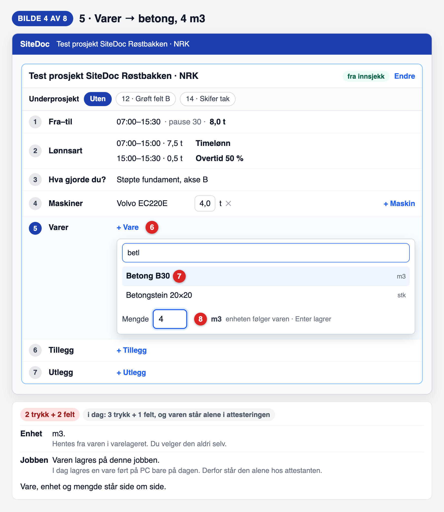
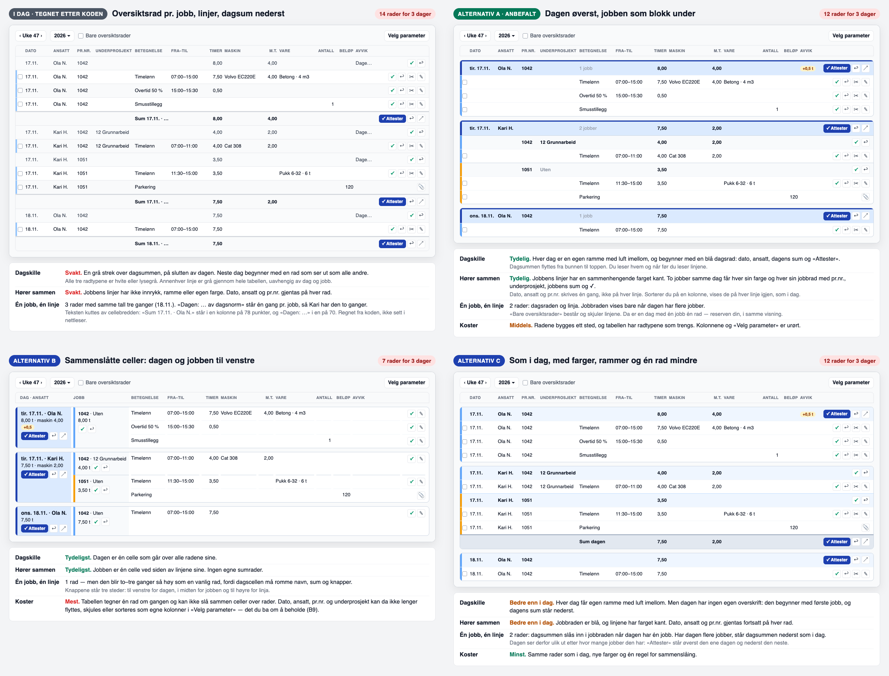

# Timeføring på web — plan med bilder (FORSLAG)

> **Bestilt av Kenneth 2026-11-17** etter test av develop `3b0f1abb` på test.sitedoc.no: *«hvorfor er ikke arbeidstimer
> og maskintimer som hører sammen på samme linje? maskintimer registreringen fra til trengs ikke … registrering av
> dagseddel på web er jo ikke slik vi har det på mobilen … Du må levere ny plan med bilder i strukturert rekkefølge!
> WEB-> registrering av timer. Bilde 1->Bilde2 ....til registrering er ferdig. registrering skal være minimum trykk og
> valg. Skriv tekst sammen med bildet for hvor vi henter preutfylt informasjon og hvorfor.»*
>
> **Scenario:** en arbeider jobber 07:00–15:30, bruker Volvo i 4 timer og 4 m3 betong.
>
> **Bildene:** [`skisser-web-timeforing/`](skisser-web-timeforing/) — `bilde-1.png` … `bilde-9.png`, og alle ni
> samlet i `oversikt.png`. Kilde: `skisser.html`. Bildene er skisser av forslaget, ikke skjermbilder av noe som er bygget.
> Bilde 1–5 er føringen, 6–8 attesteringen, og 9 firmainnstillingene som styrer føringen.
> **Versjon 5:** dagsvisningen i attesteringen (B14) står i `b14-sammenlikning.png` — i dag og alternativ A, B og C
> side om side — og enkeltvis i `b14-idag.png`, `b14-a.png`, `b14-b.png` og `b14-c.png`. Kilde: `skisser-b14.html`.
>
> **Vedtak som står:** spec `prosjektkort-kortid-spec.md` § 12 — R3 (én linje), R24 (sperren), G5, H12 og H13, og B4 i
> § 10 (maskin-tak pr. kort i skjermen). Planen bygger på dem. Der planen går lenger, står avviket i § 4.1 med
> hjemmelen fra Kenneth. Det som fortsatt er åpent, står i § 8.
> **Versjon 6:** Kenneths ord 19.11. om maskintimer (§ 8.6 punkt 2) går lenger enn B4. Forslaget står i § 4.4 (w9).

## 1. Kenneths føringer (2026-11-17, ordrett)

> *«Alt 1. benytt GPS logg for å bestemme prosjektene og byggeplasser*
> *alt:2 benytt innlogget byggeplass Prosjekt/byggeplass*
>
> *registrering av timer*
> *fra/til*
> *lønnsart*
> *hva gjorde du*
> *hvilken(e) maskin(er)? hvor mange timer(for hver enkelt maskin spesifiseert (ikke fra/til)*
> *hvilke varer (vare og enhet og mengde)*
> *tillegg?*
> *utlegg*
>
> *Dette er informasjon som hører sammen og kan ikke vises hver for seg. Det skal tydelig komme frem i timelisten hvem
> kjørte maskinen og hvor mange timer. Arbeidstimene er allerede spesifisert for denne arbeideren, vi trenger ikke
> spesifisere hvilke minutter mannen var i maskinen eller når han jobbet uten maskinen så lenge han er på samme "jobb" i
> prosjektet»*

| Føring | Slik følger planen den |
|---|---|
| **Prosjekt og byggeplass utledes** — Alt 1 GPS-logg, Alt 2 innlogget prosjekt og byggeplass | Bilde 1 og 2. Rekkefølgen er telefonens dag → innsjekk-loggen → prosjektet og byggeplassen i toppen → arbeideren velger. Telefonens GPS-logg finnes ikke på serveren (WM23) og sendes ikke dit (B2 og B3, vedtatt). |
| **Én samlet registrering** i rekkefølgen fra/til · lønnsart · hva gjorde du · maskiner · varer · tillegg · utlegg | Bilde 2–5. Jobben er én flate med sju faste deler, i denne rekkefølgen. Ingen egne vinduer. |
| **Alt hører sammen og vises sammen** | Jobben er prosjektkortet. Føringen (bilde 5) og timelista (bilde 6) viser samme enhet. |
| **Hvem kjørte maskinen, og hvor mange timer** | Bilde 6: ansatt, maskin og maskintimer på samme linje. |
| **Maskin har timer, ikke klokkeslett.** Timene deles ikke i «med maskin» og «uten» | Bilde 3: maskin = utstyr + timer, høyst jobbens timer. Firmaet kan velge fra–til i tillegg (B5, bilde 9). Det som må endres, står i § 5. |

### 1.1 Kenneths svar på versjon 2 (2026-11-17, ordrett)

> *«hva skjer hvis det inngår overtid i denne perioden? hvordan viser vi det*
>
> *kun en ting savnes -> hva om timer tilhører underprosjekt?*
>
> *Atttestering -> viktig å vise kjærneinformasjon #2-> trykk på #2 og da vises registreringen#3 -> i attestering så må
> den som attesterer kunne dele opp timer lett dersom noe er feil registrert. f.eks underprosjekt mangler eller ikke
> riktig registrert. feil lønnsart med mere»*

«#2» er attesteringslinja og «#3» er jobben, etter utsnittene Kenneth markerte (`relay/kenneth-2026-11-17-timer/93`
og `94`). Lest slik: linja viser kjernen, og et trykk på linja åpner registreringen slik den ble ført.

| Spørsmål | Svar i planen |
|---|---|
| **Overtid i perioden** | Bilde 2 og 6. Tiden etter dagsnormen får egen linje med firmaets overtidsart, i jobben og i attesteringen. Maskinen fordeles av systemet. |
| **Timer som tilhører underprosjekt** | Bilde 2 og 5. Underprosjektet står i jobbens hode. Én jobb har ett underprosjekt; to underprosjekter er to jobber («Del jobben»). |
| **Attesteringen: kjernen på linja, trykk åpner registreringen, del opp lett** | Bilde 6, 7 og 8. Det som avviker fra vedtak i kort-id-specen § 12, står i § 4.1. |

### 1.2 Vedtatt 2026-11-17: B1–B11 som føringer

Kenneths ord står i § 8.1. Her står hva de betyr i planen, og hva som er målt.

| # | Føring | Slik står det i planen | Målt |
|---|---|---|---|
| **B1** | Ikke «Ny dag». Én knapp «+ Registrer timer» åpner en jobb på et prosjekt. Dagen summeres etter hvert. | Bilde 1, 2 og 5. Dagsseddelen lages stille når første jobb føres på en dato. Neste jobb legges på samme seddel. Annen dato og annet prosjekt velges i jobbens hode. «Send dagen» består. | WM57–WM61 |
| **B2** | Rekkefølgen telefonens dag → innsjekk-loggen → toppen → arbeideren velger. | Bilde 1. Siste trinn er ikke lenger et skjema: jobben åpnes med prosjektet tomt. | WM23–WM26 |
| **B3** | GPS-loggen sendes ikke til serveren. | Vedtaket «synkes aldri» står. | WM23 |
| **B4** | Dagsnormen leses fra firmaets innstillinger eller kalender for datoen. 07:00–15:30 med 30 minutter pause er 7,5 t og 0,5 t overtid. | Bilde 2, 5, 8 og 9. Ingen skjerm har 7,5 som fast tall. | WM62–WM65 |
| **B5** | Firmaet velger om maskin føres med fra–til. Begge moduser. | Bilde 9 og § 5. Ny firmainnstilling, som krever en migrering. Hvem som får hvilken verdi ved innføringen, er B12. | WM66–WM67 |
| **B6** | «Hva gjorde du?» er påkrevd på web. | Bilde 2. Kontrolleres pr. jobb før «Send dagen». | WM31 |
| **B7** | Korte merker i Avvik. Forklaringen vises på hover, og ved trykk på berøringsskjerm. | Bilde 6 (B). Bruker `Tooltip`, som finnes. | WM21, WM68 |
| **B8** | Overtid er egen linje med én gang. | Bilde 2 og 6. | WM37–WM39 |
| **B9** | 11 kjernekolonner er standard. «Velg parameter» består. Klikk på linja åpner hele registreringen for inspeksjon og oppdeling. | Bilde 6 og 7. Tall på tilleggs- og utleggslinjer er B13. | WM69–WM71 |
| **Tillegg** | Datoen vises som dd.mm. Året byttes som egen handling. | Bilde 6 (A): årsvelger ved ukevalget. | WM72 |
| **B10** | Alle som kan attestere linja, får rette og dele opp når «rediger ved attestering» er på. | Bilde 7 og 8. Serverens krav endres tre steder. | WM54 |
| **B11** | «Uten» er forhåndsvalgt. Få underprosjekter: knapper. Mange: søkbar nedtrekk. | Bilde 2 og 7. Til og med 6 underprosjekter er knapper. | WM45, WM73 |

## 2. Svar til Kenneth

- **Telefonen er ikke bygget om.** I prosjektkort-modus fører du i Bekreft dag: tid, lønnsart, beskrivelse, «+ Maskin»,
  «+ Varer», tillegg og utlegg på én skjerm. Det eneste nye i dag er at en maskin som selges pr. time, må kobles til
  en timerad (d2c-2, merget 17.11 kl. 10:16).
- **Web har aldri fått den flyten.** Web har to skjermer før første rad og fem egne vinduer (timerad, maskin, vare,
  tillegg, utlegg), og viser maskiner etter timeradene og varer i en egen liste.
- **Bildene du fikk 6. og 7. november, viste telefonen.** Web er ikke tegnet før nå.
- **Linjene du så i attesteringen 07.11, er ført før koblingen fantes på PC** (16.11 kl. 23:14). En maskin ført på PC i
  dag havner på timeradens linje. En **vare** ført på PC gjør det fortsatt ikke.
- **GPS-loggen ligger bare på telefonen.** Den sendes aldri til serveren, etter vedtak. Web kan lese innsjekken på
  byggeplassen og prosjektet du står i.
- **Forslaget:** «+ Registrer timer» med ett trykk, og jobben føres på én flate i din rekkefølge. 6 trykk og 4–5
  felt, mot 10 trykk og 3 felt i dag. Dagen summeres etter hvert. Overtid står som egen linje, og underprosjektet
  velges i jobbens hode.

## 3. Målt mot koden (develop @ 3b0f1abb; WM57–WM73 @ b8b16571)

Timer-koden er lik på de to hashene: `git diff 3b0f1abb b8b16571 -- apps packages` viser bare 3D-filer.

Forkortelser: `NY` = `apps/web/src/app/dashbord/timer/ny/page.tsx`, `WS` = `apps/web/src/app/dashbord/timer/[id]/page.tsx`,
`D` = `apps/api/src/routes/timer/dagsseddel.ts`, `M` = `apps/mobile/src`, `PS` = `packages/db/prisma/schema.prisma`,
`ST` = `packages/db-timer/prisma/schema.prisma`, `BD` = `apps/mobile/app/timer/bekreft-dag.tsx`.

**Web i dag**

| # | Funn | Referanse |
|---|---|---|
| WM1 | **To skjermer før første rad.** «Ny dagsseddel» på Mine timer åpner et skjema (dato, prosjekt, aktivitet, arbeidstid, kommentar). «Opprett dagsseddel» lager sedelen og åpner dagssiden. Det finnes ingen vei med ett trykk. | `apps/web/src/app/dashbord/timer/mine/page.tsx:313`; `NY:190–203`; `apps/web/src/app/dashbord/[prosjektId]/timer/ny/page.tsx:10` |
| WM2 | **Fra, til og pause i skjemaet kommer fra firmaets arbeidstid:** `OrganizationSetting.standardStartTid`, `standardSluttTid` og `standardPauseMin`. Standard i databasen er 07:00, 15:00 og 30. Firmaet endrer dem i Firma → Innstillinger. Bruker firmaet kalender som normkilde, kan kalenderen overstyre. | `NY:116`, `:124–126`; `apps/api/src/services/timer/arbeidstid.ts:49–70`; `PS:434–436`; `apps/web/src/app/dashbord/firma/innstillinger/page.tsx:953`, `:985` |
| WM3 | **Lønnsarten bærer ingen arbeidstid.** `Lonnsart` har ingen felt for fra, til eller timer pr. dag. Dagsnormen (7,5) er en egen firmainnstilling, `OrganizationSetting.dagsnorm`. | `ST:22–57`; `PS:408` |
| WM4 | **Serveren lager første timerad selv** når prosjektet er sendt med: firmaets standard-lønnsart (`erStandardvalg`), tidene fra skjemaet, og pausen trukket når dagen er over 5,5 timer. Byggeplass sendes ikke, så raden får «Ingen byggeplass» selv om toppen viser en. | `D:3859–3869`, `:2534–2538`; `packages/shared/src/utils/pauseBeregning.ts:30`; `NY:190–203` |
| WM5 | **Prosjekt, aktivitet og dato i skjemaet:** prosjektet fra toppen av siden, aktiviteten «Anleggsarbeid» hvis den finnes og ellers den første, datoen i dag. | `NY:108–113`, `:152–162`, `:46` |
| WM6 | **Vinduet «Legg til timer-rad»:** Fra er siste til-tid på dagen, ellers firmaets start. Derfor sto det 15:00 med tom Til hos Kenneth. Lønnsart er alltid standardvalget. Vinduet har en sammenleggbar del «Maskin (valgfritt)». **Vare finnes ikke i vinduet.** | `WS:693–706`, `:2840–2850`, `:3658–3724`, `:3350–3368` |
| WM7 | **Vinduet «Legg til maskinbruk»** har Utstyr, Timerad, Byggeplass, Antall timer, Fra kl., Til kl., Mengde, Enhet, Underprosjekt og en infolinje. Fra og til er merket valgfritt og er ikke påkrevd noe sted, verken i skjermen eller på serveren. De fylles ut med dagens ramme, og antallet regnes av dem. | `WS:4798–5308`, `:1030–1037`, `:4874–4886`, `:5166–5194`, `:5075`; `D:10033` |
| WM8 | **«Timerad (Valgfritt)»:** merkelappen «Valgfritt» står så lenge utstyr ikke er valgt. Velger du en maskin som krever timerad, forsvinner den, og lagring stoppes uten rad. Timeraden er forvalgt når kortet har én arbeidsrad. Serveren håndhever det samme (R24). | `WS:4925`, `:5113–5121`, `:5036–5043`, `:4917–4922`; `D:2195–2201`; `packages/shared/src/utils/maskinKobling.ts:19–21` |
| WM9 | **«Arbeid i gruppen: 7,5 t · ledig: 8 t»:** ledig er arbeid **pluss pausen**, minus maskintimer som alt er ført. 7,5 + 0,5 = 8. Teksten sier ikke det. | `packages/shared/src/utils/maskinKapasitet.ts:72–73`; `WS:4988–4992`; `packages/shared/src/i18n/nb.json:604` |
| WM10 | **Maskinens fra–til brukes ikke videre.** Rapport og eksport tar dem ikke med. Attesteringens redigering bærer dem bare videre. | `packages/shared/src/utils/timerDetaljRader.ts:223`; `apps/api/src/routes/timer/rapport.ts:697–714`; `apps/web/src/components/timer/AttesteringDetalj_Edit.tsx:174` |
| WM11 | 🔴 **Varen kobles ikke til timeraden på web.** Vinduet for vareforbruk sender bare dagen. Kolonnen for kobling finnes, og serveren tar imot den. Varen blir derfor en egen linje i attesteringen. | `apps/web/src/components/timer/KortVareforbrukModal.tsx` (0 treff på `sheetTimerId`); `apps/api/src/routes/vareforbruk.ts:75–84`; `packages/db-varelager/prisma/schema.prisma:85–88` |
| WM12 | **I kortet på dagssiden står maskinene etter timeradene, og varene i en egen liste under.** Ikke på raden. | `WS:2173–2194`, `:1699–1715` |
| WM13 | **Dagens web, talt for scenarioet: 10 trykk og 3 felt.** Ny dagsseddel · Til 15:30 · Opprett · + Maskin · åpne velger · Volvo · antall 4 · Lagre · + Vareforbruk · betong · antall 4 · Lagre · Send dagen. Talt i koden, ikke klikket i nettleser. | WM1–WM11 |

**Telefonen i dag**

| # | Funn | Referanse |
|---|---|---|
| WM14 | **To moduser, styrt av firmaet:** dagskort (standard) og prosjektkort. I prosjektkort-modus åpner «+» Bekreft dag. | `PS:495`; `packages/shared/src/utils/prosjektkort.ts:13–14`; `M/components/DagsseddelListe.tsx:136–138` |
| WM15 | **Bekreft dag er én skjerm:** prosjekt, tid, lønnsartlinjer og pause, «+ Maskin» og «+ Varer», tillegg og utlegg, beskrivelse, «Bekreft og lagre». Så «Send dagen». | `BD:1454–1506`, `:2279–2292`, `:1805`; `M/components/timer-detalj/BekreftDagRadTillegg.tsx:119`, `:127` |
| WM16 | **Maskin på telefonen har ikke fra–til når den føres fra en rad** — bare timer, mengde og enhet. Timene er forhåndsutfylt med radens timer. Fra Bekreft dag lagres maskinen uten fra–til. Dagskort-modusens maskinvindu har fortsatt fra–til. | `M/components/timer-detalj/BekreftDagRadTillegg.tsx:271`; `M/utils/dagsforslagAnvend.ts:503–504`; `M/components/timer-detalj/MaskinSeksjon.tsx:928` |
| WM17 | **Forhåndsutfylling på telefonen:** start er siste til-tid på dagen, ellers firmaets start; slutt er firmaets slutt; pausen er firmaets. Sist brukte maskiner står øverst i velgeren (fem). | `M/utils/manuellDag.ts:44–51`; `M/utils/nyRadTider.ts:23–24`; `M/services/nyTimerRad.ts:130` |
| WM18 | **I kortet står maskin og vare under raden sin:** «Volvo EC220E · 4 t» og «Betong 4 m3». | `M/components/timer-detalj/prosjektkort/ProsjektkortDagsoversikt.tsx:741`, `:755` |

**Attesteringen (bilde 84)**

| # | Funn | Referanse |
|---|---|---|
| WM19 | **En maskin står på timeradens linje bare når den er koblet** til en timerad i samme kort. Ellers er den egen linje med Type «Maskin». Kolonnene Maskin og Maskintimer er på som standard. Sortering endrer ikke dette. | `packages/shared/src/utils/kortGruppering.ts:156–157`; `packages/shared/src/utils/timerDetaljRader.ts:736–742`; `apps/web/src/components/timer/TimerRadTabell.tsx:166–169` |
| WM20 | **PC sendte ikke koblingen før d2c-1,** som ble merget 2026-11-16 kl. 23:14. Telefonen fikk sperren 2026-11-17 kl. 10:16. Rader ført 07.11 på PC har derfor ingen kobling. **Ikke målt:** databasen — jeg har ikke lest radene til Kenneth. | `git show 274e7fb2^1` (0 treff på `sheetTimerId` i `WS`); `git log -1 274e7fb2`, `338de16a` |
| WM21 | **Hvorfor maskinlinjene er høye — mest sannsynlig Avvik-cellen.** Alle celler kuttes med «…», unntatt Beskrivelse og Avvik, som brytes over flere linjer. En egen maskinlinje får to setninger i Avvik: «Maskin uten arbeidstimer» og «Maskinarbeid uten registrert maskinførerbevis — flagget for synlighet.» Kolonnen er minst 180 px bred. Rundt 95 tegn i 180 px gir fem–seks tekstlinjer. **Lest i koden, ikke målt i nettleser.** | `apps/web/src/components/attestering/AttesteringTabell.tsx:259–262`; `apps/web/src/components/attestering/attestering-tabell.ts:300–306`; `packages/shared/src/utils/timerDetaljRader.ts:755`; `packages/shared/src/i18n/nb.json:5064`, `:4607` |
| WM22 | **Merket heter «Maskin uten arbeidstimer» i tabellen.** Specen (G5, R24) sier «Maskin uten timerad». | `packages/shared/src/i18n/nb.json:5064` |

**Prosjekt og byggeplass: hva web kan utlede (føring 1)**

| # | Funn | Referanse |
|---|---|---|
| WM23 | 🔴 **Telefonens GPS-logg sendes aldri til serveren.** Arbeidsdagen og besøkene pr. byggeplass ligger bare i telefonens lokale database. Serveren har ingen modell for dem og får bare den ferdige dagsseddelen. Det er et vedtak, ikke en mangel: «synkes ALDRI». | `M/db/schema.ts:447`; `docs/claude/timer-gps-helhetsplan.md:52`; `docs/claude/timer-gps-lag3-4-spec.md:131` |
| WM24 | **Det serveren har, er innsjekk-loggen:** `PsiTilstedevarelse` med prosjekt, byggeplass, bruker, innsjekk-tid, utsjekk-tid og kilde (manuell, QR, geofence, HMS-kort, app). Den finnes bare når PSI-modulen er på. Klokkeslettene er firma-isolert. | `PS:2436–2454`; `apps/api/src/routes/mannskap.ts:166` |
| WM25 | **Ingen prosedyre gir «mine innsjekker for en dato».** `minStatus` gir bare den åpne innsjekken nå, for ett prosjekt. `hentForProsjekt` gir alle personer på prosjektet. | `apps/api/src/routes/mannskap.ts:269`, `:319` |
| WM26 | **Prosjektet og byggeplassen i toppen av siden («innlogget»):** prosjektet huskes i nettleseren. Byggeplassen huskes i nettleseren og på serveren. En innsjekk som er nyere enn det manuelle valget, går foran. Timer-sidene leser begge. | `apps/web/src/kontekst/prosjekt-kontekst.tsx:15`; `apps/web/src/kontekst/byggeplass-kontekst.tsx:22`, `:152`; `packages/shared/src/utils/standardByggeplass.ts:87`; `NY:108–113`; `apps/web/src/components/timer/RadByggeplassFelt.tsx:19–41` |
| WM27 | **Vedtak 2026-11-15:** målte tidspunkter fra geofence og innsjekk **kan** foreslås som tider; arbeideren bestemmer og retter. Innsjekk som tidskilde er en egen ordre som ikke er bygget. | `docs/claude/timer-gps-lag3-4-spec.md:133` |
| WM28 | **Telefonens dagsforslag er ren regning, men bor i mobilappen** og leser telefonens lokale database. Web har ikke noe tilsvarende. GPS i nettleseren på PC er et eget BACKLOG-punkt som ikke er gjort. | `M/utils/dagsforslag.ts:10`; `M/services/dagsforslagInput.ts:86`; `docs/claude/BACKLOG.md:4412` |

**Tillegg, utlegg og beskrivelse (føring 2 og 3)**

| # | Funn | Referanse |
|---|---|---|
| WM29 | **Tillegg og utlegg på web går gjennom en velger og så et eget vindu hver.** Antallet er forhåndsutfylt med 1. Kvittering kan bare legges ved etter at raden er lagret. De hører til kortet (`kortId`), ikke til en timerad. Web sender ikke `kortId`; serveren finner kortet selv. | `WS:4300`, `:3842`, `:4503`, `:3870`, `:4106`; `ST:435`, `:513`; `D:5178`, `:5227` |
| WM30 | **På telefonen står tillegg og utlegg i Bekreft dag,** på samme skjerm som resten, pr. kort. | `BD:1805`; `M/components/timer-detalj/BekreftDagLonnUtlegg.tsx:18` |
| WM31 | **«Hva gjorde du?» er valgfritt på web og påkrevd på telefonen.** På telefonen er regelen én tekst pr. kort. Teksten lagres på kortets arbeidsrader. | `WS:3638`; `BD:998`; `M/utils/bekreftDag.ts:116`; `ST:251`; `docs/claude/prosjektkort-kortid-spec.md:529` |

**Maskintimene (føring 4)**

| # | Funn | Referanse |
|---|---|---|
| WM32 | **Maskintaket finnes i tre lag.** Serveren: maskintimer ≤ arbeidstimer + pause pr. bøtte (prosjekt + underprosjekt), kontrollert åtte steder. Telefonen pr. rad: hver maskin ≤ radens timer. Bekreft dag: pr. kort i skjermen. | `packages/shared/src/utils/maskinKapasitet.ts:42`, `:54`; `D:2806`, `:3287`, `:4135`, `:4389`, `:4818`, `:9252`, `:10079`, `:10212`; `M/services/kobledeMaskiner.ts:56–58`; `BD:1645` |
| WM33 | **Bekreft dag fordeler kortets maskiner og varer på kortets timerader selv.** Varene går til første rad. Maskinene fyller første rad og renner over til neste. En maskin på 9 timer på en jobb med 7,5 t ordinært og 1,5 t overtid blir to maskinrader. De lagres uten fra–til. | `M/utils/tilleggPaaKort.ts:80–81`, `:109`; `M/utils/dagsforslagAnvend.ts:503–504` |
| WM34 | **På web kan maskintimene ikke settes i timerad-vinduet** — maskinen får radens timer. I maskinvinduet er taket pr. bøtte en hard sperre. | `WS:3361`; `WS:5299` |
| WM35 | **Pausen i taket er begrunnet med døgn-maskiner.** Dokumentasjonen sier at den ikke er ment for timeleide maskiner. Koden legger den likevel til alle. Vedtak 2026-11-16 (B4): «maskin-tak som i dag på server, pr. kort i skjermen». | `docs/claude/fase-0-beslutninger.md:2112–2116`; `docs/claude/prosjektkort-kortid-spec.md:606` |
| WM36 | **I attesteringen står ansatt, maskin og maskintimer på samme linje.** I timerapportens Detaljer står maskinnavnet som et tillegg i Betegnelse, uten egen maskinkolonne. Egen kolonne hører til ordre d3 i kort-id-specen, som ikke er bygget. | `packages/shared/src/utils/timerDetaljRader.ts:736–742`; `apps/web/src/lib/timer-rapport-eksport.ts:420` |

**Overtid (Kenneths svar på versjon 2)**

| # | Funn | Referanse |
|---|---|---|
| WM37 | **Én regel avgjør overtid:** resten av dagsnormen er dagsnormen minus arbeid som alt er ført på datoen. Jobben får normaltid opp til resten, deretter overtid. Reise og fravær teller ikke. Det er dagsnormen som gjelder, ikke ukenormen. Bare 50 % er bygget. | `docs/claude/prosjektkort-kortid-spec.md:333–340`; `packages/shared/src/utils/lonnsregel.ts:10`, `:65`, `:114` |
| WM38 | **Telefonen viser overtid som egen linje** i Bekreft dag: «07:00–15:00 · 7,5 t · Timelønn ▾» og «15:00–15:30 · 0,5 t · Overtid 50 % ▾». Lønnsarten kan byttes pr. linje. Det lagres som to timerader i samme kort. | `docs/claude/prosjektkort-kortid-spec.md:355–362`; `M/utils/dagsforslag.ts:1888–1950`; `BD:2294–2310`; `packages/shared/src/i18n/nb.json:5776` |
| WM39 | **Web viser overtid som et forslag med knappen «Del raden»** i timerad-vinduet. Trykket lager to rader. Serveren lager aldri en overtidsrad selv. | `packages/shared/src/utils/overtidForslag.ts:74`; `WS:3101–3160`, `:3178–3250`, `:3538–3540`; `packages/shared/src/i18n/nb.json:631–633`; `D:2534–2538` |
| WM40 | **Mulig feil, lest og ikke kjørt:** når en rad deles i normal og overtid på web, får en ny maskin **hele** radens timer på normal-delen. | `WS:3236–3240` |
| WM41 | **«Sum i dag X t av Y t»:** prikken blir gul når X er over Y. Ingen tekst sier hvorfor. | `packages/shared/src/utils/prosjektkort.ts:173–180`; `WS:1822–1832` |
| WM42 | **Fordelingen med overtid:** en maskin på 4 t på en jobb med 7,5 t ordinært og 0,5 t overtid havner i sin helhet på den ordinære linja. En maskin på 8 t blir 7,5 + 0,5. Den ordinære er først fordi den lages først, ikke fordi radene sorteres på tid. | `M/utils/tilleggPaaKort.ts:76–88`; `packages/shared/src/utils/lonnsregel.ts:65` |
| WM43 | **I attesteringen blir ordinær tid og overtid to linjer i samme kort,** sortert på fra-tid. Varen står på linja den er koblet til. | `packages/shared/src/utils/kortGruppering.ts:147`, `:155–164` |

**Underprosjekt**

| # | Funn | Referanse |
|---|---|---|
| WM44 | **Et kort har ett prosjekt, ett underprosjekt og én byggeplass** (K2–K4). To kort kan ha like verdier (K7). | `docs/claude/prosjektkort-kortid-spec.md:107–109`, `:113` |
| WM45 | **Telefonen velger underprosjekt med knapper pr. kort,** «Uten» først. De vises bare når prosjektet har åpne underprosjekter, og ingenting er forhåndsvalgt utover «Uten». Valget skrives på kortets arbeidsrader, maskin, varer, tillegg og utlegg. «Sist brukt underprosjekt» finnes ikke. | `BD:1573`, `:667–679`; `M/utils/dagsforslagAnvend.ts:349–355`, `:497`, `:525`; `docs/claude/prosjektkort-kortid-spec.md:265–266` |
| WM46 | **Web velger underprosjekt i en nedtrekksliste i hvert vindu** (timerad, maskin, tillegg, utlegg). Lista er prosjektets aktive underprosjekter som er åpne for timer. Kortet på dagssiden er pr. prosjekt, med en undergruppe pr. underprosjekt. | `WS:3570–3590`, `:5238–5252`, `:593–657`, `:2129–2140`; `apps/api/src/routes/eksternKostObjekt.ts:69–89` |
| WM47 | **Web kan ikke lage et nytt kort på et prosjekt som alt har kort.** «+ Nytt prosjektkort» tilbyr bare prosjekter uten kort. Kort-id-specen § 5.4 sier at det skal gå. | `WS:680–682`, `:992` |
| WM48 | **Dele en jobb:** telefonen har «Del til eget kort» ved et klokkeslett. Web har «Del opp» pr. rad, der delene kan få ulikt underprosjekt. Valget «eget kort» finnes ikke i web-vinduet, selv om serveren støtter det. | `M/utils/kortIdForslag.ts:125`; `BD:1614`; `apps/web/src/components/timer/SplittRadModal.tsx` (0 treff på `egetKort`); `D:2612` |

**Attesteringen: linja, retting og oppdeling**

| # | Funn | Referanse |
|---|---|---|
| WM49 | **Et trykk på en linje gjør ingenting.** Lenken til detaljsiden står bare på dagens sumrad. | `apps/web/src/components/timer/TimerRadTabell.tsx:310–316`; `apps/web/src/components/attestering/AttesteringTabell.tsx:411` |
| WM50 | **Linja har 26 kolonner som standard og er minst 2 814 punkter bred.** Maskin begynner om lag 1 340 punkter inn, Vare om lag 1 700. På en skjerm på 1 440 må attestanten rulle sidelengs for å se dem. Regnet fra koden, ikke målt i nettleser. | `packages/shared/src/utils/timerDetaljRader.ts:736–742`, `:745–755`; `apps/web/src/components/timer/TimerRadTabell.tsx:192–194`; `apps/web/src/components/attestering/AttesteringTabell.tsx:75` |
| WM51 | **Retting i cellen er bygget:** fra, til, timer, pause, lønnsart og aktivitet på timeraden; maskin, maskintimer, mengde og enhet; antall på tillegg. Ikke prosjekt, underprosjekt, byggeplass, beskrivelse eller vare. Cellen viser «var …» etter retting. | `apps/web/src/components/attestering/AttesteringTabell.tsx:196–218`, `:239`, `:271–287` |
| WM52 | 🔴 **Underprosjekt kan ikke rettes fra tabellen.** «Flytt underprosjekt» finnes på serveren (`flyttTimerRadEco`), men **ingen skjerm kaller den** — 0 treff i `apps/web` og `apps/mobile`. Den flytter bare timer- og tilleggsrader; maskinens underprosjekt oppdateres ikke. Eneste vei i dag er detaljsiden → «Rediger hele sedelen» → nedtrekk → Lagre, om lag fire trykk. R14 og R21 i kort-id-specen forutsetter handlingen. | `D:6627`; `apps/web/src/components/timer/AttesteringDetalj.tsx:494–497`; `apps/web/src/components/timer/AttesteringDetalj_Edit.tsx:218` |
| WM53 | **«Del opp» (✂):** pr. del kan prosjekt, lønnsart, aktivitet, underprosjekt, fra, til og timer settes. Timene regnes ikke ut av klokkeslettene. Å dele 8 t i to med ulikt underprosjekt er om lag sju handlinger. Koblede maskiner og varer blir på første del. | `apps/web/src/components/timer/SplittRadModal.tsx:210–224`, `:280`; `apps/web/src/components/timer/RedigerTimerRad.tsx:63–147`; `D:7591` |
| WM54 | **Hvem får rette:** retting i cellen, pennen og ✂ krever firmaadministrator og firmavalget «rediger ved attestering». «Flytt underprosjekt» krever bare attesteringsrett. Skjermen viser ✂ og pennen uten å sjekke firmavalget; serveren avviser. | `D:7251`, `:2998`, `:7497`, `:6658`; `apps/web/src/components/attestering/AttesteringTabell.tsx:418`, `:431` |
| WM55 | **Mulig feil, lest og ikke kjørt:** vinduet bak pennen sender `byggeplassId: null` for alle radene det lagrer. | `apps/web/src/components/attestering/RedigerRadModal.tsx:403`, `:414`, `:435`, `:450` |
| WM56 | **Telefonens attestering kan ikke rette eller dele.** | `apps/mobile/src/components/timer-attestering/AttesteringDetaljMobil.tsx:52` |

**Målt i versjon 4 — «+ Registrer timer» og dagsseddelen (B1)**

| # | Funn | Referanse |
|---|---|---|
| WM57 | **Én dagsseddel pr. arbeider pr. dato, uten prosjekt.** Prosjektet ligger på raden. | `ST:214`; `D:3761–3764` |
| WM58 | **`opprett` er alt «finn eller lag».** Den tar imot dato, aktivitet (påkrevd) og prosjekt (valgfritt). Finnes dagen, returneres den urørt med `eksisterte: true`. Første timerad lages bare når sedelen er tom. | `D:3753–3774`, `:3824–3856`, `:3857–3869`, `:3871–3888`, `:2509–2530` |
| WM59 | **En jobb til på en dag som har rader, er `tilfoyTimerRad` med ny `kortId`.** Serveren tar imot feltet. Web sender det aldri, så raden havner i dagens eldste kort med samme prosjekt, underprosjekt og byggeplass. **Ikke lest:** hvordan `tilfoyTimerRad` behandler en `kortId` serveren ikke kjenner. | `D:3990–3991`; `WS` (0 treff på `kortId`); `docs/claude/prosjektkort-kortid-spec.md:232`, `:244` |
| WM60 | **Låsene.** Rader kan bare føres når dagen er utkast eller returnert. En sendt dag kan arbeideren gjenåpne selv, så lenge ingen rad er attestert. Dager eldre enn firmaets grense avvises. Fra og til er påkrevd på timeraden. | `D:230–233`, `:4009–4014`, `:5745–5790`, `:1531–1552`, `:4000–4006` |
| WM61 | **Knappen på Mine timer heter «Ny dagsseddel» og lenker til skjemaet.** Sedelens kommentar kan rettes på dagssiden etterpå. | `apps/web/src/app/dashbord/timer/mine/page.tsx:311–319`; `packages/shared/src/i18n/nb.json:269`; `WS:5346–5368` |

**Målt i versjon 4 — dagsnormen (B4)**

| # | Funn | Referanse |
|---|---|---|
| WM62 | **Normleseren tar firma og dato.** «Fast»: `dagsnorm`-kolonnen, og sesong ignoreres. «Kalender»: slutt − start − pause, og en dato mellom aktiv `sommertid_start` og `sommertid_slutt` samme år bruker tidene på `sommertid_start`-raden. Standard er «fast». Firmaet velger i Firma → Innstillinger. Leseren bruker altså kalenderens sommertid-markører, men bare når firmaet står på «kalender». | `apps/api/src/services/timer/arbeidstid.ts:45–136`, `:74–76`, `:78–119`, `:123–126`; `PS:485`, `:408`, `:3134–3135`; `apps/web/src/app/dashbord/firma/innstillinger/page.tsx:1135–1153`; `packages/shared/src/i18n/nb.json:2217–2220` |
| WM63 | **I «kalender» finnes ikke et eget normtall.** Normen er arbeidstiden. 7 t vinter og 8 t sommer settes som arbeidstid 07:00–14:30 og en sommertid-rad 07:00–15:30, begge med 30 minutter pause. I «fast» er normen den samme hele året. | `arbeidstid.ts:123–126` |
| WM64 | **Web og server leser normen pr. dato fra samme leser.** | `apps/api/src/routes/organisasjon.ts:1347–1358`; `WS:672–677`; `D:1161`, `:2548`, `:3818`, `:6540` |
| WM65 | **Halvdag og helligdag endrer ikke normen.** Leseren slår bare opp sommertid-radene. Ikke lest: telefonen. | `arbeidstid.ts:17–19`, `:78–106` |

**Målt i versjon 4 — maskin med fra–til som firmavalg (B5)**

| # | Funn | Referanse |
|---|---|---|
| WM66 | **Maskinradens fra og til er valgfrie kolonner; timer er påkrevd.** Radene trenger ingen skjemaendring. | `ST:593–594`, `:599` |
| WM67 | **Firmainnstillingene er faste kolonner.** Modellen har ikke noe fritt felt. En ny innstilling er en ny kolonne i `packages/db`, altså en migrering. Telefonen speiler firmainnstillingene i en lokal tabell med én kolonne pr. innstilling. | `PS:376`, `:495` (0 treff på `Json` i modellen); `M/services/organizationSettingKatalog.ts:86`; `M/db/schema.ts:783` |

**Målt i versjon 4 — attesteringen (B7, B9, datoen) og underprosjekt (B11)**

| # | Funn | Referanse |
|---|---|---|
| WM68 | **`Tooltip` støtter berøring:** trykk viser, trykk utenfor lukker. Veilederen fraråder nativ `title=`, som ikke vises på berøringsskjerm. | `packages/ui/src/tooltip.tsx:81`, `:175`, `:228`; `docs/claude/retningslinjer/tooltip-hjelpetekst-veileder.md:10`, `:23` |
| WM69 | **Standardutvalget er én liste.** Kolonnevalg, rekkefølge og bredde lagres pr. bruker på serveren. En bruker med lagret oppsett beholder det; ny standard treffer bare den som ikke har lagret noe. Ingen «tilbakestill til standard» er funnet. **Ikke lest:** om oppsettet lagres før brukeren endrer noe. | `packages/shared/src/utils/timerDetaljRader.ts:736–742`; `apps/web/src/hooks/useTabelloppsett.ts:40`, `:89`; `apps/web/src/components/attestering/AttesteringTabell.tsx:72–73`, `:101` |
| WM70 | **De 11 kjernekolonnene er 14 kolonner i koden.** Fra og til er to. Vare, enhet og mengde er tre. Lønnsart er kolonnen `betegnelse`. Minstebreddene summerer til 1 462 punkter, før avkrysning og knapper. Sidemenyen er minst 220 punkter, så om lag 1 220 er ledig på en skjerm på 1 440. Regnet, ikke målt i nettleser. | `timerDetaljRader.ts:700`, `:704–705`, `:712–714`, `:607–636`, `:745–755`; `apps/web/src/components/layout/NavSidebar.tsx:231` |
| WM71 | **Antall og Beløp er egne kolonner,** for tillegg og utlegg. Uten dem viser en tilleggslinje ikke antallet og en utleggslinje ikke beløpet. | `timerDetaljRader.ts:715–716` |
| WM72 | **Datoen skrives `2026-11-17`.** Firmaets attestering viser én uke om gangen, med forrige uke, neste uke og «Denne uka». Året kan bare byttes ved å bla uke for uke. Prosjektets attestering har ikke ukevalg. | `apps/web/src/components/attestering/attestering-tabell.ts:169–172`; `AttesteringTabell.tsx:466`; `apps/web/src/app/dashbord/firma/timer/attestering/page.tsx:159–176`, `:194–199`, `:345–369`; `apps/web/src/app/dashbord/[prosjektId]/timer/attestering/page.tsx` (0 treff på `fraOgMed`) |
| WM73 | **`ui-standarder.md` har ingen grense for knapper mot nedtrekk.** Regelen «adaptiv nedtrekk» gjelder fritekstfelt som lærer av bruk: forslag etter tre bruk, og søkefelt når lista passerer 7. Telefonen har bare knapper (WM45). | `docs/claude/retningslinjer/ui-standarder.md:102–115` |

**Målt i versjon 5 — dagsvisningen i attesteringen (B14), develop @ `ee7146e5`**

`AT` = `apps/web/src/components/attestering/AttesteringTabell.tsx`, `AM` = `apps/web/src/components/attestering/attestering-tabell.ts`,
`TR` = `apps/web/src/components/timer/TimerRadTabell.tsx`.

| # | Funn | Referanse |
|---|---|---|
| WM74 | **En dag har tre radtyper.** For hver jobb (kort): én oversiktsrad, så linjene. Etter dagens siste jobb: én dagsum. «Etter prosjekt» har ingen dagsum. | `AT:532–589`, `:569–570` |
| WM75 | **Samme opplysning står tre steder.** Oversiktsraden viser dato, ansatt, pr.nr., underprosjekt og jobbens sum. Linjene bærer de samme fire feltene. Dagsummen viser «Sum {dato} · {ansatt}» og dagens sum. En dag med én jobb og én linje viser derfor samme timetall tre ganger. | `AT:538–563`, `:578–588`; `AM:272–284`; `packages/shared/src/i18n/nb.json:5057` |
| WM76 | **«Dagen: X t av dagsnorm Y t» bygges pr. jobb, ikke pr. dag.** En dag med to jobber viser setningen to ganger. | `AT:537`, `:556` |
| WM77 | **Dagen har ingen markering der den begynner.** Oversiktsraden har 1 punkt grå strek og lysegrå bunn. Dagsummen har 2 punkter grå strek over seg og står sist i dagen. Linjene veksler mellom hvit og lysegrå etter løpende linjenummer i hele tabellen, uavhengig av dag og jobb. Linjene har ikke innrykk. | `TR:331–342`, `:362–363`, `:208–214`; `AT:695–723` (sender ikke `innrykk`) |
| WM78 | **Cellene kutter tekst.** Etiketten «Sum 17.11. · Ola N.» står i kolonnen Betegnelse (78 punkter som standard), og «Dagen: …» i Avvik (70). Begge tekstene er lengre enn kolonnen. Regnet fra breddene; ikke sett i nettleser. | `TR:349`; `AT:89–105`, `:377–379` |
| WM79 | **«Bare oversiktsrader» skjuler linjene.** Oversiktsradene og dagsummen står. Valget gjelder besøket og lagres ikke. En dag med én jobb er da to rader med samme tall. | `AT:152`, `:564–567`, `:644` |
| WM80 | **Maskin og vare som er koblet til timeraden, står på timeradens linje.** Tillegg og utlegg er egne linjer i jobben. Vare- og utleggslinjer har ingen egen ✓. Reise er en egen blokk først på dagen, og rader uten kort-id samles sist. | `AM:300–413`, `:432–444`; `AT:565` |
| WM81 | **Knappene står på tre nivåer.** Linja: ✓ ↩ ↺ ✂ og penn. Oversiktsraden: ✓ ↩ ↺ for prosjektseddelen. Dagsummen: «Attester» for hele dagsseddelen, ↩ og lenke til sedelen. I prosjektets attestering gjelder dagsummens knapp bare prosjektets del. | `AT:396–415`, `:426–471`, `:473–493` |
| WM82 | **Sorterer brukeren på en kolonne, vises bare linjene,** som flat liste uten oversiktsrader og dagsum. Derfor bærer hver linje dato og ansatt. | `TR:195–206` |
| WM83 | **Tabellen tegner én rad om gangen.** Kolonnene kan flyttes, skjules og endre bredde. Tabellen har en fri rad (`overskrift`) og en sumrad med celler pr. kolonne. En celle kan ikke gå over flere rader. Timerapporten bruker samme tabell. | `TR:36–65`, `:309–357`; `apps/web/src/components/timer/TimerRapportDetaljer.tsx` |
| WM84 | **Radhøydene, målt i nettleser av w5:** oversiktsrad 38, linje 37, dagsum 43. En dag med én jobb og én linje er 118 punkter høy. | w5-leveransen, `relay/inbox-orkestrator.md:33267` |

**Målt i versjon 5 — attestantens egne timer (B15), develop @ `ee7146e5`**

`SK` = `packages/db/prisma/schema.prisma`. `D` er `apps/api/src/routes/timer/dagsseddel.ts`, som ellers i planen.

| # | Funn | Referanse |
|---|---|---|
| WM85 | **Ingen egenskap ved den ansatte sier timelønn eller fastlønn.** Verken brukeren eller ansettelsen har feltet. | `SK:10–80`, `:248–292`. Søkt uten treff: timelonn, fastlonn, lonnstype, lonnsform, maanedslonn, salaryType, payType, ansettelsesform. |
| WM86 | **«Timelønn» og «Fastlønn (månedslønn)» er to lønnsarter av samme type.** Bare navnet skiller dem, og firmaet kan endre navnet. Lønnsarten har ingen kolonne for lønnsform. | `packages/db-timer/prisma/schema.prisma:22–51`; `apps/api/src/services/seed/index.ts:61–62` |
| WM87 | **Modellen peker ikke ut noens leder.** Avdelingen har ikke leder. Stillingen (ansatt, bas, prosjektleder, daglig leder) er en opplysning og gir ingen rett. | `SK:2857–2875`, `:252`. Søkt uten treff: lederId, managerId, naermesteLeder, overordnet, avdelingsleder. |
| WM88 | **Attesteringsrett har firmaadministrator i sedelens firma, og aktiv ansatt som er prosjektadministrator eller har «kan attestere» på radens prosjekt.** Fravær uten prosjekt attesteres av firmaadministrator, og av prosjektleder når firmaet har valgt det. «Firmaansvarlig» gir ingen attesteringsrett. | `D:275–302`, `:332–358`, `:502–540`; `SK:741`, `:744` |
| WM89 | **Ingen prosedyre sammenligner den som attesterer, med den som eier sedelen.** Det gjelder attestering, retur, gjenåpning, retting, deling og flytting av underprosjekt — elleve prosedyrer. Listene tar med attestantens egne sedler. | `D:6018–6188`, `:6203–6500`, `:6791`, `:6917`, `:7121`, `:7315`, `:7422`, `:7515`, `:7529`, `:7695`, `:7802`, `:8287`, `:8465` |
| WM90 | **Kolonnen `tillattSelvAttestering` finnes i firmainnstillingene, med standard «ja». Ingen kode leser eller skriver den.** Den ble lagt inn 01.05. for en plan som ikke er bygget: at en vanlig ansatt kunne attestere egen seddel i stedet for å sende den til leder. | `SK:416–417`; migreringen `20260501200000_add_timer_modul_og_settings`; `timer.md:74`, `:453` |
| WM91 | **Sedelen bærer alt et flagg for retting og en sperretekst til skjermen.** En sperret linje får ✓ slått av med forklaring og sendes ikke med «Attester utvalget». ↩ stoppes ikke av sperren. | `D:6181`, `:6371`, `:6485`; `AM:256–258`, `:586–597`; `AT:405`, `:455`, `:483` |
| WM92 | **Telefonen har attestering for firmaadministrator:** liste, attestering av rader og retur. Den har ikke retting, deling eller gjenåpning. Av firmainnstillingene lagrer den bare «rediger ved attestering» lokalt. | `apps/mobile/app/timer/attestering/index.tsx:72–79`; `apps/mobile/src/components/timer-attestering/AttesteringDetaljMobil.tsx:72–77`; `apps/mobile/src/db/schema.ts:754` |

**Målt i versjon 6 — maskintimer over arbeidstimer (§ 8.6 punkt 2), develop @ `1afb318a`**

Linjene i `D` gjelder `1afb318a` og er forskjøvet fra WM32, som ble målt på en eldre hash. `MK` =
`packages/shared/src/utils/maskinKapasitet.ts`, `KS` = `docs/claude/prosjektkort-kortid-spec.md`.

| # | Funn | Referanse |
|---|---|---|
| WM93 | **Eksempeldagen er lagt rett inn i databasen med SQL. Den er aldri ført gjennom serveren.** Lokal kopi av test-basen (nyeste seddel der er fra 11.07.2026): Ola Tømrer 14.05.2026, pause 30 min, status sendt. Timerad 07–12 med 4,50 t uten underprosjekt, timerad 12–15 med 3,00 t på TILL-001, maskinrad 07–15 med 7,50 t uten underprosjekt. Sedelen og de tre radene har håndlagde ID-er (`22222222-4f4f-2222-2222-…`) og er opprettet 17.05.2026 kl. 10:02:06, i samme sekund. Bøtta var i brudd fra første stund: 4,5 + 0,5 t pause er mindre enn 7,5. Skriptet ligger ikke i repoet. | Lesespørring mot lokal `sitedoc` 19.11. (`timer.daily_sheets`, `sheet_timer`, `sheet_machines`); søk etter ID-en i treet og med `git log --all -S` ga ingen treff |
| WM94 | **Underprosjektet END-002 er satt senere.** I kopien fra 11.07. har 07–12-raden og maskinen ikke underprosjekt; på test 19.11. står begge på END-002. Begge veiene som bytter underprosjekt, skriver uten å sjekke taket (WM97). Hvilken som ble brukt, er ikke målt: test-basen er ikke lest. | WM93; `D:6926–6942`, `D:684–726` |
| WM95 | **Regelen kom dagen før dataene ble lagt inn.** `validerMaskinUnderArbeid` ble innført 16.05.2026, pausen i taket 18.05., og den delte funksjonen 05.07. Seed-koden som lager timer og maskin (`seed-timer-demo.ts`), skriver også rett i databasen, men holder seg under taket. | `git log -S validerMaskinUnderArbeid` → `ff5c90e1`; `731770da`; `docs/claude/fase-0-beslutninger.md:2110–2115`; `packages/db/scripts/seed-timer-demo.ts:162–176` |
| WM96 | **Taket sjekkes åtte steder, alltid mot alle bøttene på sedelen.** Kommentaren sier at bare nye og endrede rader sjekkes, men koden filtrerer ikke. En seddel som alt er i brudd, får derfor avvist enhver skriving som går gjennom sjekken, også i en annen bøtte. Lest i koden, ikke kjørt. | `D:2174–2199`, kommentaren `D:2133–2138`; `MK:80–108`; kallene `D:3000`, `:3501`, `:4354`, `:4608`, `:5037`, `:9680`, `:10507`, `:10640` |
| WM97 | **Sju skriveveier endrer arbeidstimer eller underprosjekt uten å sjekke taket:** (1) ✂ på en timerad — hver del kan få eget underprosjekt, og maskinen blir stående på første del; sjekken gjelder bare ✂ på en maskinrad. (2) Den ansattes egen deling av en timerad. (3) Bytte av underprosjekt på én timerad. (4) Bytte av underprosjekt for hele jobben. (5) «Del opp» (WM98). (6) Sletting av en timerad. (7) Endring av dagens pause i sedelhodet. | (1) `D:2988–3004`, `:7874`; (2) `D:8155`; (3) `D:6926–6942`; (4) `D:684–726`; (5) `D:7052–7074`; (6) `D:4700–4746`; (7) `D:4111–4165` |
| WM98 | **«Del opp» har to egne vakter, og begge har hull.** Vakten mot en maskin som går over klokkeslettet, slipper alle maskiner uten fra–til. Vakten mot for mange maskintimer ser bare på maskiner som er koblet til en rad som deles. En maskin uten klokkeslett som er koblet til en rad før klokkeslettet, eller ikke koblet til noen rad, blir stående på del A med alle timene. Med radene 07–12 og 12–15 og en maskin på 7,5 t uten klokkeslett gir «Del opp» ved 12 nøyaktig eksempelet. | `apps/api/src/routes/timer/jobb-deling.ts:94–98`; `D:7054–7072` |
| WM99 | **Synken sjekker det telefonen sender, ikke det som blir lagret.** Timerader serveren velger å ikke skrive, blir stående som de var. Maskinradene erstattes alltid med telefonens. En telefon med en eldre versjon av dagen kan derfor skrive maskintimene tilbake etter at arbeidstimene er flyttet på serveren. | `D:9671–9690`; `D:9970` og `:10137` (leseagent, ikke stikkprøvd) |
| WM100 | **Synken kan ikke skille en gammel app fra en ny, og den avviser hele sedelen.** Telefonen sender ingen versjon. Koden sier selv at en eldre app aldri skal avvises strengere enn før. En avvist seddel lagres ikke; telefonen viser et rødt felt «Avvist» med serverens tekst, som ikke er oversatt, til brukeren retter og lagrer på nytt. | `D:9683–9694`; `apps/mobile/src/lib/trpc.ts:18–21`; `apps/mobile/src/services/timerSync.ts:714–727`; `packages/shared/src/i18n/nb.json:687–689` |
| WM101 | **Taket ser ikke på hva slags maskin det er.** Døgn-maskiner telles med som alle andre. En Heatwork kan i dag ikke ha flere timer enn arbeidstimene pluss pausen i bøtta. Det er vedtatt slik: taket «gjelder fortsatt alle maskiner, også døgn-maskiner». | `MK:80–108`; `D:2174–2199`; `KS:1580`, `:1706` |
| WM102 | **Maskinen som går uten fører, kjennes igjen på ett felt: enheten maskinen selges i** (`Equipment.utleieEnhet`: «døgn», «time» eller ikke satt). Det er vedtatt som det styrende skillet (18.05. og 01.09.): døgn går uten fører; time og ikke satt krever fører og timerad (H15, 16.11.). Et eget merke for «krever fører» er uttrykkelig avvist. Heatwork-maskinene i seeden er småutstyr merket «Utleieobjekt» med enheten døgn. I den lokale kopien står alle fem Heatwork slik, og gravemaskinen uten enhet. | `packages/db-maskin/prisma/schema.prisma:96–100`; `packages/shared/src/utils/maskinKobling.ts:19–21`; `docs/claude/maskin.md:263–276`; `docs/claude/fase-0-beslutninger.md:2124–2133`; `KS:2085`; `packages/db-maskin/prisma/seed-amarkussen-heatwork.ts:34–72` |
| WM103 | **Enheten kan bare settes når maskinen er merket «Utleieobjekt».** Ny maskin opprettes uten enhet. Utleie pr. time kan ikke skilles fra en egen gravemaskin som selges pr. time: begge har enheten time og krever fører. «Materiell» finnes ikke som eget begrep; utleid materiell må ligge i maskinregisteret for å kjennes igjen. | `apps/web/src/app/dashbord/maskin/[id]/page.tsx:1715–1755`; `apps/api/src/routes/maskin/equipment.ts:250–284`, `:330–333`; `KS:1278` |
| WM104 | **En maskinrad føres alltid i timer.** Enhet og mengde på raden gjelder produsert mengde (m3, stk), ikke leietid. En døgn-maskin føres som timer. | `packages/db-timer/prisma/schema.prisma:577–630` |
| WM105 | **Ingen flate regner pr. jobb.** PC-en har ingen regel pr. rad eller pr. jobb, verken på dagssiden eller i attesteringen: maskinvinduet sperrer pr. bøtte med pausen, og feltet for maskintimer i den åpne registreringen er et fritt tall som bare serverens bøtteregel stopper. Attestanten kan derfor sette maskintimene over jobbens timer, eller kutte arbeidstimene under maskinens, så lenge bøtta har plass. Telefonen sperrer pr. rad (hver maskin høyst radens timer) og i Bekreft dag pr. kort (hver maskin høyst kortets arbeidstimer), begge uten pausen, og i tillegg pr. bøtte med pausen. To ulike maskiner kan hver ha hele kortets timer; bare bøttesummen stopper det. | `WS:5071–5102` (leseagent); `apps/web/src/components/attestering/RegistreringPanel.tsx:102–121`, `:239`; `apps/web/src/components/attestering/RedigerRadModal.tsx:640–661`; `M/services/kobledeMaskiner.ts:56–58`; `BD:1645`; `M/utils/tilleggPaaKort.ts:56–58` |
| WM106 | **Attesteringen har ikke noe avviksmerke for maskin over arbeid, og attestering stoppes ikke av et brudd.** Avvikene som finnes: sperre (normtak og overlapp), ukeavvik, maskin uten timerad, manglende maskinførerbevis, tilleggskrav og normmerket. Jobbraden og dagsraden viser de to summene uten å sammenlikne dem. | `apps/web/src/components/attestering/attestering-tabell.ts:289–363`; `AT:644–724` (leseagent) |
| WM107 | **En jobb ligger alltid i én bøtte; en bøtte kan ha flere jobber.** Kort-id-en utledes av prosjekt, byggeplass og underprosjekt. Eldre rader uten kort-id er ingen jobb: i attesteringen samles de i ett samlekort pr. seddel, og flytting og «Del opp» avvises for dem. | `apps/api/src/services/timer/kortId.ts:1–15`, `:233–254`; `packages/shared/src/utils/kortGruppering.ts:124–142`; `attestering-tabell.ts:438–444` |
| WM108 | **Bekreft dag varsler ikke når arbeidstiden kuttes etter at maskinen er lagt inn.** Bruddet stopper først ved Bekreft, med «For mange maskintimer». | `M/utils/bekreftDag.ts:233–262`; `BD:1064–1068` (leseagent, ikke stikkprøvd) |

## 4. Forslaget — bilde for bilde

Røde tall i bildene er trykk og felt i rekkefølge: 1 til 9 i føringen (bilde 1–5), og fra 1 igjen i attesteringen (bilde 6–8). Gult er felt som er fylt ut for brukeren. De grå tallene 1–7
er de sju delene i Kenneths rekkefølge.

### Bilde 1 — Mine timer → «+ Registrer timer»

**1 trykk.** I dag: 2 trykk og et skjema imellom (WM1).

**Arbeideren fører en jobb på et prosjekt. Dagen er ikke et eget steg** (B1). Slik kartlegges knappen mot
dagsseddelen:

| Når | Det som skjer | Målt |
|---|---|---|
| Dagen finnes ikke | Dagsseddelen lages stille. Serveren lager første timerad med prosjekt, byggeplass, firmaets arbeidstid og standard-lønnsart. | WM58, WM4 |
| Dagen finnes, som utkast eller returnert | Jobben legges til som et nytt kort på samme seddel. Fra er siste til-tid på dagen (WM6). Raden lagres når Til er fylt ut. | WM59, WM60 |
| Dagen er sendt | Jobben kan ikke føres før dagen er gjenåpnet. Knappen tilbyr «Gjenåpne dagen». Har lederen attestert noe, må lederen returnere dagen. Det er dagens regel. | WM60 |
| Annen dato | Datoen velges i jobbens hode (bilde 2). Jobben legges på den datoens seddel, etter de samme tre reglene. Firmaets aldersgrense gjelder. | WM57, WM60 |
| Annet prosjekt | «Endre» i jobbens hode. | — |

**Prosjekt og byggeplass velges ikke. De hentes i denne rekkefølgen** (B2):

| | Kilde | Finnes i dag? | Hvorfor denne plassen |
|---|---|---|---|
| 1 | **Dagen fra telefonen.** Jobbene arbeideren har bekreftet fra GPS-forslaget, står alt på dagen. | Ja. Dagen er på serveren. | De føres ikke på nytt. «+ Registrer timer» legger en jobb til, med Fra etter den siste. |
| 2 | **Alt 1 — innsjekk-loggen.** Hvor arbeideren var sjekket inn i dag, og når. | Dataene finnes (WM24). Leseren mangler (WM25), og innsjekk som tidskilde er ikke bygget (WM27). | Den er målt på stedet, som GPS-loggen, og ligger alt på serveren. |
| 3 | **Alt 2 — prosjektet og byggeplassen i toppen.** | Ja (WM26). | Det er der brukeren står nå. En nyere innsjekk går alt foran der. |
| 4 | **Arbeideren velger prosjekt** i jobbens hode. | Velgeren finnes. | Bare når ingenting er kjent. |

- **Telefonens GPS-logg er ikke i lista,** fordi den ikke finnes på serveren (WM23). Den sendes ikke dit (B3, vedtatt).
- ⚠️ **Skjemaet «Ny dagsseddel» brukes ikke lenger i prosjektkort-modus.** Feltene finnes andre steder: dato,
  prosjekt og aktivitet i jobbens hode, arbeidstiden som jobbens fra–til, og kommentaren på dagssiden (WM61).
  Skjemaet består i dagskort-modus.
- **Samme knapp står nederst på dagen** (bilde 5). Der erstatter den «+ Nytt prosjektkort» og tilbyr også prosjekter
  som alt har et kort (WM47).
- **«Send dagen» består.** Dagsseddelen er fortsatt det som sendes og attesteres.

### Bilde 2 — jobben åpnes: underprosjekt, tid, lønnsart og overtid

**1 felt** (teksten). Alt 2: 2 felt (Til og teksten).

| Fylt ut | Verdi | Hentes fra | Hvorfor |
|---|---|---|---|
| Prosjekt, byggeplass | Røstbakken · NRK | Alt 1: innsjekken (WM24). Alt 2: toppen av siden (WM26). | Føring 1. «Endre» hvis det er feil. |
| Dato | tir. 17.11. | Klokka. | Annen dato velges her, ikke i et skjema først (B1). |
| Underprosjekt | «Uten» | Ingen kilde. Valgene er prosjektets åpne underprosjekter (WM46). Til og med 6: knapper. Flere: søkbar nedtrekk med «Uten» valgt. | Som telefonen, og vedtatt i kort-id-specen § 5.1 (WM45) og av Kenneth (B11). Det gjettes ikke: feil underprosjekt gir feil faktura. |
| Fra–til | 07:00–15:30 | Alt 1: innsjekk 06:58 og utsjekk 15:34, rundet til firmaets steg (`OrganizationSetting.tidsrundingMinutter`, `PS:422`). Alt 2: firmaets arbeidstid (WM2). | Målt tid kan foreslås; arbeideren retter (WM27). |
| Pause | 30 | Firmaets arbeidstid (WM2). Trekkes når dagen er over 5,5 timer (WM4). | Som i dag. |
| Lønnsart | Timelønn · 07:00–15:00 · 7,5 t | Lønnsarten firmaet har merket som standardvalg (`D:2534–2538`), opp til dagsnormen (WM37). | Den brukes på de fleste jobber. |
| Overtid | Overtid 50 % · 15:00–15:30 · 0,5 t | Regelen i WM37: dagsnormen for datoen minus det som alt er ført den dagen. Normen kommer fra normleseren (WM62): 7,5 fast, eller kalenderen. Arten er firmaets overtidsart. | Tiden over normen skal ha egen lønnsart. Arbeideren kan bytte lønnsart på linja. |
| Hva gjorde du? | Tomt | — | Påkrevd pr. jobb før «Send dagen», som på telefonen (B6). |

- **De sju delene står alltid i samme rekkefølge:** 1 Fra–til · 2 Lønnsart · 3 Hva gjorde du? · 4 Maskiner · 5 Varer ·
  6 Tillegg · 7 Utlegg. **Underprosjektet står i jobbens hode,** sammen med prosjekt, byggeplass og dato: det sier
  *hvor* jobben hører til, og gjelder alt i jobben (K3).
- **Overtid vises som egen linje med én gang,** slik telefonen gjør (WM38; B8, vedtatt). I dag viser web et forslag
  med knappen «Del raden» (WM39). Går dagen ikke over normen, er det én linje.
- **Regnestykket** (B4): 07:00–15:30 med 30 minutter pause er 8,0 t. Normen 17.11. er 7,5 t, så 0,5 t er overtid.
  Står firmaet på «kalender», og datoen ligger i sommertiden med arbeidstid 07:00–15:30, er normen 8,0 t. Da blir
  det ingen overtidslinje (WM63).
- **Underprosjekt-raden vises bare når prosjektet har åpne underprosjekter.** Nederst i bildet står nedtrekken for
  prosjekter med mange. Grensen 6 er Fabels forslag: «Uten» og 6 knapper er sju valg, og sju er der
  `ui-standarder.md` legger søk på en liste. Den regelen gjelder egentlig fritekstfelt (WM73).

### Bilde 3 — 4 · Maskiner → Volvo, 4 timer

**2 trykk + 1 felt.** I dag: 4 trykk + 1 felt, i eget vindu (WM7).

| Fylt ut | Verdi | Hentes fra | Hvorfor |
|---|---|---|---|
| Sist brukt | De fem sist brukte maskinene | Brukerens egne dagssedler (`WS:261`, finnes i dag) | De fleste kjører samme maskin flere dager. |
| Timer | 8,0 — brukeren skriver 4 | Jobbens arbeidstimer (WM16, WM32) | Hver maskin har egne timer. Ingen maskin kan ha flere timer enn jobben (B4 i kort-id-specen, vedtatt). |
| Hvem kjørte | Den som fører | Jobben | Føring 3. Navnet står på samme linje i timelista. |
| Fra–til | Vises ikke | Firmaets valg «maskin føres med fra–til» (B5, bilde 9). Bildet viser «Nei». | Kenneth: *«la firma velge»*. |

- **Ingen «Timerad», ingen «ledig: 8 t».** Fra–til vises bare når firmaet har valgt det (B5). Uten det sier
  brukeren ikke når på dagen maskinen gikk (føring 4).
- **Overtid:** brukeren fordeler ikke maskinen på ordinær tid og overtid. Systemet fyller den ordinære linja først
  (WM42). 4 timer havner på den ordinære.
- Flere maskiner: «+ Maskin» igjen, hver med sine timer.

### Bilde 4 — 5 · Varer → betong, 4 m3

**2 trykk + 2 felt.** I dag: 3 trykk + 1 felt, og varen står alene i attesteringen (WM11).

| Fylt ut | Verdi | Hentes fra | Hvorfor |
|---|---|---|---|
| Enhet | m3 | Varen i varelageret | Brukeren velger den aldri selv. |
| Jobben | Varen lagres på jobben | Jobben | Føring 3. I dag lagres varen bare på dagen. |

- Vare, enhet og mengde står side om side.
- En «Sist brukt»-liste for varer ville spart søket. Den finnes ikke i dag og er ikke med.

### Bilde 5 — 6–7 · Tillegg og utlegg → «Send dagen»

**1 trykk.** Som i dag. Scenarioet har verken tillegg eller utlegg.

- **Tillegg og utlegg føres på jobben,** etter varene, uten velger og uten egne vinduer. Tillegget står med antall 1,
  som i dag (WM29). Utlegg får kategori, beløp og kvittering.
- **Alt på jobben står samlet:** tid, lønnsart, tekst, maskin, vare, tillegg og utlegg (føring 3).
- **Dagen summeres etter hvert** (B1). Hver jobb legges til «Sum i dag». «Send dagen» sender alle jobbene på datoen
  samlet, som i dag.
- **Neste jobb: «+ Registrer timer»,** samme knapp som på Mine timer. Jobben kan ligge på samme prosjekt eller et
  annet. Web kan ikke lage to kort på samme prosjekt i dag (WM47).
- **Timer på to underprosjekter:** én jobb har ett underprosjekt (K3). «✂ Del jobben» deler ved et klokkeslett: tiden
  før blir i jobben, tiden etter blir en ny jobb på samme prosjekt, med eget underprosjekt. Det er telefonens «Del til
  eget kort» (WM48).
- «Sum i dag 8,0 t av 7,5 t · 0,5 t overtid»: 7,5 er dagsnormen for datoen (WM64). Prikken er gul over normen
  (WM41), og linja sier nå hvorfor.

### Bilde 6 — attesteringen: de 11 kjernekolonnene

**1 trykk åpner registreringen.** I dag gjør et trykk på linja ingenting (WM49).

- **De 11 kjernekolonnene er standard** (B9): dato · ansatt · prosjektnr · underprosjekt · lønnsart · fra–til ·
  timer · maskin · maskintimer · vare med mengde · avvik. Knappene ✓ og ↩ står fast til høyre (R22).
- **«Velg parameter» består.** Attestanten legger til og fjerner kolonner selv, som i dag. Alle 26 finnes fortsatt.
- **Hvorfor:** i dag har linja 26 kolonner og er minst 2 814 punkter bred. Maskin og Vare ligger utenfor skjermen
  (WM50).
- **Vare med mengde er én kolonne i kjernen:** «Betong · 4 m3», slik telefonen skriver den (WM18). Med de tre
  kolonnene som finnes (vare, enhet, mengde) er kjernen 1 462 punkter bred, mot om lag 1 220 ledig på en skjerm
  på 1 440 (WM70). Med én varekolonne, dd.mm. og litt smalere tekstkolonner er den regnet til om lag 1 140.
  Koderen måler i nettleser; kravet er at kjernen vises uten sidelengs rulling på 1 440.
- **A · Dato og år** (tillegget): datoen skrives «17.11.», ikke «2026-11-17» (WM72). Året står i årsvelgeren ved
  ukevalget og byttes der, så attestanten slipper å bla uke for uke. Prosjektets attestering, som ikke har ukevalg,
  får samme årsvelger.
- **B · Avvik** (B7): korte merker på én linje — «Uten timerad», «Uten førerbevis». Hele forklaringen vises når
  pekeren holdes over merket, og ved trykk på berøringsskjerm (WM68). I dag brytes to setninger over fem–seks
  linjer (WM21).
- **Tall på tillegg og utlegg:** de 11 kolonnene har ingen kolonne for antallet på et tillegg eller beløpet på et
  utlegg (WM71). Se B13.
- **Lagret oppsett:** en attestant som alt har lagret et kolonneoppsett, beholder det (WM69). «Velg parameter» får
  valget «Tilbakestill til standard», så kjernen er ett trykk unna.
- **Overtid:** ordinær tid og overtid er to linjer i samme kort (WM43). De er to lønnsarter og attesteres hver for
  seg. Kortets linje viser summen.
- **Maskin og overtid:** nederst i bildet står samme jobb med Volvo i 8 timer. Maskinen står da på begge linjene, med
  7,50 og 0,50. Summen, «maskin 8,0 t», står i kortets linje.
- **Er det lesbart?** Ja, så lenge kortets linje viser summen. Uten den ser 7,50 og 0,50 ut som to føringer. Den som
  førte, har bare skrevet «8». Alternativet er å la alle maskintimene stå på den ordinære linja; det bryter telefonens
  grense «maskin høyst radens timer» (WM32) og er ikke foreslått.

### Bilde 7 — klikk på linja → hele registreringen · rett underprosjekt

**2 trykk:** åpne, og velg underprosjekt. I dag: om lag fire trykk via en egen side, og ikke fra lista (WM52).

- **Hele registreringen åpnes under linja,** slik den ble ført: samme sju deler, samme rekkefølge. Attestanten
  inspiserer og deler opp uten å forlate lista (B9).
- **Underprosjekt mangler eller er feil:** trykk på riktig underprosjekt. Det gjelder hele jobben — timene, maskinen,
  varen, tillegg og utlegg flyttes sammen (K3). Linja viser det nye, og «var: Uten» blir stående, som ved retting i
  cellen i dag (WM51).
- **Feil lønnsart:** velg ny lønnsart på linja i registreringen. Det finnes alt som retting i cellen (WM51).
- **Timer, maskintimer og mengde** rettes i feltene, som i cellen i dag.
- **Hver retting lagres med en gang.** Etterpå godkjennes linja med ✓, som i dag (R21).
- **Hvem:** alle som kan attestere linja, når firmaet har «rediger ved attestering» på (B10, vedtatt). I dag krever
  serveren firmaadministrator for retting, penn og ✂ (WM54); kravet endres til attesteringsrett de tre stedene.
- Har prosjektet mange underprosjekter, er valget en søkbar nedtrekk, som i bilde 2 (B11).

### Bilde 8 — del opp timene: to underprosjekter

**4 trykk + 1 felt:** åpne · «Del opp» · klokkeslettet · underprosjekt på del B · «Del opp». I dag: om lag sju
handlinger, og timene må regnes for hånd (WM53).

| Fylt ut | Verdi | Hentes fra | Hvorfor |
|---|---|---|---|
| Timer pr. del | 4,0 og 4,0 | Regnes ut av klokkeslettet, pausen og dagsnormen for datoen (WM62) | I dag må attestanten skrive timene selv (WM53). |
| Lønnsart pr. del | Del B: 3,5 t Timelønn + 0,5 t Overtid 50 % | Samme regel som ved føring (WM37) | Overtiden følger tiden på dagen. |
| Underprosjekt, del A | Som før | Jobben | Bare del B endres. |
| Maskin og vare | Blir på del A | Slik serveren gjør i dag når en rad deles (WM53) | De kan flyttes til del B etterpå. |

- **Hver del er en egen jobb** (eget kort), med sitt underprosjekt. Serveren støtter «eget kort» ved deling; web-vinduet
  bruker det ikke (WM48).
- **Den opprinnelige jobben lagres i historikken,** som ved retting i dag. Den ansatte ser delingen etter neste synk.
- **Den ansatte kan dele sin egen jobb på samme måte** før dagen sendes («✂ Del jobben», bilde 5).
- ✂ på linja kan bestå for å dele én rad; «Del opp» i registreringen deler hele jobben.

### Bilde 9 — firmainnstillingene som styrer føringen

**Oppsett, ikke en del av føringen.** Firmaadministrator setter det én gang i Firma → Innstillinger.

| Innstilling | Finnes? | Hva den styrer | Hentes fra |
|---|---|---|---|
| **Dagsnorm-kilde:** «Fast (7,5 t)» eller «Kalender (sesong)» | Ja (WM62) | Hvor mye av dagen som er normaltid før overtid: overtidslinja (bilde 2), dagens sum (bilde 5) og oppdelingen (bilde 8). | Normleseren, pr. dato. «Fast»: firmaets dagsnorm. «Kalender»: arbeidstiden den datoen, med sommertiden fra firmakalenderen (WM63). |
| **Maskin føres med fra–til:** «Nei · bare timer» eller «Ja · fra–til» | **Nei — ny** (B5) | Om maskinlinja har klokkeslett. «Nei»: utstyr og timer, forhåndsutfylt med jobbens timer (bilde 3). «Ja»: fra–til, forhåndsutfylt med jobbens start; timene regnes ut av klokkeslettene, som i dagens maskinvindu på PC (WM7). | Ny kolonne i firmainnstillingene. |

- **Den nye innstillingen krever en migrering** (WM67), og telefonen må få en lokal kolonne for den. Maskinradene
  trenger ingen skjemaendring: fra og til er alt valgfrie (WM66).
- **Den gjelder PC og telefon, dagskort og prosjektkort** (B5). Maskinrader som alt er lagret, røres ikke.
- **Hvem som får «Ja» og «Nei» når innstillingen innføres,** er B12.
- **Kenneths tall:** 7 t vinter og 8 t sommer krever «Kalender». Da er normen arbeidstiden, så en sommerdag
  07:00–15:30 har norm 8,0 og gir ingen overtid. Med «Fast» er normen 7,5 hele året, og samme dag gir 0,5 t
  overtid (WM63).

**I alt for føringen (bilde 1–5): 6 trykk og 4–5 felt, én flate, ingen egne vinduer.** I dag: 10 trykk og 3 felt, to
skjermer før første rad og tre vinduer — uten «Hva gjorde du?», og med varen alene (WM13). Overtidslinja og
underprosjektet «Uten» koster ingen trykk.

Alle ni samlet: [`oversikt.png`](skisser-web-timeforing/oversikt.png).

### 4.1 Det som avviker fra vedtak i kort-id-specen

Avvikene har hjemmel i Kenneths svar 2026-11-17 (§ 8.1). Ingenting er skrevet inn i kort-id-specen ennå; det gjøres
i ordren som bygger delen.

| Vedtak | Det sier | Planen | Hjemmel |
|---|---|---|---|
| **R2** (§ 12) | Linja bærer alt, 26 kolonner i standardrekkefølge. «Ingenting ligger bak innrykk, tooltip, hover eller klikk.» | 11 kjernekolonner er standard. Resten ligger i registreringen, ett klikk unna, og kan slås på som kolonner. Avvik-forklaringen ligger bak hover. | **B9 og B7, vedtatt.** Det snur ordene fra 16.11 («ingen ting kan utelates»). |
| **R14** (§ 12) | Detaljsiden består for forslaget, flytt underprosjekt, vedlegg og «rediger sedel». | Registreringen åpnes under linja. Detaljsiden består for forslaget og for redigering av hele sedelen. | **B9, vedtatt.** Detaljsiden nås i dag bare fra sumraden (WM49). |
| **R21** (§ 12) | Prosjekt, underprosjekt og byggeplass rettes ikke i cellen; de flyttes med «Flytt underprosjekt». | Fortsatt ikke i cellen. Underprosjektet rettes i den åpne registreringen, for hele jobben. | Ikke et avvik i regelen. Det lukker et hull: «Flytt underprosjekt» har ingen knapp i dag (WM52). |
| **R21** (§ 12) | Retting er for firmaadministrator med «rediger ved attestering» på. | Alle som kan attestere linja, når «rediger ved attestering» er på. | **B10, vedtatt.** |
| **R10** (§ 12) | ✂ på hver linje. | ✂ består. I tillegg «Del opp» i registreringen, ved et klokkeslett, for hele jobben. | Kenneth: «dele opp timer lett». Dagens ✂ er sju handlinger (WM53). |
| **§ 5.5** (paritetsmatrisen) | Web: overtid som forslag i rad-vinduet (V21), uendret. | Overtid som egen linje med én gang, som telefonen. | **B8, vedtatt.** |
| **K19** (2026-11-06) | Maskin i Bekreft dag føres med antall, ikke fra–til. | Firmaet velger. Med «Ja» får også Bekreft dag fra–til på maskin. | **B5, vedtatt.** |
| **Kenneth 2026-11-07** | Endringer i prosjektkortet skal aldri påvirke dagskortet. | Firmavalget for maskin gjelder begge moduser. Resten av planen rører ikke dagskortet. | **B5, vedtatt.** Med anbefalingen i B12 ser ingen dagskort-firma en endring før de selv bytter. |
| **B4** (§ 10, 2026-11-16) | Maskin-taket er som i dag på serveren (pr. bøtte, med pausen), og pr. kort i skjermen. | Serveren får regelen pr. jobb, uten pausen, og døgn-maskiner tas ut av taket (§ 4.4, w9). | **Kenneth 2026-11-19** (§ 8.6 punkt 2): «det er ikke lov». 🟡 Omfanget er B21–B23. |
| **§ 5.4** | Web skal kunne lage nytt kort på et prosjekt som alt har kort. | Uendret vedtak. «+ Ny jobb på samme prosjekt» og «Del jobben» bygger det. | Ikke bygget i dag (WM47). |

Disse står urørt: R3 (én linje pr. timerad med maskin og vare), R22 (faste knapper), R23 (gjenåpne), R24 (sperren),
R25 (underlinjer for flere maskiner og varer), G5 og G6.

### 4.2 Dagsvisningen i attesteringen (B14) — tre alternativer

Enkeltbilder: [`b14-idag.png`](skisser-web-timeforing/b14-idag.png) · [`b14-a.png`](skisser-web-timeforing/b14-a.png) ·
[`b14-b.png`](skisser-web-timeforing/b14-b.png) · [`b14-c.png`](skisser-web-timeforing/b14-c.png). Alle fire viser de
samme tre dagene: Ola 17.11. (én jobb, tre linjer), Kari 17.11. (to jobber) og Ola 18.11. (én jobb, én linje).
«I dag» er tegnet etter koden, ikke et skjermbilde.

**Kenneths tre krav** (§ 8.2): tydelig skille fra dag til dag · tydelig hvilke registreringer som hører sammen ·
oversiktlig. Flere linjer pr. dag er førstevalget; én rad pr. dag er reserven.

**Slik er det i dag (WM74–WM84):**
- Dagen begynner med en jobbrad som ser ut som alle andre rader. Det eneste dagskillet er en grå strek over
  dagsummen, sist i dagen (WM77).
- Jobbens linjer har verken innrykk, ramme eller egen farge. Annenhver linje er grå gjennom hele tabellen (WM77).
- En dag med én jobb og én linje er tre rader med samme timetall (WM75).

| | I dag | **A — dagen øverst, jobben som blokk** | B — sammenslåtte celler | C — som i dag, tydeliggjort |
|---|---|---|---|---|
| Dagskille | Svakt | **Tydelig:** egen ramme pr. dag, luft imellom, blå dagsrad først | Tydeligst: dagen er én celle over alle radene sine | Bedre: ramme og luft, men dagen har ingen egen overskrift |
| Hører sammen | Svakt | **Tydelig:** farget kant pr. jobb, jobbrad når dagen har flere jobber | Tydeligst: jobben er én celle ved linjene sine | Bedre: blå jobbrad og farget kant; dato og ansatt gjentas |
| Rader for de tre dagene | 14 | **12** | 7 | 12 |
| En dag med én jobb og én linje | 3 rader | **2 rader** | 1 rad, to–tre ganger så høy | 2 rader |
| «Velg parameter», sortering, filter | — | **Urørt** | Dato, ansatt, pr.nr. og underprosjekt kan ikke lenger flyttes, skjules eller sorteres hver for seg | Urørt |
| Rører | — | `AT` (radbyggingen), `TR` (ny valgfri radvariant), i18n, hjelpeteksten | `TR` bygges om så en dag er én enhet (WM83), `AT`, kolonnevelgeren, i18n, hjelpeteksten | `AT`, `TR` (farger), i18n, hjelpeteksten |

**Anbefaling: A.**
- A oppfyller alle tre kravene uten å røre kolonnene. Kolonnevalget ba Kenneth om å beholde (B9).
- B er tydeligst, men bryter med B9 og krever at tabellen bygges om. Knappene havner tre steder i bredden.
- C er billigst, men løser ikke dagskillet: dagen begynner fortsatt med en jobb, og «Attester» for dagen står øverst
  én dag og nederst den neste, etter hvor mange jobber dagen har.
- **Reserven «én rad pr. dag» finnes i A:** «Bare oversiktsrader» skjuler linjene, og en dag med én jobb er da én rad.

**Alternativ A i detalj — det en ordre må bære:**

1. **Dagsraden står først i dagen.** Den viser dato med ukedag, ansatt, dagens timer og maskintimer, dagens avvik og
   dagens knapper («Attester», ↩, lenke til sedelen). Den erstatter dagsummen nederst og har samme innhold og samme
   knapper (WM75, WM81).
2. **Dagen har én jobb:** jobbraden vises ikke. Pr.nr. og underprosjekt står i dagsraden, og jobbens ↺ står der.
   ⚠️ ✓ og ↩ «for prosjektseddelen» vises da ikke som egne knapper; dagens «Attester» og ↩ dekker de samme linjene.
3. **Dagen har flere jobber:** hver jobb får en jobbrad med pr.nr., underprosjekt, jobbens sum og ✓ ↩ ↺, og sin egen
   kantfarge. Reise og rader uten kort er egne blokker, som i dag (WM80).
4. **Dato, ansatt, pr.nr. og underprosjekt skrives ikke på linja når de er like raden over.** Har en linje et annet
   prosjekt eller underprosjekt enn jobben, vises verdien. Ved sortering, i filter og i eksport er alt som i dag
   (WM82).
5. **Dagsnormen står én gang, i dagsraden.** Avviker dagen fra normen, står et merke («+0,5 t»), og hele setningen
   «Dagen: 8,0 t av dagsnorm 7,5 t» vises når pekeren holdes over (mønsteret fra B7). ⚠️ En dag som er lik normen,
   viser ingen normtekst. I dag står setningen én gang pr. jobb og kuttes av kolonnebredden (WM76, WM78).
6. **Hver dag har ramme, og det er luft mellom dagene.** Linjene veksler ikke mellom hvit og grå inne i en dag.
7. **«Bare oversiktsrader» består** og skjuler linjene. Da vises dagsraden, og jobbradene når dagen har flere jobber.
8. **«Etter prosjekt» får ingen dagsrad** (dagens regel: en dagsum der ville villede). Jobbraden bærer dato og
   ansatt som i dag og får dagsradens utseende. I «Etter ansatt» står dagsradene under gruppens overskrift.
9. **I prosjektets attestering gjelder dagsradens knapp bare prosjektets del,** som i dag.
10. **Registreringen åpnes under linja,** som i dag (bilde 7).
11. **Timerapporten bruker samme tabell (WM83) og skal se ut som før.** Det nye utseendet er valgfritt i komponenten.

En dag med én jobb og én linje blir om lag 75 punkter høy, mot 118 i dag (regnet fra WM84).

### 4.3 Attestantens egne timer (B15) — firmavalg

**Kenneth:** *«leder bør attestere attestants timer dersom denne har timelønn. dette bør være et firmavalg i
firmainstillinger.»*

**Målt (WM85–WM92):**
- Systemet vet ikke hvem som har timelønn. Det finnes bare som navn på en lønnsart (WM85, WM86).
- Systemet vet ikke hvem som er noens leder (WM87).
- Ingenting hindrer en attestant i å attestere eller rette egne timer i dag (WM89).
- En ubrukt innstilling for selv-attestering finnes i firmainnstillingene (WM90).

Fordi modellen mangler både «timelønn» og «leder», går fem spørsmål til Kenneth: B16–B20 (§ 8). Forslaget under
bruker de anbefalte svarene.

| Del | Forslag | Spørsmål |
|---|---|---|
| **Firmavalget** | Firma → Innstillinger, ved «Rediger ved attestering»: **«Attestant kan attestere egne timer»** — «Ja» eller «Nei». «Ja» er som i dag. Lagres i kolonnen som finnes (`tillattSelvAttestering`, WM90). | B19 (standardverdi) |
| **Hvem regelen treffer** | Sedler der den som attesterer, selv eier sedelen og har lønnsformen timelønn. Lønnsformen er et nytt felt på den ansatte: «Timelønn» eller «Fastlønn». Innstillingssiden viser firmaets attestanter med lønnsformen, så firmaadministratoren ser hvem valget treffer og kan rette det der. | B17 |
| **Hvem som attesterer i stedet** | Alle andre som har attesteringsrett på raden (WM88): en annen prosjektleder på prosjektet, eller en firmaadministrator. | B16 |
| **Hva som sperres på egne sedler** | ✓, ↩, ↺, penn, ✂, «Del opp», bytte av underprosjekt og retting i celle. Sedelen vises fortsatt i lista, med merket «Egne timer» og forklaringen «Egne timer attesteres av en annen». Registreringen kan åpnes og leses. Egne rettinger gjøres i Mine timer, som for andre ansatte. | B18 |
| **Ingen andre kan attestere** | Timene blir stående som «Venter». Innstillingssiden advarer når valget slås på og en attestant står uten noen andre. Ingen automatisk unntak. | B20 |
| **Serveren** | Sperren håndheves i de elleve prosedyrene (WM89). De tre listene sender et flagg pr. seddel, så PC og telefon skjuler knappene uten å kjenne innstillingen (WM91). Telefonen trenger ingen lokal kolonne (WM92). | — |
| **«Attester utvalget»** | Hopper over egne linjer og melder hvor mange som ble stående. Mekanismen finnes for sperrede linjer (WM91). | — |

**Trengs ny kolonne (migrering, Kenneth)?** Det avhenger av svarene:

| Svar | Ny kolonne | Hvor |
|---|---|---|
| B17 A — lønnsform på den ansatte (anbefalt) | Ja: lønnsform på ansettelsen | `packages/db`. Kan gå i samme migrering som B5 (w6). |
| B17 B — valget gjelder alle attestanter | Nei | Firmavalget bruker kolonnen som finnes. |
| B17 C — merke på lønnsarten | Ja | `packages/db-timer`. Egen migrering. |
| B16 C eller D — navngitt leder, eller leder på avdelingen | Ja | `packages/db` |

**Følge, si fra hvis du mente noe annet:** kolonnen `tillattSelvAttestering` ble lagt inn for en annen plan — at en
vanlig ansatt uten attesteringsrett kunne attestere egen seddel (`timer.md:453`). Den er ikke bygget. Tas kolonnen i
bruk for B15, bygges den planen ikke med dette, og `timer.md` rettes i ordren.

### 4.4 Maskintimer høyst jobbens arbeidstimer (w9)

**Kenneth 2026-11-19:** *«arbeid 4,5 timer, maskin 7,5 timer -> det er ikke lov. Kun maskiner som heatwork eller
utleie maskiner/materiell kan ha timer/døgn leie uten at arbeidstimer tilsvarende eller flere er registrert.»*

🟡 Forslag. Ingenting er bygget. Tre spørsmål går til Kenneth: B21–B23 (§ 8).

**Slik oppsto eksempelet (WM93–WM98):**
- Dagen ble lagt rett inn i test-basen med SQL 17.05.2026. Den har aldri vært gjennom serverens tak, og var i brudd
  fra første stund.
- Underprosjektet END-002 er satt senere, på en vei som ikke sjekker taket.
- Samme tilstand kan lages i dag uten SQL, på sju veier. Tre av dem gir eksempelet nøyaktig: ✂ på en timerad, bytte
  av underprosjekt på én timerad, og «Del opp» når maskinen er ført uten klokkeslett.
- Taket som finnes, er dessuten slakkere enn regelen: det regnes pr. prosjekt og underprosjekt, ikke pr. jobb, og
  pausen legges til.

**Regelen**

| Del | Forslag | Grunn |
|---|---|---|
| **Hva som sammenliknes** | På hver jobb (kort): summen av timene til maskinene som krever fører, er høyst jobbens arbeidstimer. | Kenneths ord. Én person fører én maskin om gangen. Serveren regner alt summen i dag (WM96). |
| **Arbeidstimer** | Jobbens timerader, ordinær tid og overtid. Reise og erstattede rader teller ikke. | Samme «arbeid» som taket og sperren R24 bruker i dag. |
| **Pausen** | Regnes ikke med. | Pausen ble lagt til 18.05. for døgn-maskiner, som går mens føreren har pause. Når de er unntatt, har den ingen grunn. Skjermen er alt vedtatt uten pausen (§ 8.1, følge 3). |
| **Unntatt** | Maskiner med enheten «døgn» (WM102). De telles ikke med og har ikke noe tak. | Kenneths ord: Heatwork og utleie. ⚠️ Dette endrer dagens regel: i dag kan en Heatwork ikke ha flere timer enn arbeidstimene pluss pausen (WM101). Omfanget er B21. |
| **Maskin uten satt enhet** | Krever fører, og følger regelen. | H15, vedtatt 16.11. |
| **Eldre rader uten jobb** | Følger bøtteregelen som i dag, med pausen. Døgn-maskinene tas ut der også. | De er ingen jobb (WM107), og skal ikke avvises strengere enn da de ble ført. |

Eksempelet etter regelen: END-002 har 4,5 t arbeid og kan ha høyst 4,5 t maskin. De siste 3,0 maskintimene hører til
TILL-001, der arbeidet er ført.

**Hvor regelen må håndheves**

| Lag | I dag | Endring | Fjerner noe? |
|---|---|---|---|
| **Delt regel** (`packages/shared/src/utils/maskinKapasitet.ts`) | Pr. bøtte, pausen lagt til, alle maskiner. | Pr. jobb, uten pausen, døgn-maskiner utenfor. Rader uten jobb som i dag. Server, PC og telefon bruker samme funksjon. | Nei. |
| **Serveren — de åtte stedene som sjekker i dag** (WM96) | Sjekker alle bøttene på sedelen. | Bruker den nye regelen. En skriving avvises bare når den lager eller øker et brudd på en jobb den rører. | Nei. ⚠️ I dag stopper et gammelt brudd all føring på dagen; det gjør det ikke lenger. |
| **Serveren — de sju veiene uten sjekk** (WM97) | Skriver uten å sjekke. | Alle sjekker regelen. ✂ og bytte av underprosjekt på én timerad avvises når maskinen blir stående igjen med flere timer enn arbeidet, med beskjed om å flytte hele jobben eller rette maskintimene først. | ⚠️ Ja: handlinger som går gjennom i dag, avvises. |
| **«Del opp»** (WM98) | To egne vakter med hull. | Regelen sjekkes for begge delene etter delingen. Forhåndsvisningen viser maskintimene pr. del. | Nei. |
| **Synken fra telefonen** (WM99, WM100) | Sjekker det telefonen sender, pr. bøtte med pausen. | Sjekker det som faktisk blir lagret. Om synken får den strengere regelen med en gang, er B22. | Avhenger av B22. |
| **PC — føringen** (dagssiden; jobben i w3) | Maskinvinduet sperrer pr. bøtte med pausen. Timerad-vinduet gir maskinen radens timer uten sjekk (WM105). | Ved timer-feltet: «høyst 4,5» = jobbens arbeidstimer minus de andre maskinene. Døgn-maskin: ingen grense. | Infolinja «Arbeid i gruppen …» går ut, som alt planlagt i § 5. |
| **PC — attesteringen** | Fritt tallfelt for maskintimer og arbeidstimer; bare bøtteregelen stopper (WM105). Intet avviksmerke (WM106). | Samme «høyst» ved feltene i den åpne registreringen. Nytt avviksmerke **«Maskin over arbeid»** på jobben, med «Maskin 7,5 t, arbeid 4,5 t» på hover. | ⚠️ Ja: advarselen «operatør pauser, maskin går videre» i «Rediger sedel» (`timer.rediger.maskinOverstigerMedPause`) går ut for maskiner som krever fører. |
| **Telefonen — Bekreft dag** | Hver maskin høyst kortets arbeidstimer; bøtta med pausen (WM105). Varsler ikke når arbeidstiden kuttes (WM108). | Summen av maskinene som krever fører, høyst jobbens arbeidstimer. Døgn-maskin uten grense. Varselet kommer når arbeidstiden kuttes, ikke først ved Bekreft. | Nei. |
| **Telefonen — dagskort-modus og dagsoversikten** | Pr. rad uten pausen, og pr. bøtte med pausen. | Samme delte regel. Sperren pr. rad står, men gjelder ikke døgn-maskiner. | Nei. Regelen er en regel om dataene og gjelder begge moduser; dagskortets skjermer endres ikke utover tallet grensen viser. |

**Det som er lagret (B23)**
- Rader som er attestert, røres ikke.
- Jobber som venter og bryter regelen, får merket «Maskin over arbeid». Forslaget er at de ikke kan attesteres før
  de er rettet eller returnert — samme mekanisme som sperren for normtak (WM106).
- Hvor mange jobber det gjelder i test og prod, er ikke målt. Tellingen må gjøres før delen bygges (§ 10).

**Eldre apper og vedtaket B4 fra 16.11. (B22)**
- B4 i kort-id-specen sier: «maskin-tak som i dag på server, pr. kort i skjermen», fordi et strengere servertak kan
  avvise sedler som er riktige i dag (`KS:591`, `:606`). **Kenneths ord 19.11. sier at slike sedler ikke er riktige.
  Regelen kan ikke holdes uten at serveren endres:** sju veier skriver forbi taket i dag, og PC-en har ingen regel pr.
  jobb. Blir w9 vedtatt, er B4 opphevet for serveren.
- En eldre app sperrer alt hver maskin til kortets timer i Bekreft dag. Den rammes bare i kanttilfeller: to maskiner
  som til sammen har flere timer enn jobben, en maskin som bruker pausen, og dagskort-modus.
- I de tilfellene avviser serveren hele dagen. Arbeideren ser et rødt felt «Avvist» med en tekst som ikke er oversatt,
  og må rette og lagre på nytt (WM100). Ingenting går tapt på telefonen.
- Unntaket for døgn-maskiner er en lettelse og kan gjelde alle veier fra første dag.

**Migrering?** Ingen med anbefalt svar på B21 (A): feltet finnes. Med B21 B trengs en ny kolonne på maskinen i
`packages/db-maskin`, som Kenneth kjører.

**Følger som ikke er spørsmål, men si fra hvis du mente noe annet:**
1. Regelen gjelder summen av maskinene på jobben, ikke hver maskin for seg.
2. Pausen regnes ikke med for maskiner som krever fører.
3. En døgn-maskin føres fortsatt i timer (WM104) og har ingen øvre grense på jobben.
4. Regelen gjelder begge moduser, prosjektkort og dagskort.
5. En Heatwork eller et aggregat må stå som «Utleieobjekt» med enheten døgn i maskinregisteret for å være unntatt
   (H15). Står enheten tom, regnes maskinen som en maskin med fører.

## 5. Maskintimer er en del av arbeidstiden — hva som må endres (føring 4)

| Del | I dag | Endring | Fjerner noe? |
|---|---|---|---|
| **Maskinens fra–til** | Felt i PC-ens maskinvindu (WM7). PC-ens timerad-vindu gir maskinen radens fra–til (`WS:3350–3368`). Telefonens dagskort-modus har feltene (WM16). Telefonen ellers lagrer uten, eller med radens tid. | **Firmaet velger** (B5, bilde 9). «Nei»: maskin lagres uten fra–til, og feltene vises ingen steder. «Ja»: feltene står på maskinlinja i jobben, i maskinvinduet og på telefonen i begge moduser, og timene regnes av dem. Ny kolonne i firmainnstillingene (WM67). | ⚠️ **Ja, for firma med «Nei»:** feltene «Fra kl.» og «Til kl.» forsvinner der de finnes i dag. Lagrede verdier røres ikke. Hvem som får «Nei» ved innføringen, er B12. |
| **Maskin-taket** (`maskinKapasitet.ts`) | Serveren: pr. bøtte, med pausen lagt til (WM32, WM35). | **Serveren endres ikke** — vedtatt 2026-11-16 (B4), og en eldre app skal ikke avvises strengere enn før. I skjermen: hver maskin høyst jobbens arbeidstimer, uten pausen. | Nei. Skjermen blir strengere enn serveren for timeleide maskiner; døgn-maskiner følger serverens tak som i dag. 🟡 **Foreslått erstattet 2026-11-19:** serveren får samme regel som skjermen, og døgn-maskiner tas ut av taket (§ 4.4, w9). |
| **«Arbeid i gruppen … ledig: 8 t»** | Infolinje i PC-ens maskinvindu og timerad-vindu (WM9; `WS:3725–3730`). | Erstattes av «høyst 8,0» ved timer-feltet. | ⚠️ **Ja:** infolinja, i føringen på jobben. |
| **Koblingen til timerad (R24)** | Brukeren velger «Timerad» i PC-ens maskinvindu (WM8) og i telefonens dagskort-modus. | Regelen står. Brukeren velger ikke rad: maskinen føres på jobben, og systemet kobler den til jobbens timerader. | ⚠️ **Ja:** feltet «Timerad» i føringen på jobben. Det består i maskinvinduet for en maskin uten jobb (døgn-maskin). |
| **Fordelingen på timerader** | Finnes på telefonen, i Bekreft dag (WM33). Web har den ikke; web gir maskinen radens timer (WM34). | Web bruker **samme fordeling**. Regelen flyttes fra `M/utils/tilleggPaaKort.ts` til `packages/shared`, og begge bruker den. Ingen ny kopi. | Nei. |
| **Maskin med egne timer** | På PC får en maskin ført i timerad-vinduet alltid radens timer (WM34). | Brukeren skriver timene pr. maskin (bilde 3). | Nei. |

- **Det som ikke endres:** R24, G5, taket på serveren, `syncBatch`, og alt som er lagret. 🟡 Taket på serveren og
  `syncBatch` er foreslått endret i § 4.4 (w9, B22).
- **Jobb med både ordinær tid og overtid:** systemet fordeler maskintimene på linjene selv, som telefonen gjør. I
  attesteringen står maskinen da på begge linjene, med timene delt. Brukeren har ikke sagt når maskinen gikk.
- **Målt i versjon 6 (WM105):** PC-ens retting i attesteringen (`rettRadFelt`) kan gi en maskin flere timer enn raden
  og jobben den står på. Bare bøtteregelen på serveren stopper den.

## 6. Funnene fra skjermbildene

| | Funn | Målt | Forslag |
|---|---|---|---|
| **(a)** | Maskinens fra–til trengs ikke (Kenneth). | WM7, WM10, WM16. K19 (2026-11-06) sa det samme for Bekreft dag: «antall, ikke fra/til». | § 5. Firmaet velger (B5, vedtatt). |
| **(b)** | Ny dagsseddel foreslår 07:00–15:00 og pause 30. | Firmaets arbeidstid, med 07:00–15:00–30 som standard i databasen (WM2). Lønnsarten bærer ingen tid (WM3). | Alt 1 gir tiden fra innsjekken. Ellers firmaets arbeidstid (B4, vedtatt). Fører arbeideren til 15:30, er 0,5 t overtid mot normen for datoen (WM62). |
| **(c)** | «Arbeid i gruppen: 7,5 t · ledig: 8 t». | Ledig = arbeid + pause − ført maskin (WM9). | § 5: grensen er jobbens timer, og infolinja går ut. |
| **(d)** | «Timerad (Valgfritt)» mot R24. | «Valgfritt» står bare til utstyr er valgt; da håndheves R24 (WM8). | På jobben finnes ikke feltet. I maskinvinduet som består, vises ingen merkelapp før utstyr er valgt. |
| **(e)** | Maskinlinjer står alene og er svært høye. | De står alene fordi de ble ført på PC før koblingen fantes (WM19, WM20). De er høye fordi Avvik-teksten brytes over fem–seks linjer (WM21, ikke målt i nettleser). | Gamle rader kobles ikke automatisk (H13). Korte merker på én linje i Avvik, med forklaringen på hover (B7, vedtatt). Teksten rettes til «Maskin uten timerad» (WM22). |
| **(f)** | To skjermer før første rad. | WM1, WM4. | «+ Registrer timer» med ett trykk (B1, vedtatt). |
| **(g)** | *Ikke i ordren:* varen kobles ikke til raden på web. | WM11. | Bilde 4. Reparasjon mot R3. |
| **(h)** | *Ikke i ordren:* første rad får «Ingen byggeplass» selv om toppen viser NRK. | WM4. Synlig på Kenneths bilde 86. | Byggeplassen følger med når dagen opprettes. |
| **(i)** | *Ikke i ordren:* web sender ikke `kortId` for tillegg og utlegg. | WM29. Serveren finner kortet selv; med to jobber på samme prosjekt kan den velge feil. | Tillegg og utlegg ført på jobben sender jobbens `kortId`. |
| **(j)** | *Ikke i ordren:* «Flytt underprosjekt» har ingen knapp. | WM52. Prosedyren finnes, ingen skjerm kaller den. | Bilde 7. |
| **(k)** | *Ikke i ordren, mulig feil:* ved overtidsdeling på web får en ny maskin hele radens timer på normal-delen. | WM40. Lest i koden, ikke kjørt. | Faller bort når maskinen føres på jobben og fordeles av den delte regelen (§ 5). Bør likevel måles av en koder. |
| **(l)** | *Ikke i ordren, mulig feil:* vinduet bak pennen i attesteringen sender tom byggeplass for alle rader. | WM55. Lest i koden, ikke kjørt. | Måles av en koder. Er det riktig lest, mister rettede rader byggeplassen. |
| **(m)** | *Ikke i ordren:* web kan ikke lage to kort på samme prosjekt. | WM47. Vedtatt i kort-id-specen § 5.4, ikke bygget. | Bilde 5: «+ Registrer timer» sender ny `kortId` (WM59). |
| **(n)** | *Ikke i ordren:* halvdag og helligdag endrer ikke dagsnormen. | WM65. Normleseren slår bare opp sommertid-radene. | Ikke med i planen. En halvdag med full dag ført gir ingen overtid før normen for en hel dag er nådd. Meldt, ikke foreslått endret. |
| **(o)** | *Ikke i ordren:* et lagret kolonneoppsett kan ikke tilbakestilles. | WM69. | «Tilbakestill til standard» i «Velg parameter» (bilde 6). Uten det ser en attestant med lagret oppsett aldri kjernen. |
| **(p)** | *Ikke i ordren:* året i attesteringen kan bare byttes ved å bla uke for uke. | WM72. | Årsvelger ved ukevalget (bilde 6). |

## 7. Funksjonsinventar

Ingen funksjon fjernes uten svar fra Kenneth. Det som går ut, er merket ⚠️. **Planen gjelder firma i
prosjektkort-modus.** Dagskort-modus røres ikke (Kenneth 2026-11-07: endringer i prosjektkortet skal aldri påvirke
dagskortet). Ett unntak: firmavalget «maskin føres med fra–til» gjelder begge moduser (B5).

| Funksjon | Kode | Forslag |
|---|---|---|
| Skjemaet «Ny dagsseddel» (annen dato, annet prosjekt, kommentar, arbeidstid) | `NY` | ⚠️ **UT av prosjektkort-modus** (B1). Dato, prosjekt og aktivitet står i jobbens hode, arbeidstiden er jobbens fra–til, og kommentaren rettes på dagssiden (WM61). **BEVARES** i dagskort-modus. |
| Knappen «Ny dagsseddel» på Mine timer | `apps/web/src/app/dashbord/timer/mine/page.tsx:311–319` | **ENDRES** i prosjektkort-modus: «+ Registrer timer» (bilde 1). Uendret i dagskort-modus. |
| Serveren lager første timerad | `D:3859–3869` | **BEVARES.** Får byggeplassen med (h). |
| Vinduet «Legg til timer-rad»: lønnsart, aktivitet, underprosjekt, byggeplass, overtidsforslag, «Maskin (valgfritt)» | `WS:2692–3769` | **ENDRES:** feltene står på jobben (bilde 2). Aktivitet, underprosjekt og byggeplass står i jobbens hode, bak «Endre». Vinduet består i dagskort-modus. |
| Maskinvinduet «Legg til maskinbruk» | `WS:4798–5308` | **BEVARES** for en maskin uten jobb (døgn-maskin) og i dagskort-modus. ⚠️ I føringen på jobben går Timerad og infolinja ut (§ 5). Fra kl. og Til kl. følger firmavalget (B5), her og på jobben. |
| Maskin-taket pr. bøtte på serveren | `packages/shared/src/utils/maskinKapasitet.ts` | **BEVARES** uendret. |
| Sperren R24 | `WS:5036–5043`; `D:2195–2201` | **BEVARES.** |
| Vinduet for vareforbruk, vare uten rad | `apps/web/src/components/timer/KortVareforbrukModal.tsx` | **BEVARES** for vare uten jobb. Vare ført på jobben kobles (bilde 4). |
| Velgeren og vinduene for tillegg og utlegg, kvittering | `WS:4300`, `:3842`, `:4503` | **ENDRES:** tillegg og utlegg føres på jobben (bilde 5), med jobbens `kortId`. Alle feltene består. Vinduene består i dagskort-modus. |
| «Hva gjorde du?» valgfritt på web | `WS:3638` | **ENDRES** (B6): påkrevd pr. jobb før «Send dagen», som på telefonen. |
| Maskiner etter timeradene og varer i egen liste i kortet | `WS:2173–2194`, `:1699–1715` | **ENDRES:** jobben vises samlet (bilde 5). |
| «+ Reise», del opp, slett, dagens ramme, «Send dagen» | `WS` | **BEVARES** uendret. |
| «+ Nytt prosjektkort» | `WS:680–682`, `:992`; `packages/shared/src/i18n/nb.json:406` | **ENDRES** (B1): heter «+ Registrer timer», og tilbyr også prosjekter som alt har kort (§ 5.4, WM47). |
| Overtidsforslaget med knappen «Del raden» i timerad-vinduet (V21) | `WS:3538–3540`, `:3178–3250` | **ENDRES** (B8): overtid står som egen linje i jobben. Regnestykket er det samme (`overtidForslag.ts`), mot normen for datoen. Vinduet består i dagskort-modus. |
| Underprosjekt i nedtrekksliste i hvert vindu | `WS:3570–3590`, `:5238–5252` | **ENDRES:** ett valg i jobbens hode, som gjelder alt i jobben (bilde 2). Knapper til og med 6, søkbar nedtrekk over det (B11). |
| Attesteringens 26 standardkolonner, «Velg parameter», sortering, filter, bredde, flytting | `packages/shared/src/utils/timerDetaljRader.ts:736–742` | **ENDRES** (B9): standardutvalget blir de 11 kjernekolonnene. Alle kolonnene finnes fortsatt og kan slås på. Lagrede oppsett pr. bruker røres ikke (WM69). Nytt: «Tilbakestill til standard». |
| Datoen `åååå-mm-dd` i attesteringen | `apps/web/src/components/attestering/attestering-tabell.ts:169–172` | **ENDRES** (tillegget): vises som dd.mm. Sortering og filter bruker fortsatt hele datoen. |
| Ukevalget i firmaets attestering | `apps/web/src/app/dashbord/firma/timer/attestering/page.tsx:345–369` | **BEVARES.** Nytt: årsvelger ved siden av. |
| Avvik-setningene i tabellen | `packages/shared/src/i18n/nb.json:5064`, `:4607` | **ENDRES** (B7): korte merker i cellen. Setningene består som forklaring på hover. |
| Retting i cellen, «var …», ✓, ↩, ✂, penn, gjenåpne | `apps/web/src/components/attestering/AttesteringTabell.tsx` | **BEVARES.** Nytt: klikk på linja åpner registreringen (bilde 7). Kravet om firmaadministrator blir attesteringsrett (B10). |
| Detaljsiden for én dag, «Rediger hele sedelen» | `apps/web/src/components/timer/AttesteringDetalj.tsx` | **BEVARES.** |
| «Flytt underprosjekt» på serveren | `D:6627` | **BEVARES.** ⚠️ Må utvides: i dag flytter den bare timer- og tilleggsrader (WM52). Underprosjekt for hele jobben flytter også maskin, vare og utlegg. |
| «Del opp» pr. rad i attesteringen | `apps/web/src/components/timer/SplittRadModal.tsx` | **BEVARES.** Nytt ved siden av: «Del opp» ved klokkeslett for hele jobben (bilde 8). |
| Dagskort-modus på web og telefon | `WS`; `M/components/timer-detalj/MaskinSeksjon.tsx` | **BEVARES.** Fra–til på maskin følger firmavalget (B5); med anbefalingen i B12 står feltene som i dag. |
| Telefonens Bekreft dag og prosjektkort | `BD` | **BEVARES** uendret. Fordelingen flyttes til delt kode uten endret oppførsel (§ 5). |
| Oversiktsraden pr. jobb med ✓ ↩ ↺ | `AT:538–563`, `:396–415` | **ENDRES** (B14, alternativ A): blir jobbrad og vises når dagen har flere jobber. ⚠️ Med én jobb vises den ikke; dagsraden bærer pr.nr., underprosjekt og ↺, og dagens «Attester» og ↩ dekker de samme linjene. |
| Dagsummen nederst på dagen | `AT:571–588` | **ENDRES** (B14 A): flyttes øverst som dagsrad. Samme sum og samme knapper. |
| «Dagen: X t av dagsnorm Y t» i hver oversiktsrad | `AT:537`, `:556` | **ENDRES** ⚠️ (B14 A): én gang pr. dag, som merke når dagen avviker fra normen. Setningen vises på hover. |
| Dato, ansatt, pr.nr. og underprosjekt på hver linje | `AM:272–284` | **ENDRES** (B14 A): skrives ikke når de er like raden over. Uendret ved sortering, i filter og i eksport. |
| Vekslende grå linjer | `TR:362–363` | **ENDRES** i attesteringen (B14 A): ingen veksling inne i en dag. **BEVARES** i timerapporten. |
| «Bare oversiktsrader» | `AT:152`, `:564`, `:644` | **BEVARES.** Viser dagsraden og jobbradene. |
| «Etter prosjekt» uten dagsum, «Etter ansatt» | `AT:517–531`, `:569–570` | **BEVARES.** |
| Attestant attesterer og retter egne timer | `D` (WM89) | **ENDRES** når firmaet velger det (B15): sperres for attestant med timelønn. Standard er som i dag. |
| Innstillingen `tillattSelvAttestering` (ubrukt) | `SK:417` | **TAS I BRUK** for B15. ⚠️ Planen fra 01.05. om at en vanlig ansatt attesterer egen seddel (`timer.md:453`) er ikke bygget, og bygges ikke med dette. |

## 8. Åpne spørsmål til Kenneth

B1–B13 er besvart (§ 8.1). B14–B20 er besvart (§ 8.3–8.5). **Tre spørsmål er åpne etter versjon 6: B21–B23**, alle
om maskintimer høyst jobbens arbeidstimer (§ 4.4).

| # | Spørsmål | Alternativer | Anbefaling |
|---|---|---|---|
| **B21** | **Hvilke maskiner er unntatt?** Du sa «heatwork eller utleie maskiner/materiell» med «timer/døgn leie». Systemet kjenner i dag bare igjen maskiner som selges pr. døgn (WM102). En maskin som leies ut pr. time uten fører, kan ikke skilles fra en egen gravemaskin pr. time (WM103). | **A:** maskiner med enheten «døgn» i maskinregisteret (Heatwork, meisel, aggregat, utleid materiell). En maskin som leies ut uten fører, settes til døgn. Ingen migrering. **B:** nytt merke på maskinen, «Går uten fører», uavhengig av enhet. Dekker timeleie uten fører. Krever migrering, og snur vedtaket fra 18.05. om ikke å innføre et slikt merke. **C:** alle maskiner merket «Utleieobjekt», uansett enhet. Da er også en timeleid gravemaskin med fører unntatt. | **A.** Feltet finnes, er vedtatt som skillet (01.09.) og brukes alt av sperren R24. Med C kan regelen omgås ved å krysse av «Utleieobjekt». **Si fra hvis dere leier ut noe pr. time uten egen fører** — da er det B. |
| **B22** | **Skal serveren avvise strengere enn i dag, og gjelder det også eldre apper?** B4 fra 16.11. sa «serveren endres ikke». Regelen din kan ikke holdes uten at serveren endres (§ 4.4). Telefonen sender ingen versjon, så serveren kan ikke skille gammel app fra ny (WM100). | **A:** den nye regelen gjelder alle veier fra første dag, også synken. En eldre app får da hele dagen avvist i kanttilfellene (to maskiner på samme jobb, maskin som bruker pausen, dagskort-modus). **B:** den nye regelen gjelder all føring og retting på PC og alle hullene (WM97) fra første dag. Synken fra telefonen beholder dagens grense til den nye appen er ute, og strammes i neste utgave. Brudd som kommer inn i mellomtiden, får avviksmerket (B23). **C:** B4 står. Bare skjermene endres. Da kan eksempelet oppstå igjen. | **B.** Ingen arbeider får dagen avvist av en regel appen hans ikke kjenner, og regelen holder likevel ved attesteringen. Med A eller B er B4 opphevet for serveren. |
| **B23** | **Hva skjer med jobber som alt bryter regelen** — som Ola Tømrer 14.05.? Attesterte rader røres ikke. | **A:** avviksmerket «Maskin over arbeid» på jobben, og jobben kan ikke attesteres før den er rettet eller returnert. **B:** bare merket; attestanten kan attestere likevel. **C:** ingenting; regelen gjelder bare ny føring. | **A.** «Ikke lov» bør bety at det ikke kan attesteres. Mekanismen finnes for normtak-sperren (WM106). |

**Besvart i versjon 5 — B14 og B16–B20 slik de ble stilt** (svarene står i § 8.3–8.5):

| # | Spørsmål | Alternativer | Anbefaling |
|---|---|---|---|
| **B14** | **Hvilken dagsvisning skal attesteringen ha?** Bildet står i § 4.2. | **A:** dagen øverst som blå dagsrad, jobben som blokk med farget kant. **B:** sammenslåtte celler for dag og jobb. **C:** som i dag, med farger og rammer. | **A.** Oppfyller de tre kravene dine uten å røre kolonnevalget (B9). Reserven «én rad pr. dag» finnes som «Bare oversiktsrader». |
| **B16** | **Hvem er «leder» som attesterer attestantens timer?** Systemet har ingen leder pr. ansatt (WM87). | **A:** alle andre med attesteringsrett på raden — en annen prosjektleder på prosjektet, eller en firmaadministrator. **B:** bare firmaadministrator. **C:** en navngitt nærmeste leder pr. ansatt (nytt felt som må fylles ut for hver attestant). **D:** lederen for avdelingen (nytt felt; firma uten avdelinger faller utenfor). | **A.** Ingen nye opplysninger å holde ved like, og det finnes alltid noen. B er strengere: to baser på samme prosjekt kan da ikke attestere hverandre. |
| **B17** | **Hvordan vet systemet at attestanten har timelønn?** Det finnes ikke som opplysning om den ansatte (WM85). | **A:** nytt felt på den ansatte, «Timelønn» eller «Fastlønn». De som finnes, får «Timelønn»; firmaet retter de fastlønnede. Krever migrering. **B:** valget gjelder alle attestanter, uansett lønnsform. Ingen migrering. **C:** utledes av lønnsarten på raden, med et nytt merke på lønnsarten. Krever migrering i timer-skjemaet. | **A.** Det følger ordene dine. Med B kan heller ikke en fastlønnet daglig leder attestere egne timer; er han eneste firmaadministrator, kan ingen. |
| **B18** | **Gjelder valget også retting av egne rader, eller bare attesteringen?** B10 lar en attestant rette og dele egne rader i attesteringen i dag. | **A:** begge. Egne sedler vises i attesteringen, men kan bare leses; rettinger gjøres i Mine timer. **B:** bare ✓ sperres. Attestanten kan fortsatt rette og dele egne rader i attesteringen; lederen ser «var …» når han attesterer. | **A.** Én regel: egne timer behandles av en annen. Den ansatte kan uansett gjenåpne og rette dagen sin i Mine timer før den er attestert. |
| **B19** | **Standardverdien.** | **A:** «Ja» (som i dag) for alle firma, nye og gamle. Firmaet slår sperren på selv. **B:** «Nei» for nye firma, «Ja» for de som finnes. | **A.** Ingenting endrer seg for noen ved deploy. Kolonnen som finnes, står alt på «Ja» som standard (WM90). |
| **B20** | **Hva skjer når ingen andre kan attestere?** Eksempel: attestanten er firmaets eneste firmaadministrator og har timelønn. | **A:** timene blir stående som «Venter». Innstillingssiden advarer når valget slås på. **B:** unntak — den eneste som kan attestere, får attestere egne timer. | **A.** Et stille unntak gjør sperren uforutsigbar. Løsningen er å gi én person til attesteringsrett. |

**Besvart i versjon 4 — B12 og B13 slik de ble stilt:**

| # | Spørsmål | Anbefaling |
|---|---|---|
| **B12** | **Hvem får «maskin føres med fra–til» slått på når innstillingen innføres?** Innstillingen er ny (B5), og firmaene som finnes, må få en verdi. **A:** «Nei» for nye firma. Ved innføringen får firma i dagskort-modus «Ja», fordi de har feltene i dag, og firma i prosjektkort-modus «Nei», fordi telefonens Bekreft dag ikke har dem. Det eneste som endrer seg uten at firmaet bytter selv, er PC-ens maskinvindu i prosjektkort-modus, der fra–til går ut — slik du ba om 17.11. **B:** «Nei» for alle. Feltene forsvinner for alle firma ved deploy, også i dagskort-modus. **C:** «Ja» for alle. Da får jobben på PC og telefonens Bekreft dag fra–til på maskin til firmaet slår det av. | **A.** Ingen firma mister eller får felt de ikke har bedt om, og dagskortet står urørt (regelen din fra 07.11). Innstillingen krever en migrering, som du kjører. |
| **B13** | **Antall og Beløp i kjernen?** De 11 kjernekolonnene har ingen kolonne for antallet på et tillegg eller beløpet på et utlegg (WM71). En tilleggslinje viser da «Smusstillegg» uten tallet, og en utleggslinje «Parkering» uten kronene. **A:** legg Antall og Beløp til standarden — 13 kolonner. **B:** behold 11; tallet vises når registreringen åpnes. | **A.** Den som attesterer et utlegg, må se beløpet uten å åpne noe. Kolonnene er smale (68 og 88 punkter) og tomme på timelinjene. |

### 8.1 Kenneths svar 2026-11-17 (vedtak — arbeidet inn i versjon 4)

| # | Svar (Kenneths ord i anførsel) | Hva det betyr for planen |
|---|---|---|
| **B1** | *«hvorfor ikke bare + registrer timer. kun registrer timer på et prosjekt -> dagen summerer vi etterhvert som vi registrerer»* | Ikke «Ny dag». Én knapp «+ Registrer timer» åpner en jobb på et prosjekt; dagsseddelen er ikke et eget steg for brukeren, dagen summeres etter hvert som jobber føres. Fabel måler hvordan det kartlegges mot dagsseddel-modellen (opprettes stille ved første jobb?) og hva som skjer med skjemaet «Annen dato eller annet prosjekt». |
| **B2** | A | Rekkefølgen telefonens dag → innsjekk-loggen → toppen → skjema. |
| **B3** | A | GPS-loggen sendes ikke til serveren. |
| **B4** | A. *«pausen er ikke 60 minutter, det er 30 minutter overtid fordi dagsnormen i firmainstilnger er 7,5 timer (kan være 7 timer vinter og 8 timer sommer i firmainstillinger/kalender)»* | 07:00–15:30 med 30 min pause = 8,0 t = 7,5 t norm + 0,5 t overtid. Normen leses fra firmaets innstillinger/kalender for datoen, aldri hardkodet 7,5. Sommer/vinter-markører finnes i kalenderen (`packages/db/prisma/schema.prisma:3134–3135`); om normleseren bruker dem, er umålt. |
| **B5** | *«la firma (firmainstillinger) velge om maskin registereres med fra/til»* | Ny firmainnstilling: maskin med eller uten fra–til. Gjelder begge moduser. Ny innstilling = funksjonsendring med hjemmel herfra; krever trolig skjemafelt (umålt). |
| **B6** | A | «Hva gjorde du?» påkrevd på web. |
| **B7** | A. *«kan dette bli et merke med en hover?»* | Korte merker; forklaringen vises ved hover (trykk på berøringsskjerm). |
| **B8** | Ja | Overtid som egen linje med én gang. |
| **B9** | A. *«men la bruker legge til /fjerne rader etter eget behov slik vi har det i dag. -> Klikk på timer åpner hele registreringen for inspeksjon/oppdeling»* | De 11 kjernekolonnene er standard. «Velg parameter» (legg til/fjern kolonner pr. bruker) består som i dag. Klikk på linja åpner hele registreringen for inspeksjon og oppdeling. |
| **Tillegg** | *«vi viser i dag åååå.mm.dd, vi trenger bare dd.mm. for å bytte år så gjør vi heller det som en egen handling.»* | Datokolonnen i attesteringen viser dd.mm. Året velges som egen handling (årsvelger/filter), ikke i hver linje. |
| **B10** | Ja | Alle som kan attestere linja, får rette og dele opp når «rediger ved attestering» er på. |
| **B11** | Ja. *«jeg foretrekker underprosjekt som nedtreksmeny dersom det blir for mange underprosjekter -> disse bør være søkbare»* | «Uten» forhåndsvalgt. Få underprosjekter: knapper. Mange: søkbar nedtrekk (adaptiv nedtrekk, `retningslinjer/ui-standarder.md`). |
| **B12** | A (Kenneth 2026-11-17) | Ved innføring: «Ja» for firma i dagskort-modus (beholder feltene), «Nei» for firma i prosjektkort-modus og for nye firma. Låser w6. |
| **B13** | A (Kenneth 2026-11-17) | Antall (tillegg) og Beløp (utlegg) legges i kjernen — 13 kolonner som standard. Låser w5. |

Tabellen står som orkestrator førte den. Det den kaller umålt (B1, B4, B5), er målt i versjon 4: WM57–WM67.

**Følger som ikke er spørsmål, men si fra hvis du mente noe annet:**

1. **Jobben er prosjektkortet.** Én jobb = ett kort. En ny jobb på samme prosjekt er et nytt kort.
2. **Varen, tillegget og utlegget lagres på jobben** når de føres der. I dag står en vare ført på PC alene i
   attesteringen.
3. **Hver maskin kan ha høyst jobbens arbeidstimer,** uten pausen. Det er vedtatt 16.11 (B4 i kort-id-specen: «pr.
   kort i skjermen»). Serveren er som før.
4. **Har jobben både ordinær tid og overtid, fordeler systemet maskintimene på linjene selv,** som telefonen gjør i
   dag. Maskinen står da på begge linjene i attesteringen.
5. **Maskintimer er forhåndsutfylt med jobbens timer,** som på telefonen i dag.
6. **Gamle maskinrader uten kobling blir stående som egne linjer** i attesteringen. De kobles ikke automatisk (H13).
7. **Planen gjelder firma i prosjektkort-modus.** Dagskort-modus er urørt, bortsett fra firmavalget for maskin
   med fra–til (B5).
8. **Én jobb har ett underprosjekt.** Timer på to underprosjekter er to jobber. Jobben deles ved et klokkeslett.
9. **Retter attestanten underprosjektet, flyttes hele jobben:** timer, maskin, vare, tillegg og utlegg.
10. **Deles en jobb, blir maskin og vare på første del,** som når en rad deles i dag.
11. **Overtid er egen linje i attesteringen** og attesteres for seg. En maskin som går inn i overtiden, står på begge
    linjene.
12. **«+ Registrer timer» på en dag som alt er sendt, krever at dagen gjenåpnes først,** som i dag. En dag sendes
    fortsatt samlet; det finnes ingen status pr. jobb.
13. **Skjemaet «Ny dagsseddel» brukes ikke i prosjektkort-modus.** Feltene finnes i jobbens hode og på dagssiden. Det
    består i dagskort-modus.
14. **«+ Nytt prosjektkort» på dagen heter «+ Registrer timer»** og er samme knapp som på Mine timer.
15. **Vare med mengde er én kolonne i kjernen** («Betong · 4 m3»). De tre kolonnene som finnes, kan fortsatt slås på.
16. **En attestant som alt har lagret et kolonneoppsett, beholder det.** Kjernen får han med «Tilbakestill til
    standard» i «Velg parameter», som er nytt.
17. **Til og med 6 underprosjekter er knapper; flere gir søkbar nedtrekk.** Grensen er Fabels forslag (WM73).
18. **Med «Kalender» er dagsnormen arbeidstiden for datoen.** En sommerdag 07:00–15:30 har norm 8,0 og gir ingen
    overtid. Med «Fast» gir samme dag 0,5 t overtid.
19. **Året velges ved ukevalget.** Prosjektets attestering, som ikke har ukevalg, får samme årsvelger.
20. **Med firmavalget «Ja» er maskinens fra–til forhåndsutfylt og valgfri,** som i dagens maskinvindu. Timene regnes
    av klokkeslettene.

### 8.2 Kenneths svar 2026-11-17 etter w5 (vedtak; spesifisert i versjon 5, § 4.2 og § 4.3)

| # | Spørsmål | Kenneths svar (ordrett) | Status |
|---|---|---|---|
| **B14** | Skal en dag med én jobb vises som én rad i attesteringen (i dag oversikt + jobb + dagsum)? | *«jeg mener raden kan deles opp. men det må være tydelig skille dag til dag. det må også være tydelig hvilke registreringer som hører sammen. Oversiktlig visning er det viktigste. men hvis vi ikke klarer å løse det på en bedre måte med en linje av gangen, da må vi bare gjøre det. men jeg ser helst at flere linjer som viser sammenhengende informsjon er en bedre måte å gi attestrator informasjon.»* | Flere linjer pr. dag er førstevalg; krav: tydelig dagskille og tydelig hvilke rader som hører sammen. Én rad bare hvis det ikke løses bedre. **Skissert i § 4.2 (versjon 5): tre alternativer, A anbefalt. Kenneth velger (B14 i § 8).** |
| **B15** | Skal en attestant sperres fra å rette/attestere egne timer (B10 åpner for det i dag)? | *«kant tilfelle. men leder bør attestere attestants timer dersom denne har timelønn. dette bør være et firmavalg i firmainstillinger.»* | Nytt firmavalg: en attestant med timelønn får egne timer attestert av leder. **Spesifisert i § 4.3 (versjon 5). Modellen mangler både «timelønn» og «leder» (WM85–WM87), så B16–B20 går til Kenneth (§ 8). Migrering trengs med anbefalt svar på B17.** |

### 8.3 Kenneths svar 2026-11-17 på v5 (B14, B16–B20)

| # | Kenneths svar (ordrett) | Betydning |
|---|---|---|
| **B14** | *«B14 A. men ved flere prosjekter samme dag, da må vi visuelt skille hvert registrerte kort fra hverandre innenfor samme dag»* | **Vedtatt A.** Hvert kort (jobb) på samme dag skal skilles visuelt fra de andre: egen jobbrad, egen kantfarge og luft mellom kortene. Låser w5b. |
| **B16** | *«B16 A men jeg tror vi trenger en daglig leder med øverste ansvar -> han har firmaadmin og prosjektadmin rettigheter»* | **Vedtatt A:** alle andre med attesteringsrett på raden. Den øverste attestanten er daglig leder, som har firmaadministrator- og prosjektadministrator-rettigheter. Fabel avklarer om «daglig leder» er firmaadministrator, eller om det trengs en egen markering. |
| **B17** | *«B17 A har vi ikke lønnsnivå fastlønn? da må vi kanskje migrere inn fastlønn. jeg ønsker ikke å utlede fastlønn systemer i dag. dette må jeg ha hjelp til. kanskje sitedoc ikke skal behandle dette annet enn å ha det som en registreringsmulighet.»* | **Retning A, med forbehold:** lønnsform registreres som et felt på den ansatte (Timelønn/Fastlønn). SiteDoc utleder og beregner ingenting av den. «Fastlønn (månedslønn)» finnes i dag bare som navn på en lønnsart (WM85). **Bekreftet 2026-11-18:** *«b17 -> ok»*. Et enkelt registreringsfelt «Lønnsform» på den ansatte; eksisterende ansatte får «Timelønn» (migrering, Kenneth). |
| **B18** | *«B18 A egne timer tettes kun i mine timer»* | **Vedtatt A:** med valget på kan egne sedler bare leses i attesteringen; retting gjøres i Mine timer. |
| **B19** | *«B19 A hvilket valg? utled spørsmålet slik at jeg vet hva jeg skal svare»* | **Spurt på nytt og besvart 2026-11-18:** *«Nei: sperren gjelder fra dag én. Attestanter med timelønn mister da straks muligheten til å attestere egne timer, i alle firmaer.»* Valget står på **Nei** for alle firmaer, nye og eksisterende. ⚠️ Følge: alle eksisterende ansatte får «Timelønn» ved migreringen, så også firmaadministratorer sperres for egne timer til lønnsformen er satt til «Fastlønn»; en eneste firmaadministrator med timelønn får egne timer stående som «Venter» (B20). |
| **B20** | *«B20 A -> se løsning for b16»* | **Vedtatt A:** står som «Venter». Daglig leder (B16) er den som attesterer til slutt. |

### 8.4 B17 revidert 2026-11-18 — lønnsform utsatt

Kenneth 2026-11-18: *«lønn til fastansatte er neppe et sitedoc ansvar -> lønnsprogrammet styrer dette for ihvertfall a.markussen»* · *«i a.markussen fører ikke fastlønnede timer. for a.markussen er ikke dette et tema. for alle andre firmaer som kommer til etter i dag. da skal vi ha regler for fastlønnede. men jeg vil ikke utlede dette i dag uten et firma å diskutere dette»*

- **Erstatter B17 i § 8.3:** det kommer **ikke** noe lønnsform-felt nå, og B15 trenger **ingen migrering**. Alle som fører timer, regnes som timelønnede.
- **Sperren (B15, B18 A, B19 Nei):** fra dag én kan ingen attestant attestere, returnere, gjenåpne, rette eller dele **egne** sedler i noe firma. Egne timer rettes i Mine timer. Sperren gjelder også firmaadministrator; daglig leder (B16) attesterer de andre.
- **B20 A står:** har ingen andre attesteringsrett, blir timene stående som «Venter».
- **Utsatt:** regler for fastlønnede bygges først når et firma som trenger dem, kan være med og diskutere dem.

### 8.5 w7 migrering vedtatt 2026-11-18

Kenneth 2026-11-18: «Ja, (a)». Firmavalget «Attestant kan attestere egne timer» bruker `tillattSelvAttestering` (`packages/db/prisma/schema.prisma:417`), som i dag har standard `true` uten at noen kode har lest eller skrevet feltet. Prisma-migreringen setter standarden til `false` og setter alle eksisterende rader til `false`. Kenneth kjører migreringen. Advarselen om attestant uten annen attestant (§ 4.3) tas ikke med i w7; den blir egen oppfølger. Løsningen før kode: `relay/inbox-orkestrator.md` § LØSNING FØR KODE — ORDRE w7.

### 8.6 Kenneth 2026-11-19 etter test av w5b/w7 (`5823552f`)

1. **Klikk åpner registreringen fra jobben, ikke fra hver timerad.** Kenneth: «jeg klikker på 4 forskjellige timerader og får opp samme kort -> er det ikke bedre å trykke på toppraden, så kommer kortet opp som er felles for alle radene? … Menneske ser ikke umidelbart at det er samme kort.» Toppraden for jobben (jobbraden, eller dagsraden når dagen har én jobb) åpner registreringen; timeradene åpner den ikke. 🟡 Løsning før kode bestilt.
2. **Maskintimer kan ikke overstige arbeidstimer på samme jobb.** Kenneth: «arbeid 4,5 timer, maskin 7,5 timer -> det er ikke lov. Kun maskiner som heatwork eller utleie maskiner/materiell kan ha timer/døgn leie uten at arbeidstimer tilsvarende eller flere er registrert.» Eksempel på test: Ola Tømrer 14.05, jobb END-002 med 4,50 arbeid og 7,50 maskin. Unntak: heatwork og utleie av maskin/materiell (timer- eller døgnleie). 🟡 Målt og spesifisert i versjon 6: WM93–WM108 (§ 3), forslaget i § 4.4, delen w9 i § 9 og B21–B23 i § 8. Eksempelet ble lagt inn med SQL 17.05.2026 og har aldri vært gjennom serverens tak (WM93).

## 9. Rekkefølge

Dette er forslag til oppdeling, ikke ordrer. **w1, w2 og w5 er merget** (§ 9.1–9.3). **w6 krever en migrering** (ny
kolonne i firmainnstillingene, B5), som Kenneth kjører. **w7 hadde en migrering** (§ 8.5). **w9 krever en migrering bare hvis B21 besvares med B.** De andre
delene krever ingen.

| Del | Innhold | Rører | Kenneth ser etterpå |
|---|---|---|---|
| **w1** | Vare ført på PC kobles til jobben (g). Avvik: korte merker med forklaring på hover, og teksten «Maskin uten timerad» (B7, WM22). Datoen som dd.mm. og årsvelger ved ukevalget (tillegget). | `apps/web/src/components/timer/KortVareforbrukModal.tsx`, `WS`, `apps/web/src/components/attestering/*`, `apps/web/src/app/dashbord/firma/timer/attestering/page.tsx`, i18n | Varen står på timeradens linje i attesteringen. Maskinlinjene er like høye som de andre. Datoen er «17.11.», og året byttes i én handling. |
| **w2** | «+ Registrer timer» (B1): knappen på Mine timer og på dagen, dagen lages stille, ny jobb på et prosjekt som alt har kort (sender `kortId`), gjenåpning når dagen er sendt, byggeplass på første rad (h), prosjekt og byggeplass fra toppen (B2 trinn 3). | `apps/web/src/app/dashbord/timer/mine/page.tsx`, `WS`, `D` (bare hvis `tilfoyTimerRad` ikke tar en ny `kortId`, WM59), i18n, hjelpeteksten | Ett trykk fra Mine timer til utfylt jobb. Neste jobb med samme knapp. |
| **w3** | Jobben som én flate med de sju delene (bilde 2–5): underprosjekt i hodet som knapper eller søkbar nedtrekk (B11), overtidslinja mot normen for datoen (B8, B4), «Hva gjorde du?» påkrevd (B6), fordelingen i delt kode, `kortId` på tillegg og utlegg (§ 5, i), «Del jobben». Maskinlinja bygges uten fra–til til w6 er inne. | `WS`, `packages/shared` (fordelingen, flyttet fra `M/utils/tilleggPaaKort.ts`), `M/utils/tilleggPaaKort.ts` (bare byttet til den delte), i18n, hjelpeteksten for siden | Bilde 2–5. |
| **w4** | Innsjekk-loggen som kilde for prosjekt, byggeplass og foreslått tid (B2 trinn 2). | `apps/api/src/routes/mannskap.ts` (ny leser for egen bruker og dato), `WS`, `mine/page.tsx` | Jobben åpnes med stedet og tiden fra innsjekken. |
| **w5** | Attesteringen: 11 kjernekolonner som standard med «Tilbakestill til standard» (B9), klikk åpner registreringen, underprosjekt for hele jobben, «Del opp» ved klokkeslett, retting for alle med attesteringsrett (B10). | `apps/web/src/components/attestering/*`, `packages/shared/src/utils/timerDetaljRader.ts` (standardutvalget, kolonnen «vare med mengde»), `D` (`flyttTimerRadEco` utvidet til hele jobben; deling med «eget kort»; kravene i `:7251`, `:2998`, `:7497`), i18n, hjelpeteksten | Bilde 6–8. |
| **w6** | Firmavalget «maskin føres med fra–til» (B5): ny kolonne i firmainnstillingene (**migrering, Kenneth**), innstillingssiden, jobben og maskinvinduet på PC, og Bekreft dag og dagskortets maskinvindu på telefonen. | `packages/db` (skjema og migrering), firmainnstillingenes API, `apps/web/src/app/dashbord/firma/innstillinger/page.tsx`, `WS`, `M/services/organizationSettingKatalog.ts`, `M/db/schema.ts`, `M/components/timer-detalj/BekreftDagRadTillegg.tsx`, `M/components/timer-detalj/MaskinSeksjon.tsx`, i18n, hjelpeteksten | Bilde 9. |
| **w5b** | Dagsvisningen i attesteringen (B14, § 4.2) etter alternativet Kenneth velger. Med A: dagsraden øverst, jobbrad bare når dagen har flere jobber, farget kant pr. jobb, ramme og luft pr. dag, og normen som merke. | `AT`, `TR` (ny valgfri radvariant; timerapporten urørt), i18n (`timer.attestering.tabell.hjelp.struktur`, `.handlinger`), `hjelpetekster.md`, `apps/web/src/__tests__/attestering-tabell.test.tsx` | Bildet `b14-a.png`. |
| **w7** | Attestantens egne timer (B15, § 4.3): firmavalget på innstillingssiden, sperren på serveren i de elleve prosedyrene (WM89), flagg pr. seddel i de tre listene, og merket «Egne timer» på PC og telefon. Med B17 A: lønnsform på den ansatte (**migrering, Kenneth**), feltet på ansattkortet og attestantlista på innstillingssiden. | `packages/db` (bare med B17 A), `D`, `apps/api/src/routes/organisasjon.ts`, `apps/web/src/app/dashbord/firma/innstillinger/page.tsx`, `AT`, `AM`, `apps/mobile/app/timer/attestering/`, `apps/mobile/src/components/timer-attestering/`, i18n, hjelpeteksten, `timer.md` | Egne timer står med «Egne timer» og uten ✓ når firmaet har valgt «Nei». |

| **w9** | Maskintimer høyst jobbens arbeidstimer (§ 4.4): den delte regelen pr. jobb uten pausen og uten døgn-maskiner, de åtte stedene og de sju hullene på serveren (WM96, WM97), «Del opp», avviksmerket «Maskin over arbeid» og «høyst» ved feltene på PC. Deretter telefonen (**w9m**): Bekreft dag, dagskort-modus og dagsoversikten, og til slutt synken (B22). | `packages/shared/src/utils/maskinKapasitet.ts`, `D`, `apps/api/src/routes/timer/jobb-deling.ts`, `WS`, `apps/web/src/components/attestering/*` (`RegistreringPanel.tsx`, `RedigerRadModal.tsx`, `attestering-tabell.ts`), i18n, hjelpeteksten, `timer.md`, `maskin.md`, `KS` (B4, R24), `fase-0-beslutninger.md`. w9m: `BD`, `M/utils/bekreftDag.ts`, `M/utils/bekreftDagTillegg.ts`, `M/services/kobledeMaskiner.ts`, `M/components/timer-detalj/MaskinSeksjon.tsx`, `M/components/timer-detalj/ProsjektkortDagsoversikt.tsx`. Med B21 B: `packages/db-maskin` (**migrering, Kenneth**) og maskinkortet. | Ola Tømrer 14.05. står med «Maskin over arbeid» og kan ikke attesteres. ✂ og bytte av underprosjekt som ville gitt samme tilstand, avvises med forklaring. En Heatwork kan føres med flere timer enn arbeidet. |

- **w1 kan gå først og alene.** Den retter det Kenneth så i attesteringen, uten å vente på resten.
- **w1 → w2 → w3 → w4 går etter hverandre:** alle rører `WS`.
- **w5 går etter w1** (samme filer i attesteringen), og er uavhengig av w2–w4. **B13 må være besvart før w5.**
- **w6 går etter w3 på PC.** Telefon-delen kan gå for seg. **B12 må være besvart før w6.** Til da føres maskin
  på jobben uten fra–til, og vinduene som finnes, har feltene som i dag.
- **w5b er en egen del, ikke en del av w3 eller w6.** Den rører bare attesteringen, og w3, w4 og w6 rører den ikke.
  Den krever ingen migrering og kan gå så snart B14 er valgt.
- **w7 går etter w5b** (samme filer i attesteringen). **B16–B20 må være besvart før w7.** Delen gjelder
  attestering av lønn, så regel 10 kjøres uavhengig.
- **Migreringene kan slås sammen:** kolonnen i w6 (B5) og lønnsformen i w7 (B17 A) ligger begge i `packages/db`.
  Er B17 besvart før w6 bygges, blir det én migrering og én kjøring for Kenneth. Ellers får hver del sin.
- **w3, w4 og w6 står som før.**
- **w9 går etter w8** (klikk fra jobbraden, § 8.6 punkt 1): begge rører attesteringen. **B21–B23 må være besvart
  før w9.** Server og PC går først. Telefonen (w9m) går for seg etterpå, og synken strammes sist (B22 B).
  «Høyst» ved timer-feltet i føringen bygges i w3 hvis w3 kommer først; ellers i w9 på vinduene som finnes.
- **Før w9 bygges, telles bruddene** i test og prod (§ 10). Tallet avgjør hvor mange jobber B23 A sperrer første dag.

### 9.1 w1 i kode (merget til develop `7abb7155`)

| Del | Hvor |
|---|---|
| (g) Varen kobles til jobben | `KortVareforbrukModal.tsx` sender `sheetTimerId`; jobbens første arbeidsrad er forvalgt, velgeren «Timerad» vises når jobben har flere (`vareTimerader`, `packages/shared/src/utils/prosjektkort.ts`). Serveren og foldingen var der fra før (`gyldigVareRad`, `kortGruppering.ts:160`). |
| B7 merker | `attestering-tabell.ts` (`AvvikMerke`, `avvikMerker`); `AttesteringTabell.tsx` (`AvvikMerker`, `Tooltip`). Merkene står på én linje. `linje.avvik` beholder hele teksten til filter og ukeoversikt. |
| Dato dd.mm. | `visDato`/`spennerFlereAar` i `attestering-tabell.ts`. Eksporten har egen vei (`timer-rapport-eksport.ts`, `byggDetaljRader`) og beholder året. |
| Årsvelger | `apps/web/src/components/attestering/ukevalg.ts`; firmasiden ved ukevalget. T49-testen tillater nå denne ene nedtrekken. |
| Prosjektets attestering | Ikke bygget: siden har ingen periode (alle sendte sedler, `hentTilAttestering` tar bare `projectId`). En årsvelger der krever ukevalg og datoinndata i API-et først. Til da står året med i datoen når tabellen spenner over flere år. |

### 9.2 w2 i kode (merget til develop `1e792946`)

| Del | Hvor |
|---|---|
| Knappen | `apps/web/src/components/timer/RegistrerTimerKnapp.tsx` på Mine timer (`timer/mine/page.tsx`) og prosjektets Timer-side (`[prosjektId]/timer/page.tsx`). Prosjektkort-modus: «+ Registrer timer» kaller `opprett` (finn-eller-lag) med prosjektet og byggeplassen fra toppen, og går til dagen med `?registrer=1`. Dagskort-modus: «Ny dagsseddel» og skjemaet som før (B12 A). |
| Dagen lages stille | `opprett` uten tider: serveren fyller arbeidstiden (`hentEffektivArbeidstid`) og lager første jobb med byggeplassen (h). Byggeplassen sendes bare når den hører til prosjektet (`byggeplassForRegistrering`, `apps/web/src/lib/registrerTimer.ts`); ellers avviser serveren hele opprettelsen. |
| Neste jobb | Dagssiden (`WS`) leser `registrer=1` og velger steg med `registrerTimerSteg`: ny dag → ferdig; dag fantes → timervinduet med ny `kortId` (`aapneNyJobb`), Fra = siste til-tid; uten prosjekt i toppen → prosjektvelgeren. Knappen nederst på dagen er «+ Registrer timer · neste jobb, samme eller annet prosjekt». `tilfoyTimerRad` tok allerede `kortId` (WM59). |
| Gjenåpning | Sendt dag uten attestert rad → «Gjenåpne dagen» åpnes først, deretter timervinduet. Attestert rad eller godkjent dag → ingenting åpnes; dagens egen tekst forklarer. |
| «Hvor møter du vanligvis?» | `OppmoteSporsmaalModal` lå på skjemaet «Ny dagsseddel», som prosjektkort-modus ikke lenger går via. Den vises nå på dagen når den åpnes fra knappen. |
| Komma og dd.mm. | `visTimerTall` («7,50») og `visDagDato`/`spennerFlereAar` på Mine timer og prosjektets Timer-side. Slett-bekreftelsen på Mine timer beholder datoen med år. |
| `apps/api`: duplikat-dato | Én endring: `opprett` i `apps/api/src/routes/timer/dagsseddel.ts` kjenner igjen P2002 på `name` + `code` i stedet for `instanceof Prisma.PrismaClientKnownRequestError`. I web-ruta (`/api/trpc`, bundlet i Next) kaster timer-klienten en annen feilklasse, så en dag som fantes ga 409 «Dette finnes allerede» i stedet for `eksisterte: true`. Samme grunn som `somPrismaFeil` i `trpc/feilformat.ts`. Test i `registrer-timer-web.integration.test.ts` (rød med gammel sjekk). `syncBatch` har samme mønster, men går via Fastify for mobil og er ikke rørt. |
| Timer på dagssiden | «7.50 t» på radene i dagssiden er ikke gjort om til komma: visningen deles med dagskort-modus, som skal stå uendret (B12 A). Tas i w3. |
| **Kjent avvik til w3** | Dagssiden på PC grupperer kortene pr. prosjekt. Jobb 2 på samme prosjekt ligger derfor i samme prosjektkort på PC, men er eget kort (egen `kortId`) på serveren og i attesteringen. Testene: `apps/api/src/routes/timer/registrer-timer-web.integration.test.ts` (to kort-id-er, to kort i `grupperPaaKort`) og `prosjektkort-visning.test.tsx` (ett prosjektkort på PC). |

### 9.3 w5 i kode (merget til develop `2347af8a`)

| Del | Hvor |
|---|---|
| Kjernen (B9 + B13 A) | `TIMER_TABELL_STANDARD` i `packages/shared/src/utils/timerDetaljRader.ts`: dato · ansatt · pr.nr. · underprosjekt · betegnelse · fra–til · timer · maskin · maskintimer · vare med mengde · Antall · Beløp · avvik (13). «Fra–til» (`fraTil`) og «Vare og mengde» (`vareOgMengde`) er nye kolonner; Fra, Til, Vare, Mengde og resten står i «Velg parameter». Lagret oppsett leses som før (WM69): et oppsett uten egen rekkefølge (også den gamle 26-kolonnersstandarden) følger `TIMER_TABELL_KOL_KEYS` som på develop. Standarden har sin egen rekkefølge: ny bruker og «Tilbakestill til standard» får standardlista med `rekkefolge: true` og uten bredder (`useTabelloppsett`, `standardMedRekkefolge`, `__reset__`). |
| Bredden (WM70) | Målt i nettleser ved 1440 px: tabellen er 1170 px av 1170 på begge sider (develop: 2 814). Kompakt hode (`hodeBrytes`, `hodeTekst` i `TimerRadTabell.tsx`) bryter overskriften over to linjer og har korte etiketter for fire kolonner (`timer.attestering.tabell.hode.*`). Bredder i `ATTESTERING_BREDDE` (`AttesteringTabell.tsx`). w5b retur 1: alle 13 overskriftene står hele ved 1 440 — det kompakte hodet har 14 px håndtak-innrykk og filterikonet uten venstremarg (`FlyttbarHodecelle`/`Hodecelle` i `TimerRadTabell.tsx`, bare med `hodeBrytes`); målt ingen hodecelle med `scrollWidth > clientWidth` (breddehåndtaket utenom). Prosjektsiden manglet `min-w-0` og ble sprengt av tabellen. |
| Klikk åpner registreringen (bilde 7) | `RegistreringPanel.tsx` åpnes under linja (`onLinjeKlikk`/`erAapen` i `TimerRadTabell`); klikk i avkrysning, knapp eller celle åpner ikke. Sju deler: fra–til · lønnsart · hva gjorde du · maskiner · varer · tillegg · utlegg. Hver retting lagres med en gang (`rettRadFelt`). |
| Underprosjekt for hele jobben | Knapper til og med 6, ellers søkbar nedtrekk (B11, `UnderprosjektValg`). Serveren: `flyttTimerRadEco` med `helJobb: true` flytter timer, maskin, tillegg, utlegg og varer på kortet. Rader uten kort-id er ingen jobb og kan ikke flyttes samlet. |
| «Del opp» (bilde 8) | `delJobb` i `dagsseddel.ts`, planen i `jobb-deling.ts` (`planleggJobbDeling`). Forhåndsvisning (`forhandsvis: true`) regner timene pr. del uten å skrive. Del A beholder kortet og maskinene på radene før klokkeslettet; del B blir eget kort med valgt underprosjekt. Pausen følger `fordelPauseVedSplitt`. Avvises når en maskin på jobben går over klokkeslettet (`fraTid < kl < tilTid`, `maskinKrysserKl`) eller maskintimene på en delt rad er flere enn del A; ingenting skrives. |
| B10 | `krevRettingVedAttestering` erstatter `autoriserAdminForFirma` i `utforRedigerSedelRader` (pennen og `rettRadFelt`) og gjelder `delJobb`: attesteringsrett på prosjektene som røres (`krevAttesteringsrett`, firma- og prosjektgrensen) + «rediger ved attestering» på. Pennen og ✂ vises bare når innstillingen er på (WM54). |

Tester: `apps/web/src/__tests__/attestering-tabell.test.tsx` (w5-blokkene), `timerTabellKol.test.ts`, `apps/api/src/routes/timer/jobb-deling.test.ts`, `apps/api/src/routes/w5-retting-ved-attestering.integration.test.ts` (ekte Postgres; 7 av 14 røde mot develop).

Målt, ikke endret: én jobb pr. dag gir tre rader (oversikt, linje, dagsum). Forslag: for en dag med ett kort slås dagsummen inn i oversiktsraden. «Bare oversiktsrader» står. **Fulgt opp i § 4.2 (B14): forslaget her er alternativ C; A er anbefalt.**

### 9.4 w5b i kode (B14 A, merget til develop `1aa91654`)

| Del | Hvor |
|---|---|
| Dagsrad øverst | `AttesteringTabell.tsx` (`rader`): sumraden med `variant: "dag"` står først i dagen — dato med ukedag (`ukedagDato`), ansatt, dagens sum og maskintimer, «N jobber» (`timer.attestering.tabell.antallJobber_*`), normmerket «+0,5 t» bare ved avvik med setningen på hover (`normMerke`, `timer.attestering.tabell.normMerke`, `dagenAvNorm`), «Attester», ↩ og ↗. Dagsummen nederst er borte (nøkkelen `timer.attestering.tabell.dagsum` fjernet i alle 15 språk). |
| Jobbrad pr. kort | Bare når dagen har flere kort: `variant: "jobb"` med pr.nr., underprosjekt, sum, ✓ ↩ ↺ og egen kantfarge (`KORT_KANT`). Med ett kort står kortets felt og ↺ i dagsraden, og jobbens ✓ ↩ vises ikke (dagens «Attester» og ↩ gjelder det samme). |
| Ramme og luft | `TimerRadTabell.tsx`, valgfrie props: `blokk` (`TimerRadBlokk`: kantfarge og `slutt`) på linje, panel og sum; `variant` på sum; `skjul` på linje. Siste rad i dagen pakkes i `pb-3` (luft mellom dager). Inne i blokken veksler ikke linjene grått/hvitt. Uten props tegnes tabellen som før — timerapporten (`TimerRapportDetaljer.tsx`) er urørt og vaktes av et øyeblikksbilde i `timer-rad-tabell.test.tsx`. |
| Én gang pr. dag | `skjul` på linja: dato, ansatt, ansattnr. og kortets pr.nr./prosjekt/underprosjekt/byggeplass vises ikke på linjene. Sortert tabell er flat liste (WM82): blokk og `skjul` slås av, og hver linje viser alt. |
| Etter prosjekt | Hvert kort er sin egen blokk med dagsrad (kortets dato, ansatt og felt). |
| Bredder | Dato 84 og ansatt 104 så «ons. 18.11.» og et vanlig navn står helt i dagsraden ved 1 440; plassen tatt fra Vare og mengde, Maskintimer, Betegnelse, Pr.nr., Maskin og Avvik. Tabellen er fortsatt 1 170 av 1 170 px. Hodene «Maskin» og «Avvik» mister siste bokstav (full tittel ved hover). |

Målt i nettleser (lokal dev, 1 440): dagsrad 43, jobbrad 38, linje 37 punkter. En dag med én jobb og én linje er 80 punkter + 12 luft (WM84: 118). Prosjektsiden: jobbrad og linje for et annet prosjekt (nedtonet, uten knapper) er 34 og 33.

Tester: `attestering-tabell.test.tsx` («w5b — dagsvisningen, alternativ A»), `timer-rad-tabell.test.tsx` («w5b — vakttest», «w5b — blokkvisningen»), `web-timer-w1.test.tsx` (datoen står i dagsraden).

## 10. Ikke målt

- Databasen: Kenneths rader fra 07.11, firmaets innstillinger i test, og om testfirmaet har PSI-modulen på.
- Nettleseren: høyden på maskinlinjene (WM21) er regnet fra koden. Ingen av dagens skjermer er klikket gjennom; trykkene
  i WM13 er talt i koden.
- Personvern-vurderingen for å bruke innsjekk-tid som forslag (B2). Vedtaket fra 15.11 åpner for forslag;
  grunnlaget er ikke lest i detalj her.
- Om en «Sist brukt»-liste for varer finnes på telefonen.
- ~~Om retting i attesteringen kan gi en maskin flere timer enn raden (§ 5).~~ Målt i versjon 6: ja (WM105).
- De to mulige feilene i WM40 og WM55 er lest i koden og ikke kjørt.
- Kjernens bredde er regnet fra minstebreddene (WM70), ikke målt i nettleser. Bredden på avkrysning og knapper er
  ikke lest. Bredden i WM50 er også regnet.
- Hvordan `tilfoyTimerRad` behandler en `kortId` serveren ikke kjenner (WM59). Telefonen lager nye kort via
  `syncBatch`; web-prosedyren er ikke lest til bunns.
- Om kolonneoppsettet lagres på serveren før brukeren endrer noe (WM69). Det avgjør hvor mange som ser kjernen uten
  «Tilbakestill til standard».
- Om firmaet kan endre selve dagsnorm-tallet. Valget på innstillingssiden heter «Fast (7,5 t)».
- Halvdag og helligdag på telefonen (WM65).
- Om web har en søkbar enkeltvelger som kan brukes for underprosjekt, eller om den må bygges.
- Hvordan telefonen skal vise mange underprosjekter. Den har bare knapper i dag (WM45); B11 er svart for web.
- Om en prosjektleder uten firmaadministrator-rolle i dag ser pennen og ✂ og får avslag fra serveren (WM54).
- WM1–WM56 er målt av leseagenter, og linjehenvisningene er stikkprøvd mot koden. WM57–WM73 er lest direkte i
  koden av Fabel.
- **Versjon 5, B14:** attesteringen etter w5 er ikke sett i nettleser av Fabel. «I dag» i bildet er tegnet etter
  koden. At tekstene kuttes (WM78), og høyden på en dag i alternativ A, er regnet.
- Hvordan luft mellom dagene løses i en tabell som tegner én rad om gangen (WM83). Koderen måler.
- **Versjon 5, B15:** databasen. Hvor mange firma som har mer enn én firmaadministrator, og om noen rad har
  `tillatt_selv_attestering` satt til «nei». Ingen kode skriver kolonnen (WM90).
- WM74–WM83 og WM90 er lest direkte i koden av Fabel. WM85–WM89, WM91 og WM92 er målt av en leseagent; stikkprøvd
  er skjemaet (`SK:248–256`, `:412–428`, `:2857–2875`), lønnsart-modellen, seedet og `attesteringsFirmaer`
  (`D:275–302`). Linjene for de elleve prosedyrene i WM89 og telefonen i WM92 er ikke stikkprøvd.
- Hvordan `syncBatch` fra telefonen forholder seg til attestering (B15).
- **Versjon 6, w9:** test-basen og prod er ikke lest. Ikke målt: hvordan END-002 kom på eksempeldagen etter 11.07.
  (WM94), og hvor mange jobber som i dag har flere maskintimer enn arbeidstimer. Tellingen gjøres før w9 bygges:
  pr. kort-id, maskiner uten enheten døgn, arbeid uten reise og erstattede rader; rader uten kort-id pr. bøtte.
- Hvor mange maskiner i prod som har enheten satt, og om alle Heatwork, aggregat og meisler står med døgn (WM102).
  Den lokale kopien har fem Heatwork med døgn og én gravemaskin uten enhet.
- Om enheten blir stående når krysset «Utleieobjekt» fjernes på maskinkortet (WM103). Lest som mulig i koden, ikke
  kjørt.
- At en seddel i brudd får all føring avvist (WM96), er lest i koden og ikke kjørt.
- WM93–WM95, WM101 og WM102 er målt eller lest av Fabel. WM96–WM100 og WM103–WM108 er målt av leseagenter;
  stikkprøvd er `validerMaskinUnderArbeid` og de åtte kallene, ✂-sjekken (`D:2988–3004`), bytte av underprosjekt
  (`D:6926–6942`, `D:715–726`), «Del opp» (`D:7052–7074`, `jobb-deling.ts:94–98`), sletting av timerad
  (`D:4736–4746`), synken (`D:9668–9702`), `kobledeMaskiner.ts:56–58`, `BD:1645`, `timerSync.ts:714–727`,
  `RedigerRadModal.tsx:640–661`, `kortGruppering.ts:124–128` og utleiefeltene på maskinen. Ikke stikkprøvd:
  `D:9970` og `:10137` (WM99), `WS:5071–5102`, `RegistreringPanel.tsx`, `AT:644–724` og `bekreftDag.ts:233–262`.
