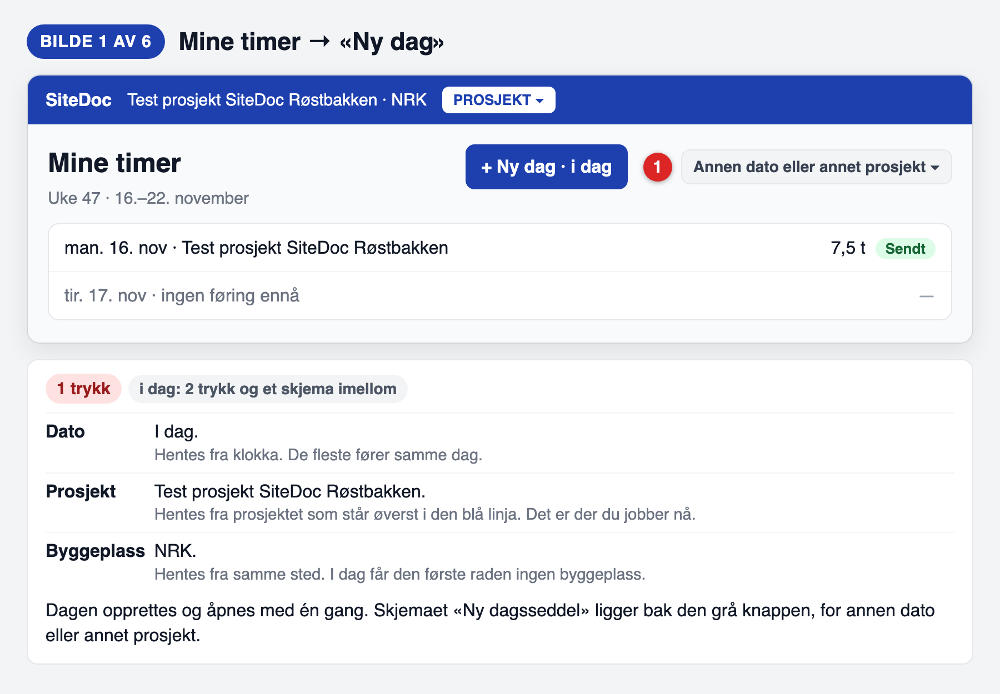
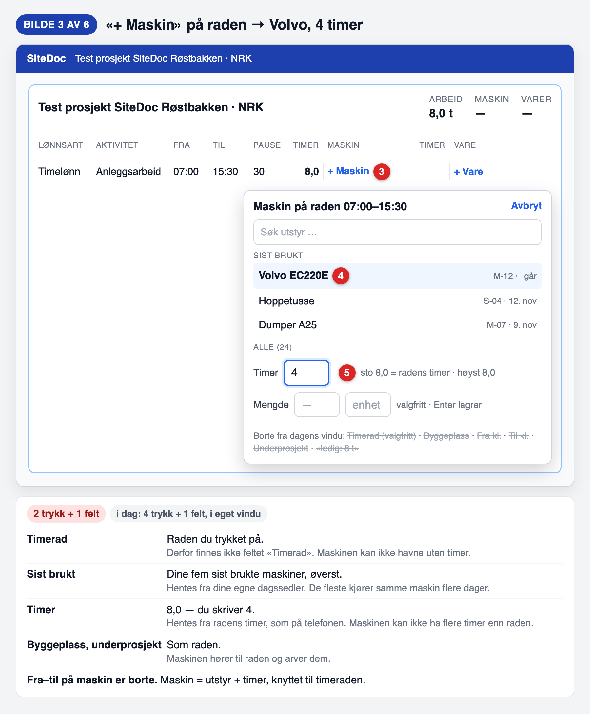

# Timeføring på web — plan med bilder (FORSLAG)

> **Bestilt av Kenneth 2026-11-17** etter test av develop `3b0f1abb` på test.sitedoc.no: *«hvorfor er ikke arbeidstimer
> og maskintimer som hører sammen på samme linje? maskintimer registreringen fra til trengs ikke … registrering av
> dagseddel på web er jo ikke slik vi har det på mobilen … Du må levere ny plan med bilder i strukturert rekkefølge!
> WEB-> registrering av timer. Bilde 1->Bilde2 ....til registrering er ferdig. registrering skal være minimum trykk og
> valg. Skriv tekst sammen med bildet for hvor vi henter preutfylt informasjon og hvorfor.»*
>
> **Scenario:** en arbeider jobber 07:00–15:30, bruker Volvo i 4 timer og 4 m3 betong.
>
> **Bildene:** [`skisser-web-timeforing/`](skisser-web-timeforing/) — `bilde-1.png` … `bilde-6.png`, og alle seks side om
> side i `oversikt.png`. Kilde: `skisser.html`. Bildene er skisser av forslaget, ikke skjermbilder av noe som er bygget.
>
> **Vedtak som står:** spec `prosjektkort-kortid-spec.md` § 12 — R3 (én linje), R24 (sperren), G5, H12 og H13. Planen
> bygger på dem. Der planen går lenger, står det som forslag i § 6.

## 1. Svar til Kenneth

- **Telefonen er ikke bygget om.** I prosjektkort-modus fører du fortsatt i Bekreft dag: tid, «+ Maskin», «+ Varer» og
  «Bekreft og lagre» på én skjerm, og maskin og vare står under raden i kortet. Det eneste nye i dag er at en maskin
  som selges pr. time, må kobles til en timerad (d2c-2, merget 17.11 kl. 10:16).
- **Web har aldri fått den flyten.** Web har to skjermer før første rad, tre egne vinduer (timerad, maskin, vare), og
  viser maskiner etter timeradene og varer i en egen liste.
- **Bildene du fikk 6. og 7. november, viste telefonen.** Web er ikke tegnet før nå.
- **Linjene du så i attesteringen 07.11, er ført før koblingen fantes på PC** (den kom 16.11 kl. 23:14). En maskin ført
  på PC i dag havner på timeradens linje. En **vare** ført på PC gjør det fortsatt ikke — det er et hull.
- **Forslaget under:** «Ny dag» med ett trykk, og maskin og vare føres fra selve raden. 6 trykk og 3–4 felt, mot 10
  trykk og 3 felt i dag.

## 2. Målt mot koden (develop @ 3b0f1abb)

Forkortelser: `NY` = `apps/web/src/app/dashbord/timer/ny/page.tsx`, `WS` = `apps/web/src/app/dashbord/timer/[id]/page.tsx`,
`D` = `apps/api/src/routes/timer/dagsseddel.ts`, `M` = `apps/mobile/src`, `PS` = `packages/db/prisma/schema.prisma`.

**Web i dag**

| # | Funn | Referanse |
|---|---|---|
| WM1 | **To skjermer før første rad.** «Ny dagsseddel» på Mine timer åpner et skjema (dato, prosjekt, aktivitet, arbeidstid, kommentar). «Opprett dagsseddel» lager sedelen og åpner dagssiden. Det finnes ingen vei med ett trykk. | `apps/web/src/app/dashbord/timer/mine/page.tsx:313`; `NY:190–203`; `apps/web/src/app/dashbord/[prosjektId]/timer/ny/page.tsx:10` |
| WM2 | **Fra, til og pause i skjemaet kommer fra firmaets arbeidstid:** `OrganizationSetting.standardStartTid`, `standardSluttTid` og `standardPauseMin`. Standard i databasen er 07:00, 15:00 og 30. Firmaet endrer dem i Firma → Innstillinger. Bruker firmaet kalender som normkilde, kan kalenderen overstyre. | `NY:116`, `:124–126`; `apps/api/src/services/timer/arbeidstid.ts:49–70`; `PS:434–436`; `apps/web/src/app/dashbord/firma/innstillinger/page.tsx:953`, `:985` |
| WM3 | **Lønnsarten bærer ingen arbeidstid.** `Lonnsart` har ingen felt for fra, til eller timer pr. dag. Dagsnormen (7,5) er en egen firmainnstilling, `OrganizationSetting.dagsnorm`. | `packages/db-timer/prisma/schema.prisma:22–57`; `PS:408` |
| WM4 | **Serveren lager første timerad selv** når prosjektet er sendt med: firmaets standard-lønnsart (`erStandardvalg`), tidene fra skjemaet, og pausen trukket når dagen er over 5,5 timer. Byggeplass sendes ikke, så raden får «Ingen byggeplass» selv om toppen viser en. | `D:3859–3869`, `:2534–2538`; `packages/shared/src/utils/pauseBeregning.ts:30`; `NY:190–203` |
| WM5 | **Prosjekt, aktivitet og dato i skjemaet:** prosjektet fra toppen av siden, aktiviteten «Anleggsarbeid» hvis den finnes og ellers den første, datoen i dag. | `NY:108–113`, `:152–162`, `:46` |
| WM6 | **Vinduet «Legg til timer-rad»:** Fra er siste til-tid på dagen, ellers firmaets start. Derfor sto det 15:00 med tom Til hos Kenneth. Lønnsart er alltid standardvalget. Vinduet har en sammenleggbar del «Maskin (valgfritt)» der maskintimene settes lik radens timer og koblingen sendes med. **Vare finnes ikke i vinduet.** | `WS:693–706`, `:2840–2850`, `:3658–3724`, `:3350–3368` |
| WM7 | **Vinduet «Legg til maskinbruk»** har Utstyr, Timerad, Byggeplass, Antall timer, Fra kl., Til kl., Mengde, Enhet, Underprosjekt og en infolinje. Fra og til er merket valgfritt og er ikke påkrevd noe sted, verken i skjermen eller på serveren. De fylles ut med dagens ramme, og antallet regnes av dem. | `WS:4798–5308`, `:1030–1037`, `:4874–4886`, `:5166–5194`, `:5075`; `D:10033` |
| WM8 | **«Timerad (Valgfritt)»:** merkelappen «Valgfritt» står så lenge utstyr ikke er valgt. Velger du en maskin som krever timerad, forsvinner den, og lagring stoppes uten rad. Timeraden er forvalgt når kortet har én arbeidsrad. Serveren håndhever det samme (R24). | `WS:4925`, `:5113–5121`, `:5036–5043`, `:4917–4922`; `D:2195–2201`; `packages/shared/src/utils/maskinKobling.ts:19–21` |
| WM9 | **«Arbeid i gruppen: 7,5 t · ledig: 8 t»:** ledig er arbeid **pluss pausen**, minus maskintimer som alt er ført. 7,5 + 0,5 = 8. Det er maskin-taket (HM63 i kort-id-specen): maskinen kan gå mens føreren har pause. Teksten sier ikke det. | `packages/shared/src/utils/maskinKapasitet.ts:72–73`; `WS:4988–4992`; `packages/shared/src/i18n/nb.json:604` |
| WM10 | **Maskinens fra–til brukes ikke videre.** Rapport og eksport tar dem ikke med. Attesteringens redigering bærer dem bare videre. | `packages/shared/src/utils/timerDetaljRader.ts:223`; `apps/api/src/routes/timer/rapport.ts:697–714`; `apps/web/src/components/timer/AttesteringDetalj_Edit.tsx:174` |
| WM11 | 🔴 **Varen kobles ikke til timeraden på web.** Vinduet for vareforbruk sender bare dagen. Kolonnen for kobling finnes, og serveren tar imot den. Varen blir derfor en egen linje i attesteringen. | `apps/web/src/components/timer/KortVareforbrukModal.tsx` (0 treff på `sheetTimerId`); `apps/api/src/routes/vareforbruk.ts:75–84`; `packages/db-varelager/prisma/schema.prisma:85–88` |
| WM12 | **I kortet på dagssiden står maskinene etter timeradene, og varene i en egen liste under.** Ikke på raden. | `WS:2173–2194`, `:1699–1715` |
| WM13 | **Dagens web, talt for scenarioet: 10 trykk og 3 felt.** Ny dagsseddel · Til 15:30 · Opprett · + Maskin · åpne velger · Volvo · antall 4 · Lagre · + Vareforbruk · betong · antall 4 · Lagre · Send dagen. Talt i koden, ikke klikket i nettleser. | WM1–WM11 |

**Telefonen i dag**

| # | Funn | Referanse |
|---|---|---|
| WM14 | **To moduser, styrt av firmaet:** dagskort (standard) og prosjektkort. I prosjektkort-modus åpner «+» Bekreft dag. | `PS:495`; `packages/shared/src/utils/prosjektkort.ts:13–14`; `M/components/DagsseddelListe.tsx:136–138` |
| WM15 | **Bekreft dag er én skjerm:** prosjekt, tid, lønnsartlinjer og pause, «+ Maskin» og «+ Varer», beskrivelse, «Bekreft og lagre». Så «Send dagen». | `apps/mobile/app/timer/bekreft-dag.tsx:1454–1506`, `:2279–2292`; `M/components/timer-detalj/BekreftDagRadTillegg.tsx:119`, `:127` |
| WM16 | **Maskin på telefonen har ikke fra–til når den føres fra en rad** — bare timer, mengde og enhet. Timene er forhåndsutfylt med radens timer og kan ikke være høyere. Fra Bekreft dag lagres maskinen uten fra–til. Dagskort-modusens maskinvindu har fortsatt fra–til. | `M/components/timer-detalj/BekreftDagRadTillegg.tsx:271`; `M/services/kobledeMaskiner.ts:56–58`; `M/utils/dagsforslagAnvend.ts:503–504`; `M/components/timer-detalj/MaskinSeksjon.tsx:928` |
| WM17 | **Forhåndsutfylling på telefonen:** start er siste til-tid på dagen, ellers firmaets start; slutt er firmaets slutt; pausen er firmaets. Sist brukte maskiner står øverst i velgeren (fem). | `M/utils/manuellDag.ts:44–51`; `M/utils/nyRadTider.ts:23–24`; `M/services/nyTimerRad.ts:130` |
| WM18 | **I kortet står maskin og vare under raden sin:** «Volvo EC220E · 4 t» og «Betong 4 m3». | `M/components/timer-detalj/prosjektkort/ProsjektkortDagsoversikt.tsx:741`, `:755` |

**Attesteringen (bilde 84)**

| # | Funn | Referanse |
|---|---|---|
| WM19 | **En maskin står på timeradens linje bare når den er koblet** til en timerad i samme kort. Ellers er den egen linje med Type «Maskin». Kolonnene Maskin og Maskintimer er på som standard. Sortering endrer ikke dette. | `packages/shared/src/utils/kortGruppering.ts:156–157`; `packages/shared/src/utils/timerDetaljRader.ts:736–742`; `apps/web/src/components/timer/TimerRadTabell.tsx:166–169` |
| WM20 | **PC sendte ikke koblingen før d2c-1,** som ble merget 2026-11-16 kl. 23:14. Telefonen fikk sperren 2026-11-17 kl. 10:16. Rader ført 07.11 på PC har derfor ingen kobling. **Ikke målt:** databasen — jeg har ikke lest radene til Kenneth. | `git show 274e7fb2^1` (0 treff på `sheetTimerId` i `WS`); `git log -1 274e7fb2`, `338de16a` |
| WM21 | **Hvorfor maskinlinjene er høye — mest sannsynlig Avvik-cellen.** Alle celler kuttes med «…», unntatt Beskrivelse og Avvik, som brytes over flere linjer. En egen maskinlinje får to setninger i Avvik: «Maskin uten arbeidstimer» og «Maskinarbeid uten registrert maskinførerbevis — flagget for synlighet.» Kolonnen er minst 180 px bred. Rundt 95 tegn i 180 px gir fem–seks tekstlinjer. Kolonnen var rullet ut av syne hos Kenneth, men den bestemmer høyden på hele raden. **Lest i koden, ikke målt i nettleser.** | `apps/web/src/components/attestering/AttesteringTabell.tsx:259–262`; `apps/web/src/components/attestering/attestering-tabell.ts:300–306`; `packages/shared/src/utils/timerDetaljRader.ts:755`; `packages/shared/src/i18n/nb.json:5064`, `:4607` |
| WM22 | **Merket heter «Maskin uten arbeidstimer» i tabellen.** Specen (G5, R24) sier «Maskin uten timerad». | `packages/shared/src/i18n/nb.json:5064` |

## 3. Forslaget — bilde for bilde

Røde tall i bildene er trykk og felt i rekkefølge, 1 til 9. Gult er felt som er fylt ut for brukeren.

### Bilde 1 — Mine timer → «Ny dag»

**1 trykk.** I dag: 2 trykk og et skjema imellom (WM1).

| Fylt ut | Verdi | Hentes fra | Hvorfor |
|---|---|---|---|
| Dato | I dag | Klokka (`NY:46`) | De fleste fører samme dag. |
| Prosjekt | Prosjektet i toppen av siden | Aktivt prosjekt (`NY:108–113`) | Det er der brukeren jobber nå. |
| Byggeplass | Byggeplassen i toppen | Samme regel som timerad-vinduet bruker i dag (`apps/web/src/components/timer/RadByggeplassFelt.tsx:19–41`) | I dag får første rad ingen byggeplass (WM4). |

- Knappen oppretter dagens seddel og åpner den. Finnes dagen fra før, åpnes den.
- Skjemaet «Ny dagsseddel» består bak «Annen dato eller annet prosjekt». Ingenting fjernes.
- Står det ikke noe prosjekt i toppen, åpnes skjemaet som i dag.

### Bilde 2 — dagen er åpnet, første rad står ferdig

**1 felt** (Til: 15:00 → 15:30). **0** hvis firmaets arbeidstid er 07:00–15:30.

| Fylt ut | Verdi | Hentes fra | Hvorfor |
|---|---|---|---|
| Fra · Til · Pause | 07:00 · 15:00 · 30 | Firmaets arbeidstid, Firma → Innstillinger (WM2) | Én innstilling gjelder alle. Lønnsarten bærer ingen tid (WM3). Se B2. |
| Lønnsart | Timelønn | Lønnsarten firmaet har merket som standardvalg (`D:2534–2538`) | Den brukes på de fleste rader. Overtid foreslås som i dag. |
| Aktivitet | Anleggsarbeid | «Anleggsarbeid» hvis den finnes, ellers første aktive (`NY:152–162`) | Som i dag. |
| Timer | 8,0 | Regnes ut: til − fra − pause | Brukeren skriver aldri timene. |

- Raden rettes der den står: trykk i cellen, skriv, Enter. Blyanten åpner fortsatt hele vinduet, for underprosjekt og
  beskrivelse.
- Raden er én linje med plass til maskin og vare — samme kolonnerekkefølge som attesteringen (R2 i kort-id-specen).

### Bilde 3 — «+ Maskin» på raden → Volvo, 4 timer

**2 trykk + 1 felt.** I dag: 4 trykk + 1 felt, i eget vindu (WM7).

| Fylt ut | Verdi | Hentes fra | Hvorfor |
|---|---|---|---|
| Timerad | Raden brukeren trykket på | Trykket | Maskinen kan ikke havne uten timer (R24). Feltet «Timerad» trengs ikke. |
| Sist brukt | De fem sist brukte maskinene | Brukerens egne dagssedler (`WS:261`, finnes i dag) | De fleste kjører samme maskin flere dager. |
| Timer | 8,0 — brukeren skriver 4 | Radens timer, som telefonen (WM16) | Maskinen kan ikke ha flere timer enn raden. Se B4. |
| Byggeplass, underprosjekt | Som raden | Raden | Maskinen hører til raden. |

- ⚠️ **Foreslås fjernet fra føringen** (B3, B4): Fra kl., Til kl. og infolinja «ledig».
- Feltene Timerad, Byggeplass og Underprosjekt er ikke fjernet som opplysning. De følger raden.
- Maskinvinduet består for én ting: en døgn-maskin som skal stå uten timerad. Den nås fra kortet, som i dag.

### Bilde 4 — «+ Vare» på raden → betong, 4 m3

**2 trykk + 2 felt.** I dag: 3 trykk + 1 felt, og varen havner ikke på raden (WM11).

| Fylt ut | Verdi | Hentes fra | Hvorfor |
|---|---|---|---|
| Timerad | Raden brukeren trykket på | Trykket | Varen skal stå på timeradens linje i attesteringen (H2 i kort-id-specen). |
| Enhet | m3 | Varen i varelageret | Brukeren velger den aldri selv. |
| Prosjekt, byggeplass | Som raden | Raden | Varen er brukt i jobben raden beskriver. |

- Dette lukker hullet i WM11. Det er en reparasjon mot R3, ikke en ny funksjon.
- En «Sist brukt»-liste for varer ville spart søket. Den finnes ikke i dag og er ikke med i forslaget.

### Bilde 5 — raden er ferdig → «Send dagen»

**1 trykk.** Som i dag.

- Arbeid, maskin og vare står på samme linje. «+ Maskin» og «+ Vare» står igjen under linja for flere.
- «Sum i dag 8,0 t av 7,5 t»: 7,5 er firmaets dagsnorm (WM3). 07:00–15:30 med 30 minutter pause er 8,0 timer. Se B2.
- «+ Timerad», «+ Reise», «+ Tillegg/Utlegg», «+ Nytt prosjektkort», «Slett dagsseddel» og dagens ramme består.

### Bilde 6 — sendt, og slik ser attestanten den

**0 trykk.** Maskinen og varen ble koblet til timeraden da de ble ført. Derfor står de på timeradens linje hos
attestanten (WM19).

**I alt: 6 trykk og 3–4 felt, ingen egne vinduer.** I dag: 10 trykk og 3 felt, to skjermer før første rad, tre vinduer
— og varen står alene (WM13).

Alle seks side om side: [`oversikt.png`](skisser-web-timeforing/oversikt.png).

## 4. Funnene fra skjermbildene

| | Funn | Målt | Forslag |
|---|---|---|---|
| **(a)** | Maskinens fra–til trengs ikke (Kenneth). | Feltene er valgfrie og brukes ikke i rapport eller eksport (WM7, WM10). Telefonen har dem ikke når maskinen føres fra en rad (WM16). K19 (2026-11-06) sa det samme for Bekreft dag: «antall, ikke fra/til». | Maskin = utstyr + timer, ført fra raden (bilde 3). Fra og til tas ut av føringen på web og i telefonens dagskort-modus. Verdier som alt er lagret, røres ikke. **B3.** |
| **(b)** | Ny dagsseddel foreslår 07:00–15:00 og pause 30. | Det er firmaets arbeidstid, med 07:00–15:00–30 som standard i databasen (WM2). Lønnsarten bærer ingen tid (WM3). | Behold firmaets arbeidstid som kilde, og sett den til 07:00–15:30 i Firma → Innstillinger. Arbeidstid pr. lønnsart krever nytt felt og migrering. **B2.** |
| **(c)** | «Arbeid i gruppen: 7,5 t · ledig: 8 t». | Ledig = arbeid + pause − ført maskin (WM9). Regnestykket er riktig etter maskin-taket; teksten forklarer det ikke. | Når maskinen føres fra en rad, er grensen radens timer, som på telefonen, og infolinja trengs ikke. **B4.** |
| **(d)** | «Timerad (Valgfritt)» mot R24. | «Valgfritt» står bare til utstyr er valgt; da håndheves R24 (WM8). Sperren virker, men merkelappen sier det motsatte av regelen. | I bilde 3 finnes ikke feltet. I maskinvinduet som består, vises ingen merkelapp før utstyr er valgt. Liten rettelse, ikke et spørsmål. |
| **(e)** | Maskinlinjer står alene og er svært høye. | De står alene fordi de ble ført på PC før koblingen fantes (WM19, WM20). Tabellen gjør det specen sier (G5). De er høye fordi Avvik-teksten brytes over fem–seks linjer (WM21, ikke målt i nettleser). | Gamle rader kobles ikke automatisk (H13). Høyden rettes med korte merker på én linje i Avvik. **B6.** Teksten «Maskin uten arbeidstimer» rettes til «Maskin uten timerad» (WM22). |
| **(f)** | To skjermer før første rad. | Stemmer (WM1). Serveren lager alt første rad selv (WM4); skjemaet spør bare om det den kan utlede. | «Ny dag · i dag» med ett trykk (bilde 1). **B1.** |
| **(g)** | *Ikke i ordren:* varen kobles ikke til raden på web. | WM11. | Bilde 4. Reparasjon mot R3. |
| **(h)** | *Ikke i ordren:* første rad får «Ingen byggeplass» selv om toppen viser NRK. | WM4. Synlig på Kenneths bilde 86. | Byggeplassen i toppen følger med når dagen opprettes (bilde 1). |

## 5. Funksjonsinventar

Ingen funksjon fjernes uten svar fra Kenneth. Det som foreslås fjernet, er merket ⚠️.

| Funksjon | Kode | Forslag |
|---|---|---|
| Skjemaet «Ny dagsseddel» (annen dato, annet prosjekt, kommentar, arbeidstid) | `NY` | **BEVARES**, bak «Annen dato eller annet prosjekt». Ikke lenger eneste vei inn (B1). |
| Serveren lager første timerad | `D:3859–3869` | **BEVARES.** Får byggeplassen fra toppen (h). |
| Vinduet «Legg til timer-rad» med lønnsart, aktivitet, underprosjekt, beskrivelse, overtidsforslag | `WS:2692–3769` | **BEVARES**, bak blyanten og «+ Timerad». Vanlig retting skjer i raden (bilde 2). |
| «Maskin (valgfritt)» inne i timerad-vinduet | `WS:3658–3724` | **BEVARES.** Samme felt som bilde 3. |
| Maskinvinduet «Legg til maskinbruk» | `WS:4798–5308` | **BEVARES** for døgn-maskin uten timerad. ⚠️ **Foreslås fjernet:** Fra kl. og Til kl. (B3) og infolinja «ledig» (B4). |
| Maskin-taket pr. bøtte på serveren | `packages/shared/src/utils/maskinKapasitet.ts` | **BEVARES** uendret. |
| Sperren R24 på PC | `WS:5036–5043`; `D:2195–2201` | **BEVARES.** |
| «+ Vareforbruk» på kortet, vare uten rad | `apps/web/src/components/timer/KortVareforbrukModal.tsx` | **BEVARES** for vare som ikke hører til en rad. Vare fra raden kobles (bilde 4). |
| Maskiner etter timeradene og varer i egen liste i kortet | `WS:2173–2194`, `:1699–1715` | **ENDRES** (B5): én linje pr. timerad. Maskin og vare uten rad står som egne linjer etter dem, som i attesteringen (G5). |
| «+ Reise», «+ Tillegg/Utlegg», «+ Nytt prosjektkort», del opp, slett, dagens ramme, «Send dagen» | `WS` | **BEVARES** uendret. |
| Telefonens dagskort-modus: fra–til i maskinvinduet | `M/components/timer-detalj/MaskinSeksjon.tsx:928` | ⚠️ **Foreslås fjernet** (B3), så web og telefon er like. |
| Telefonens Bekreft dag og prosjektkort | `apps/mobile/app/timer/bekreft-dag.tsx` | **BEVARES** uendret. |

## 6. Spørsmål til Kenneth

| # | Spørsmål | Anbefaling |
|---|---|---|
| **B1** | **«Ny dag» med ett trykk** (bilde 1). Knappen oppretter dagens seddel på prosjektet i toppen og åpner den, uten skjema. Skjemaet ligger bak «Annen dato eller annet prosjekt». A: ja. B: nei, behold skjemaet som eneste vei. | **A.** Skjemaet spør om det systemet alt vet. Ingenting fjernes. |
| **B2** | **Hvor skal 07:00–15:30 komme fra?** I dag kommer tidene fra firmaets arbeidstid, som står på 07:00–15:00 med 30 minutter pause. Lønnsarten har ingen arbeidstid. A: firmaets arbeidstid, som i dag — du setter den til 07:00–15:30 i Firma → Innstillinger. B: hver lønnsart får egen arbeidstid. Det er nytt felt, migrering og ny innstillingsside. **Og:** 07:00–15:30 med 30 minutter pause er 8,0 timer, men dagsnormen står på 7,5. Er dagsnormen 8,0, eller er pausen 60 minutter? | **A.** Den finnes og virker i dag, på web og telefon. Dagsnorm og pause er innstillinger du setter selv; si hva som er riktig, så stemmer bildene. |
| **B3** | **Maskinens fra–til tas ut av føringen.** A: på web og i telefonens dagskort-modus. Det som alt er lagret, blir stående. B: bare på web. | **A.** Du sa det i dag, og K19 sa det samme 06.11. Feltene brukes ikke i rapport eller eksport. |
| **B4** | **En maskin ført fra en rad kan ikke ha flere timer enn raden,** og infolinja «ledig: 8 t» fjernes. Slik er det på telefonen. I dag tillater PC arbeid + pause for hele bøtta. A: ja. B: nei, behold dagens grense og forklar den i teksten («inntil 8,0 t: arbeid 7,5 t + pause 0,5 t»). | **A.** Maskintimene hører til radens timer. Serverens tak endres ikke. |
| **B5** | **Kortet på dagssiden viser én linje pr. timerad,** med maskin og vare på linja (bilde 5), i samme rekkefølge som attesteringen. I dag står maskinene etter timeradene og varene i en egen liste. A: ja. B: nei, behold dagens kort og endre bare føringen. | **A.** Da ser den ansatte og attestanten samme linje. |
| **B6** | **Korte merker i Avvik i attesteringen:** «Uten timerad» · «Uten førerbevis», på én linje. Hele forklaringen flyttes til ?-hjelpen. I dag brytes to setninger over fem–seks linjer og gjør raden høy. A: ja. B: behold setningene og gjør kolonnen bredere. | **A.** Merket leses uten å rulle, og raden blir like høy som de andre. |

**Følger som ikke er spørsmål, men si fra hvis du mente noe annet:**

1. **Varen kobles til timeraden når den føres fra raden på PC.** I dag står den alene i attesteringen.
2. **Maskintimer er forhåndsutfylt med radens timer,** som på telefonen i dag. K19 sa «ikke forhåndsutfylt» for
   Bekreft dag i november; koden fyller ut radens timer nå.
3. **Gamle maskinrader uten kobling blir stående som egne linjer** i attesteringen. De kobles ikke automatisk (H13).
4. **Første rad får byggeplassen fra toppen av siden.**

## 7. Rekkefølge hvis Kenneth sier ja

Dette er forslag til oppdeling, ikke ordrer. Ingen av delene krever migrering med B2 = A.

| Del | Innhold | Rører | Kenneth ser etterpå |
|---|---|---|---|
| **w1** | Vare fra raden kobles til timeraden (g). Avvik-merkene og teksten «Maskin uten timerad» (B6, WM22). | `apps/web/src/components/timer/KortVareforbrukModal.tsx`, `WS`, `apps/web/src/components/attestering/*`, i18n | Varen står på timeradens linje i attesteringen. Maskinlinjene er like høye som de andre. |
| **w2** | «Ny dag» med ett trykk og byggeplass på første rad (B1, h). | `apps/web/src/app/dashbord/timer/mine/page.tsx`, `D` (`opprett`), i18n | Ett trykk fra Mine timer til ferdig utfylt rad. |
| **w3** | Linja i kortet, retting i raden, «+ Maskin» og «+ Vare» på raden; fra–til og infolinja ut (B3–B5). | `WS`, i18n, hjelpeteksten for siden | Bilde 2–5. |
| **m1** | Fra–til ut av telefonens dagskort-modus (B3 = A). | `M/components/timer-detalj/MaskinSeksjon.tsx`, i18n | Samme maskinfelt på telefon og PC. |

w1 kan gå først og alene: den retter det Kenneth så i attesteringen i dag, uten å vente på resten.

## 8. Ikke målt

- Databasen: Kenneths rader fra 07.11, og firmaets innstillinger i test.
- Nettleseren: høyden på maskinlinjene (WM21) er regnet fra koden. Ingen av dagens skjermer er klikket gjennom; trykkene
  i WM13 er talt i koden.
- Om en «Sist brukt»-liste for varer finnes på telefonen.
- Hvordan PNG-ene fra 6.–7. november ble tegnet. Disse er tegnet med Chrome uten vindu fra `skisser.html` (kommandoen
  står øverst i fila).
