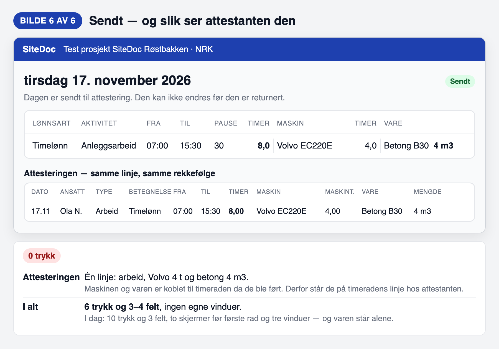
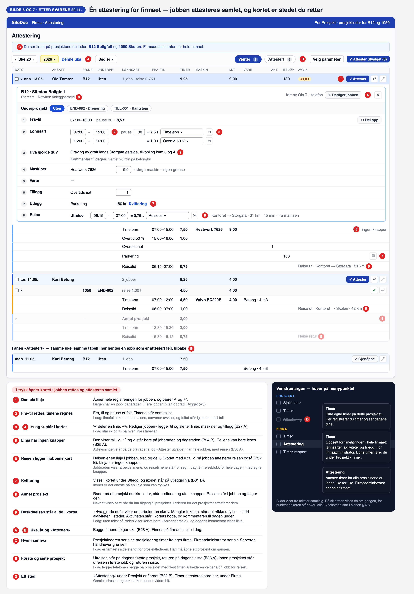

# Timeføring på web — plan med bilder (FORSLAG)

> **Bestilt av Kenneth 2026-11-17** etter test av develop `3b0f1abb` på test.sitedoc.no: *«hvorfor er ikke arbeidstimer
> og maskintimer som hører sammen på samme linje? maskintimer registreringen fra til trengs ikke … registrering av
> dagseddel på web er jo ikke slik vi har det på mobilen … Du må levere ny plan med bilder i strukturert rekkefølge!
> WEB-> registrering av timer. Bilde 1->Bilde2 ....til registrering er ferdig. registrering skal være minimum trykk og
> valg. Skriv tekst sammen med bildet for hvor vi henter preutfylt informasjon og hvorfor.»*
>
> **Scenario:** en arbeider jobber 07:00–15:30, bruker Volvo i 4 timer og 4 m3 betong.
>
> **Bildene:** [`skisser-web-timeforing/`](skisser-web-timeforing/) — `bilde-1.png` … `bilde-9.png`, og alle ni
> samlet i `oversikt.png`. Kilde: `skisser.html`. Bildene er skisser av forslaget, ikke skjermbilder av noe som er bygget.
> Bilde 1–5 er føringen, 6–8 attesteringen, og 9 firmainnstillingene som styrer føringen.
> **Versjon 5:** dagsvisningen i attesteringen (B14) står i `b14-sammenlikning.png` — i dag og alternativ A, B og C
> side om side — og enkeltvis i `b14-idag.png`, `b14-a.png`, `b14-b.png` og `b14-c.png`. Kilde: `skisser-b14.html`.
>
> **Vedtak som står:** spec `prosjektkort-kortid-spec.md` § 12 — R3 (én linje), R24 (sperren), G5, H12 og H13, og B4 i
> § 10 (maskin-tak pr. kort i skjermen). Planen bygger på dem. Der planen går lenger, står avviket i § 4.1 med
> hjemmelen fra Kenneth. Det som fortsatt er åpent, står i § 8.
> **Versjon 6:** Kenneths ord 19.11. om maskintimer (§ 8.6 punkt 2) går lenger enn B4. Forslaget står i § 4.4 (w9).
> **Versjon 7:** bilde 6 og 7 er tegnet før B13 A, B14 A og § 8.6 punkt 1. Slik de gjelder nå, står de i
> `ks-attestering.png` (§ 4.5). Kilde: `skisser-ks.html`.
> **Versjon 8:** `ks-attestering.png` er tegnet om etter Kenneths svar på B24–B28 (§ 8.8) og viser firmaets
> attestering slik en prosjektleder ser den (§ 4.6). Hover-tekstene i venstremargen står i § 4.8.
> **Versjon 9:** `ks-attestering.png` er tegnet om etter svarene på B29–B31 (§ 8.9): «Attestering» finnes bare
> under Firma (§ 4.10), kortet viser alltid beskrivelsen (§ 4.9), og reisen står under prosjektet sitt (§ 4.7).
> **Versjon 10:** `ks-attestering.png` er tegnet om etter svarene på B32–B33 (§ 8.10): reisen ligger i jobbens
> kort og attesteres med jobben (§ 4.11).
> **Versjon 11:** `ks-attestering.png` er tegnet om etter svaret på B34 (§ 8.11): reisen viser underprosjektet
> den er ført på når det avviker fra jobbens, og kortet har «Føres på» under «Reise» (§ 4.11 del C).

## 1. Kenneths føringer (2026-11-17, ordrett)

> *«Alt 1. benytt GPS logg for å bestemme prosjektene og byggeplasser*
> *alt:2 benytt innlogget byggeplass Prosjekt/byggeplass*
>
> *registrering av timer*
> *fra/til*
> *lønnsart*
> *hva gjorde du*
> *hvilken(e) maskin(er)? hvor mange timer(for hver enkelt maskin spesifiseert (ikke fra/til)*
> *hvilke varer (vare og enhet og mengde)*
> *tillegg?*
> *utlegg*
>
> *Dette er informasjon som hører sammen og kan ikke vises hver for seg. Det skal tydelig komme frem i timelisten hvem
> kjørte maskinen og hvor mange timer. Arbeidstimene er allerede spesifisert for denne arbeideren, vi trenger ikke
> spesifisere hvilke minutter mannen var i maskinen eller når han jobbet uten maskinen så lenge han er på samme "jobb" i
> prosjektet»*

| Føring | Slik følger planen den |
|---|---|
| **Prosjekt og byggeplass utledes** — Alt 1 GPS-logg, Alt 2 innlogget prosjekt og byggeplass | Bilde 1 og 2. Rekkefølgen er telefonens dag → innsjekk-loggen → prosjektet og byggeplassen i toppen → arbeideren velger. Telefonens GPS-logg finnes ikke på serveren (WM23) og sendes ikke dit (B2 og B3, vedtatt). |
| **Én samlet registrering** i rekkefølgen fra/til · lønnsart · hva gjorde du · maskiner · varer · tillegg · utlegg | Bilde 2–5. Jobben er én flate med sju faste deler, i denne rekkefølgen. Ingen egne vinduer. |
| **Alt hører sammen og vises sammen** | Jobben er prosjektkortet. Føringen (bilde 5) og timelista (bilde 6) viser samme enhet. |
| **Hvem kjørte maskinen, og hvor mange timer** | Bilde 6: ansatt, maskin og maskintimer på samme linje. |
| **Maskin har timer, ikke klokkeslett.** Timene deles ikke i «med maskin» og «uten» | Bilde 3: maskin = utstyr + timer, høyst jobbens timer. Firmaet kan velge fra–til i tillegg (B5, bilde 9). Det som må endres, står i § 5. |

### 1.1 Kenneths svar på versjon 2 (2026-11-17, ordrett)

> *«hva skjer hvis det inngår overtid i denne perioden? hvordan viser vi det*
>
> *kun en ting savnes -> hva om timer tilhører underprosjekt?*
>
> *Atttestering -> viktig å vise kjærneinformasjon #2-> trykk på #2 og da vises registreringen#3 -> i attestering så må
> den som attesterer kunne dele opp timer lett dersom noe er feil registrert. f.eks underprosjekt mangler eller ikke
> riktig registrert. feil lønnsart med mere»*

«#2» er attesteringslinja og «#3» er jobben, etter utsnittene Kenneth markerte (`relay/kenneth-2026-11-17-timer/93`
og `94`). Lest slik: linja viser kjernen, og et trykk på linja åpner registreringen slik den ble ført.

| Spørsmål | Svar i planen |
|---|---|
| **Overtid i perioden** | Bilde 2 og 6. Tiden etter dagsnormen får egen linje med firmaets overtidsart, i jobben og i attesteringen. Maskinen fordeles av systemet. |
| **Timer som tilhører underprosjekt** | Bilde 2 og 5. Underprosjektet står i jobbens hode. Én jobb har ett underprosjekt; to underprosjekter er to jobber («Del jobben»). |
| **Attesteringen: kjernen på linja, trykk åpner registreringen, del opp lett** | Bilde 6, 7 og 8. Det som avviker fra vedtak i kort-id-specen § 12, står i § 4.1. |

### 1.2 Vedtatt 2026-11-17: B1–B11 som føringer

Kenneths ord står i § 8.1. Her står hva de betyr i planen, og hva som er målt.

| # | Føring | Slik står det i planen | Målt |
|---|---|---|---|
| **B1** | Ikke «Ny dag». Én knapp «+ Registrer timer» åpner en jobb på et prosjekt. Dagen summeres etter hvert. | Bilde 1, 2 og 5. Dagsseddelen lages stille når første jobb føres på en dato. Neste jobb legges på samme seddel. Annen dato og annet prosjekt velges i jobbens hode. «Send dagen» består. | WM57–WM61 |
| **B2** | Rekkefølgen telefonens dag → innsjekk-loggen → toppen → arbeideren velger. | Bilde 1. Siste trinn er ikke lenger et skjema: jobben åpnes med prosjektet tomt. | WM23–WM26 |
| **B3** | GPS-loggen sendes ikke til serveren. | Vedtaket «synkes aldri» står. | WM23 |
| **B4** | Dagsnormen leses fra firmaets innstillinger eller kalender for datoen. 07:00–15:30 med 30 minutter pause er 7,5 t og 0,5 t overtid. | Bilde 2, 5, 8 og 9. Ingen skjerm har 7,5 som fast tall. | WM62–WM65 |
| **B5** | Firmaet velger om maskin føres med fra–til. Begge moduser. | Bilde 9 og § 5. Ny firmainnstilling, som krever en migrering. Hvem som får hvilken verdi ved innføringen, er B12. | WM66–WM67 |
| **B6** | «Hva gjorde du?» er påkrevd på web. | Bilde 2. Kontrolleres pr. jobb før «Send dagen». | WM31 |
| **B7** | Korte merker i Avvik. Forklaringen vises på hover, og ved trykk på berøringsskjerm. | Bilde 6 (B). Bruker `Tooltip`, som finnes. | WM21, WM68 |
| **B8** | Overtid er egen linje med én gang. | Bilde 2 og 6. | WM37–WM39 |
| **B9** | 11 kjernekolonner er standard. «Velg parameter» består. Klikk på linja åpner hele registreringen for inspeksjon og oppdeling. | Bilde 6 og 7. Tall på tilleggs- og utleggslinjer er B13. | WM69–WM71 |
| **Tillegg** | Datoen vises som dd.mm. Året byttes som egen handling. | Bilde 6 (A): årsvelger ved ukevalget. | WM72 |
| **B10** | Alle som kan attestere linja, får rette og dele opp når «rediger ved attestering» er på. | Bilde 7 og 8. Serverens krav endres tre steder. | WM54 |
| **B11** | «Uten» er forhåndsvalgt. Få underprosjekter: knapper. Mange: søkbar nedtrekk. | Bilde 2 og 7. Til og med 6 underprosjekter er knapper. | WM45, WM73 |

## 2. Svar til Kenneth

- **Telefonen er ikke bygget om.** I prosjektkort-modus fører du i Bekreft dag: tid, lønnsart, beskrivelse, «+ Maskin»,
  «+ Varer», tillegg og utlegg på én skjerm. Det eneste nye i dag er at en maskin som selges pr. time, må kobles til
  en timerad (d2c-2, merget 17.11 kl. 10:16).
- **Web har aldri fått den flyten.** Web har to skjermer før første rad og fem egne vinduer (timerad, maskin, vare,
  tillegg, utlegg), og viser maskiner etter timeradene og varer i en egen liste.
- **Bildene du fikk 6. og 7. november, viste telefonen.** Web er ikke tegnet før nå.
- **Linjene du så i attesteringen 07.11, er ført før koblingen fantes på PC** (16.11 kl. 23:14). En maskin ført på PC i
  dag havner på timeradens linje. En **vare** ført på PC gjør det fortsatt ikke.
- **GPS-loggen ligger bare på telefonen.** Den sendes aldri til serveren, etter vedtak. Web kan lese innsjekken på
  byggeplassen og prosjektet du står i.
- **Forslaget:** «+ Registrer timer» med ett trykk, og jobben føres på én flate i din rekkefølge. 6 trykk og 4–5
  felt, mot 10 trykk og 3 felt i dag. Dagen summeres etter hvert. Overtid står som egen linje, og underprosjektet
  velges i jobbens hode.

## 3. Målt mot koden (develop @ 3b0f1abb; WM57–WM73 @ b8b16571)

Timer-koden er lik på de to hashene: `git diff 3b0f1abb b8b16571 -- apps packages` viser bare 3D-filer.

Forkortelser: `NY` = `apps/web/src/app/dashbord/timer/ny/page.tsx`, `WS` = `apps/web/src/app/dashbord/timer/[id]/page.tsx`,
`D` = `apps/api/src/routes/timer/dagsseddel.ts`, `M` = `apps/mobile/src`, `PS` = `packages/db/prisma/schema.prisma`,
`ST` = `packages/db-timer/prisma/schema.prisma`, `BD` = `apps/mobile/app/timer/bekreft-dag.tsx`.

**Web i dag**

| # | Funn | Referanse |
|---|---|---|
| WM1 | **To skjermer før første rad.** «Ny dagsseddel» på Mine timer åpner et skjema (dato, prosjekt, aktivitet, arbeidstid, kommentar). «Opprett dagsseddel» lager sedelen og åpner dagssiden. Det finnes ingen vei med ett trykk. | `apps/web/src/app/dashbord/timer/mine/page.tsx:313`; `NY:190–203`; `apps/web/src/app/dashbord/[prosjektId]/timer/ny/page.tsx:10` |
| WM2 | **Fra, til og pause i skjemaet kommer fra firmaets arbeidstid:** `OrganizationSetting.standardStartTid`, `standardSluttTid` og `standardPauseMin`. Standard i databasen er 07:00, 15:00 og 30. Firmaet endrer dem i Firma → Innstillinger. Bruker firmaet kalender som normkilde, kan kalenderen overstyre. | `NY:116`, `:124–126`; `apps/api/src/services/timer/arbeidstid.ts:49–70`; `PS:434–436`; `apps/web/src/app/dashbord/firma/innstillinger/page.tsx:953`, `:985` |
| WM3 | **Lønnsarten bærer ingen arbeidstid.** `Lonnsart` har ingen felt for fra, til eller timer pr. dag. Dagsnormen (7,5) er en egen firmainnstilling, `OrganizationSetting.dagsnorm`. | `ST:22–57`; `PS:408` |
| WM4 | **Serveren lager første timerad selv** når prosjektet er sendt med: firmaets standard-lønnsart (`erStandardvalg`), tidene fra skjemaet, og pausen trukket når dagen er over 5,5 timer. Byggeplass sendes ikke, så raden får «Ingen byggeplass» selv om toppen viser en. | `D:3859–3869`, `:2534–2538`; `packages/shared/src/utils/pauseBeregning.ts:30`; `NY:190–203` |
| WM5 | **Prosjekt, aktivitet og dato i skjemaet:** prosjektet fra toppen av siden, aktiviteten «Anleggsarbeid» hvis den finnes og ellers den første, datoen i dag. | `NY:108–113`, `:152–162`, `:46` |
| WM6 | **Vinduet «Legg til timer-rad»:** Fra er siste til-tid på dagen, ellers firmaets start. Derfor sto det 15:00 med tom Til hos Kenneth. Lønnsart er alltid standardvalget. Vinduet har en sammenleggbar del «Maskin (valgfritt)». **Vare finnes ikke i vinduet.** | `WS:693–706`, `:2840–2850`, `:3658–3724`, `:3350–3368` |
| WM7 | **Vinduet «Legg til maskinbruk»** har Utstyr, Timerad, Byggeplass, Antall timer, Fra kl., Til kl., Mengde, Enhet, Underprosjekt og en infolinje. Fra og til er merket valgfritt og er ikke påkrevd noe sted, verken i skjermen eller på serveren. De fylles ut med dagens ramme, og antallet regnes av dem. | `WS:4798–5308`, `:1030–1037`, `:4874–4886`, `:5166–5194`, `:5075`; `D:10033` |
| WM8 | **«Timerad (Valgfritt)»:** merkelappen «Valgfritt» står så lenge utstyr ikke er valgt. Velger du en maskin som krever timerad, forsvinner den, og lagring stoppes uten rad. Timeraden er forvalgt når kortet har én arbeidsrad. Serveren håndhever det samme (R24). | `WS:4925`, `:5113–5121`, `:5036–5043`, `:4917–4922`; `D:2195–2201`; `packages/shared/src/utils/maskinKobling.ts:19–21` |
| WM9 | **«Arbeid i gruppen: 7,5 t · ledig: 8 t»:** ledig er arbeid **pluss pausen**, minus maskintimer som alt er ført. 7,5 + 0,5 = 8. Teksten sier ikke det. | `packages/shared/src/utils/maskinKapasitet.ts:72–73`; `WS:4988–4992`; `packages/shared/src/i18n/nb.json:604` |
| WM10 | **Maskinens fra–til brukes ikke videre.** Rapport og eksport tar dem ikke med. Attesteringens redigering bærer dem bare videre. | `packages/shared/src/utils/timerDetaljRader.ts:223`; `apps/api/src/routes/timer/rapport.ts:697–714`; `apps/web/src/components/timer/AttesteringDetalj_Edit.tsx:174` |
| WM11 | 🔴 **Varen kobles ikke til timeraden på web.** Vinduet for vareforbruk sender bare dagen. Kolonnen for kobling finnes, og serveren tar imot den. Varen blir derfor en egen linje i attesteringen. | `apps/web/src/components/timer/KortVareforbrukModal.tsx` (0 treff på `sheetTimerId`); `apps/api/src/routes/vareforbruk.ts:75–84`; `packages/db-varelager/prisma/schema.prisma:85–88` |
| WM12 | **I kortet på dagssiden står maskinene etter timeradene, og varene i en egen liste under.** Ikke på raden. | `WS:2173–2194`, `:1699–1715` |
| WM13 | **Dagens web, talt for scenarioet: 10 trykk og 3 felt.** Ny dagsseddel · Til 15:30 · Opprett · + Maskin · åpne velger · Volvo · antall 4 · Lagre · + Vareforbruk · betong · antall 4 · Lagre · Send dagen. Talt i koden, ikke klikket i nettleser. | WM1–WM11 |

**Telefonen i dag**

| # | Funn | Referanse |
|---|---|---|
| WM14 | **To moduser, styrt av firmaet:** dagskort (standard) og prosjektkort. I prosjektkort-modus åpner «+» Bekreft dag. | `PS:495`; `packages/shared/src/utils/prosjektkort.ts:13–14`; `M/components/DagsseddelListe.tsx:136–138` |
| WM15 | **Bekreft dag er én skjerm:** prosjekt, tid, lønnsartlinjer og pause, «+ Maskin» og «+ Varer», tillegg og utlegg, beskrivelse, «Bekreft og lagre». Så «Send dagen». | `BD:1454–1506`, `:2279–2292`, `:1805`; `M/components/timer-detalj/BekreftDagRadTillegg.tsx:119`, `:127` |
| WM16 | **Maskin på telefonen har ikke fra–til når den føres fra en rad** — bare timer, mengde og enhet. Timene er forhåndsutfylt med radens timer. Fra Bekreft dag lagres maskinen uten fra–til. Dagskort-modusens maskinvindu har fortsatt fra–til. | `M/components/timer-detalj/BekreftDagRadTillegg.tsx:271`; `M/utils/dagsforslagAnvend.ts:503–504`; `M/components/timer-detalj/MaskinSeksjon.tsx:928` |
| WM17 | **Forhåndsutfylling på telefonen:** start er siste til-tid på dagen, ellers firmaets start; slutt er firmaets slutt; pausen er firmaets. Sist brukte maskiner står øverst i velgeren (fem). | `M/utils/manuellDag.ts:44–51`; `M/utils/nyRadTider.ts:23–24`; `M/services/nyTimerRad.ts:130` |
| WM18 | **I kortet står maskin og vare under raden sin:** «Volvo EC220E · 4 t» og «Betong 4 m3». | `M/components/timer-detalj/prosjektkort/ProsjektkortDagsoversikt.tsx:741`, `:755` |

**Attesteringen (bilde 84)**

| # | Funn | Referanse |
|---|---|---|
| WM19 | **En maskin står på timeradens linje bare når den er koblet** til en timerad i samme kort. Ellers er den egen linje med Type «Maskin». Kolonnene Maskin og Maskintimer er på som standard. Sortering endrer ikke dette. | `packages/shared/src/utils/kortGruppering.ts:156–157`; `packages/shared/src/utils/timerDetaljRader.ts:736–742`; `apps/web/src/components/timer/TimerRadTabell.tsx:166–169` |
| WM20 | **PC sendte ikke koblingen før d2c-1,** som ble merget 2026-11-16 kl. 23:14. Telefonen fikk sperren 2026-11-17 kl. 10:16. Rader ført 07.11 på PC har derfor ingen kobling. **Ikke målt:** databasen — jeg har ikke lest radene til Kenneth. | `git show 274e7fb2^1` (0 treff på `sheetTimerId` i `WS`); `git log -1 274e7fb2`, `338de16a` |
| WM21 | **Hvorfor maskinlinjene er høye — mest sannsynlig Avvik-cellen.** Alle celler kuttes med «…», unntatt Beskrivelse og Avvik, som brytes over flere linjer. En egen maskinlinje får to setninger i Avvik: «Maskin uten arbeidstimer» og «Maskinarbeid uten registrert maskinførerbevis — flagget for synlighet.» Kolonnen er minst 180 px bred. Rundt 95 tegn i 180 px gir fem–seks tekstlinjer. **Lest i koden, ikke målt i nettleser.** | `apps/web/src/components/attestering/AttesteringTabell.tsx:259–262`; `apps/web/src/components/attestering/attestering-tabell.ts:300–306`; `packages/shared/src/utils/timerDetaljRader.ts:755`; `packages/shared/src/i18n/nb.json:5064`, `:4607` |
| WM22 | **Merket heter «Maskin uten arbeidstimer» i tabellen.** Specen (G5, R24) sier «Maskin uten timerad». | `packages/shared/src/i18n/nb.json:5064` |

**Prosjekt og byggeplass: hva web kan utlede (føring 1)**

| # | Funn | Referanse |
|---|---|---|
| WM23 | 🔴 **Telefonens GPS-logg sendes aldri til serveren.** Arbeidsdagen og besøkene pr. byggeplass ligger bare i telefonens lokale database. Serveren har ingen modell for dem og får bare den ferdige dagsseddelen. Det er et vedtak, ikke en mangel: «synkes ALDRI». | `M/db/schema.ts:447`; `docs/claude/timer-gps-helhetsplan.md:52`; `docs/claude/timer-gps-lag3-4-spec.md:131` |
| WM24 | **Det serveren har, er innsjekk-loggen:** `PsiTilstedevarelse` med prosjekt, byggeplass, bruker, innsjekk-tid, utsjekk-tid og kilde (manuell, QR, geofence, HMS-kort, app). Den finnes bare når PSI-modulen er på. Klokkeslettene er firma-isolert. | `PS:2436–2454`; `apps/api/src/routes/mannskap.ts:166` |
| WM25 | **Ingen prosedyre gir «mine innsjekker for en dato».** `minStatus` gir bare den åpne innsjekken nå, for ett prosjekt. `hentForProsjekt` gir alle personer på prosjektet. | `apps/api/src/routes/mannskap.ts:269`, `:319` |
| WM26 | **Prosjektet og byggeplassen i toppen av siden («innlogget»):** prosjektet huskes i nettleseren. Byggeplassen huskes i nettleseren og på serveren. En innsjekk som er nyere enn det manuelle valget, går foran. Timer-sidene leser begge. | `apps/web/src/kontekst/prosjekt-kontekst.tsx:15`; `apps/web/src/kontekst/byggeplass-kontekst.tsx:22`, `:152`; `packages/shared/src/utils/standardByggeplass.ts:87`; `NY:108–113`; `apps/web/src/components/timer/RadByggeplassFelt.tsx:19–41` |
| WM27 | **Vedtak 2026-11-15:** målte tidspunkter fra geofence og innsjekk **kan** foreslås som tider; arbeideren bestemmer og retter. Innsjekk som tidskilde er en egen ordre som ikke er bygget. | `docs/claude/timer-gps-lag3-4-spec.md:133` |
| WM28 | **Telefonens dagsforslag er ren regning, men bor i mobilappen** og leser telefonens lokale database. Web har ikke noe tilsvarende. GPS i nettleseren på PC er et eget BACKLOG-punkt som ikke er gjort. | `M/utils/dagsforslag.ts:10`; `M/services/dagsforslagInput.ts:86`; `docs/claude/BACKLOG.md:4412` |

**Tillegg, utlegg og beskrivelse (føring 2 og 3)**

| # | Funn | Referanse |
|---|---|---|
| WM29 | **Tillegg og utlegg på web går gjennom en velger og så et eget vindu hver.** Antallet er forhåndsutfylt med 1. Kvittering kan bare legges ved etter at raden er lagret. De hører til kortet (`kortId`), ikke til en timerad. Web sender ikke `kortId`; serveren finner kortet selv. | `WS:4300`, `:3842`, `:4503`, `:3870`, `:4106`; `ST:435`, `:513`; `D:5178`, `:5227` |
| WM30 | **På telefonen står tillegg og utlegg i Bekreft dag,** på samme skjerm som resten, pr. kort. | `BD:1805`; `M/components/timer-detalj/BekreftDagLonnUtlegg.tsx:18` |
| WM31 | **«Hva gjorde du?» er valgfritt på web og påkrevd på telefonen.** På telefonen er regelen én tekst pr. kort. Teksten lagres på kortets arbeidsrader. | `WS:3638`; `BD:998`; `M/utils/bekreftDag.ts:116`; `ST:251`; `docs/claude/prosjektkort-kortid-spec.md:529` |

**Maskintimene (føring 4)**

| # | Funn | Referanse |
|---|---|---|
| WM32 | **Maskintaket finnes i tre lag.** Serveren: maskintimer ≤ arbeidstimer + pause pr. bøtte (prosjekt + underprosjekt), kontrollert åtte steder. Telefonen pr. rad: hver maskin ≤ radens timer. Bekreft dag: pr. kort i skjermen. | `packages/shared/src/utils/maskinKapasitet.ts:42`, `:54`; `D:2806`, `:3287`, `:4135`, `:4389`, `:4818`, `:9252`, `:10079`, `:10212`; `M/services/kobledeMaskiner.ts:56–58`; `BD:1645` |
| WM33 | **Bekreft dag fordeler kortets maskiner og varer på kortets timerader selv.** Varene går til første rad. Maskinene fyller første rad og renner over til neste. En maskin på 9 timer på en jobb med 7,5 t ordinært og 1,5 t overtid blir to maskinrader. De lagres uten fra–til. | `M/utils/tilleggPaaKort.ts:80–81`, `:109`; `M/utils/dagsforslagAnvend.ts:503–504` |
| WM34 | **På web kan maskintimene ikke settes i timerad-vinduet** — maskinen får radens timer. I maskinvinduet er taket pr. bøtte en hard sperre. | `WS:3361`; `WS:5299` |
| WM35 | **Pausen i taket er begrunnet med døgn-maskiner.** Dokumentasjonen sier at den ikke er ment for timeleide maskiner. Koden legger den likevel til alle. Vedtak 2026-11-16 (B4): «maskin-tak som i dag på server, pr. kort i skjermen». | `docs/claude/fase-0-beslutninger.md:2112–2116`; `docs/claude/prosjektkort-kortid-spec.md:606` |
| WM36 | **I attesteringen står ansatt, maskin og maskintimer på samme linje.** I timerapportens Detaljer står maskinnavnet som et tillegg i Betegnelse, uten egen maskinkolonne. Egen kolonne hører til ordre d3 i kort-id-specen, som ikke er bygget. | `packages/shared/src/utils/timerDetaljRader.ts:736–742`; `apps/web/src/lib/timer-rapport-eksport.ts:420` |

**Overtid (Kenneths svar på versjon 2)**

| # | Funn | Referanse |
|---|---|---|
| WM37 | **Én regel avgjør overtid:** resten av dagsnormen er dagsnormen minus arbeid som alt er ført på datoen. Jobben får normaltid opp til resten, deretter overtid. Reise og fravær teller ikke. Det er dagsnormen som gjelder, ikke ukenormen. Bare 50 % er bygget. | `docs/claude/prosjektkort-kortid-spec.md:333–340`; `packages/shared/src/utils/lonnsregel.ts:10`, `:65`, `:114` |
| WM38 | **Telefonen viser overtid som egen linje** i Bekreft dag: «07:00–15:00 · 7,5 t · Timelønn ▾» og «15:00–15:30 · 0,5 t · Overtid 50 % ▾». Lønnsarten kan byttes pr. linje. Det lagres som to timerader i samme kort. | `docs/claude/prosjektkort-kortid-spec.md:355–362`; `M/utils/dagsforslag.ts:1888–1950`; `BD:2294–2310`; `packages/shared/src/i18n/nb.json:5776` |
| WM39 | **Web viser overtid som et forslag med knappen «Del raden»** i timerad-vinduet. Trykket lager to rader. Serveren lager aldri en overtidsrad selv. | `packages/shared/src/utils/overtidForslag.ts:74`; `WS:3101–3160`, `:3178–3250`, `:3538–3540`; `packages/shared/src/i18n/nb.json:631–633`; `D:2534–2538` |
| WM40 | **Mulig feil, lest og ikke kjørt:** når en rad deles i normal og overtid på web, får en ny maskin **hele** radens timer på normal-delen. | `WS:3236–3240` |
| WM41 | **«Sum i dag X t av Y t»:** prikken blir gul når X er over Y. Ingen tekst sier hvorfor. | `packages/shared/src/utils/prosjektkort.ts:173–180`; `WS:1822–1832` |
| WM42 | **Fordelingen med overtid:** en maskin på 4 t på en jobb med 7,5 t ordinært og 0,5 t overtid havner i sin helhet på den ordinære linja. En maskin på 8 t blir 7,5 + 0,5. Den ordinære er først fordi den lages først, ikke fordi radene sorteres på tid. | `M/utils/tilleggPaaKort.ts:76–88`; `packages/shared/src/utils/lonnsregel.ts:65` |
| WM43 | **I attesteringen blir ordinær tid og overtid to linjer i samme kort,** sortert på fra-tid. Varen står på linja den er koblet til. | `packages/shared/src/utils/kortGruppering.ts:147`, `:155–164` |

**Underprosjekt**

| # | Funn | Referanse |
|---|---|---|
| WM44 | **Et kort har ett prosjekt, ett underprosjekt og én byggeplass** (K2–K4). To kort kan ha like verdier (K7). | `docs/claude/prosjektkort-kortid-spec.md:107–109`, `:113` |
| WM45 | **Telefonen velger underprosjekt med knapper pr. kort,** «Uten» først. De vises bare når prosjektet har åpne underprosjekter, og ingenting er forhåndsvalgt utover «Uten». Valget skrives på kortets arbeidsrader, maskin, varer, tillegg og utlegg. «Sist brukt underprosjekt» finnes ikke. | `BD:1573`, `:667–679`; `M/utils/dagsforslagAnvend.ts:349–355`, `:497`, `:525`; `docs/claude/prosjektkort-kortid-spec.md:265–266` |
| WM46 | **Web velger underprosjekt i en nedtrekksliste i hvert vindu** (timerad, maskin, tillegg, utlegg). Lista er prosjektets aktive underprosjekter som er åpne for timer. Kortet på dagssiden er pr. prosjekt, med en undergruppe pr. underprosjekt. | `WS:3570–3590`, `:5238–5252`, `:593–657`, `:2129–2140`; `apps/api/src/routes/eksternKostObjekt.ts:69–89` |
| WM47 | **Web kan ikke lage et nytt kort på et prosjekt som alt har kort.** «+ Nytt prosjektkort» tilbyr bare prosjekter uten kort. Kort-id-specen § 5.4 sier at det skal gå. | `WS:680–682`, `:992` |
| WM48 | **Dele en jobb:** telefonen har «Del til eget kort» ved et klokkeslett. Web har «Del opp» pr. rad, der delene kan få ulikt underprosjekt. Valget «eget kort» finnes ikke i web-vinduet, selv om serveren støtter det. | `M/utils/kortIdForslag.ts:125`; `BD:1614`; `apps/web/src/components/timer/SplittRadModal.tsx` (0 treff på `egetKort`); `D:2612` |

**Attesteringen: linja, retting og oppdeling**

| # | Funn | Referanse |
|---|---|---|
| WM49 | **Et trykk på en linje gjør ingenting.** Lenken til detaljsiden står bare på dagens sumrad. | `apps/web/src/components/timer/TimerRadTabell.tsx:310–316`; `apps/web/src/components/attestering/AttesteringTabell.tsx:411` |
| WM50 | **Linja har 26 kolonner som standard og er minst 2 814 punkter bred.** Maskin begynner om lag 1 340 punkter inn, Vare om lag 1 700. På en skjerm på 1 440 må attestanten rulle sidelengs for å se dem. Regnet fra koden, ikke målt i nettleser. | `packages/shared/src/utils/timerDetaljRader.ts:736–742`, `:745–755`; `apps/web/src/components/timer/TimerRadTabell.tsx:192–194`; `apps/web/src/components/attestering/AttesteringTabell.tsx:75` |
| WM51 | **Retting i cellen er bygget:** fra, til, timer, pause, lønnsart og aktivitet på timeraden; maskin, maskintimer, mengde og enhet; antall på tillegg. Ikke prosjekt, underprosjekt, byggeplass, beskrivelse eller vare. Cellen viser «var …» etter retting. | `apps/web/src/components/attestering/AttesteringTabell.tsx:196–218`, `:239`, `:271–287` |
| WM52 | 🔴 **Underprosjekt kan ikke rettes fra tabellen.** «Flytt underprosjekt» finnes på serveren (`flyttTimerRadEco`), men **ingen skjerm kaller den** — 0 treff i `apps/web` og `apps/mobile`. Den flytter bare timer- og tilleggsrader; maskinens underprosjekt oppdateres ikke. Eneste vei i dag er detaljsiden → «Rediger hele sedelen» → nedtrekk → Lagre, om lag fire trykk. R14 og R21 i kort-id-specen forutsetter handlingen. | `D:6627`; `apps/web/src/components/timer/AttesteringDetalj.tsx:494–497`; `apps/web/src/components/timer/AttesteringDetalj_Edit.tsx:218` |
| WM53 | **«Del opp» (✂):** pr. del kan prosjekt, lønnsart, aktivitet, underprosjekt, fra, til og timer settes. Timene regnes ikke ut av klokkeslettene. Å dele 8 t i to med ulikt underprosjekt er om lag sju handlinger. Koblede maskiner og varer blir på første del. | `apps/web/src/components/timer/SplittRadModal.tsx:210–224`, `:280`; `apps/web/src/components/timer/RedigerTimerRad.tsx:63–147`; `D:7591` |
| WM54 | **Hvem får rette:** retting i cellen, pennen og ✂ krever firmaadministrator og firmavalget «rediger ved attestering». «Flytt underprosjekt» krever bare attesteringsrett. Skjermen viser ✂ og pennen uten å sjekke firmavalget; serveren avviser. | `D:7251`, `:2998`, `:7497`, `:6658`; `apps/web/src/components/attestering/AttesteringTabell.tsx:418`, `:431` |
| WM55 | **Mulig feil, lest og ikke kjørt:** vinduet bak pennen sender `byggeplassId: null` for alle radene det lagrer. | `apps/web/src/components/attestering/RedigerRadModal.tsx:403`, `:414`, `:435`, `:450` |
| WM56 | **Telefonens attestering kan ikke rette eller dele.** | `apps/mobile/src/components/timer-attestering/AttesteringDetaljMobil.tsx:52` |

**Målt i versjon 4 — «+ Registrer timer» og dagsseddelen (B1)**

| # | Funn | Referanse |
|---|---|---|
| WM57 | **Én dagsseddel pr. arbeider pr. dato, uten prosjekt.** Prosjektet ligger på raden. | `ST:214`; `D:3761–3764` |
| WM58 | **`opprett` er alt «finn eller lag».** Den tar imot dato, aktivitet (påkrevd) og prosjekt (valgfritt). Finnes dagen, returneres den urørt med `eksisterte: true`. Første timerad lages bare når sedelen er tom. | `D:3753–3774`, `:3824–3856`, `:3857–3869`, `:3871–3888`, `:2509–2530` |
| WM59 | **En jobb til på en dag som har rader, er `tilfoyTimerRad` med ny `kortId`.** Serveren tar imot feltet. Web sender det aldri, så raden havner i dagens eldste kort med samme prosjekt, underprosjekt og byggeplass. **Ikke lest:** hvordan `tilfoyTimerRad` behandler en `kortId` serveren ikke kjenner. | `D:3990–3991`; `WS` (0 treff på `kortId`); `docs/claude/prosjektkort-kortid-spec.md:232`, `:244` |
| WM60 | **Låsene.** Rader kan bare føres når dagen er utkast eller returnert. En sendt dag kan arbeideren gjenåpne selv, så lenge ingen rad er attestert. Dager eldre enn firmaets grense avvises. Fra og til er påkrevd på timeraden. | `D:230–233`, `:4009–4014`, `:5745–5790`, `:1531–1552`, `:4000–4006` |
| WM61 | **Knappen på Mine timer heter «Ny dagsseddel» og lenker til skjemaet.** Sedelens kommentar kan rettes på dagssiden etterpå. | `apps/web/src/app/dashbord/timer/mine/page.tsx:311–319`; `packages/shared/src/i18n/nb.json:269`; `WS:5346–5368` |

**Målt i versjon 4 — dagsnormen (B4)**

| # | Funn | Referanse |
|---|---|---|
| WM62 | **Normleseren tar firma og dato.** «Fast»: `dagsnorm`-kolonnen, og sesong ignoreres. «Kalender»: slutt − start − pause, og en dato mellom aktiv `sommertid_start` og `sommertid_slutt` samme år bruker tidene på `sommertid_start`-raden. Standard er «fast». Firmaet velger i Firma → Innstillinger. Leseren bruker altså kalenderens sommertid-markører, men bare når firmaet står på «kalender». | `apps/api/src/services/timer/arbeidstid.ts:45–136`, `:74–76`, `:78–119`, `:123–126`; `PS:485`, `:408`, `:3134–3135`; `apps/web/src/app/dashbord/firma/innstillinger/page.tsx:1135–1153`; `packages/shared/src/i18n/nb.json:2217–2220` |
| WM63 | **I «kalender» finnes ikke et eget normtall.** Normen er arbeidstiden. 7 t vinter og 8 t sommer settes som arbeidstid 07:00–14:30 og en sommertid-rad 07:00–15:30, begge med 30 minutter pause. I «fast» er normen den samme hele året. | `arbeidstid.ts:123–126` |
| WM64 | **Web og server leser normen pr. dato fra samme leser.** | `apps/api/src/routes/organisasjon.ts:1347–1358`; `WS:672–677`; `D:1161`, `:2548`, `:3818`, `:6540` |
| WM65 | **Halvdag og helligdag endrer ikke normen.** Leseren slår bare opp sommertid-radene. Ikke lest: telefonen. | `arbeidstid.ts:17–19`, `:78–106` |

**Målt i versjon 4 — maskin med fra–til som firmavalg (B5)**

| # | Funn | Referanse |
|---|---|---|
| WM66 | **Maskinradens fra og til er valgfrie kolonner; timer er påkrevd.** Radene trenger ingen skjemaendring. | `ST:593–594`, `:599` |
| WM67 | **Firmainnstillingene er faste kolonner.** Modellen har ikke noe fritt felt. En ny innstilling er en ny kolonne i `packages/db`, altså en migrering. Telefonen speiler firmainnstillingene i en lokal tabell med én kolonne pr. innstilling. | `PS:376`, `:495` (0 treff på `Json` i modellen); `M/services/organizationSettingKatalog.ts:86`; `M/db/schema.ts:783` |

**Målt i versjon 4 — attesteringen (B7, B9, datoen) og underprosjekt (B11)**

| # | Funn | Referanse |
|---|---|---|
| WM68 | **`Tooltip` støtter berøring:** trykk viser, trykk utenfor lukker. Veilederen fraråder nativ `title=`, som ikke vises på berøringsskjerm. | `packages/ui/src/tooltip.tsx:81`, `:175`, `:228`; `docs/claude/retningslinjer/tooltip-hjelpetekst-veileder.md:10`, `:23` |
| WM69 | **Standardutvalget er én liste.** Kolonnevalg, rekkefølge og bredde lagres pr. bruker på serveren. En bruker med lagret oppsett beholder det; ny standard treffer bare den som ikke har lagret noe. Ingen «tilbakestill til standard» er funnet. **Ikke lest:** om oppsettet lagres før brukeren endrer noe. | `packages/shared/src/utils/timerDetaljRader.ts:736–742`; `apps/web/src/hooks/useTabelloppsett.ts:40`, `:89`; `apps/web/src/components/attestering/AttesteringTabell.tsx:72–73`, `:101` |
| WM70 | **De 11 kjernekolonnene er 14 kolonner i koden.** Fra og til er to. Vare, enhet og mengde er tre. Lønnsart er kolonnen `betegnelse`. Minstebreddene summerer til 1 462 punkter, før avkrysning og knapper. Sidemenyen er minst 220 punkter, så om lag 1 220 er ledig på en skjerm på 1 440. Regnet, ikke målt i nettleser. | `timerDetaljRader.ts:700`, `:704–705`, `:712–714`, `:607–636`, `:745–755`; `apps/web/src/components/layout/NavSidebar.tsx:231` |
| WM71 | **Antall og Beløp er egne kolonner,** for tillegg og utlegg. Uten dem viser en tilleggslinje ikke antallet og en utleggslinje ikke beløpet. | `timerDetaljRader.ts:715–716` |
| WM72 | **Datoen skrives `2026-11-17`.** Firmaets attestering viser én uke om gangen, med forrige uke, neste uke og «Denne uka». Året kan bare byttes ved å bla uke for uke. Prosjektets attestering har ikke ukevalg. | `apps/web/src/components/attestering/attestering-tabell.ts:169–172`; `AttesteringTabell.tsx:466`; `apps/web/src/app/dashbord/firma/timer/attestering/page.tsx:159–176`, `:194–199`, `:345–369`; `apps/web/src/app/dashbord/[prosjektId]/timer/attestering/page.tsx` (0 treff på `fraOgMed`) |
| WM73 | **`ui-standarder.md` har ingen grense for knapper mot nedtrekk.** Regelen «adaptiv nedtrekk» gjelder fritekstfelt som lærer av bruk: forslag etter tre bruk, og søkefelt når lista passerer 7. Telefonen har bare knapper (WM45). | `docs/claude/retningslinjer/ui-standarder.md:102–115` |

**Målt i versjon 5 — dagsvisningen i attesteringen (B14), develop @ `ee7146e5`**

`AT` = `apps/web/src/components/attestering/AttesteringTabell.tsx`, `AM` = `apps/web/src/components/attestering/attestering-tabell.ts`,
`TR` = `apps/web/src/components/timer/TimerRadTabell.tsx`.

| # | Funn | Referanse |
|---|---|---|
| WM74 | **En dag har tre radtyper.** For hver jobb (kort): én oversiktsrad, så linjene. Etter dagens siste jobb: én dagsum. «Etter prosjekt» har ingen dagsum. | `AT:532–589`, `:569–570` |
| WM75 | **Samme opplysning står tre steder.** Oversiktsraden viser dato, ansatt, pr.nr., underprosjekt og jobbens sum. Linjene bærer de samme fire feltene. Dagsummen viser «Sum {dato} · {ansatt}» og dagens sum. En dag med én jobb og én linje viser derfor samme timetall tre ganger. | `AT:538–563`, `:578–588`; `AM:272–284`; `packages/shared/src/i18n/nb.json:5057` |
| WM76 | **«Dagen: X t av dagsnorm Y t» bygges pr. jobb, ikke pr. dag.** En dag med to jobber viser setningen to ganger. | `AT:537`, `:556` |
| WM77 | **Dagen har ingen markering der den begynner.** Oversiktsraden har 1 punkt grå strek og lysegrå bunn. Dagsummen har 2 punkter grå strek over seg og står sist i dagen. Linjene veksler mellom hvit og lysegrå etter løpende linjenummer i hele tabellen, uavhengig av dag og jobb. Linjene har ikke innrykk. | `TR:331–342`, `:362–363`, `:208–214`; `AT:695–723` (sender ikke `innrykk`) |
| WM78 | **Cellene kutter tekst.** Etiketten «Sum 17.11. · Ola N.» står i kolonnen Betegnelse (78 punkter som standard), og «Dagen: …» i Avvik (70). Begge tekstene er lengre enn kolonnen. Regnet fra breddene; ikke sett i nettleser. | `TR:349`; `AT:89–105`, `:377–379` |
| WM79 | **«Bare oversiktsrader» skjuler linjene.** Oversiktsradene og dagsummen står. Valget gjelder besøket og lagres ikke. En dag med én jobb er da to rader med samme tall. | `AT:152`, `:564–567`, `:644` |
| WM80 | **Maskin og vare som er koblet til timeraden, står på timeradens linje.** Tillegg og utlegg er egne linjer i jobben. Vare- og utleggslinjer har ingen egen ✓. Reise er en egen blokk først på dagen, og rader uten kort-id samles sist. | `AM:300–413`, `:432–444`; `AT:565` |
| WM81 | **Knappene står på tre nivåer.** Linja: ✓ ↩ ↺ ✂ og penn. Oversiktsraden: ✓ ↩ ↺ for prosjektseddelen. Dagsummen: «Attester» for hele dagsseddelen, ↩ og lenke til sedelen. I prosjektets attestering gjelder dagsummens knapp bare prosjektets del. | `AT:396–415`, `:426–471`, `:473–493` |
| WM82 | **Sorterer brukeren på en kolonne, vises bare linjene,** som flat liste uten oversiktsrader og dagsum. Derfor bærer hver linje dato og ansatt. | `TR:195–206` |
| WM83 | **Tabellen tegner én rad om gangen.** Kolonnene kan flyttes, skjules og endre bredde. Tabellen har en fri rad (`overskrift`) og en sumrad med celler pr. kolonne. En celle kan ikke gå over flere rader. Timerapporten bruker samme tabell. | `TR:36–65`, `:309–357`; `apps/web/src/components/timer/TimerRapportDetaljer.tsx` |
| WM84 | **Radhøydene, målt i nettleser av w5:** oversiktsrad 38, linje 37, dagsum 43. En dag med én jobb og én linje er 118 punkter høy. | w5-leveransen, `relay/inbox-orkestrator.md:33267` |

**Målt i versjon 5 — attestantens egne timer (B15), develop @ `ee7146e5`**

`SK` = `packages/db/prisma/schema.prisma`. `D` er `apps/api/src/routes/timer/dagsseddel.ts`, som ellers i planen.

| # | Funn | Referanse |
|---|---|---|
| WM85 | **Ingen egenskap ved den ansatte sier timelønn eller fastlønn.** Verken brukeren eller ansettelsen har feltet. | `SK:10–80`, `:248–292`. Søkt uten treff: timelonn, fastlonn, lonnstype, lonnsform, maanedslonn, salaryType, payType, ansettelsesform. |
| WM86 | **«Timelønn» og «Fastlønn (månedslønn)» er to lønnsarter av samme type.** Bare navnet skiller dem, og firmaet kan endre navnet. Lønnsarten har ingen kolonne for lønnsform. | `packages/db-timer/prisma/schema.prisma:22–51`; `apps/api/src/services/seed/index.ts:61–62` |
| WM87 | **Modellen peker ikke ut noens leder.** Avdelingen har ikke leder. Stillingen (ansatt, bas, prosjektleder, daglig leder) er en opplysning og gir ingen rett. | `SK:2857–2875`, `:252`. Søkt uten treff: lederId, managerId, naermesteLeder, overordnet, avdelingsleder. |
| WM88 | **Attesteringsrett har firmaadministrator i sedelens firma, og aktiv ansatt som er prosjektadministrator eller har «kan attestere» på radens prosjekt.** Fravær uten prosjekt attesteres av firmaadministrator, og av prosjektleder når firmaet har valgt det. «Firmaansvarlig» gir ingen attesteringsrett. | `D:275–302`, `:332–358`, `:502–540`; `SK:741`, `:744` |
| WM89 | **Ingen prosedyre sammenligner den som attesterer, med den som eier sedelen.** Det gjelder attestering, retur, gjenåpning, retting, deling og flytting av underprosjekt — elleve prosedyrer. Listene tar med attestantens egne sedler. | `D:6018–6188`, `:6203–6500`, `:6791`, `:6917`, `:7121`, `:7315`, `:7422`, `:7515`, `:7529`, `:7695`, `:7802`, `:8287`, `:8465` |
| WM90 | **Kolonnen `tillattSelvAttestering` finnes i firmainnstillingene, med standard «ja». Ingen kode leser eller skriver den.** Den ble lagt inn 01.05. for en plan som ikke er bygget: at en vanlig ansatt kunne attestere egen seddel i stedet for å sende den til leder. | `SK:416–417`; migreringen `20260501200000_add_timer_modul_og_settings`; `timer.md:74`, `:453` |
| WM91 | **Sedelen bærer alt et flagg for retting og en sperretekst til skjermen.** En sperret linje får ✓ slått av med forklaring og sendes ikke med «Attester utvalget». ↩ stoppes ikke av sperren. | `D:6181`, `:6371`, `:6485`; `AM:256–258`, `:586–597`; `AT:405`, `:455`, `:483` |
| WM92 | **Telefonen har attestering for firmaadministrator:** liste, attestering av rader og retur. Den har ikke retting, deling eller gjenåpning. Av firmainnstillingene lagrer den bare «rediger ved attestering» lokalt. | `apps/mobile/app/timer/attestering/index.tsx:72–79`; `apps/mobile/src/components/timer-attestering/AttesteringDetaljMobil.tsx:72–77`; `apps/mobile/src/db/schema.ts:754` |

**Målt i versjon 6 — maskintimer over arbeidstimer (§ 8.6 punkt 2), develop @ `1afb318a`**

Linjene i `D` gjelder `1afb318a` og er forskjøvet fra WM32, som ble målt på en eldre hash. `MK` =
`packages/shared/src/utils/maskinKapasitet.ts`, `KS` = `docs/claude/prosjektkort-kortid-spec.md`.

| # | Funn | Referanse |
|---|---|---|
| WM93 | **Eksempeldagen er lagt rett inn i databasen med SQL. Den er aldri ført gjennom serveren.** Lokal kopi av test-basen (nyeste seddel der er fra 11.07.2026): Ola Tømrer 14.05.2026, pause 30 min, status sendt. Timerad 07–12 med 4,50 t uten underprosjekt, timerad 12–15 med 3,00 t på TILL-001, maskinrad 07–15 med 7,50 t uten underprosjekt. Sedelen og de tre radene har håndlagde ID-er (`22222222-4f4f-2222-2222-…`) og er opprettet 17.05.2026 kl. 10:02:06, i samme sekund. Bøtta var i brudd fra første stund: 4,5 + 0,5 t pause er mindre enn 7,5. Skriptet ligger ikke i repoet. | Lesespørring mot lokal `sitedoc` 19.11. (`timer.daily_sheets`, `sheet_timer`, `sheet_machines`); søk etter ID-en i treet og med `git log --all -S` ga ingen treff |
| WM94 | **Underprosjektet END-002 er satt senere.** I kopien fra 11.07. har 07–12-raden og maskinen ikke underprosjekt; på test 19.11. står begge på END-002. Begge veiene som bytter underprosjekt, skriver uten å sjekke taket (WM97). Hvilken som ble brukt, er ikke målt: test-basen er ikke lest. | WM93; `D:6926–6942`, `D:684–726` |
| WM95 | **Regelen kom dagen før dataene ble lagt inn.** `validerMaskinUnderArbeid` ble innført 16.05.2026, pausen i taket 18.05., og den delte funksjonen 05.07. Seed-koden som lager timer og maskin (`seed-timer-demo.ts`), skriver også rett i databasen, men holder seg under taket. | `git log -S validerMaskinUnderArbeid` → `ff5c90e1`; `731770da`; `docs/claude/fase-0-beslutninger.md:2110–2115`; `packages/db/scripts/seed-timer-demo.ts:162–176` |
| WM96 | **Taket sjekkes åtte steder, alltid mot alle bøttene på sedelen.** Kommentaren sier at bare nye og endrede rader sjekkes, men koden filtrerer ikke. En seddel som alt er i brudd, får derfor avvist enhver skriving som går gjennom sjekken, også i en annen bøtte. Lest i koden, ikke kjørt. | `D:2174–2199`, kommentaren `D:2133–2138`; `MK:80–108`; kallene `D:3000`, `:3501`, `:4354`, `:4608`, `:5037`, `:9680`, `:10507`, `:10640` |
| WM97 | **Sju skriveveier endrer arbeidstimer eller underprosjekt uten å sjekke taket:** (1) ✂ på en timerad — hver del kan få eget underprosjekt, og maskinen blir stående på første del; sjekken gjelder bare ✂ på en maskinrad. (2) Den ansattes egen deling av en timerad. (3) Bytte av underprosjekt på én timerad. (4) Bytte av underprosjekt for hele jobben. (5) «Del opp» (WM98). (6) Sletting av en timerad. (7) Endring av dagens pause i sedelhodet. | (1) `D:2988–3004`, `:7874`; (2) `D:8155`; (3) `D:6926–6942`; (4) `D:684–726`; (5) `D:7052–7074`; (6) `D:4700–4746`; (7) `D:4111–4165` |
| WM98 | **«Del opp» har to egne vakter, og begge har hull.** Vakten mot en maskin som går over klokkeslettet, slipper alle maskiner uten fra–til. Vakten mot for mange maskintimer ser bare på maskiner som er koblet til en rad som deles. En maskin uten klokkeslett som er koblet til en rad før klokkeslettet, eller ikke koblet til noen rad, blir stående på del A med alle timene. Med radene 07–12 og 12–15 og en maskin på 7,5 t uten klokkeslett gir «Del opp» ved 12 nøyaktig eksempelet. | `apps/api/src/routes/timer/jobb-deling.ts:94–98`; `D:7054–7072` |
| WM99 | **Synken sjekker det telefonen sender, ikke det som blir lagret.** Timerader serveren velger å ikke skrive, blir stående som de var. Maskinradene erstattes alltid med telefonens. En telefon med en eldre versjon av dagen kan derfor skrive maskintimene tilbake etter at arbeidstimene er flyttet på serveren. | `D:9671–9690`; `D:9970` og `:10137` (leseagent, ikke stikkprøvd) |
| WM100 | **Synken kan ikke skille en gammel app fra en ny, og den avviser hele sedelen.** Telefonen sender ingen versjon. Koden sier selv at en eldre app aldri skal avvises strengere enn før. En avvist seddel lagres ikke; telefonen viser et rødt felt «Avvist» med serverens tekst, som ikke er oversatt, til brukeren retter og lagrer på nytt. | `D:9683–9694`; `apps/mobile/src/lib/trpc.ts:18–21`; `apps/mobile/src/services/timerSync.ts:714–727`; `packages/shared/src/i18n/nb.json:687–689` |
| WM101 | **Taket ser ikke på hva slags maskin det er.** Døgn-maskiner telles med som alle andre. En Heatwork kan i dag ikke ha flere timer enn arbeidstimene pluss pausen i bøtta. Det er vedtatt slik: taket «gjelder fortsatt alle maskiner, også døgn-maskiner». | `MK:80–108`; `D:2174–2199`; `KS:1580`, `:1706` |
| WM102 | **Maskinen som går uten fører, kjennes igjen på ett felt: enheten maskinen selges i** (`Equipment.utleieEnhet`: «døgn», «time» eller ikke satt). Det er vedtatt som det styrende skillet (18.05. og 01.09.): døgn går uten fører; time og ikke satt krever fører og timerad (H15, 16.11.). Et eget merke for «krever fører» er uttrykkelig avvist. Heatwork-maskinene i seeden er småutstyr merket «Utleieobjekt» med enheten døgn. I den lokale kopien står alle fem Heatwork slik, og gravemaskinen uten enhet. | `packages/db-maskin/prisma/schema.prisma:96–100`; `packages/shared/src/utils/maskinKobling.ts:19–21`; `docs/claude/maskin.md:263–276`; `docs/claude/fase-0-beslutninger.md:2124–2133`; `KS:2085`; `packages/db-maskin/prisma/seed-amarkussen-heatwork.ts:34–72` |
| WM103 | **Enheten kan bare settes når maskinen er merket «Utleieobjekt».** Ny maskin opprettes uten enhet. Utleie pr. time kan ikke skilles fra en egen gravemaskin som selges pr. time: begge har enheten time og krever fører. «Materiell» finnes ikke som eget begrep; utleid materiell må ligge i maskinregisteret for å kjennes igjen. | `apps/web/src/app/dashbord/maskin/[id]/page.tsx:1715–1755`; `apps/api/src/routes/maskin/equipment.ts:250–284`, `:330–333`; `KS:1278` |
| WM104 | **En maskinrad føres alltid i timer.** Enhet og mengde på raden gjelder produsert mengde (m3, stk), ikke leietid. En døgn-maskin føres som timer. | `packages/db-timer/prisma/schema.prisma:577–630` |
| WM105 | **Ingen flate regner pr. jobb.** PC-en har ingen regel pr. rad eller pr. jobb, verken på dagssiden eller i attesteringen: maskinvinduet sperrer pr. bøtte med pausen, og feltet for maskintimer i den åpne registreringen er et fritt tall som bare serverens bøtteregel stopper. Attestanten kan derfor sette maskintimene over jobbens timer, eller kutte arbeidstimene under maskinens, så lenge bøtta har plass. Telefonen sperrer pr. rad (hver maskin høyst radens timer) og i Bekreft dag pr. kort (hver maskin høyst kortets arbeidstimer), begge uten pausen, og i tillegg pr. bøtte med pausen. To ulike maskiner kan hver ha hele kortets timer; bare bøttesummen stopper det. | `WS:5071–5102` (leseagent); `apps/web/src/components/attestering/RegistreringPanel.tsx:102–121`, `:239`; `apps/web/src/components/attestering/RedigerRadModal.tsx:640–661`; `M/services/kobledeMaskiner.ts:56–58`; `BD:1645`; `M/utils/tilleggPaaKort.ts:56–58` |
| WM106 | **Attesteringen har ikke noe avviksmerke for maskin over arbeid, og attestering stoppes ikke av et brudd.** Avvikene som finnes: sperre (normtak og overlapp), ukeavvik, maskin uten timerad, manglende maskinførerbevis, tilleggskrav og normmerket. Jobbraden og dagsraden viser de to summene uten å sammenlikne dem. | `apps/web/src/components/attestering/attestering-tabell.ts:289–363`; `AT:644–724` (leseagent) |
| WM107 | **En jobb ligger alltid i én bøtte; en bøtte kan ha flere jobber.** Kort-id-en utledes av prosjekt, byggeplass og underprosjekt. Eldre rader uten kort-id er ingen jobb: i attesteringen samles de i ett samlekort pr. seddel, og flytting og «Del opp» avvises for dem. | `apps/api/src/services/timer/kortId.ts:1–15`, `:233–254`; `packages/shared/src/utils/kortGruppering.ts:124–142`; `attestering-tabell.ts:438–444` |
| WM108 | **Bekreft dag varsler ikke når arbeidstiden kuttes etter at maskinen er lagt inn.** Bruddet stopper først ved Bekreft, med «For mange maskintimer». | `M/utils/bekreftDag.ts:233–262`; `BD:1064–1068` (leseagent, ikke stikkprøvd) |

## 4. Forslaget — bilde for bilde

Røde tall i bildene er trykk og felt i rekkefølge: 1 til 9 i føringen (bilde 1–5), og fra 1 igjen i attesteringen (bilde 6–8). Gult er felt som er fylt ut for brukeren. De grå tallene 1–7
er de sju delene i Kenneths rekkefølge.

### Bilde 1 — Mine timer → «+ Registrer timer»


**1 trykk.** I dag: 2 trykk og et skjema imellom (WM1).

**Arbeideren fører en jobb på et prosjekt. Dagen er ikke et eget steg** (B1). Slik kartlegges knappen mot
dagsseddelen:

| Når | Det som skjer | Målt |
|---|---|---|
| Dagen finnes ikke | Dagsseddelen lages stille. Serveren lager første timerad med prosjekt, byggeplass, firmaets arbeidstid og standard-lønnsart. | WM58, WM4 |
| Dagen finnes, som utkast eller returnert | Jobben legges til som et nytt kort på samme seddel. Fra er siste til-tid på dagen (WM6). Raden lagres når Til er fylt ut. | WM59, WM60 |
| Dagen er sendt | Jobben kan ikke føres før dagen er gjenåpnet. Knappen tilbyr «Gjenåpne dagen». Har lederen attestert noe, må lederen returnere dagen. Det er dagens regel. | WM60 |
| Annen dato | Datoen velges i jobbens hode (bilde 2). Jobben legges på den datoens seddel, etter de samme tre reglene. Firmaets aldersgrense gjelder. | WM57, WM60 |
| Annet prosjekt | «Endre» i jobbens hode. | — |

**Prosjekt og byggeplass velges ikke. De hentes i denne rekkefølgen** (B2):

| | Kilde | Finnes i dag? | Hvorfor denne plassen |
|---|---|---|---|
| 1 | **Dagen fra telefonen.** Jobbene arbeideren har bekreftet fra GPS-forslaget, står alt på dagen. | Ja. Dagen er på serveren. | De føres ikke på nytt. «+ Registrer timer» legger en jobb til, med Fra etter den siste. |
| 2 | **Alt 1 — innsjekk-loggen.** Hvor arbeideren var sjekket inn i dag, og når. | Dataene finnes (WM24). Leseren mangler (WM25), og innsjekk som tidskilde er ikke bygget (WM27). | Den er målt på stedet, som GPS-loggen, og ligger alt på serveren. |
| 3 | **Alt 2 — prosjektet og byggeplassen i toppen.** | Ja (WM26). | Det er der brukeren står nå. En nyere innsjekk går alt foran der. |
| 4 | **Arbeideren velger prosjekt** i jobbens hode. | Velgeren finnes. | Bare når ingenting er kjent. |

- **Telefonens GPS-logg er ikke i lista,** fordi den ikke finnes på serveren (WM23). Den sendes ikke dit (B3, vedtatt).
- ⚠️ **Skjemaet «Ny dagsseddel» brukes ikke lenger i prosjektkort-modus.** Feltene finnes andre steder: dato,
  prosjekt og aktivitet i jobbens hode, arbeidstiden som jobbens fra–til, og kommentaren på dagssiden (WM61).
  Skjemaet består i dagskort-modus.
- **Samme knapp står nederst på dagen** (bilde 5). Der erstatter den «+ Nytt prosjektkort» og tilbyr også prosjekter
  som alt har et kort (WM47).
- **«Send dagen» består.** Dagsseddelen er fortsatt det som sendes og attesteres.

### Bilde 2 — jobben åpnes: underprosjekt, tid, lønnsart og overtid


**1 felt** (teksten). Alt 2: 2 felt (Til og teksten).

| Fylt ut | Verdi | Hentes fra | Hvorfor |
|---|---|---|---|
| Prosjekt, byggeplass | Røstbakken · NRK | Alt 1: innsjekken (WM24). Alt 2: toppen av siden (WM26). | Føring 1. «Endre» hvis det er feil. |
| Dato | tir. 17.11. | Klokka. | Annen dato velges her, ikke i et skjema først (B1). |
| Underprosjekt | «Uten» | Ingen kilde. Valgene er prosjektets åpne underprosjekter (WM46). Til og med 6: knapper. Flere: søkbar nedtrekk med «Uten» valgt. | Som telefonen, og vedtatt i kort-id-specen § 5.1 (WM45) og av Kenneth (B11). Det gjettes ikke: feil underprosjekt gir feil faktura. |
| Fra–til | 07:00–15:30 | Alt 1: innsjekk 06:58 og utsjekk 15:34, rundet til firmaets steg (`OrganizationSetting.tidsrundingMinutter`, `PS:422`). Alt 2: firmaets arbeidstid (WM2). | Målt tid kan foreslås; arbeideren retter (WM27). |
| Pause | 30 | Firmaets arbeidstid (WM2). Trekkes når dagen er over 5,5 timer (WM4). | Som i dag. |
| Lønnsart | Timelønn · 07:00–15:00 · 7,5 t | Lønnsarten firmaet har merket som standardvalg (`D:2534–2538`), opp til dagsnormen (WM37). | Den brukes på de fleste jobber. |
| Overtid | Overtid 50 % · 15:00–15:30 · 0,5 t | Regelen i WM37: dagsnormen for datoen minus det som alt er ført den dagen. Normen kommer fra normleseren (WM62): 7,5 fast, eller kalenderen. Arten er firmaets overtidsart. | Tiden over normen skal ha egen lønnsart. Arbeideren kan bytte lønnsart på linja. |
| Hva gjorde du? | Tomt | — | Påkrevd pr. jobb før «Send dagen», som på telefonen (B6). |

- **De sju delene står alltid i samme rekkefølge:** 1 Fra–til · 2 Lønnsart · 3 Hva gjorde du? · 4 Maskiner · 5 Varer ·
  6 Tillegg · 7 Utlegg. **Underprosjektet står i jobbens hode,** sammen med prosjekt, byggeplass og dato: det sier
  *hvor* jobben hører til, og gjelder alt i jobben (K3).
- **Overtid vises som egen linje med én gang,** slik telefonen gjør (WM38; B8, vedtatt). I dag viser web et forslag
  med knappen «Del raden» (WM39). Går dagen ikke over normen, er det én linje.
- **Regnestykket** (B4): 07:00–15:30 med 30 minutter pause er 8,0 t. Normen 17.11. er 7,5 t, så 0,5 t er overtid.
  Står firmaet på «kalender», og datoen ligger i sommertiden med arbeidstid 07:00–15:30, er normen 8,0 t. Da blir
  det ingen overtidslinje (WM63).
- **Underprosjekt-raden vises bare når prosjektet har åpne underprosjekter.** Nederst i bildet står nedtrekken for
  prosjekter med mange. Grensen 6 er Fabels forslag: «Uten» og 6 knapper er sju valg, og sju er der
  `ui-standarder.md` legger søk på en liste. Den regelen gjelder egentlig fritekstfelt (WM73).

### Bilde 3 — 4 · Maskiner → Volvo, 4 timer


**2 trykk + 1 felt.** I dag: 4 trykk + 1 felt, i eget vindu (WM7).

| Fylt ut | Verdi | Hentes fra | Hvorfor |
|---|---|---|---|
| Sist brukt | De fem sist brukte maskinene | Brukerens egne dagssedler (`WS:261`, finnes i dag) | De fleste kjører samme maskin flere dager. |
| Timer | 8,0 — brukeren skriver 4 | Jobbens arbeidstimer (WM16, WM32) | Hver maskin har egne timer. Ingen maskin kan ha flere timer enn jobben (B4 i kort-id-specen, vedtatt). |
| Hvem kjørte | Den som fører | Jobben | Føring 3. Navnet står på samme linje i timelista. |
| Fra–til | Vises ikke | Firmaets valg «maskin føres med fra–til» (B5, bilde 9). Bildet viser «Nei». | Kenneth: *«la firma velge»*. |

- **Ingen «Timerad», ingen «ledig: 8 t».** Fra–til vises bare når firmaet har valgt det (B5). Uten det sier
  brukeren ikke når på dagen maskinen gikk (føring 4).
- **Overtid:** brukeren fordeler ikke maskinen på ordinær tid og overtid. Systemet fyller den ordinære linja først
  (WM42). 4 timer havner på den ordinære.
- Flere maskiner: «+ Maskin» igjen, hver med sine timer.

### Bilde 4 — 5 · Varer → betong, 4 m3


**2 trykk + 2 felt.** I dag: 3 trykk + 1 felt, og varen står alene i attesteringen (WM11).

| Fylt ut | Verdi | Hentes fra | Hvorfor |
|---|---|---|---|
| Enhet | m3 | Varen i varelageret | Brukeren velger den aldri selv. |
| Jobben | Varen lagres på jobben | Jobben | Føring 3. I dag lagres varen bare på dagen. |

- Vare, enhet og mengde står side om side.
- En «Sist brukt»-liste for varer ville spart søket. Den finnes ikke i dag og er ikke med.

### Bilde 5 — 6–7 · Tillegg og utlegg → «Send dagen»


**1 trykk.** Som i dag. Scenarioet har verken tillegg eller utlegg.

- **Tillegg og utlegg føres på jobben,** etter varene, uten velger og uten egne vinduer. Tillegget står med antall 1,
  som i dag (WM29). Utlegg får kategori, beløp og kvittering.
- **Alt på jobben står samlet:** tid, lønnsart, tekst, maskin, vare, tillegg og utlegg (føring 3).
- **Dagen summeres etter hvert** (B1). Hver jobb legges til «Sum i dag». «Send dagen» sender alle jobbene på datoen
  samlet, som i dag.
- **Neste jobb: «+ Registrer timer»,** samme knapp som på Mine timer. Jobben kan ligge på samme prosjekt eller et
  annet. Web kan ikke lage to kort på samme prosjekt i dag (WM47).
- **Timer på to underprosjekter:** én jobb har ett underprosjekt (K3). «✂ Del jobben» deler ved et klokkeslett: tiden
  før blir i jobben, tiden etter blir en ny jobb på samme prosjekt, med eget underprosjekt. Det er telefonens «Del til
  eget kort» (WM48).
- «Sum i dag 8,0 t av 7,5 t · 0,5 t overtid»: 7,5 er dagsnormen for datoen (WM64). Prikken er gul over normen
  (WM41), og linja sier nå hvorfor.

### Bilde 6 — attesteringen: de 11 kjernekolonnene



> **Gjelder med endringene i § 4.5** (2026-11-19): dagsrad og jobbrad etter B14 A, 13 kolonner etter B13 A, og
> uke, år og «Attestert» også på prosjektets side. Bildet under er det opprinnelige.

**1 trykk åpner registreringen.** I dag gjør et trykk på linja ingenting (WM49).

- **De 11 kjernekolonnene er standard** (B9): dato · ansatt · prosjektnr · underprosjekt · lønnsart · fra–til ·
  timer · maskin · maskintimer · vare med mengde · avvik. Knappene ✓ og ↩ står fast til høyre (R22).
- **«Velg parameter» består.** Attestanten legger til og fjerner kolonner selv, som i dag. Alle 26 finnes fortsatt.
- **Hvorfor:** i dag har linja 26 kolonner og er minst 2 814 punkter bred. Maskin og Vare ligger utenfor skjermen
  (WM50).
- **Vare med mengde er én kolonne i kjernen:** «Betong · 4 m3», slik telefonen skriver den (WM18). Med de tre
  kolonnene som finnes (vare, enhet, mengde) er kjernen 1 462 punkter bred, mot om lag 1 220 ledig på en skjerm
  på 1 440 (WM70). Med én varekolonne, dd.mm. og litt smalere tekstkolonner er den regnet til om lag 1 140.
  Koderen måler i nettleser; kravet er at kjernen vises uten sidelengs rulling på 1 440.
- **A · Dato og år** (tillegget): datoen skrives «17.11.», ikke «2026-11-17» (WM72). Året står i årsvelgeren ved
  ukevalget og byttes der, så attestanten slipper å bla uke for uke. Prosjektets attestering, som ikke har ukevalg,
  får samme årsvelger.
- **B · Avvik** (B7): korte merker på én linje — «Uten timerad», «Uten førerbevis». Hele forklaringen vises når
  pekeren holdes over merket, og ved trykk på berøringsskjerm (WM68). I dag brytes to setninger over fem–seks
  linjer (WM21).
- **Tall på tillegg og utlegg:** de 11 kolonnene har ingen kolonne for antallet på et tillegg eller beløpet på et
  utlegg (WM71). Se B13.
- **Lagret oppsett:** en attestant som alt har lagret et kolonneoppsett, beholder det (WM69). «Velg parameter» får
  valget «Tilbakestill til standard», så kjernen er ett trykk unna.
- **Overtid:** ordinær tid og overtid er to linjer i samme kort (WM43). De er to lønnsarter og attesteres hver for
  seg. Kortets linje viser summen.
- **Maskin og overtid:** nederst i bildet står samme jobb med Volvo i 8 timer. Maskinen står da på begge linjene, med
  7,50 og 0,50. Summen, «maskin 8,0 t», står i kortets linje.
- **Er det lesbart?** Ja, så lenge kortets linje viser summen. Uten den ser 7,50 og 0,50 ut som to føringer. Den som
  førte, har bare skrevet «8». Alternativet er å la alle maskintimene stå på den ordinære linja; det bryter telefonens
  grense «maskin høyst radens timer» (WM32) og er ikke foreslått.

### Bilde 7 — klikk på linja → hele registreringen · rett underprosjekt


> **Gjelder med endringene i § 4.5** (2026-11-19): den blå linja åpner kortet (§ 8.6 punkt 1), fra–til er felt og
> timene regnes ut, ✂ og «Rediger jobben» står i kortet, og «Endre» øverst i kortet er «Rediger jobben».

**2 trykk:** åpne, og velg underprosjekt. I dag: om lag fire trykk via en egen side, og ikke fra lista (WM52).

- **Hele registreringen åpnes under linja,** slik den ble ført: samme sju deler, samme rekkefølge. Attestanten
  inspiserer og deler opp uten å forlate lista (B9).
- **Underprosjekt mangler eller er feil:** trykk på riktig underprosjekt. Det gjelder hele jobben — timene, maskinen,
  varen, tillegg og utlegg flyttes sammen (K3). Linja viser det nye, og «var: Uten» blir stående, som ved retting i
  cellen i dag (WM51).
- **Feil lønnsart:** velg ny lønnsart på linja i registreringen. Det finnes alt som retting i cellen (WM51).
- **Timer, maskintimer og mengde** rettes i feltene, som i cellen i dag.
- **Hver retting lagres med en gang.** Etterpå godkjennes linja med ✓, som i dag (R21).
- **Hvem:** alle som kan attestere linja, når firmaet har «rediger ved attestering» på (B10, vedtatt). I dag krever
  serveren firmaadministrator for retting, penn og ✂ (WM54); kravet endres til attesteringsrett de tre stedene.
- Har prosjektet mange underprosjekter, er valget en søkbar nedtrekk, som i bilde 2 (B11).

### Bilde 8 — del opp timene: to underprosjekter


**4 trykk + 1 felt:** åpne · «Del opp» · klokkeslettet · underprosjekt på del B · «Del opp». I dag: om lag sju
handlinger, og timene må regnes for hånd (WM53).

| Fylt ut | Verdi | Hentes fra | Hvorfor |
|---|---|---|---|
| Timer pr. del | 4,0 og 4,0 | Regnes ut av klokkeslettet, pausen og dagsnormen for datoen (WM62) | I dag må attestanten skrive timene selv (WM53). |
| Lønnsart pr. del | Del B: 3,5 t Timelønn + 0,5 t Overtid 50 % | Samme regel som ved føring (WM37) | Overtiden følger tiden på dagen. |
| Underprosjekt, del A | Som før | Jobben | Bare del B endres. |
| Maskin og vare | Blir på del A | Slik serveren gjør i dag når en rad deles (WM53) | De kan flyttes til del B etterpå. |

- **Hver del er en egen jobb** (eget kort), med sitt underprosjekt. Serveren støtter «eget kort» ved deling; web-vinduet
  bruker det ikke (WM48).
- **Den opprinnelige jobben lagres i historikken,** som ved retting i dag. Den ansatte ser delingen etter neste synk.
- **Den ansatte kan dele sin egen jobb på samme måte** før dagen sendes («✂ Del jobben», bilde 5).
- ✂ for å dele én rad står i kortet, ved timelinja, ikke på linja i tabellen (§ 4.5 punkt 4, Kenneth 2026-11-19).
  «Del opp» i registreringen deler hele jobben.

### Bilde 9 — firmainnstillingene som styrer føringen


**Oppsett, ikke en del av føringen.** Firmaadministrator setter det én gang i Firma → Innstillinger.

| Innstilling | Finnes? | Hva den styrer | Hentes fra |
|---|---|---|---|
| **Dagsnorm-kilde:** «Fast (7,5 t)» eller «Kalender (sesong)» | Ja (WM62) | Hvor mye av dagen som er normaltid før overtid: overtidslinja (bilde 2), dagens sum (bilde 5) og oppdelingen (bilde 8). | Normleseren, pr. dato. «Fast»: firmaets dagsnorm. «Kalender»: arbeidstiden den datoen, med sommertiden fra firmakalenderen (WM63). |
| **Maskin føres med fra–til:** «Nei · bare timer» eller «Ja · fra–til» | **Nei — ny** (B5) | Om maskinlinja har klokkeslett. «Nei»: utstyr og timer, forhåndsutfylt med jobbens timer (bilde 3). «Ja»: fra–til, forhåndsutfylt med jobbens start; timene regnes ut av klokkeslettene, som i dagens maskinvindu på PC (WM7). | Ny kolonne i firmainnstillingene. |

- **Den nye innstillingen krever en migrering** (WM67), og telefonen må få en lokal kolonne for den. Maskinradene
  trenger ingen skjemaendring: fra og til er alt valgfrie (WM66).
- **Den gjelder PC og telefon, dagskort og prosjektkort** (B5). Maskinrader som alt er lagret, røres ikke.
- **Hvem som får «Ja» og «Nei» når innstillingen innføres,** er B12.
- **Kenneths tall:** 7 t vinter og 8 t sommer krever «Kalender». Da er normen arbeidstiden, så en sommerdag
  07:00–15:30 har norm 8,0 og gir ingen overtid. Med «Fast» er normen 7,5 hele året, og samme dag gir 0,5 t
  overtid (WM63).

**I alt for føringen (bilde 1–5): 6 trykk og 4–5 felt, én flate, ingen egne vinduer.** I dag: 10 trykk og 3 felt, to
skjermer før første rad og tre vinduer — uten «Hva gjorde du?», og med varen alene (WM13). Overtidslinja og
underprosjektet «Uten» koster ingen trykk.

Alle ni samlet: [`oversikt.png`](skisser-web-timeforing/oversikt.png).

### 4.1 Det som avviker fra vedtak i kort-id-specen

Avvikene har hjemmel i Kenneths svar 2026-11-17 (§ 8.1). Ingenting er skrevet inn i kort-id-specen ennå; det gjøres
i ordren som bygger delen.

| Vedtak | Det sier | Planen | Hjemmel |
|---|---|---|---|
| **R2** (§ 12) | Linja bærer alt, 26 kolonner i standardrekkefølge. «Ingenting ligger bak innrykk, tooltip, hover eller klikk.» | 11 kjernekolonner er standard. Resten ligger i registreringen, ett klikk unna, og kan slås på som kolonner. Avvik-forklaringen ligger bak hover. | **B9 og B7, vedtatt.** Det snur ordene fra 16.11 («ingen ting kan utelates»). |
| **R14** (§ 12) | Detaljsiden består for forslaget, flytt underprosjekt, vedlegg og «rediger sedel». | Registreringen åpnes under linja. Detaljsiden består for forslaget og for redigering av hele sedelen. | **B9, vedtatt.** Detaljsiden nås i dag bare fra sumraden (WM49). |
| **R21** (§ 12) | Prosjekt, underprosjekt og byggeplass rettes ikke i cellen; de flyttes med «Flytt underprosjekt». | Fortsatt ikke i cellen. Underprosjektet rettes i den åpne registreringen, for hele jobben. | Ikke et avvik i regelen. Det lukker et hull: «Flytt underprosjekt» har ingen knapp i dag (WM52). |
| **R21** (§ 12) | Retting er for firmaadministrator med «rediger ved attestering» på. | Alle som kan attestere linja, når «rediger ved attestering» er på. | **B10, vedtatt.** |
| **R10** (§ 12) | ✂ på hver linje. | ✂ består. I tillegg «Del opp» i registreringen, ved et klokkeslett, for hele jobben. ⚠️ **Snudd 2026-11-19 (§ 8.8):** ✂ står ved timelinja i kortet, ikke på linja i tabellen. | Kenneth: «dele opp timer lett». Dagens ✂ er sju handlinger (WM53). |
| **§ 5.5** (paritetsmatrisen) | Web: overtid som forslag i rad-vinduet (V21), uendret. | Overtid som egen linje med én gang, som telefonen. | **B8, vedtatt.** |
| **K19** (2026-11-06) | Maskin i Bekreft dag føres med antall, ikke fra–til. | Firmaet velger. Med «Ja» får også Bekreft dag fra–til på maskin. | **B5, vedtatt.** |
| **Kenneth 2026-11-07** | Endringer i prosjektkortet skal aldri påvirke dagskortet. | Firmavalget for maskin gjelder begge moduser. Resten av planen rører ikke dagskortet. | **B5, vedtatt.** Med anbefalingen i B12 ser ingen dagskort-firma en endring før de selv bytter. |
| **B4** (§ 10, 2026-11-16) | Maskin-taket er som i dag på serveren (pr. bøtte, med pausen), og pr. kort i skjermen. | Serveren får regelen pr. jobb, uten pausen, og døgn-maskiner tas ut av taket (§ 4.4, w9). | **Kenneth 2026-11-19** (§ 8.6 punkt 2): «det er ikke lov». 🟡 Omfanget er B21–B23. |
| **§ 5.4** | Web skal kunne lage nytt kort på et prosjekt som alt har kort. | Uendret vedtak. «+ Ny jobb på samme prosjekt» og «Del jobben» bygger det. | Ikke bygget i dag (WM47). |

Disse står urørt: R3 (én linje pr. timerad med maskin og vare), R23 (gjenåpne), R24 (sperren),
R25 (underlinjer for flere maskiner og varer), G5 og G6.

⚠️ **Snudd av Kenneth 2026-11-19 (§ 8.8), etter test av `eedbc7cd`:** R22 (faste knapper på linja) og «én ✓ pr.
linje» i R3 og R10 gjelder ikke lenger. ✓, ↩ og ↺ står på jobbraden og dagsraden, fordi jobben attesteres samlet
(B24 B). Retting i cellen (R21) går ut; kortet er det ene stedet du retter (B25 A). Det gamle står over og i
kort-id-specen § 12 til ordren w10 fører det inn der.

### 4.2 Dagsvisningen i attesteringen (B14) — tre alternativer


Enkeltbilder: [`b14-idag.png`](skisser-web-timeforing/b14-idag.png) · [`b14-a.png`](skisser-web-timeforing/b14-a.png) ·
[`b14-b.png`](skisser-web-timeforing/b14-b.png) · [`b14-c.png`](skisser-web-timeforing/b14-c.png). Alle fire viser de
samme tre dagene: Ola 17.11. (én jobb, tre linjer), Kari 17.11. (to jobber) og Ola 18.11. (én jobb, én linje).
«I dag» er tegnet etter koden, ikke et skjermbilde.

**Kenneths tre krav** (§ 8.2): tydelig skille fra dag til dag · tydelig hvilke registreringer som hører sammen ·
oversiktlig. Flere linjer pr. dag er førstevalget; én rad pr. dag er reserven.

**Slik er det i dag (WM74–WM84):**
- Dagen begynner med en jobbrad som ser ut som alle andre rader. Det eneste dagskillet er en grå strek over
  dagsummen, sist i dagen (WM77).
- Jobbens linjer har verken innrykk, ramme eller egen farge. Annenhver linje er grå gjennom hele tabellen (WM77).
- En dag med én jobb og én linje er tre rader med samme timetall (WM75).

| | I dag | **A — dagen øverst, jobben som blokk** | B — sammenslåtte celler | C — som i dag, tydeliggjort |
|---|---|---|---|---|
| Dagskille | Svakt | **Tydelig:** egen ramme pr. dag, luft imellom, blå dagsrad først | Tydeligst: dagen er én celle over alle radene sine | Bedre: ramme og luft, men dagen har ingen egen overskrift |
| Hører sammen | Svakt | **Tydelig:** farget kant pr. jobb, jobbrad når dagen har flere jobber | Tydeligst: jobben er én celle ved linjene sine | Bedre: blå jobbrad og farget kant; dato og ansatt gjentas |
| Rader for de tre dagene | 14 | **12** | 7 | 12 |
| En dag med én jobb og én linje | 3 rader | **2 rader** | 1 rad, to–tre ganger så høy | 2 rader |
| «Velg parameter», sortering, filter | — | **Urørt** | Dato, ansatt, pr.nr. og underprosjekt kan ikke lenger flyttes, skjules eller sorteres hver for seg | Urørt |
| Rører | — | `AT` (radbyggingen), `TR` (ny valgfri radvariant), i18n, hjelpeteksten | `TR` bygges om så en dag er én enhet (WM83), `AT`, kolonnevelgeren, i18n, hjelpeteksten | `AT`, `TR` (farger), i18n, hjelpeteksten |

**Anbefaling: A.**
- A oppfyller alle tre kravene uten å røre kolonnene. Kolonnevalget ba Kenneth om å beholde (B9).
- B er tydeligst, men bryter med B9 og krever at tabellen bygges om. Knappene havner tre steder i bredden.
- C er billigst, men løser ikke dagskillet: dagen begynner fortsatt med en jobb, og «Attester» for dagen står øverst
  én dag og nederst den neste, etter hvor mange jobber dagen har.
- **Reserven «én rad pr. dag» finnes i A:** «Bare oversiktsrader» skjuler linjene, og en dag med én jobb er da én rad.

**Alternativ A i detalj — det en ordre må bære:**

1. **Dagsraden står først i dagen.** Den viser dato med ukedag, ansatt, dagens timer og maskintimer, dagens avvik og
   dagens knapper («Attester», ↩, lenke til sedelen). Den erstatter dagsummen nederst og har samme innhold og samme
   knapper (WM75, WM81).
2. **Dagen har én jobb:** jobbraden vises ikke. Pr.nr. og underprosjekt står i dagsraden, og jobbens ↺ står der.
   ⚠️ ✓ og ↩ «for prosjektseddelen» vises da ikke som egne knapper; dagens «Attester» og ↩ dekker de samme linjene.
3. **Dagen har flere jobber:** hver jobb får en jobbrad med pr.nr., underprosjekt, jobbens sum og ✓ ↩ ↺, og sin egen
   kantfarge. Reise og rader uten kort er egne blokker, som i dag (WM80).
4. **Dato, ansatt, pr.nr. og underprosjekt skrives ikke på linja når de er like raden over.** Har en linje et annet
   prosjekt eller underprosjekt enn jobben, vises verdien. Ved sortering, i filter og i eksport er alt som i dag
   (WM82).
5. **Dagsnormen står én gang, i dagsraden.** Avviker dagen fra normen, står et merke («+0,5 t»), og hele setningen
   «Dagen: 8,0 t av dagsnorm 7,5 t» vises når pekeren holdes over (mønsteret fra B7). ⚠️ En dag som er lik normen,
   viser ingen normtekst. I dag står setningen én gang pr. jobb og kuttes av kolonnebredden (WM76, WM78).
6. **Hver dag har ramme, og det er luft mellom dagene.** Linjene veksler ikke mellom hvit og grå inne i en dag.
7. **«Bare oversiktsrader» består** og skjuler linjene. Da vises dagsraden, og jobbradene når dagen har flere jobber.
8. **«Etter prosjekt» får ingen dagsrad** (dagens regel: en dagsum der ville villede). Jobbraden bærer dato og
   ansatt som i dag og får dagsradens utseende. I «Etter ansatt» står dagsradene under gruppens overskrift.
9. **I prosjektets attestering gjelder dagsradens knapp bare prosjektets del,** som i dag.
10. **Registreringen åpnes under linja,** som i dag (bilde 7).
11. **Timerapporten bruker samme tabell (WM83) og skal se ut som før.** Det nye utseendet er valgfritt i komponenten.

En dag med én jobb og én linje blir om lag 75 punkter høy, mot 118 i dag (regnet fra WM84).

### 4.3 Attestantens egne timer (B15) — firmavalg

**Kenneth:** *«leder bør attestere attestants timer dersom denne har timelønn. dette bør være et firmavalg i
firmainstillinger.»*

**Målt (WM85–WM92):**
- Systemet vet ikke hvem som har timelønn. Det finnes bare som navn på en lønnsart (WM85, WM86).
- Systemet vet ikke hvem som er noens leder (WM87).
- Ingenting hindrer en attestant i å attestere eller rette egne timer i dag (WM89).
- En ubrukt innstilling for selv-attestering finnes i firmainnstillingene (WM90).

Fordi modellen mangler både «timelønn» og «leder», går fem spørsmål til Kenneth: B16–B20 (§ 8). Forslaget under
bruker de anbefalte svarene.

| Del | Forslag | Spørsmål |
|---|---|---|
| **Firmavalget** | Firma → Innstillinger, ved «Rediger ved attestering»: **«Attestant kan attestere egne timer»** — «Ja» eller «Nei». «Ja» er som i dag. Lagres i kolonnen som finnes (`tillattSelvAttestering`, WM90). | B19 (standardverdi) |
| **Hvem regelen treffer** | Sedler der den som attesterer, selv eier sedelen og har lønnsformen timelønn. Lønnsformen er et nytt felt på den ansatte: «Timelønn» eller «Fastlønn». Innstillingssiden viser firmaets attestanter med lønnsformen, så firmaadministratoren ser hvem valget treffer og kan rette det der. | B17 |
| **Hvem som attesterer i stedet** | Alle andre som har attesteringsrett på raden (WM88): en annen prosjektleder på prosjektet, eller en firmaadministrator. | B16 |
| **Hva som sperres på egne sedler** | ✓, ↩, ↺, penn, ✂, «Del opp», bytte av underprosjekt og retting i celle. Sedelen vises fortsatt i lista, med merket «Egne timer» og forklaringen «Egne timer attesteres av en annen». Registreringen kan åpnes og leses. Egne rettinger gjøres i Mine timer, som for andre ansatte. | B18 |
| **Ingen andre kan attestere** | Timene blir stående som «Venter». Innstillingssiden advarer når valget slås på og en attestant står uten noen andre. Ingen automatisk unntak. | B20 |
| **Serveren** | Sperren håndheves i de elleve prosedyrene (WM89). De tre listene sender et flagg pr. seddel, så PC og telefon skjuler knappene uten å kjenne innstillingen (WM91). Telefonen trenger ingen lokal kolonne (WM92). | — |
| **«Attester utvalget»** | Hopper over egne linjer og melder hvor mange som ble stående. Mekanismen finnes for sperrede linjer (WM91). | — |

**Trengs ny kolonne (migrering, Kenneth)?** Det avhenger av svarene:

| Svar | Ny kolonne | Hvor |
|---|---|---|
| B17 A — lønnsform på den ansatte (anbefalt) | Ja: lønnsform på ansettelsen | `packages/db`. Kan gå i samme migrering som B5 (w6). |
| B17 B — valget gjelder alle attestanter | Nei | Firmavalget bruker kolonnen som finnes. |
| B17 C — merke på lønnsarten | Ja | `packages/db-timer`. Egen migrering. |
| B16 C eller D — navngitt leder, eller leder på avdelingen | Ja | `packages/db` |

**Følge, si fra hvis du mente noe annet:** kolonnen `tillattSelvAttestering` ble lagt inn for en annen plan — at en
vanlig ansatt uten attesteringsrett kunne attestere egen seddel (`timer.md:453`). Den er ikke bygget. Tas kolonnen i
bruk for B15, bygges den planen ikke med dette, og `timer.md` rettes i ordren.

### 4.4 Maskintimer høyst jobbens arbeidstimer (w9)

**Kenneth 2026-11-19:** *«arbeid 4,5 timer, maskin 7,5 timer -> det er ikke lov. Kun maskiner som heatwork eller
utleie maskiner/materiell kan ha timer/døgn leie uten at arbeidstimer tilsvarende eller flere er registrert.»*

🟡 Forslag. Ingenting er bygget. Tre spørsmål går til Kenneth: B21–B23 (§ 8).

**Slik oppsto eksempelet (WM93–WM98):**
- Dagen ble lagt rett inn i test-basen med SQL 17.05.2026. Den har aldri vært gjennom serverens tak, og var i brudd
  fra første stund.
- Underprosjektet END-002 er satt senere, på en vei som ikke sjekker taket.
- Samme tilstand kan lages i dag uten SQL, på sju veier. Tre av dem gir eksempelet nøyaktig: ✂ på en timerad, bytte
  av underprosjekt på én timerad, og «Del opp» når maskinen er ført uten klokkeslett.
- Taket som finnes, er dessuten slakkere enn regelen: det regnes pr. prosjekt og underprosjekt, ikke pr. jobb, og
  pausen legges til.

**Regelen**

| Del | Forslag | Grunn |
|---|---|---|
| **Hva som sammenliknes** | På hver jobb (kort): summen av timene til maskinene som krever fører, er høyst jobbens arbeidstimer. | Kenneths ord. Én person fører én maskin om gangen. Serveren regner alt summen i dag (WM96). |
| **Arbeidstimer** | Jobbens timerader, ordinær tid og overtid. Reise og erstattede rader teller ikke. | Samme «arbeid» som taket og sperren R24 bruker i dag. |
| **Pausen** | Regnes ikke med. | Pausen ble lagt til 18.05. for døgn-maskiner, som går mens føreren har pause. Når de er unntatt, har den ingen grunn. Skjermen er alt vedtatt uten pausen (§ 8.1, følge 3). |
| **Unntatt** | Maskiner med enheten «døgn» (WM102). De telles ikke med og har ikke noe tak. | Kenneths ord: Heatwork og utleie. ⚠️ Dette endrer dagens regel: i dag kan en Heatwork ikke ha flere timer enn arbeidstimene pluss pausen (WM101). Omfanget er B21. |
| **Maskin uten satt enhet** | Krever fører, og følger regelen. | H15, vedtatt 16.11. |
| **Eldre rader uten jobb** | Følger bøtteregelen som i dag, med pausen. Døgn-maskinene tas ut der også. | De er ingen jobb (WM107), og skal ikke avvises strengere enn da de ble ført. |

Eksempelet etter regelen: END-002 har 4,5 t arbeid og kan ha høyst 4,5 t maskin. De siste 3,0 maskintimene hører til
TILL-001, der arbeidet er ført.

**Hvor regelen må håndheves**

| Lag | I dag | Endring | Fjerner noe? |
|---|---|---|---|
| **Delt regel** (`packages/shared/src/utils/maskinKapasitet.ts`) | Pr. bøtte, pausen lagt til, alle maskiner. | Pr. jobb, uten pausen, døgn-maskiner utenfor. Rader uten jobb som i dag. Server, PC og telefon bruker samme funksjon. | Nei. |
| **Serveren — de åtte stedene som sjekker i dag** (WM96) | Sjekker alle bøttene på sedelen. | Bruker den nye regelen. En skriving avvises bare når den lager eller øker et brudd på en jobb den rører. | Nei. ⚠️ I dag stopper et gammelt brudd all føring på dagen; det gjør det ikke lenger. |
| **Serveren — de sju veiene uten sjekk** (WM97) | Skriver uten å sjekke. | Alle sjekker regelen. ✂ og bytte av underprosjekt på én timerad avvises når maskinen blir stående igjen med flere timer enn arbeidet, med beskjed om å flytte hele jobben eller rette maskintimene først. | ⚠️ Ja: handlinger som går gjennom i dag, avvises. |
| **«Del opp»** (WM98) | To egne vakter med hull. | Regelen sjekkes for begge delene etter delingen. Forhåndsvisningen viser maskintimene pr. del. | Nei. |
| **Synken fra telefonen** (WM99, WM100) | Sjekker det telefonen sender, pr. bøtte med pausen. | Sjekker det som faktisk blir lagret. Om synken får den strengere regelen med en gang, er B22. | Avhenger av B22. |
| **PC — føringen** (dagssiden; jobben i w3) | Maskinvinduet sperrer pr. bøtte med pausen. Timerad-vinduet gir maskinen radens timer uten sjekk (WM105). | Ved timer-feltet: «høyst 4,5» = jobbens arbeidstimer minus de andre maskinene. Døgn-maskin: ingen grense. | Infolinja «Arbeid i gruppen …» går ut, som alt planlagt i § 5. |
| **PC — attesteringen** | Fritt tallfelt for maskintimer og arbeidstimer; bare bøtteregelen stopper (WM105). Intet avviksmerke (WM106). | Samme «høyst» ved feltene i den åpne registreringen. Nytt avviksmerke **«Maskin over arbeid»** på jobben, med «Maskin 7,5 t, arbeid 4,5 t» på hover. | ⚠️ Ja: advarselen «operatør pauser, maskin går videre» i «Rediger sedel» (`timer.rediger.maskinOverstigerMedPause`) går ut for maskiner som krever fører. |
| **Telefonen — Bekreft dag** | Hver maskin høyst kortets arbeidstimer; bøtta med pausen (WM105). Varsler ikke når arbeidstiden kuttes (WM108). | Summen av maskinene som krever fører, høyst jobbens arbeidstimer. Døgn-maskin uten grense. Varselet kommer når arbeidstiden kuttes, ikke først ved Bekreft. | Nei. |
| **Telefonen — dagskort-modus og dagsoversikten** | Pr. rad uten pausen, og pr. bøtte med pausen. | Samme delte regel. Sperren pr. rad står, men gjelder ikke døgn-maskiner. | Nei. Regelen er en regel om dataene og gjelder begge moduser; dagskortets skjermer endres ikke utover tallet grensen viser. |

**Det som er lagret (B23)**
- Rader som er attestert, røres ikke.
- Jobber som venter og bryter regelen, får merket «Maskin over arbeid». Forslaget er at de ikke kan attesteres før
  de er rettet eller returnert — samme mekanisme som sperren for normtak (WM106).
- Hvor mange jobber det gjelder i test og prod, er ikke målt. Tellingen må gjøres før delen bygges (§ 10).

**Eldre apper og vedtaket B4 fra 16.11. (B22)**
- B4 i kort-id-specen sier: «maskin-tak som i dag på server, pr. kort i skjermen», fordi et strengere servertak kan
  avvise sedler som er riktige i dag (`KS:591`, `:606`). **Kenneths ord 19.11. sier at slike sedler ikke er riktige.
  Regelen kan ikke holdes uten at serveren endres:** sju veier skriver forbi taket i dag, og PC-en har ingen regel pr.
  jobb. Blir w9 vedtatt, er B4 opphevet for serveren.
- En eldre app sperrer alt hver maskin til kortets timer i Bekreft dag. Den rammes bare i kanttilfeller: to maskiner
  som til sammen har flere timer enn jobben, en maskin som bruker pausen, og dagskort-modus.
- I de tilfellene avviser serveren hele dagen. Arbeideren ser et rødt felt «Avvist» med en tekst som ikke er oversatt,
  og må rette og lagre på nytt (WM100). Ingenting går tapt på telefonen.
- Unntaket for døgn-maskiner er en lettelse og kan gjelde alle veier fra første dag.

**Migrering?** Ingen med anbefalt svar på B21 (A): feltet finnes. Med B21 B trengs en ny kolonne på maskinen i
`packages/db-maskin`, som Kenneth kjører.

**Følger som ikke er spørsmål, men si fra hvis du mente noe annet:**
1. Regelen gjelder summen av maskinene på jobben, ikke hver maskin for seg.
2. Pausen regnes ikke med for maskiner som krever fører.
3. En døgn-maskin føres fortsatt i timer (WM104) og har ingen øvre grense på jobben.
4. Regelen gjelder begge moduser, prosjektkort og dagskort.
5. En Heatwork eller et aggregat må stå som «Utleieobjekt» med enheten døgn i maskinregisteret for å være unntatt
   (H15). Står enheten tom, regnes maskinen som en maskin med fører.

### 4.5 KS av attesteringen mot bilde 6–8 (2026-11-19) — avvik, hull og retting (w10)



Kilde: `skisser-web-timeforing/skisser-ks.html`. Bildet er en skisse, ikke et skjermbilde. Det er sist tegnet om i
versjon 11, etter Kenneths svar på B32–B34 (§ 8.10, § 8.11). Det viser firmaets attestering slik en
prosjektleder ser den (§ 4.6), med beskrivelsen i kortet (§ 4.9) og reisen som linje i jobbens kort, med
underprosjektet den er ført på (§ 4.11).

**Kenneth 2026-11-19** (test `eedbc7cd`, prosjektets attestering): *«Koden gjør ikke det Fabels opprinnelige bilder
viser i seksjon 4 bilde 6 … linjeknappenes funksjon (de ekstra ikonene) ble ikke flyttet til topplinja. I stedet ble
det introdusert en ny redigeringsmåte … vi trenger bare å åpne de blå linjene. Det bør åpne hele registreringskortet,
og da kan vi redigere direkte … Jeg kan heller ikke hente tilbake en linje som er attestert feil … Det finnes ingen
perioder å hente frem … Har planen hull, må vi tette dem, ikke rekode noe annet.»*

Målt mot develop @ `eedbc7cd`. `RP` = `apps/web/src/components/attestering/RegistreringPanel.tsx`, `PS` =
`apps/web/src/app/dashbord/[prosjektId]/timer/attestering/page.tsx`, `FS` =
`apps/web/src/app/dashbord/firma/timer/attestering/page.tsx`, `AD` = `apps/web/src/components/timer/AttesteringDetalj.tsx`.

**Er det B-spørsmålene som gjør at koden ikke viser det bildene viser? Bare delvis.** Det er tre årsaker:

1. **Bilde 6 og 7 ble ikke tegnet om etter tre vedtak som endret utseendet:** B13 A (13 kolonner), B14 A (dagsrad
   og jobbrad, med eget bilde `b14-a.png`) og § 8.6 punkt 1 (den blå linja åpner kortet). Der følger koden
   vedtakene, men bildene viser noe annet (K2, K3).
2. **Planen la kortet til som en ny måte å rette på og lot de fire gamle stå** (§ 7: «BEVARES», og § 4.1). Det er
   planens feil, ikke et B-svar. Ingen ba om fem veier (K4, K6, K8).
3. **Noe er ikke bygget, eller ikke synlig hos Kenneth:** prosjektets attestering har ikke uke, år eller
   «Attestert» (K9, K10). Brukeren hans har et lagret kolonneoppsett og ser ikke kjernekolonnene (K1). Testdagene
   er lagt inn med SQL, så maskinen står på egen linje (K12).

**Avvikslista:**

| # | Planen sier | Koden gjør | Kom fra | Vedtatt av Kenneth? | Minst som skal til |
|---|---|---|---|---|---|
| **K1** | Bilde 6: 11 kjernekolonner (13 etter B13 A) er standard. Følge 16: lagret oppsett beholdes. | Lagret oppsett vinner over standarden (`apps/web/src/hooks/useTabelloppsett.ts:56–92`; `AT:153–160`). Kenneths skjerm viser Ansattnr, Prosjekt, Byggeplass, Type, Aktivitet, Fra og Til som egne kolonner; Maskin, Vare og Avvik står utenfor skjermen (bilde 113, 117). | w5 `799ea86c`, retur 1 `9729c584` | Nei. Lagt fram som følge («si fra hvis feil»), ikke som spørsmål. | **B26 → A (§ 8.8):** attesteringslistas lagrede oppsett nullstilles én gang (ny listenøkkel, `AT:78`). |
| **K2** | Bilde 6: jobben er én tekstlinje («▸ 1042 · … · 8,0 t · maskin 4,0 t»), og hver linje gjentar dato, ansatt og pr.nr. | Dagsrad først, jobbrad bare når dagen har flere jobber, og linjene gjentar ikke det raden over viser (`AT:589–596`, `:615–753`). | w5b `4a3d9e3a` | **Ja**, B14 A 17.11. (§ 8.3), valgt etter bildet `b14-a.png`. | Ingen kodeendring. Bildet er tegnet på nytt (over). |
| **K3** | Bilde 7: «klikk på linja». | Jobbraden åpner kortet, eller dagsraden når dagen har én jobb. Timelinjene åpner ingenting (`AT:630–633`, `:664`, `:706`, `:735`). | w5 `799ea86c` → w8 `46076897` | **Ja**, 19.11. (§ 8.6 punkt 1). | Ingen. |
| **K4** | Bildet viser bare ✓ og ↩ på linja. Teksten sier at ✂ består (§ 4.1, R10) og at pennen bevares (§ 7). | ✂ og ✎ står på hver ventende linje (`AT:525–527`). | d2b-1 `ab2f58c5` (R10 og R22 i kort-id-specen). Videreført i ordrene for w5 og w8 («✓/↩/✂/penn står uendret»). | Ja 16.11. (R10: «✂ og penn står synlig»). **Snudd 19.11.:** funksjonen skal til topplinja. | ✂ og ✎ flyttes inn i kortet og tas bort fra linjene. Funksjonene er de samme. **B27 → A:** «Rediger jobben» vises med ✎. |
| **K5** | Bilde 6: ✓ og ↩ på hver linje. | ✓ og ↩ på hver ventende linje (`AT:517–521`). I tillegg ✓ ↩ på jobbraden og «Attester» ↩ på dagsraden (`AT:417–435`, `:457–507`). | d2b-1 `ab2f58c5`, w5b | Ja 16.11. (R10). Kenneths ord 19.11. kan leses begge veier. | ⚠️ **B24 → B (§ 8.8), mot anbefalingen:** ✓, ↩ og ↺ fjernes fra linjene og står bare på jobbraden og dagsraden. Jobben attesteres samlet. |
| **K6** | Bilde 7: «Hele registreringen åpnes … slik den ble ført: samme sju deler». Tegnet med felt for underprosjekt, lønnsart, maskintimer og varemengde. Fra–til er tegnet som tekst. | Kan rettes i kortet: underprosjekt (`RP:169`), lønnsart (`:225`), timer (`:236`), maskintimer (`:263`), antall på tillegg (`:295`) og «Del opp» (`:181`). Kan bare leses: fra–til og pause (`:192–200`), «Hva gjorde du?» (`:250`), hvilken maskin (`:261`), varer (`:273–284`) og utlegg (`:304–315`). Ingenting kan legges til eller slettes. | w5 `799ea86c` | Nei. Koden følger planens punkter. Planen sa ikke at fra–til skal kunne rettes i kortet. **Hull i planen.** | Fra, til og pause blir felt (serveren tar dem alt: `D:7312–7315`). «Rediger jobben» i kortet for resten (B27). |
| **K7** | Bilde 7: «Timer, maskintimer og mengde rettes i feltene, som i cellen i dag.» | Timefeltet sender bare `timer` (`RP:143–145`, `:236–241`). Serveren krever at timene stemmer med fra–til minus pause og avviser (`D:3155–3175`, `:1464–1479`). Feltet blir stående med det som ble skrevet, fordi det bare nullstilles når serveren gir ny verdi (`RP:344–346`, `:126–129`). Bilde 113: feltet viser 8, linja 7,50. Cellen «Timer» på linja går samme vei (`AT:268`, `:304`). | w5 `799ea86c` (kortet), d2b-1 (cellen) | Nei. **Feil.** Planen tok ikke hensyn til serverens regel. | Timefeltet tas ut. Fra og til rettes, timene regnes ut og sendes i samme kall. Avvist retting setter feltet tilbake. |
| **K8** | § 4.1 (R14): detaljsiden består «for redigering av hele sedelen». § 7: retting i cellen, ✂ og penn bevares. Kortet kommer i tillegg. | Fem veier til å rette: cellen (`AT:259–309`), kortet (`RP`), ✎ → vindu (`AT:526–527`, `:907`), ✂ → vindu (`AT:525`, `:903`), og ↗ → detaljsiden → «Rediger sedel» (`AT:444–451`, `AD:495–499`). Tre av dem heter «Rediger sedel»: ↗ og ✎ deler nøkkelen `timer.attestering.meny.rediger`, og knappen har `timer.rediger.knapp`. | T7-2b2 (14.05.), T7-2c2 (16.05.), T7-5d (17.05.), d2b-1 (16.11.), w5 (17.11.) | Hver for seg, ja. At alle fem skulle stå samtidig, er planens «BEVARES», ikke Kenneths valg. | Kortet er stedet å rette (K4, K6, K7). ↗ får eget navn. **B25 → A:** cellene kan bare leses. |
| **K9** | Bilde 6 A er tegnet på et prosjekt, med «Uke 47 · 2026 · Denne uka». Følge 19: prosjektets attestering «får samme årsvelger». | Prosjektets side har ingen verktøy (`PS:118`). Lista tar bare `projectId` og henter alle sendte sedler uansett dato (`D:5765–5777`). Firmaets side har uke, år og «Denne uka» (`FS:160–164`, `:345–385`). | w1 `f0a35019`, ført som «ikke bygget» i § 9.1 | Nei. Meldt i planen, aldri lagt fram for Kenneth. | ⚠️ **Erstattet 19.11. (§ 8.8):** attesteringen samles på firmaets side, som åpnes for prosjektledere (§ 4.6). **B29 → B (§ 8.9):** prosjektets side og menypunktet fjernes (§ 4.10). |
| **K10** | R23 står: gjenåpne på attestert linje og jobb. Bilde 6 har merket «Venter» øverst til høyre. | ↺ finnes på attestert linje, jobb og dag (`AT:438–442`, `:497–503`, `:523–524`, `:994`). Firmaets side har fanene «Venter på attestering» og «Attestert» (`FS:167`, `:197–220`, `:411–446`), men krever firmaadministrator (`D:5979`). Prosjektets side henter bare `status: "sent"` (`D:5776`). Når siste linje på en dag er attestert, forsvinner dagen fra siden, og det finnes ingen liste å hente den fra. | T7-5e (fanene, firma), d2b-1 (↺) | Nei. Planen sa ikke hvor attesterte linjer vises i prosjektet. **Hull i planen.** | ⚠️ **Erstattet 19.11. (§ 8.8):** fanene finnes på firmaets side, som prosjektlederen får (§ 4.6). ↺ står på jobbraden og dagsraden (B24 B). |
| **K11** | R14: detaljsiden tegner radene med samme tabell. | Tabellen ligger i en smalere ramme (`AD:216`, `max-w-6xl`). Kolonner og tekst kuttes («Anleggsarbeic», tomme kolonnehoder; bilde 114, 115, 119). Lest fra bildene og koden, ikke målt i nettleser. | d2b-2 `769e9a49`, breddene fra w5 | Nei. **Feil.** | Tabellen på detaljsiden får full bredde. |
| **K12** | Bilde 6: maskinen står på timelinja, med bare timer. | Koden gjør det for maskiner koblet til en timerad (R3). Testdagene er lagt inn med SQL uten kobling (WM93), så maskinen står på egen linje, med fra–til (bilde 117). Firmavalget for fra–til på maskin (w6) er ikke bygget. | Testdata 17.05.; w6 ikke bestilt | — (ikke kode) | Ny testdata gjennom serverens skriveveier (§ 8.7), som nå kan bestilles fordi w9 er merget. w6 for seg. |
| **K13** | Bilde 7 har lenken «Endre» øverst i kortet. Teksten forklarer den ikke. | Finnes ikke. Kortet har bare ✕ (`RP:160–162`). | w5 `799ea86c` | Nei. **Hull i planen.** | «Endre» er «✎ Rediger jobben» (**B27 → A**). |
| **K14** | Bilde 7 viser varemengden som felt. | Varene kan bare leses (`RP:273–284`). `rettRadFelt` har ingen vare (`D:7299–7355`). | w5 `799ea86c` | Nei. Teksten i bilde 7 sa «mengde», som i cellen er maskinens mengde (WM51). **Uklart i planen.** | Ingen endring i w10. Varemengden følger w3, der varen føres på jobben. |

**De fire punktene:**

- **(a) Hvorfor har hver linje knapper og blyant?** ✓ ↩ ✂ ✎ på hver linje ble vedtatt 16.11. (R10 og R22 i
  kort-id-specen) og bygget i d2b-1. Planen videreførte dem i teksten (§ 4.1 og § 7), selv om bilde 6 bare viser
  ✓ og ↩. Kenneths ord 19.11. ble ført som «klikket flyttes til toppraden» (§ 8.6 punkt 1). Ordren for w8 ba
  uttrykkelig om at knappene skulle stå. At knappenes funksjon skulle følge med til toppraden, ble ikke ført noe
  sted. Koden følger altså ordren, og ordren fulgte planen. Det er planen som er feil (K4).
- **(b) Hvorfor åpner ikke den blå linja et kort der alt kan rettes?** Den blå linja åpner kortet (w8). Kortet har
  ikke felt for fra–til og kan ikke legge til eller slette noe (K6). Det eneste stedet som retter alt, er
  detaljsiden → «Rediger sedel». Planen lot den veien stå «for redigering av hele sedelen» (R14). Ikonet ↗ på den
  blå linja heter «Rediger sedel», men åpner bare detaljsiden. Derfor fire trykk (K8).
- **(c) Gjenåpning, oversikt over attesterte linjer og periode.** Gjenåpning er bygget for linje, jobb og dag.
  Oversikten med uke og år finnes bare på firmaets side og krever firmaadministrator. Prosjektets side viser bare
  det som venter, uten periode. Der forsvinner en dag i det siste linje er attestert. Planen tegnet uke og år på
  et prosjekt, men w1 bygde det bare for firmaet og førte resten som «ikke bygget» (K9, K10).
- **(d) Kortet lar deg endre timer uten fra–til.** Feltet finnes, men serveren godtar aldri timer som ikke stemmer
  med klokkeslettene. Rettingen avvises, og feltet blir stående med tallet som ble skrevet (K7).

**Slik gjelder bilde 6–8 fra nå** (hullene tettet; rettet i versjon 8 etter Kenneths svar i § 8.8):

1. **Den blå linja åpner kortet.** Det er jobbraden, eller dagsraden når dagen har én jobb. Timelinjene åpner
   ingenting. Dette er bygget (w8).
2. **Kortet er stedet å rette, og det eneste** (B25 A). Underprosjekt, fra, til, pause, lønnsart, maskintimer og
   antall på tillegg er felt i kortet. Hver retting lagres med en gang, som i dag. Cellene på linja kan bare leses.
3. **Timer rettes aldri alene.** Fra og til rettes, og timene regnes ut med samme regel som serveren
   (`effektiveTimerFraSpenn`, `packages/shared/src/utils/pauseBeregning.ts:94`). Timene står som tekst. Avviser
   serveren, går feltet tilbake til det som er lagret, og grunnen står ved feltet.
4. **✂ og ✎ står i kortet, ikke på linjene** (B27 A). ✂ står ved hver timelinje i kortet og deler den linja
   (vinduet som finnes). «✎ Rediger jobben» står øverst i kortet og åpner vinduet pennen åpner i dag, for hele
   jobben: legge til og slette linjer, maskiner og tillegg, bytte maskin og aktivitet. «Del opp» ved klokkeslett
   står som i bilde 8.
5. **Jobben attesteres samlet** (⚠️ B24 B, snur R10 og R22 fra 16.11.). ✓ og ↩ står på jobbraden og på
   dagsraden, ikke på linjene. ↺ følger samme regel: på jobbraden, og som «Gjenåpne» på dagsraden i fanen
   «Attestert». Linjene viser tall og har ingen knapper. Kenneth: «det gir ingen mening å attestere timer dersom
   maskintimene har feil». Følgene:
   - Ordinær tid og overtid på samme jobb kan ikke lenger attesteres eller returneres hver for seg. Er én linje
     feil, rettes den i kortet, eller hele jobben returneres med kommentar.
   - En jobb som alt er delvis attestert (eldre data, eller rader attestert fra telefonen), viser ✓ og ↩
     for linjene som venter og ↺ for dem som er attestert, slik jobbraden gjør i dag (`AT:417–442`).
   - Hver linje hører til en blå rad: jobben (kort-id), blokken «Reise» (§ 4.7) eller blokken for rader uten
     kort-id (`attestering-tabell.ts:490–502`). Ingen linje blir stående uten vei til ✓.
   - En sortert tabell er en flat liste uten blå rader (WM82). Der kan det leses og letes, men ikke attesteres pr.
     jobb. «Attester utvalget» virker der også, og tar da alle jobbene som vises (B30 A).
   - Serverens kall for enkeltrader (`attesterRader`, `returnerRader`, `gjenaapneRader`) står. Telefonen bruker de
     to første (`AttesteringDetaljMobil.tsx:77`, `ReturnerModal.tsx:28`).
   - **Avkrysningen står på de blå radene, ikke på linjene** (B30 A, § 8.9). Den står på jobbraden, på raden
     «Reise» og på dagsraden. Et kryss på dagsraden velger alle jobbene på dagen. «Attester utvalget» tar hele
     jobber: de avkryssede, eller alle jobbene som vises når ingen er krysset av. En jobb der filteret skjuler noen
     linjer, attesteres likevel hel. Knappen teller jobber, ikke linjer. I dag teller og sender den linjer
     (`AT:212–217`, `:866–875`). 🟡 Ikke bygget; w10 del A.
   - **Kvitteringsikonet står på utleggslinja** (B31 B, § 8.9). Det er det eneste på en linje som kan trykkes.
     Kvitteringen vises også i kortet under «Utlegg», med samme komponent (`Kvitteringer`, `AT:1018–1045`).
     🟡 Kortet viser ikke kvitteringen i dag (`RP:304–315`); w10 del A.
6. **Attesteringen ligger på firmaets side, også for prosjektledere** (Kenneth 19.11., § 4.6). Siden har uke, år,
   «Denne uka» og fanene «Venter» og «Attestert». Begge fanene følger uka (B28 A); slik virker firmaets side alt
   (`FS:196–215`).
7. **↗ på den blå linja heter «Åpne dagsseddelen».** Detaljsiden står for forslaget (V19), vedlegg og historikk.
   «Rediger sedel» der står urørt til w3 er bygget.
8. **Beskrivelsen står alltid i kortet** (Kenneth 2026-11-20, § 4.9). Del 3 «Hva gjorde du?» viser det arbeideren
   skrev, aldri aktiviteten i stedet. Mangler teksten, står det «Ikke utfylt». Dagens «Kommentar» vises under.
   Beskrivelsen, varer og utlegg kan leses i kortet, ikke rettes. Varemengden følger w3.
9. **Kjernekolonnene er det attestanten ser** (B26 A). Lagrede oppsett for attesteringslista settes til kjernen
   én gang.
10. **«Attestering» under Prosjekt fjernes** (B29 B, § 8.9). Timer attesteres ett sted på PC: Firma ›
    Attestering. Gamle adresser sender videre dit. Hva som blir dødt, og rekkefølgen, står i § 4.10.
11. **Reisen står som blå rad «Reise» under prosjektet den hører til** (§ 4.7). Hvordan, er B32.

**Ikke målt:**
- Dagsraden for 13.05. er om lag tre ganger så høy som dagsraden for 14.05., og maskinlinja er dobbelt så høy som
  de andre (bilde 113–115). Årsaken er ikke funnet i koden; koderen måler i nettleser.
- Om en prosjektleder uten firmaadministrator-rolle kan åpne en ferdig attestert seddel på detaljsiden hvis han
  har adressen.
- Om `vareforbruk.oppdater` slipper inn en attestant (K14).
- K7 for cellen på linja og K11 er lest, ikke kjørt.

### 4.6 Én attestering på firmanivå — også for prosjektledere (versjon 8)

**Kenneth 2026-11-19:** *«hvordan er det for prosjektleder for 4 prosjekter -> må han bytte prosjekt for å attestere
andre prosjekter enn der han er innlogget? Hvis svaret er ja -> bør attestering flyttes til firmaattestering der
prosjektleder får opp sine ansatte i sine prosjekter.»*

**Svaret er ja.** En prosjektleder for fire prosjekter må i dag åpne fire sider. Firmaets side er stengt for ham.
Denne delen sier hvordan firmaets side åpnes for prosjektledere. Den erstatter w10 punkt 3 fra versjon 7 (uke, år
og faner på prosjektets side), som ikke bygges.

Målt mot develop @ `57770fc0`. `TK` = `apps/api/src/trpc/tilgangskontroll.ts`, `NS` =
`apps/web/src/components/layout/NavSidebar.tsx`, `SE` = `apps/web/src/components/layout/sidebar-elementer.tsx`, `FN` =
`apps/web/src/components/layout/firma-nav.tsx`.

| # | Målt | Hvor |
|---|---|---|
| **FA1** | Prosjektets liste tar ett prosjekt. Den henter bare sedler som venter, uten periode. | `D:5765–5778` |
| **FA2** | Firmaets liste krever firmaadministrator (eller sitedoc_admin). Den henter firmaets egne sedler, med periode og status. | `D:5954–6021`; `TK:910–931` |
| **FA3** | «Prosjektleder» er ingen rolle. Det er et aktivt prosjektmedlem med rollen admin eller med «kan attestere». Retten gjelder bare timer fra firma der han selv er aktiv ansatt (H1). | `D:246–261`, `:279–306` |
| **FA4** | Ingen funksjon gir «alle prosjekter brukeren kan attestere på». Alle hjelperne tar ett prosjekt om gangen. | `D:246`, `:279`, `:5940–5944` |
| **FA5** | Handlingene krever ikke firmaadministrator. De sjekker retten pr. rad: `attesterRader` (`D:6946`), `returnerRader` (`:7137`), `gjenaapneRader` (`:7500`), `gjenaapneAttestering` (`:7240–7247`), `attester` (`:8143`), `returner` (`:8287–8294`), `rettRadFelt` (`:7370`), `redigerSedelRader` (`:2963`), `splittRad` (`:7612`), `delJobb` (`:6711`) og `flyttTimerRadEco` (`:6581`). Alle har også sperren for egne timer (w7). | Målt av leseagent; `krevAttesteringsrett` (`D:506–544`) er stikkprøvd. |
| **FA6** | Bare to kall er stengt for prosjektlederen: lista `hentTilAttesteringFirma` (`D:5979`) og flagget `kanAttestereFirma` (`D:6257–6266`). Flagget styrer firmaets side (`FS:188`), firmaets detaljside (`firma/timer/attestering/[id]/page.tsx:39`, `AD:81`) og telefonens attestering (`apps/mobile/app/timer/attestering/index.tsx:74`, `mer.tsx:75`). | |
| **FA7** | Firmaets side ligger bak to rammer for firmaadministrator: `apps/web/src/app/dashbord/firma/layout.tsx:23`, og fanene i `firma/timer/layout.tsx:26–36`. | |
| **FA8** | «Attestering» står ikke i venstremargen under Firma. Den er en fane på Firma › Timer. Firma-sonen i margen er tom for den som ikke er firmaadministrator (`FN:82`); bare Maskin vises uten adminrolle (`NS:131`, `:139–141`). | |
| **FA9** | Prosjektets side låser tabellen til ett prosjekt (`prosjektKontekst`). Dagens «Attester» tar da bare linjene på prosjektet, og linjer på andre prosjekter står nedtonet uten knapper. Navnet på et annet prosjekt vises bare når brukeren har tilgang til det (R13). Siden tegner én tabell pr. firma. | `AT:459–480`, `:790`, `:878`; `D:5827–5849`; `PS:35–43` |
| **FA10** | Firmaets side har visningene Sedler, Etter prosjekt og Etter ansatt, og husker visning, uke og fane i adressen. Filtrene i tabellhodet (blant dem pr.nr. og ansatt) ligger ikke i adressen. | `FS:156–179`; `AT:168`, `:757–760` |
| **FA11** | De to listene svarer ulikt. Bare firmalista har ukenorm, overtidsgrunnlag og reisetimer (`D:6233–6246`). Bare prosjektlista skjuler navn og har prosjekt og kort-id på utlegg (`D:5795–5806`, `:5924–5928`). | Målt av leseagent. |
| **FA12** | Ukeavviket regnes i nettleseren av sedlene lista ga. | `FS:224–252` |
| **FA13** | Firmaets innstillinger leses med krav om firmaadministrator (`apps/api/src/routes/organisasjon.ts:1152–1155`, `:47–54`). Tabellen og «Rediger»-vinduet leser tidsrundingen derfra (`AT:227`, `RedigerRadModal.tsx:137`). En prosjektleder får derfor ikke firmaets tidsrunding i dag. Lest, ikke kjørt. | |
| **FA14** | En ansatt uten adminrolle får firmaet sitt valgt automatisk når han er medlem av ett firma. Er han medlem av flere, er ingen firma valgt, og han kan ikke bytte. | `apps/web/src/kontekst/firma-kontekst.tsx:76–88` |
| **FA15** | Telefonen har attestering bare for firmaadministrator, på tvers av prosjekter, med de samme to kallene som i FA6. | `apps/mobile/app/timer/attestering/index.tsx:74–83` |

**Slik skal det være:**

1. **Én side.** Firmaets attestering er stedet der timer attesteres. Alle som kan attestere, bruker den samme
   siden med de samme verktøyene: uke, år, «Denne uka», fanene «Venter» og «Attestert», visningene Sedler, Etter
   prosjekt og Etter ansatt, og «Velg parameter».
2. **Hvem ser hva:**

   | Hvem | Ser | Kan attestere |
   |---|---|---|
   | Firmaadministrator og sitedoc_admin | Alle firmaets sedler i uka, som i dag. | Alt, som i dag. |
   | Prosjektleder (FA3) som er aktiv ansatt i firmaet | Sedlene i firmaet som har minst én rad på et prosjekt han leder. | Radene på prosjektene han leder. Rader på andre prosjekter på de samme sedlene står nedtonet og uten knapper, og prosjektnavnet vises bare når han har tilgang til prosjektet (R13, som på prosjektets side i dag). |
   | Alle andre | Ingenting. Menypunktet vises ikke. | — |

   Fravær uten prosjekt følger F1 som i dag (`D:329–362`): prosjektlederen kan attestere det bare når firmaet har
   slått på valget, og bare på en sedel som har en rad på et av prosjektene hans. En sedel med bare fravær ser han
   ikke. Egne timer følger w7 som i dag.
3. **Firma-grensen håndheves på serveren, på ett sted.** En ny hjelper gir omfanget for (bruker, firma): *alle*,
   eller en liste med prosjekter. Lista er prosjektene der brukeren er aktivt medlem med admin eller «kan
   attestere», firmaet deltar i prosjektet, og brukeren er aktiv ansatt i firmaet. Tom liste betyr ingen tilgang.
   - Hjelperen skal gi samme svar som `attesteringsFirmaer` gir pr. prosjekt (`D:279–306`). En test sammenlikner
     de to for hver rad lista returnerer, så listen og handlingene aldri kan være uenige.
   - `hentTilAttesteringFirma` bruker hjelperen i stedet for `autoriserAdminForFirma`. Med omfang *alle* svarer
     den som i dag. Med en prosjektliste henter den firmaets sedler med rad på et av prosjektene, uten grenen for
     sedler med bare fravær, og med navneskjulet prosjektlista har i dag (`navnSynlighet`, `D:371–384`).
   - Svaret sier hvilke prosjekter som er brukerens. Tabellens `prosjektKontekst` blir en mengde prosjekter i
     stedet for ett.
   - `kanAttestereFirma` beholder betydningen av `kanAttestere` (firmaadministrator). Omfanget kommer i et nytt
     felt. Telefonen og eldre apper leser det gamle feltet og oppfører seg som før (FA15).
4. **Handlingene endres ikke på serveren** (FA5). I tabellen tar dagens «Attester», ↩ og «Gjenåpne» for en
   prosjektleder bare radene på prosjektene hans, slik prosjektets side gjør i dag (`AT:459–480`). Kallene for
   hele sedelen brukes bare med omfang *alle*.
5. **Ukeavvik og ukeoversikt vises ikke for prosjektlederen i w10.** De regnes av sedlene lista ga (FA12).
   Prosjektlederen får ikke den ansattes sedler fra andre prosjekter, så summen for uka ville blitt for lav og
   merket feil. Prosjektets side har dem ikke i dag, så ingenting forsvinner. Om prosjektlederen skal se den
   ansattes hele uke, er et eget spørsmål som ikke stilles nå.
6. **Menyen.** Firma-sonen i venstremargen får punktet **«Attestering»**. Det vises for firmaadministrator og for
   prosjektleder med omfang, når firmaet har timer-modulen. For en prosjektleder uten adminrolle er det eneste
   punkt i Firma-sonen (sammen med Maskin når firmaet har den modulen). Fanen «Attestering» på Firma › Timer står
   for firmaadministrator. Søket (`dype-sider.tsx:43–50`) følger samme vilkår som menypunktet. Menypunktet
   «Attestering» under Prosjekt fjernes (B29 B), så navnet står bare ett sted i margen.
7. **Prosjektlederen slipper bare inn på attesteringen.** Siden ligger bak firmaadministrator-rammen (FA7).
   Kravet er at ingen annen firmaside åpnes for ham, og at han ikke ser fanene Oppsett, Lønnsarter, Aktiviteter,
   Tillegg og Utleggskategorier. Koderen foreslår hvordan i løsningen før kode. Anbefalt: attesteringen får en
   rute utenfor firmaadministrator-rammen, så sperren i `firma/layout.tsx` står urørt, og den gamle adressen
   sender videre. Detaljsiden for én dag følger med (FA6).
8. **Prosjektets side fjernes** (B29 → B, § 8.9). Den, detaljsiden, menypunktet og serverens kall for ett
   prosjekt tas ut, og gamle adresser sender videre til firmaets side. Lista over hva som blir dødt, hva som
   består, og testene som må flyttes, står i § 4.10. Fjerningen gjøres sist i del B, når prosjektlederen har
   firmaets side.
9. **Den som attesterer for flere firma,** ser ett firma om gangen. Er han ikke firmaadministrator, kan han i dag
   ikke velge firma (FA14). Prosjektets side viser i dag én tabell pr. firma (FA9). Kravet er at ingen mister
   tilgang: koderen måler om tilfellet finnes i testdata, og foreslår velger eller én tabell pr. firma.
10. **Firmaets tidsrunding** skal gjelde også når en prosjektleder retter fra–til (FA13). Lista sender den med,
    slik den alt sender «rediger ved attestering» (`redigerTillatt`).
11. **Telefonen røres ikke.** Der er attesteringen fortsatt bare for firmaadministrator. Om prosjektlederen skal
    attestere på telefonen, er ikke en del av w10 (attestering i volum hører på PC, `SAMARBEIDSREGLER.md` § 5).

**Tester som må til** (attestering er lønn; regel 10 kjøres uavhengig):
- Prosjektlederen får ikke en sedel uten rad på prosjektene sine.
- Han får ikke et annet firmas sedler på eget prosjekt (H1), og ingenting fra et firma der han ikke er aktiv ansatt.
- En rad på et prosjekt han ikke leder, kommer uten navn når han ikke har tilgang, og kan ikke attesteres
  (serveren avviser).
- Fravær uten prosjekt følger F1 i begge stillinger av firmavalget.
- Firmaadministrator får nøyaktig samme svar som før endringen.
- Omfanget er likt `attesteringsFirmaer` pr. prosjekt.
- `kanAttestereFirma.kanAttestere` er usann for prosjektlederen (telefonen).

### 4.7 Reise — hører til prosjektet (versjon 9)

**Kenneth 2026-11-19 (B24):** kortet rettes samlet — «… utlegg, tillegg og eventuelt reise».

**Kenneth 2026-11-20, uenig i versjon 8:** *«En reisekostnad knyttes til en kostnad for et prosjekt. Det er
reisekostnaden til/fra et prosjekt og bør knyttes til prosjektet kostnaden tilhører.»*

⚠️ **Versjon 10: Kenneth svarte B32 → B og B33 → A (§ 8.10).** Punkt 2–5 under er snudd: reisen ligger i
jobbens kort. Det som gjelder, står i **§ 4.11**. Punkt 1, 6, 7 og 9 står. FA16–FA33 er målingene, og de står.

⚠️ Versjon 8 sa «reise hører til dagen, ikke til en jobb». Det var bare halve bildet. Målingen under viser at
reiseraden alt bærer et prosjekt, og at kostnaden og attesteringsretten følger det. Det attesteringen mangler, er å
vise det. Målt mot develop @ `a5483f48`. `RK` = `apps/web/src/app/dashbord/timer/[id]/ReiseKort.tsx`.

| # | Målt | Hvor |
|---|---|---|
| **FA16** | Reisetid er en vanlig timerad merket `erReise`. **Den bærer alltid et prosjekt** — en rad uten prosjekt kan ikke være reise. Den bærer også byggeplass, valgfritt underprosjekt, retning (ut eller retur), oppmøtested, kjøretid, avstand og kilde. Den har aldri kort-id. | `ST:241–254`, `:286–307`, `:317–318`; `D:4026–4029`; `prosjektkort-kortid-spec.md` § 2.2 (B1 = A) og G8 (`:1346`); `apps/api/src/services/timer/kortId.ts:231–232`. Skjemaet og `D:4029` er lest av Fabel. |
| **FA17** | Grupperingen legger reise i en egen bøtte før kort-id leses. Reise kan ikke havne i en jobb. | `packages/shared/src/utils/kortGruppering.ts:123–126` |
| **FA18** | ⚠️ Rettet i versjon 9. Attesteringen lager **én reiseblokk pr. dag**, uansett prosjekt. Den blå raden får prosjektnummer, underprosjekt og byggeplass fra den første reiselinja. Den sier ikke «Reise»; teksten finnes (`timer.attestering.tabell.type.reise`), men brukes ikke i tabellen. En dag med reise på to prosjekter viser derfor bare det første prosjektet på den blå raden. | `AM:473–494`; `AT:581–600`, `:724–745`; `AM:126`. Lest av Fabel. |
| **FA19** | Reise teller ikke som arbeid i maskinregelen (w9), i normen eller i taket. | `packages/shared/src/utils/reiseSkille.ts:85–109`; `maskinKapasitet.ts:31–33` |
| **FA20** | **Hvem setter prosjektet på reisen:** På PC står «+ Reise» i prosjektkortet og gir raden kortets prosjekt, med valgfritt underprosjekt. På telefonen føres reise i dag-seksjonen og får prosjektet med flest arbeidstimer den dagen. GPS-forslaget gir ut- og returreisen samme prosjekt: dagens ene destinasjon. Ingen av stedene har prosjektvelger på reisen. Serveren har ingen regel for hvilket prosjekt reisen skal ha. | `RK:171–188`; `apps/mobile/src/components/timer-detalj/prosjektkort/DagSeksjon.tsx:80–96`; `M/utils/dagsforslag.ts:1168–1171` (lest av Fabel), `:1407–1408`, `:1953–1986` (leseagent); `D:4013–4042` |
| **FA21** | I kortet for reiseblokken kan lønnsarten byttes til en hvilken som helst lønnsart, også en arbeidsart. Motsatt kan en arbeidslinje i en jobb byttes til en reiseart. | `RP:225–233`. Hva serveren da gjør med raden, er lest (`D:3185–3200`, `:3286–3287`), ikke kjørt. |
| **FA28** | **Kostnaden følger radens prosjekt i dag.** Timerapporten summerer timer på radens prosjekt og skiller ikke ut reise. Detaljeksporten har én linje pr. reiserad med prosjekt, fra-sted, til-sted, km og minutter. | `apps/api/src/routes/timer/rapport.ts:298–323`, `:631–668`. Målt av leseagent; summeringen er stikkprøvd. |
| **FA29** | **Attesteringsretten følger radens prosjekt, også for reise.** Det finnes ingen særregel for `erReise`. Reisen attesteres altså av lederen for prosjektet reisen står på. | `D:506–544`, `:279–306`, `:6931–6946`. Målt av leseagent; `krevAttesteringsrett` er stikkprøvd tidligere. |
| **FA30** | I visningen «Etter prosjekt» står reisen alt under prosjektet sitt: hvert kort deles på radens prosjekt. | `AM:693–720`. Lest av Fabel. |
| **FA31** | Fra-sted og til-sted er ikke egne felt. De utledes ved visning av retningen, oppmøtestedet og byggeplassen. Ruta vises på reiselinja som merke. | `apps/web/src/components/attestering/ReiseRadMerke.tsx:42–90`; `rapport.ts:635–640`. Målt av leseagent. |
| **FA32** | **Reise mellom to prosjekter finnes ikke i koden.** Retningen er bare ut eller retur. Vedtaket finnes: en mellometappe i ordinær tid er arbeidstid og bæres av prosjektet man kommer til (V9, Kenneth 2026-10-01). Det er ikke bygget. | `packages/shared/src/utils/reise.ts:28–29`; `timer-gps-helhetsplan.md:147`, `:406`; `timer-gps-lag3-4-spec.md` § 4.3 og M6 (`:46`). Vedtaket er lest av Fabel. |
| **FA33** | Reise hjemmefra kompenseres ikke. Reisen regnes fra kontor eller oppmøtested til byggeplass, og mellom byggeplasser. | `fase-0-beslutninger.md:1054` (T.10) |

**Slik gjelder det:**

1. **Reisen hører til prosjektet den går til eller fra.** Kostnaden, rapporten og attesteringsretten følger
   prosjektet på raden (FA28, FA29). Det er slik i dag og endres ikke.
2. ⚠️ **Snudd av B32 B (§ 4.11).** ~~Reisen hører ikke til en jobb.~~ Den har ikke kort-id (B1 = A og G8, Kenneth 2026-11-16). Et prosjekt kan ha
   flere jobber samme dag, og reisen gjelder prosjektet, ikke én av dem. Om dette skal snus, er **B32**.
3. ⚠️ **Utgått (B32 B).** ~~Attesteringen viser én blå rad «Reise» for hvert prosjekt~~ (anbefalt svar på B32). Bygges ikke.
   - Raden sier «Reise» og viser prosjektnummeret, underprosjektet når reisen har ett, og sum reisetimer.
   - Den står rett over den første jobben på samme prosjekt. Har prosjektet ingen jobb den dagen, står den først
     på dagen.
   - En dag med reise på to prosjekter får to rader «Reise», én for hvert prosjekt (i dag én, FA18).
   - Raden har ✓, ↩, ↺ og avkrysning, som en jobbrad (B24 B, B30 A). Reiselinjene under har ingen knapper.
   - En prosjektleder attesterer reisen på prosjektene han leder. Reise på et annet prosjekt står nedtonet og uten
     knapper, som andre rader utenfor omfanget hans (§ 4.6).
4. ⚠️ **Utgått (B32 B).** Reisen er del 8 i jobbens kort (§ 4.11 del C). ~~Den blå raden åpner et eget kort for reisen:~~
   - Hodet viser prosjektet og byggeplassen.
   - Ruta står der «Hva gjorde du?» står i jobbens kort: retning, fra-sted → til-sted, km, minutter og kilde
     (FA31). Reise har ingen beskrivelse; telefonen skriver den aldri (`M/utils/dagsforslagAnvend.ts:284`).
   - Fra og til er felt, og timene regnes ut, som i jobbens kort.
   - Lønnsartvalget tilbyr bare reisearter (punkt 6).
   - Underprosjektet vises, men kan ikke byttes i kortet («flytt hele jobben» tar ikke reise, `D:704`).
   - Maskiner, varer, tillegg og «Del opp» hører ikke hjemme der.
5. ⚠️ **Gjelder til w12 er bygget.** **En dag med én jobb og reise har to blå rader under dagsraden.** Da åpner dagsraden ingenting; jobbraden åpner
   jobben og reiseraden åpner reisen (`AT:687`, `:705–706`). Slik er det i dag.
6. **Lønnsartvalget i kortet holder reise og arbeid fra hverandre** (FA21). ⚠️ Versjon 10: regelen leser
   linja, ikke kortet — en reiselinje tilbyr bare reisearter, og en arbeidslinje tilbyr ikke reisearter. Det er samme regel som i føringen (V4 og B6 i
   kort-id-specen). 🟡 Ikke bygget; w10 del A punkt A1.
7. **Reise mellom to prosjekter** er vedtatt (V9, FA32): tiden er arbeidstid og bæres av prosjektet man kommer
   til. Når det bygges (timer-GPS lag 4), blir etappen en arbeidslinje i jobben på det prosjektet, ikke en
   reiserad. Til da lager systemet ingen slik rad selv. Fører arbeideren den for hånd, havner den på prosjektet
   han velger. **Krever ikke svar.**
8. **En dag med to prosjekter:** telefonen legger i dag både ut- og returreisen på ett prosjekt (FA20). Etter
   ordene dine hører utreisen til prosjektet du reiser til, og returen til prosjektet du reiser fra. Det er
   **B33**. Det gjelder føringen på telefonen, ikke attesteringen, og ligger utenfor w10. ✅ Besvart A
   (§ 8.10); spesifisert i § 4.11 del G.
9. **Kilometer og kjøregodtgjørelse er ikke reisetid.** De føres som lønnsart pr. km eller som utlegg, og følger
   jobben de er ført på. Målt av leseagent, ikke stikkprøvd.

**Hvis B32 besvares med B** (reisen inn i jobbens kort), må dette til — ✅ besvart B; spesifisert i § 4.11:
- Reise får kort-id. Det snur B1 = A, § 2.2 og G8 i kort-id-specen, og serveren som tømmer kort-id på reise
  (`kortId.ts:231–232`, `D:1058`).
- Reiseradene som finnes, må få kort-id. Det er en migrering med backfill, som Kenneth kjører.
- Telefonens dag-seksjon og GPS-forslaget må velge jobb, ikke bare prosjekt.
- Det må finnes en regel for hvilken jobb reisen havner i når prosjektet har flere jobber samme dag, og for en
  dag der prosjektet har reise, men ingen jobb.
- ✓ på jobben attesterer da også reisen.

### 4.8 Hover-forklaring på menypunktene i venstremargen (versjon 8, w11)

**Hjemmel: Kenneth 2026-11-19** (§ 8.8). Alle menypunktene i venstremargen skal ha en kort forklaring av hva siden
gjør og hvem den er for, særlig der samme navn står både under Prosjekt og Firma.

Målt mot develop @ `57770fc0`:

| # | Målt | Hvor |
|---|---|---|
| **FA22** | Det finnes én venstremarg. Flagget for ny navigasjon er fjernet. Menyen har tre deler: Prosjekt, Firma og «Innstillinger» nederst. | `apps/web/src/app/dashbord/layout.tsx:52`; `NS:249–301` |
| **FA23** | Menypunktene er data, ikke hardkodet: `SidebarElement` (`SE:54–65`, lista `:67–239`) og `FirmaNavElement` (`FN:33–40`, lista `:42–65`). «Innstillinger» er hardkodet (`NS:287–300`). De samme listene brukes av søket og av mobilmenyen (`Toppbar.tsx:46–56`). | Målt av leseagent; `FN:33–65` og `SE:166–190` er stikkprøvd. |
| **FA24** | I full bredde har menypunktene ingen hover-tekst. I smal bredde vises bare ikonet, med navnet som nettleserens `title` (`NS:166`, `:201`, `:290`). | Målt av leseagent. |
| **FA25** | `Tooltip` i `packages/ui/src/tooltip.tsx` har tittel og tekst over flere linjer, forsinkelse, og vises ved tastaturfokus og ved trykk på berøringsskjerm. Den brukes alt i attesteringen (`AT:1059`). | Målt av leseagent. |
| **FA26** | Samme navn står to steder i dag: **Timer** (`nav.timer` under Prosjekt, `firmaNav.timer` under Firma) og **HMS** (`nav.hms`, `firmaNav.hms`). **Attestering** står bare under Prosjekt i margen; under Firma er den en fane (FA8). Med § 4.6 punkt 6 og B29 B (§ 8.9) står den bare under Firma. | `SE:173–187`; `FN:49`, `:58` |
| **FA27** | Bare 8 av sidene har ?-hjelp. To menypunkter heter noe annet enn siden de åpner: «Fakturering» åpner «Lagring», og «Firmaprofil» åpner «Innstillinger» (hardkodet). | Målt av leseagent, ikke stikkprøvd. |

**Regelen for teksten** (føres inn i `tooltip-hjelpetekst-veileder.md` av ordren som bygger den):
- Første setning sier hva siden gjør. Andre setning sier hvem den er for, når det ikke er alle på prosjektet.
- Høyst to korte setninger. Navnet på menypunktet gjentas ikke.
- Står samme navn to steder, sier teksten hva som skiller dem, og peker til det andre stedet.
- «pr.» bare i sats og enhet; ellers «etter» og «for hvert» (veilederen § 5).

**Hvor i koden:**
- Nytt valgfritt felt `hjelpNokkel` ved siden av `labelKey` i `SidebarElement` (`SE:56`) og `FirmaNavElement`
  (`FN:34`).
- Nøklene heter `nav.hjelp.<navn>` og `firmaNav.hjelp.<navn>`, med samme `<navn>` som i `labelKey`. De legges i
  `nb.json` og `en.json` og genereres til de andre språkene med `--only`.
- Raden pakkes i `Tooltip` der den tegnes: `renderRad` (`NS:155–178`), `renderFirmaRad` (`NS:194–211`) og
  «Innstillinger» (`NS:287–300`). Tooltipen står til høyre for menyen. I full bredde viser den teksten. I smal
  bredde viser den navnet som tittel og teksten under, og erstatter `title` (veilederen § 2: `title` skal ut).
- Mobilmenyen (`Toppbar.tsx:259–306`) får ikke hover: et trykk der åpner siden. ❌ med grunn: berøringsskjerm.
- Telefon-appen har egen meny og er ikke med.

**Tekstene.** De to første tabellene er punktene med samme navn to steder. «Kilde» er det teksten bygger på.

| Menypunkt | Nøkkel | Tekst | Kilde |
|---|---|---|---|
| Prosjekt › **Timer** | `nav.hjelp.timer` | Dine egne timer på dette prosjektet. Her registrerer du timer og ser dagene dine. | `[prosjektId]/timer/page.tsx:103–110`; alle prosjektmedlemmer når modulen er på (`SE:173–179`) |
| Firma › **Timer** | `firmaNav.hjelp.timer` | Oppsett for timeføringen i hele firmaet: lønnsarter, aktiviteter og tillegg. For firmaadministrator. Egne timer fører du under Prosjekt › Timer. | `firma/timer/layout.tsx:26–36`, `:83`; `FN:58`, `:82` |
| ~~Prosjekt › **Attestering**~~ | — | ⚠️ Utgår (B29 B, § 8.9): menypunktet fjernes, så det får ingen tekst. Nøkkelen `nav.hjelp.timerAttestering` lages ikke. | § 4.10 |
| Firma › **Attestering** (nytt, § 4.6) | `firmaNav.hjelp.attestering` | Attester timer for alle prosjektene du leder, uke for uke. Firmaadministrator ser hele firmaet. | § 4.6 punkt 2 og 6. Etter B29 B er dette det eneste stedet timer attesteres på PC. |
| Prosjekt › **HMS** | `nav.hjelp.hms` | Meld avvik, SJA og RUH på dette prosjektet, og se det som er meldt. | `[prosjektId]/hms/page.tsx:360–434` |
| Firma › **HMS** | `firmaNav.hjelp.hms` | HMS samlet for alle firmaets prosjekter. For firmaadministrator og HMS-ansvarlig. | `firma/hms/page.tsx:145–148`, `:176–177` |

Resten av Prosjekt-sonen:

| Menypunkt | Nøkkel | Tekst | Kilde |
|---|---|---|---|
| Dashbord | `nav.hjelp.dashbord` | Oversikt over det valgte prosjektet: faggrupper, maler og medlemmer. | `[prosjektId]/page.tsx:218–294` |
| Sjekklister | `nav.hjelp.sjekklister` | Prosjektets sjekklister. Opprett, fyll ut og følg opp. | `sjekklister/page.tsx:430–436` |
| Oppgaver | `nav.hjelp.oppgaver` | Prosjektets oppgaver. Opprett, svar og følg opp. | `oppgaver/page.tsx:325–333` |
| Tegninger | `nav.hjelp.tegninger` | Åpne tegningene, mål på dem, og lag oppgaver og kontrollpunkter rett på tegningen. | `tegninger/page.tsx` |
| 3D | `nav.hjelp.3d` | Prosjektets IFC-modeller i 3D. Klikk på et objekt for å se egenskapene. | `3d-visning/page.tsx:297–298` (sidens egen hjelp) |
| Tegning+3D | `nav.hjelp.tegning3d` | Tegning og 3D-modell side om side. | `tegning-3d/page.tsx` |
| Bilder | `nav.hjelp.bilder` | Prosjektets bilder, plassert på kart og tegning. | `bilder/page.tsx:1097–1136` |
| Mapper | `nav.hjelp.mapper` | Prosjektets dokumenter i mapper. Last opp og last ned. | `mapper/page.tsx:468–493` |
| Kontrollplan | `nav.hjelp.kontrollplan` | Kobler sjekklister til områder, frister og ansvarlig faggruppe, og viser fremdriften. | `kontrollplan/page.tsx:263–265` (sidens egen hjelp) |
| Økonomi | `nav.hjelp.okonomi` | Kontrakter, mengder og notaer for prosjektet. | `okonomi/page.tsx:91–209` |
| Dokumentsøk | `nav.hjelp.sok` | Søk i prosjektets dokumenter, med ord eller med AI. | `sok/page.tsx:15–57` |
| PSI | `nav.hjelp.psi` | Hvem som har signert prosjektets sikkerhetsinstruks. | `psi/page.tsx:95–103` |
| Mannskap | `nav.hjelp.mannskap` | Hvem som er på byggeplassen nå. | `mannskap/page.tsx:88–93` |
| Vareforbruk | `nav.hjelp.vareforbruk` | Varer brukt på dette prosjektet. Registrer og rett. | `vareforbruk/page.tsx:109–267` |
| Papirkurv | `nav.hjelp.papirkurv` | Slettede sjekklister og oppgaver. De kan gjenopprettes i 90 dager. | `papirkurv/page.tsx:176` |
| Kontakter | `nav.hjelp.kontakter` | Personene på prosjektet, gruppert etter faggruppe. | `kontakter/page.tsx:146` |

Resten av Firma-sonen (alle er for firmaadministrator unntatt Maskin; teksten sier det bare der det skiller):

| Menypunkt | Nøkkel | Tekst | Kilde |
|---|---|---|---|
| Oversikt | `firmaNav.hjelp.oversikt` | Nøkkeltall og firmainformasjon. For firmaadministrator. | `firma/page.tsx:62` |
| Prosjekter | `firmaNav.hjelp.prosjekter` | Alle firmaets prosjekter. Her opprettes nye. | `firma/prosjekter/page.tsx:64–141` |
| Ansatte | `firmaNav.hjelp.ansatte` | Firmaets ansatte og tilgangene deres. Inviter og deaktiver. | `firma/ansatte/page.tsx:83–96` |
| Avdelinger | `firmaNav.hjelp.avdelinger` | Firmaets avdelinger. Brukes i ansattlister, eksport og maskinansvar. | `firma/avdelinger/page.tsx:69` |
| Oppmøtesteder | `firmaNav.hjelp.oppmotesteder` | Faste kontorer og verksteder med GPS-radius. Brukes til å kjenne igjen hvor dagen starter. | `firma/oppmotesteder/page.tsx:59–103` |
| Kompetanse | `firmaNav.hjelp.kompetanse` | Sertifikater, kurs og opplæring for hver ansatt. | `firma/kompetanse/page.tsx:94` |
| Moduler | `firmaNav.hjelp.moduler` | Slå firmamoduler av og på. Gjelder alle firmaets prosjekter. | `firma/moduler/page.tsx:140` |
| Malforvaltning | `firmaNav.hjelp.malforvaltning` | Firmaets maler og SiteDocs maler: hva de bygger på, og hva som endres når du redigerer. | `malforvaltning/page.tsx:63` |
| Timer-rapport | `firmaNav.hjelp.timerRapport` | Timer i firmaet etter ansatt, prosjekt og periode. Eksporter til Excel, CSV eller PDF. | `firma/timer/rapport/page.tsx:773–784` |
| Kalender | `firmaNav.hjelp.kalender` | Helligdager, fellesferie og halvdager for firmaet. | `firma/kalender/page.tsx:154` |
| Varelager | `firmaNav.hjelp.varelager` | Firmaets varer og varekategorier. | `firma/varelager/page.tsx:73–83` |
| Fakturering | `firmaNav.hjelp.fakturering` | Lagringsplassen firmaets filer bruker, for hvert prosjekt. Bare for SiteDoc-administrator. | `firma/fakturering/page.tsx:30–32`; `FN:62` |
| Firmaprofil | `firmaNav.hjelp.innstillinger` | Firmainformasjon, arbeidstid, reise og standardtilganger. | `firma/innstillinger/page.tsx:285–349` |
| Integrasjoner | `firmaNav.hjelp.integrasjoner` | Koblinger til eksterne tjenester for firmaet. | `firma/innstillinger/integrasjoner/page.tsx:37` |
| Maskin | `nav.hjelp.maskin` | Firmaets maskiner og utstyr. For alle i firmaet; firmaadministrator legger til. | `maskin/page.tsx:122–259`; `NS:139–141` |
| Innstillinger (nederst) | `nav.hjelp.innstillinger` | Alle innstillinger for firma og prosjekt på ett sted. Du ser bare det du har tilgang til. | `innstillinger/page.tsx:115–120` |

Tekstene for Timer, Attestering og HMS bygger på sider og sperrer som er lest. De andre bygger på leseagentens
gjennomgang av hver side (overskrift, beskrivelse og hva siden lar deg gjøre) og er ikke stikkprøvd. Koderen holder
hver tekst mot siden før nøkkelen legges inn, og melder avvik i stedet for å skrive om.

### 4.9 Beskrivelsen i kortet (versjon 9)

**Kenneth 2026-11-20:** *«Jeg glemte at vi også må ha med beskrivelse i kortet. Denne er svært viktig ved
attestering.»*

Målt mot develop @ `a5483f48`:

| # | Målt | Hvor |
|---|---|---|
| **FA34** | **Det finnes to tekstfelt.** Dagsseddelen har ett for hele dagen, som heter «Kommentar» på skjermen. Hver timerad har ett, som heter «Hva gjorde du?». Begge er valgfrie i databasen. Ingen kode kopierer mellom dem. Maskinraden har ingen tekst. | `ST:191`, `:251`; `packages/shared/src/i18n/nb.json:496` (`timer.felt.beskrivelse`), `:654` (`timer.felt.radBeskrivelse`). Lest av Fabel. |
| **FA35** | **Telefonen skriver «Hva gjorde du?» på timeradene.** I prosjektkort-modus er det én tekst pr. jobb. Den er påkrevd og lagres på alle jobbens arbeidsrader, også overtidsraden. Reiserader får ingen. I dagskort-modus er teksten pr. rad og påkrevd i radvinduet. | `M/utils/dagsforslagAnvend.ts:284`, `M/utils/beskrivelseKort.ts:202–212` (lest av Fabel); `M/components/timer-detalj/prosjektkort/kortBeskrivelse.ts:16–40`, `M/utils/bekreftDag.ts:115–119`, `M/components/timer-detalj/TimerSeksjon.tsx:1751–1761` (leseagent) |
| **FA36** | **Web skriver «Hva gjorde du?» på raden, og feltet er valgfritt.** Teksten kopieres ikke til de andre radene i jobben. B6 (påkrevd pr. jobb) er vedtatt og bygges i w3. | `WS:3758–3771` (lest av Fabel); `WS:3187`, `:3201`, `:3303–3341` (leseagent) |
| **FA37** | **«Kommentar» for dagen skrives et annet sted:** i skjemaet «Ny dagsseddel» og på dagssiden på web, og i vinduet for arbeidstid på telefonen. Returkommentaren har sitt eget felt og blandes ikke inn. | `NY:345–356`; `WS:5562–5570`; `M/components/timer-detalj/ArbeidstidSeksjon.tsx:204`; `ST:192` (`lederKommentar`). Målt av leseagent. |
| **FA38** | **Kortet leser bare radenes tekst.** En rad uten tekst gir aktivitetsnavnet i stedet. Tekstene skjøtes med « · ». En jobb med én rad med tekst og én uten viser «Graving … · Anleggsarbeid». En jobb uten tekst viser bare «Anleggsarbeid», og attestanten ser ikke at beskrivelsen mangler. | `RP:109`, `:250–252`. Lest av Fabel. |
| **FA39** | **Dagens «Kommentar» vises ikke i lista eller i kortet.** Den står bare på detaljsiden. Begge listene sender den til nettleseren. | `AD:454–459` (lest av Fabel); `D:5779–5788`, `:5893`, `:6022–6036`, `:6215` (leseagent) |
| **FA40** | Tabellen har en kolonne «Beskrivelse» som leser radens tekst. Den er ikke blant kjernekolonnene og må slås på med «Velg parameter». | `packages/shared/src/utils/timerDetaljRader.ts:745–751` (lest av Fabel); `AM:391` |
| **FA41** | **Attestanten kan ikke rette beskrivelsen.** Rettekallet har ikke feltet, og «Rediger»-vinduet tar det ikke for nye rader. | `D:7299–7320` (lest av Fabel); `D:2874–2892` |
| **FA42** | **✂ mister beskrivelsen.** Den første delen beholder den, fordi originalraden oppdateres. De andre delene lages uten tekst. «Del opp» ved klokkeslett kopierer teksten. | `D:7722–7748`, `:6813`. Lest av Fabel. |
| **FA43** | **Telefonens attestering viser dagens «Kommentar», men ikke radens «Hva gjorde du?».** | `M/components/timer-attestering/AttesteringDetaljMobil.tsx:268–271` (lest av Fabel), `:300–314` |
| **FA44** | Testdagen 13.05. har teksten i dagens «Kommentar», ikke på radene (målt av orkestrator på test). Dagen ble lagt inn med SQL (WM93). Teksten finnes ikke i noe skript i repoet. Databasen er ikke lest av Fabel. | `relay/inbox-fabel.md` ordre 2026-11-20 (3) |

**Hvorfor kortet viste «Anleggsarbeid»:** testdagen har ingen tekst på radene (FA44), og kortet setter da inn
aktiviteten (FA38). Ekte dager ført på telefonen har teksten på radene (FA35). Feilen i koden er at aktiviteten
tar beskrivelsens plass, og at dagens kommentar ikke vises.

**Slik skal det være** (w10 del A punkt A6):

1. **Del 3 «Hva gjorde du?» viser det arbeideren skrev på jobben.** Det er teksten på jobbens timerader, hver
   tekst én gang, i rekkefølge etter klokkeslett.
2. **Aktiviteten står aldri der beskrivelsen skal stå.** Har ingen av jobbens rader tekst, står det
   **«Ikke utfylt»**, uthevet, så attestanten ser at beskrivelsen mangler og kan returnere jobben.
3. **Aktiviteten flyttes til kortets hode,** ved siden av byggeplassen. Den forsvinner ikke fra kortet.
4. **Dagens «Kommentar» vises i kortet,** under del 3, med ledeteksten «Kommentar til dagen». Den vises i hvert
   kort den dagen, også reisens. Er den tom, vises ingenting.
5. **Beskrivelsen kan leses, ikke rettes, i w10.** Slik er det i dag (FA41). Er den feil eller mangler, returneres
   jobben med kommentar. Retting av teksten følger w3, der jobben føres som én flate.
6. **✂ arver beskrivelsen** (FA42). De nye delene får originalens tekst, slik «Del opp» alt gjør. Det er én linje
   på serveren og lukker et hull: i dag mister de nye delene teksten i rapporten og eksporten.
7. **Kolonnen «Beskrivelse» står som i dag.** Den er ikke i kjernen (B13 A, 13 kolonner), og kan slås på.
8. **Reisens kort har ingen «Hva gjorde du?».** Der står ruta (§ 4.7 punkt 4).

**Utenfor w10:**
- Telefonens attestering viser ikke radens beskrivelse (FA43). Det bør rettes i en egen liten ordre for
  telefonen. Hjemmelen er Kenneths ord over.
- «Hva gjorde du?» blir påkrevd på web i w3 (B6).
- Ny testdata (§ 8.7) skriver beskrivelsen på radene, gjennom serverens egne skriveveier. Det står alt i kravet.

### 4.10 «Attestering» under Prosjekt fjernes — hva som blir dødt (B29 B, versjon 9)

**Kenneth 2026-11-20:** B29 → B. *«fjern eventuell kode som nå er, eller skal bli død.»*

Lista er målt mot develop @ `a5483f48`. For hver post er kallere søkt i web, telefon, API med tester og
`packages/*`. `PA` = `apps/web/src/app/dashbord/[prosjektId]/timer/attestering`, `BU` =
`apps/web/src/components/attestering/attestering-buckets.tsx`.

**Rekkefølgen er ufravikelig.** Prosjektets side er i dag den eneste veien en prosjektleder har til
attesteringen. Den fjernes derfor **sist i w10 del B**, etter at firmaets side er åpnet for prosjektledere (§ 4.6)
og isolasjonstestene er flyttet og grønne. Fjernes den før, mister prosjektlederen attesteringen.

**A. Blir dødt — fjernes**

| # | Hva | Hvor | Kallere målt |
|---|---|---|---|
| **DK1** | Prosjektets attesteringsside | `PA/page.tsx` (123 linjer) | Eneste inngang er menypunktet (DK4) og omdirigeringen fra `godkjenning` (DK3). Ingen lenker fra Mine timer, dagssiden, rapporten, e-post, varsler eller telefonen. Fila blir en omdirigering (del C). |
| **DK2** | Prosjektets detaljside for én dag | `PA/[id]/page.tsx` (48 linjer) | Lenkes bare fra DK1 (`:120`). Fila blir en omdirigering (del C). |
| **DK3** | Den gamle omdirigeringen fra «godkjenning» | `apps/web/src/app/dashbord/[prosjektId]/timer/godkjenning/page.tsx:8` | Peker til DK1. Pekes rett til firmaets side, så ingen sendes to ganger. |
| **DK4** | Menypunktet «Attestering» under Prosjekt | `SE:180–187` (elementet), `:259–260` (adressen), `:48` (`MODUL_EIERSKAP`) | Margen, mobilmenyen, ⇄-paringen og søket får punktet fra samme liste (`NS:128`, `Toppbar.tsx:46–49`, `KontekstChip.tsx:107`, `hooks/useSokRegistry.ts:111–115`). De trenger ingen egen endring. |
| **DK5** | Feltet `kreverTimerLeder` og sjekken som bruker det | `SE:64`, `:319–322`, `:357–358` | Bare DK4 bruker feltet. |
| **DK6** | Spesialtilfellet for aktiv seksjon, og typen | `apps/web/src/hooks/useAktivSeksjon.ts:60–63`; `apps/web/src/kontekst/navigasjon-kontekst.tsx:27` | Slår bare til for DK4. Kommentaren i `KontekstChip.tsx:117–118` rettes. |
| **DK7** | Serverens liste for ett prosjekt, `hentTilAttestering` | `D:5765–5937` | Web: bare DK1 (`PA/page.tsx:29`). Telefonen: ingen. `packages/*`: ingen. Seks steder i web nullstiller bare hurtiglageret og må fjernes samtidig, ellers feiler typesjekken: `AD:92`, `:614`, `AttesteringDetalj_Edit.tsx:221`, `SplittRadModal.tsx:200`, `AT:232`, `RedigerRadModal.tsx:337`. API-testene står i del D. |
| **DK8** | Serverens flagg for ett prosjekt, `kanAttestere` | `D:5940–5944` | Web: DK1 (`:27`), DK2 (`:18`) og DK5 (`SE:319`). Telefonen: ingen (den bruker `kanAttestereFirma`). Én API-test (del D). |
| **DK9** | Hjelperne `krevProsjektLeder` og `erProsjektLeder` | `D:263`, `:246` | Bare DK7 og DK8 kaller dem. ⚠️ Regelen de bærer (aktivt medlem med admin eller «kan attestere», FA3) flyttes til den nye hjelperen for omfanget (§ 4.6 punkt 3) før de slettes. |
| **DK10** | Hjelperen `dagsnormerFor` | `D:1425` | Bare DK7 (`:5812`). ⚠️ Før sletting: bekreft at firmaets liste gir dagsnormen tabellen viser som merke. |
| **DK11** | Kodeblokkene i DK7 for navneskjul og for prosjekt og kort-id på utlegg | `D:5795–5806`, `:5814–5849`, `:5924–5928` | Bare i DK7. ⚠️ Innholdet flyttes til firmaets liste i del B (FA11). Hjelperen `navnSynlighet` (`D:371–384`) består; detaljkallet bruker den (`D:6421`). |
| **DK12** | i18n: `timer.attestering.beskrivelse` og `timer.attestering.prosjekt.hjelp.laast` | `nb.json:732`, `:5833`, og de 14 andre språkfilene | Bare DK1 (`PA/page.tsx:69`, `:73`). |
| **DK13** | «Én tabell pr. firma» på prosjektets side | `PA/page.tsx:35–42`, `:111–123` | Bare DK1. ⚠️ Se § 4.6 punkt 9: ingen som attesterer for flere firma, skal miste tilgang. |
| **DK14** | **Død i dag, før B29:** `ProsjektSectionAttest`, `EcoBucketAttest` og radkomponentene de alene bruker | `BU:580`, `:693`; `BU:136`, `:160`, `:335`, `:475` | Ingen kallere utenfor fila (søkt av Fabel). En test vokter at de ikke brukes (`attestering-tabell-modell.test.ts:313`). `radIKontekst` (`BU:32–40`) og typene i samme fil er i bruk og består. Koderen måler hver eksport før den slettes. |
| **DK15** | Docs som beskriver prosjektets side som noe som finnes | `hjelpetekster.md:378–384`, `:328`, `:338`; `timer.md:127`, `:750`, `:776`, `:819`, `:1073`, `:1078`; `web.md:56`; `api.md:40`; `arkitektur.md:388`; `redesign-paritetssjekkliste.md:109`, `:222`, `:225`; `prosjektkort-kortid-spec.md:2222`, `:2227` | Rettes i samme commit. `api.md:40` nevner også `hentTilGodkjenning` og `kanGodkjenne`, som ikke finnes i koden. De strykes. |

**B. Ser dødt ut, men består**

| Hva | Hvor | Hvorfor det består |
|---|---|---|
| `prosjektKontekst` i tabellen og detaljsiden, med «dagens Attester tar bare prosjektets del» | `AT:147–150`, `:193–194`, `:217`, `:459–480`, `:753`; `AD:51–58`, `:111`, `:483`, `:683–694`; `BU:32–40`; `AM:640–656` | Bare prosjektets side setter den i dag. **Del B gjør den til en mengde prosjekter** og bruker den for prosjektlederen på firmaets side (§ 4.6 punkt 3 og 4). Den slettes ikke. |
| Teksten «Attester prosjektets del» | `timer.attestering.tabell.attesterProsjektetsDel`, `nb.json:5831`; `AT:469` | Følger grenen over. Teksten må passe flere prosjekter; koderen foreslår ny ordlyd i løsningen før kode. |
| `navnSynlighet`, `prosjekterMedTilgang`, `attesteringsFirmaer`, `kanAttestereFravaer` | `D:371–384`, `:313`, `:279`, `:351–360` | Brukes av detaljkallet, handlingene og den nye hjelperen. |
| `nav.timerAttestering` | `nb.json:30` | Brukes av søket (`dype-sider.tsx:45`). |
| `timer.attestering.tittel`, `.ingenSedler`, `.ingenTilgang` og `timer.attestering.tabell.hjelp.*` | `nb.json:731–734` | Deles med firmaets side og telefonen. |
| Listenøkkelen `"timer-attestering"` for lagret kolonneoppsett | `AT:78` | Har samme navn som menypunktet, men er noe annet. B26 A gir den ny nøkkel i del A. |
| Retten prosjektlederen har på serveren, firmavalget for fravær (F1) og bryteren «kan attestere» på personkortet | `D:297–303`; `firma/innstillinger/page.tsx:997`; `oppsett/brukere/_components/PersonKort.tsx:136` | De er grunnlaget for omfanget i § 4.6. |

**C. Gamle adresser sender videre**

Mønsteret finnes: en `page.tsx` som bare kaller `redirect()` og står for eldre bokmerker
(`apps/web/src/app/dashbord/[prosjektId]/timer/[id]/page.tsx:8–10`; med id: `firma/malarkiv/[malId]/page.tsx:7–9`).

| Gammel adresse | Sender til |
|---|---|
| `/dashbord/[prosjektId]/timer/attestering` | Firmaets attestering (adressen del B velger, § 4.6 punkt 7) |
| `/dashbord/[prosjektId]/timer/attestering/[id]` | Firmaets detaljside for samme dag, med samme id |
| `/dashbord/[prosjektId]/timer/godkjenning` | Firmaets attestering, direkte |

- Prosjektet tas ikke med som filter. Det var alternativ A i B29, og Kenneth valgte B.
- `apps/web/src/hooks/__tests__/sok-dekning.test.ts:70–78` går gjennom alle sider og krever at hver enten er
  søkbar eller står i unntakslista. De to nye omdirigeringene føres i lista, og grunnen for `godkjenning` rettes.
  Ellers feiler testen.

**D. Tester — kravene flyttes, de slettes ikke**

Testene under kaller `hentTilAttestering` eller `kanAttestere`. De som er merket 🔴, bærer isolasjon mellom firma
og prosjekter. Kravet skrives om mot firmaets liste med prosjektleder-omfang, og skal være grønt **før** DK7 og
DK8 slettes. Ingen 🔴-test slettes uten at den nye er vist rød uten sperren.

| Test | Hva den bærer |
|---|---|
| 🔴 `apps/api/src/routes/timer/prosjektliste-isolasjon.test.ts` (hele fila, `:177–229`) | Firmagrensen (lederen i A ser ikke B sin sedel), R13 (rader på prosjekt uten tilgang røper ikke navn eller nummer), feltene tabellen trenger. |
| 🔴 `apps/api/src/routes/timer/attestering-navn-vedlegg.test.ts:196`, `:213`, `:219` | Samme navneskjul for underprosjekt og byggeplass i lista. Testene for detaljen (`:203`, `:229`, `:241–260`) står urørt. |
| 🔴 `apps/api/src/routes/timer/firmagrense-attestering.test.ts:197–200`, `:212–215`, `:306–309` | H1 (A-leder ser ikke B sin sedel), ansattnummer fra sedelens firma (M7). |
| 🔴 `apps/api/src/trpc/firmaadmin-eierfirma.test.ts:117–126` | Firmaadministrator i et deltakerfirma får ikke attesteringsrett. Flyttes til hjelperen for omfanget. |
| 🔴 `apps/api/src/routes/fravaer-uten-prosjekt.integration.test.ts:565–572` (TF5) | F1: fravær uten prosjekt i prosjektlederens kø, i begge stillinger av firmavalget. |
| `apps/api/src/routes/kortid-d2a.integration.test.ts:355`, `:393`, `:456`, `:477` | «Alle tre leserne gir samme kort-id» — blir to lesere, eller tre med prosjektleder-omfanget. |
| `apps/api/src/routes/fravaer-normtak.integration.test.ts:567` (TF18); `apps/api/src/routes/w7-egne-timer.integration.test.ts:381–387` | Normbruddet og «egne timer» vises i lista. Flyttes til firmaets liste. |
| 🔴 `apps/web/src/__tests__/attestering-tabell.test.tsx:300–325`, `:382–390`, `:781`, `:832` | T30/R13: tabellen er låst til prosjektet, dagens «Attester» tar bare prosjektets del, egen sedel er utenfor. Skrives om til en mengde prosjekter. |
| `apps/web/src/__tests__/attestering-tabell-modell.test.ts:127–132` | Et kort på et annet prosjekt kan ikke velges. Skrives om til en mengde. |

**Bakoverkompatibilitet:** telefonen kaller verken `hentTilAttestering` eller `kanAttestere` (søkt av Fabel i
`apps/mobile`). Ingen eldre app mister noe når de to kallene fjernes. Web og API deployes sammen.

**Ikke målt:** `ProsjektSectionAttest` og `EcoBucketAttest` er søkt, ikke bygget uten. Om firmaets liste i dag
har prosjekt på utleggsradene (DK11) er ikke lest til bunns. Linjene i del D er målt av leseagent; stikkprøvd er
alle kallene til `hentTilAttestering` og `kanAttestere`, `SE:178–188`, `:258–261`, `:317–323`, `:355–359`,
omdirigeringen i `godkjenning`, de tre i18n-nøklene, `sok-dekning.test.ts:70–78` og `dype-sider.tsx:43–50`.

### 4.11 Reisen i jobbens kort (B32 B, B34 B) og første og siste prosjekt (B33 A) — w12 og w12m (versjon 11)

**Kenneth 2026-11-20 (§ 8.10):** B32 → B: reisen legges inn i jobbens kort og attesteres sammen med jobben.
B33 → A: utreisen føres på dagens første prosjekt, returen på dagens siste.

**Kenneth 2026-11-20 (§ 8.11), B34:** *«Arbeideren bestemmer hvor reisen føres: prosjekt – underprosjekt eller
prosjekt – byggeplass. Arbeideren bestemmer hvilket valg.»*

🟡 Ikke bygget. Delen heter **w12** (server, delt kode, migrering og web) og **w12m** (telefonen, med B33).

⚠️ **Versjon 11:** delen er skrevet om etter B34. Reisen beholder underprosjektet og byggeplassen arbeideren
valgte. Regelen for hvilken jobb reisen står i (del A punkt 3), er ny. Alt som i versjon 10 sto «med B34 A», er
tatt ut. Hvordan svaret er lest mot koden, står under tabellen. Det som kan leses på flere måter, er **B35** (§ 8).

**Dette snus:**
- § 4.7 punkt 2–5 i denne planen: «reisen hører ikke til en jobb», blå rad «Reise» pr. prosjekt og eget reisekort.
- Kort-id-specen: § 2.2 («Reise-rader: alltid `NULL`»), `CHECK`-teksten i § 3.4, G8 og E2 (B1 = A, Kenneth 2026-11-16).
- w10 A10 utgår.

**Dette står:** kostnaden og attesteringsretten følger prosjektet på reiseraden (§ 4.7 punkt 1). Reise er aldri
arbeid i maskinregelen, normen eller overtiden (FA19). Lønnsartvalget holder reise og arbeid fra hverandre
(§ 4.7 punkt 6). Mellometappen er arbeidstid (V9).

Målt mot develop @ `bdf2320f`. `RK` = `apps/web/src/app/dashbord/timer/[id]/ReiseKort.tsx`, `KI` =
`apps/api/src/services/timer/kortId.ts`, `KG` = `packages/shared/src/utils/kortGruppering.ts`.

| # | Målt | Hvor |
|---|---|---|
| **FA45** | **Databasen har ingen sperre mot kort-id på reise.** Kolonnen `kort_id` finnes på timeradene og forslagsradene, kan være tom og har indeks. Den eneste `CHECK`-en gjelder rader uten prosjekt. B32 B trenger derfor ingen ny kolonne, bare utfylling. | `ST:318–321`, `:395–398`; `packages/db-timer/prisma/migrations/20261116120000_kortid_fravaer_normtak/migration.sql:11`, `:14–18`, `:24–30`, `:76–77`, `:95–104`. Søkt av Fabel. |
| **FA46** | **Regelen «reise har aldri kort» bor i koden.** `sikreKortId` tømmer kort-id på reise, holder reise utenfor tildeling og validering, og svarer med tom verdi. Hver skrivevei setter tom verdi selv. | `KI:232`, `:234`, `:298` (lest av Fabel); `D:4142`, `:9787`, `:3287` (lest av Fabel); `D:4375–4379`, `:7662`, `:7931`, `:6609`, `:4881`, `:4905`, `:1049`, `:1058` (leseagent) |
| **FA47** | **Valideringen krever lik nøkkel for alle rader i et kort:** prosjekt, byggeplass og underprosjekt. Reiseraden bærer sin egen byggeplass (stedet det ble reist til) og et valgfritt underprosjekt. Med kort-id ville den blitt avvist i dag. | `packages/shared/src/utils/kortId.ts:233–253` (lest av Fabel) |
| **FA48** | **Attesteringen går på rad-id-er.** `attesterRader`, `returnerRader` og `gjenaapneRader` tar lister med id-er. Serveren har ingen regel om at en jobb attesteres hel. Web bygger lista fra jobbens linjer. Dagsradens ✓ uten prosjektomfang attesterer hele dagsseddelen. | `D:6888`, `:7083`, `:7466`, `:8075` (leseagent); `AT:417–442`, `:482–506` (dagsraden lest av Fabel) |
| **FA49** | **Serverkode som leser jobben på kort-id:** «flytt hele jobben» og «Del opp» holder reise utenfor med eget filter. Maskinregelen gir reise 0 timer, også med samme kort-id. En maskin kan ikke kobles til en reiserad. Oppslaget av timerad for en vare har ikke reisefilter. Sletting av en timerad kjører ikke `sikreKortId`. | `D:704`, `:6699` (lest av Fabel); `packages/shared/src/utils/maskinKapasitet.ts:97–111` (lest av Fabel); `maskinKobling.ts:58–60`; `KI:321`, `:399`; `D:4401–4472` (søkt av Fabel: ingen kall) |
| **FA50** | **Den delte grupperingen** legger reise i egen bøtte før kort-id leses. Kortets hode leses fra første timelinje, og kortenes rekkefølge fra første linjes fra-tid. Bare attesteringen på web kaller den. Telefonen har sin egen gruppering. | `KG:124`, `:170`, `:175–186` (lest av Fabel); `AM:313`; `M/utils/dagsoversiktRader.ts:132` (leseagent) |
| **FA51** | **Attesteringen på web:** reiseblokken er et vanlig kort med egen nøkkel. Summene tar med reise i jobbsum og dagsum. Typekolonnen viser «Arbeid» på reiselinja. Kortet har ingen reisesjekk: fra–til, sum, underprosjekt og beskrivelse regnes fra alle timelinjene i blokken. | `AM:490–494`, `:539–547`; `RP:52–70`, `:105–141` (lest av Fabel); `AT:320–331` (leseagent) |
| **FA52** | **PC-føringen:** «+ Reise» står én gang i hvert prosjektkort, ikke pr. jobb, og sender ingen kort-id. Brukeren kan velge underprosjekt på reisen. Reise under terskelen blir en vanlig arbeidsrad. | `WS:1815–1823`; `RK:87`, `:171–201`, `:354`; `packages/shared/src/utils/reiseManuell.ts:8–15` (leseagent; `RK:87`, `:177`, `:354` søkt av Fabel) |
| **FA53** | **Telefonen tømmer kort-id på reise** etter hver lokal skriving, før hver sending og etter hver henting. En eldre app sender derfor alltid reise uten kort-id, også etter at serveren har satt den. | `M/utils/kortIdNormalisering.ts:86`, `:108`; `M/services/timerSync.ts:951–952` (lest av Fabel); `timerSync.ts:863`, `:1778` (leseagent) |
| **FA54** | **Telefonens føring:** manuell reise får prosjektet med flest arbeidstimer. Brukeren velger tur eller retur, byggeplass når prosjektet har flere, og underprosjekt. GPS-forslaget har én destinasjon pr. økt, og begge reisene får forslagets ene prosjekt. Forslaget kjenner ikke flere opphold; det er lag 4 (L4-B), som er spesifisert og ikke bygget. | `M/components/timer-detalj/prosjektkort/DagSeksjon.tsx:80–96`; `M/components/timer-detalj/ReiseKort.tsx:104`, `:304–309` (søkt av Fabel); `M/utils/dagsforslag.ts:1166–1171`, `:1964–1987` (leseagent); `timer-gps-helhetsplan.md:419` |
| **FA55** | **Retningen kan mangle.** Serveren krever retning bare for reise fra matrisen og for overføring. En manuell reise er gyldig uten. Telefonen fjerner retningen når en reise som ikke kom fra matrisen, redigeres. | `apps/api/src/routes/timer/reise-sporbarhet.ts:314–330`; `M/components/timer-detalj/prosjektkort/radLagring.ts:171–179` (lest av Fabel) |
| **FA56** | **Telefonen: sletting og flytting av en jobb tar ikke reisen med.** Reisen blir stående på prosjektet den er ført på. | `M/components/timer-detalj/prosjektkort/kortRadFlytt.ts:351` (lest av Fabel); `:539–560`, `:600–700` (leseagent) |
| **FA57** | **Rapport og eksport leser ikke kort-id.** Summene følger prosjektet og underprosjektet på raden. | `apps/api/src/routes/timer/rapport.ts` (leseagent: ingen treff); `apps/web/src/lib/timer-rapport-eksport.ts:116` |
| **FA58** | **Telefonens attestering** viser alle timerader i én liste, uten reisemerke, og attesterer pr. rad. | `M/components/timer-attestering/AttesteringDetaljMobil.tsx:141–146`, `:296–320` (leseagent) |
| **FA59** | **Tester som låser «reise har ikke kort»** og må snus. | `apps/api/src/routes/kortid-skriveveier.integration.test.ts:333`, `:492`; `kortid-migrering.integration.test.ts:171`; `packages/shared/src/utils/kortId.test.ts:120`; `kortGruppering.test.ts:193` (leseagent) |
| **FA60** | **Reisevinduet på PC har to uavhengige felt.** Prosjektet kommer fra prosjektkortet «+ Reise» står i; vinduet har ingen prosjektvelger. *Byggeplass:* skjult når prosjektet ikke har noen, tekst når det har én, nedtrekk når det har flere. *Underprosjekt:* valgfri nedtrekk, tom som forvalg, vist når prosjektet har underprosjekter. Det finnes ikke et enten–eller mellom dem. | `WS:1228–1232`; `RK:56`, `:90–91`, `:297–299`, `:347–366`; `apps/web/src/components/timer/RadByggeplassFelt.tsx:49–86`. Lest av Fabel @ `8c260833`. |
| **FA61** | **Reisevinduet på telefonen har de samme to feltene.** Prosjektet gis av «Dagen» (FA54), uten prosjektvelger. Byggeplassen er forvalgt, og lista vises bare når prosjektet har flere. Underprosjekt er et valgfritt felt, tomt som forvalg. | `M/components/timer-detalj/ReiseKort.tsx:66`, `:101–104`, `:127`, `:255–271`, `:304–313`. Lest av Fabel. |
| **FA62** | **Hva reiseraden bærer.** Tur og retur bærer prosjekt, byggeplass og underprosjektet arbeideren valgte, ellers tomt. Uten byggeplass kan reisen ikke lagres: kjøretiden regnes fra oppmøtested × byggeplass. Reise til et annet kontor bærer ingen byggeplass. | `RK:171–188`; `M/components/timer-detalj/ReiseKort.tsx:150–160`; `packages/shared/src/utils/reiseManuell.ts:196`, `:327–329`. Lest av Fabel. |
| **FA63** | **Underprosjektet har ingen byggeplass.** Det hører til prosjektet. Byggeplass (hvor) og underprosjekt (hvilken kostnad) er to uavhengige akser. | `PS:2808–2843`. Søkt av Fabel. |
| **FA64** | **Jobben har de samme tre:** prosjekt, byggeplass og underprosjekt. Telefonens kort viser «byggeplass · underprosjekt» under prosjektnavnet. | `M/components/timer-detalj/prosjektkort/ProsjektkortDagsoversikt.tsx:105–106`, `:721–733`. Lest av Fabel. |
| **FA65** | **Underprosjektet kan byttes på én timerad i attesteringen.** `flyttTimerRadEco` uten `helJobb` tar én rad, og har ikke reisefilter fram til `helJobb`-grenen. «Flytt hele jobben» holder reise utenfor (FA49). | `D:6548–6606`, `:704`. Lest av Fabel til `:6606`; resten av grenen er ikke lest, og ingenting er kjørt. |

#### Svaret på B34 lest mot koden

1. **«Prosjekt – byggeplass» er i koden det samme som reise uten underprosjekt.** Det er ikke et eget valg.
   Reisevinduet har to uavhengige felt på PC og telefon (FA60, FA61): byggeplassen det reises til, og et
   valgfritt underprosjekt.
2. **Hva raden bærer** (FA62):

   | Arbeideren velger | Prosjekt | Byggeplass | Underprosjekt |
   |---|---|---|---|
   | Bare byggeplass — «prosjekt – byggeplass» | ja | ja | tomt |
   | Også underprosjekt — «prosjekt – underprosjekt» | ja | ja, kjøretiden regnes fra den | det valgte |
   | Reise til annet kontor | ja | tomt | det valgte, eller tomt |

3. **Slik leser planen svaret:** reisen føres der arbeideren valgte. Ingenting flytter underprosjektet eller
   byggeplassen på en reiserad av seg selv. Det er alternativ B slik B34 sto. Reisevinduet har alt begge
   valgene, og ingenting bygges der.
4. **Svaret kan leses på en annen måte:** at arbeideren skal velge blant dagens jobber i én liste, eller velge
   prosjektet selv på telefonen. Det er **B35** (§ 8). Reglene under gjelder uansett svar på B35, fordi serveren
   bare leser prosjektet, byggeplassen og underprosjektet på raden.

#### A. Regelen — hvilken jobb reisen står i

1. **Reiseraden bærer alltid en kort-id.** Etter w12 har ingen timerad tom kort-id.
2. **Brukeren velger aldri jobb for reisen.** Én delt funksjon i `packages/shared` regner den ut, og serveren og
   telefonen bruker den samme. Kort-id som klienten sender på en reiserad, leses ikke.
3. **Kandidatene** er jobbene på samme dagsseddel som har arbeid på reisens prosjekt. Reisen står i jobben som
   er ført samme sted som reisen (B34 B). Utvalget snevres inn i tre steg:
   - **Først underprosjektet.** Har prosjektet jobber med samme underprosjekt som reisen, er bare de kandidater.
     «Uten underprosjekt» regnes som en egen verdi. Har ingen jobb samme underprosjekt, er alle prosjektets
     jobber kandidater.
   - **Så byggeplassen.** Har noen av kandidatene samme byggeplass som reisen, er bare de kandidater. Ellers
     står kandidatene fra forrige steg. En reise uten byggeplass (til annet kontor, FA62) hopper over steget.
   - **Så retningen.** Kandidatene ordnes slik kortene vises: første arbeidsrads fra-tid, jobber uten
     klokkeslett sist, deretter eldste rad (FA50).
     - **Utreisen** står i den **første**.
     - **Returen** står i den **siste**.
     - **Uten retning** (FA55): starter reisen før første arbeid blant kandidatene, står den i første jobb.
       Ellers i siste. Har den verken retning eller klokkeslett, står den i første.
   - **Prosjektet har ingen jobb den dagen:** reisen står alene i sitt eget kort på prosjektet. Kort-id-en
     utledes av reisens egen nøkkel, slik `utledKortId` gjør for andre rader.
   - Jobbens underprosjekt og byggeplass leses fra arbeidsradene (punkt 7). Byggeplassen er den effektive,
     slik nøkkelen leser den (FA69).

   **Eksempel.** B12 har to jobber: «Storgata · uten underprosjekt» 07–12 og «Storgata · END-002» 12–16.

   | Reisen er ført på | Står i |
   |---|---|
   | Utreise, uten underprosjekt | Jobben 07–12 |
   | Retur, uten underprosjekt | Jobben 07–12. Den er eneste jobb uten underprosjekt. |
   | Retur, END-002 | Jobben 12–16 |
   | Utreise, TILL-001 (ingen jobb der den dagen) | Jobben 07–12. Linja viser «TILL-001». |
   | Utreise på prosjekt 1050 (ingen jobb der den dagen) | Alene i eget kort på 1050 |

4. **Regelen kjøres på nytt hver gang dagsseddelen skrives** (i `sikreKortId` på serveren og i
   `sikreLokalKortId` på telefonen). Følgene:
   - Føres en tidligere jobb blant kandidatene, flytter utreisen dit.
   - Slettes jobben, går reisen til en annen jobb på prosjektet. Finnes ingen, står reisen alene. Reisen slettes
     ikke med jobben (som i dag, FA56).
   - Etter «Del opp» står utreisen i første del og returen i siste.
   - Bytter jobben eller reisen underprosjekt, regnes plassen på nytt.
   - **Attesterte og erstattede reiserader flyttes aldri.**
5. **Reisen bytter ikke prosjekt, underprosjekt eller byggeplass av seg selv** (B34 B).
   - Flyttes jobben til et annet prosjekt, blir reisen stående på prosjektet den er ført på (som i dag), og
     punkt 3 kobler den på nytt. Byggeplassen og kjøretiden gjelder det gamle stedet og kan ikke flyttes med.
   - «Flytt hele jobben» til et annet underprosjekt endrer jobbens rader og lar reisen stå (som i dag, FA49).
     Etterpå regnes plassen på nytt: har prosjektet en annen jobb på reisens underprosjekt, står reisen der.
     Ellers blir den i jobben, og linja viser underprosjektet sitt (del C punkt 1).
   - Underprosjektet på reisen endres bare når arbeideren eller attestanten endrer det på reisen (del C punkt 5).
6. **Invariantene i kort-id-specen § 2.3 for en reiserad i et kort:**
   - K1 (samme dagsseddel) og K2 (samme prosjekt) gjelder.
   - K3 (underprosjekt) gjelder ikke reise som krav (B34 B). Regelen foretrekker lik underprosjekt (punkt 3),
     men en reise kan stå i en jobb med et annet underprosjekt når dagen ikke har noen jobb på reisens.
   - K4 (byggeplass) gjelder ikke reise. Reisens byggeplass er stedet det ble reist til eller fra, og brukes
     mot reisematrisen.
   - K5 (beskrivelsen) gjelder ikke reise. K6 står: maskin og vare kan ikke kobles til en reiserad.
   - Reiseraden teller ikke når kortets nøkkel avgjøres. Valideringen sammenlikner bare dagsseddel og prosjekt
     for en reiserad (FA47).
7. **Alt kortet regner, regnes av arbeidsradene:** hodet, klokkeslettene, rekkefølgen, sum arbeidstimer,
   «høyst X t», normen og beskrivelsen. Reise teller aldri som arbeid (FA19, FA49).

#### B. Hvor koblingen settes

| Sted | I dag | Etter w12 | Del |
|---|---|---|---|
| `sikreKortId` (`KI:176–300`) | Tømmer kort-id på reise (FA46). | Kjører regelen i A, og validerer K1 og K2 for reise. Rører ikke attesterte rader. | w12 |
| Skriveveiene i FA46 | Setter tom verdi selv. | Hver vei ender med reisen koblet. Én test pr. vei. | w12 |
| Sletting av timerad (`D:4401–4472`) | Kjører ikke `sikreKortId` (FA49). | Kjører den, så reisen ikke blir hengende på en jobb uten arbeid når prosjektet har en annen jobb. | w12 |
| Vareoppslaget (`KI:399`) | Uten reisefilter. | Finner bare arbeidsrader. | w12 |
| «Del opp» (`D:6699`) | Holder reise utenfor. | Uendret kode. Regelen flytter returen til siste del (A punkt 4). | w12 |
| «Flytt hele jobben» (`D:704`) | Holder reise utenfor. | Uendret kode: reisen beholder underprosjektet sitt (B34 B). `sikreKortId` kjøres etterpå og regner plassen på nytt (A punkt 5). | w12 |
| Bytte av underprosjekt på én rad (`flyttTimerRadEco` uten `helJobb`, FA65) | Tar én timerad. | Brukes for reiseraden fra del 8 i kortet (del C punkt 5). Plassen regnes på nytt etterpå. Koderen måler først at grenen tar en reiserad. | w12 |
| Synken (`D:9671–9675`, `:9787`) | Kort-id fra klienten på reise sjekkes mot andre dagssedler og tømmes så. | Verdien leses ikke og sjekkes ikke. Serveren regner selv. | w12 |
| Forslagsradene (V19, `D:1049–1058`) | Reise uten kort-id. | Uendret i tabellen. Reisen kobles når forslaget forsones (`D:4881–4905`). | w12 |
| PC-føringen (`RK`, `WS:1815–1823`) | «+ Reise» pr. prosjektkort, uten kort-id. Byggeplass og underprosjekt velges i vinduet (FA60). | Uendret. Valgene står (B34 B), og serveren kobler. | w12 |
| Den delte grupperingen (`KG:124`) | Reise i egen bøtte. | Reise med kort-id ligger i kortet, sist. Reise uten kort-id ligger i bøtta som før. Hode og rekkefølge leses fra arbeidsradene. 🟡 Bygget i `feat/web-timer-w12`. | w12 |
| Attesteringen på web | Egen reiseblokk pr. dag (FA51). | Del C. 🟡 Bygget i `feat/web-timer-w12` (timer.md § Reisen i jobbens kort). | w12 |
| Telefonen lokalt (`kortIdNormalisering.ts:86–123`, `dagsforslagAnvend.ts:267–269`, `nyTimerRad.ts:310`) | Tømmer kort-id på reise. | Samme regel som serveren, og lokal utfylling av radene som finnes. | w12m |
| Telefonens kort (`kortRadFlytt.ts:351`, `ProsjektkortDagsoversikt.tsx:315–340`, `DagSeksjon.tsx:119–137`) | Reisen står i «Dagen». | Del D. | w12m |
| Dagsforslaget | Reise uten kort (`dagsforslagAnvend.ts:267`). | Reisen kobles når forslaget lagres. Hvilket prosjekt den får, er del G. | w12m og L4-B |

#### C. Attesteringen på web

1. **Reiselinja står i jobben, sist** — etter utlegg, utreise før retur. Den viser lønnsart, fra–til, timer og
   rutemerket som i dag. Typekolonnen sier «Reise» (teksten finnes, FA51). Linja har ingen knapper og ingen
   avkrysning, som de andre linjene (B24 B, B30 A).
   - **Er reisen ført på et annet underprosjekt enn jobben, står reisens eget på linja** i kolonnen for
     underprosjekt — «Uten» når reisen ikke har noe (B34 B). Det er ikke et avvik og får ikke avviksfarge.
     Ellers står cellen som på de andre linjene.
2. **Reiseblokken forsvinner.** En dag med én jobb og reise har ett kort, og dagsraden åpner det. «N jobber»
   teller jobber, ikke reise.
3. **✓, ↩ og ↺ på jobbraden tar reisen med.** Klienten sender reiseradenes id-er sammen med jobbens (FA48).
   Ingen ny prosedyre på serveren. «Attester utvalget» gjør det samme.
4. **Jobbraden viser arbeidstimene** i «Timer». Reisetimene står på reiselinja, og jobbraden sier
   «reise 1,00 t» i grått. Dagsraden summerer alt, som i dag. Slik stemmer jobbradens tall med «høyst X t».
5. **Kortet får del 8, «Reise»,** som bare vises når jobben har reise. For hver reiserad:
   - «Utreise», «Retur» eller «Reise», og ruta: fra-sted → til-sted, km, minutter og kilde (FA31).
   - Fra og til som felt. Timene regnes ut, som i del 2 (w10 A1).
   - Lønnsartvalget tilbyr bare reisearter.
   - **«Føres på»:** underprosjektet reisen er ført på, som valg — samme knapper eller nedtrekk som i kortets
     hode (B11), med «Uten» som eget valg. Attestanten kan rette det. Hjemmel: B24, «kortet rettes samlet …
     og eventuelt reise», og B10. Kallet gjelder bare reiseraden (FA65). Byggeplassen står i ruta og kan ikke
     byttes her, fordi kjøretiden hører til stedet.
   - ✂ ved linja, som på en arbeidslinje. Delene av en delt reise følger regelen i A.
   - Ingen beskrivelse, ingen maskiner og ingen varer.
6. **Del 1–7 regnes av arbeidsradene** (A punkt 7). I dag ville en reise i kortet endret fra–til, summen og
   underprosjektet (FA51). Underprosjektvalget i kortets hode gjelder jobben og flytter ikke reisen (A punkt 5).
   Hjelpeteksten for siden sier det.
7. **Reise alene i et kort** vises som en jobbrad med prosjektnummer, reisens underprosjekt og teksten «Reise».
   Kortet har hodet og del 8. Underprosjektvalget i hodet og «Del opp» vises ikke der; underprosjektet rettes
   under «Føres på».
8. **Prosjektlederen** attesterer reisen sammen med jobben. Reisen står på jobbens prosjekt, så omfanget i
   § 4.6 trenger ingen egen regel.
9. **En reiserad uten kort-id** skal ikke finnes etter migreringen. Finnes den likevel, vises den som egen
   blokk som i dag. Den skjules aldri.
10. Den sorterte tabellen, «Etter prosjekt» og ukeoversikten står som i dag.

#### D. Telefonen (w12m)

1. **Samme regel lokalt.** `kortIdNormalisering.ts` bruker den delte funksjonen. Radene som alt ligger på
   telefonen, fylles ut ved første oppstart etter oppdateringen.
2. **Reisen vises i jobbens kort,** nederst, med retning, klokkeslett og timer. «Dagen» beholder «+ Reise» og
   overlappvarselet, men lister ikke reisene en gang til. En reise som står alene, vises som eget kort «Reise»
   med prosjektet. Har reisen et annet underprosjekt enn kortet, står underprosjektet på reiselinja.
   - **Reisevinduet står urørt:** byggeplass og underprosjekt velges som i dag (FA61, B34 B). Om vinduet skal
     få noe mer, er B35.
3. **Sletting av en jobb sletter ikke reisen** (som i dag). Regelen kobler den på nytt.
4. **Bekreft dag står urørt:** én utreise og én retur vises rundt arbeidet (`BD:2221–2247`).
5. **Dagskort-modus står urørt** (regelen fra 07.11.). Radene får kort-id av normaliseringen, og ingenting
   vises annerledes.
6. **Kortets sum, «høyst X t» og beskrivelsen** regnes uten reise, som i dag
   (`ProsjektkortDagsoversikt.tsx:318`, `kortBeskrivelse.ts:25`).
7. Koderen leverer løsning med skjermbilde av kortet før kode. Telefonskjermen er ikke tegnet her.

#### E. Migrering (w12) — Kenneth kjører

Ingen ny kolonne (FA45). Migreringen er en utfylling i `packages/db-timer`. Den følger to-stegs-regelen.

**Steg 1, i w12:**
- **Diskriminerende WHERE:** bare `er_reise = true AND kort_id IS NULL`. Rader som har kort-id, røres ikke.
- **Setning 1 — reise med jobb:** reisen får kort-id-en til en jobb på samme dagsseddel og samme prosjekt, valgt
  etter A punkt 3: lik underprosjekt først, så lik byggeplass, så retningen. I SQL er det én sortering:
  underprosjekt-treff, byggeplass-treff, og så tid — stigende for utreise, synkende for retur. Utfyllingen endrer
  aldri underprosjektet eller byggeplassen på en rad (B34 B).
- **Setning 2 — reise uten jobb:** resten får utledet kort-id av sin egen nøkkel (bruker, dato, prosjekt,
  byggeplass, underprosjekt), med samme formel som kort-id-specen § 3.2. De står alene i sitt kort.
- Attesterte og erstattede rader får også kort-id. Ingen andre felt endres.
- Migreringen skriver ikke `updated_at`. Ingen dagsseddel skal se endret ut for synken.
- Kjørt to ganger gir den samme resultat.
- Forslagstabellen røres ikke (del B).

**Steg 2, neste utgivelse:** samme utfylling én gang til, og så `CHECK (kort_id IS NOT NULL)` på timeradene.
Den erstatter `CHECK`-teksten i kort-id-specen § 3.4, som krevde tom kort-id på reise. Den er ikke lagt på
(FA45), så ingenting må fjernes først.

**Telling før w12 bygges** (bare lesing; Kenneth kjører mot `sitedoc_test` og `sitedoc`):

```sql
with reise as (
  select id, sheet_id, project_id, external_cost_object_id as eco, reise_retning, fra_tid
    from timer.sheet_timer where er_reise = true and kort_id is null
), jobb as (
  select distinct sheet_id, project_id, external_cost_object_id as eco
    from timer.sheet_timer
   where er_reise = false and kort_id is not null and attestert_status is distinct from 'erstattet'
)
select count(*) as reiserader,
  count(*) filter (where r.eco is not null) as med_underprosjekt,
  count(*) filter (where exists (select 1 from jobb j where j.sheet_id = r.sheet_id
     and j.project_id = r.project_id and j.eco is not distinct from r.eco)) as jobb_samme_underprosjekt,
  count(*) filter (where exists (select 1 from jobb j where j.sheet_id = r.sheet_id
     and j.project_id = r.project_id) and not exists (select 1 from jobb j where j.sheet_id = r.sheet_id
     and j.project_id = r.project_id and j.eco is not distinct from r.eco)) as jobb_annet_underprosjekt,
  count(*) filter (where not exists (select 1 from jobb j where j.sheet_id = r.sheet_id
     and j.project_id = r.project_id)) as ingen_jobb,
  count(*) filter (where r.reise_retning is null) as uten_retning,
  count(*) filter (where r.reise_retning is null and r.fra_tid is null) as uten_retning_og_tid
from reise r;
```

- `ingen_jobb` er radene som blir stående alene i eget kort.
- `jobb_annet_underprosjekt` er radene som blir liggende i en jobb med et annet underprosjekt enn sitt eget.
  Attestanten ser underprosjektet på reiselinja (del C punkt 1).
- `med_underprosjekt` sier hvor ofte arbeiderne har brukt valget.

Kolonnenavnene er lest i `ST:232–318`; koderen kjører spørringen mot lokal base før den går til Kenneth.

**Gate-SQL etter migreringen** (1–3 skal gi 0 rett etter kjøringen; 4 er til orientering):

```sql
-- 1) timerad uten kort
select count(*) from timer.sheet_timer where kort_id is null;
-- 2) reise i et kort med arbeid på et annet prosjekt
select count(*) from timer.sheet_timer r join timer.sheet_timer t
    on t.sheet_id = r.sheet_id and t.kort_id = r.kort_id and t.er_reise = false
 where r.er_reise = true and t.project_id is distinct from r.project_id;
-- 3) reise i en jobb med et annet underprosjekt, enda prosjektet har en jobb på reisens underprosjekt
select count(*) from timer.sheet_timer r
 where r.er_reise = true
   and exists (select 1 from timer.sheet_timer t
                where t.sheet_id = r.sheet_id and t.kort_id = r.kort_id and t.er_reise = false
                  and t.attestert_status is distinct from 'erstattet'
                  and t.external_cost_object_id is distinct from r.external_cost_object_id)
   and exists (select 1 from timer.sheet_timer j
                where j.sheet_id = r.sheet_id and j.project_id = r.project_id and j.er_reise = false
                  and j.attestert_status is distinct from 'erstattet'
                  and j.external_cost_object_id is not distinct from r.external_cost_object_id);
-- 4) reise som står alene i kortet sitt
select count(*) from timer.sheet_timer r where r.er_reise = true and not exists (
  select 1 from timer.sheet_timer t where t.sheet_id = r.sheet_id and t.kort_id = r.kort_id and t.er_reise = false);
```

Spørring 1 kjøres en gang til etter at ny server er oppe. Den gamle serveren tømmer kort-id på reise (FA46) og
kan ha skrevet rader i vinduet mellom migrering og oppstart. Er tallet over 0, kjøres utfyllingen på nytt.

**«Stille tomhet er forbudt»:** (a) utfyllingen over, (b) `CHECK` i steg 2, og (c) tester som er røde når
kolonnen er tom — del H punkt 1–3.

#### F. Eldre apper og eldre server

| Situasjon | Hva skjer |
|---|---|
| Eldre app sender reise uten kort-id | Serveren regner kort-id selv (A punkt 2). Reisen står i jobbens kort i attesteringen. Ingenting avvises. |
| Eldre app henter rader med kort-id på reise | Den tømmer verdien lokalt og sender tom verdi neste gang (FA53). Serveren regner samme svar på nytt. Raden skal ikke se endret ut av det; koderen måler det mot radversjonene (V19.9) og melder. |
| Eldre app viser reisen | I «Dagen», som i dag. |
| Eldre app og B33 | Den legger fortsatt ut og retur på prosjektet med flest timer. Serveren flytter ikke reise mellom prosjekter (A punkt 5). |
| Eldre app og B34 B | Underprosjektet og byggeplassen arbeideren valgte i den gamle appen, står. Serveren endrer dem ikke; den velger bare jobben. |
| Ny app mot eldre server | Den gamle serveren tømmer kort-id på reise (FA46). Ingenting feiler. Serveren deployes først. |

Telefonen sender ingen versjon (WM100). Regelen trenger ingen, fordi serveren regner likt for alle.

#### G. B33 A — utreisen på dagens første prosjekt, returen på dagens siste

- **Manuell reise på telefonen** (`DagSeksjon.tsx:80–96`): «flest arbeidstimer» erstattes. Tur får prosjektet
  til dagens første jobb, retur får prosjektet til dagens siste. Rekkefølgen er den samme som i A punkt 3.
  Byggeplassen og kjøretiden regnes mot det prosjektet. Bytter brukeren mellom tur og retur i reisevinduet,
  byttes prosjektet med. Har dagen ett prosjekt, er alt som i dag. Hører til **w12m**: samme fil og samme
  rekkefølgefunksjon som regelen i A.
  - Byggeplass og underprosjekt velger arbeideren i reisevinduet som i dag (B34 B). Prosjektet kan han ikke
    velge på telefonen (FA61). Om han skal kunne det, er B35.
- **Reise ført i Bekreft dag** (`BD:1768–1772`) gjelder ett prosjekt og står uendret.
- **GPS-forslaget** kjenner bare én destinasjon pr. økt (FA54). Regelen kan først bygges når forslaget kjenner
  flere opphold. Det er **L4-B** i timer-GPS-sporet, der den alt er vedtatt: første etappe går til første
  besøk, og returen regnes fra siste besøk (V7, `timer-gps-helhetsplan.md:371–372`). B33 A bekrefter det.
- **PC:** «+ Reise» står i prosjektkortet, og arbeideren velger dermed prosjektet selv. Uendret.
- **Serveren håndhever ikke B33.** Regelen er et forvalg i føringen.
- **Eldre apper:** som i dag, til de er oppdatert (del F). Attestanten ser hvilket prosjekt reisen står på,
  fordi den ligger i jobbens kort.

#### H. Tester som skal feile først

1. **Pr. skrivevei på serveren** (ekte Postgres): etter kallet har ingen reiserad på dagsseddelen tom kort-id.
   Veiene er de i FA46, og sletting av timerad. Rød i dag.
2. **Utfyllingen:** en fast dagsseddel med utreise og retur på et prosjekt med to jobber, reise på et prosjekt
   uten jobb, reise uten retning med og uten klokkeslett, en attestert reise, og en reise med underprosjekt på
   en dag med én jobb på samme underprosjekt og én på et annet. Riktig kort pr. rad, kjørt to ganger gir samme
   svar, `updated_at`, underprosjekt og byggeplass er urørt på alle rader, og gate-SQL 1–3 gir 0.
   - **Samme dagsseddel gjennom den delte regelen og gjennom SQL-utfyllingen gir samme kort pr. reiserad.**
     Regelen finnes to steder, og testen er det som holder dem like.
3. **Telefonen, pr. lokal skrivevei:** ny reise, redigert reise, lagret forslag, og rader hentet fra serveren.
   Reisen har kort-id etterpå. Rød i dag (FA53).
4. **Den delte regelen:** første og siste jobb etter klokkeslett; uten retning; ingen jobb; attestert rad
   flyttes ikke; ny tidligere jobb flytter utreisen; slettet jobb. Etter B34 B også:
   - lik underprosjekt går foran, så lik byggeplass — de fem radene i eksempelet i del A punkt 3;
   - reise uten byggeplass hopper over byggeplass-steget;
   - «flytt hele jobben» endrer ikke reisens underprosjekt, og plassen regnes på nytt;
   - regelen endrer aldri prosjekt, underprosjekt eller byggeplass på reiseraden.
5. **Eldre app:** to synker på rad med reise uten kort-id, og med tom kort-id etter henting. Raden står med
   jobbens kort-id etter hver synk, og ingenting avvises.
6. **Isolasjon:** reisen kobles aldri til en jobb på en annen dagsseddel, et annet prosjekt eller et annet
   firma. En prosjektleder får ikke attestert en reise utenfor omfanget sitt ved å sende id-en.
7. **Maskinregelen:** «høyst X t» og «Maskin over arbeid» er like før og etter at reisen har jobbens kort-id
   (testen finnes, `apps/web/src/__tests__/attestering-tabell-modell.test.ts:379`).
8. **Attesteringen:** reiselinja står sist i jobben uten knapper; ✓ på jobben sender reisens id; jobbradens
   timer er uten reise; kortets del 1–7 er uendret av reisen; del 8 vises; reise alene vises som eget kort.
   Reiselinja viser eget underprosjekt bare når det avviker fra jobbens. «Føres på» i del 8 bytter
   underprosjektet på reiseraden og ingen annen rad.
9. **Lønnsartvalget:** reiselinja tilbyr bare reisearter, arbeidslinja ingen.
10. Testene i FA59 snus.

#### I. Funksjonsinventar

- **BEVARES:** «+ Reise» der den står på PC og telefon, byggeplass- og underprosjektvalget i reisevinduet på PC
  og telefon (B34 B), tur og retur, overføring, reise under terskel som arbeidsrad, rutemerket med km, minutter og kilde, avviksvarselet mot matrisen, klokkevinduet på reise (V8),
  reise utenfor norm, overtid og maskinregel, sletting og deling av en reiserad, ✂ på reiselinja, retting av
  reise i «Rediger jobben», reisekolonnen i rapport og eksport, Bekreft dag, dagskort-modus, telefonens
  attestering, og at reise ikke slettes med jobben.
- **FLYTTES:** reisen fra egen blokk til jobbens kort i attesteringen; fra «Dagen» til jobbens kort på
  telefonen.
- **NYTT:** «Føres på» i kortets del 8 — attestanten kan rette underprosjektet på reisen (B24, B10).
- **FJERNES:** reiseblokkens egne ✓ ↩ ↺ og avkrysning (reisen attesteres med jobben, B32 B). Ingenting annet.
- **Fjerner koderen noe annet: STOPP og meld.**

#### J. Rapport og eksport

Koblingen endrer ingen sum (FA57). Timerapporten og detaljeksporten følger prosjektet og underprosjektet på
raden, som før. Kolonnen «Kort» i eksporten (E2 i kort-id-specen, ikke bygget) skulle stå tom for reise; den
får jobbens nummer. Reisetimene står på underprosjektet arbeideren valgte, som i dag (B34 B). Når reisen ligger
i en jobb med et annet underprosjekt, viser eksporten derfor jobbens nummer og reisens eget underprosjekt på
samme linje. Attesterte rader røres ikke.

### 4.12 Hvor arbeid utføres: prosjekt og byggeplass, eller prosjekt og underprosjekt (versjon 11)

**Kenneth 2026-11-20, presisering til B34:** *«prosjekt og byggeplass eller prosjekt og underprosjekt må være
gyldige valg for hvor arbeid utføres.»* Det gjelder arbeid, ikke bare reise.

Målt mot develop @ `8c260833`. Alt er lest av Fabel. Ingenting er kjørt.

| # | Målt | Hvor |
|---|---|---|
| **FA66** | **Telefonen:** et kort er prosjekt, byggeplass og underprosjekt. «+ Nytt kort» viser byggeplassene som rader, alltid med «Uten byggeplass», og underprosjektene som knapper med «Uten» som forvalg. Har prosjektet høyst én byggeplass og ingen underprosjekter, åpnes kortet direkte. | `M/components/timer-detalj/prosjektkort/KortValgModal.tsx:14–27`, `:33–43`, `:76–84`, `:99–118` |
| **FA67** | **PC:** timerad-vinduet har feltet byggeplass (skjult når prosjektet ikke har noen, tekst når det har én, nedtrekk med «Ingen byggeplass» når det har flere) og et valgfritt underprosjekt. | `WS:2914`, `:3537–3541`, `:3690–3707`; `apps/web/src/components/timer/RadByggeplassFelt.tsx:49–86`; `apps/web/src/lib/timerByggeplass.ts:21–33` |
| **FA68** | **Serveren krever ingen av dem.** Byggeplass og underprosjekt kan begge være tomme på en timerad. Serveren sjekker bare at byggeplassen hører til prosjektet. | `D:3920`, `:3934`, `:4016` |
| **FA69** | **Nøkkelen (K2–K4)** er prosjekt, byggeplass og underprosjekt. Byggeplass og underprosjekt kan være tomme hver for seg. Byggeplassen er den effektive: radens egen, ellers dagsseddelens når den hører til radens prosjekt. | `packages/shared/src/utils/kortId.ts:127–129`, `:132–140` |
| **FA70** | **PC kan ikke alltid føre arbeid uten byggeplass.** Har prosjektet én byggeplass, velges den selv og kan ikke tas bort. Har dagsseddelen en byggeplass på samme prosjekt, arver raden den når brukeren velger «Ingen byggeplass». Telefonen løfter arven ut ved lagring, så «Uten byggeplass» blir stående. PC har ikke den koden. | `apps/web/src/lib/timerByggeplass.ts:21–33`; `kortId.ts:132–140`; `KortValgModal.tsx:24–26`; søk på `loftByggeplassArv` gir bare treff i `apps/mobile` |

**Svaret:**

1. **Begge valgene er gyldige i dag** — på telefon, PC og server.

   | Arbeidet føres på | Telefon | PC | Server og nøkkel |
   |---|---|---|---|
   | Prosjekt og byggeplass | ja | ja | ja |
   | Prosjekt og underprosjekt, uten byggeplass | ja | ikke alltid (FA70) | ja |
   | Prosjekt, byggeplass og underprosjekt | ja | ja | ja |
   | Bare prosjektet | ja | ikke alltid (FA70) | ja |

2. **Hva mangler:** ingenting for gyldigheten. Det ene avviket er FA70: på PC får en jobb på et underprosjekt
   noen ganger en byggeplass med på kjøpet. Kostnaden blir ikke feil av det. Underprosjektet står på raden
   uansett, og rapporten følger prosjektet og underprosjektet (FA57).
3. **Jobbens kort og nøkkelen:** K1–K4 trenger ingen endring. En jobb på «prosjekt og underprosjekt» har nøkkel
   med tom byggeplass, eller med byggeplassen arbeidet sto på. To jobber kan ha lik nøkkel (K7). Regelen for
   reisen (§ 4.11 del A punkt 3) dekker alle fire radene i tabellen.
4. **Er det nytt arbeid?** Ikke i w12 eller w12m. Hva som eventuelt bygges, følger svaret på **B35** (§ 8), som
   nå gjelder både arbeid og reise:
   - **Med A** bygges ingen ny del. FA70 rettes i w3, der jobbens hode på PC bygges: «Ingen byggeplass» blir
     stående, som på telefonen. 🟡 Ikke bygget.
   - **Med B** blir det en egen del, **w13** (§ 9). 🟡 Ikke bygget.

## 5. Maskintimer er en del av arbeidstiden — hva som må endres (føring 4)

| Del | I dag | Endring | Fjerner noe? |
|---|---|---|---|
| **Maskinens fra–til** | Felt i PC-ens maskinvindu (WM7). PC-ens timerad-vindu gir maskinen radens fra–til (`WS:3350–3368`). Telefonens dagskort-modus har feltene (WM16). Telefonen ellers lagrer uten, eller med radens tid. | **Firmaet velger** (B5, bilde 9). «Nei»: maskin lagres uten fra–til, og feltene vises ingen steder. «Ja»: feltene står på maskinlinja i jobben, i maskinvinduet og på telefonen i begge moduser, og timene regnes av dem. Ny kolonne i firmainnstillingene (WM67). | ⚠️ **Ja, for firma med «Nei»:** feltene «Fra kl.» og «Til kl.» forsvinner der de finnes i dag. Lagrede verdier røres ikke. Hvem som får «Nei» ved innføringen, er B12. |
| **Maskin-taket** (`maskinKapasitet.ts`) | Serveren: pr. bøtte, med pausen lagt til (WM32, WM35). | **Serveren endres ikke** — vedtatt 2026-11-16 (B4), og en eldre app skal ikke avvises strengere enn før. I skjermen: hver maskin høyst jobbens arbeidstimer, uten pausen. | Nei. Skjermen blir strengere enn serveren for timeleide maskiner; døgn-maskiner følger serverens tak som i dag. 🟡 **Foreslått erstattet 2026-11-19:** serveren får samme regel som skjermen, og døgn-maskiner tas ut av taket (§ 4.4, w9). |
| **«Arbeid i gruppen … ledig: 8 t»** | Infolinje i PC-ens maskinvindu og timerad-vindu (WM9; `WS:3725–3730`). | Erstattes av «høyst 8,0» ved timer-feltet. | ⚠️ **Ja:** infolinja, i føringen på jobben. |
| **Koblingen til timerad (R24)** | Brukeren velger «Timerad» i PC-ens maskinvindu (WM8) og i telefonens dagskort-modus. | Regelen står. Brukeren velger ikke rad: maskinen føres på jobben, og systemet kobler den til jobbens timerader. | ⚠️ **Ja:** feltet «Timerad» i føringen på jobben. Det består i maskinvinduet for en maskin uten jobb (døgn-maskin). |
| **Fordelingen på timerader** | Finnes på telefonen, i Bekreft dag (WM33). Web har den ikke; web gir maskinen radens timer (WM34). | Web bruker **samme fordeling**. Regelen flyttes fra `M/utils/tilleggPaaKort.ts` til `packages/shared`, og begge bruker den. Ingen ny kopi. | Nei. |
| **Maskin med egne timer** | På PC får en maskin ført i timerad-vinduet alltid radens timer (WM34). | Brukeren skriver timene pr. maskin (bilde 3). | Nei. |

- **Det som ikke endres:** R24, G5, taket på serveren, `syncBatch`, og alt som er lagret. 🟡 Taket på serveren og
  `syncBatch` er foreslått endret i § 4.4 (w9, B22).
- **Jobb med både ordinær tid og overtid:** systemet fordeler maskintimene på linjene selv, som telefonen gjør. I
  attesteringen står maskinen da på begge linjene, med timene delt. Brukeren har ikke sagt når maskinen gikk.
- **Målt i versjon 6 (WM105):** PC-ens retting i attesteringen (`rettRadFelt`) kan gi en maskin flere timer enn raden
  og jobben den står på. Bare bøtteregelen på serveren stopper den.

## 6. Funnene fra skjermbildene

| | Funn | Målt | Forslag |
|---|---|---|---|
| **(a)** | Maskinens fra–til trengs ikke (Kenneth). | WM7, WM10, WM16. K19 (2026-11-06) sa det samme for Bekreft dag: «antall, ikke fra/til». | § 5. Firmaet velger (B5, vedtatt). |
| **(b)** | Ny dagsseddel foreslår 07:00–15:00 og pause 30. | Firmaets arbeidstid, med 07:00–15:00–30 som standard i databasen (WM2). Lønnsarten bærer ingen tid (WM3). | Alt 1 gir tiden fra innsjekken. Ellers firmaets arbeidstid (B4, vedtatt). Fører arbeideren til 15:30, er 0,5 t overtid mot normen for datoen (WM62). |
| **(c)** | «Arbeid i gruppen: 7,5 t · ledig: 8 t». | Ledig = arbeid + pause − ført maskin (WM9). | § 5: grensen er jobbens timer, og infolinja går ut. |
| **(d)** | «Timerad (Valgfritt)» mot R24. | «Valgfritt» står bare til utstyr er valgt; da håndheves R24 (WM8). | På jobben finnes ikke feltet. I maskinvinduet som består, vises ingen merkelapp før utstyr er valgt. |
| **(e)** | Maskinlinjer står alene og er svært høye. | De står alene fordi de ble ført på PC før koblingen fantes (WM19, WM20). De er høye fordi Avvik-teksten brytes over fem–seks linjer (WM21, ikke målt i nettleser). | Gamle rader kobles ikke automatisk (H13). Korte merker på én linje i Avvik, med forklaringen på hover (B7, vedtatt). Teksten rettes til «Maskin uten timerad» (WM22). |
| **(f)** | To skjermer før første rad. | WM1, WM4. | «+ Registrer timer» med ett trykk (B1, vedtatt). |
| **(g)** | *Ikke i ordren:* varen kobles ikke til raden på web. | WM11. | Bilde 4. Reparasjon mot R3. |
| **(h)** | *Ikke i ordren:* første rad får «Ingen byggeplass» selv om toppen viser NRK. | WM4. Synlig på Kenneths bilde 86. | Byggeplassen følger med når dagen opprettes. |
| **(i)** | *Ikke i ordren:* web sender ikke `kortId` for tillegg og utlegg. | WM29. Serveren finner kortet selv; med to jobber på samme prosjekt kan den velge feil. | Tillegg og utlegg ført på jobben sender jobbens `kortId`. |
| **(j)** | *Ikke i ordren:* «Flytt underprosjekt» har ingen knapp. | WM52. Prosedyren finnes, ingen skjerm kaller den. | Bilde 7. |
| **(k)** | *Ikke i ordren, mulig feil:* ved overtidsdeling på web får en ny maskin hele radens timer på normal-delen. | WM40. Lest i koden, ikke kjørt. | Faller bort når maskinen føres på jobben og fordeles av den delte regelen (§ 5). Bør likevel måles av en koder. |
| **(l)** | *Ikke i ordren, mulig feil:* vinduet bak pennen i attesteringen sender tom byggeplass for alle rader. | WM55. Lest i koden, ikke kjørt. | Måles av en koder. Er det riktig lest, mister rettede rader byggeplassen. |
| **(m)** | *Ikke i ordren:* web kan ikke lage to kort på samme prosjekt. | WM47. Vedtatt i kort-id-specen § 5.4, ikke bygget. | Bilde 5: «+ Registrer timer» sender ny `kortId` (WM59). |
| **(n)** | *Ikke i ordren:* halvdag og helligdag endrer ikke dagsnormen. | WM65. Normleseren slår bare opp sommertid-radene. | Ikke med i planen. En halvdag med full dag ført gir ingen overtid før normen for en hel dag er nådd. Meldt, ikke foreslått endret. |
| **(o)** | *Ikke i ordren:* et lagret kolonneoppsett kan ikke tilbakestilles. | WM69. | «Tilbakestill til standard» i «Velg parameter» (bilde 6). Uten det ser en attestant med lagret oppsett aldri kjernen. |
| **(p)** | *Ikke i ordren:* året i attesteringen kan bare byttes ved å bla uke for uke. | WM72. | Årsvelger ved ukevalget (bilde 6). |

## 7. Funksjonsinventar

Ingen funksjon fjernes uten svar fra Kenneth. Det som går ut, er merket ⚠️. **Planen gjelder firma i
prosjektkort-modus.** Dagskort-modus røres ikke (Kenneth 2026-11-07: endringer i prosjektkortet skal aldri påvirke
dagskortet). Ett unntak: firmavalget «maskin føres med fra–til» gjelder begge moduser (B5).

| Funksjon | Kode | Forslag |
|---|---|---|
| Skjemaet «Ny dagsseddel» (annen dato, annet prosjekt, kommentar, arbeidstid) | `NY` | ⚠️ **UT av prosjektkort-modus** (B1). Dato, prosjekt og aktivitet står i jobbens hode, arbeidstiden er jobbens fra–til, og kommentaren rettes på dagssiden (WM61). **BEVARES** i dagskort-modus. |
| Knappen «Ny dagsseddel» på Mine timer | `apps/web/src/app/dashbord/timer/mine/page.tsx:311–319` | **ENDRES** i prosjektkort-modus: «+ Registrer timer» (bilde 1). Uendret i dagskort-modus. |
| Serveren lager første timerad | `D:3859–3869` | **BEVARES.** Får byggeplassen med (h). |
| Vinduet «Legg til timer-rad»: lønnsart, aktivitet, underprosjekt, byggeplass, overtidsforslag, «Maskin (valgfritt)» | `WS:2692–3769` | **ENDRES:** feltene står på jobben (bilde 2). Aktivitet, underprosjekt og byggeplass står i jobbens hode, bak «Endre». Vinduet består i dagskort-modus. |
| Maskinvinduet «Legg til maskinbruk» | `WS:4798–5308` | **BEVARES** for en maskin uten jobb (døgn-maskin) og i dagskort-modus. ⚠️ I føringen på jobben går Timerad og infolinja ut (§ 5). Fra kl. og Til kl. følger firmavalget (B5), her og på jobben. |
| Maskin-taket pr. bøtte på serveren | `packages/shared/src/utils/maskinKapasitet.ts` | **BEVARES** uendret. |
| Sperren R24 | `WS:5036–5043`; `D:2195–2201` | **BEVARES.** |
| Vinduet for vareforbruk, vare uten rad | `apps/web/src/components/timer/KortVareforbrukModal.tsx` | **BEVARES** for vare uten jobb. Vare ført på jobben kobles (bilde 4). |
| Velgeren og vinduene for tillegg og utlegg, kvittering | `WS:4300`, `:3842`, `:4503` | **ENDRES:** tillegg og utlegg føres på jobben (bilde 5), med jobbens `kortId`. Alle feltene består. Vinduene består i dagskort-modus. |
| «Hva gjorde du?» valgfritt på web | `WS:3638` | **ENDRES** (B6): påkrevd pr. jobb før «Send dagen», som på telefonen. |
| Maskiner etter timeradene og varer i egen liste i kortet | `WS:2173–2194`, `:1699–1715` | **ENDRES:** jobben vises samlet (bilde 5). |
| «+ Reise», del opp, slett, dagens ramme, «Send dagen» | `WS` | **BEVARES** uendret. |
| «+ Nytt prosjektkort» | `WS:680–682`, `:992`; `packages/shared/src/i18n/nb.json:406` | **ENDRES** (B1): heter «+ Registrer timer», og tilbyr også prosjekter som alt har kort (§ 5.4, WM47). |
| Overtidsforslaget med knappen «Del raden» i timerad-vinduet (V21) | `WS:3538–3540`, `:3178–3250` | **ENDRES** (B8): overtid står som egen linje i jobben. Regnestykket er det samme (`overtidForslag.ts`), mot normen for datoen. Vinduet består i dagskort-modus. |
| Underprosjekt i nedtrekksliste i hvert vindu | `WS:3570–3590`, `:5238–5252` | **ENDRES:** ett valg i jobbens hode, som gjelder alt i jobben (bilde 2). Knapper til og med 6, søkbar nedtrekk over det (B11). |
| Attesteringens 26 standardkolonner, «Velg parameter», sortering, filter, bredde, flytting | `packages/shared/src/utils/timerDetaljRader.ts:736–742` | **ENDRES** (B9): standardutvalget blir de 11 kjernekolonnene. Alle kolonnene finnes fortsatt og kan slås på. Lagrede oppsett pr. bruker røres ikke (WM69). Nytt: «Tilbakestill til standard». ⚠️ **Snudd 2026-11-19 (B26 A):** lagrede oppsett for attesteringslista settes til kjernen én gang. |
| Datoen `åååå-mm-dd` i attesteringen | `apps/web/src/components/attestering/attestering-tabell.ts:169–172` | **ENDRES** (tillegget): vises som dd.mm. Sortering og filter bruker fortsatt hele datoen. |
| Ukevalget i firmaets attestering | `apps/web/src/app/dashbord/firma/timer/attestering/page.tsx:345–369` | **BEVARES.** Nytt: årsvelger ved siden av. |
| Avvik-setningene i tabellen | `packages/shared/src/i18n/nb.json:5064`, `:4607` | **ENDRES** (B7): korte merker i cellen. Setningene består som forklaring på hover. |
| Retting i cellen, «var …», ✓, ↩, ✂, penn, gjenåpne | `apps/web/src/components/attestering/AttesteringTabell.tsx` | **BEVARES.** Nytt: klikk på linja åpner registreringen (bilde 7). Kravet om firmaadministrator blir attesteringsrett (B10). ⚠️ **Snudd 2026-11-19 (§ 8.8):** retting i cellen går ut (B25 A). ✓, ↩ og gjenåpne står bare på jobbraden og dagsraden (B24 B). ✂ og penn flyttes inn i kortet (B27 A). |
| Detaljsiden for én dag, «Rediger hele sedelen» | `apps/web/src/components/timer/AttesteringDetalj.tsx` | **BEVARES** under Firma. ⚠️ Prosjektets adresse til den sender videre dit (B29 B, § 4.10). |
| «Attestering» under Prosjekt: siden for ett prosjekt, menypunktet og søketreffet | `apps/web/src/app/dashbord/[prosjektId]/timer/attestering/`; `SE:180–187` | ⚠️ **UT** (B29 B, Kenneth 2026-11-20). Prosjektlederen attesterer på Firma › Attestering (§ 4.6). Gamle adresser sender videre. Dødkode-lista står i § 4.10. |
| Avkrysning pr. linje og «Attester utvalget» | `AT:212–217`, `:866–875` | ⚠️ **ENDRES** (B30 A): avkrysningen står på jobbraden, reiseraden og dagsraden, og knappen tar hele jobber. En enkelt linje kan ikke lenger attesteres den veien. |
| Kvitteringsikonet på utleggslinja | `AT:516`, `:1018–1045` | **BEVARES** (B31 B). Nytt: kvitteringen vises også i kortet. |
| «Hva gjorde du?» i kortet, med aktiviteten som erstatning når teksten mangler | `RP:109`, `:250–252` | ⚠️ **ENDRES** (Kenneth 2026-11-20, § 4.9): aktiviteten står ikke lenger i beskrivelsens plass. Den flyttes til kortets hode. Mangler teksten, står «Ikke utfylt». Dagens «Kommentar» vises under. |
| Reiseblokken i attesteringen: én pr. dag | `AM:489–494` | **ENDRES** (§ 4.7, venter på B32): én blå rad «Reise» for hvert prosjekt, med prosjektnummeret. Kort, ✓ og ↩ består. |
| «Flytt underprosjekt» på serveren | `D:6627` | **BEVARES.** ⚠️ Må utvides: i dag flytter den bare timer- og tilleggsrader (WM52). Underprosjekt for hele jobben flytter også maskin, vare og utlegg. |
| «Del opp» pr. rad i attesteringen | `apps/web/src/components/timer/SplittRadModal.tsx` | **BEVARES.** Nytt ved siden av: «Del opp» ved klokkeslett for hele jobben (bilde 8). ⚠️ 2026-11-19: ✂ som åpner vinduet, står i kortet (§ 4.5 punkt 4). |
| Dagskort-modus på web og telefon | `WS`; `M/components/timer-detalj/MaskinSeksjon.tsx` | **BEVARES.** Fra–til på maskin følger firmavalget (B5); med anbefalingen i B12 står feltene som i dag. |
| Telefonens Bekreft dag og prosjektkort | `BD` | **BEVARES** uendret. Fordelingen flyttes til delt kode uten endret oppførsel (§ 5). |
| Oversiktsraden pr. jobb med ✓ ↩ ↺ | `AT:538–563`, `:396–415` | **ENDRES** (B14, alternativ A): blir jobbrad og vises når dagen har flere jobber. ⚠️ Med én jobb vises den ikke; dagsraden bærer pr.nr., underprosjekt og ↺, og dagens «Attester» og ↩ dekker de samme linjene. |
| Dagsummen nederst på dagen | `AT:571–588` | **ENDRES** (B14 A): flyttes øverst som dagsrad. Samme sum og samme knapper. |
| «Dagen: X t av dagsnorm Y t» i hver oversiktsrad | `AT:537`, `:556` | **ENDRES** ⚠️ (B14 A): én gang pr. dag, som merke når dagen avviker fra normen. Setningen vises på hover. |
| Dato, ansatt, pr.nr. og underprosjekt på hver linje | `AM:272–284` | **ENDRES** (B14 A): skrives ikke når de er like raden over. Uendret ved sortering, i filter og i eksport. |
| Vekslende grå linjer | `TR:362–363` | **ENDRES** i attesteringen (B14 A): ingen veksling inne i en dag. **BEVARES** i timerapporten. |
| «Bare oversiktsrader» | `AT:152`, `:564`, `:644` | **BEVARES.** Viser dagsraden og jobbradene. |
| «Etter prosjekt» uten dagsum, «Etter ansatt» | `AT:517–531`, `:569–570` | **BEVARES.** |
| Attestant attesterer og retter egne timer | `D` (WM89) | **ENDRES** når firmaet velger det (B15): sperres for attestant med timelønn. Standard er som i dag. |
| Innstillingen `tillattSelvAttestering` (ubrukt) | `SK:417` | **TAS I BRUK** for B15. ⚠️ Planen fra 01.05. om at en vanlig ansatt attesterer egen seddel (`timer.md:453`) er ikke bygget, og bygges ikke med dette. |

## 8. Åpne spørsmål til Kenneth

B1–B34 er besvart (§ 8.1–8.11). **Ett spørsmål er åpent etter versjon 11: B35.** Det gjelder hvordan
arbeideren velger hvor arbeid og reise føres (§ 4.11, «Svaret på B34 lest mot koden», og § 4.12).
**w12 venter ikke på svaret. w12m venter.** Bildet står i § 4.5.

| # | Spørsmål | Alternativer | Anbefaling |
|---|---|---|---|
| **B35** | **Hvordan skal arbeideren velge hvor arbeid og reise føres?** Ordene dine: «prosjekt og byggeplass eller prosjekt og underprosjekt må være gyldige valg for hvor arbeid utføres», og for reisen «prosjekt – underprosjekt eller prosjekt – byggeplass». I dag er begge gyldige, for arbeid og for reise, på PC og telefon (§ 4.12, FA60–FA62, FA66–FA69). De velges i to uavhengige felt: byggeplass og underprosjekt. En jobb kan ha begge, ett av dem eller ingen. Reisen bærer alltid byggeplassen, fordi kjøretiden regnes fra den. | **A:** som i dag, to felt. «Prosjekt og byggeplass» er byggeplass valgt og underprosjekt «Uten». «Prosjekt og underprosjekt» er underprosjekt valgt, med eller uten byggeplass. Ingen ny del bygges. PC får ekte «Ingen byggeplass» i w3, som på telefonen (FA70). **B:** ett valg «Hvor» i føringen av arbeid og reise, på PC og telefon. Lista har én linje pr. sted: «B12 – Storgata» (prosjekt og byggeplass) og «B12 – END-002 Drenering» (prosjekt og underprosjekt). For reisen viser den stedene dagen har jobb på, med regelen i B33 A som forvalg, og arbeideren kan da velge prosjektet på telefonen. En reise til et underprosjekt må fortsatt ha en byggeplass når prosjektet har flere. Egen del, w13. | **A.** Alt du nevner, er gyldig i dag, og w12 legger reisen i jobben med samme underprosjekt og byggeplass. B gir ett trykk i stedet for to felt, men er nytt arbeid i fire vinduer. Serveren, nøkkelen og attesteringen er like med A og B. **Si fra hvis du mener at en jobb aldri skal ha både byggeplass og underprosjekt.** Det endrer nøkkelen (K3, K4) og krever migrering av jobbene som har begge; hvor mange det er, er ikke talt. |

**Følger av B32 B, B33 A og B34 B som ikke er spørsmål, men si fra hvis du mente noe annet:**

1. Arbeideren velger byggeplass og underprosjekt for reisen, ikke jobb. Reisen står i jobben som er ført samme
   sted: lik underprosjekt først, så lik byggeplass. Står flere igjen, står utreisen i den første og returen i
   den siste (§ 4.11 del A).
   - Har dagen ingen jobb på reisens underprosjekt, står reisen i en annen jobb på prosjektet, og linja viser
     underprosjektet reisen er ført på.
   - «Flytt hele jobben» til et annet underprosjekt flytter ikke reisen. Attestanten kan rette underprosjektet
     på reisen for seg, under «Føres på» i kortet (hjemmel: B24, «og eventuelt reise»).
2. Har prosjektet ingen jobb den dagen, står reisen alene i sitt eget kort på prosjektet og attesteres for seg.
3. Sletter arbeideren jobben, slettes ikke reisen (som i dag). Flyttes jobben til et annet prosjekt, blir reisen
   stående på prosjektet den er ført på (som i dag).
4. Reiselinja står sist i jobben, og jobbraden viser arbeidstimene. Reisetimene står på reiselinja og i
   dagsummen (§ 4.11 del C).
5. På telefonen flytter reisen fra «Dagen» til jobbens kort. «+ Reise» står der den står (§ 4.11 del D).
6. Reiser som alt er ført, kobles til jobben av migreringen, etter samme regel. Underprosjektet og byggeplassen
   på dem endres ikke. De som ikke har en jobb på prosjektet, står alene i eget kort (§ 4.11 del E).
7. En eldre app virker som før. Serveren kobler reisen selv (§ 4.11 del F).
   - PC får ekte «Ingen byggeplass» når w3 bygger jobbens hode, slik telefonen har det (FA70, § 4.12). Da kan
     en jobb stå på prosjekt og underprosjekt uten byggeplass også på PC.
8. B33 A for GPS-forslaget bygges med lag 4 (L4-B), der regelen alt er vedtatt (V7). Manuell reise på
   telefonen får regelen i w12m (§ 4.11 del G).
9. Telefonens attestering attesterer fortsatt pr. rad og kan ta jobben uten reisen (FA58). Det rettes i samme
   ordre som FA43, ikke i w12.

**Står fra versjon 9:**

1. Dagens «Kommentar» vises i kortet under «Hva gjorde du?», i hvert kort den dagen (§ 4.9 punkt 4).
2. Aktiviteten flyttes til kortets hode. Mangler beskrivelsen, står det «Ikke utfylt» (§ 4.9 punkt 2 og 3).
3. Attestanten kan lese beskrivelsen, ikke rette den, i w10. Mangler den, returneres jobben (§ 4.9 punkt 5).
4. ✂ arver beskrivelsen til de nye delene. I dag mister de den (FA42).
5. Gamle adresser til prosjektets attestering sender videre til firmaets side, uten prosjektet som filter
   (§ 4.10 del C).
6. Prosjektets side fjernes sist i w10 del B, når prosjektlederen har firmaets side (§ 4.10).
7. Kode som alt er død i dag, fjernes i samme ordre (DK14).
8. Hover-teksten for Prosjekt › Attestering utgår. w11 har 37 tekster (§ 4.8).
9. Telefonens attestering viser ikke radens beskrivelse (FA43). Det rettes i en egen liten ordre, ikke i w10.
10. Står fra versjon 8: ↗ heter «Åpne dagsseddelen». Detaljsiden og «Rediger sedel» der står urørt til w3. ↺ står
    på jobbraden og dagsraden. Prosjektlederen får ikke ukeavvik og ukeoversikt i w10 (§ 4.6 punkt 5).
    Telefonens attestering er fortsatt bare for firmaadministrator. Ny testdata (§ 8.7) bestilles nå.

**Besvart i versjon 9 — B32–B33 slik de ble stilt** (svarene står i § 8.10; B32 ble besvart mot anbefalingen):

| # | Spørsmål | Alternativer | Anbefaling |
|---|---|---|---|
| **B32** | **Hvor skal reisen stå i attesteringen?** Reiseraden bærer alt et prosjekt, og kostnaden følger det (FA28). I dag vises all reise som én blokk for dagen, med nummeret til det første prosjektet (FA18). | **A:** egen blå rad «Reise» for hvert prosjekt, rett over jobbene på prosjektet. Raden viser prosjektnummeret, har eget kort og egen ✓, og attesteres av lederen for prosjektet. Ingen migrering. **B:** reisen legges inn i jobbens kort som egen del og attesteres sammen med jobben. Da må reise få kort-id. Det snur vedtaket fra 16.11. (B1 = A og G8), krever en migrering av reiseradene som finnes, endring på telefonen, og en regel for hvilken jobb reisen havner i når prosjektet har flere jobber samme dag. | **A.** Reisen blir knyttet til prosjektet og synlig der, uten at vedtak snus eller data røres. Reisen gjelder prosjektet, ikke én av jobbene på det. |
| **B33** | **En dag med to prosjekter: hvilket prosjekt bærer utreisen og returen?** Telefonen legger i dag begge på ett prosjekt: det med flest arbeidstimer, eller GPS-forslagets ene destinasjon (FA20). | **A:** utreisen føres på dagens første prosjekt, og returen på dagens siste. **B:** som i dag: begge på ett prosjekt. | **A.** Det følger ordene dine: reisen til et prosjekt hører til det prosjektet, og reisen fra et prosjekt hører til det. Endringen gjelder føringen på telefonen og hører til timer-GPS-sporet, ikke w10. Etappen mellom de to prosjektene er alt vedtatt (V9): arbeidstid på prosjektet du kommer til. |

**Besvart i versjon 8 — B29–B31 slik de ble stilt** (svarene står i § 8.9; B29 ble besvart mot anbefalingen):

| # | Spørsmål | Alternativer | Anbefaling |
|---|---|---|---|
| **B29** | **Hva skjer med «Attestering» under Prosjekt når attesteringen samles på firmaets side?** I dag er det en egen side for ett prosjekt, uten uke og faner (FA1, FA9). | **A:** menypunktet står, men åpner firmaets attestering med prosjektet valgt som filter. Filteret fjernes med ett trykk, og da vises alle prosjektene dine. Prosjektets egen side tas ut. **B:** menypunktet under Prosjekt fjernes. Attestering finnes ett sted: Firma › Attestering. **C:** prosjektets side består som egen side og får uke, år og faner (w10 punkt 3 fra versjon 7). Da er det to sider som må holdes like. | **A.** Ingen mister veien de bruker i dag, og en prosjektleder med ett prosjekt lander rett på sitt. B er renere og kan tas senere uten ny koding. Med A flytter et trykk under Prosjekt deg til Firma-sonen. |
| **B30** | **Avkrysningen står på hver linje, og «Attester utvalget» attesterer de avkryssede linjene (`AT:212–217`, `:866–875`). Skal den følge B24 B?** | **A:** avkrysningen flyttes til jobbraden og dagsraden. «Attester utvalget» tar hele jobber: de avkryssede, eller alle jobbene som vises når ingen er krysset av. En jobb der filteret skjuler noen linjer, attesteres likevel hel. Knappen teller jobber. **B:** avkrysningen står på linjene som i dag. Da kan en enkelt linje fortsatt attesteres den veien. | **A.** Det følger begrunnelsen din for B24: jobben attesteres samlet. Med B finnes det en bakvei til det du valgte bort. |
| **B31** | **Kvitteringsikonet på utleggslinja (`AT:516`) er den eneste knappen som blir igjen på en linje.** Kortet viser i dag utlegget uten kvittering (`RP:304–315`). | **A:** kvitteringen vises bare i kortet, under «Utlegg». Ikonet tas bort fra linja. Det blir ett klikk mer for å se den. **B:** ikonet står på utleggslinja som i dag, og kvitteringen vises i tillegg i kortet. | **B.** Kvitteringen er et bilag du ser på, ikke en handling på timene. Beløpet ble lagt i kjernen av samme grunn (B13 A). |

**Besvart i versjon 7 — B24–B28 slik de ble stilt** (svarene står i § 8.8; B24 ble besvart mot anbefalingen):

| # | Spørsmål | Alternativer | Anbefaling |
|---|---|---|---|
| **B24** | **Skal ✓ og ↩ stå på hver linje?** Du skrev at knappene på linjene i bilde 6 «er erstattet av knapper som fungerer bedre». Det kan leses begge veier. | **A:** ✓ og ↩ står på hver linje, som i bilde 6 og i dag. Ordinær tid kan attesteres og overtiden returneres hver for seg. **B:** de fjernes. Attestering og retur skjer bare pr. jobb (jobbraden) og pr. dag (dagsraden). En enkelt linje kan da ikke returneres alene. | **A.** Det er bilde 6, og ingen funksjon forsvinner. ✂ og ✎ flyttes uansett inn i kortet. |
| **B25** | **Skal cellene på linja fortsatt kunne rettes ved klikk?** I dag åpnes Fra, Til, Timer, Pause, lønnsart, aktivitet, maskin, maskintimer og antall for retting når du klikker i cellen (vedtatt 16.11., R21). | **A:** nei. Linja kan bare leses, og kortet er det ene stedet å rette. Aktivitet og bytte av maskin rettes da i «Rediger jobben». **B:** ja, ved siden av kortet. | **A.** Det følger ordene dine: det er unødvendig at hver rad kan åpnes for redigering. |
| **B26** | **Du ser ikke de 13 kjernekolonnene, fordi brukeren din har et lagret kolonneoppsett fra før w5.** Planen lot lagrede oppsett stå (følge 16). | **A:** alle lagrede oppsett for attesteringen settes til kjernen én gang. Den som vil ha flere kolonner, legger dem til igjen med «Velg parameter». **B:** som i dag. Hver bruker trykker «Tilbakestill til standard» selv. | **A.** Prod har bare testbrukere, og kjernen er det planen viser. |
| **B27** | **Hvordan legger attestanten til og sletter linjer, maskiner og tillegg fra kortet?** Kortet kan i dag bare rette verdier som finnes. | **A:** knappen «Rediger jobben» øverst i kortet åpner vinduet pennen åpner i dag, for hele jobben. «+» og «✕» rett i kortet kommer med w3, når føringen bygges som én flate og kortet blir samme flate. **B:** «+» og «✕» bygges rett i kortet nå, og vinduet bak pennen tas ut. Det er større, og må gjøres om når w3 kommer. | **A.** Det er en justering av det som finnes. Alt som rettes ofte (fra–til, lønnsart, maskintimer, underprosjekt, del opp), gjøres rett i kortet. |
| **B28** | **Prosjektets attestering får uke, år og fanene «Venter» og «Attestert». Hva viser «Venter»?** I dag viser siden alt som venter, uansett uke. | **A:** begge fanene følger uka, som firmaets side og bilde 6. Det som venter fra tidligere uker, ser du når du blar tilbake. **B:** «Venter» viser alt som venter, uansett uke, som i dag. Ukevalget gjelder bare «Attestert». | **A.** Samme side og samme regel i firma og prosjekt. Med A kan en gammel dag bli liggende usett; med B oppfører de to fanene seg ulikt. |

**Besvart i versjon 6 — B21–B23 slik de ble stilt** (svarene står i § 8.7):

| # | Spørsmål | Alternativer | Anbefaling |
|---|---|---|---|
| **B21** | **Hvilke maskiner er unntatt?** Du sa «heatwork eller utleie maskiner/materiell» med «timer/døgn leie». Systemet kjenner i dag bare igjen maskiner som selges pr. døgn (WM102). En maskin som leies ut pr. time uten fører, kan ikke skilles fra en egen gravemaskin pr. time (WM103). | **A:** maskiner med enheten «døgn» i maskinregisteret (Heatwork, meisel, aggregat, utleid materiell). En maskin som leies ut uten fører, settes til døgn. Ingen migrering. **B:** nytt merke på maskinen, «Går uten fører», uavhengig av enhet. Dekker timeleie uten fører. Krever migrering, og snur vedtaket fra 18.05. om ikke å innføre et slikt merke. **C:** alle maskiner merket «Utleieobjekt», uansett enhet. Da er også en timeleid gravemaskin med fører unntatt. | **A.** Feltet finnes, er vedtatt som skillet (01.09.) og brukes alt av sperren R24. Med C kan regelen omgås ved å krysse av «Utleieobjekt». **Si fra hvis dere leier ut noe pr. time uten egen fører** — da er det B. |
| **B22** | **Skal serveren avvise strengere enn i dag, og gjelder det også eldre apper?** B4 fra 16.11. sa «serveren endres ikke». Regelen din kan ikke holdes uten at serveren endres (§ 4.4). Telefonen sender ingen versjon, så serveren kan ikke skille gammel app fra ny (WM100). | **A:** den nye regelen gjelder alle veier fra første dag, også synken. En eldre app får da hele dagen avvist i kanttilfellene (to maskiner på samme jobb, maskin som bruker pausen, dagskort-modus). **B:** den nye regelen gjelder all føring og retting på PC og alle hullene (WM97) fra første dag. Synken fra telefonen beholder dagens grense til den nye appen er ute, og strammes i neste utgave. Brudd som kommer inn i mellomtiden, får avviksmerket (B23). **C:** B4 står. Bare skjermene endres. Da kan eksempelet oppstå igjen. | **B.** Ingen arbeider får dagen avvist av en regel appen hans ikke kjenner, og regelen holder likevel ved attesteringen. Med A eller B er B4 opphevet for serveren. |
| **B23** | **Hva skjer med jobber som alt bryter regelen** — som Ola Tømrer 14.05.? Attesterte rader røres ikke. | **A:** avviksmerket «Maskin over arbeid» på jobben, og jobben kan ikke attesteres før den er rettet eller returnert. **B:** bare merket; attestanten kan attestere likevel. **C:** ingenting; regelen gjelder bare ny føring. | **A.** «Ikke lov» bør bety at det ikke kan attesteres. Mekanismen finnes for normtak-sperren (WM106). |

**Besvart i versjon 5 — B14 og B16–B20 slik de ble stilt** (svarene står i § 8.3–8.5):

| # | Spørsmål | Alternativer | Anbefaling |
|---|---|---|---|
| **B14** | **Hvilken dagsvisning skal attesteringen ha?** Bildet står i § 4.2. | **A:** dagen øverst som blå dagsrad, jobben som blokk med farget kant. **B:** sammenslåtte celler for dag og jobb. **C:** som i dag, med farger og rammer. | **A.** Oppfyller de tre kravene dine uten å røre kolonnevalget (B9). Reserven «én rad pr. dag» finnes som «Bare oversiktsrader». |
| **B16** | **Hvem er «leder» som attesterer attestantens timer?** Systemet har ingen leder pr. ansatt (WM87). | **A:** alle andre med attesteringsrett på raden — en annen prosjektleder på prosjektet, eller en firmaadministrator. **B:** bare firmaadministrator. **C:** en navngitt nærmeste leder pr. ansatt (nytt felt som må fylles ut for hver attestant). **D:** lederen for avdelingen (nytt felt; firma uten avdelinger faller utenfor). | **A.** Ingen nye opplysninger å holde ved like, og det finnes alltid noen. B er strengere: to baser på samme prosjekt kan da ikke attestere hverandre. |
| **B17** | **Hvordan vet systemet at attestanten har timelønn?** Det finnes ikke som opplysning om den ansatte (WM85). | **A:** nytt felt på den ansatte, «Timelønn» eller «Fastlønn». De som finnes, får «Timelønn»; firmaet retter de fastlønnede. Krever migrering. **B:** valget gjelder alle attestanter, uansett lønnsform. Ingen migrering. **C:** utledes av lønnsarten på raden, med et nytt merke på lønnsarten. Krever migrering i timer-skjemaet. | **A.** Det følger ordene dine. Med B kan heller ikke en fastlønnet daglig leder attestere egne timer; er han eneste firmaadministrator, kan ingen. |
| **B18** | **Gjelder valget også retting av egne rader, eller bare attesteringen?** B10 lar en attestant rette og dele egne rader i attesteringen i dag. | **A:** begge. Egne sedler vises i attesteringen, men kan bare leses; rettinger gjøres i Mine timer. **B:** bare ✓ sperres. Attestanten kan fortsatt rette og dele egne rader i attesteringen; lederen ser «var …» når han attesterer. | **A.** Én regel: egne timer behandles av en annen. Den ansatte kan uansett gjenåpne og rette dagen sin i Mine timer før den er attestert. |
| **B19** | **Standardverdien.** | **A:** «Ja» (som i dag) for alle firma, nye og gamle. Firmaet slår sperren på selv. **B:** «Nei» for nye firma, «Ja» for de som finnes. | **A.** Ingenting endrer seg for noen ved deploy. Kolonnen som finnes, står alt på «Ja» som standard (WM90). |
| **B20** | **Hva skjer når ingen andre kan attestere?** Eksempel: attestanten er firmaets eneste firmaadministrator og har timelønn. | **A:** timene blir stående som «Venter». Innstillingssiden advarer når valget slås på. **B:** unntak — den eneste som kan attestere, får attestere egne timer. | **A.** Et stille unntak gjør sperren uforutsigbar. Løsningen er å gi én person til attesteringsrett. |

**Besvart i versjon 4 — B12 og B13 slik de ble stilt:**

| # | Spørsmål | Anbefaling |
|---|---|---|
| **B12** | **Hvem får «maskin føres med fra–til» slått på når innstillingen innføres?** Innstillingen er ny (B5), og firmaene som finnes, må få en verdi. **A:** «Nei» for nye firma. Ved innføringen får firma i dagskort-modus «Ja», fordi de har feltene i dag, og firma i prosjektkort-modus «Nei», fordi telefonens Bekreft dag ikke har dem. Det eneste som endrer seg uten at firmaet bytter selv, er PC-ens maskinvindu i prosjektkort-modus, der fra–til går ut — slik du ba om 17.11. **B:** «Nei» for alle. Feltene forsvinner for alle firma ved deploy, også i dagskort-modus. **C:** «Ja» for alle. Da får jobben på PC og telefonens Bekreft dag fra–til på maskin til firmaet slår det av. | **A.** Ingen firma mister eller får felt de ikke har bedt om, og dagskortet står urørt (regelen din fra 07.11). Innstillingen krever en migrering, som du kjører. |
| **B13** | **Antall og Beløp i kjernen?** De 11 kjernekolonnene har ingen kolonne for antallet på et tillegg eller beløpet på et utlegg (WM71). En tilleggslinje viser da «Smusstillegg» uten tallet, og en utleggslinje «Parkering» uten kronene. **A:** legg Antall og Beløp til standarden — 13 kolonner. **B:** behold 11; tallet vises når registreringen åpnes. | **A.** Den som attesterer et utlegg, må se beløpet uten å åpne noe. Kolonnene er smale (68 og 88 punkter) og tomme på timelinjene. |

### 8.1 Kenneths svar 2026-11-17 (vedtak — arbeidet inn i versjon 4)

| # | Svar (Kenneths ord i anførsel) | Hva det betyr for planen |
|---|---|---|
| **B1** | *«hvorfor ikke bare + registrer timer. kun registrer timer på et prosjekt -> dagen summerer vi etterhvert som vi registrerer»* | Ikke «Ny dag». Én knapp «+ Registrer timer» åpner en jobb på et prosjekt; dagsseddelen er ikke et eget steg for brukeren, dagen summeres etter hvert som jobber føres. Fabel måler hvordan det kartlegges mot dagsseddel-modellen (opprettes stille ved første jobb?) og hva som skjer med skjemaet «Annen dato eller annet prosjekt». |
| **B2** | A | Rekkefølgen telefonens dag → innsjekk-loggen → toppen → skjema. |
| **B3** | A | GPS-loggen sendes ikke til serveren. |
| **B4** | A. *«pausen er ikke 60 minutter, det er 30 minutter overtid fordi dagsnormen i firmainstilnger er 7,5 timer (kan være 7 timer vinter og 8 timer sommer i firmainstillinger/kalender)»* | 07:00–15:30 med 30 min pause = 8,0 t = 7,5 t norm + 0,5 t overtid. Normen leses fra firmaets innstillinger/kalender for datoen, aldri hardkodet 7,5. Sommer/vinter-markører finnes i kalenderen (`packages/db/prisma/schema.prisma:3134–3135`); om normleseren bruker dem, er umålt. |
| **B5** | *«la firma (firmainstillinger) velge om maskin registereres med fra/til»* | Ny firmainnstilling: maskin med eller uten fra–til. Gjelder begge moduser. Ny innstilling = funksjonsendring med hjemmel herfra; krever trolig skjemafelt (umålt). |
| **B6** | A | «Hva gjorde du?» påkrevd på web. |
| **B7** | A. *«kan dette bli et merke med en hover?»* | Korte merker; forklaringen vises ved hover (trykk på berøringsskjerm). |
| **B8** | Ja | Overtid som egen linje med én gang. |
| **B9** | A. *«men la bruker legge til /fjerne rader etter eget behov slik vi har det i dag. -> Klikk på timer åpner hele registreringen for inspeksjon/oppdeling»* | De 11 kjernekolonnene er standard. «Velg parameter» (legg til/fjern kolonner pr. bruker) består som i dag. Klikk på linja åpner hele registreringen for inspeksjon og oppdeling. |
| **Tillegg** | *«vi viser i dag åååå.mm.dd, vi trenger bare dd.mm. for å bytte år så gjør vi heller det som en egen handling.»* | Datokolonnen i attesteringen viser dd.mm. Året velges som egen handling (årsvelger/filter), ikke i hver linje. |
| **B10** | Ja | Alle som kan attestere linja, får rette og dele opp når «rediger ved attestering» er på. |
| **B11** | Ja. *«jeg foretrekker underprosjekt som nedtreksmeny dersom det blir for mange underprosjekter -> disse bør være søkbare»* | «Uten» forhåndsvalgt. Få underprosjekter: knapper. Mange: søkbar nedtrekk (adaptiv nedtrekk, `retningslinjer/ui-standarder.md`). |
| **B12** | A (Kenneth 2026-11-17) | Ved innføring: «Ja» for firma i dagskort-modus (beholder feltene), «Nei» for firma i prosjektkort-modus og for nye firma. Låser w6. |
| **B13** | A (Kenneth 2026-11-17) | Antall (tillegg) og Beløp (utlegg) legges i kjernen — 13 kolonner som standard. Låser w5. |

Tabellen står som orkestrator førte den. Det den kaller umålt (B1, B4, B5), er målt i versjon 4: WM57–WM67.

**Følger som ikke er spørsmål, men si fra hvis du mente noe annet:**

1. **Jobben er prosjektkortet.** Én jobb = ett kort. En ny jobb på samme prosjekt er et nytt kort.
2. **Varen, tillegget og utlegget lagres på jobben** når de føres der. I dag står en vare ført på PC alene i
   attesteringen.
3. **Hver maskin kan ha høyst jobbens arbeidstimer,** uten pausen. Det er vedtatt 16.11 (B4 i kort-id-specen: «pr.
   kort i skjermen»). Serveren er som før.
4. **Har jobben både ordinær tid og overtid, fordeler systemet maskintimene på linjene selv,** som telefonen gjør i
   dag. Maskinen står da på begge linjene i attesteringen.
5. **Maskintimer er forhåndsutfylt med jobbens timer,** som på telefonen i dag.
6. **Gamle maskinrader uten kobling blir stående som egne linjer** i attesteringen. De kobles ikke automatisk (H13).
7. **Planen gjelder firma i prosjektkort-modus.** Dagskort-modus er urørt, bortsett fra firmavalget for maskin
   med fra–til (B5).
8. **Én jobb har ett underprosjekt.** Timer på to underprosjekter er to jobber. Jobben deles ved et klokkeslett.
9. **Retter attestanten underprosjektet, flyttes hele jobben:** timer, maskin, vare, tillegg og utlegg.
10. **Deles en jobb, blir maskin og vare på første del,** som når en rad deles i dag.
11. **Overtid er egen linje i attesteringen** og attesteres for seg. En maskin som går inn i overtiden, står på begge
    linjene.
12. **«+ Registrer timer» på en dag som alt er sendt, krever at dagen gjenåpnes først,** som i dag. En dag sendes
    fortsatt samlet; det finnes ingen status pr. jobb.
13. **Skjemaet «Ny dagsseddel» brukes ikke i prosjektkort-modus.** Feltene finnes i jobbens hode og på dagssiden. Det
    består i dagskort-modus.
14. **«+ Nytt prosjektkort» på dagen heter «+ Registrer timer»** og er samme knapp som på Mine timer.
15. **Vare med mengde er én kolonne i kjernen** («Betong · 4 m3»). De tre kolonnene som finnes, kan fortsatt slås på.
16. **En attestant som alt har lagret et kolonneoppsett, beholder det.** Kjernen får han med «Tilbakestill til
    standard» i «Velg parameter», som er nytt.
17. **Til og med 6 underprosjekter er knapper; flere gir søkbar nedtrekk.** Grensen er Fabels forslag (WM73).
18. **Med «Kalender» er dagsnormen arbeidstiden for datoen.** En sommerdag 07:00–15:30 har norm 8,0 og gir ingen
    overtid. Med «Fast» gir samme dag 0,5 t overtid.
19. **Året velges ved ukevalget.** Prosjektets attestering, som ikke har ukevalg, får samme årsvelger.
20. **Med firmavalget «Ja» er maskinens fra–til forhåndsutfylt og valgfri,** som i dagens maskinvindu. Timene regnes
    av klokkeslettene.

### 8.2 Kenneths svar 2026-11-17 etter w5 (vedtak; spesifisert i versjon 5, § 4.2 og § 4.3)

| # | Spørsmål | Kenneths svar (ordrett) | Status |
|---|---|---|---|
| **B14** | Skal en dag med én jobb vises som én rad i attesteringen (i dag oversikt + jobb + dagsum)? | *«jeg mener raden kan deles opp. men det må være tydelig skille dag til dag. det må også være tydelig hvilke registreringer som hører sammen. Oversiktlig visning er det viktigste. men hvis vi ikke klarer å løse det på en bedre måte med en linje av gangen, da må vi bare gjøre det. men jeg ser helst at flere linjer som viser sammenhengende informsjon er en bedre måte å gi attestrator informasjon.»* | Flere linjer pr. dag er førstevalg; krav: tydelig dagskille og tydelig hvilke rader som hører sammen. Én rad bare hvis det ikke løses bedre. **Skissert i § 4.2 (versjon 5): tre alternativer, A anbefalt. Kenneth velger (B14 i § 8).** |
| **B15** | Skal en attestant sperres fra å rette/attestere egne timer (B10 åpner for det i dag)? | *«kant tilfelle. men leder bør attestere attestants timer dersom denne har timelønn. dette bør være et firmavalg i firmainstillinger.»* | Nytt firmavalg: en attestant med timelønn får egne timer attestert av leder. **Spesifisert i § 4.3 (versjon 5). Modellen mangler både «timelønn» og «leder» (WM85–WM87), så B16–B20 går til Kenneth (§ 8). Migrering trengs med anbefalt svar på B17.** |

### 8.3 Kenneths svar 2026-11-17 på v5 (B14, B16–B20)

| # | Kenneths svar (ordrett) | Betydning |
|---|---|---|
| **B14** | *«B14 A. men ved flere prosjekter samme dag, da må vi visuelt skille hvert registrerte kort fra hverandre innenfor samme dag»* | **Vedtatt A.** Hvert kort (jobb) på samme dag skal skilles visuelt fra de andre: egen jobbrad, egen kantfarge og luft mellom kortene. Låser w5b. |
| **B16** | *«B16 A men jeg tror vi trenger en daglig leder med øverste ansvar -> han har firmaadmin og prosjektadmin rettigheter»* | **Vedtatt A:** alle andre med attesteringsrett på raden. Den øverste attestanten er daglig leder, som har firmaadministrator- og prosjektadministrator-rettigheter. Fabel avklarer om «daglig leder» er firmaadministrator, eller om det trengs en egen markering. |
| **B17** | *«B17 A har vi ikke lønnsnivå fastlønn? da må vi kanskje migrere inn fastlønn. jeg ønsker ikke å utlede fastlønn systemer i dag. dette må jeg ha hjelp til. kanskje sitedoc ikke skal behandle dette annet enn å ha det som en registreringsmulighet.»* | **Retning A, med forbehold:** lønnsform registreres som et felt på den ansatte (Timelønn/Fastlønn). SiteDoc utleder og beregner ingenting av den. «Fastlønn (månedslønn)» finnes i dag bare som navn på en lønnsart (WM85). **Bekreftet 2026-11-18:** *«b17 -> ok»*. Et enkelt registreringsfelt «Lønnsform» på den ansatte; eksisterende ansatte får «Timelønn» (migrering, Kenneth). |
| **B18** | *«B18 A egne timer tettes kun i mine timer»* | **Vedtatt A:** med valget på kan egne sedler bare leses i attesteringen; retting gjøres i Mine timer. |
| **B19** | *«B19 A hvilket valg? utled spørsmålet slik at jeg vet hva jeg skal svare»* | **Spurt på nytt og besvart 2026-11-18:** *«Nei: sperren gjelder fra dag én. Attestanter med timelønn mister da straks muligheten til å attestere egne timer, i alle firmaer.»* Valget står på **Nei** for alle firmaer, nye og eksisterende. ⚠️ Følge: alle eksisterende ansatte får «Timelønn» ved migreringen, så også firmaadministratorer sperres for egne timer til lønnsformen er satt til «Fastlønn»; en eneste firmaadministrator med timelønn får egne timer stående som «Venter» (B20). |
| **B20** | *«B20 A -> se løsning for b16»* | **Vedtatt A:** står som «Venter». Daglig leder (B16) er den som attesterer til slutt. |

### 8.4 B17 revidert 2026-11-18 — lønnsform utsatt

Kenneth 2026-11-18: *«lønn til fastansatte er neppe et sitedoc ansvar -> lønnsprogrammet styrer dette for ihvertfall a.markussen»* · *«i a.markussen fører ikke fastlønnede timer. for a.markussen er ikke dette et tema. for alle andre firmaer som kommer til etter i dag. da skal vi ha regler for fastlønnede. men jeg vil ikke utlede dette i dag uten et firma å diskutere dette»*

- **Erstatter B17 i § 8.3:** det kommer **ikke** noe lønnsform-felt nå, og B15 trenger **ingen migrering**. Alle som fører timer, regnes som timelønnede.
- **Sperren (B15, B18 A, B19 Nei):** fra dag én kan ingen attestant attestere, returnere, gjenåpne, rette eller dele **egne** sedler i noe firma. Egne timer rettes i Mine timer. Sperren gjelder også firmaadministrator; daglig leder (B16) attesterer de andre.
- **B20 A står:** har ingen andre attesteringsrett, blir timene stående som «Venter».
- **Utsatt:** regler for fastlønnede bygges først når et firma som trenger dem, kan være med og diskutere dem.

### 8.5 w7 migrering vedtatt 2026-11-18

Kenneth 2026-11-18: «Ja, (a)». Firmavalget «Attestant kan attestere egne timer» bruker `tillattSelvAttestering` (`packages/db/prisma/schema.prisma:417`), som i dag har standard `true` uten at noen kode har lest eller skrevet feltet. Prisma-migreringen setter standarden til `false` og setter alle eksisterende rader til `false`. Kenneth kjører migreringen. Advarselen om attestant uten annen attestant (§ 4.3) tas ikke med i w7; den blir egen oppfølger. Løsningen før kode: `relay/inbox-orkestrator.md` § LØSNING FØR KODE — ORDRE w7.

### 8.6 Kenneth 2026-11-19 etter test av w5b/w7 (`5823552f`)

1. **Klikk åpner registreringen fra jobben, ikke fra hver timerad.** Kenneth: «jeg klikker på 4 forskjellige timerader og får opp samme kort -> er det ikke bedre å trykke på toppraden, så kommer kortet opp som er felles for alle radene? … Menneske ser ikke umidelbart at det er samme kort.» Toppraden for jobben (jobbraden, eller dagsraden når dagen har én jobb) åpner registreringen; timeradene åpner den ikke. 🟡 Løsningen er godkjent 2026-11-19 (`relay/inbox-orkestrator.md` § LØSNING FØR KODE w8) og bygd i w8 (`feat/web-timer-w8`, ikke merget): registreringen står rett under raden som ble klikket, raden har ▸/▾ i venstrekolonnen og er mørkere når den er åpen, og «Etter prosjekt» og «Bare oversikt» følger samme regel (`AT` `aapne()`, `TR` sumradens `onKlikk`/`aapen`).
2. **Maskintimer kan ikke overstige arbeidstimer på samme jobb.** Kenneth: «arbeid 4,5 timer, maskin 7,5 timer -> det er ikke lov. Kun maskiner som heatwork eller utleie maskiner/materiell kan ha timer/døgn leie uten at arbeidstimer tilsvarende eller flere er registrert.» Eksempel på test: Ola Tømrer 14.05, jobb END-002 med 4,50 arbeid og 7,50 maskin. Unntak: heatwork og utleie av maskin/materiell (timer- eller døgnleie). 🟡 Målt og spesifisert i versjon 6: WM93–WM108 (§ 3), forslaget i § 4.4, delen w9 i § 9 og B21–B23 i § 8. Eksempelet ble lagt inn med SQL 17.05.2026 og har aldri vært gjennom serverens tak (WM93).

### 8.7 Kenneths svar på B21–B23, 2026-11-19

- **B21: A** (Kenneth 2026-11-19: «Kan vi varsle attestator dersom utleiemaskin har flere timer enn timer arbeidet?», bekreftet «Ja, døgn = A»). Unntaket er maskiner med enheten «døgn» i maskinregisteret. De sperres ikke, men får avviksmerket «Maskin over arbeid» når timene overstiger jobbens arbeidstimer. Merket er et varsel; jobben kan attesteres. Ingen migrering.
- **B22: A** (Kenneth 2026-11-19): «22B->A vi må også kjøre en ny versjon av appen på produksjon. det er kun testbrukere på prod enda». Den nye regelen gjelder alle veier fra første dag, også synken fra telefonen. B4 fra 16.11. er opphevet for serveren. Risikoen med eldre apper godtas fordi prod bare har testbrukere. w9 (server og PC) og w9m (telefonen) leveres derfor sammen, og prod får ny app-versjon i samme slipp (Kenneths steg).
- **B23: B** (Kenneth 2026-11-19). Jobber som allerede bryter regelen, får bare avviksmerket. De kan attesteres.
- **Døgn-maskiner føres uten fra–til** (Kenneth 2026-11-19: «døgnleiemaskiner skal ikke registrere fra /til de heller»). Maskiner med enheten «døgn» får bare timer, også når firmaet har valgt «maskin føres med fra–til» (B5). 🟡 Ikke bygget; hører til w6, som eier fra–til på maskin.
- **Ny testdata etter w9** (Kenneth 2026-11-19: «Ja, etter w9»). Dagene på test ble lagt inn med SQL (WM93) og følger ikke reglene, blant annet fordi maskinene mangler kobling til timerad (R24). Etter at w9 er merget, lager en agent nye testdager gjennom serverens egne skriveveier. Dagene skal vise jobber med arbeid, maskiner med og uten fører, døgn-maskiner, flere jobber på én dag og noen bevisste brudd som viser merket «Maskin over arbeid». Hver jobb får en beskrivelse av arbeidet («hva gjorde du») som passer til aktiviteten, for eksempel «Graving av grøft for drenering, 40 m» (Kenneth 2026-11-19: «få med en beskrivelse av arbeidet i testdata»). Leveransen tar også med en oversikt over hvilken ansatt og dato som viser hvilket tilfelle. Skriptet kjøres bare mot `sitedoc_test`, og Kenneth kjører det. De gamle SQL-dagene slettes ikke uten Kenneths ja. 🟡 Ikke bestilt.


### 8.8 Kenneths svar på B24–B28, 2026-11-19

- **B24 → B.** ✓ og ↩ står bare på jobbraden og dagsraden. Linjene viser tall og har ingen knapper. Kenneths begrunnelse: kortet rettes samlet (prosjekt, byggeplass, underprosjekt, arbeidstimer, maskiner pr. time/døgn, varer med type, enhet og mengde, utlegg, tillegg og eventuelt reise), og «det gir ingen mening å attestere timer dersom maskintimene har feil». Reise er målt i § 4.7. ⚠️ Kenneth var uenig i versjon 8 sin tekst om reise 20.11. (§ 8.9); § 4.7 er skrevet om i versjon 9, og plasseringen er B32. 🟡 B24 B er ikke bygget; følgene står i § 4.5 punkt 5. B30 og B31 er besvart (§ 8.9).
- **B25 → A.** Cellene på linja åpnes ikke for retting. Kortet er det ene stedet du retter.
- **B26 → A** (Kenneth var usikker; forklart 19.11.). Lagrede kolonneoppsett for attesteringslista settes til kjernekolonnene én gang. Kolonner kan legges til igjen med «Velg parameter».
- **B27 → A, og pennen beholdes.** «Rediger jobben» i kortet vises med pennen (✎) som ikon. «+» og «✕» direkte i kortet kommer med w3.
- **B28 → A.** «Venter» følger uka.
- **Nytt ønske (hjemmel Kenneth 19.11.):** hover-forklaring på menypunktene i venstre marg, særlig der samme navn står både under Prosjekt og Firma (Attestering, Timer). Teksten skal si hva siden gjør og hvem den er for. Fabel skriver tekstene etter `tooltip-hjelpetekst-veileder.md`. 🟡 Tekstene og plasseringen i koden står i § 4.8; delen heter w11 og er ikke bygget.

- **Prosjektleder med flere prosjekter (Kenneth 19.11.).** Målt: prosjektets attestering henter bare ett prosjekt (`hentTilAttestering`, `dagsseddel.ts:5765`). Firmaets side krever firmaadministrator (`autoriserAdminForFirma`, `dagsseddel.ts:5979`). En prosjektleder for fire prosjekter må derfor bytte prosjekt fire ganger. Kenneth: da bør attesteringen flyttes til firmaattesteringen, der prosjektlederen får opp sine ansatte i sine prosjekter. 🟡 Spesifisert i § 4.6 (versjon 8); bygges som w10 del B. Prosjektets side fjernes (B29 → B, § 8.9 og § 4.10).

### 8.9 Kenneths svar på B29–B31 og innspill til v8, 2026-11-20

- **B29 → B.** «Attestering» under Prosjekt fjernes, og attesteringen finnes bare under Firma. Kenneth: «fjern eventuell kode som nå er, eller skal bli død». 🟡 Ikke bygget. Lista over hva som blir dødt, hva som består, omdirigeringene og testene som må flyttes, står i § 4.10 (DK1–DK15). Fjerningen er siste steg i w10 del B.
- **B30 → A.** Avkrysningen flyttes til jobbraden og dagsraden. «Attester utvalget» tar hele jobber. 🟡 Ikke bygget; § 4.5 punkt 5, w10 del A.
- **B31 → B.** Kvitteringsikonet står på utleggslinja, og kvitteringen vises også i kortet. 🟡 Kortet viser den ikke i dag; § 4.5 punkt 5, w10 del A.
- **Reise — Kenneth er uenig med § 4.7.** «En reisekostnad knyttes til en kostnad for et prosjekt. Det er reisekostnaden til/fra et prosjekt og bør knyttes til prosjektet kostnaden tilhører.» 🟡 § 4.7 er skrevet om i versjon 9. Målt: reiseraden bærer alt et prosjekt, og kostnaden og attesteringsretten følger det (FA28, FA29). Attesteringen viser det dårlig: én blokk pr. dag med det første prosjektets nummer (FA18). Om reisen skal stå som egen rad under prosjektet eller inn i jobbens kort, er B32. Hvilket prosjekt som bærer ut- og returreisen på en dag med to prosjekter, er B33.
- **Beskrivelsen i kortet.** Kenneth: beskrivelsen må være med i kortet, og «denne er svært viktig ved attestering». Orkestrator har målt: kortet viser `rad.beskrivelse` og faller tilbake til aktiviteten (`RegistreringPanel.tsx:109`). På test 13.05. står beskrivelsen i sedelens kommentar, og kortet viser derfor «Anleggsarbeid». 🟡 Målt og spesifisert i § 4.9 (FA34–FA44): kortet viser alltid radenes «Hva gjorde du?», aldri aktiviteten i stedet, og dagens «Kommentar» under. Ikke bygget; w10 del A punkt A6.

### 8.10 Kenneths svar på B32–B33, 2026-11-20

- **B32 → B.** Reisen legges inn i jobbens kort på prosjektet og attesteres sammen med jobben. Dette snur vedtaket fra 16.11. om at reise ikke har kort-id. Det krever migrering av eksisterende reiserader (to-stegs, backfill, Kenneth kjører) og endring på telefonen. Fabel spesifiserer det som egen leveranse. w10 A10 utgår og erstattes av den leveransen. 🟡 Spesifisert i § 4.11 (versjon 10) som w12 og w12m; ikke bygget. Om reisen følger jobbens underprosjekt, er B34.
- **B33 → A.** På en dag med to prosjekter føres utreisen på dagens første prosjekt og returen på dagens siste. Det gjelder telefonen og timer-GPS-sporet, ikke w10. 🟡 Spesifisert i § 4.11 del G: manuell reise i w12m, GPS-forslaget i L4-B. Ikke bygget.

### 8.11 Kenneths svar på B34, 2026-11-20

- **B34 → B, med presisering.** Kenneth: «Arbeideren bestemmer hvor reisen føres: prosjekt – underprosjekt eller prosjekt – byggeplass. Arbeideren bestemmer hvilket valg.» Reisen følger altså ikke automatisk jobbens underprosjekt. Fabel skriver w12 og w12m om etter dette. Det må avklares hvordan reisen ligger i jobbens kort (B32 B) når arbeideren har valgt et annet underprosjekt eller en annen byggeplass enn jobben har. 🟡 Spesifisert i § 4.11 (versjon 11): reisen beholder det arbeideren valgte og står i jobben med samme underprosjekt og byggeplass når dagen har en; ellers i en annen jobb på prosjektet, med underprosjektet vist på linja. Ikke bygget. Om reisevinduet skal ha noe mer enn dagens to felt, er B35.
- **Presisering samme dag.** Kenneth: «prosjekt og byggeplass eller prosjekt og underprosjekt må være gyldige valg for hvor arbeid utføres.» Det gjelder arbeid, ikke bare reise. Målt i § 4.12 (FA66–FA70): begge er gyldige i dag på telefon, PC og server, og nøkkelen (K1–K4) trenger ingen endring. PC kan ikke alltid føre arbeid uten byggeplass (FA70). Hvordan valget skal se ut, er B35, som nå gjelder arbeid og reise.

### 8.12 Kenneths svar på B35, S2 (w10b) og B36, 2026-11-20

- **B35 → A.** Kenneth: «prosjekt / byggeplass / valgfritt valg -> underprosjekt». En jobb kan ha begge («hvis vi har dette er det også ok»). Rekkefølgen i kortet: prosjekt, så byggeplass (med «Uten byggeplass»; feltet vises ikke når prosjektet ikke har noen), så underprosjekt (valgfritt, «Uten» forvalgt). «Uten byggeplass» er bekreftet av Kenneth og holder «prosjekt og underprosjekt» gyldig. Reise krever byggeplass (kjøretiden). Ingen w13; FA70 rettes i w3; w12m kan bestilles etter w12.
- **S2 (w10b) → A.** Utlegg står i jobbens kort også for firmaadministrator (`kortId` og `project` på utlegg i firmalista for alle omfang), som kort-id-specen § 6 sier. Synlig endring for firmaadministrator, med Kenneths hjemmel; testen for «samme svar som før» unntar de to utleggsfeltene.
- **B36 → 1 (2026-11-20).** Hull i planen funnet ved test av w10a/w10b/w12 på test (`51160003`): attestantens egne dagssedler stod i attesteringen og åpnet et kort uten noen funksjon, fordi selvattestering er av (w7/B15, `tillattSelvAttestering`; `RegistreringPanel.tsx:247`, `:508`). Kenneth: «egne timer vises ikke i attesteringen når selvattestering er av.» Når innstillingen er på, er alt som før. Egne timer ses i Mine timer og attesteres av en annen. 🟡 Vedtatt, ikke bygget; liten del (w10c) bestilles etter Kenneths test.

### 8.13 Kenneth 2026-11-20 etter test av dagsseddelen på PC (test `51160003`) — krav, ordrett

Testet på `/dashbord/timer/[id]`, dagens dagsseddel på PC. Den er ikke bygget om ennå: w3 («Jobben som én flate») er ikke bygget. Bildene er nummerert slik Kenneth nummererte dem: #1 lista, #2 dagen med ett kort, #3 «Legg til maskinbruk», #4 «Rediger timer-rad», #5–#6 ny rad 15–16 på TILL-001 med maskin, #7 dagen etterpå.

- **#3:** «her skal ikke registreres timer fra/til -> kun antall. Maskin skal heller ikke registrere mengde og enhet. Mengde og enhet tilhører varer. Alternativet er å legge til en varelinje over enhet og mengde. Underprosjekt arves fra timerad som standard»
- **#4:** «rediger timer funger bra.»
- **#7:** «nå viser dette at rediger timer rad i #4 må være mangelfull. Det er logiske brister i hvordan data knyttes sammen.»
- **#2:** «jeg liker hvordan #2 ser ut. men ikke hvordan det blir når mer informasjon tilføyes. Hvis #2 var et sammenhengende kort, så ville dette være perfekt. men når jeg legger til timer #5 og #6, da ser jeg at data ikke henger sammen slik jeg ønsker.»
- **Kravet:** «Arbeider registerer timer fra/til -> følgende informasjon er en del av denne registreringen ->hvor mange timer kjørte maskinen og hvilken maskin. ble det brukt noe varer på denne jobben. har denne jobben noe vareforbruk. har denne jobben reisetid. har denne jobben noen utlegg eller tillegg.» Kenneth: kravet samsvarer med det han har sagt før (§ 1), med andre ord.
- **Mobil venter:** «mobilappen skal vi vente med til web har fått en timeføring vi er fornøyd med.» w12m og mobildelene av w6 og w9m-oppfølgere bestilles ikke før det.

Kenneth ba om en ny runde mot avvik i planen. 🟡 Fabel går gjennom planen og koden (ordre i `relay/inbox-fabel.md`). Det som strider mot vedtak, blir B-spørsmål: maskinens mengde og enhet (WM104 sier i dag at de gjelder produsert mengde) og firmavalget for fra–til på maskin (B5, w6) mot «kun antall».

## 9. Rekkefølge

Dette er forslag til oppdeling, ikke ordrer. **w1, w2 og w5 er merget** (§ 9.1–9.3). **w12 krever en migrering** (utfylling av kort-id på reise, § 4.11 del E), som Kenneth kjører. **w6 krever en migrering** (ny
kolonne i firmainnstillingene, B5), som Kenneth kjører. **w7 hadde en migrering** (§ 8.5). **w9 krever en migrering bare hvis B21 besvares med B.** De andre
delene krever ingen.

| Del | Innhold | Rører | Kenneth ser etterpå |
|---|---|---|---|
| **w1** | Vare ført på PC kobles til jobben (g). Avvik: korte merker med forklaring på hover, og teksten «Maskin uten timerad» (B7, WM22). Datoen som dd.mm. og årsvelger ved ukevalget (tillegget). | `apps/web/src/components/timer/KortVareforbrukModal.tsx`, `WS`, `apps/web/src/components/attestering/*`, `apps/web/src/app/dashbord/firma/timer/attestering/page.tsx`, i18n | Varen står på timeradens linje i attesteringen. Maskinlinjene er like høye som de andre. Datoen er «17.11.», og året byttes i én handling. |
| **w2** | «+ Registrer timer» (B1): knappen på Mine timer og på dagen, dagen lages stille, ny jobb på et prosjekt som alt har kort (sender `kortId`), gjenåpning når dagen er sendt, byggeplass på første rad (h), prosjekt og byggeplass fra toppen (B2 trinn 3). | `apps/web/src/app/dashbord/timer/mine/page.tsx`, `WS`, `D` (bare hvis `tilfoyTimerRad` ikke tar en ny `kortId`, WM59), i18n, hjelpeteksten | Ett trykk fra Mine timer til utfylt jobb. Neste jobb med samme knapp. |
| **w3** | Jobben som én flate med de sju delene (bilde 2–5): underprosjekt i hodet som knapper eller søkbar nedtrekk (B11), overtidslinja mot normen for datoen (B8, B4), «Hva gjorde du?» påkrevd (B6), fordelingen i delt kode, `kortId` på tillegg og utlegg (§ 5, i), «Del jobben». Maskinlinja bygges uten fra–til til w6 er inne. «Ingen byggeplass» blir stående når brukeren velger det, som på telefonen (FA70, § 4.12; versjon 11). | `WS`, `packages/shared` (fordelingen, flyttet fra `M/utils/tilleggPaaKort.ts`), `M/utils/tilleggPaaKort.ts` (bare byttet til den delte), i18n, hjelpeteksten for siden | Bilde 2–5. |
| **w4** | Innsjekk-loggen som kilde for prosjekt, byggeplass og foreslått tid (B2 trinn 2). | `apps/api/src/routes/mannskap.ts` (ny leser for egen bruker og dato), `WS`, `mine/page.tsx` | Jobben åpnes med stedet og tiden fra innsjekken. |
| **w5** | Attesteringen: 11 kjernekolonner som standard med «Tilbakestill til standard» (B9), klikk åpner registreringen, underprosjekt for hele jobben, «Del opp» ved klokkeslett, retting for alle med attesteringsrett (B10). | `apps/web/src/components/attestering/*`, `packages/shared/src/utils/timerDetaljRader.ts` (standardutvalget, kolonnen «vare med mengde»), `D` (`flyttTimerRadEco` utvidet til hele jobben; deling med «eget kort»; kravene i `:7251`, `:2998`, `:7497`), i18n, hjelpeteksten | Bilde 6–8. |
| **w6** | Firmavalget «maskin føres med fra–til» (B5): døgn-maskiner føres alltid uten fra–til (§ 8.7); ny kolonne i firmainnstillingene (**migrering, Kenneth**), innstillingssiden, jobben og maskinvinduet på PC, og Bekreft dag og dagskortets maskinvindu på telefonen. | `packages/db` (skjema og migrering), firmainnstillingenes API, `apps/web/src/app/dashbord/firma/innstillinger/page.tsx`, `WS`, `M/services/organizationSettingKatalog.ts`, `M/db/schema.ts`, `M/components/timer-detalj/BekreftDagRadTillegg.tsx`, `M/components/timer-detalj/MaskinSeksjon.tsx`, i18n, hjelpeteksten | Bilde 9. |
| **w5b** | Dagsvisningen i attesteringen (B14, § 4.2) etter alternativet Kenneth velger. Med A: dagsraden øverst, jobbrad bare når dagen har flere jobber, farget kant pr. jobb, ramme og luft pr. dag, og normen som merke. | `AT`, `TR` (ny valgfri radvariant; timerapporten urørt), i18n (`timer.attestering.tabell.hjelp.struktur`, `.handlinger`), `hjelpetekster.md`, `apps/web/src/__tests__/attestering-tabell.test.tsx` | Bildet `b14-a.png`. |
| **w8** | Kenneth 2026-11-19 (§ 8.6 punkt 1): jobbraden åpner registreringen, timeradene gjør det ikke. Datoen i dagsraden står hel ved 1 440. Retting av «null null» for utstyr uten merke og modell, og av den kuttede «Ansattnr»-overskriften. | `AT`, `TR`, `apps/web/src/components/attestering/utstyr-navn.ts`, `DagsKort.tsx`, `attestering-buckets.tsx`, i18n (`timer.attestering.tabell.hjelp.registrering`), `hjelpetekster.md` | Ett klikk på jobbraden åpner jobben; «man. 16.11.» står hel. |
| **w7** | Attestantens egne timer (B15, § 4.3): firmavalget på innstillingssiden, sperren på serveren i de elleve prosedyrene (WM89), flagg pr. seddel i de tre listene, og merket «Egne timer» på PC og telefon. Med B17 A: lønnsform på den ansatte (**migrering, Kenneth**), feltet på ansattkortet og attestantlista på innstillingssiden. | `packages/db` (bare med B17 A), `D`, `apps/api/src/routes/organisasjon.ts`, `apps/web/src/app/dashbord/firma/innstillinger/page.tsx`, `AT`, `AM`, `apps/mobile/app/timer/attestering/`, `apps/mobile/src/components/timer-attestering/`, i18n, hjelpeteksten, `timer.md` | Egne timer står med «Egne timer» og uten ✓ når firmaet har valgt «Nei». |
| **w9** | Maskintimer høyst jobbens arbeidstimer (§ 4.4): den delte regelen pr. jobb uten pausen og uten døgn-maskiner, de åtte stedene og de sju hullene på serveren (WM96, WM97), «Del opp», avviksmerket «Maskin over arbeid» og «høyst» ved feltene på PC. Deretter telefonen (**w9m**): Bekreft dag, dagskort-modus og dagsoversikten, og til slutt synken (B22). | `packages/shared/src/utils/maskinKapasitet.ts`, `D`, `apps/api/src/routes/timer/jobb-deling.ts`, `WS`, `apps/web/src/components/attestering/*` (`RegistreringPanel.tsx`, `RedigerRadModal.tsx`, `attestering-tabell.ts`), i18n, hjelpeteksten, `timer.md`, `maskin.md`, `KS` (B4, R24), `fase-0-beslutninger.md`. w9m: `BD`, `M/utils/bekreftDag.ts`, `M/utils/bekreftDagTillegg.ts`, `M/services/kobledeMaskiner.ts`, `M/components/timer-detalj/MaskinSeksjon.tsx`, `M/components/timer-detalj/ProsjektkortDagsoversikt.tsx`. Med B21 B: `packages/db-maskin` (**migrering, Kenneth**) og maskinkortet. | Ola Tømrer 14.05. står med «Maskin over arbeid» og kan attesteres med merket (B23 B). ✂ og bytte av underprosjekt som ville gitt samme tilstand, avvises med forklaring. En Heatwork kan føres med flere timer enn arbeidet. **D1 (w9m, Kenneth 2026-11-19, B21 A):** «Kun maskiner som heatwork eller utleie maskiner/materiell kan ha timer/døgn leie uten at arbeidstimer tilsvarende eller flere er registrert» — telefonens rad-regel «maskin ≤ radens timer» (`maskinerOverRad`) gjelder derfor bare maskiner med fører. |
| **w10** | Retteordren etter KS (§ 4.5) og Kenneths svar (§ 8.8, § 8.9). ⚠️ Skrevet om i versjon 9: B29–B31 er arbeidet inn, beskrivelsen (§ 4.9) og fjerningen av prosjektets side (§ 4.10) er lagt til. **Del A — kortet og knappene** (web, og én linje på serveren): (A1) fra, til og pause som felt i kortet, timene regnes ut, timefeltet ut (K7); lønnsartvalget holder reise og arbeid fra hverandre, og regelen leser linja (`erReise`), ikke hvilket kort som er åpent (§ 4.7 punkt 6, versjon 10); (A2) ✓, ↩, ↺, ✂ og ✎ bort fra linjene: ✓ ↩ ↺ står bare på de blå radene (B24 B), ✂ ved timelinja i kortet og «✎ Rediger jobben» øverst i kortet (B27 A); (A3) kjernekolonnene for alle (K1, B26 A); (A4) cellene på linja kan bare leses (B25 A), bygges etter A1; (A5) ↗ heter «Åpne dagsseddelen», og detaljsidens tabell får full bredde (K8, K11); (A6) beskrivelsen: del 3 viser radenes «Hva gjorde du?», aldri aktiviteten; «Ikke utfylt» når den mangler; aktiviteten i kortets hode; dagens «Kommentar» under (§ 4.9); del 3 vises ikke når kortet bare har reise (versjon 10); (A7) avkrysningen på de blå radene, og «Attester utvalget» tar hele jobber (B30 A); (A8) kvitteringen vises også i kortet, og ikonet står på utleggslinja (B31 B); (A9) ✂ arver beskrivelsen (FA42) — den ene linja på serveren; (A10) ⚠️ **utgått** (B32 B, § 8.10): reiseblokken står som i dag, én pr. dag, til w12 legger reisen i jobbens kort. **Del B — én attestering på firmanivå** (§ 4.6): (B1–B6) omfanget regnes på serveren, firmaets liste og detaljside åpnes for prosjektledere, «Attestering» blir menypunkt under Firma, og firmaets tidsrunding følger med lista; (B7) «Attestering» under Prosjekt fjernes (B29 B): DK1–DK15 i § 4.10, gamle adresser sender videre, isolasjonstestene flyttes først. B7 er siste commit i del B. Ingen migrering. | Del A: `RP`, `AT`, `AD`, `AM`, `D` (bare `splittRad`, A9), i18n, `hjelpetekster.md`, `apps/web/src/__tests__/attestering-tabell.test.tsx`. Del B: `D` (`hentTilAttesteringFirma`, `kanAttestereFirma`, ny hjelper for omfanget; ut: `hentTilAttestering`, `kanAttestere`, `krevProsjektLeder`, `erProsjektLeder`, `dagsnormerFor`), `FS`, `apps/web/src/app/dashbord/firma/timer/attestering/[id]/page.tsx`, ruta og rammen (§ 4.6 punkt 7), `FN`, `SE`, `apps/web/src/components/layout/dype-sider.tsx`, `apps/web/src/app/dashbord/[prosjektId]/timer/attestering/` og `…/godkjenning/` (blir omdirigeringer), `useAktivSeksjon.ts`, `navigasjon-kontekst.tsx`, `BU` (DK14), `AT` (`prosjektKontekst` som mengde), i18n (15 språkfiler for nøklene som slettes), testene i § 4.10 del D, `sok-dekning.test.ts`, `hjelpetekster.md`, `timer.md`, `api.md`, `web.md`, `arkitektur.md`, `redesign-paritetssjekkliste.md`, kort-id-specen. Ikke `apps/mobile`. | Bildet `ks-attestering.png` uten reisen i kortet (den kommer med w12): en prosjektleder ser alle prosjektene sine på én side, linjene har ingen knapper, jobben rettes i kortet, og kortet viser hva arbeideren skrev. «Attestering» finnes bare under Firma. |
| **w11** | Hover-forklaring på menypunktene i venstremargen (§ 4.8, hjemmel Kenneth 2026-11-19): feltet `hjelpNokkel` på menypunktene, `Tooltip` rundt raden i full og smal bredde, og 37 tekster (38 før B29 B tok ut Prosjekt › Attestering). | `SE`, `FN`, `NS`, i18n (`nav.hjelp.*`, `firmaNav.hjelp.*`), `docs/claude/retningslinjer/tooltip-hjelpetekst-veileder.md`, `hjelpetekster.md` | Hold pekeren over «Timer» under Prosjekt og under Firma: teksten sier hva som skiller dem. |
| **w12** | Reisen i jobbens kort (B32 B, B34 B, § 4.11). ⚠️ Skrevet om i versjon 11 etter B34 B. **Delt regel:** én funksjon som velger jobben for en reiserad — lik underprosjekt først, så lik byggeplass, så første jobb for utreise og siste for retur (del A punkt 3, med eksempel). Regelen endrer aldri prosjekt, underprosjekt eller byggeplass på reiseraden. **Server:** `sikreKortId` kjører regelen i stedet for å tømme kort-id; skriveveiene i FA46, sletting av timerad, vareoppslaget og synken (del B); valideringen sammenlikner bare dagsseddel og prosjekt for reise (K1, K2). «Flytt hele jobben» lar reisen stå, og plassen regnes på nytt etterpå. **Migrering (Kenneth):** utfylling av kort-id på reiseradene som finnes, med samme regel som én sortering i SQL; ingen ny kolonne, og ingen andre felt endres (del E). **Web:** grupperingen legger reisen i kortet, reiseblokken forsvinner, reiselinja står sist i jobben uten knapper og viser underprosjektet sitt når det avviker fra jobbens, ✓ ↩ ↺ på jobben tar reisen med, og kortet får del 8 «Reise» med ruta og «Føres på», der attestanten kan rette reisens underprosjekt (del C). Reisevinduet på PC står urørt. `CHECK (kort_id IS NOT NULL)` kommer i neste utgivelse (steg 2). **Venter ikke på B35.** | `packages/shared/src/utils/` (ny regel, `kortGruppering.ts`, `kortId.ts`), `KI`, `D`, `apps/api/src/routes/timer/jobb-deling.ts` (bare hvis testene krever det), `packages/db-timer/prisma/migrations/` (ny, bare data), `AM`, `AT`, `RP`, i18n, testene i FA59 og § 4.11 del H, `hjelpetekster.md`, `timer.md`, `api.md`, `web.md`, `shared-pakker.md`, `arkitektur.md`, `KS` (§ 2.2, § 2.3, § 3.4, G8, E2). Ikke `RK`, ikke `apps/mobile`. | Bildet `ks-attestering.png`: reisen står som linje i jobben, ✓ på jobben attesterer den, og kortet viser ruta og hvor reisen er ført under «Reise». En reise ført på et annet underprosjekt enn jobben viser det på linja. En dag med én jobb og reise åpnes fra dagsraden. |
| **w12m** | Telefonen etter w12 (§ 4.11 del D og G). ⚠️ Skrevet om i versjon 11 etter B34 B. Samme regel lokalt (`kortIdNormalisering.ts`) med utfylling av radene som ligger på telefonen; forslaget og «+ Reise» lagrer reisen koblet; reisen vises i jobbens kort i stedet for i «Dagen», med underprosjektet sitt på linja når det avviker fra kortets. **B33 A:** manuell tur får prosjektet til dagens første jobb, retur får dagens siste (`DagSeksjon.tsx:80–96`). **Reisevinduet:** byggeplass og underprosjekt velges som i dag (B34 B). **B35 må være besvart før w12m bestilles;** med B35 B flyttes reisevinduet til w13. Bekreft dag og dagskort-modus står urørt. Ingen migrering på serveren. Krever OTA. | `M/utils/kortIdNormalisering.ts`, `M/services/kortIdLokal.ts`, `M/db/migreringer.ts`, `M/utils/dagsforslagAnvend.ts`, `M/services/nyTimerRad.ts`, `M/components/timer-detalj/prosjektkort/` (`DagSeksjon.tsx`, `kortRadFlytt.ts`, `ProsjektkortDagsoversikt.tsx`, `radLagring.ts`), `M/utils/dagsoversiktRader.ts`, i18n, `mobil.md`, `timer.md`, `hjelpetekster.md`. Ikke `apps/api`, ikke `apps/web`. | Reisen står i jobbens kort på telefonen — i kortet med samme underprosjekt og byggeplass som du valgte for reisen. På en dag med to prosjekter står turen på det første og returen på det siste. |
| **w13** | ⚠️ **Bare hvis B35 besvares med B** (§ 4.12, § 8). Ett valg «Hvor» i føringen av arbeid og reise: én linje pr. sted, enten «prosjekt – byggeplass» eller «prosjekt – underprosjekt». **Arbeid:** jobbens hode på PC og kortvalget på telefonen. **Reise:** begge reisevinduene, med stedene dagen har jobb på og B33 A som forvalg. Raden bærer det samme som i dag (prosjekt, byggeplass, underprosjekt), så serveren, nøkkelen og w12 er urørt. Koderen leverer løsning med skjermbilde før kode; valget er ikke tegnet. Ingen migrering. | `WS` (jobbens hode, etter w3), `RK`, `M/components/timer-detalj/prosjektkort/KortValgModal.tsx`, `M/components/timer-detalj/ReiseKort.tsx`, `M/components/timer-detalj/prosjektkort/DagSeksjon.tsx`, i18n, `hjelpetekster.md`, `mobil.md`, `web.md`. Ikke `apps/api`. | Ett trykk på stedet i stedet for to felt, likt for arbeid og reise. |

- **w10 går før w3, w4 og w6.** Den justerer det som er bygget, tilbake til bilde 6–8. Del A går først. Den er web,
  med én linje på serveren (A9). Del B går rett etter, på de samme filene (`AT`), og får egen gate: den endrer hvem
  som får se timer og lønnsart, så regel 10 kjøres uavhengig. I del A bygges A4 etter A1, så ingen rettevei
  forsvinner før kortet har feltene.
- **I del B er fjerningen (B7) siste commit.** Prosjektets side er prosjektlederens eneste vei til attesteringen i
  dag. Den tas ut først når firmaets side er åpnet for ham og isolasjonstestene er flyttet og grønne (§ 4.10).
- **A10 er utgått** (B32 B). Hele del A og hele del B kan starte nå. Reiseblokken røres ikke i w10; den
  forsvinner i w12.
- **w12 går etter w10 del B.** Den rører de samme filene som begge delene (`D`, `AM`, `AT`, `RP`) og bygger
  på kortet slik del A etterlater det. Den har en migrering og gjelder attestering av lønn, så regel 10 kjøres
  uavhengig. B34 er besvart (§ 8.11), og w12 venter ikke på B35: serveren og attesteringen er like med A og B.
- **w12m går etter w12.** Den trenger den delte regelen, og serveren må være oppe før appen sender. Den rører
  bare `apps/mobile` og kan gå samtidig med w11. **B35 må være besvart før w12m bestilles.**
- **w13 finnes bare med B35 B.** Den går etter w3 på PC og etter w12m på telefonen (samme filer). B33 A for manuell reise ligger i w12m, fordi den rører samme
  fil og bruker samme rekkefølge på jobbene. B33 A for GPS-forslaget ligger i L4-B (timer-GPS-sporet).
- **w12 går før w3.** w3 bygger jobben som én flate på PC, og reisen skal da stå i jobben der også.
- **Tellingen i § 4.11 del E kjøres før w12 bygges,** mot test og prod.
- **w11 går etter w10 del B,** fordi menypunktet Firma › Attestering må finnes først, og Prosjekt › Attestering
  må være borte (37 tekster). Den rører ikke attesteringens
  filer. i18n-generatoren kjøres aldri samtidig med en annen del.
- **w1 kan gå først og alene.** Den retter det Kenneth så i attesteringen, uten å vente på resten.
- **w1 → w2 → w3 → w4 går etter hverandre:** alle rører `WS`.
- **w5 går etter w1** (samme filer i attesteringen), og er uavhengig av w2–w4. **B13 må være besvart før w5.**
- **w6 går etter w3 på PC.** Telefon-delen kan gå for seg. **B12 må være besvart før w6.** Til da føres maskin
  på jobben uten fra–til, og vinduene som finnes, har feltene som i dag.
- **w5b er en egen del, ikke en del av w3 eller w6.** Den rører bare attesteringen, og w3, w4 og w6 rører den ikke.
  Den krever ingen migrering og kan gå så snart B14 er valgt.
- **w7 går etter w5b** (samme filer i attesteringen). **B16–B20 må være besvart før w7.** Delen gjelder
  attestering av lønn, så regel 10 kjøres uavhengig.
- **Migreringene kan slås sammen:** kolonnen i w6 (B5) og lønnsformen i w7 (B17 A) ligger begge i `packages/db`.
  Er B17 besvart før w6 bygges, blir det én migrering og én kjøring for Kenneth. Ellers får hver del sin.
- **w3, w4 og w6 står som før.**
- **w9 går etter w8** (klikk fra jobbraden, § 8.6 punkt 1): begge rører attesteringen. **B21–B23 må være besvart
  før w9.** Server og PC går først, telefonen (w9m) rett etter. Synken strammes i w9 (B22 A), så w9 og w9m deployes og slippes sammen, med ny app-versjon i prod.
  «Høyst» ved timer-feltet i føringen bygges i w3 hvis w3 kommer først; ellers i w9 på vinduene som finnes.
- **Før w9 bygges, telles bruddene** i test og prod (§ 10). Med B23 B sperres ingen; tallet sier bare hvor mange jobber får merket første dag.

### 9.1 w1 i kode (merget til develop `7abb7155`)

| Del | Hvor |
|---|---|
| (g) Varen kobles til jobben | `KortVareforbrukModal.tsx` sender `sheetTimerId`; jobbens første arbeidsrad er forvalgt, velgeren «Timerad» vises når jobben har flere (`vareTimerader`, `packages/shared/src/utils/prosjektkort.ts`). Serveren og foldingen var der fra før (`gyldigVareRad`, `kortGruppering.ts:160`). |
| B7 merker | `attestering-tabell.ts` (`AvvikMerke`, `avvikMerker`); `AttesteringTabell.tsx` (`AvvikMerker`, `Tooltip`). Merkene står på én linje. `linje.avvik` beholder hele teksten til filter og ukeoversikt. |
| Dato dd.mm. | `visDato`/`spennerFlereAar` i `attestering-tabell.ts`. Eksporten har egen vei (`timer-rapport-eksport.ts`, `byggDetaljRader`) og beholder året. |
| Årsvelger | `apps/web/src/components/attestering/ukevalg.ts`; firmasiden ved ukevalget. T49-testen tillater nå denne ene nedtrekken. |
| Prosjektets attestering | Ikke bygget: siden har ingen periode (alle sendte sedler, `hentTilAttestering` tar bare `projectId`). En årsvelger der krever ukevalg og datoinndata i API-et først. Til da står året med i datoen når tabellen spenner over flere år. |

### 9.2 w2 i kode (merget til develop `1e792946`)

| Del | Hvor |
|---|---|
| Knappen | `apps/web/src/components/timer/RegistrerTimerKnapp.tsx` på Mine timer (`timer/mine/page.tsx`) og prosjektets Timer-side (`[prosjektId]/timer/page.tsx`). Prosjektkort-modus: «+ Registrer timer» kaller `opprett` (finn-eller-lag) med prosjektet og byggeplassen fra toppen, og går til dagen med `?registrer=1`. Dagskort-modus: «Ny dagsseddel» og skjemaet som før (B12 A). |
| Dagen lages stille | `opprett` uten tider: serveren fyller arbeidstiden (`hentEffektivArbeidstid`) og lager første jobb med byggeplassen (h). Byggeplassen sendes bare når den hører til prosjektet (`byggeplassForRegistrering`, `apps/web/src/lib/registrerTimer.ts`); ellers avviser serveren hele opprettelsen. |
| Neste jobb | Dagssiden (`WS`) leser `registrer=1` og velger steg med `registrerTimerSteg`: ny dag → ferdig; dag fantes → timervinduet med ny `kortId` (`aapneNyJobb`), Fra = siste til-tid; uten prosjekt i toppen → prosjektvelgeren. Knappen nederst på dagen er «+ Registrer timer · neste jobb, samme eller annet prosjekt». `tilfoyTimerRad` tok allerede `kortId` (WM59). |
| Gjenåpning | Sendt dag uten attestert rad → «Gjenåpne dagen» åpnes først, deretter timervinduet. Attestert rad eller godkjent dag → ingenting åpnes; dagens egen tekst forklarer. |
| «Hvor møter du vanligvis?» | `OppmoteSporsmaalModal` lå på skjemaet «Ny dagsseddel», som prosjektkort-modus ikke lenger går via. Den vises nå på dagen når den åpnes fra knappen. |
| Komma og dd.mm. | `visTimerTall` («7,50») og `visDagDato`/`spennerFlereAar` på Mine timer og prosjektets Timer-side. Slett-bekreftelsen på Mine timer beholder datoen med år. |
| `apps/api`: duplikat-dato | Én endring: `opprett` i `apps/api/src/routes/timer/dagsseddel.ts` kjenner igjen P2002 på `name` + `code` i stedet for `instanceof Prisma.PrismaClientKnownRequestError`. I web-ruta (`/api/trpc`, bundlet i Next) kaster timer-klienten en annen feilklasse, så en dag som fantes ga 409 «Dette finnes allerede» i stedet for `eksisterte: true`. Samme grunn som `somPrismaFeil` i `trpc/feilformat.ts`. Test i `registrer-timer-web.integration.test.ts` (rød med gammel sjekk). `syncBatch` har samme mønster, men går via Fastify for mobil og er ikke rørt. |
| Timer på dagssiden | «7.50 t» på radene i dagssiden er ikke gjort om til komma: visningen deles med dagskort-modus, som skal stå uendret (B12 A). Tas i w3. |
| **Kjent avvik til w3** | Dagssiden på PC grupperer kortene pr. prosjekt. Jobb 2 på samme prosjekt ligger derfor i samme prosjektkort på PC, men er eget kort (egen `kortId`) på serveren og i attesteringen. Testene: `apps/api/src/routes/timer/registrer-timer-web.integration.test.ts` (to kort-id-er, to kort i `grupperPaaKort`) og `prosjektkort-visning.test.tsx` (ett prosjektkort på PC). |

### 9.3 w5 i kode (merget til develop `2347af8a`)

| Del | Hvor |
|---|---|
| Kjernen (B9 + B13 A) | `TIMER_TABELL_STANDARD` i `packages/shared/src/utils/timerDetaljRader.ts`: dato · ansatt · pr.nr. · underprosjekt · betegnelse · fra–til · timer · maskin · maskintimer · vare med mengde · Antall · Beløp · avvik (13). «Fra–til» (`fraTil`) og «Vare og mengde» (`vareOgMengde`) er nye kolonner; Fra, Til, Vare, Mengde og resten står i «Velg parameter». Lagret oppsett leses som før (WM69): et oppsett uten egen rekkefølge (også den gamle 26-kolonnersstandarden) følger `TIMER_TABELL_KOL_KEYS` som på develop. Standarden har sin egen rekkefølge: ny bruker og «Tilbakestill til standard» får standardlista med `rekkefolge: true` og uten bredder (`useTabelloppsett`, `standardMedRekkefolge`, `__reset__`). |
| Bredden (WM70) | Målt i nettleser ved 1440 px: tabellen er 1170 px av 1170 på begge sider (develop: 2 814). Kompakt hode (`hodeBrytes`, `hodeTekst` i `TimerRadTabell.tsx`) bryter overskriften over to linjer og har korte etiketter for fire kolonner (`timer.attestering.tabell.hode.*`). Bredder i `ATTESTERING_BREDDE` (`AttesteringTabell.tsx`). w5b retur 1: alle 13 overskriftene står hele ved 1 440 — det kompakte hodet har 14 px håndtak-innrykk og filterikonet uten venstremarg (`FlyttbarHodecelle`/`Hodecelle` i `TimerRadTabell.tsx`, bare med `hodeBrytes`); målt ingen hodecelle med `scrollWidth > clientWidth` (breddehåndtaket utenom). Prosjektsiden manglet `min-w-0` og ble sprengt av tabellen. |
| Klikk åpner registreringen (bilde 7) | `RegistreringPanel.tsx` åpnes under linja (`onLinjeKlikk`/`erAapen` i `TimerRadTabell`); klikk i avkrysning, knapp eller celle åpner ikke. Sju deler: fra–til · lønnsart · hva gjorde du · maskiner · varer · tillegg · utlegg. Hver retting lagres med en gang (`rettRadFelt`). |
| Underprosjekt for hele jobben | Knapper til og med 6, ellers søkbar nedtrekk (B11, `UnderprosjektValg`). Serveren: `flyttTimerRadEco` med `helJobb: true` flytter timer, maskin, tillegg, utlegg og varer på kortet. Rader uten kort-id er ingen jobb og kan ikke flyttes samlet. |
| «Del opp» (bilde 8) | `delJobb` i `dagsseddel.ts`, planen i `jobb-deling.ts` (`planleggJobbDeling`). Forhåndsvisning (`forhandsvis: true`) regner timene pr. del uten å skrive. Del A beholder kortet og maskinene på radene før klokkeslettet; del B blir eget kort med valgt underprosjekt. Pausen følger `fordelPauseVedSplitt`. Avvises når en maskin på jobben går over klokkeslettet (`fraTid < kl < tilTid`, `maskinKrysserKl`) eller maskintimene på en delt rad er flere enn del A; ingenting skrives. |
| B10 | `krevRettingVedAttestering` erstatter `autoriserAdminForFirma` i `utforRedigerSedelRader` (pennen og `rettRadFelt`) og gjelder `delJobb`: attesteringsrett på prosjektene som røres (`krevAttesteringsrett`, firma- og prosjektgrensen) + «rediger ved attestering» på. Pennen og ✂ vises bare når innstillingen er på (WM54). |

Tester: `apps/web/src/__tests__/attestering-tabell.test.tsx` (w5-blokkene), `timerTabellKol.test.ts`, `apps/api/src/routes/timer/jobb-deling.test.ts`, `apps/api/src/routes/w5-retting-ved-attestering.integration.test.ts` (ekte Postgres; 7 av 14 røde mot develop).

Målt, ikke endret: én jobb pr. dag gir tre rader (oversikt, linje, dagsum). Forslag: for en dag med ett kort slås dagsummen inn i oversiktsraden. «Bare oversiktsrader» står. **Fulgt opp i § 4.2 (B14): forslaget her er alternativ C; A er anbefalt.**

### 9.4 w5b i kode (B14 A, merget til develop `1aa91654`)

| Del | Hvor |
|---|---|
| Dagsrad øverst | `AttesteringTabell.tsx` (`rader`): sumraden med `variant: "dag"` står først i dagen — dato med ukedag (`ukedagDato`), ansatt, dagens sum og maskintimer, «N jobber» (`timer.attestering.tabell.antallJobber_*`), normmerket «+0,5 t» bare ved avvik med setningen på hover (`normMerke`, `timer.attestering.tabell.normMerke`, `dagenAvNorm`), «Attester», ↩ og ↗. Dagsummen nederst er borte (nøkkelen `timer.attestering.tabell.dagsum` fjernet i alle 15 språk). |
| Jobbrad pr. kort | Bare når dagen har flere kort: `variant: "jobb"` med pr.nr., underprosjekt, sum, ✓ ↩ ↺ og egen kantfarge (`KORT_KANT`). Med ett kort står kortets felt og ↺ i dagsraden, og jobbens ✓ ↩ vises ikke (dagens «Attester» og ↩ gjelder det samme). |
| Ramme og luft | `TimerRadTabell.tsx`, valgfrie props: `blokk` (`TimerRadBlokk`: kantfarge og `slutt`) på linje, panel og sum; `variant` på sum; `skjul` på linje. Siste rad i dagen pakkes i `pb-3` (luft mellom dager). Inne i blokken veksler ikke linjene grått/hvitt. Uten props tegnes tabellen som før — timerapporten (`TimerRapportDetaljer.tsx`) er urørt og vaktes av et øyeblikksbilde i `timer-rad-tabell.test.tsx`. |
| Én gang pr. dag | `skjul` på linja: dato, ansatt, ansattnr. og kortets pr.nr./prosjekt/underprosjekt/byggeplass vises ikke på linjene. Sortert tabell er flat liste (WM82): blokk og `skjul` slås av, og hver linje viser alt. |
| Etter prosjekt | Hvert kort er sin egen blokk med dagsrad (kortets dato, ansatt og felt). |
| Bredder | Dato 84 og ansatt 104 så «ons. 18.11.» og et vanlig navn står helt i dagsraden ved 1 440; plassen tatt fra Vare og mengde, Maskintimer, Betegnelse, Pr.nr., Maskin og Avvik. Tabellen er fortsatt 1 170 av 1 170 px. Hodene «Maskin» og «Avvik» mister siste bokstav (full tittel ved hover). |

Målt i nettleser (lokal dev, 1 440): dagsrad 43, jobbrad 38, linje 37 punkter. En dag med én jobb og én linje er 80 punkter + 12 luft (WM84: 118). Prosjektsiden: jobbrad og linje for et annet prosjekt (nedtonet, uten knapper) er 34 og 33.

Tester: `attestering-tabell.test.tsx` («w5b — dagsvisningen, alternativ A»), `timer-rad-tabell.test.tsx` («w5b — vakttest», «w5b — blokkvisningen»), `web-timer-w1.test.tsx` (datoen står i dagsraden).

### 9.5 w10 del A i kode (🟡 `feat/web-timer-w10a`, ikke merget)

| Del | Hvor |
|---|---|
| A1 Fra–til og pause i kortet | `RegistreringPanel.tsx` (`TidFelter`): felt for fra, til og pause (pausefeltet bare når raden har pause). Lagrer ved utgang eller Enter, etter tidsrundingen; Esc angrer. Urørte felt viser lagret `timer`; timene regnes ut (`effektiveTimerFraSpenn`) og vises som tekst først når fra, til eller pause er endret (RETUR 1). Bare timebaserte lønnsarter (`erTimebasertLonnsart`: `satsEnhet` null eller `per_time`, som serverens `erTimebasert`); `per_km`, `per_dag`, `per_natt` og art utenfor katalogen beholder tallfeltet (`timer` = antall), og avvist retting setter også det tilbake. Ett `rettRadFelt` sender `fraTid`, `tilTid`, `timer` og `pauseMin`. Ugyldig klokkeslett, til før fra og for lang pause sendes ikke. Avvist kall setter feltet tilbake, og grunnen står ved linja (`role="alert"`). Lønnsartvalget: `tillatteLonnsarter(linje, …)` følger linjetypen (Fabel 2026-11-20): reiselinja (`erReise`) bare reisearter, arbeidslinja ingen reisearter; den lagrede står alltid. |
| A2 Knappene | Linja har ingen knapper. ✓ ↩ ↺ står på jobbraden og dagsraden som før. ✂ står ved timelinja, ved en maskin på egen linje og ved tillegget i kortet (`kanSplitte`, samme vilkår som før, S1). «Rediger jobben» står øverst i kortet (`redigerJobb` i `AttesteringTabell.tsx`, åpner `RedigerRadModal` for jobbens sedel, prosjekt og underprosjekt). |
| A3 Kolonneoppsettet | Liste-nøkkelen er `timer-attestering-v2`: lagrede oppsett nullstilles én gang. |
| A4 Cellene | Bare lesing; `CelleRedigering` og cellens `rettRadFelt` er fjernet fra `AttesteringTabell.tsx`. |
| A5 Småting | ↗ heter «Åpne dagsseddelen» (`timer.attestering.tabell.aapneDagsseddel`). Detaljsidens tabell har full bredde (`AttesteringDetalj.tsx`, `max-w-6xl` fjernet). |
| A6 Beskrivelsen | Del 3 viser radenes `beskrivelse` sortert på tid, hver tekst én gang (`jobbensBeskrivelser`); aldri aktiviteten. Uten tekst: «Ikke utfylt» i fet skrift; i reisekortet «—» (§ 4.9 punkt 8). Aktiviteten står i kortets hode ved byggeplassen. «Kommentar til dagen» (`sedel.beskrivelse`) står under når den har innhold. |
| A7 Avkrysningen | På jobbraden, reiseraden og dagsraden (`TimerRadTabell.tsx`: sumraden viser både avkrysning og pil i den faste venstrekolonnen på 36 px). Dagsraden med flere jobber velger alle dagens jobber. «Attester utvalget» = `byggJobbUtvalg` (`attestering-tabell.ts`): de avkryssede synlige jobbene, eller alle synlige, slått opp i den ufiltrerte modellen, så linjer filteret skjuler kommer med. Knappen teller jobber. |
| A8 Kvitteringen | Også under «Utlegg» i kortet (`Kvitteringer.tsx`, flyttet ut av `AttesteringTabell.tsx`). |
| A9 `splittRad` | Delene arver originalens `beskrivelse` (`dagsseddel.ts`, `splittRad`). Eneste serverendring. |
| A10 Reisen | Utgått (orkestrator 2026-11-20, reisen flyttes inn i jobbens kort i w12). Reiseblokken har avkrysning og ✓ ↩ som en jobbrad (modellens `AttKort.reise`). |

Skjermbilder ved 1 440 (komponenten rendret med testdata, appens Tailwind): `skisser-web-timeforing/w10a-liste-kort-aapent.png` og `w10a-liste-lukket.png`, ved siden av `ks-attestering.png`.

Målt på test (M7, 1 440, firmaattesteringen, uke 20, fanen Attestert): dagsraden 13.05. for Per Prosjektadmin er 228 punkter, 14.05. er 43. Årsaken er Avvik-cella (68 px): dagsraden bærer fire merker, og ett av dem er hele setningen «Avvik denne uka (uke 20): ført overtid under ukenorm 37.5 t», ikke et kort merke. Den brytes over mange linjer (212 px). Overtidslinja samme dag er 173 punkter av samme grunn, og maskinlinja 49 fordi «Uten bevis» brytes i to. Ikke rettet i w10a.

Tester: `attestering-tabell.test.tsx` (blokkene merket «w10a»), `attestering-tabell-modell.test.ts` («w10a (B30 A)»), `kortid-d2a.integration.test.ts` («w10a (A9)»).

### 9.6 w10 del B i kode (🟡 `feat/web-timer-w10b`, ikke merget)

| Del | Hvor |
|---|---|
| B1 Omfanget | `attesteringsOmfang` i `apps/api/src/routes/timer/dagsseddel.ts`: `alle` for sitedoc_admin og firma-admin (ikke deaktivert); ellers, for aktiv ansatt, prosjektene der brukeren er aktivt medlem med admin eller «kan attestere». Ingen deltakerfilter (S1 A). Test: `w10b-attestering-omfang.integration.test.ts` (likhet med `attesteringsFirmaer` begge veier). |
| B2 Lista | `hentTilAttesteringFirma` bruker omfanget (`krevAttesteringsOmfang`). Firma-admin: samme svar som før, unntatt S2 A (under). Prosjektleder: sedler med rad på sine prosjekter, ikke sedler med bare fravær, navneskjul (`navnSynlighet`), `mineProsjektIder`, `tidsrundingMinutter`. Kort-id og prosjekt (med navneskjul) på utlegg for alle omfang (S2 A, § 8.12): utlegget står i jobbens kort også for firma-admin. Test: `w10b-attestering-omfang.integration.test.ts` O6. |
| B3 `kanAttestereFirma` | `kanAttestere` betyr fortsatt firma-admin (telefonen); nye felt `omfang` og `prosjektIder`. Ny `mineAttesteringsFirmaer`. |
| B4 Tabellen | `prosjektKontekst` er en mengde (`ReadonlySet`). «Attester radene på dine prosjekter» (`timer.attestering.tabell.attesterDineProsjekter`). Ukeavvik og ukeoversikt bare for firma-admin. |
| B5 Siden og menyen | `/dashbord/attestering` (+ `/[id]`) utenfor firma-layouten; `/dashbord/firma/timer/attestering` sender dit (`lib/attestering-ruter.ts`). Menypunktet i FIRMA-sonen (`firma-nav.tsx`, `gateFirmaNav`): prosjektlederen ser bare det. |
| B6 Flere firma | Firmavalg på siden (`?firma=`, nedtrekk bare ved flere firma; `useAttesteringsFirma.ts`). |
| B7 Prosjektets side fjernet | DK1–DK3: omdirigeringer i `[prosjektId]/timer/attestering/page.tsx`, `[id]/page.tsx` og `godkjenning/page.tsx`. DK4–DK6: menypunktet, `kreverTimerLeder` og spesialtilfellet i `useAktivSeksjon.ts` slettet. DK7–DK11: `hentTilAttestering`, `kanAttestere`, `erProsjektLeder`, `krevProsjektLeder`, `dagsnormerFor` og invalideringene slettet. DK12: to i18n-nøkler i 15 filer. DK14: `ProsjektSectionAttest`, `EcoBucketAttest`, radkomponentene og `eneProsjekt`/`visProsjektnavn` (brukt bare av dem) slettet; `attestering-buckets.tsx` har typene og `radIKontekst`. Del D: testene skrevet om mot firmalista med prosjektleder-omfang, hver 🔴 vist rød uten sperren. |

## 10. Ikke målt

- Databasen: Kenneths rader fra 07.11, firmaets innstillinger i test, og om testfirmaet har PSI-modulen på.
- Nettleseren: høyden på maskinlinjene (WM21) er regnet fra koden. Ingen av dagens skjermer er klikket gjennom; trykkene
  i WM13 er talt i koden.
- Personvern-vurderingen for å bruke innsjekk-tid som forslag (B2). Vedtaket fra 15.11 åpner for forslag;
  grunnlaget er ikke lest i detalj her.
- Om en «Sist brukt»-liste for varer finnes på telefonen.
- ~~Om retting i attesteringen kan gi en maskin flere timer enn raden (§ 5).~~ Målt i versjon 6: ja (WM105).
- De to mulige feilene i WM40 og WM55 er lest i koden og ikke kjørt.
- Kjernens bredde er regnet fra minstebreddene (WM70), ikke målt i nettleser. Bredden på avkrysning og knapper er
  ikke lest. Bredden i WM50 er også regnet.
- Hvordan `tilfoyTimerRad` behandler en `kortId` serveren ikke kjenner (WM59). Telefonen lager nye kort via
  `syncBatch`; web-prosedyren er ikke lest til bunns.
- Om kolonneoppsettet lagres på serveren før brukeren endrer noe (WM69). Det avgjør hvor mange som ser kjernen uten
  «Tilbakestill til standard».
- Om firmaet kan endre selve dagsnorm-tallet. Valget på innstillingssiden heter «Fast (7,5 t)».
- Halvdag og helligdag på telefonen (WM65).
- Om web har en søkbar enkeltvelger som kan brukes for underprosjekt, eller om den må bygges.
- Hvordan telefonen skal vise mange underprosjekter. Den har bare knapper i dag (WM45); B11 er svart for web.
- Om en prosjektleder uten firmaadministrator-rolle i dag ser pennen og ✂ og får avslag fra serveren (WM54).
- WM1–WM56 er målt av leseagenter, og linjehenvisningene er stikkprøvd mot koden. WM57–WM73 er lest direkte i
  koden av Fabel.
- **Versjon 5, B14:** attesteringen etter w5 er ikke sett i nettleser av Fabel. «I dag» i bildet er tegnet etter
  koden. At tekstene kuttes (WM78), og høyden på en dag i alternativ A, er regnet.
- Hvordan luft mellom dagene løses i en tabell som tegner én rad om gangen (WM83). Koderen måler.
- **Versjon 5, B15:** databasen. Hvor mange firma som har mer enn én firmaadministrator, og om noen rad har
  `tillatt_selv_attestering` satt til «nei». Ingen kode skriver kolonnen (WM90).
- WM74–WM83 og WM90 er lest direkte i koden av Fabel. WM85–WM89, WM91 og WM92 er målt av en leseagent; stikkprøvd
  er skjemaet (`SK:248–256`, `:412–428`, `:2857–2875`), lønnsart-modellen, seedet og `attesteringsFirmaer`
  (`D:275–302`). Linjene for de elleve prosedyrene i WM89 og telefonen i WM92 er ikke stikkprøvd.
- Hvordan `syncBatch` fra telefonen forholder seg til attestering (B15).
- **Versjon 6, w9:** test-basen og prod er ikke lest. Ikke målt: hvordan END-002 kom på eksempeldagen etter 11.07.
  (WM94), og hvor mange jobber som i dag har flere maskintimer enn arbeidstimer. Tellingen gjøres før w9 bygges:
  pr. kort-id, maskiner uten enheten døgn, arbeid uten reise og erstattede rader; rader uten kort-id pr. bøtte.
- Hvor mange maskiner i prod som har enheten satt, og om alle Heatwork, aggregat og meisler står med døgn (WM102).
  Den lokale kopien har fem Heatwork med døgn og én gravemaskin uten enhet.
- Om enheten blir stående når krysset «Utleieobjekt» fjernes på maskinkortet (WM103). Lest som mulig i koden, ikke
  kjørt.
- At en seddel i brudd får all føring avvist (WM96), er lest i koden og ikke kjørt.
- WM93–WM95, WM101 og WM102 er målt eller lest av Fabel. WM96–WM100 og WM103–WM108 er målt av leseagenter;
  stikkprøvd er `validerMaskinUnderArbeid` og de åtte kallene, ✂-sjekken (`D:2988–3004`), bytte av underprosjekt
  (`D:6926–6942`, `D:715–726`), «Del opp» (`D:7052–7074`, `jobb-deling.ts:94–98`), sletting av timerad
  (`D:4736–4746`), synken (`D:9668–9702`), `kobledeMaskiner.ts:56–58`, `BD:1645`, `timerSync.ts:714–727`,
  `RedigerRadModal.tsx:640–661`, `kortGruppering.ts:124–128` og utleiefeltene på maskinen. Ikke stikkprøvd:
  `D:9970` og `:10137` (WM99), `WS:5071–5102`, `RegistreringPanel.tsx`, `AT:644–724` og `bekreftDag.ts:233–262`.
- **Versjon 8:** ingenting er kjørt i nettleser eller mot en database. FA1–FA4, FA7–FA10, FA12–FA14, FA17, FA18
  og FA21 er lest av Fabel. FA5, FA6 (linjene), FA11, FA15, FA16, FA19, FA20 og FA22–FA27 er målt av leseagenter;
  stikkprøvd er `krevAttesteringsrett`, `kanAttestereFirma`, `organisasjon.hentSetting`, de to detaljsidenes
  sperre, `firma/layout.tsx`, `firma/timer/layout.tsx`, `FN:33–95`, `SE:166–190`, `kortGruppering.ts:123–126`
  og G8 i kort-id-specen.
- Om noen bruker attesterer for flere firma uten å være firmaadministrator (FA14, § 4.6 punkt 9).
- Hvordan serveren regner `ukenorm` og `overtidsgrunnlag`, og om tallene avhenger av sedler prosjektlederen ikke
  får (§ 4.6 punkt 5).
- Hva serveren gjør med raden når en reiserad får en arbeidsart i kortet, eller omvendt (FA21).
- Om telefonens attestering lar én rad attesteres alene (§ 4.5 punkt 5).
- Hover-tekstene utenom Timer, Attestering og HMS er ikke holdt mot sidene av Fabel (§ 4.8).
- Hvordan en prosjektleder slipper inn på attesteringen uten at firmaadministrator-rammen åpnes (§ 4.6 punkt 7).
  Koderen foreslår det i løsningen før kode.
- **Versjon 9:** ingenting er kjørt i nettleser eller mot en database. Testdagen 13.05. er ikke lest av Fabel;
  at teksten står i dagens «Kommentar», er målt av orkestrator (FA44).
- FA16 (skjemaet og `D:4029`), FA18, FA30, FA34, FA38, FA40, FA42 og deler av FA20, FA35, FA36, FA39, FA41 og FA43
  er lest av Fabel. Resten av FA20 og FA28–FA33, FA35–FA37 og FA39 er målt av leseagenter; stikkprøvd er
  `DagSeksjon.tsx:80–96`, `dagsforslag.ts:1168–1171`, V9 og K8 i `timer-gps-helhetsplan.md`,
  `fase-0-beslutninger.md:1054`, `rapport.ts:298–323`, `D:700–706` og `D:1055–1059`.
- Ikke stikkprøvd: `ReiseRadMerke.tsx`, `rapport.ts:631–668`, `kortBeskrivelse.ts`, `bekreftDag.ts:115–119`,
  `TimerSeksjon.tsx:1751–1761`, `NY:345–356`, `WS:5562–5570` og `ArbeidstidSeksjon.tsx:204`.
- Om «Rediger jobben» (`redigerSedelRader`) mister beskrivelsen når en rad slettes og legges til på nytt (FA41).
  Koderen måler og melder.
- Om en reiserad kan få nytt prosjekt i attesteringen i dag (pennen på en reiselinje), og hva som da skjer med
  retning og rute.
- Hvor mange dager i test og prod som har reise på mer enn ett prosjekt (FA18), og hvor mange sedler som har
  tekst i dagens «Kommentar» uten tekst på radene.
- § 4.10: se «Ikke målt» nederst i delen.
- **Versjon 11:** ingenting er kjørt. FA60–FA70 er lest av Fabel i kildefilene. Ikke lest: resten av
  `flyttTimerRadEco` etter `D:6606` (om grenen for én rad tar en reiserad, FA65). Koderen måler det før «Føres
  på» bygges. Ikke talt: hvor mange jobber som har både byggeplass og underprosjekt, og hvor mange som har
  ingen av dem. Ikke lest: om «+ Registrer timer» (w2) og Bekreft dag på telefonen tilbyr de samme valgene som
  timerad-vinduet og «+ Nytt kort» (FA66, FA67).
- **Versjon 10:** ingenting er kjørt i nettleser, på telefon eller mot en database. Tellingen i § 4.11 del E er
  ikke kjørt; hvor mange reiserader som blir stående alene i eget kort, er ukjent.
- FA45–FA59 er målt av tre leseagenter. Lest eller søkt av Fabel: `KI:176–300`, `KG:60–324`, `D:698–708`,
  `:3284–3288`, `:4138–4147`, `:6697–6701`, `:9668–9676`, `:9783–9789`, at sletting av timerad ikke kaller
  `sikreKortId`, `AM:473–505`, `:539–547`, `RP:52–70`, `:105–141`, `AT:482–490`,
  `packages/shared/src/utils/kortId.ts:225–262`, `maskinKapasitet.ts:90–112`, `reise-sporbarhet.ts:285–345`,
  `kortIdNormalisering.ts:78–126`, `radLagring.ts:166–182`, `timerSync.ts:946–954`, `kortRadFlytt.ts:345–355`,
  `dagsforslagAnvend.ts:264–271`, `BD:2219–2225`, underprosjektvalget i de to reisevinduene, og at ingen
  migrering har `CHECK` på kort-id.
- Ikke stikkprøvd: linjene i FA46 utenom tre, `D:6888`, `:7083`, `:7466`, `dagsforslag.ts:1166–1171` og
  `:1964–1987`, `AttesteringDetaljMobil.tsx`, testlinjene i FA59 og `rapport.ts`.
- Om en rad ser endret ut for synken når en eldre app sender tom kort-id på en reise serveren har koblet
  (§ 4.11 del F). Koderen måler mot radversjonene.
- Om en reiserad kan få nytt prosjekt i attesteringen i dag (står fra versjon 9).
- Hvor byggeplassen på en reiserad settes i synken, og om den alltid hører til reisens prosjekt.
- Telefonens kort med reisen er ikke tegnet. Koderen leverer skjermbilde i løsningen før kode (§ 4.11 del D).
