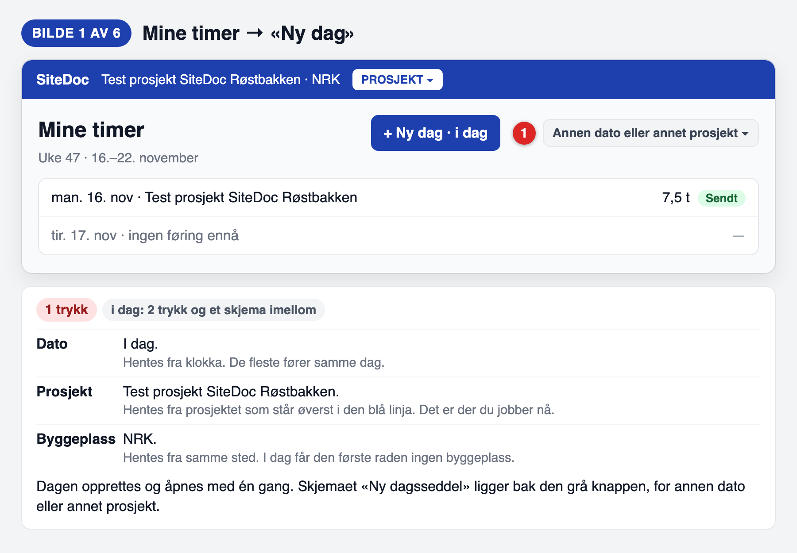
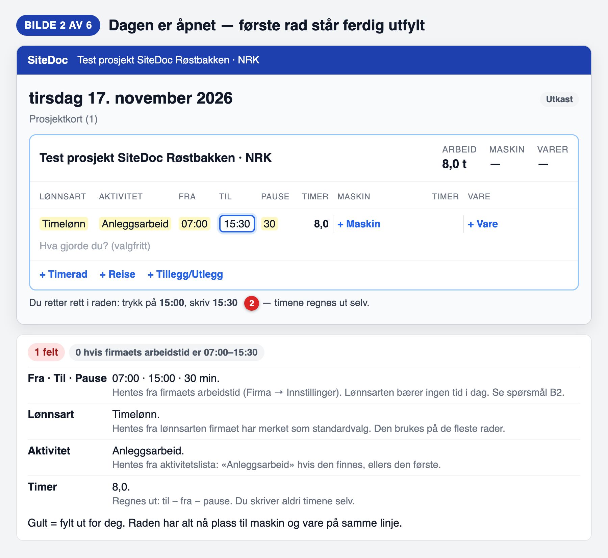
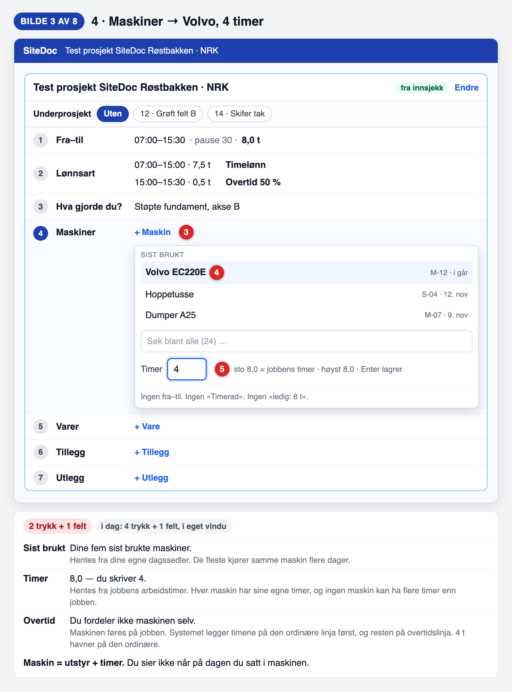
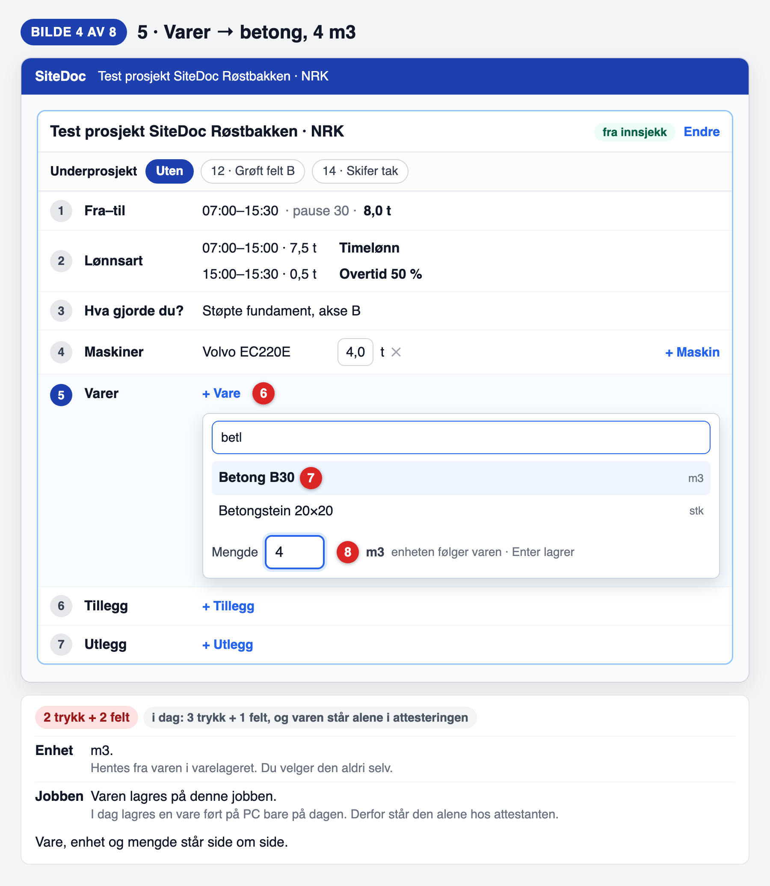
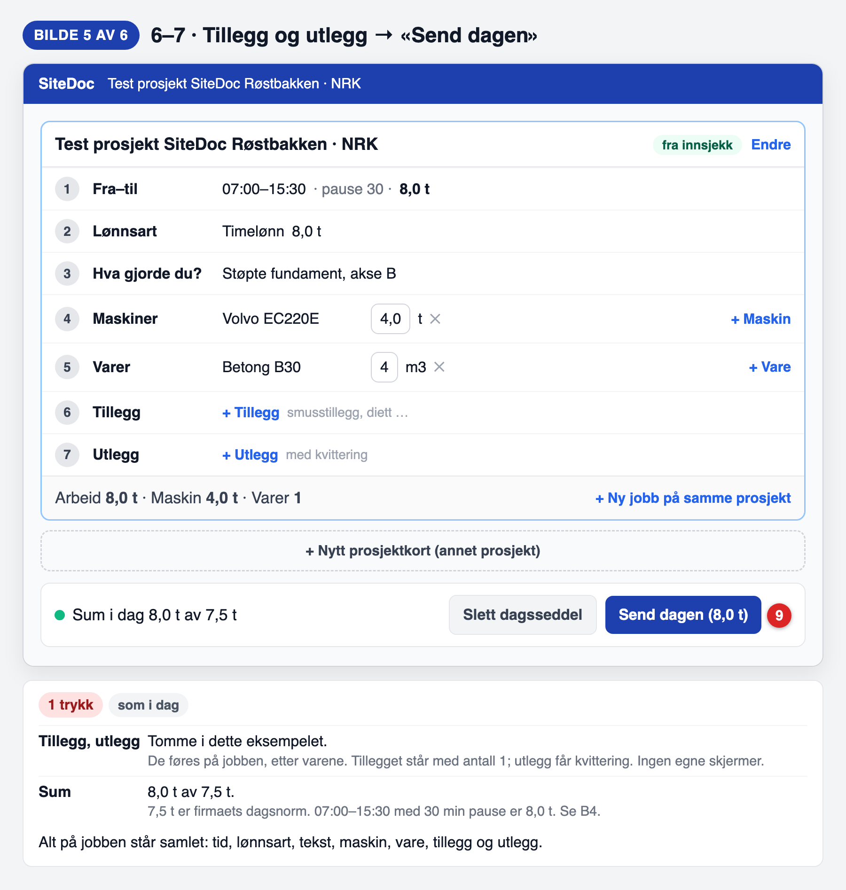
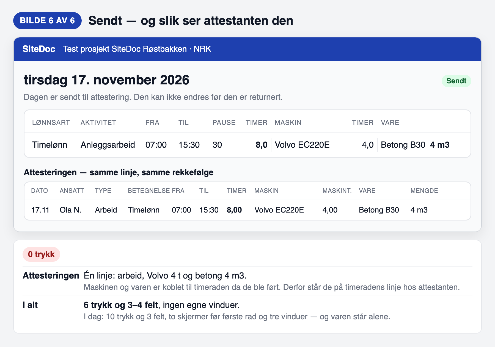
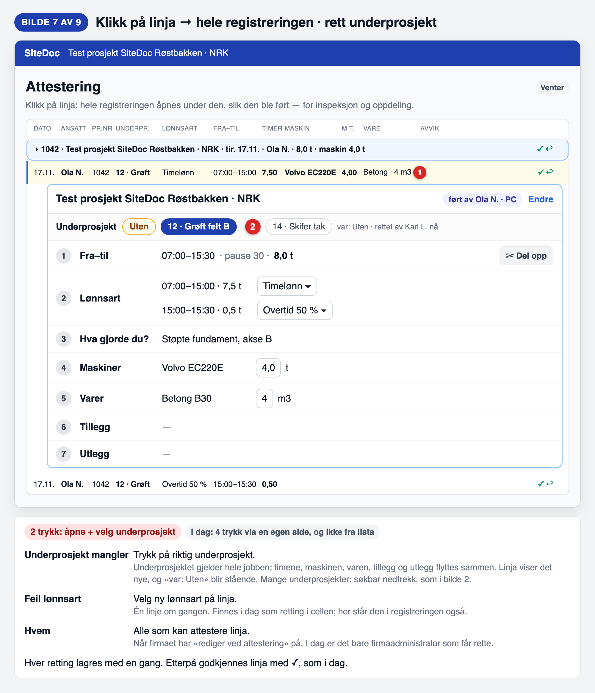
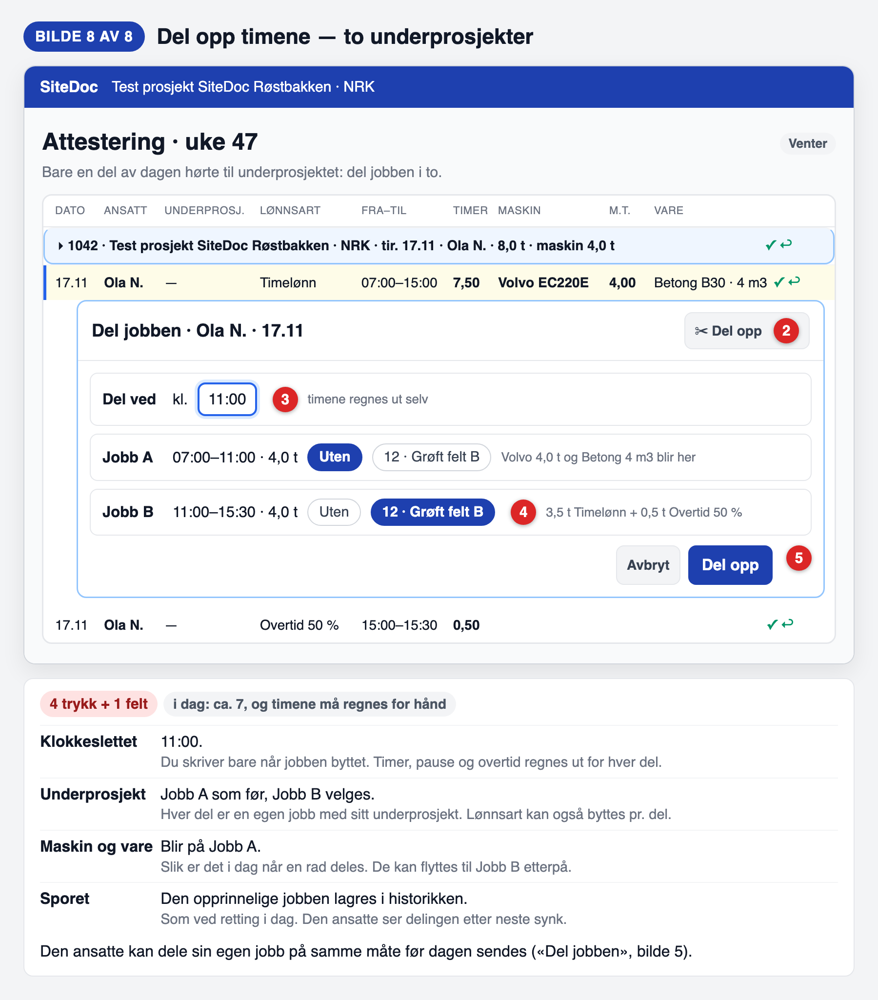
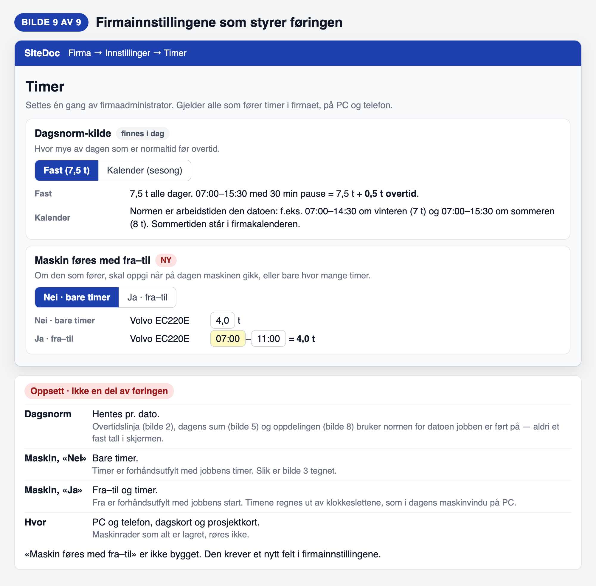

> Del av [Timeføring på web — plan med bilder](../web-timeforing-plan.md): § 4 innledning og Bilde 1–9. Seksjonsnumrene er de samme som før delingen.

## 4. Forslaget — bilde for bilde

Røde tall i bildene er trykk og felt i rekkefølge: 1 til 9 i føringen (bilde 1–5), og fra 1 igjen i attesteringen (bilde 6–8). Gult er felt som er fylt ut for brukeren. De grå tallene 1–7
er de sju delene i Kenneths rekkefølge.

### Bilde 1 — Mine timer → «+ Registrer timer»

**1 trykk.** I dag: 2 trykk og et skjema imellom (WM1).

**Arbeideren fører en jobb på et prosjekt. Dagen er ikke et eget steg** (B1). Slik kartlegges knappen mot
dagsseddelen:

| Når | Det som skjer | Målt |
|---|---|---|
| Dagen finnes ikke | Dagsseddelen lages stille. Serveren lager første timerad med prosjekt, byggeplass, firmaets arbeidstid og standard-lønnsart. | WM58, WM4 |
| Dagen finnes, som utkast eller returnert | Jobben legges til som et nytt kort på samme seddel. Fra er siste til-tid på dagen (WM6). Raden lagres når Til er fylt ut. | WM59, WM60 |
| Dagen er sendt | Jobben kan ikke føres før dagen er gjenåpnet. Knappen tilbyr «Gjenåpne dagen». Har lederen attestert noe, må lederen returnere dagen. Det er dagens regel. | WM60 |
| Annen dato | Datoen velges i jobbens hode (bilde 2). Jobben legges på den datoens seddel, etter de samme tre reglene. Firmaets aldersgrense gjelder. | WM57, WM60 |
| Annet prosjekt | «Endre» i jobbens hode. | — |

**Prosjekt og byggeplass velges ikke. De hentes i denne rekkefølgen** (B2):

| | Kilde | Finnes i dag? | Hvorfor denne plassen |
|---|---|---|---|
| 1 | **Dagen fra telefonen.** Jobbene arbeideren har bekreftet fra GPS-forslaget, står alt på dagen. | Ja. Dagen er på serveren. | De føres ikke på nytt. «+ Registrer timer» legger en jobb til, med Fra etter den siste. |
| 2 | **Alt 1 — innsjekk-loggen.** Hvor arbeideren var sjekket inn i dag, og når. | Dataene finnes (WM24). Leseren mangler (WM25), og innsjekk som tidskilde er ikke bygget (WM27). | Den er målt på stedet, som GPS-loggen, og ligger alt på serveren. |
| 3 | **Alt 2 — prosjektet og byggeplassen i toppen.** | Ja (WM26). | Det er der brukeren står nå. En nyere innsjekk går alt foran der. |
| 4 | **Arbeideren velger prosjekt** i jobbens hode. | Velgeren finnes. | Bare når ingenting er kjent. |

- **Telefonens GPS-logg er ikke i lista,** fordi den ikke finnes på serveren (WM23). Den sendes ikke dit (B3, vedtatt).
- ⚠️ **Skjemaet «Ny dagsseddel» brukes ikke lenger i prosjektkort-modus.** Feltene finnes andre steder: dato,
  prosjekt og aktivitet i jobbens hode, arbeidstiden som jobbens fra–til, og kommentaren på dagssiden (WM61).
  Skjemaet består i dagskort-modus.
- **Samme knapp står nederst på dagen** (bilde 5). Der erstatter den «+ Nytt prosjektkort» og tilbyr også prosjekter
  som alt har et kort (WM47).
- **«Send dagen» består.** Dagsseddelen er fortsatt det som sendes og attesteres.

### Bilde 2 — jobben åpnes: underprosjekt, tid, lønnsart og overtid

**1 felt** (teksten). Alt 2: 2 felt (Til og teksten).

| Fylt ut | Verdi | Hentes fra | Hvorfor |
|---|---|---|---|
| Prosjekt, byggeplass | Røstbakken · NRK | Alt 1: innsjekken (WM24). Alt 2: toppen av siden (WM26). | Føring 1. «Endre» hvis det er feil. |
| Dato | tir. 17.11. | Klokka. | Annen dato velges her, ikke i et skjema først (B1). |
| Underprosjekt | «Uten» | Ingen kilde. Valgene er prosjektets åpne underprosjekter (WM46). Til og med 6: knapper. Flere: søkbar nedtrekk med «Uten» valgt. | Som telefonen, og vedtatt i kort-id-specen § 5.1 (WM45) og av Kenneth (B11). Det gjettes ikke: feil underprosjekt gir feil faktura. |
| Fra–til | 07:00–15:30 | Alt 1: innsjekk 06:58 og utsjekk 15:34, rundet til firmaets steg (`OrganizationSetting.tidsrundingMinutter`, `PS:422`). Alt 2: firmaets arbeidstid (WM2). | Målt tid kan foreslås; arbeideren retter (WM27). |
| Pause | 30 | Firmaets arbeidstid (WM2). Trekkes når dagen er over 5,5 timer (WM4). | Som i dag. |
| Lønnsart | Timelønn · 07:00–15:00 · 7,5 t | Lønnsarten firmaet har merket som standardvalg (`D:2534–2538`), opp til dagsnormen (WM37). | Den brukes på de fleste jobber. |
| Overtid | Overtid 50 % · 15:00–15:30 · 0,5 t | Regelen i WM37: dagsnormen for datoen minus det som alt er ført den dagen. Normen kommer fra normleseren (WM62): 7,5 fast, eller kalenderen. Arten er firmaets overtidsart. | Tiden over normen skal ha egen lønnsart. Arbeideren kan bytte lønnsart på linja. |
| Hva gjorde du? | Tomt | — | Påkrevd pr. jobb før «Send dagen», som på telefonen (B6). |

- **De sju delene står alltid i samme rekkefølge:** 1 Fra–til · 2 Lønnsart · 3 Hva gjorde du? · 4 Maskiner · 5 Varer ·
  6 Tillegg · 7 Utlegg. **Underprosjektet står i jobbens hode,** sammen med prosjekt, byggeplass og dato: det sier
  *hvor* jobben hører til, og gjelder alt i jobben (K3).
- ⚠️ **Reise er også en del av registreringen** (§ 8.21): arbeid, reise, maskin, varer, tillegg og utlegg hører
  sammen i kortet. Bildet er tegnet før reisen kom inn i kortet (w12, w3a).
- **Overtid vises som egen linje med én gang,** slik telefonen gjør (WM38; B8, vedtatt). I dag viser web et forslag
  med knappen «Del raden» (WM39). Går dagen ikke over normen, er det én linje.
- **Regnestykket** (B4): 07:00–15:30 med 30 minutter pause er 8,0 t. Normen 17.11. er 7,5 t, så 0,5 t er overtid.
  Står firmaet på «kalender», og datoen ligger i sommertiden med arbeidstid 07:00–15:30, er normen 8,0 t. Da blir
  det ingen overtidslinje (WM63).
- **Underprosjekt-raden vises bare når prosjektet har åpne underprosjekter.** Nederst i bildet står nedtrekken for
  prosjekter med mange. Grensen 6 er Fabels forslag: «Uten» og 6 knapper er sju valg, og sju er der
  `ui-standarder.md` legger søk på en liste. Den regelen gjelder egentlig fritekstfelt (WM73).

### Bilde 3 — 4 · Maskiner → Volvo, 4 timer

**2 trykk + 1 felt.** I dag: 4 trykk + 1 felt, i eget vindu (WM7).

| Fylt ut | Verdi | Hentes fra | Hvorfor |
|---|---|---|---|
| Sist brukt | De fem sist brukte maskinene | Brukerens egne dagssedler (`WS:261`, finnes i dag) | De fleste kjører samme maskin flere dager. |
| Timer | 8,0 — brukeren skriver 4 | Jobbens arbeidstimer (WM16, WM32) | Hver maskin har egne timer. Ingen maskin kan ha flere timer enn jobben (B4 i kort-id-specen, vedtatt). ⚠️ Regelen gjelder nå også på serveren, pr. jobb og uten pausen; døgn-maskiner er unntatt (w9, § 4.4). |
| Hvem kjørte | Den som fører | Jobben | Føring 3. Navnet står på samme linje i timelista. |
| Fra–til | Vises ikke | ⚠️ Utgått: firmavalget «maskin føres med fra–til» (B5, bilde 9). Maskin har aldri fra–til (§ 8.22 punkt 1). | Kenneth 2026-11-21: maskinførerens skjønn gjelder; han anslår antall timer. |

- **Ingen «Timerad», ingen «ledig: 8 t».** ⚠️ Fra–til vises aldri (B5 er utgått, § 8.22 punkt 1). Brukeren
  sier ikke når på dagen maskinen gikk (føring 4).
- **Overtid:** brukeren fordeler ikke maskinen på ordinær tid og overtid. Systemet fyller den ordinære linja først
  (WM42). 4 timer havner på den ordinære.
- Flere maskiner: «+ Maskin» igjen, hver med sine timer.

### Bilde 4 — 5 · Varer → betong, 4 m3

**2 trykk + 2 felt.** I dag: 3 trykk + 1 felt, og varen står alene i attesteringen (WM11).

| Fylt ut | Verdi | Hentes fra | Hvorfor |
|---|---|---|---|
| Enhet | m3 | Varen i varelageret | Brukeren velger den aldri selv. |
| Jobben | Varen lagres på jobben | Jobben | Føring 3. I dag lagres varen bare på dagen. |

- Vare, enhet og mengde står side om side.
- En «Sist brukt»-liste for varer ville spart søket. Den finnes ikke i dag og er ikke med.

### Bilde 5 — 6–7 · Tillegg og utlegg → «Send dagen»

**1 trykk.** Som i dag. Scenarioet har verken tillegg eller utlegg.

- **Tillegg og utlegg føres på jobben,** etter varene, uten velger og uten egne vinduer. Tillegget står med antall 1,
  som i dag (WM29). Utlegg får kategori, beløp, mva og kvittering (§ 8.21). Tillegg føres uten bilde og kvittering;
  vedlegget som finnes på tillegg i koden, står inntil videre (§ 8.22 punkt 4).
- **Alt på jobben står samlet:** tid, lønnsart, tekst, reise, maskin, vare, tillegg og utlegg (føring 3; reise
  lagt til etter § 8.21).
- **Dagen summeres etter hvert** (B1). Hver jobb legges til «Sum i dag». «Send dagen» sender alle jobbene på datoen
  samlet, som i dag.
- **Neste jobb: «+ Registrer timer»,** samme knapp som på Mine timer. Jobben kan ligge på samme prosjekt eller et
  annet. Web kan ikke lage to kort på samme prosjekt i dag (WM47).
- **Timer på to underprosjekter:** én jobb har ett underprosjekt (K3). «✂ Del jobben» deler ved et klokkeslett: tiden
  før blir i jobben, tiden etter blir en ny jobb på samme prosjekt, med eget underprosjekt. Det er telefonens «Del til
  eget kort» (WM48).
- ⚠️ **Bunnlinja viser to tall (§ 8.22):** arbeid mot normen («8,0 av 7,5» — arbeid uten reise mot dagsnormen
  for datoen, WM64) og «Sum i dag» = arbeid + reise («11 t» når 3 t er reise). Maskintimer vises, men legges ikke
  til. Bildet og teksten «Sum i dag 8,0 t av 7,5 t · 0,5 t overtid» er fra før reisen kom med i summen.
  ✅ Bygget i sumlinja (merget `c03aa0e6`, ikke deployet). Prikken er gul over normen (WM41).

### Bilde 6 — attesteringen: de 11 kjernekolonnene

> **Gjelder med endringene i § 4.5** (2026-11-19): dagsrad og jobbrad etter B14 A, 13 kolonner etter B13 A, og
> uke, år og «Attestert» også på prosjektets side. Bildet under er det opprinnelige.

**1 trykk åpner registreringen.** I dag gjør et trykk på linja ingenting (WM49).

- **De 11 kjernekolonnene er standard** (B9): dato · ansatt · prosjektnr · underprosjekt · lønnsart · fra–til ·
  timer · maskin · maskintimer · vare med mengde · avvik. Knappene ✓ og ↩ står fast til høyre (R22).
- **«Velg parameter» består.** Attestanten legger til og fjerner kolonner selv, som i dag. Alle 26 finnes fortsatt.
- **Hvorfor:** i dag har linja 26 kolonner og er minst 2 814 punkter bred. Maskin og Vare ligger utenfor skjermen
  (WM50).
- **Vare med mengde er én kolonne i kjernen:** «Betong · 4 m3», slik telefonen skriver den (WM18). Med de tre
  kolonnene som finnes (vare, enhet, mengde) er kjernen 1 462 punkter bred, mot om lag 1 220 ledig på en skjerm
  på 1 440 (WM70). Med én varekolonne, dd.mm. og litt smalere tekstkolonner er den regnet til om lag 1 140.
  Koderen måler i nettleser; kravet er at kjernen vises uten sidelengs rulling på 1 440.
- **A · Dato og år** (tillegget): datoen skrives «17.11.», ikke «2026-11-17» (WM72). Året står i årsvelgeren ved
  ukevalget og byttes der, så attestanten slipper å bla uke for uke. Prosjektets attestering, som ikke har ukevalg,
  får samme årsvelger.
- **B · Avvik** (B7): korte merker på én linje — «Uten timerad», «Uten førerbevis». Hele forklaringen vises når
  pekeren holdes over merket, og ved trykk på berøringsskjerm (WM68). I dag brytes to setninger over fem–seks
  linjer (WM21).
- **Tall på tillegg og utlegg:** de 11 kolonnene har ingen kolonne for antallet på et tillegg eller beløpet på et
  utlegg (WM71). Se B13.
- **Lagret oppsett:** en attestant som alt har lagret et kolonneoppsett, beholder det (WM69). «Velg parameter» får
  valget «Tilbakestill til standard», så kjernen er ett trykk unna.
- **Overtid:** ordinær tid og overtid er to linjer i samme kort (WM43). De er to lønnsarter og attesteres hver for
  seg. Kortets linje viser summen.
- **Maskin og overtid:** nederst i bildet står samme jobb med Volvo i 8 timer. Maskinen står da på begge linjene, med
  7,50 og 0,50. Summen, «maskin 8,0 t», står i kortets linje.
- **Er det lesbart?** Ja, så lenge kortets linje viser summen. Uten den ser 7,50 og 0,50 ut som to føringer. Den som
  førte, har bare skrevet «8». Alternativet er å la alle maskintimene stå på den ordinære linja; det bryter telefonens
  grense «maskin høyst radens timer» (WM32) og er ikke foreslått.

### Bilde 7 — klikk på linja → hele registreringen · rett underprosjekt

> **Gjelder med endringene i § 4.5** (2026-11-19): den blå linja åpner kortet (§ 8.6 punkt 1), fra–til er felt og
> timene regnes ut, ✂ og «Rediger jobben» står i kortet, og «Endre» øverst i kortet er «Rediger jobben».
> ⚠️ **Etter w15g (§ 8.20):** kortet har ingen åpne felt. Linjene er tekst med ✎, og feltene står i vinduet bak pennen.

**2 trykk:** åpne, og velg underprosjekt. I dag: om lag fire trykk via en egen side, og ikke fra lista (WM52).

- **Hele registreringen åpnes under linja,** slik den ble ført: samme sju deler, samme rekkefølge. Attestanten
  inspiserer og deler opp uten å forlate lista (B9).
- **Underprosjekt mangler eller er feil:** trykk på riktig underprosjekt. Det gjelder hele jobben — timene, maskinen,
  varen, tillegg og utlegg flyttes sammen (K3). Linja viser det nye, og «var: Uten» blir stående, som ved retting i
  cellen i dag (WM51).
- **Feil lønnsart:** velg ny lønnsart på linja i registreringen. Det finnes alt som retting i cellen (WM51).
- ⚠️ **Utgått (w15g, § 8.20; B24 B):** kortet har ingen åpne felt, og en retting lagres med «Lagre» i vinduet bak
  ✎. Jobben attesteres samlet på jobbraden. Sto slik: timer, maskintimer og mengde rettes i feltene, som i cellen i
  dag, og hver retting lagres med en gang; etterpå godkjennes linja med ✓ (R21).
- **Hvem:** alle som kan attestere linja, når firmaet har «rediger ved attestering» på (B10, vedtatt). I dag krever
  serveren firmaadministrator for retting, penn og ✂ (WM54); kravet endres til attesteringsrett de tre stedene.
- Har prosjektet mange underprosjekter, er valget en søkbar nedtrekk, som i bilde 2 (B11).

### Bilde 8 — del opp timene: to underprosjekter

**4 trykk + 1 felt:** åpne · «Del opp» · klokkeslettet · underprosjekt på del B · «Del opp». I dag: om lag sju
handlinger, og timene må regnes for hånd (WM53).

| Fylt ut | Verdi | Hentes fra | Hvorfor |
|---|---|---|---|
| Timer pr. del | 4,0 og 4,0 | Regnes ut av klokkeslettet, pausen og dagsnormen for datoen (WM62) | I dag må attestanten skrive timene selv (WM53). |
| Lønnsart pr. del | Del B: 3,5 t Timelønn + 0,5 t Overtid 50 % | Samme regel som ved føring (WM37) | Overtiden følger tiden på dagen. |
| Underprosjekt, del A | Som før | Jobben | Bare del B endres. |
| Maskin og vare | Blir på del A | Slik serveren gjør i dag når en rad deles (WM53) | De kan flyttes til del B etterpå. ⚠️ § 8.21 punkt 2: maskintimer, varer og resten blir i kortet de ble registrert i, og det nye kortet registrerer sine egne. «Del opp» flytter i dag maskin og vare som er koblet til en rad som går til del B (`delJobb`, `dagsseddel.ts:6871–6895` @ `cbf99013`). 🟡 Måles, ikke bestilt. |

- **Hver del er en egen jobb** (eget kort), med sitt underprosjekt. Serveren støtter «eget kort» ved deling; web-vinduet
  bruker det ikke (WM48).
- **Den opprinnelige jobben lagres i historikken,** som ved retting i dag. Den ansatte ser delingen etter neste synk.
- **Den ansatte kan dele sin egen jobb på samme måte** før dagen sendes («✂ Del jobben», bilde 5).
- ✂ for å dele én rad står i kortet, ved timelinja, ikke på linja i tabellen (§ 4.5 punkt 4, Kenneth 2026-11-19).
  «Del opp» i registreringen deler hele jobben.
- **Versjon 23 (Kenneth 2026-11-23, B68–B71 ja):** «✂ Del opp» er blokka i kortet. Etter delingen står kort A og
  kort B åpne og redigerbare side om side, linjer kan flyttes mellom dem, og attestanten kan legge til linjer.
  Det som gjelder, står i § 4.16 del G og `v23-del-opp-etter.png`. Vinduet fra versjon 21 er utgått.

### Bilde 9 — firmainnstillingene som styrer føringen

**Oppsett, ikke en del av føringen.** Firmaadministrator setter det én gang i Firma → Innstillinger.

| Innstilling | Finnes? | Hva den styrer | Hentes fra |
|---|---|---|---|
| **Dagsnorm-kilde:** «Fast (7,5 t)» eller «Kalender (sesong)» | Ja (WM62) | Hvor mye av dagen som er normaltid før overtid: overtidslinja (bilde 2), dagens sum (bilde 5) og oppdelingen (bilde 8). | Normleseren, pr. dato. «Fast»: firmaets dagsnorm. «Kalender»: arbeidstiden den datoen, med sommertiden fra firmakalenderen (WM63). |
| ⚠️ **UTGÅTT — bygges ikke** (B38 A, § 8.14; § 8.22 punkt 1). Sto slik: **Maskin føres med fra–til:** «Nei · bare timer» eller «Ja · fra–til» | **Nei — ny** (B5) | Om maskinlinja har klokkeslett. «Nei»: utstyr og timer, forhåndsutfylt med jobbens timer (bilde 3). «Ja»: fra–til, forhåndsutfylt med jobbens start; timene regnes ut av klokkeslettene, som i dagens maskinvindu på PC (WM7). | Ny kolonne i firmainnstillingene. |

- ⚠️ **De tre punktene under om den nye innstillingen er utgått:** B5, B12 og w6 bygges ikke (§ 8.14, § 8.22
  punkt 1). Av bilde 9 gjelder bare dagsnorm-kilden.
- **Den nye innstillingen krever en migrering** (WM67), og telefonen må få en lokal kolonne for den. Maskinradene
  trenger ingen skjemaendring: fra og til er alt valgfrie (WM66).
- **Den gjelder PC og telefon, dagskort og prosjektkort** (B5). Maskinrader som alt er lagret, røres ikke.
- **Hvem som får «Ja» og «Nei» når innstillingen innføres,** er B12.
- **Kenneths tall:** 7 t vinter og 8 t sommer krever «Kalender». Da er normen arbeidstiden, så en sommerdag
  07:00–15:30 har norm 8,0 og gir ingen overtid. Med «Fast» er normen 7,5 hele året, og samme dag gir 0,5 t
  overtid (WM63).

**I alt for føringen (bilde 1–5): 6 trykk og 4–5 felt, én flate, ingen egne vinduer.** I dag: 10 trykk og 3 felt, to
skjermer før første rad og tre vinduer — uten «Hva gjorde du?», og med varen alene (WM13). Overtidslinja og
underprosjektet «Uten» koster ingen trykk.

Alle ni samlet: [`oversikt.png`](../skisser-web-timeforing/oversikt.png).
