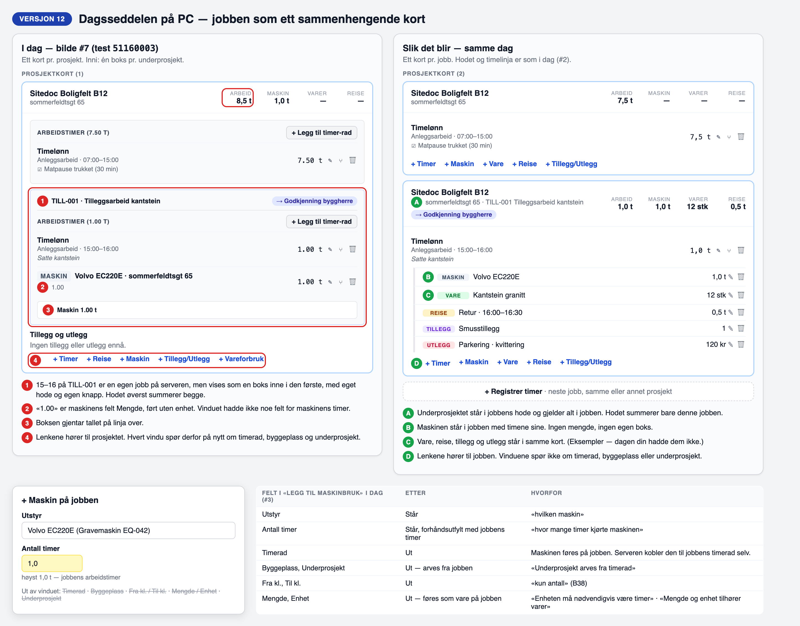

> Del av [Timeføring på web — plan med bilder](../web-timeforing-plan.md): § 4.13. Seksjonsnumrene er de samme som før delingen.

### 4.13 Avviksrunde etter Kenneths test av dagsseddelen på PC (versjon 12)

Kenneths ord står i § 8.13. Bildene hans er `relay/bilder/2026-11-20-dagsseddel/k1.webp`–`k7.webp` (#1–#7).
Målt mot develop @ `d9354caa`. Koden i `apps` og `packages` er lik test `51160003`
(`git diff --stat 51160003 d9354caa -- apps packages` er tom). `WS`, `D` og `KI` som ellers i planen;
`KG` = `packages/shared/src/utils/kortGruppering.ts`, `NB` = `packages/shared/src/i18n/nb.json`.



Kilde: `skisser-web-timeforing/skisser-v12.html`. Skisse av forslaget, ikke bygget. Linjene for vare, reise,
tillegg og utlegg i høyre kort er eksempler for å vise plassen.

**Kravet, slik det er lest.** Én registrering er jobben: arbeideren fører fra–til, og i den samme registreringen
står hvilken maskin og hvor mange timer, varene, reisen, tilleggene og utleggene. Alt vises i ett kort.
«Varer» og «vareforbruk» er lest som det samme: varene som ble brukt på jobben. Kravet er det samme som
føringene i § 1.

**De fire presiseringene samme dag** (§ 8.13) er arbeidet inn slik:

| Presisering | Hvor i runden |
|---|---|
| 1 — lastebilen: 08–10, 2 timer på bilen, 5 m3 grus eller pukk og parkeringsutlegget i samme jobb | Del F: eksempelet ført del for del, med hvor hver del lagres og hva som bryter. Bildet over (høyre kort). Mengden føres som vare på jobben (A4, B37). |
| 2 — maskinen føres i timer, og bare i timer | A3, A4 og del G: hvor mengde og enhet finnes i dag, hva som skjer med lagrede verdier, og spørringen som teller dem. Nedtrekket «Enhet» og feltet «Mengde» går ut av maskinføringen (w3b). |
| 3 — maskinen er eksempelet for alle typene | Del D: hver type målt mot maskin-mønsteret. |
| 4 — attestanten ser alt i sammenheng | Del E: attesteringen målt. |

#### Del A — hva du så på #7, og hvorfor

**Dataene er riktige. Visningen er feil.** 15–16 på TILL-001 er en egen jobb på serveren, og maskinen hører til
den. Dagssiden på PC viser ikke jobber. Den viser ett kort pr. prosjekt, med én boks pr. underprosjekt inni.

| Det du så | Hvorfor | Kode |
|---|---|---|
| 15–16 på TILL-001 ble en egen boks, med eget hode og egen «+ Legg til timer-rad» | Dagssiden deler radene i bøtter pr. prosjekt og underprosjekt. Hver bøtte tegnes som en boks med eget hode, egen sum «Arbeidstimer (1.00 t)» og egen knapp. Raden fikk TILL-001 i vinduet, så den havnet i en ny bøtte. | `WS:662–669`, `:2071–2100`, `:2217–2253` |
| «Prosjektkort (1)», og hodet viser 8,5 t og 1,0 t | Kortene lages pr. prosjekt, ikke pr. jobb. Hodet summerer alle jobbene på prosjektet. Koden sier det selv: «dagssiden grupperer fortsatt pr. prosjekt … til w3». | `WS:1699`, `:1709–1731`, `:741–742` |
| På serveren er 15–16 en egen jobb | «+ Timer» i kortet sender ingen kort-id. En rad med annet underprosjekt enn jobben får et annet kort. Det er vedtatt: én jobb har ett underprosjekt (K3). Attesteringen viser derfor to jobber for denne dagen. | `WS:1087`; `D:4147`, `:4151–4154`; `KI:250–265`; `KG:136–159` |
| «1.00» under maskinen | Det er feltet Mengde, ført uten enhet. Maskindelen i «Legg til timer-rad» har Utstyr, Mengde og Enhet, men ikke noe felt for timer. Maskinen får radens timer. «høyst 1 t» står rett under Mengde, og hjelpeteksten sier «sett lavere timer», men feltet finnes ikke. | `WS:2733–2737`, `:3798–3851`, `:3481`; `NB:604`, `:610` |
| Boksen «Maskin 1.00 t» | Bøttas maskinsum. Den gjentar tallet på linja over. | `WS:2315–2321` |
| Maskinen står etter timeradene, ikke ved raden sin | Bøtta tegner først alle timeradene, så alle maskinene. | `WS:2260–2282` |

**Hva «Rediger timer-rad» (#4) ikke gjør:**

1. **Det viser ikke maskinen.** Maskindelen tegnes bare for en ny rad. Maskinen rettes med pennen på maskinlinja,
   som åpner et annet vindu (`WS:3777`, `:825–826`).
2. **Det viser ikke varer, reise, tillegg eller utlegg.** De har egne vinduer bak lenkene nederst i kortet
   (`WS:1806–1852`).
3. 🔴 **Bytter du underprosjekt eller byggeplass på raden, følger ikke maskinen og varen med.** Serveren
   oppdaterer bare timeraden (`D:4278–4300`, `:4376–4402`). Maskinens kort-id følger raden (`KI:266–269`), men
   maskinens eget underprosjekt blir stående, og valideringen unntar det (`KI:311–323`). Dagssiden lar maskinen
   stå i den gamle boksen (`WS:666–669`). Timerapporten viser maskintimene på det gamle underprosjektet
   (`apps/api/src/routes/timer/rapport.ts:681`, `:705`). Lest i koden, ikke kjørt.
4. **Prosjektet kan ikke byttes** (`WS:3525`). Det er kjent og en egen oppfølger (`WS:2904`).

**De andre vinduene har samme brist:**

- **«Legg til maskinbruk» (#3)** åpnes fra prosjektet, med tomt underprosjekt og dagens ramme som fra–til
  (`WS:1100–1107`). Underprosjektet følger ikke timeraden du velger (`WS:5025–5027`, `:5250–5252`), og serveren
  lagrer det vinduet sender (`D:10109–10110`). Antallet må stemme med fra–til (`WS:5175–5189`). Vinduet krever
  «Timerad» (`WS:5164–5171`), selv om serveren kobler maskinen til jobbens timerad selv når den mangler (`D:2268–2270`).
- **Tillegg og utlegg** åpnes fra prosjektet med tomt underprosjekt og sender ikke kort-id (`WS:3899–3900`, `:1109`,
  `:4114`, `:4773–4782`). De vises under prosjektet eller i underprosjektets boks, aldri i jobben (`WS:2103–2144`,
  `:2287–2310`).
- **Varer** står i en egen liste nederst i prosjektets kort, uten penn og søppelbøtte (`WS:1788–1804`). Varen kan
  ikke rettes eller slettes fra dagen. Prosedyrene finnes (`apps/api/src/routes/vareforbruk.ts:565`, `:740`).
- **Reise:** «+ Reise» åpner timerad-vinduet på prosjektet med tomt underprosjekt (`WS:1097–1099`). Raden står
  blant timeradene i boksen til underprosjektet sitt. Serveren har den i jobbens kort (w12).

**Hva w3 retter slik w3 sto i versjon 11, og hva ingen del retter:**

| Brist | w3 i versjon 11 | Ingen del |
|---|---|---|
| Kortet er pr. prosjekt, ikke pr. jobb | Ja (bilde 5). Men tegnet som en ny flate med sju nummererte deler, ikke kortet du liker (#2). | — |
| Maskin uten timer-felt; «Timerad»; fra–til | Ja (bilde 3, § 5). Fra–til ut (⚠️ w6 er utgått, § 8.14). | — |
| Mengde og enhet på maskin | — | Bilde 3 viser dem ikke, men § 5 og § 7 sier ikke at de går ut. WM104 og H9 A sier at de består. Kenneth 20.11.: de går ut av maskinføringen (A4). |
| Underprosjekt arves i vinduene | Ja, for føring på jobben (underprosjektet i hodet gjelder alt). | Maskinvinduet som består for døgn-maskin. |
| Maskin og vare følger ikke når radens underprosjekt byttes | — | Ingen del rører `oppdaterTimerRad`. |
| Reisen i jobben på dagssiden | — | Bilde 2–5 har sju deler uten reise. § 7 sier «+ Reise … BEVARES uendret», og w12 sier «Reisevinduet på PC står urørt». |
| Tillegg og utlegg uten kort-id | Ja (§ 6 (i)). | — |
| Varen kan ikke rettes eller slettes i kortet | — | Ikke nevnt. |
| «Rediger timer-rad» viser ikke jobbens maskin | w3 erstattet vinduet med flaten. | Når vinduet beholdes (#4 «fungerer bra»), må det sies hvor maskinen rettes. |

#### Del B — avvikslista

| # | Krav | I dag | Planen sa | Avvik | Retting |
|---|---|---|---|---|---|
| **A1** | «Hvis #2 var et sammenhengende kort, så ville dette være perfekt.» | Kort pr. prosjekt, boks pr. underprosjekt (`WS:1709–1713`, `:2071–2100`). Serveren og attesteringen har jobben som enhet (`KG:136–159`). | w3: jobben som én flate (bilde 2–5). Ikke bygget. | Jobben er ikke enheten på dagssiden. | **w3a:** ett kort pr. jobb, med samme gruppering som attesteringen (`grupperPaaKort`). |
| **A2** | «jeg liker hvordan #2 ser ut» · «rediger timer funger bra» | Kortets hode med fire tall, timelinja med lønnsart, tid, pause og tekst (`WS:1733–1782`, `:2483–2560`). | Bilde 2–5: ny flate med nummererte deler og uten vinduer. | Planen tegnet om det som virker. | **w3 skrives om:** kortet og timerad-vinduet beholdes. Bilde 2–5 gjelder som innhold og rekkefølge, ikke som utseende. Bildet over erstatter bilde 5 for dagssiden. |
| **A3** | «hvor mange timer kjørte maskinen og hvilken maskin» | Maskindelen i timerad-vinduet har ikke timer; maskinen får radens (`WS:3798–3843`, `:3481`). «høyst» står under Mengde (`WS:3844–3851`). | § 5: brukeren skriver timene pr. maskin (bilde 3). Ikke bygget. | Timer kan ikke føres der maskinen velges. | **w3b:** maskin = utstyr + antall timer, forhåndsutfylt med jobbens timer, «høyst X t» ved feltet. |
| **A4** | «Enheten må nødvendigvis være timer, ikke kubikk og stykk og kvadrat» · «Mengde og enhet tilhører varer.» | Mengde og Enhet (m, m2, m3, kg, tonn, stk) står i begge maskinvinduene (`WS:87`, `:3810–3843`, `:5343–5370`), lagres på maskinraden (`D:10113–10114`) og vises i attestering, rapport og eksport (`packages/shared/src/utils/timerDetaljRader.ts:715`; `rapport.ts:685`, `:708`). | WM104 og H9 A (kort-id-specen): mengden gjelder produsert mengde og vises i egne kolonner. | Vedtaket er snudd av Kenneth 20.11. | **w3b:** feltene går ut av maskinføringen på PC i prosjektkort-modus. Mengden føres som vare på jobben: «Pukk · 5 m3». **Ingen data slettes:** det som alt er lagret på maskinrader, står og vises som før i attestering, rapport og eksport. Det flyttes ikke til varer, fordi raden ikke sier hvilken vare det var (HM22). **B37** gjelder prosjekter uten varelager. |
| **A5** | «her skal ikke registreres timer fra/til -> kun antall» | Fra og til i maskinvinduet, forhåndsutfylt, og antallet må stemme med dem (`WS:1105–1106`, `:5175–5189`). Timerad-vinduet gir maskinen radens fra–til (`WS:3485–3486`). | B5: firmaet velger. B12 A: prosjektkort-firma får «Nei». w6, ikke bygget. | Feltene står til w6, og B5 lar et firma slå dem på igjen. | **w3b** tar feltene ut på PC i prosjektkort-modus nå. ⚠️ **B38 → A (§ 8.14):** B5 og w6 er utgått. Ingen firma kan slå fra–til på igjen (§ 8.22 punkt 1). |
| **A6** | «Underprosjekt arves fra timerad som standard» | Vinduene for maskin, tillegg, utlegg og reise åpnes fra prosjektet med tomt underprosjekt (`WS:1100–1109`, `:1097–1099`, `:3899–3900`). | § 7: ett valg i jobbens hode gjelder alt i jobben. Ikke bygget. | Ingenting arves. | **w3a:** lenkene står på jobben. Vinduene får jobbens prosjekt, byggeplass, underprosjekt og kort-id, og viser ikke feltene. Unntak: reisen (B34 B). |
| **A7** | «Det er logiske brister i hvordan data knyttes sammen.» | Bytte av underprosjekt eller byggeplass på en timerad flytter ikke koblet maskin og vare (`D:4278–4300`, `:4376–4402`; `KI:311–323`). Maskin lagres med det vinduet sender (`D:10109–10110`). | Ikke nevnt for arbeiderens retting. Attestantens «hele jobben» flytter alt (w5). | Maskintimer kan stå på et annet underprosjekt enn arbeidet, også i timerapporten. | **w3a, serveren:** koblet maskin og vare følger timeraden. En maskin som føres koblet, lagres med timeradens underprosjekt og byggeplass. Bare PC-veiene; synken røres ikke. Rader som alt avviker, telles først (§ 10). ⚠️ § 8.21 punkt 2 (2026-11-21) sier at maskintimer, varer og resten hører til kortet de ble registrert i. A7 er bygget (w3a) og gjelder bytte på en timerad, ikke oppdeling. Ingenting er bestilt endret. |
| **A8** | «har denne jobben reisetid» | Reiseraden står blant timeradene i underprosjektets boks (`WS:662–665`). Kortets hode har tallet «Reise» pr. prosjekt (`WS:1730`). | Føringen har sju deler uten reise. w12 la reisen i jobbens kort i attesteringen. | Reisen mangler i jobben på dagssiden. | **w3a:** reisen vises i jobbens kort etter kort-id-en serveren har satt. «+ Reise» står på jobben. Reisevinduet: se [vedtak-timer-web.md § Reisevinduet](../vedtak-timer-web.md). |
| **A9** | «har denne jobben noen utlegg eller tillegg» | Vises under prosjektet eller i underprosjektets boks. Kort-id sendes ikke (`WS:2103–2144`, `:4114`, `:4773–4782`). | § 6 (i): jobbens kort-id sendes. Ikke bygget. | Med to jobber på samme sted velger serveren jobben selv. | **w3a:** føres fra jobben med jobbens kort-id, og vises i jobben. |
| **A10** | «ble det brukt noe varer på denne jobben» | Egen liste nederst i prosjektets kort, uten retting og sletting (`WS:1788–1804`). Varen er koblet til timeraden (w1). | § 7: «jobben vises samlet». | Varen står utenfor jobben og kan ikke rettes. | **w3a:** varen står i jobben, med penn og søppelbøtte. |
| **A11** | Én sammenhengende jobb | To innganger til samme ting: «+ Legg til timer-rad» i hver boks og «+ Timer» nederst (`WS:2247–2252`, `:1808–1814`). «Maskin X t»-boksen (`WS:2315–2321`). «Timerad» i maskinvinduet (`WS:5243–5270`). | § 5: «Timerad» ut av føringen på jobben. | Rester fra bøttevisningen. | **w3a:** én rekke lenker pr. jobb. Boksen og hodet «Arbeidstimer (N t)» går ut i prosjektkort-modus. «Timerad» vises ikke når maskinen føres fra en jobb. |
| **A12** | Én sammenhengende jobb | «+ Timer» i kortet lar deg velge et annet underprosjekt. Da blir raden en ny jobb uten at skjermen sier det (`WS:1087`; `D:4147`). | § 4 bilde 5: ny jobb lages med «+ Registrer timer». | Samme knapp gir to ulike ting. | **w3a:** «+ Timer» i jobben gir en ny linje i samme jobb, med jobbens byggeplass og underprosjekt. Ny jobb er «+ Registrer timer». |
| **A13** | «rediger timer rad i #4 må være mangelfull» | Maskindelen vises bare for ny rad (`WS:3777`). | w3 erstattet vinduet. | Legg til og rediger viser ulikt. | **w3b:** maskindelen er lik i «Legg til» og «Rediger» og viser jobbens maskiner. Resten av jobben står i kortet rett under raden (w3a). |
| **A14** | «mobilappen skal vi vente med» | — | w12m, telefon-delen av w6 (⚠️ utgått, § 8.14) og w9m, og w3s bytte i `M/utils/tilleggPaaKort.ts`. | Planen hadde mobildeler i kø. | § 9: merket «venter på web». Ingenting bestilles på mobil. |

**Det som ikke røres** (ordrens punkt 5): kortets hode og utseende (#2), timelinja, vinduet «Rediger timer-rad» med
feltene det har (#4), «Dagens ramme», «Sum i dag», «Send dagen» og «+ Registrer timer». Dagskort-modus røres
ikke (Kenneth 2026-11-07); `ProsjektGruppe` og `EcoGruppe` brukes av begge moduser og får vakt-test.

#### Del D — hver type målt mot maskin-mønsteret (presisering 3)

Mønsteret: typen henger på jobben, arver jobbens prosjekt, byggeplass og underprosjekt, og har bare feltene
som hører til typen. `RK` = `apps/web/src/app/dashbord/timer/[id]/ReiseKort.tsx`,
`KV` = `apps/web/src/components/timer/KortVareforbrukModal.tsx`.

| Type | Vinduet i dag | Åpnes fra | Felt etter w3a og w3b | Felt som går ut av vinduet |
|---|---|---|---|---|
| **Maskin** | Utstyr, Timerad, Byggeplass, Antall timer, Fra kl., Til kl., Mengde, Enhet, Underprosjekt (`WS:5230–5388`) | Prosjektet (`WS:1100–1107`) | Utstyr · Antall timer | Timerad, Byggeplass, Fra kl., Til kl., Mengde, Enhet, Underprosjekt |
| **Vare** | Prosjekt, Timerad, Byggeplass, Vare, Antall med varens enhet (`KV:96–135`) | Prosjektet (`WS:1111`) | Vare · Antall (enheten følger varen) | Prosjekt, Timerad, Byggeplass |
| **Tillegg** | Tillegg, Antall, Kommentar, Kvittering, Byggeplass, Underprosjekt (`WS:3995`, `:4116–4260`) | Prosjektet (`WS:1109`) | Tillegg · Antall · Kommentar · Kvittering | Byggeplass, Underprosjekt |
| **Utlegg** | Kategori, Beløp, Kommentar, Kvittering, Byggeplass, Underprosjekt (`WS:4645`, `:4790–4920`) | Prosjektet, via velgeren (`WS:1109`) | Kategori · Beløp · Kommentar · Kvittering | Byggeplass, Underprosjekt |
| **Reise** | Tur, Retur eller annet kontor, Byggeplass, Underprosjekt (`RK:177`, `:298`). Tiden regnes av reiseregelen. | Prosjektet (`WS:1228–1243`) | Som i dag, med jobbens byggeplass og underprosjekt forhåndsvalgt | Ingen. Arbeideren bestemmer hvor reisen føres (B34 B). |

**Hvor hver type lagres og kobles i dag.** `ST` = `packages/db-timer/prisma/schema.prisma`,
`VS` = `packages/db-varelager/prisma/schema.prisma`. Alle tabellene har kolonnen `kort_id`.

| Type | Tabell | Kobles til jobben med | Sted på raden | Hvem setter kort-id i dag |
|---|---|---|---|---|
| Arbeid (fra–til) | `timer.sheet_timer` (`ST:230–331`) | `kort_id` (`ST:318`) | prosjekt, byggeplass, underprosjekt (`ST:245`, `:252`) | PC sender den for ny jobb (`WS:746`); ellers serveren, etter stedet (`KI:250–265`) |
| Maskin | `timer.sheet_machines` (`ST:577–628`) | `sheet_timer_id` og `kort_id` (`ST:587`, `:617`) | egne kolonner, kan avvike fra timeraden (`ST:591`, `:598`) | Serveren: timeradens (`KI:266–269`) |
| Vare | `varelager.vareforbruk` (`VS:74–108`) | `sheet_timer_id` og `kort_id` (`VS:88`, `:91`) | egne kolonner (`VS:78–79`) | Serveren: timeradens (`KI:373–410`) |
| Tillegg | `timer.sheet_tillegg` (`ST:407–445`) | `kort_id` (`ST:435`). Ingen kobling til timerad. | egne kolonner (`ST:415–416`) | Serveren, etter stedet: eldste jobb med samme sted (`D:5153`) |
| Utlegg | `timer.sheet_utlegg` (`ST:487–521`) | `kort_id` (`ST:513`). Ingen kobling til timerad. | egne kolonner (`ST:493–494`) | Serveren, etter stedet (`D:5474`) |
| Reise | `timer.sheet_timer`, med reise-merke | `kort_id`, satt av reiseregelen | egne kolonner; arbeideren velger (B34 B) | Serveren (`KI:271–307`) |

**Felt som må velges på nytt i stedet for å arves:** Byggeplass og Underprosjekt i alle fem vinduene, og Timerad
i maskin- og varevinduet. **Felt som ikke hører til typen:** Fra kl., Til kl., Mengde og Enhet på maskin, og
Prosjekt i varevinduet.

- **Alle fem åpnes fra prosjektet i dag, ingen fra jobben.** Det er årsaken til at hvert vindu spør om sted på
  nytt. w3a flytter lenkene til jobben (A6, A11).
- **Feltene som går ut av vinduet, finnes fortsatt:** de står i jobbens hode og gjelder alt i jobben. Ingen
  opplysning forsvinner.
- **Vinduene består som de er i dagskort-modus,** og for en døgn-maskin eller vare som føres uten jobb.
- **Serveren trenger ingen ny lagring.** Alle fem radtypene har alt kort-id, og vare og maskin har kobling til
  timerad. Det som mangler, er at PC sender jobbens kort-id (A9) og at koblet maskin og vare følger timeraden
  (A7).

#### Del E — attesteringen målt mot presisering 4

**Kortet i attesteringen viser allerede alt.** Et klikk på jobbraden åpner jobben med åtte deler: fra–til,
lønnsart, «Hva gjorde du?», maskiner, varer, tillegg, utlegg og reise
(`apps/web/src/components/attestering/RegistreringPanel.tsx:337–469`). Lista viser maskin og vare på
timeradens linje, og tillegg, utlegg og reise som linjer i samme jobb (`KG:136–159`; w10 del B, w12).
Bildet er `ks-attestering.png` (§ 4.5).

**Det attestanten likevel ikke kan stole på, kommer fra føringen på PC:**

| Hull | Årsak | Retting |
|---|---|---|
| Tillegg og utlegg kan stå i feil jobb når dagen har to jobber på samme sted | PC sender ikke kort-id; serveren velger den eldste jobben med samme nøkkel (A9). | w3a |
| Maskintimene kan stå på et annet underprosjekt enn arbeidet i timerapporten, selv om attesteringen viser dem på jobbens linje | A7. | w3a, serveren |
| Mengden på en maskin («1.00») sier ikke hva som er målt | A4, HM22. | w3b: nye føringer er varer. Gamle står som de er. |
| Eldre rader uten kort-id står i et samlekort, ikke i en jobb | WM107. Radene er ført før kort-id fantes. | Ingen. Vedtatt (H13): gamle rader kobles ikke automatisk. |

Attesteringen trenger altså ingen ny del for presisering 4. Den blir riktig når føringen blir det.

**Slik bygges jobben i attesteringen** (`AM` = `apps/web/src/components/attestering/attestering-tabell.ts`):
timelinja bærer maskinene og varene som er koblet til den (`AM:366–367`; `KG:160–184`). Maskin og vare uten
timerad, tillegg og utlegg er egne linjer i samme jobb (`AM:419`, `:435`, `:456`, `:470`). Reisen står sist i
jobben (w12). **Utenfor jobben havner bare** rader uten kort-id, i samlekortet (`KG:141–157`; `AM:520–522`),
og reise uten kort-id, i den gamle reiseblokken (`AM:512–514`). Dagsraden summerer alle jobbene på dagen.

#### Del F — lastebilen som testtilfelle

Jobben 08:00–10:00 → lastebil 2 timer → 5 m3 grus eller pukk → parkeringsutlegg. Ført på PC i dag, på en dag
som alt har en jobb på samme prosjekt:

| Del | Slik føres den i dag | Lagres | Hva som bryter sammenhengen |
|---|---|---|---|
| Jobben 08–10 | «+ Registrer timer» eller «+ Timer», vinduet «Legg til timer-rad» | `timer.sheet_timer`, med kort-id | Med «+ Timer» og samme sted som en annen jobb havner raden i den jobben. Med et annet underprosjekt blir den en ny jobb i en boks (A1, A12). |
| Lastebilen, 2 timer | Maskindelen i samme vindu gir 2 timer av seg selv (radens). Med «+ Maskin» må sjåføren velge timerad og får 07:00–15:00 foreslått som fra–til. | `timer.sheet_machines`, koblet til timeraden | Timer kan ikke skrives der bilen velges (A3). Fra–til og «Timerad» spørres det om (A5, A11). Underprosjektet arves ikke (A6). |
| 5 m3 grus eller pukk | Enten «Mengde 5» og «Enhet m3» i maskindelen, eller «+ Vareforbruk» på prosjekter med varelager. | Maskinraden (`mengde`, `enhet`), eller `varelager.vareforbruk` koblet til timeraden | På maskinraden sier tallet ikke at det er pukk (HM22). Som vare står linja nederst i prosjektets kort, ikke i jobben, og kan ikke rettes (A10). |
| Parkeringen | «+ Tillegg/Utlegg» → velger → utleggsvinduet, med Byggeplass og Underprosjekt | `timer.sheet_utlegg`, kort-id valgt av serveren | Utlegget vises under prosjektet. Har dagen to jobber på samme sted, kan det få den andre jobbens kort-id (A9). |

**I attesteringen** står de fire delene i samme jobb når kort-id-ene stemmer: bilen og varen på timelinja,
utlegget som egen linje, og alle i kortet (del E). «5 m3» ført på maskinen vises i kolonnene «Maskinmengde» og
«Maskinenhet», som ikke er blant kjernekolonnene, og i kortet som et tall bak maskinen
(`RegistreringPanel.tsx:409`). **Etter w3a og w3b** føres alle fire fra jobbens kort, og kortet på dagssiden og
kortet i attesteringen viser det samme. Dette er testtilfellet for begge delene.

#### Del G — maskinens mengde og enhet: hvor de finnes, og hva som skjer med dem

| Lag | Hvor | Etter w3b |
|---|---|---|
| Databasen | `timer.sheet_machines.mengde` og `.enhet` (`ST:600–601`) | Står. Ingen migrering, ingen sletting. |
| PC, føring | Maskindelen i «Legg til timer-rad» (`WS:3810–3843`), «Legg til maskinbruk» (`WS:5343–5370`), enhetslista (`WS:87`) | Feltene går ut i prosjektkort-modus. |
| PC, visning på dagen | Linja under maskinen (`WS:2733–2737`) | Vises fortsatt for rader som har verdien, med ledeteksten «Mengde». |
| Serveren | Tar imot og lagrer (`D:10044–10045`, `:10113–10114`, `:10137`), bærer dem gjennom deling og retting (`D:7699`, `:7947`, `:7243`), synken fra telefonen (`D:8604`, `:9729`) | Urørt. Feltene er valgfrie. |
| Attesteringen | Kolonnene «Maskinmengde» og «Maskinenhet» (`packages/shared/src/utils/timerDetaljRader.ts:715–716`), tallet i kortet (`RegistreringPanel.tsx:409`), retting på detaljsiden (`apps/web/src/components/timer/RedigerMaskinRad.tsx:142–160`), deling (`apps/web/src/components/timer/SplittRadModal.tsx:550–554`) | Står, for det som er lagret. |
| Rapport og eksport | `apps/api/src/routes/timer/rapport.ts:685`, `:708`; `apps/web/src/lib/timer-rapport-eksport.ts:481–482`; `apps/api/src/routes/timer/eksportOppsett.ts:55` | Står. Lagrede maler virker som før. |
| Telefonen | Bekreft dag fører alt maskin uten mengde og enhet (`M/components/timer-detalj/BekreftDagRadTillegg.tsx:251`). Dagskort-modus har feltene (`M/components/timer-detalj/MaskinSeksjon.tsx:582`, `:421–423`). | Urørt. Mobil venter. |

**Lagrede verdier: forslag.** De blir stående på maskinraden og vises som i dag. De flyttes ikke til varer,
fordi raden ikke sier hvilken vare mengden gjaldt. Nye føringer på PC i prosjektkort-modus får ikke mengde på
maskinen.

**Telling.** Ikke talt av Fabel: lesespørringen mot den lokale databasen ble avvist av tillatelsesvakten. Disse
to skrivebeskyttede spørringene gir tallene på test og prod:

```sql
SELECT count(*) AS maskinrader,
       count(mengde) AS med_mengde,
       count(*) FILTER (WHERE mengde IS NOT NULL AND enhet IS NULL) AS mengde_uten_enhet,
       max(created_at) FILTER (WHERE mengde IS NOT NULL) AS sist_fort
FROM timer.sheet_machines;
```

```sql
SELECT count(*) AS koblet_maskin_med_annet_sted
FROM timer.sheet_machines m
JOIN timer.sheet_timer t ON t.id = m.sheet_timer_id
WHERE m.external_cost_object_id IS DISTINCT FROM t.external_cost_object_id
   OR m.byggeplass_id IS DISTINCT FROM t.byggeplass_id;
```

Den første gjelder B37, den andre A7. Kolonnenavnene er lest i `ST:577–628` (`created_at`: `ST:609`).

#### Del H — w3 delt i tre

1. **w3a — kortet pr. jobb.** Visningen og arven. A1, A6–A12. Ingen felt forsvinner fra vinduet «Rediger
   timer-rad». Ingen migrering. Kan bestilles nå.
2. **w3b — maskin er utstyr og antall timer.** A3–A5 og A13. Venter på B37, fordi mengde da bare kan føres
   der prosjektet har varelager. Ingen migrering.
3. **w3c — resten av gamle w3.** Overtid som egen linje med én gang (B8), «Hva gjorde du?» påkrevd (B6),
   underprosjektet i jobbens hode for hele jobben med knapper (B11), «Del jobben», ekte «Ingen byggeplass» (FA70)
   og fordelingen av maskintimer på linjene. Bestilles etter at du har testet w3a og w3b.

**Følger som ikke er spørsmål, men si fra hvis du mente noe annet:**

1. «Underprosjekt arves fra timerad som standard» er lest slik: maskinen, varen, tillegget og utlegget har alltid
   jobbens underprosjekt, og feltet vises ikke. Skal maskinen på et annet underprosjekt, er det en annen jobb
   (K3). Reisen er unntaket: der bestemmer arbeideren (B34 B).
2. Bytter arbeideren underprosjekt på en timerad i «Rediger timer-rad», flytter raden til en annen jobb, og
   maskinen og varen på raden følger med (A7). Tillegg og utlegg blir i den gamle jobben, fordi de hører til
   jobben og ikke til raden. Bytte for hele jobben kommer i w3c. ⚠️ § 8.21 punkt 2 (2026-11-21): ved oppdeling
   blir maskintimer, varer og resten i kortet de ble registrert i. Punktet her gjelder bytte på en timerad
   (bygget i w3a). Ingenting er bestilt endret.
3. Eldre rader uten kort-id vises i ett samlekort sist på dagen, som i attesteringen (WM107).
