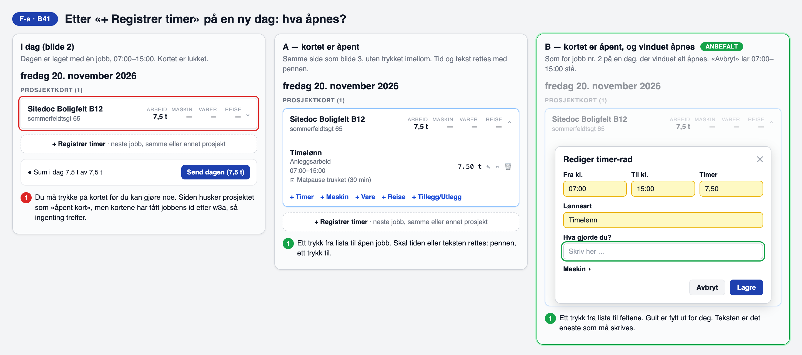
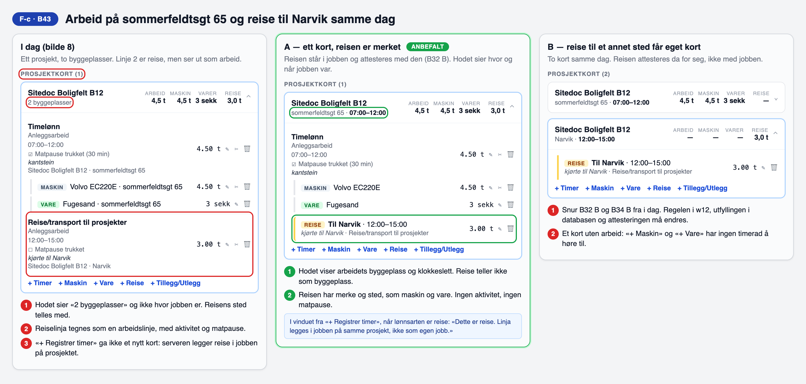
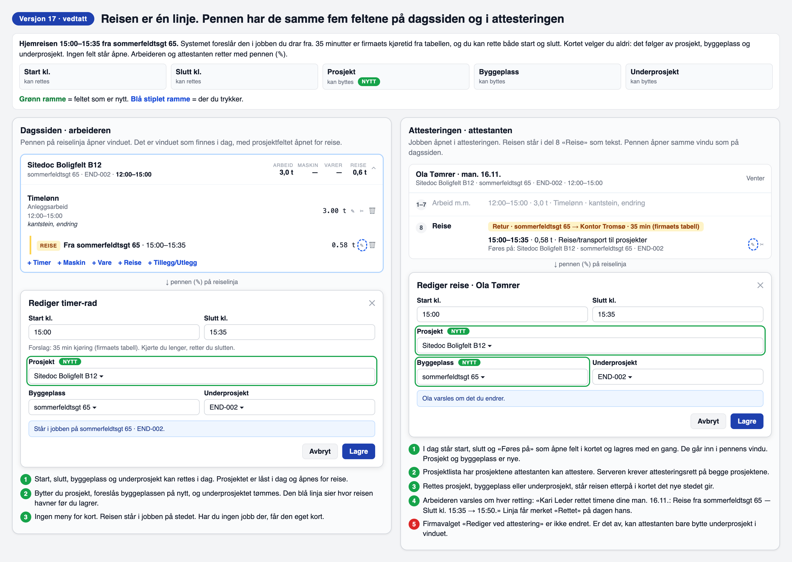

> Del av [Timeføring på web — plan med bilder](../web-timeforing-plan.md): § 4.15 innledning og del A–E. Seksjonsnumrene er de samme som før delingen.

### 4.15 Testfunn 20.11. på test `f529b527`: lukket kort, reisetid og reisens kort (versjon 17, w15)

Kenneths ord står i § 8.17. Bildene hans er `relay/bilder/2026-11-20-test-w3b-w14/1.webp`–`8.webp`
(gitignorert). Målt mot develop @ `30346a95`; koden i `apps` og `packages` er lik test `f529b527`
(`git diff --stat f529b527 30346a95 -- apps packages` er tom). Alt er lest i koden og sett i bildene.
Ingenting er klikket gjennom av Fabel. `WS`, `D`, `KI` og `RK` som ellers i planen. Nye forkortelser:
`RT` = `apps/web/src/lib/registrerTimer.ts`, `MR` = `apps/web/src/hooks/useManuellReiseWeb.ts`,
`RM` = `packages/shared/src/utils/reiseManuell.ts`, `RV` = `packages/shared/src/utils/reiseKort.ts`,
`OP` = `packages/shared/src/utils/oppmote.ts`.

Skissene er forslag, ikke bygget. Kilde: `skisser-web-timeforing/skisser-v14.html`, `skisser-v15.html`,
`skisser-v16.html`, `skisser-v16b.html` og `skisser-v17.html`.

⚠️ **Versjon 20 (§ 8.21–8.22):** w15a, w15b, w15c, w15d, w15f, F68 og w15g er merget (del G). Tre særregler
for reisens kort er strøket av Kenneth og merket der de står: automatisk flytting når en annen registrering
føres eller slettes (§ 4.11 del A punkt 4), regelen etter klokkeslett for reise uten byggeplass (del E
punkt 6), og kortet for reise til annet kontor uten «+ Timer» (del F, B45). Leveransen som fjerner koden, står
i § 9. Overføring til annet kontor har ingen egen regel (Kenneth: «Ja, samme regel», § 8.22 punkt 2). Reisevinduet: se [vedtak-timer-web.md § Reisevinduet](../vedtak-timer-web.md).
Automatisk justering av nabokort (§ 8.21 punkt 1) er utgått og bygges ikke.

⚠️ **Versjon 19:** Kenneth har svart på B49 (§ 8.20, 2026-11-21): *«jeg vil ikke varsle med e-post. Kan vi
ikke varsle i appen/web. Vi varsler at timer er korrigert "Redigert/Korrigert av ...." i timelisten».*
Ordet er **«Korrigert av»**. Ut av planen: e-posten, utløseren ved ✓ og ↩, nettet etter 24 timer og merket
«sendt» i loggen. Inn: merket heter «Korrigert av [navn]» med tidspunkt, i stedet for «Rettet». Del F
(varselet), del G (w15g) og del H (punkt 28–38) er skrevet om. F79–F83 er målt mot develop @ `d4c0eecd`.
Appen får merket som egen leveranse etter web (w15gm, § 9). Ingen nye bilder.

⚠️ **Versjon 17:** Kenneth har forenklet reisen (§ 8.20, 2026-11-21): *«jeg trenger valgmuligheter ->
enkle linjer. vi trenger ikke mange forskjellige varianter av kort.»* Reisen er én linje med fem felt:
start, slutt, prosjekt, byggeplass og underprosjekt. Feltene er de samme i pennen på dagssiden og i
reisedelen i attesteringen. Kortet følger av prosjekt og sted, og arbeideren velger aldri kort. **B46 B er
snudd.** Ut av planen: «Flytt til …», «Eget kort», «Følg forslaget», «Flyttet av deg», kolonnen
`valgt_kort_id` med prosedyren, panel 4 og w15e. Nytt: prosjektet kan byttes på en reise som finnes
(**w15f**). B47 → A og B48 → A er arbeidet inn. Del E–H er skrevet om. Tekst som er snudd, er merket ⚠️ der
den står. F46–F56 er målt mot develop @ `afdaa7ac`. Bildet er `v17-reiselinje.png`.
**Tillegg samme kveld (§ 8.20):** arbeideren varsles om hver retting i attesteringen (del F). Attestanten
retter via pennen (✎) på kortet, og ingen felt står åpne i kortet (del E, F63). Firmavalget
«Rediger ved attestering» er målt (F57–F62) og endres ikke nå. Resten av kortet og varselet er **w15g**.

**Presisert samme dag (§ 8.20):** kortet har to tilstander. I informasjonsstatus er linjene tekst med ✎.
Åpnet for redigering står feltene åpne uten penn. Målt (F64–F68): kortet har i dag ingen egen tilstand for
redigering, så forslaget bruker vinduet bak «✎ Rediger jobben» (del F, `v17-kortet-to-tilstander.png`).

⚠️ **Versjon 16** (⚠️ B46 B, «valgt kort», lagringen av valget og w15e i dette avsnittet er utgått — se
versjon 17 over; B47 og B48 er besvart med A)**:** Kenneth har svart (§ 8.19): **B44 → utgangspunkt A, med valg. B45 → A. B46 → B.** B46
gikk mot anbefalingen. Del E er skrevet om: et valgt underprosjekt er et krav, og et valgt kort går foran
regelen. Del F har nye målinger (F36–F45), lagringen av valget, og to nye spørsmål: **B47** og **B48**.
Del G har fem leveranser (w15e er ny), og del H har testene for valget. De to lesningene fra versjon 15
som var merket «si fra», er besvart med ja (Kenneth 2026-11-21, § 8.19) og står som vedtak i del B og
del E punkt 6. F36–F45 er målt mot
develop @ `88d37194`; koden i `apps` og `packages` er lik `12094b58`
(`git diff --stat 12094b58 88d37194 -- apps packages` er tom). `PS` og `ST` som ellers i planen (§ 3).
w14 leveranse 2 ble merget etterpå (develop @ `d78dfdb1`); den rører ingen av filene F36–F45 viser til
(`git diff --stat 88d37194 d78dfdb1` for de filene er tom).

⚠️ **Versjon 15:** Kenneth har svart (§ 8.18): **B41 → A, B42 → A, B43 → B.** B41 og B43 gikk mot
anbefalingen. Del A–C står som målt, med svaret satt inn. Del D er skrevet om. Del E–H er nye: regelen
etter B43 B, konsekvensen målt i koden (F22–F35), leveransene og testene. Åpent: **B44**, **B45** og
**B46**.
Kenneths presisering av B43 og prinsippet om dynamiske løsninger (§ 8.18, lagt til på develop i
`2c7f3152`, `e70f8bc0` og `43011d2f` mens revisjonen ble skrevet) er arbeidet inn i del B, E og G.
F22–F35 er målt mot develop @ `12094b58`; koden i `apps` og `packages` er lik `30346a95`
(`git diff --stat 30346a95 12094b58 -- apps packages` er tom). `KG`, `AM` og `AT` som ellers i planen
(§ 3, § 4.11). Ny forkortelse: `KS2` = `packages/shared/src/utils/kortId.ts`.

#### Del A — F-a: kortet er lukket etter «+ Registrer timer» (bilde 2)

**Det er en feil, ikke et valg.** w2 lovet at kortet åpnes på en ny dag (`RT:14–15`). Det sluttet å virke
da w3a ga kortene jobbens id.

| # | Målt | Kode |
|---|---|---|
| F1 | Siden åpnes med `?registrer=1&nyttProsjekt=<prosjekt>`. Det åpne kortet settes til **prosjektets** id. | `RT:73–74`; `WS:388–390` |
| F2 | Etter w3a er et kort åpent når nøkkelen er lik **jobbens** kort-id. Prosjekt-id treffer bare et tomt prosjektkort. | `WS:1987`, `:2053` |
| F3 | På en ny dag har serveren alt laget første jobb (WM58), så prosjektet har ikke noe tomt kort. Nøkkelen treffer ingenting. | `WS:936–938` |
| F4 | Regelen «dagen har ett kort, så det er åpent» slår ikke inn, fordi den bare gjelder når ingen nøkkel er satt. | `WS:950–951` |
| F5 | Flyten gjør ingenting i steget «ferdig» (ny dag). For jobb nr. 2 på en dag åpner den vinduet og setter den nye jobbens kort som åpent. | `WS:812–820`, `:785–791` |

**Retting (uansett svar på B41):** jobben som nettopp ble laget, er åpen når siden kommer opp.

**B41 — skal vinduet også åpnes?** I dag er første og andre jobb ulike: jobb nr. 2 åpner vinduet «Legg til
timer-rad» (F5), første jobb åpner ingenting. På bilde 3 og 4 gjorde Kenneth det neste for hånd: åpnet kortet,
trykket på pennen, rettet til 07:00–12:00, skrev «kantstein» og la til maskinen.

| | Etter «+ Registrer timer» på en ny dag | Trykk til feltene |
|---|---|---|
| I dag | Dagen, kortet lukket | 3 (knappen, kortet, pennen) |
| **A** | Dagen, kortet åpent | 2 (knappen, pennen) |
| **B** | Dagen, kortet åpent, og «Rediger timer-rad» åpent på jobben serveren laget. «Avbryt» lar 07:00–15:00 stå. | 1 (knappen) |

Anbefalingen var B. ✅ **Kenneth: A** (§ 8.18): *«hvis jeg trykker knappen +Registrer timer → da må kort A
åpne med en gang åpent.»* Kortet er åpent når dagen vises. Vinduet åpnes ikke av seg selv på dagens første
jobb. Jobb nr. 2 på en dag står som i dag: der er vinduet «Legg til timer-rad» stedet jobben lages (F5), og
kortet er åpent etterpå. Delen heter **w15a** (del G).

#### Del B — F-b: reisen får klokkeslett arbeideren ikke kan endre (bilde 6)

Reisevinduet: se [vedtak-timer-web.md § Reisevinduet](../vedtak-timer-web.md).

#### Del C — F-c: to prosjekter eller to byggeplasser, og hvorfor ett kort (bilde 8)

**Det er ett prosjekt med to byggeplasser, og den andre linja er reise, ikke arbeid.** Linja sier
«Sitedoc Boligfelt B12 · Narvik»: Narvik er en byggeplass på samme prosjekt. Hodet teller linja som reise
(«Reise 3,0 t»), og summen sier «reise 3 t».

**Veien Kenneth gikk:** «+ Registrer timer» nederst på dagen, lønnsart «Reise/transport til prosjekter»,
byggeplass Narvik, 12:00–15:00, teksten «kjørte til Narvik». Det er lest av resultatet, ikke sett: det er
den eneste knappen som gir en ny linje med annen byggeplass, egen klokke og tekst i ett vindu (F13).
«+ Timer» etterfulgt av pennen gir samme linje med to vinduer.

| # | Målt | Kode |
|---|---|---|
| F13 | «+ Registrer timer» åpner «Legg til timer-rad» med Prosjekt og Byggeplass og en ny kort-id. «+ Timer» i kortet viser ikke feltene. Reisevinduet: se [vedtak-timer-web.md § Reisevinduet](../vedtak-timer-web.md). | `WS:785–791`, `:1478`, `:4233`, `:4255`; `RK` |
| F14 | Lønnsartlista i vinduet har alle firmaets lønnsarter, også reise. | `WS:4265–4278` |
| F15 | Serveren gjør raden til reise ut fra lønnsarten og kaster kort-id-en vinduet sendte. | `D:4057–4058`, `:4171` |
| F16 | Reisen legges så i en jobb på samme prosjekt (w12, B32 B). Ingen jobb er ført på Narvik, så alle jobbene på prosjektet står igjen. Reisen har ingen retning og starter ikke før første arbeid, så den får dagens siste jobb. Dagen har én. | `KI:271–307`; `RV:104–125` |
| F17 | Hadde linja vært arbeid (Timelønn) på Narvik, ville dagen fått to kort. | `D:4171`; `KI:250–265` |
| F18 | Reiselinja tegnes med samme komponent som arbeidslinja: lønnsart i fet skrift, aktivitet, klokke, «☐ Matpause trukket», tekst, sted. Maskin og vare har merke; reise har ikke. | `WS:967–981`, `:2920–2976` |
| F19 | Hodet regner byggeplassen av arbeid, reise og maskin sammen. Reisens Narvik gjør «sommerfeldtsgt 65» om til «2 byggeplasser». Jobben selv har én byggeplass (K4). | `WS:906–910`, `:2239–2243`, `:2257–2261` |
| F20 | Hodet viser ikke jobbens klokkeslett, selv om siden har regnet det ut. To kort på samme prosjekt skilles bare av den grå linja under navnet. | `WS:927–928` |
| F21 | Vinduet sier ikke at en linje med reise-lønnsart legges i en annen jobb. | `WS:4265–4278` |

**Hvorfor du måtte studere kortet:** knappen sa «neste jobb», men ga en linje i jobben du hadde (F15, F16).
Linja ser ut som arbeid (F18). Hodet byttet jobbens sted mot «2 byggeplasser» (F19).

**B43 — hvor skal en reise til et annet sted stå?**

| | Dagen på bilde 8 | Følger |
|---|---|---|
| **A** | Ett kort. Reisen står sist i jobben med merket «Reise», stedet og klokka: «Til Narvik · 12:00–15:00». Ingen aktivitet og ingen matpause på linja. Hodet viser arbeidets byggeplass og klokkeslett: «sommerfeldtsgt 65 · 07:00–12:00». | Bare visningen på dagssiden. Serveren, regelen og attesteringen er urørt. |
| **B** | To kort. Reise ført til et sted ingen jobb har, får eget kort: «Narvik · 12:00–15:00». | Snur B32 B og B34 B (§ 8.10, § 8.11): regelen i w12, utfyllingen i databasen og attesteringen må endres, og reisen attesteres for seg. Kortet har ikke arbeid, så «+ Maskin» og «+ Vare» har ingen timerad å høre til. |

Anbefalingen var A. ✅ **Kenneth: B** (§ 8.18): *«Reise til annet prosjekt må på eget kort.»* På
kontrollspørsmålet om reise til en annen byggeplass på samme prosjekt (Narvik i testen): *«kort b»*.
Reise til et sted ingen jobb på dagen har, får eget kort, også på samme prosjekt. Regelen står i del E,
konsekvensen i del F.

**Fra følgene av A står dette, også med B** (w15d, del G):

1. Hodet viser stedet og klokkeslettet på alle kort, åpne og lukkede. To kort på samme prosjekt skilles
   da av sted og tid (F17, F20).
2. En reise som står i jobbens kort (til og fra jobbens byggeplass), tegnes med merket «Reise», stedet og
   klokka, uten aktivitet og matpause (F18). Reisens underprosjekt vises når det avviker fra jobbens.
3. Hodet regner byggeplassen av arbeidet. Reise teller ikke (F19).
4. Ingen lønnsart tas ut av lista i timerad-vinduet. Teksten under lønnsarten når den er reise, skrives
   om: «Dette er reise. Den står i jobben på byggeplassen du velger. Har du ingen jobb der i dag, får
   reisen eget kort.»
   ⚠️ **Versjon 17 (§ 8.20):** teksten sier hvor regelen legger reisen: «Dette er reise. Den står i jobben
   på {sted}.» eller «Dette er reise. Den får eget kort.» Den regnes av samme funksjon som linja i
   reisevinduet (godkjent for w15d 2026-11-21). Kortet lagres ikke som valgt. Versjon 16 lot veien inn
   («+ Registrer timer» eller «+ Timer») bestemme kortet; det er utgått.
5. Pennen på reiselinja åpner samme vindu som i dag.

#### Del D — det som ikke røres

**Firmavalget dagskort-modus påvirkes ikke.** «+ Reise» og kortet pr. jobb finnes bare i prosjektkort-modus (`WS:1255–1329`).
`RaderTimer` brukes av begge moduser (`WS:971`, `:2725`) og endres ikke: reiselinja får egen tegning i
kortets linjeliste (`WS:963–981`). `dagskort-vakt.test.tsx` står. **Mobil røres ikke** i noen del av w15
(§ 8.13, F32).

#### Del E — reisen er én linje, og regelen for hvilket kort den står i (versjon 17: B43 B, B44, B47 A, B48 A og § 8.20)

⚠️ **Snudd 2026-11-21 (§ 8.20).** Versjon 16 lot arbeideren velge kort med «Flytt til …» og lagret valget i
kolonnen `valgt_kort_id` (B46 B). Kenneth etter skissen: *«nå begynner du å komplisere problemet istedenfor
å forenkle. jeg trenger valgmuligheter -> enkle linjer. vi trenger ikke mange forskjellige varianter av
kort. jeg trenger å kunne endre tider på reisen og jeg trenger å endre prosjektet reisen går til/fra. jeg
trenger mulighet å redigere disse linjene ved attestering».* Ut av planen: «Flytt til …», «Eget kort»,
«Følg forslaget», merket «Flyttet av deg», kolonnen `valgt_kort_id` med prosedyren, panel 4 og w15e.
Slik del E–H sto i versjon 16: `git show cd7fe057:docs/claude/web-timeforing-plan.md`.

**Kenneths krav (§ 8.20):** (1) tidene på reisen kan rettes, (2) prosjektet reisen går til eller fra kan
byttes, (3) begge kan rettes ved attestering.

**Kenneths presisering (§ 8.18), som står:** *«Problemet er at fabel blander kjøring. før prosjekt →
kjøretider må kunne redigeres → prosjektet er det samme som det vi kjører til. etter at en har vært på et
prosjekt → da kjører man til et annet prosjekt → kjøretiden registreres da på et nytt prosjekt.»*

**Kenneth om returen hjem, B44 (§ 8.19), som står:** *«i utgangspunktet fra prosjektet man drar fra. men
kanskje det ikke er slik bedriften ønsker å føre kostnaden. derfor må man kunne velge andre løsninger. →
dersom prosjekt/byggeplass/underprosjekt byttes, da må vi ha nytt kort.»* ⚠️ Fortsettelsen, *«et alternativ
er å velge nytt kort og velge reise der»*, er endret av § 8.20: arbeideren velger ikke kort. Han bytter
prosjekt, byggeplass eller underprosjekt på reisen, og kortet følger.

**Reiselinja: pennen har fem felt, to steder** (forslag til w15f; koderen leverer løsning med skjermbilde før kode):

35 minutter i bildet er firmaets kjøretid fra tabellen. Kilde: `skisser-web-timeforing/skisser-v17.html`.
Kortene i bildet er de som finnes i dag, tegnet med pennen åpen. Versjon 17 legger ikke til kort, paneler
eller visninger (Kenneth 2026-11-21, § 8.20).

**Kenneth 2026-11-21 (§ 8.20):** *«jeg sa at den som attesterer må ha MULIGHET til å redigere. det er ikke
det samme som at alt er redigerbart hele tiden. Derfor skal pennen være der på et kort».* Reiselinja i
attesteringens kort er tekst med ✎. ✎ åpner vinduet med de samme fem feltene som på dagssiden. Ingen felt
står åpne i kortet (informasjonsstatus, del F).

| Felt | Pennen på dagssiden (arbeideren) | Pennen på reiselinja i attesteringen (attestanten) |
|---|---|---|
| Start kl. og Slutt kl. | Finnes (F46). | Står som åpne felt i kortet i dag (F52, F63). Flyttes inn i pennens vindu. Krever firmavalget «Rediger ved attestering». |
| Prosjekt | **Nytt.** Feltet er låst i dag, og serveren tar ikke imot prosjekt (F46, F47). Nedtrekk som i reisevinduet (w15b). Åpnes bare for reiserader. | **Nytt i skjermen.** Serveren tar det imot i dag (F48). Lista har prosjektene attestanten kan attestere (F50). Krever firmavalget. |
| Byggeplass | Finnes (F46). | **Nytt i skjermen.** Serveren tar det imot i dag (F48). Krever firmavalget. |
| Underprosjekt | Finnes (F46). | Står som åpent valg «Føres på» i dag (F52). Flyttes inn i pennens vindu. Krever ikke firmavalget. |

- Bytter han prosjekt, foreslås byggeplassen på nytt for det nye prosjektet, og underprosjektet tømmes, som
  i reisevinduet (`RK:342–350`). Prosjekt, byggeplass og underprosjekt sendes i samme kall.
- Tidene endres ikke når prosjektet byttes. Retningen, oppmøtestedet og firmaets kjøretid står på raden
  slik de var da reisen ble ført (F56). Var turen lengre, retter han slutten.
- En linje under feltene i pennen sier hvor reisen havner før lagring: «Står i jobben på …» eller «Får
  eget kort på …». Det er samme funksjon som i reisevinduet (F55).
- Prosjektfeltet åpnes bare for reise. For arbeid er det låst som i dag.
- En attestert reise kan ikke rettes, som i dag. Overlapp, aldersgrense og låst dagsseddel gjelder som i
  dag.
- Retter attestanten prosjekt, byggeplass eller underprosjekt, står reisen etterpå i kortet det nye stedet
  gir. Kortet han har åpent, mister linja. Koderen viser i løsningen hvordan attestanten ser hvor reisen
  ble av.
- **Firmavalget «Rediger ved attestering» endres ikke nå** (Kenneth 2026-11-21, § 8.20). Er det på, har
  vinduet alle fem feltene. Er det av, er bare underprosjektet åpent i vinduet, som i dag (F52, F57–F59).
  Lagres bare underprosjektet, brukes samme kall som «Føres på» bruker i dag, så ingen firma mister noe.
- **Arbeideren varsles om hver retting i attesteringen** (vedtatt 2026-11-21, § 8.20): hva som ble endret,
  av hvem, og verdien før og etter (del F). Varselet er merket «Korrigert av [navn]» i timelisten. Ingen e-post
  (§ 8.20, svaret på B49).

**Lest mot regelen:**

1. **Reisen hører til stedet man kjører til.** Reise før arbeid står i jobben man kjører til. Reise etter
   arbeid til et annet prosjekt eller en annen byggeplass står på det nye stedet.
2. **Returen hjem hører til jobben man drar fra (B44, B47 A).** Reisevinduet: se [vedtak-timer-web.md § Reisevinduet](../vedtak-timer-web.md).
   Den som ikke rører noe i vinduet, får returen i jobben «+ Reise» står i. Firmaet har ingen innstilling for dette (B47 A).
3. **Stedet på reisen er prosjekt, byggeplass og underprosjekt.** Bytter arbeideren eller attestanten ett
   av dem, regnes kortet på nytt. Har dagen en jobb på det nye stedet, står reisen i den jobben. Ellers får
   den eget kort.
4. **Arbeideren velger aldri kort (§ 8.20).** Konsekvensen Kenneth har godtatt: hjemreisen står i jobben
   man drar fra. Den kan ikke legges i en annen jobb på samme sted uten å bytte prosjekt, byggeplass eller
   underprosjekt.

| Arbeideren gjør | Versjon 16 | Versjon 17 |
|---|---|---|
| Retter start eller slutt | Pennen. Reisevinduet: se [vedtak-timer-web.md § Reisevinduet](../vedtak-timer-web.md). | Står. Attestanten kan også (F52). |
| Bytter prosjekt på en reise som finnes | Gikk ikke: feltet er låst (F46). Planen viste til pennen uten at det var målt. | **Nytt (w15f).** Reisen står i jobben på det nye stedet, ellers i eget kort. |
| Bytter byggeplass | Reisen står i jobben på den byggeplassen, ellers i eget kort (B43 B). | Står. |
| Bytter underprosjekt | Et valgt underprosjekt er et krav (B44). Har ingen jobb på byggeplassen det, får reisen eget kort. | Står. |
| Vil ha reisen i et annet kort uten å bytte sted | «Flytt til …» (B46 B). | **Utgår.** Kortet følger av stedet. |
| Starter et nytt kort med «+ Registrer timer» og fører reisen der | Kortet ble lagret som valgt. | **Utgår.** Reisen står der regelen legger den. Kort-id-en vinduet sender, leses ikke, som i dag (F15). |

**Regelen slik den blir.** Den erstatter § 4.11 del A punkt 3. Resten av § 4.11 del A står. Nummereringen
fra versjon 16 er beholdt, fordi resten av planen viser til punktene.

1. ⚠️ **Utgått (§ 8.20).** Punktet sa at et valgt kort går foran regelen.
2. **Kandidatene** er jobbene på samme dagsseddel med arbeid på reisens prosjekt. Har prosjektet ingen
   jobb den dagen, står reisen i eget kort. *Som i dag.*
3. **Byggeplassen er et krav.** Bare jobber på reisens byggeplass er kandidater. Har ingen jobb den
   byggeplassen, står reisen i eget kort. *Fra versjon 15 (B43 B). I dag er byggeplassen et ønske (F22).*
4. **Underprosjektet:**
   - **Reisen har et underprosjekt:** bare jobber med det samme er kandidater. Har ingen jobb på
     byggeplassen det, står reisen i eget kort. *Fra versjon 16 (B44).*
   - **Reisen har ikke underprosjekt:** jobbene uten underprosjekt går foran. Har ingen jobb på
     byggeplassen «Uten», står alle jobbene på byggeplassen som kandidater, og linja viser «Uten
     underprosjekt». ✅ **Kenneth: A** (B48, § 8.20).
5. **Retningen** velger blant dem som står igjen: utreisen i første jobb, returen i siste, og uten retning
   etter klokka. *Som i dag (`RV:114–125`).*
6. ⚠️ **Strøket av Kenneth (§ 8.22 punkt 3):** reise uten byggeplass følger ikke klokka, og kortet for reise til
   annet kontor er ikke en egen variant. Kortet avgjøres av reisens egne felt. 🟡 Vedtatt, ikke bygget: koden
   følger punktet (w15c) til leveransen i § 9 er bygget. Overføring til annet kontor følger samme regel som all
   annen kjøring (§ 8.22 punkt 2). Sto slik:
   **Reise uten byggeplass** (til annet kontor) følger tiden: før dagens første arbeid på prosjektet står
   den i jobben man kjører til, som i dag; etter at arbeidet er begynt, får den eget kort. Underprosjektet
   følger punkt 4. Bildet er `v15-kontor.png`. *Nytt for reise etter arbeid: i dag står den alltid i en
   jobb (`RV:109`, `:117–118`).* ✅ **Kenneth: ja** (2026-11-21, § 8.19).
7. ⚠️ **Utgått (§ 8.20).** Punktet beskrev valgt kort (B46 B).

Attesterte og erstattede reiser flyttes aldri, som i dag. **Eget kort** får kort-id utledet av reisens egen
nøkkel, som i dag (F24). Reise til annet kontor i eget kort får en id som ikke kan bli lik en jobbs (F25;
⚠️ den egne varianten og id-utledningen er utgått, § 8.22 punkt 2 og 3).

Byggeplassen leses slik nøkkelen leser den (effektiv, FA69), for reisen og for jobben. «Uten byggeplass» er
en egen verdi: på et prosjekt uten byggeplasser står reisen i jobben, som i dag. I dag leser regelen reisens
egen byggeplass (`KI:300`). Koderen måler om byttet gir et annet svar for reise ført som timerad uten
byggeplass, og melder.

**Eksempel.** B12 har byggeplassene sommerfeldtsgt 65 og Narvik. Dagen har jobb 1 «sommerfeldtsgt 65 ·
uten underprosjekt» 07–12 og jobb 2 «sommerfeldtsgt 65 · END-002» 12–15.

| Reisen er ført på | Reisen står i |
|---|---|
| Utreise til sommerfeldtsgt 65, uten underprosjekt | Jobb 1 |
| Retur fra sommerfeldtsgt 65, END-002 (fylt ut fra jobb 2) | Jobb 2 |
| Utreise til sommerfeldtsgt 65, TILL-001 (ingen jobb der) | Eget kort «Reise · sommerfeldtsgt 65 · TILL-001» |
| Reise til Narvik, uten underprosjekt (bilde 8) | Eget kort «Reise · Narvik» |
| Reise til Narvik, END-002 | Eget kort «Reise · Narvik · END-002» |
| Reise på Prosjekt 1050 (ingen jobb der) | Eget kort |
| Dagen har også jobb 3 «Narvik · uten underprosjekt» 15–17: reise til Narvik, END-002 | Eget kort «Reise · Narvik · END-002» |
| Dagen har bare jobb 2: utreise til sommerfeldtsgt 65 uten underprosjekt (ført på telefonen, F37) | Jobb 2. Linja viser «Uten underprosjekt» (B48 A). |
| Returen i jobb 2: arbeideren bytter prosjekt til Prosjekt 1050 med pennen (w15f) | Eget kort på Prosjekt 1050. Har dagen en jobb der på samme byggeplass, står reisen i den. |
| Returen i jobb 2: attestanten tømmer underprosjektet i «Føres på» | Jobb 1 (samme byggeplass, uten underprosjekt) |
| «+ Registrer timer» nederst på dagen, lønnsart reise, sommerfeldtsgt 65 uten underprosjekt | Jobb 1. ⚠️ Versjon 16 sa nytt kort med reisen alene. |

Reisevinduet: se [vedtak-timer-web.md § Reisevinduet](../vedtak-timer-web.md).

- Ingen lønnsart tas ut av timerad-vinduet.

**B32 B (§ 8.10, § 4.11) — hva som endres og hva som står:**

| B32 B sa | Etter versjon 17 |
|---|---|
| Reiseraden har alltid kort-id. | Står. |
| Brukeren velger aldri jobb for reisen. Serveren regner den ut. | Står. ⚠️ Versjon 16 endret det (B46 B); § 8.20 snudde det tilbake. |
| Reisen ligger i jobbens kort og attesteres sammen med jobben. | Står når dagen har en jobb på reisens sted. **Endres:** ellers står reisen i eget kort og attesteres for seg, med egen rad «Reise». |
| Reise på et prosjekt uten jobb står alene i eget kort. | Står. |
| Regelen kjøres på nytt hver gang dagsseddelen skrives. | Står i koden. ⚠️ Strøket av Kenneth (§ 8.22 punkt 3): reisen flyttes ikke automatisk når en annen registrering føres eller slettes. 🟡 Vedtatt, ikke bygget (§ 9). |
| Attesterte og erstattede reiserader flyttes aldri. | Står. |
| ✓ på dagsraden attesterer hele dagen. | Står. |
| Kort-id som klienten sender på en reiserad, leses ikke (§ 4.11 del A punkt 2). | Står. ⚠️ Versjon 16 endret det for PC; utgått. |

**B34 B (§ 8.11, § 4.11) — hva som endres og hva som står:**

| B34 B sa | Etter versjon 17 |
|---|---|
| Arbeideren velger byggeplass og underprosjekt for reisen. Ingenting endrer dem av seg selv. | Står. Han kan også bytte prosjektet (w15f). |
| Reisen står i jobben som er ført samme sted: lik underprosjekt først, så lik byggeplass. | **Endres:** byggeplassen er et krav (versjon 15). Et valgt underprosjekt er også et krav (versjon 16). |
| Har ingen jobb reisens underprosjekt, står reisen i en annen jobb, og linja viser underprosjektet. | **Utgår** for reise med underprosjekt: reisen får eget kort. Reise uten underprosjekt står i jobben på byggeplassen (B48 A). |
| Har ingen jobb reisens byggeplass, står reisen i en annen jobb på prosjektet. | **Utgår** (versjon 15). Reisen får eget kort. |
| «Føres på» i attesteringens kort retter underprosjektet på reisen. | Står som felt i pennens vindu, sammen med prosjekt og byggeplass (w15f). Reisen flytter til kortet det nye stedet gir. |
| Valideringen sammenlikner bare dagsseddel og prosjekt for en reiserad (K1, K2). | Står. |

**Følger som ikke er spørsmål:**

1. To reiser til samme sted samme dag står i samme kort.
2. Reisekortet attesteres for seg. Attestanten ser én rad «Reise» pr. kort.
3. Reiser som er attestert, blir stående i jobben de ble attestert i. Reiser som ikke er attestert, legges
   på nytt etter regelen av en utfylling Kenneth kjører (del F).
4. ⚠️ Følge 4–6 i versjon 16 handlet om flyttede reiser og «Flytt til …» og er utgått. Følge 5 sa at
   reisen ble stående i kortet når attestanten rettet «Føres på». Nå flytter den til kortet det nye
   underprosjektet gir, som i w12 (F42), med regelen i denne delen.
