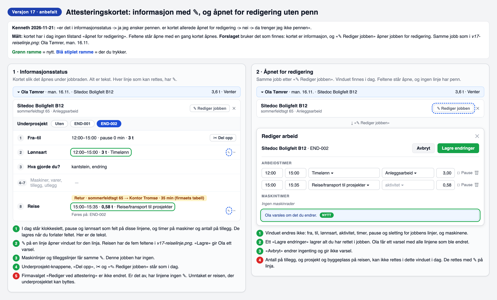
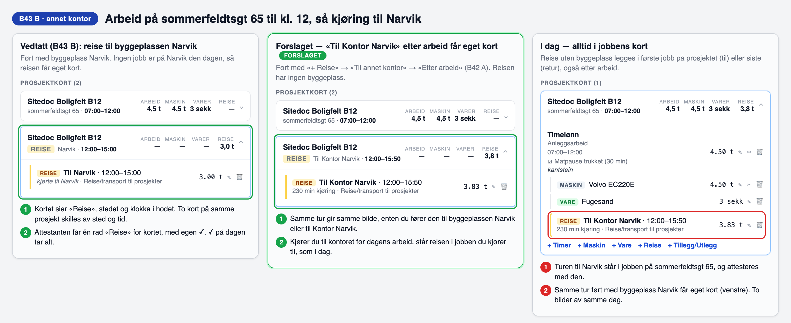
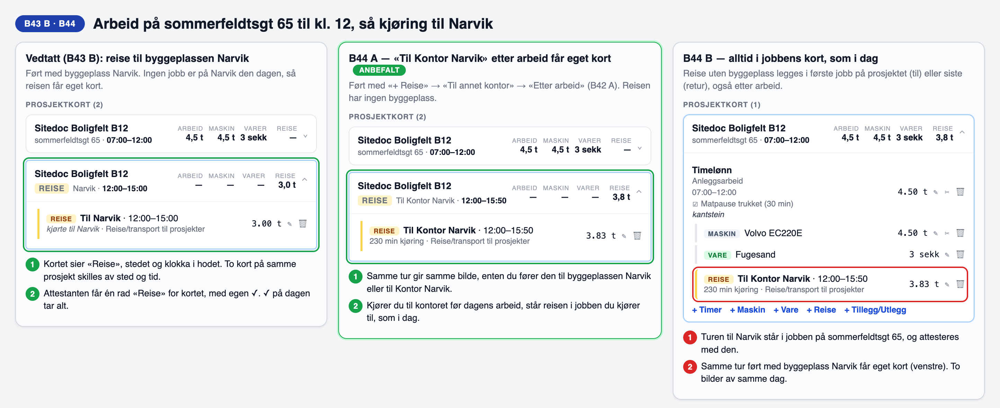
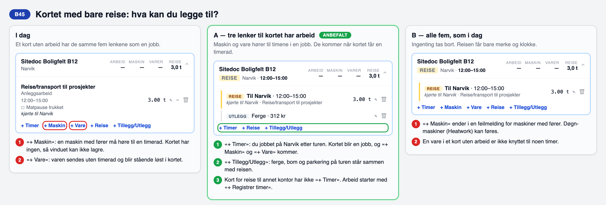
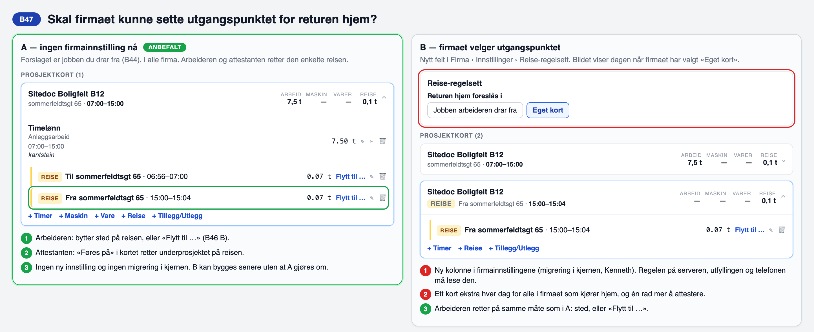
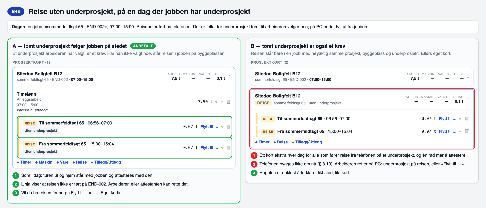

> Del av [Timeføring på web — plan med bilder](../web-timeforing-plan.md): § 4.15 del F. Seksjonsnumrene er de samme som før delingen.

#### Del F — konsekvensen målt i koden (F22–F83), prosjektbyttet (w15f), kortet og varselet (w15g), og B44–B48

Lest i koden. Ingenting er kjørt.

| # | Målt | Kode |
|---|---|---|
| F22 | **Regelen i dag:** underprosjektet snevrer inn først. Byggeplassen snevrer bare inn når en jobb har den; ellers står utvalget. Reisens egen byggeplass leses mot jobbens effektive. | `RV:107–112`; `KI:296–304` |
| F23 | Regelen har én kaller i kjørende kode: `sikreKortId`, som regner den på nytt ved hver skriving av dagsseddelen. En attestert eller erstattet reise med kort-id flyttes ikke. | `KI:291–307`; søk etter `velgReiseKort` i `apps` og `packages` |
| F24 | **Eget kort finnes alt.** Gir regelen ingen jobb, får reisen en kort-id utledet av sin egen nøkkel: prosjekt, effektiv byggeplass og underprosjekt. B43 B bruker samme vei for reise med byggeplass. | `KI:305`; `KS2:150–161` |
| F25 | Den utledede id-en er lik den en jobb med samme nøkkel ville fått. For reise med byggeplass er det riktig: samme sted, samme kort. For reise uten egen byggeplass faller nøkkelen tilbake på dagsseddelens byggeplass, som ofte er jobbens. Når reise til annet kontor får eget kort (del E punkt 6), må id-en utledes slik at den aldri blir lik en jobbs. ⚠️ Utgått (§ 8.22 punkt 2 og 3): annet kontor har ingen egen kortvariant og ingen egen id-utledning. 🟡 Vedtatt, ikke bygget (§ 9). | `KS2:132–140`, `:158`; `KI:63–72` |
| F26 | **Utfyllingen 20261120120000** har regelen i F22 som SQL: byggeplass-treff er et ledd i sorteringen, ikke et filter. Eget kort gis bare når prosjektet ikke har jobb. | `packages/db-timer/prisma/migrations/20261120120000_w12_reise_kortid/migration.sql:36–64`, `:67–75` |
| F27 | Paritetstesten leser den migreringsfila og holder den mot `velgReiseKort`. Endres regelen alene, blir testen rød. | `apps/api/src/routes/reise-kortid-migrering.integration.test.ts:26–30`, `:212` |
| F28 | Migreringsfila er merget til develop og kan ikke endres. Om den er kjørt på test og i prod, er ikke målt (§ 10). STATUS-AKTUELT sier «kjøres av Kenneth … Ikke deployet». | `docs/claude/STATUS-AKTUELT.md:39` |
| F29 | **Rader som finnes:** en reise som ligger i en jobb på en annen byggeplass, er lagt der av utfyllingen eller av `sikreKortId` etter w12. `sikreKortId` retter den bare når dagsseddelen skrives på nytt. En sendt dag som ingen rører, viser reisen i jobben til den er attestert. | `KI:291–307` |
| F30 | **Attesteringen viser alt reise alene i et kort** (bygget i w12): jobbraden sier «Reise», timene er reisetimene, «N jobber» teller ikke kortet, og kortet har hodet og del 8. B43 B trenger ingen kode der. | `AM:182–186`, `:488–505`; `AT:557–561`, `:688–690` |
| F31 | Attesteringen kjenner «bare reise» på at alle linjene er reise. Et kort med reise og et utlegg, men uten arbeid, regnes som en jobb. | `AM:492` |
| F32 | **Telefonen kaller ikke regelen.** Den tømmer kort-id på reise lokalt og viser reisen i «Dagen». Serveren regner for alle apper, også eldre. | søk i `apps/mobile` (ingen treff); `M/utils/kortIdNormalisering.ts:86`, `:108` |
| F33 | **Dagssiden på PC viser alt et kort for reise alene.** Hodet leses fra reisen, klokka er tom, og kortet har ingen timerad. | `KG:188–198`; `WS:906–929` |
| F34 | Det kortet har de samme fem lenkene som en jobb, uten sjekk på om det har arbeid. «+ Timer» lager en timerad i kortet. «+ Maskin»: en maskin med fører krever timerad, og vinduet stopper med feilmelding. «+ Vare» sendes uten timerad, med kortets id (lest i klienten; serveren er ikke lest). | `WS:2004–2033`, `:1292–1298`, `:926`, `:6067–6073`; `apps/web/src/components/timer/KortVareforbrukModal.tsx:81–82`, `:119–121` |
| F35 | Tillegg og utlegg bærer egen kort-id og eget sted, og trenger ingen timerad. | `KI:199–200`, `:239–241` |

**Målt for versjon 16** (develop @ `88d37194`; `apps` og `packages` er like `12094b58`). Lest i koden.
Ingenting er kjørt.

| # | Målt | Kode |
|---|---|---|
| F36 | Reisevinduet: se [vedtak-timer-web.md § Reisevinduet](../vedtak-timer-web.md). | — |
| F37 | **Telefonen:** feltet for underprosjekt er tomt til arbeideren velger. Reisen føres fra «Dagen», ikke fra en jobb, og får prosjektet med flest arbeidstimer. | `M/components/timer-detalj/ReiseKort.tsx:104`, `:158`; `M/components/timer-detalj/prosjektkort/DagSeksjon.tsx:80–96` |
| F38 | **Fem skriveveier tømmer kort-id på en reise** og lar `sikreKortId` regne den etterpå: ny rad, rettet rad, forsoning av forslag, forslagsraden og synken. Et valg kan derfor ikke lagres i `kort_id`. | `D:4171`, `:4414–4416`, `:4961–4962`, `:1103`, `:9758–9759` |
| F39 | **Synken fra telefonen sletter radene den skriver, og lager dem på nytt** med samme id. En kolonne telefonen ikke sender, blir tom ved hver synk hvis serveren ikke bærer den over. | `D:9648–9650`, `:9720–9764` |
| F40 | Mønsteret for å bære over finnes for kort-id: serveren leser lagret id og nøkkel før slettingen, og beholder id-en når nøkkelen er uendret. Oppslaget leser fem felt i dag. | `D:9629–9639`; `KI:78–97`, `:122–141` |
| F41 | Kort-id skrives med rå SQL uten `updated_at`, så raden ikke ser endret ut for synken. | `KI:101–109` |
| F42 | Attestantens «Føres på» på en reise tømmer kort-id-en og lar regelen legge reisen på nytt. Kallet krever attesteringsrett, en annens dagsseddel og status «sendt». | `D:6576–6578`, `:6547–6559` |
| F43 | **Firmaet har ingen innstilling for hvor en reise føres.** Reisefeltene i firmainnstillingene er terskel, enhet, arbeidstid eller reisetid under og over terskelen, og reise-lønnsart. I tillegg finnes avstandsbånd, oppmøtesteder, oppmøteperioder pr. ansatt og kjøretidstabellene. | `PS:448–481`, `:527`, `:2885`, `:2934`, `:2971`, `:3001`; `apps/api/src/routes/organisasjon.ts:1420–1434`; `apps/web/src/app/dashbord/firma/innstillinger/page.tsx:317`, `:1480` |
| F44 | Regelen og `sikreKortId` leser ingen firmainnstilling. Eneste oppslag utenfor timer-databasen er dagsseddelens byggeplass. | `RV:103–126`; `KI:53–58`, `:291–307` |
| F45 | Søk etter ord for reise sammen med prosjekt, kort, plassering og kostnadsbærer i begge skjemaene og i `apps` og `packages` ga ingen innstilling. B33 A (utreisen på dagens første prosjekt, returen på dagens siste) er ikke bygget, og er planlagt som fast regel. | Søket er gjort av en leseagent; F43 og F44 er stikkprøvd av Fabel. § 4.11 del G |

F38–F41 ble målt for lagringen av valget, som er utgått (§ 8.20). Målingene står: de viser hvorfor
reisens kort regnes på nytt ved hver skriving.

**Målt for versjon 17** (develop @ `afdaa7ac`). `D`, `KI`, `RV`, `KS2` og
`apps/web/src/components/attestering/` er uendret siden `88d37194` (`git diff --stat 88d37194 afdaa7ac`
for dem er tom), så linjenumrene i F22–F45 for de filene står. `WS`, `RK`, `MR` og `RM` er endret av w15a
og w15b; linjene under er lest på nytt. Lest i koden. Ingenting er kjørt. `RP` som ellers i planen.

| # | Målt | Kode |
|---|---|---|
| F46 | **Pennen på en reise** åpner «Rediger timer-rad». Prosjektfeltet er låst når en rad redigeres. Byggeplass, underprosjekt, start og slutt kan rettes. | `WS:4275`, `:3412–3414`, `:4288` |
| F47 | **`oppdaterTimerRad` har ikke prosjekt i inngangen.** Byggeplass og underprosjekt holdes mot radens prosjekt. Kallet gjelder egen dagsseddel som kan rettes. | `D:4187–4208`, `:4229–4235`, `:4302–4325` |
| F48 | **Attesteringens `rettRadFelt` tar alt imot prosjekt på en timerad,** sammen med byggeplass, underprosjekt, fra og til. Raden oppdateres på stedet med samme id. Retning, oppmøtested, kjøretid og kilde er ikke med i skrivingen og står. Kort-id tømmes for reise, og `sikreKortId` legger raden på nytt. | `D:7275–7284`, `:3301–3317`, `:3388–3393`, `:3429` |
| F49 | `rettRadFelt` krever attesteringsrett på **både** prosjektet raden står på og det nye, at dagsseddelen ikke er attestantens egen (B15), at raden venter, at dagsseddelen er sendt, og firmavalget «rediger ved attestering». | `D:7335–7345`, `:2992–3013` |
| F50 | **Attestantens rett følger prosjektet.** En prosjektleder kan attestere prosjektene der han er aktivt medlem med admin eller «kan attestere». Firmaadministrator har alle. Flytter han en reise til et prosjekt han ikke kan attestere, avviser serveren med «Timer attesteres av firmaet den ansatte jobber for». Klienten kan lese omfanget fra `kanAttestereFirma` (`omfang`, `prosjektIder`). | `D:284–314`, `:556–563`, `:6185–6197` |
| F51 | Det nye prosjektet må høre til dagsseddelens firma, og byggeplassen til radens prosjekt. **Underprosjektet på en timerad holdes ikke mot prosjektet i denne veien:** `krevEcoerIProsjekt` kalles bare for tillegg. Sendes bare nytt prosjekt for en reise med underprosjekt og uten byggeplass, ser underprosjektet fra det gamle prosjektet ut til å bli stående. Lest, ikke kjørt. | `D:3016–3031`; søk etter `externalCostObjectId` i `D:3033–3262` (ingen treff) |
| F52 | **Reisedelen i attesteringen (del 8)** har rutemerket, fra–til, lønnsart, ✂ og «Føres på». «Føres på» er underprosjektet og rettes med `flyttTimerRadEco`, som krever attesteringsrett og sendt dagsseddel, ikke firmavalget. Fra og til rettes med `rettRadFelt` og krever firmavalget. Prosjekt og byggeplass kan ikke rettes i skjermen. | `RP:469–500`, `:22–25`, `:247–256`; `D:6547–6563` |
| F53 | `tilfoyTimerRad` (ny rad, også ny reise fra reisevinduet) sjekker at prosjektet hører til firmaet, ikke at arbeideren er medlem av det. Synken sjekker medlemskap for hvert prosjekt på radene. Reisevinduet og timerad-vinduet lister prosjektene fra samme kilde (`prosjekt.hentForTimer`). | `D:4041–4047`, `:8895`, `:9100`; `WS:285`, `:521–531`, `:1462`; `RK:95`, `:461` |
| F54 | `harProsjektTilgang` brukes ikke i `D`. Medlemskap sjekkes der med `verifiserProsjektmedlem`. | `apps/api/src/trpc/tilgangskontroll.ts:750`; søk i `apps/api/src` (eneste treff: `routes/vareforbruk.ts`) |
| F55 | **Linja «havner i» (`reiseHavnerI`) leser bare dagens timerrader.** Under terskelen, der raden blir arbeid, slår den opp kortet blant jobbene med arbeid. Serveren ser også kort som bare har maskin, tillegg eller utlegg. Da sier linja «Får eget kort», mens serveren legger raden i kortet som finnes. Lagringen er riktig; bare linja er feil. Radene sendes inn fra `WS`. (Kontrollørens merknad, gate 112.) | `MR:84–133`; `WS:1468`; `RK:213` |
| F56 | **Reiseraden bærer ett sted.** Byggeplassen i ruta er radens byggeplass. Retning, oppmøtested, kjøretid og kilde står i egne felt og endres ikke når prosjektet byttes. | `packages/db-timer/prisma/schema.prisma:286–296` |

**Målt for tillegget om retting ved attestering** (Kenneth 2026-11-21, § 8.20; develop @ `e84a4e73`, lik
`afdaa7ac` i `apps` og `packages`). Lest i koden. Ingenting er kjørt.

| # | Målt | Kode |
|---|---|---|
| F57 | **Firmavalget «rediger ved attestering»** lagres i kjernen, i firmainnstillingene (`tillattRedigerVedAttestering`). Forvalget er på for innstillingsrader laget etter 2026-05-17; eldre rader har beholdt verdien sin. Firmaadministrator slår det av og på i Firma › Innstillinger. | `packages/db/prisma/schema.prisma:425–430`; `apps/web/src/app/dashbord/firma/innstillinger/page.tsx:840–869`; `apps/api/src/routes/organisasjon.ts:1384` |
| F58 | **Tre steder på serveren sjekker valget:** `utforRedigerSedelRader` (bak «✎ Rediger jobben» og `rettRadFelt`), `delJobb` («Del opp») og `splittRad` (✂). Har firmaet ingen innstillingsrad, leses valget som av. `flyttTimerRadEco` (underprosjekt), attester, returner og gjenåpne sjekker det ikke. | `D:2995–3006`, `:6684–6686`, `:7586–7591` |
| F59 | **Attestanten når valget er av:** listene sender `redigerTillatt`. Kortet viser feltene som tekst, og nederst står «Retting og oppdeling krever at firmaet har slått på «rediger ved attestering».» Underprosjekt, ✓, ↩ og ↺ virker. | `D:6027`, `:6163`, `:6430`, `:6488`; `RP:504–506`; `packages/shared/src/i18n/nb.json:5898` |
| F60 | **Arbeideren varsles ikke i dag.** Hver retting skriver en post i aktivitetsloggen (hvem, når, hva) og radens verdier før rettingen i historikken. Veiene som logger: retting i kortet (`rett_rad_felt`), «Rediger jobben» (`rediger_sedel_rader`), underprosjekt for hele jobben (`jobb.eco-flyttet`) og for én rad, «Del opp» (`del_jobb`) og ✂ (`splitt_rad`). Ingen av dem sender push eller e-post. ⚠️ Rettet i versjon 18 (F78): bytte av underprosjekt skriver ikke i historikken, bare i loggen. | `D:3364–3376`, `:3455–3480`, `:761–768`, `:6613`, `:6826`, `:7410`, `:7806`; søk etter `sendPush` og e-post i `D` (ingen treff) |
| F61 | **Rettede felt regnes for attestanten, ikke for arbeideren.** Serveren regner «rettede felter pr. rad» av historikken for attesteringens lesere og rapporten. Arbeiderens dagsside har ingen tekst for retting, og i18n har ingen nøkkel for «rettet av» i timer. Søk etter tekst for retting i `apps/mobile/src` ga ingen treff i timer. | `apps/api/src/services/timer/kortLeser.ts:1–9`; `D:2098–2130`; søk i `WS`, `packages/shared/src/i18n/nb.json` og `apps/mobile/src` |
| F62 | **Varselkanaler som finnes:** e-post sendes i dag for invitasjoner og for dokumentflyt (Resend; nøkkelen er valgfri, og API-et starter uten). Push har tabell (`PushToken`) og sender (`sendPush`), men ingen rute kaller dem, og appen registrerer ikke token. | `apps/api/src/services/epost.ts:30`, `:98`; `apps/api/src/services/pushVarsel.ts:64`, `:126`; `packages/db/prisma/schema.prisma:2785`; søk etter `sendPush` og `registrerPushToken` i `apps/api/src` og `apps/mobile` (ingen kallere utenom testene) |
| F63 | **Attesteringskortet har åpne felt i dag.** Når firmavalget er på og linja venter, står disse som felt som lagres med en gang: fra, til og pause (eller timer) og lønnsart på hver timelinje, også reisen; timer på hver maskinlinje; antall på hver tilleggslinje. Underprosjektet for hele jobben er knapper øverst i kortet, og «Føres på» er et valg på reiselinja; de krever ikke firmavalget. I tillegg finnes «✎ Rediger jobben» øverst i kortet, som åpner et vindu for alle jobbens timerader og maskiner, og «Del opp» og ✂. Linjene har ingen penn. | `RP:245–283`, `:320–334`, `:402–408`, `:437–443`, `:304–313`; `apps/web/src/components/attestering/RedigerRadModal.tsx:98`, `:333`; `apps/web/src/components/attestering/AttesteringTabell.tsx:497` |

**Målt for de to tilstandene i attesteringskortet** (Kenneth 2026-11-21, § 8.20; develop @ `fae0e363`, lik
`afdaa7ac` i `apps/web/src/components/attestering` og i `D`). Lest i koden. Ingenting er kjørt. `AT` er
`apps/web/src/components/attestering/AttesteringTabell.tsx`, og `RRM` er `RedigerRadModal.tsx` i samme mappe.

| # | Målt | Kode |
|---|---|---|
| F64 | **Kortet er enten lukket eller åpent.** Lukket: jobbraden i tabellen. Åpent: et klikk på jobbraden legger kortet under raden. Tabellen husker hvilket kort som er åpent, ett om gangen. Kortet har ingen tilstand utover det. | `AT:183`, `:590`, `:598`; `RP:113` |
| F65 | **Attestanten gjør ingenting for å åpne kortet for redigering.** Om en linje er felt eller tekst, følger av tre ting som er avgjort før kortet åpnes: attestanten har linjer i jobben, firmavalget er på, og linja venter. Er alle tre oppfylt, står feltene åpne i samme øyeblikk som kortet åpnes. Kortet husker selv bare om «Del opp» er slått ut, og feilmeldingene. **Dagens åpne felt (`RP:245–283`, `:402–408`, `:437–443`) hører derfor til informasjonsstatus.** | `AT:492`; `RP:247`, `:402`, `:437`, `:115–118` |
| F66 | **«✎ Rediger jobben» er det eneste attestanten åpner for redigering.** Knappen åpner vinduet «Rediger arbeid». Der står feltene åpne for jobbens ventende timerader (fra, til, lønnsart, aktivitet, timer, pause, slett rad) og maskiner. Vinduet har ingen penner. «Lagre endringer» sender alt i ett kall (`redigerSedelRader`), og «Avbryt» endrer ingenting. Tillegg kan ikke rettes der. Knappen vises når firmavalget er på og minst én linje i jobben venter. | `RP:304–313`; `AT:443–451`, `:872–879`; `RRM:333–340`, `:359`, `:394`, `:551–556` |
| F67 | **Vinduet velger rader etter prosjekt og underprosjekt, ikke etter kortet.** To jobber på samme dagsseddel med samme prosjekt og underprosjekt, for eksempel på to byggeplasser, havner i samme vindu. Lest, ikke kjørt. | `RRM:156–159`; `AT:447–450` |
| F68 | ⚠️ **«Lagre endringer» i vinduet ser ut til å tømme byggeplassen.** Vinduet sender `byggeplassId: null` for hver ventende timerad og maskinrad på dagsseddelen, også radene utenfor jobben. Serveren sammenligner feltene den får, med raden, og skriver dem; kort-id regnes av den nye nøkkelen. Retting i kortet (`rettRadFelt`) gjør ikke dette: den leser byggeplassen fra basen. Lest i koden, ikke kjørt. Etter w15c følger kortet byggeplassen, så en tømt byggeplass kan flytte raden til et annet kort. | `RRM:406`, `:417`, `:438`, `:453`; `D:2203–2206`, `:3273–3286`, `:3309`, `:3337`; `rettRadFelt`: `D:7368`, `:7384`, `:7395` |

**Målt for den samlede e-posten** (⚠️ e-posten er utgått, § 8.20; målingene står, se merknaden under tabellen) (versjon 18; Kenneth 2026-11-21, § 8.20: «én samlet e-post»; develop @
`6163086f`, etter w15c og w15f). `D` er endret av w15c og w15f, så linjenumrene for `D` i F22–F68 er
flyttet; linjene under er lest på nytt. Lest i koden. Ingenting er kjørt.
`AT` = `apps/web/src/components/attestering/AttesteringTabell.tsx`,
`KL` = `apps/api/src/services/timer/kortLeser.ts`.

| # | Målt | Kode |
|---|---|---|
| F69 | **Retting krever at dagsseddelen venter (status «sendt»).** «Rediger arbeid» og pennen (`utforRedigerSedelRader`), «Føres på» (`flyttTimerRadEco`), «Del opp» (`delJobb`) og ✂ (`splittRad`) avviser alle andre statuser. Underprosjekt-knappene for hele jobben er ikke lest for dette. | `D:3046`, `:6635`, `:6773`, `:7704` |
| F70 | **Attestering og retur skjer pr. rad, og sender ingenting.** ✓ setter radene til attestert; dagsseddelen blir godkjent først når alle radene er attestert. ↩ setter radene til returnert og dagsseddelen til returnert med en gang, med attestantens kommentar. Ingen av dem skriver i aktivitetsloggen, og ingen sender e-post eller push. **Arbeideren får altså ingen e-post ved retur i dag heller.** | `D:6937–7130` (`attesterRader`; `:7104–7127`), `:7132–7230` (`returnerRader`; `:7220–7226`); `prisma.activity.create` finnes bare i `D:761`, `:3493`, `:6694`, `:6900`, `:7616`, `:7904` |
| F71 | **Fire kall attesterer eller returnerer.** ✓ på jobben og knappen for utvalget (flere jobber i ett trykk) kaller `attesterRader`. **«Attester dagen» kaller det eldre `attester`,** som skriver statusen selv. ↩ i tabellen kaller `returnerRader`; **det eldre `returner` kalles også, fra attesteringssiden.** Telefonen kaller `attesterRader` og `returnerRader`. Ett kall kan gjelde flere dagssedler. | `AT:237`, `:243`, `:252`, `:400`, `:797–799`, `:902`; `apps/web/src/app/dashbord/attestering/page.tsx:552`; `D:8149` (`:8314`), `:8328` (`:8374`), `:6999`; `apps/mobile/src/components/timer-attestering/AttesteringDetaljMobil.tsx:77`, `ReturnerModal.tsx:28` |
| F72 | **Dagsseddelen slutter å vente på tre måter:** alle radene er attestert, noe er returnert, eller arbeideren henter den tilbake selv (bare mulig når ingen rad er attestert). Etter det kan ingen rette (F69). En dagsseddel med to prosjekter kan ha to attestanter (F50), og blir stående og vente når den første har attestert sine rader. ↺ setter den tilbake til å vente. | `D:7117–7126`, `:7220–7226`, `:5820–5898`, `:7240–7321`, `:7605–7606` |
| F73 | **API-et har ingen jobbkø og ikke noe bibliotek for tidsstyring.** Det har et fast mønster for arbeid i bakgrunnen: en løkke som startes sammen med serveren og kaller seg selv med `setTimeout`. Fire slike kjører (oversettelse, papirkurv, eksport, kjøretøyoppslag). Løkka lever i prosessen; etter omstart begynner den på nytt og leser tilstanden fra databasen. Hvert miljø har én API-container. | `apps/api/package.json:42` (`resend` er eneste treff på e-post, kø eller tidsstyring); `apps/api/src/server.ts:262–290`; `apps/api/src/services/papirkurv-sweep.ts:17–60`; `docker/docker-compose.yml:17`, `docker/docker-compose.test.yml:20` |
| F74 | **`epost.ts` sender én e-post om gangen, med en gang.** To sendere: invitasjon og dokumentvarsel. Teksten er norsk HTML i koden. En feil fanges og logges, og den som kalte, merker ingenting. Mangler nøkkelen, kastes feilen inne i samme fangst. Ingen kø, ingen nytt forsøk, og ingenting lagres om hva som er sendt. API-et har ingen tekster på andre språk. | `apps/api/src/services/epost.ts:7–20`, `:30`, `:98`, `:129–163`; søk etter `i18next` i `apps/api/src` (ingen treff) |
| F75 | **Loggen kan bære merket «e-post sendt» uten ny kolonne.** Aktivitetsloggen har mål (type og id), handling og tidspunkt, med indeks på målet. «Rediger arbeid», pennen, «Del opp», ✂ og underprosjekt for hele jobben logges på dagsseddelen. Historikken har dagsseddel, tidspunkt og hvem. | `packages/db/prisma/schema.prisma:2739–2762`; `D:761–768`, `:3493–3498`, `:6900–6907`, `:7904–7910`; `packages/db-timer/prisma/schema.prisma:650–666` |
| F76 | **Rettede felt regnes mot siste historikkpost, ikke mot den første.** En linje som rettes to ganger (15:35 → 15:40 → 15:50), vises som 15:40 → 15:50. ⚠️ Versjon 19: e-posten er utgått; arbeiderens merke regner verdien før fra første korrigering (under, «Før og etter»). | `KL:258–315` (`:275`, `:282`) |
| F77 | **Prosjekt, byggeplass og underprosjekt regnes ikke som rettede felt.** Lista over felt har tid, lønnsart, aktivitet, pause, maskin og antall. Et prosjektbytte på en reise (w15f) gir derfor ikke «rettet» for noen i dag. `KL` er ikke endret siden 16.11. | `KL:229–233`; `git log -- KL` (siste `5ed271e5`) |
| F78 | **«Føres på» på én rad skriver ingen historikkpost.** Verdien før og etter står bare i aktivitetsloggen, og posten er logget på raden, ikke på dagsseddelen. Underprosjekt for hele jobben skriver heller ingen historikkpost; verdien står i loggen på dagsseddelen. ⚠️ Retter F60, som sa at hver retting skriver radens verdier i historikken. | `D:6595–6726` (`:6694–6708`), `:709–775`; `sheetRadHistorikk.createMany` finnes bare i `D:3414`, `:6838`, `:7593`, `:7787`, `:7835`, `:7861` |

⚠️ F70–F75 ble målt for e-posten, som er utgått (§ 8.20, versjon 19). Målingene står: de viser at retting
bare er mulig mens dagsseddelen venter, og at attestering og retur ikke sender noe. F76–F78 gjelder merket.

**Målt for versjon 19** (Kenneth 2026-11-21, § 8.20: ingen e-post, «Korrigert av» i timelisten; develop @
`d4c0eecd`). Siden `6163086f` er bare `RRM` og to testfiler endret (F68;
`git diff --stat 6163086f d4c0eecd -- apps packages`), så linjenumrene for `D`, `KL`, `AT`, `RP` og `WS` i
F69–F78 står. Lest i koden. Ingenting er kjørt.

| # | Målt | Kode |
|---|---|---|
| F79 | **Ingen tekst i koden heter «Rettet» eller «Korrigert av».** Attestanten ser den gamle verdien som «var 15:35» under cellen i tabellen. i18n har ingen tekst for hvem som rettet. Merket hos arbeideren er nytt, og ingen tekst som finnes, bytter navn. | `AT:276–292`; `packages/shared/src/i18n/nb.json:5115`; søk etter «rettet» og «korriger» i `nb.json` (treff bare i hjelpetekster og i firmainnstillingen) |
| F80 | **Korrigerte felt går bare til attesteringens to lesere.** `lastKortBerikelse` kalles i `hentTilAttesteringFirma` og `hentForAttestering`. Arbeiderens leser for dagen (`hentMedId`) og lista bak Mine timer (`list`) kaller den ikke. Lukker punktet i § 10 om arbeiderens leser. | `D:2079–2121`, `:6171`, `:6459`, `:3668–3767`, `:3536–3635` |
| F81 | **Hvor arbeideren ser timelisten på PC.** Dagen leser `hentMedId`; timelinjene tegnes i `renderLinjer` og reisen i `ReiseLinje`. Mine timer leser `list` og har én rad pr. dag med status. | `WS:281`, `:992`, `:2922`; `apps/web/src/app/dashbord/timer/mine/page.tsx:178`, `:563` |
| F82 | **Hvor appen viser timelisten.** (1) Timer-fanen og `/timer`: én rad pr. dag med dato, timer og statusmerke. (2) Mine timer: én rad pr. dag med status som tekst. (3) Dagen i prosjektkort-modus: timelinja «tid · timer · lønnsart». Dagskort-modus (`TimerSeksjon.tsx`) er ikke lest. Alle leser lokal base, som fylles fra serveren av `hentEndringerSiden` og `hentMedId`. Ingen av de to gir korrigerte felt (F80), de lokale tabellene har ingen kolonne for dem, og søk etter `rettedeFelter` i `apps/mobile` gir ingen treff. | `apps/mobile/app/(tabs)/timer-oversikt.tsx:7–9`; `apps/mobile/app/timer/index.tsx:6–8`; `M/components/DagsseddelListe.tsx:277`, `:320`; `apps/mobile/app/timer/mine.tsx:92`, `:109`, `:314`; `M/components/timer-detalj/prosjektkort/ProsjektkortDagsoversikt.tsx:778–796`; `M/services/timerSync.ts:752`, `:1211`; `D:8393`; `M/db/schema.ts:142`, `:254` |
| F83 | **Navn og tidspunkt finnes i kilden.** Hvert korrigerte felt bærer hvem (`avNavn`) og når (`ved`), lest fra historikkposten. Navnet er brukerens navn, eller e-postadressen når navnet mangler. Dagsseddelen har ikke noe tidspunkt for når den ble sendt. | `KL:235–242`, `:289`, `:307–308`; `packages/db-timer/prisma/schema.prisma:153–224` (`:190`, `:203`) |

**Hva målingen betyr, del for del:**

1. **Regelen (`RV`) og `sikreKortId` (`KI`).** Regelen skrives om etter del E. `sikreKortId` kaller den
   som før. Eget kort bruker veien som finnes (F24). For reise til annet kontor må `sikreKortId` også lese
   reisekilden og klokka mot arbeidet (del E punkt 6), og id-en for reise til annet kontor får egen
   utledning (F25). ⚠️ Utgått (§ 8.22 punkt 2 og 3): lesingen av kilden og klokka og den egne id-utledningen
   for annet kontor ble bygget i w15c og fjernes i leveransen i § 9.
2. **Ny migrering — bare data, Kenneth kjører.** Uten utfyllingen står reiser som finnes, i feil kort til
   dagen skrives på nytt (F29).
   - Ny fil i `packages/db-timer/prisma/migrations/`. 20261120120000 røres ikke (F28).
   - **Ingen ny kolonne.** ⚠️ Versjon 16 hadde `valgt_kort_id` i samme migrering; den er utgått (§ 8.20).
   - **Diskriminerende WHERE:** `er_reise = true`, ikke attestert, ikke erstattet, og regelen gir en annen
     kort-id enn raden har. Rader som står riktig, røres ikke.
   - Raden regnes med hele regelen i del E: en jobb på samme byggeplass og underprosjekt, eller eget kort
     med id-en fra F24.
   - Ingen andre felt endres. `updated_at` skrives ikke. Kjørt to ganger gir den samme resultat.
   - Attesterte og erstattede reiser står der de ble attestert (§ 4.11 del A punkt 4).
   - Paritetstesten flyttes (F27): de to migreringene kjørt etter hverandre gir samme kort som regelen.
   - w12 steg 2 (`CHECK (kort_id IS NOT NULL)`, § 4.11 del E) står. Utfyllingen som kjøres en gang til
     der, bruker den nye regelen.
3. **Attesteringen.** Reisekortet vises riktig i dag (F30). Koderen måler F31 i w15c: et reisekort med
   utlegg skal også stå som «Reise», ikke som en jobb uten timer. «Føres på» tømmer kort-id-en og lar
   regelen legge reisen (F42); det står. ⚠️ Versjon 16 sa at kortet skulle lagres som valgt; utgått.
4. **Telefonen.** Ingenting bygges (F32, § 8.13). Serveren regner kortet for alle apper. w12m arver
   regelen når den bestilles.
5. **Dagssiden.** Kortet finnes (F33), men sier ikke at det er reise, og har lenker som ikke virker (F34).
   Det er w15d, med lenkene etter B45 A.
6. **Prosjektbytte på en reise som finnes (w15f).** Pennen: skjermen og serveren mangler prosjektet (F46,
   F47). Attesteringen: serveren har det (F48), skjermen mangler prosjekt og byggeplass (F52).

**Prosjektbytte på en reise som finnes (w15f) — hva som bygges:**

| | |
|---|---|
| **`oppdaterTimerRad`** | Får prosjekt som valgfritt felt. Gjelder bare en rad som er reise etter skrivingen; ellers avvises kallet. Det nye prosjektet får de samme sjekkene som en ny rad: prosjektet hører til dagsseddelens firma, byggeplassen til prosjektet og underprosjektet til prosjektet (`D:4041–4047`). I tillegg sjekkes at arbeideren er medlem av prosjektet (`verifiserProsjektmedlem`, som synken gjør, F53). Ordren ba om `harProsjektTilgang`; den brukes ikke i `D` (F54). |
| **Kortet** | Kort-id tømmes som for all reise (`D:4414–4416`), og `sikreKortId` legger reisen i jobben på det nye stedet eller i eget kort. |
| **Reisesporet** | Retning, oppmøtested, kjøretid og kilde skrives ikke (F56). |
| **`rettRadFelt`** | Tar imot prosjekt i dag (F48). Koderen lukker F51: underprosjektet på en timerad holdes mot radens prosjekt etter skrivingen. Testen skrives først og kjøres mot dagens kode. |
| **Attestantens rett** | Som i dag: rett på både gammelt og nytt prosjekt (F49). Skjermen lister bare prosjektene attestanten kan attestere (F50), så han ikke møter avvisningen. |
| **Firmavalget (B10)** | Uendret (Kenneth 2026-11-21, § 8.20). Tid, prosjekt og byggeplass ved attestering går gjennom `rettRadFelt` og krever «Rediger ved attestering». Underprosjektet går gjennom `flyttTimerRadEco` og krever det ikke (F52). |
| **Pennen** | Prosjektfeltet i «Rediger timer-rad» åpnes når raden er reise (`WS:4275`). Bytte tømmer underprosjektet og foreslår byggeplass, som i reisevinduet. Linja «havner i» står under feltene. |
| **Reiselinja i attesteringen** | Linja i del 8 er tekst med ✎ (`RP:469–500`). De åpne feltene for fra, til og lønnsart og valget «Føres på» på reiselinja tas ut. ✎ åpner vinduet med start, slutt, prosjekt, byggeplass og underprosjekt. «Lagre» sender én retting (`rettRadFelt` tar flere felt i ett kall). Endres bare underprosjektet, lagres det med `flyttTimerRadEco` som i dag. ✎ vises bare på en reise som venter. Med firmavalget av er bare underprosjektet åpent i vinduet. Lønnsarten på reisen rettes i «✎ Rediger jobben», som i dag. |
| **Linja «havner i» (F55)** | `reiseHavnerI` får også dagens maskin-, tillegg- og utleggsrader, så den finner kort som ikke har arbeid. Ordren la rettingen i w15c. Den ligger i w15f, fordi radene sendes inn fra `WS`, som w15d bygger i nå (del G). |
| **Telefonen** | Ingenting bygges (§ 8.13). Reisen kommer med nytt prosjekt ved neste henting. |
| **Migrering** | Ingen. |

**Attesteringskortet har to tilstander (Kenneth 2026-11-21, § 8.20; ✅ bygget i w15g, merget `4e2680ce`):**

Kenneth: *«hva er statusen til attesteringskortet? er det i informasjonsstatus -> ja jeg ønsker pennen. er
kortet allerede åpnet for redigering -> nei -> da trenger jeg ikke pennen».* Og før det: *«den som attesterer
må ha MULIGHET til å redigere. det er ikke det samme som at alt er redigerbart hele tiden. Derfor skal
pennen være der på et kort».*

**Målt (F64–F66):** kortet har i dag ingen tilstand «åpnet for redigering». Det er lukket eller åpent, og
feltene står åpne med en gang det åpnes. Dagens åpne felt hører til informasjonsstatus. Det eneste
attestanten åpner for redigering, er vinduet «Rediger arbeid» bak «✎ Rediger jobben».

**✅ Vedtatt (Kenneth: «ja», 2026-11-21, § 8.20) og bygget i w15g:** «i dag» og «bygges» i avsnittet og tabellen under er skrevet før w15g. Kortet får ingen ny tilstand. Kortet er
informasjonsstatus, og vinduet «Rediger arbeid» er jobben åpnet for redigering. Begge finnes i dag. Det som bygges, er at feltene i kortet blir
tekst med ✎. Rammen i § 8.20 holder: ingen nye kort, paneler eller visninger. At kortet selv bytter mellom
tekst og felt, er ikke foreslått: det ville vært en ny variant av kortet, og jobben ville fått to steder
med åpne felt.



Kilde: `skisser-web-timeforing/skisser-v17.html`, arket `#tilstander`. Samme jobb og dag som
`v17-reiselinje.png`.

⚠️ Informasjonsstatus uten felt snur w10 del A punkt A1 (K7): «fra, til og pause som felt i kortet».

| | Informasjonsstatus | Åpnet for redigering |
|---|---|---|
| **Hva det er** | Kortet under jobbraden (`RP`). | Vinduet «Rediger arbeid» bak «✎ Rediger jobben» (`RRM`). |
| **Linjene** | Tekst. Timelinjene, maskinlinjene, tilleggslinjene og reiselinja har ✎ når attestanten kan rette dem. | Feltene står åpne. Ingen linje har ✎. |
| **I dag** | Feltene står åpne og lagres når feltet forlates (F63, F65). | Slik det skal være (F66). |
| **Bygges** | De åpne feltene tas ut. Hver linje får ✎, på samme plass som på dagssiden. ✎ åpner et vindu med de samme feltene som pennen på dagssiden har for linjetypen. Alt som kan rettes i de åpne feltene i dag (F63), kan rettes i vinduet: fra, til, pause og lønnsart på en timelinje, timer på en maskinlinje, antall på en tilleggslinje. Reisen har de fem feltene (w15f). | Ingenting i skjermen, bortsett fra linja som sier hva arbeideren ser (under, «Linja i «Rediger arbeid»»). Vinduet får ingen penner og mister ingen felt. Koderen måler F67 og melder før kode. F68 rettes for seg (del G). |
| **Lagring** | «Lagre» i pennens vindu sender én retting for linja (`rettRadFelt` tar flere felt i ett kall). «Avbryt» endrer ingenting. | «Lagre endringer» sender alt som er rettet i jobben, i ett kall (`redigerSedelRader`). «Avbryt» endrer ingenting. |
| **Varsel** | Merket «Korrigert av [navn]» settes ved hvert «Lagre». | Merket «Korrigert av [navn]» settes ved «Lagre endringer», på alle linjene som ble endret. |
| **Firmavalget** | Uendret. Med valget av har linjene ingen ✎ for tid, lønnsart, maskintimer og antall, og kortet sier hvorfor, som i dag (F59). Reiselinja har ✎ med bare underprosjektet åpent (w15f). | Uendret. Med valget av vises ikke «✎ Rediger jobben», som i dag (F66). |

**Det som står i kortet:** «✎ Rediger jobben», «Del opp», ✂, ✓ ↩ ↺, og underprosjekt-knappene for hele
jobben (bilde 7, B11). De er knapper, ikke felt. Et trykk på en underprosjekt-knapp lagrer med en gang, som
i dag, og setter merket «Korrigert av [navn]» på linjene i jobben. Lesningen står i § 8; w15g er bygget slik, med knappene i kortet.

**Rekkefølgen i koden:** de åpne feltene tas ut i samme commit som pennene kommer, så ingen rettevei
forsvinner.

**Varsel til arbeideren ved retting i attesteringen: merket «Korrigert av» i timelisten (Kenneth 2026-11-21, § 8.20; ✅ bygget i w15g, merget `4e2680ce`):**

Kenneth, svar på B49: *«jeg vil ikke varsle med e-post. Kan vi ikke varsle i appen/web. Vi varsler at timer
er korrigert "Redigert/Korrigert av ...." i timelisten».* Ordet: **«Korrigert av»**.

⚠️ **Versjon 19 snur versjon 18:** ingen e-post, ingen utløser ved ✓ eller ↩, ingen løkke etter 24 timer og
ikke noe merke «sendt» i loggen. Avsnittene «Hva som utløser den samlede e-posten» og «Slik bygges (c) i
w15g» sto her og er tatt ut (de står i `c0da11c3`). Merket het «Rettet» i versjon 17 og 18.

| | |
|---|---|
| **Når** | Merket settes ved hver lagring, uansett tilstand: hver gang attestanten lagrer en endring på en annens dagsseddel, med «Lagre» i pennens vindu, «Lagre endringer» i «Rediger arbeid», et trykk på en underprosjekt-knapp, «Del opp» eller ✂ (F60). Gjelder alle rader, ikke bare reise. Ingenting sendes; arbeideren ser merket neste gang han åpner timelisten. |
| **Teksten på linja** | **«Korrigert av Kari Leder 21.11. kl. 14:32»**. Navnet og tidspunktet er fra siste korrigering på linja. Under merket står hvert korrigerte felt med verdien før og etter: «Slutt kl. 15:35 → 15:50 · Prosjekt Sitedoc Boligfelt B12 → Prosjekt 1050». |
| **Teksten i Mine timer** | **«Korrigert av Kari Leder»** på dagsraden, ved statusen. Har flere korrigert linjer på dagen: **«Korrigert av Kari Leder m.fl.»**, med navnet til den som korrigerte sist. Tidspunktet og feltene står på linja på dagen, ikke i lista. |
| **Uten navn** | Mangler navnet (brukeren er slettet): **«Korrigert ved attestering»**, med tidspunktet på linja. E-postadressen vises ikke i merket, selv om kilden faller tilbake på den (F83). |
| **Linja i «Rediger arbeid»** | Linja som i skissen sier «Ola varsles om det du endrer», sier hva arbeideren ser: **«Ola Tømrer ser «Korrigert av Kari Leder» på linjene du endrer.»** |
| **Kilden** | Finnes for attestanten, ikke for arbeideren (F80). Historikken har radens verdier før hver retting, med hvem og når (F60, F83). Fire ting bygges i w15g: (1) arbeiderens lesere for dagen og for Mine timer får de korrigerte feltene (F80, F81); (2) prosjekt, byggeplass og underprosjekt kommer med blant feltene som regnes som korrigert (F77); (3) bytte av underprosjekt leses fra aktivitetsloggen, fordi det ikke står i historikken (F78); (4) arbeiderens merke regner verdien før fra første korrigering på linja, ikke fra siste (F76). Gjenåpninger hoppes over, som i dag (`KL:280`). Ingen ny tabell, ingen kolonne og ingen migrering. |
| **Før og etter** | En linje rettet 15:35 → 15:40 → 15:50 står hos arbeideren som 15:35 → 15:50. En linje rettet fram og tilbake har ikke merke. ⚠️ Versjon 18 la hele endringen i e-posten og siste retting i merket; uten e-post er merket det eneste stedet arbeideren ser endringen, så (4) flyttes dit. Attestantens «var …» i tabellen (F79) står som i dag og viser siste retting. |
| **Hvor lenge** | Merket regnes av historikken hver gang lista leses, og lagres ikke. Det står så lenge linja har en annen verdi enn før første korrigering, også etter at linja er attestert. |
| **Starten** | Linjer som er korrigert før w15g er ute, får merket når w15g er ute. Ingen utfylling. |
| **På dagen (PC)** | Linja som er korrigert, har merket og feltene under seg: timelinje, reiselinje, maskinlinje og tilleggslinje (F81). |
| **I Mine timer (PC)** | Dagen har «Korrigert av [navn]» (F81). |
| **E-post** | ⚠️ **Utgått** (Kenneth 2026-11-21, § 8.20). Ingen e-post ved retting, attestering eller retur. `epost.ts` røres ikke. |
| **Push** | Bygges ikke. Appen registrerer ikke token (F62). |
| **Appen** | Egen leveranse etter web: **w15gm** (§ 9, «venter på web»). Kenneth sa «appen/web», og mobil venter på web (§ 8.13). Målt i F82; koden er ikke planlagt. Til w15gm er ute, ser arbeideren de nye verdiene på telefonen etter henting, uten merke. |
| **Isolasjon** | De korrigerte feltene går bare til eieren av dagsseddelen og til dem som alt kan lese den i attesteringen. |
| **Språk** | Tekstene går gjennom `t()`, med nøkler i `nb.json` og `en.json` (engelsk: «Corrected by …»). |

**Lesning (står i § 8):** «varsle i appen/web» er lest som merket i timelisten. Ingen
bjelle, ingen egen varselside og ingen push bygges.

**Telling før Kenneth kjører migreringen for w15c** (⚠️ sto «før w15c bygges»; w15c er merget, `a690363d`, og
tellingen kjøres før migreringen `20261121120000_w15c_reise_kort`. Bare lesing; Kenneth kjører mot `sitedoc_test` og `sitedoc`, etter at
20261120120000 er kjørt der). Ikke kjørt av Fabel; kolonnenavnene er lest i migreringen (F26), og koderen
kjører spørringen mot lokal base først.

```sql
-- 1) reise med byggeplass som står i en jobb på en annen byggeplass
with sedel as (
  select ds.id, ds.byggeplass_id, b.project_id as bp_prosjekt
    from timer.daily_sheets ds left join public.byggeplasser b on b.id = ds.byggeplass_id
), jobb as (
  select t.sheet_id, t.project_id, t.kort_id,
         min(coalesce(t.byggeplass_id, case when s.bp_prosjekt = t.project_id then s.byggeplass_id end)) as bp
    from timer.sheet_timer t join sedel s on s.id = t.sheet_id
   where t.er_reise = false and t.kort_id is not null and t.attestert_status is distinct from 'erstattet'
   group by t.sheet_id, t.project_id, t.kort_id
)
select count(*) as reise_i_jobb_paa_annet_sted,
       count(*) filter (where r.attestert_status in ('attestert', 'erstattet')) as blir_staaende,
       count(*) filter (where r.attestert_status is distinct from 'attestert'
                          and r.attestert_status is distinct from 'erstattet') as flyttes,
       count(*) filter (where exists (select 1 from jobb j2 where j2.sheet_id = r.sheet_id
          and j2.project_id = r.project_id and j2.bp is not distinct from r.byggeplass_id)) as har_jobb_paa_stedet
  from timer.sheet_timer r
  join jobb j on j.sheet_id = r.sheet_id and j.kort_id = r.kort_id
 where r.er_reise = true and r.byggeplass_id is not null and j.bp is distinct from r.byggeplass_id;
-- 2) reise uten byggeplass som står i en jobb (del E punkt 6)
select count(*) from timer.sheet_timer r
 where r.er_reise = true and r.byggeplass_id is null
   and exists (select 1 from timer.sheet_timer t
                where t.sheet_id = r.sheet_id and t.kort_id = r.kort_id and t.er_reise = false);
-- 3) reise med underprosjekt som står i en jobb med et annet underprosjekt (B44: får eget kort, eller
--    jobben med samme underprosjekt på byggeplassen)
select count(*) as reise_med_underprosjekt_i_annen_jobb,
       count(*) filter (where r.attestert_status in ('attestert', 'erstattet')) as blir_staaende
  from timer.sheet_timer r
 where r.er_reise = true and r.external_cost_object_id is not null
   and exists (select 1 from timer.sheet_timer t
                where t.sheet_id = r.sheet_id and t.kort_id = r.kort_id and t.er_reise = false
                  and t.attestert_status is distinct from 'erstattet'
                  and t.external_cost_object_id is distinct from r.external_cost_object_id);
-- 4) reise uten underprosjekt som står i en jobb med underprosjekt (øvre grense for B48)
select count(*) as reise_uten_underprosjekt_i_jobb_med
  from timer.sheet_timer r
 where r.er_reise = true and r.external_cost_object_id is null
   and r.attestert_status is distinct from 'attestert' and r.attestert_status is distinct from 'erstattet'
   and exists (select 1 from timer.sheet_timer t
                where t.sheet_id = r.sheet_id and t.kort_id = r.kort_id and t.er_reise = false
                  and t.attestert_status is distinct from 'erstattet'
                  and t.external_cost_object_id is not null);
```

B48 → A (§ 8.20): radene i spørring 4 blir stående i jobben.

**Gate-SQL etter migreringen:** spørring 1 med `flyttes` og spørring 3 uten `blir_staaende` skal gi 0.
Gate-SQL 3 i § 4.11 del E (underprosjekt) utgår: en reise med underprosjekt står ikke lenger i en jobb med
et annet.

**Reise til annet kontor (følge av presiseringen; ✅ bekreftet av Kenneth 2026-11-21, § 8.19):**

⚠️ **Etter § 8.22:** «eget kort når den går etter arbeid» og id-en som egen variant er strøket (punkt 3;
🟡 vedtatt, ikke bygget, § 9). Overføring til annet kontor har ingen egen regel (punkt 2, Kenneth: «Ja, samme
regel»): kjøring i arbeidstiden er arbeid og føres på kortet for det nye stedet, og kjøring før første sted
eller etter siste sted er reise. Avsnittet under er slik w15b og w15c bygde det.



Reise til annet kontor bærer ingen byggeplass (FA62; `RK:195–196`), så regelen kan ikke holde den mot en
jobbs sted. I dag legges den i første jobb på prosjektet når den går «til», og i siste når den er retur
(`RV:109`, `:117–118`). Det var en slik reise Kenneth førte på bilde 6. Etter del E punkt 6 står den i
jobben man kjører til når den går før dagens arbeid, og i eget kort når den går etter. Reisevinduet: se [vedtak-timer-web.md § Reisevinduet](../vedtak-timer-web.md). Dette lukker
også et punkt fra versjon 14: hvilken jobb en overføring «etter arbeid» havner i når prosjektet har flere
jobber.

**Det forslaget ikke dekker, og retteveien** (versjon 17, etter § 8.20):

| Tilfelle | Hva skjer | Rettevei |
|---|---|---|
| Kjøring mellom to byggeplasser midt på dagen | Firmaets tabell har ikke kjøretid mellom to byggeplasser (`MR:204–245`). Forslaget er kjøretiden fra oppmøtestedet. | Arbeideren retter slutten. |
| To jobber på samme byggeplass og samme underprosjekt | Retningen og klokka velger: utreisen i første, returen i siste. | Ingen. Godtatt av Kenneth (§ 8.20). Kostnaden er den samme: likt prosjekt, lik byggeplass, likt underprosjekt. |
| En reise arbeideren vil ha attestert med en jobb på et annet sted | Reisen følger stedet den er ført på. | Han bytter prosjekt, byggeplass eller underprosjekt på reisen til jobbens. |
| En reise arbeideren vil ha for seg, på et sted han har jobb | Reisen står i jobben på stedet. | Ingen. Godtatt av Kenneth (§ 8.20). |
| Dro hjem fra et annet sted enn jobben vinduet ble åpnet fra | Reisevinduet: se [vedtak-timer-web.md § Reisevinduet](../vedtak-timer-web.md). | Arbeideren bytter prosjekt eller byggeplass med pennen etter at reisen er ført. |
| Firmaet vil føre returen et annet sted enn jobben man drar fra | Forslaget er jobben man drar fra (B44, B47 A). | Arbeideren eller attestanten bytter prosjekt, byggeplass eller underprosjekt på reisen. |
| Reise ført på telefonen uten underprosjekt, på en jobb med underprosjekt | Reisen står i jobben, og linja viser «Uten underprosjekt» (B48 A). | Arbeideren eller attestanten setter underprosjekt på reisen. |
| En reise som finnes, skal til et annet prosjekt | Går ikke i dag (F46, F47). | **w15f:** prosjektfeltet i pennen og i attesteringen. |
| Attestanten kan ikke attestere prosjektet reisen skal til | Serveren avviser (F49, F50). Lista viser ikke prosjektet. | Firmaadministrator retter, eller dagen returneres til arbeideren. |
| Firmaet har «Rediger ved attestering» av | Attestanten kan bare rette underprosjektet (F52). | Dagen returneres til arbeideren. |
| Reise under terskelen | Reisevinduet: se [vedtak-timer-web.md § Reisevinduet](../vedtak-timer-web.md). Er turen ført som arbeidstid, er prosjektfeltet i pennen låst som for annet arbeid. Ikke lest av Fabel (§ 10). | Arbeideren sletter raden og fører den på nytt. |
| Telefonen | Ingenting bygges (§ 8.13). | Arbeideren retter på PC. |

**B44 — hjem etter siste jobb: hvor står returen?**



Kenneth har sagt hvor reisen står når man kjører **til** et prosjekt. Returen hjem eller til kontoret går
ikke til noe prosjekt. **I dag** legger regelen en retur i den siste jobben blant kandidatene (`RV:118`).
Returen er ført «Fra byggeplass» og bærer byggeplassen man kjører fra (`RK:195–199`), så etter del E står
den i siste jobb på den byggeplassen. En retur fra et midlertidig kontor har ingen byggeplass og står i
dagens siste jobb på prosjektet.

| | Returen hjem | Rettevei |
|---|---|---|
| **A** | Forslaget er jobben man kjører fra: siste jobb på returens byggeplass. Som i dag. | Arbeideren bytter prosjekt eller byggeplass i «Hvor kjørte du fra?», og reisen flytter til jobben der. Start og slutt kan rettes. |
| **B** | Returen får alltid eget kort: «Reise · Hjem fra sommerfeldtsgt 65». | Samme felt. Reisen står for seg uansett hva som rettes, og attesteres for seg. |

Anbefalingen var A. ✅ **Kenneth: utgangspunkt A, med valg** (§ 8.19): *«i utgangspunktet fra prosjektet
man drar fra. men kanskje det ikke er slik bedriften ønsker å føre kostnaden. derfor må man kunne velge
andre løsninger.»* Forslaget er jobben man drar fra. Arbeideren retter ved å bytte prosjekt, byggeplass
eller underprosjekt på reisen (del E). ⚠️ Versjon 16 nevnte også «Flytt til …» og nytt kort; utgått
(§ 8.20). Firmaet får ingen innstilling for utgangspunktet (B47 A).

**B45 — hva skal kortet med bare reise tilby?**



| | Lenkene i et kort uten arbeid | Følger |
|---|---|---|
| **A** | «+ Timer», «+ Reise» og «+ Tillegg/Utlegg». «+ Maskin» og «+ Vare» kommer når kortet har en timerad. | Tar bort to lenker som finnes i dag (F34). En døgn-maskin (Heatwork) kan i dag føres fra et kort uten arbeid; med A føres den fra en jobb. Ferge, bom og parkering føres i reisekortet. |
| **B** | Alle fem, som i dag. | «+ Maskin» ender i feilmelding for maskiner med fører. En vare i kortet er ikke knyttet til noen timer. |

✅ **Kenneth: A** (§ 8.19), som anbefalt, og presisert samme kveld: *«kommer + timer, da må maskiner og
varer også komme inn i kortet»*. Når kortet får en timerad, har det alle fem lenkene, som en jobb.
Maskin og vare henger på jobben arbeideren fører timer på (presisering 3, § 8.13; R24).
«+ Timer» står: har du jobbet på stedet etter turen, blir kortet en jobb, og reisen står i den.
⚠️ **Strøket (§ 8.22 punkt 2 og 3):** kortet for reise til annet kontor er ikke en egen variant. 🟡 Levert, venter
gate (`feat/web-timer-forenkle`, § 9). Sto slik: kortet for reise til annet kontor har ikke «+ Timer»: kortets id skal aldri bli en jobbs (F25), og arbeid
startes med «+ Registrer timer». A fjerner noe brukeren kan i dag; derfor er det Kenneths valg.
Valget gjelder bare til kortet får arbeid; da har det alle fem. **Rettevei i begge:** det som mangler i
reisekortet, føres fra en jobb på samme prosjekt.
Bygges i **w15d**.

**B46 — skal en reise kunne flyttes til et annet kort enn stedet tilsier?**

Prinsippet sier at arbeideren kan rette hvilket kort reisen hører til. I forslaget gjør han det ved å
rette stedet og tiden; kortet følger. To tilfeller dekkes ikke av det (tabellen over): en reise han vil
ha attestert med en jobb på et annet sted, og to jobber på samme sted og underprosjekt.

| | Hvordan arbeideren retter kortet | Følger |
|---|---|---|
| **A** | Ved å rette stedet (prosjekt, byggeplass, underprosjekt) og tidene. Kortet følger. | Ingen ny lagring. Regelen regner likt for PC, telefon og eldre apper. |
| **B** | Som A, og i tillegg «Flytt til …» på reiselinja: dagens kort på prosjektet og «Eget kort». Det arbeideren velger, står til han endrer det. | Valget må lagres på reisen, så regelen ikke flytter den tilbake: ny kolonne (**migrering, Kenneth**), serveren og utfyllingen leser den, og telefonen må sende den senere. Slettes jobben reisen ble flyttet til, gjelder forslaget igjen. |

Anbefalingen var A nå. Kenneth svarte B (§ 8.19): *«dette er redigering → ja → vi trenger å kunne flytte en
reise uten å skrive kortet på nytt.»* ⚠️ **Snudd 2026-11-21 (§ 8.20):** etter skissene `v16-flytt.png` og
`v16b-flytt.png` valgte Kenneth enkle linjer. Det som gjelder, er A med ett tillegg: også prosjektet kan
byttes på reisen (w15f). «Flytt til …» og w15e bygges ikke.

⚠️ **«Slik lagres valget» er strøket (§ 8.20).** Tabellen beskrev kolonnen `valgt_kort_id`, hvem som satte
og fjernet den, «Eget kort», overbæringen gjennom synken og de andre skriveveiene. Ingenting av det bygges.
Slik den sto: `git show cd7fe057:docs/claude/web-timeforing-plan.md`.

**B47 — skal firmaet kunne sette utgangspunktet for returen hjem?**



Kenneth (§ 8.19): *«kanskje det ikke er slik bedriften ønsker å føre kostnaden. derfor må man kunne velge
andre løsninger.»* **I dag** har firmaet ingen innstilling for hvor en reise føres (F43–F45). Firmaet
styrer terskel, lønnsart, avstandsbånd, oppmøtested og kjøretid. Hvor reisen føres på telefonen, bestemmes
av en fast regel (F37). PC: Reisevinduet: se [vedtak-timer-web.md § Reisevinduet](../vedtak-timer-web.md).

| | Utgangspunktet for returen | Rettevei for arbeideren | Krever |
|---|---|---|---|
| **A** | Jobben man drar fra (B44), i alle firma. Ingen firmainnstilling. | Bytter sted på reisen, «Flytt til …», eller nytt kort med reise. Attestanten retter «Føres på». | Ingenting ut over w15c. |
| **B** | Firmaet velger i Firma › Innstillinger › Reise-regelsett, «Returen hjem foreslås i»: «Jobben arbeideren drar fra» (forvalg) eller «Eget kort». | Samme som A. Firmaets valg er forslaget, ikke en lås. | Ny kolonne i firmainnstillingene (**migrering i kjernen, Kenneth**). Regelen, `sikreKortId`, utfyllingen og siden for innstillingene må lese den (F44), og telefonen når w12m bygges. Regelen leser ingen firmainnstilling i dag. |

**Anbefaling: A.** Kenneth har gitt arbeideren tre veier til å rette hver reise, og attestanten én.
Hvilken regel et firma ville valgt, vet vi ikke før et firma ber om den: eget kort, dagens første
prosjekt eller et fast prosjekt for reise er alle mulige, og bare «Eget kort» er tegnet. B kan bygges
senere uten at A gjøres om, fordi regelen da bare får én inngang til. Med B får alle i firmaet ett kort
ekstra hver dag de kjører hjem.

✅ **Kenneth: A** (§ 8.20), som anbefalt, med ordene *«men jeg savner mulighet til å endre
tidspunkter»*. Tidene rettes med pennen og i attesteringen (del E). Reisevinduet: se [vedtak-timer-web.md § Reisevinduet](../vedtak-timer-web.md). ⚠️ Retteveiene
i tabellen over som nevner «Flytt til …» og nytt kort, er utgått; retteveien er feltene på reisen.

**B48 — reise uten underprosjekt på en dag der jobben har underprosjekt: hvor står den?**



Kenneth sa at reisen får nytt kort når underprosjektet byttes (§ 8.19). På PC er feltet fylt ut fra
jobben, så en reise ingen har rørt, bærer jobbens underprosjekt (F36). På telefonen er feltet tomt til
arbeideren velger, og reisen føres fra «Dagen» (F37). En reise fra telefonen på en jobb med underprosjekt
har derfor tomt underprosjekt uten at noen har byttet noe. Reiser fra GPS-forslaget er ikke målt (§ 10).

| | Reise uten underprosjekt, når ingen jobb på byggeplassen er uten | Rettevei |
|---|---|---|
| **A** | Står i jobben på byggeplassen (første eller siste etter retning). Linja viser «Uten underprosjekt». Et underprosjekt arbeideren har valgt, er fortsatt et krav (del E punkt 4). | «Flytt til …» → «Eget kort» om reisen skal for seg. Arbeideren eller attestanten setter underprosjekt på reisen om den skal på jobbens. |
| **B** | Får eget kort, «Reise · sommerfeldtsgt 65». Regelen er lik for alle tre: likt prosjekt, lik byggeplass, likt underprosjekt. | På PC: arbeideren setter underprosjekt på reisen, eller «Flytt til …» → jobben. Telefonen bygges ikke om nå (§ 8.13). |

**Anbefaling: A.** Utgangspunktet er jobben man drar fra (B44), og på telefonen har ingen byttet noe.
Med B får alle som fører reise fra telefonen på et underprosjekt, ett kort ekstra pr. dag, og
attestanten én rad mer, til telefonen fyller ut feltet (w12m). Tallet står i spørring 4 i tellingen over.

✅ **Kenneth: A** (§ 8.20), som anbefalt. ⚠️ Retteveien «Flytt til …» → «Eget kort» i tabellen over er
utgått. Reisen kan ikke stå for seg på et sted arbeideren har jobb (godtatt, § 8.20).
