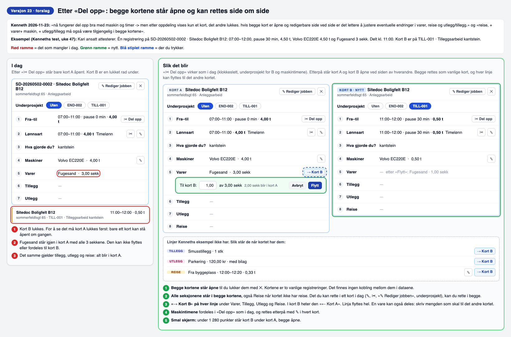

> Del av [Timeføring på web — plan med bilder](../web-timeforing-plan.md): § 4.16. Seksjonsnumrene er de samme som før delingen.

### 4.16 «Del opp»: begge kortene åpne og redigerbare side om side (versjon 21 og 23)

🟡 **Vedtatt av Kenneth 2026-11-23 («B68 ja, B69 ja, B70 ja, B71 ja»; «B72 ja, 73 ja»), ikke bestilt.** ✅ Bygget: blokka i
kortet med klokkeslett, underprosjekt for B og maskintimer for A og B (O15 `6cf48d6e`). Resten står i **del G**.

Kenneths ord 2026-11-21: «ved del opp er det viktig at begge kortene kan justeres samtidig» og «det er også
viktig at attestang kan se begge kortene ved oppdeling».

**Det som er vedtatt:**

- «✂ Del opp» er blokka i kortet, som i dag: klokkeslett, underprosjekt for B og maskintimene (Kenneth
  2026-11-22 «s2.ja»; ✅ O15 `6cf48d6e`, `delJobb` `maskinDeling`, `DelOppSkjema`; timer.md § «Del opp»).
- Etter delingen står kort A og kort B åpne og redigerbare side om side (B69 ja).
- Kortene har ingen kobling i data (B69 ja). Ingen automatisk justering (§ 8.21).
- Linjer — reise, varer, maskin, utlegg og tillegg — kan flyttes mellom kort A og kort B (B68 ja). En linje
  kan flyttes til et annet kort på dagen også når kortet åpnes alene, og også etter at det har vært lukket
  (B74 ja).
- Attestanten kan legge til nye linjer (B71 ja), også varer og utlegg (B72 ja). «＋» og redigering av alle
  linjene gjelder hver gang et kort redigeres, også når det åpnes alene og etter at det er lukket en gang
  (Kenneth 2026-11-23).
- Alle som legger til eller retter en linje på en annens dag, får merket «Lagt til av» eller «Korrigert av».
  Bare brukeren selv slipper (B73 ja, med Kenneths presisering). Det gjelder alle linjetyper og alle steder
  linja kan endres.
- Vinduet med begge kortene før lagring (alternativ A, 2026-11-21) er utgått (B70 ja). Del B, del C, del E og
  del F, som beskrev vinduet, er tatt ut av planen, og `v21-del-opp.png` gjelder ikke. Med vinduet går også
  ett «Lagre» og «Avbryt» for hele delingen, og prosjekt og byggeplass for kort B: kort B har kort A sitt
  prosjekt og sin byggeplass, og kan få et annet underprosjekt.

**Hvem, hvor og når:** attestanten, i attesteringskortet under Firma › Attestering, på en dagsseddel som er
sendt og der alle linjene i jobben venter. Kravene er de samme som i dag (DO9). Arbeideren har ikke «Del opp»
på web, og får det ikke her.

#### Del A — målt mot develop @ `310ecf43`

⚠️ Linjenumrene i tabellen er fra `310ecf43`. `delJobb` står på `D:7715–8061` i develop @ `14869899`, og to
funn er endret siden: `delJobb` tar også imot maskintimer pr. maskin (DO3, O15 `6cf48d6e`), og maskin og vare
følger ikke lenger med til B (DO14, `e4b1208f`). Det som gjelder nå, står i del G (DG1–DG14).

Lest av Fabel, ikke kjørt. `RP` = `apps/web/src/components/attestering/RegistreringPanel.tsx`, `D` =
`apps/api/src/routes/timer/dagsseddel.ts`, `JD` = `apps/api/src/routes/timer/jobb-deling.ts`, `RRV` =
`apps/web/src/components/attestering/ReiseRettVindu.tsx`, `KI` = `apps/api/src/services/timer/kortId.ts`.

| | Målt | Kilde |
|---|---|---|
| DO1 | **Knappen «✂ Del opp»** står til høyre i del 1 «Fra–til» i kortet. Den vises når attestanten kan rette, jobben har klokkeslett og et prosjekt, og første timerad har kort-id. | `RP:327–337` |
| DO2 | **Skjemaet er en blokk inne i kortet, ikke et vindu.** Det har ett klokkeslett og underprosjekt for del B. Del A og del B står som én tekstlinje hver: fra–til og timetallet. Knappene er «Avbryt» og «✂ Del opp». | `RP:349–359`, `:777–850` |
| DO3 | **`delJobb` tar imot fem ting:** dagsseddel, kort-id, klokkeslettet, underprosjekt for B og om kallet bare er forhåndsvisning. Det tar ikke imot fra, til eller pause pr. del, og ikke prosjekt eller byggeplass. | `D:6749–6759` |
| DO4 | **B kan ikke bytte prosjekt eller byggeplass i dag.** Den nye raden på B arver prosjektet og byggeplassen fra raden som deles. Rader som går hele til B, får bare nytt underprosjekt og ny kort-id. Underprosjektet holdes mot jobbens prosjekt. | `D:6879–6881`, `:6898–6901`, `:6807`, `:681–703` |
| DO5 | **Forhåndsvisningen regner fire tall:** timer på A, timer på B, antall maskiner som blir på A, og antall som går til B. Alle kravene og vaktene kjøres før den, så en deling som ville blitt avvist, avvises også i forhåndsvisningen. Den gir ikke lønnsart pr. del, ikke pause pr. del og ingenting om sted. Ingenting skrives. | `D:6841–6852` |
| DO6 | **Regelen for radene:** en timerad som slutter senest ved klokkeslettet, blir på A. En som starter ved eller etter, går til B. En som krysser, deles, og første del beholder id-en. Timene på A er klokkeslettene minus pausen; B får resten, så summen er uendret. Pausen legges på delen som overlapper firmaets pausevindu mest. | `JD:53–87`, `:77–78`; `D:1259–1305`, `:6809–6814` |
| DO7 | **Jobbens start og slutt endres ikke av «Del opp».** Bare slutten på raden som deles, og starten på den nye, settes til klokkeslettet. | `D:6871`, `:6883` |
| DO8 | **Fra, til og pause på en linje rettes i dag med ✎**, etter delingen og ett kort om gangen. Timene regnes som (til − fra − pause) / 60, og klokkeslettene rundes med firmaets tidsrunding. Pausefeltet står bare på linja som bærer pausen. | `RP:572–582`, `:585–591` |
| DO9 | **Kravene til «Del opp»:** attesteringsrett på jobbens prosjekt, ikke attestantens egen dagsseddel, firmavalget «rediger ved attestering» på, dagsseddelen sendt, og alle linjene i jobben venter. | `D:6782–6806` |
| DO10 | **Arbeid kan ikke bytte prosjekt noe sted i dag.** Arbeiderens penn avviser det: «Prosjektet kan bare byttes på en reise. Arbeid føres på en ny jobb.» Attesteringens `rettRadFelt` tar imot prosjekt på en timerad og krever da attesteringsrett på begge prosjektene, men skjermen sender det bare fra «Rett reisen». | `D:4350–4356`, `:7446–7449`; `RRV:112` |
| DO11 | **Sjekkene for et nytt prosjekt finnes** og brukes ved prosjektbyttet på reise: prosjektet hører til firmaet, byggeplassen hører til prosjektet, underprosjektet hører til prosjektet, og brukeren er med på prosjektet. | `D:4363–4380`; `apps/api/src/trpc/tilgangskontroll.ts:750` |
| DO12 | **Synken sjekker at arbeideren er med på hvert prosjekt som står på radene** han sender. Om en returnert dag med en rad på et prosjekt han ikke er med på, faktisk avvises, er ikke kjørt. | `D:9225–9241` |
| DO13 | **Overlapp er en sperre på serveren** for en ny eller rettet timerad: den kan ikke overlappe en annen rad på samme dagsseddel, og berøring i endepunktet er lov. `delJobb` kaller ikke sjekken, og trenger den ikke i dag, fordi ytterkantene ikke flyttes (DO7). | `D:2474–2503`; søk i `D:6749–6952` (ingen kall) |
| DO14 | **Maskin, vare, tillegg, utlegg og reise i dag:** en maskin eller vare som er koblet til en rad som går hel til B, følger med. Maskin og vare på raden som deles, blir på A. Tillegg leses bare for statussjekken og røres ikke. Utlegg leses ikke. Reise er holdt utenfor delingen, men `sikreKortId` kjøres etterpå og kan legge reisen i et annet kort etter den delte regelen. | `D:6819–6821`, `:6906–6911`, `:6918–6924`, `:6773`, `:6770`, `:6915`, `:6926`; `KI:5–8` |
| DO15 | **To maskinvakter og én kontroll etterpå:** en maskin med klokkeslett som går over klokkeslettet, avviser delingen. Det samme gjør maskintimer på raden som deles, når de er flere enn del A. Etter skrivingen sjekkes regelen «maskin høyst jobbens arbeidstimer» for begge delene. | `D:6822–6839`, `:6916`; `JD:94–98` |
| DO16 | **Arbeideren får merket «Korrigert av»** etter «Del opp»: radene som endres, lagres i historikken, og loggen bærer verdiene etterpå. Prosjekt, byggeplass og underprosjekt er blant feltene merket viser. | `D:6857–6866`, `:6928–6947`; `apps/api/src/services/timer/kortLeser.ts:337–341` |
| DO17 | **Kort B får en ny, tilfeldig kort-id,** også når det har samme prosjekt, byggeplass og underprosjekt som A. To kort på samme sted er lov (WM107). | `D:6854`, `:6892`, `:6900` |
| DO18 | **Listene vinduet trenger, finnes i «Rett reisen»:** prosjektene attestanten kan attestere, byggeplassene for valgt prosjekt og underprosjektene for valgt prosjekt. Når prosjektet byttes der, tømmes underprosjektet og byggeplassen settes til prosjektets standard. | `RRV:97–109`, `:115–119` |
| DO19 | **Appen kaller ikke `delJobb`.** | Søk i `apps/mobile` (0 treff) |
| DO20 | **Testene som finnes:** planleggeren, kravene fra w5, maskinregelen, sperren for egne timer og merket. | `apps/api/src/routes/timer/jobb-deling.test.ts`; `apps/api/src/routes/w5-retting-ved-attestering.integration.test.ts`, `maskin-over-arbeid.integration.test.ts`, `w7-egne-timer.integration.test.ts`, `w15g-korrigert-av.integration.test.ts`; `apps/web/src/__tests__/attestering-tabell.test.tsx` |

**Svar på ordrens to spørsmål:**

- **Kan `delJobb` bytte prosjekt og byggeplass for B i dag?** Nei (DO3, DO4). Inngangen har dem ikke, og
  B-radene skrives med jobbens prosjekt og radens byggeplass.
- **Hva regner forhåndsvisningen?** Timer på A og på B, og hvor mange maskiner som blir og går (DO5).

#### Del D — det som ikke røres

- ✂ på én timelinje (`splittRad`) og «✎ Rediger jobben».
- Pennen på linjene i kortet (w15g) og «Rett reisen» (w15f).
- Underprosjekt-knappene for hele jobben.
- Arbeiderens dagsside. Han har ikke «Del opp» på web.
- Firmavalget dagskort-modus og appen.
- Kortene etter delingen: ingen kobling mellom A og B, og ingen automatisk justering (§ 8.21).

#### Del G — begge kortene åpne og redigerbare etter «Del opp» (versjon 23)

🟡 **Vedtatt av Kenneth 2026-11-23: «B68 ja, B69 ja, B70 ja, B71 ja», «B72 ja, 73 ja» og «B74 ja». Ikke
bestilt, uten kode.**

**Kenneth 2026-11-23, etter test av O15 på test `14869899` (ordrett):** «Det er noen mangler med den opprinnelige
planen ved del opp -> det var avtalt at del opp skulle vise registreringer av begge side om side, slik at det er
enkelt å dele opp kortene. men jeg finner ikke at dette er planlagt av fabel i en visning/bilde. * reise, + varer+
maskin, + utlegg/tillegg må også være tilgjengelig i begge kortene * nå fungerer del opp bra med maskin og timer ->
men etter oppdeling vises kun et kort, det andre lukkes. hvis begge kort er åpne og redigerbare side ved side er
det lettere å justere eventuelle endringer i varer, reise og utlegg/tillegg.»

Kenneths to testbilder ligger i `relay/skisser/delopp-kenneth-1-for.webp` (blokka i kortet) og
`relay/skisser/delopp-kenneth-2-etter.webp` (etter delingen: bare kort A åpent). De er ikke i repoet.

Kilde: `skisser-v23.html` (ark `#etter`). Eksemplet er Kenneths test: Kari ansatt attesterer, registreringen er
07:00–12:00 med 30 min pause på SD-20260502-0002 · Sitedoc Boligfelt B12, med Volvo EC220E 4,50 t og Fugesand
3 sekk, delt kl. 11:00, og kort B er på TILL-001. Tillegg, utlegg og reise finnes ikke i eksemplet; de står i en
egen ramme i bildet, merket som det. ⚠️ `v23-del-opp-vindu.png` (ark `#vindu`) viser vinduet før lagring. Det er
utgått (B70 ja).

**Kenneths svar 2026-11-23:**

| | Spørsmål | Svar | Det som gjelder |
|---|---|---|---|
| B68 | Skal varer, tillegg, utlegg og reise kunne flyttes mellom kort A og kort B? | **Ja** | Linjer (reise, varer, maskin, utlegg og tillegg) kan flyttes mellom kort A og kort B. Spørsmålet nevnte ikke maskin; Kenneths ord 23.11. og orkestrators føring av svaret gjør det. Bytter ut «s3.nei» (2026-11-22). |
| B69 | Skal kort A og kort B stå åpne side om side til du lukker dem, uten kobling i dataene? | **Ja** | Etter «Del opp» står begge kortene åpne og redigerbare side om side. Kortene har ingen kobling i data. |
| B70 | Skal vinduet fra 21.11. utgå, nå som kortene står åpne etter delingen? | **Ja** | Vinduet utgår, og blokka fra O15 står. Med vinduet går tre ting som ikke var bygget: å se og justere begge kortene før noe er lagret; ett «Lagre» og ett «Avbryt» for hele delingen; og prosjekt og byggeplass for kort B. |
| B71 | Skal attestanten også kunne legge til nye linjer i kortene? | **Ja** (Fabel anbefalte nei) | Attestanten kan legge til nye linjer under oppdelingen. ⚠️ «Under oppdelingen» er rettet av Kenneth samme dag: hver gang et kort redigeres (lesningene under). Bytter ut «Mangler B noe, fører arbeideren det etterpå, eller attestanten returnerer dagen» (2026-11-21). Beskrevet under «Attestanten legger til linjer». |
| B72 | Skal en attestant som bare har attesteringsrett, få legge til varer og utlegg på arbeiderens dag? | **Ja**, for både varer og utlegg | Alle som kan attestere prosjektet, får «＋» under Varer og Utlegg. |
| B73 | Skal linja lagre hvem som la den til, i en ny kolonne? | **Ja**, med presisering | Kenneth: «den som korrigerer skal alltid få denne, kun brukeren selv slipper.» Alle som legger til eller retter en linje på en annens dag, får merket «Lagt til av» eller «Korrigert av». Det gjelder alle linjetyper og alle steder linja kan endres, ikke bare «Del opp». Én migrering, som Kenneth kjører. Beskrevet under «Merket «Lagt til av» og «Korrigert av»». |
| B74 | Skal en linje kunne flyttes til et annet kort på dagen også når kortet åpnes alene? | **Ja** | En linje kan flyttes til et annet kort på dagen også når kortet åpnes alene, og også etter at det har vært lukket. Flyttingen er ikke knyttet til paret etter «Del opp». Beskrevet i punkt 5 under «Det som gjelder». |

**Kenneth 2026-11-23 om de tre lesningene til Fabel:**

- **Maskinlinja får «→ Kort B»:** står.
- **«＋» bare i paret:** rettet. Kenneth: «et kort som redigeres må kunne redigere alle linjer, også etter at
  de er lukket en gang.» «＋» og redigering av alle linjene gjelder hver gang et kort redigeres, også når det
  åpnes alene. Det er ikke knyttet til paret etter «Del opp».
- **Merket vises også i attesteringskortet:** står.

**Målt mot develop.** DG1–DG14: develop @ `14869899`, lest av leseagent 2026-11-23; Fabel har stikkprøvd kildene
for DG1–DG7, DG9 og DG12 (ikke hver linje). DG15–DG23: develop @ `ae3c417b` (koden er lik `14869899`), lest av
leseagent 2026-11-23; Fabel har stikkprøvd DG15–DG18, DG20, DG21 og vaktene i DG23, ikke DG19 og serverdelen av
DG22. DG24–DG33: develop @ `ae3c417b`, lest av Fabel 2026-11-23. DG33 er talt på nytt på develop @ `41605c0e`
(etter O19 og O19b). Linjenumrene i `D` gjelder hashen de er målt mot; O19 og O19b har flyttet dem på develop.
Ikke kjørt. `AD` =
`apps/web/src/components/timer/AttesteringDetalj.tsx`. `D`, `JD`, `RP`, `RRV` og `KI` som i del A; `AT` =
`apps/web/src/components/attestering/AttesteringTabell.tsx`, `S` = `packages/db-timer/prisma/schema.prisma`,
`VF` = `apps/api/src/routes/vareforbruk.ts`, `KL` = `apps/api/src/services/timer/kortLeser.ts`, `ADE` =
`apps/web/src/components/timer/AttesteringDetalj_Edit.tsx`.

| | Målt | Kilde |
|---|---|---|
| DG1 | **`delJobb` tar imot** dagsseddel, kort-id, klokkeslett, underprosjekt for B, forhåndsvisning og maskintimer pr. maskin for A og B. Ikke prosjekt, byggeplass, fra, til eller pause pr. del, og ingen fordeling av varer, tillegg, utlegg eller reise. | `D:7715–7729` |
| DG2 | **Bare arbeid og maskintimer går til B.** Varer koblet til en rad som går til B, kobles om til en rad i A. Tillegg leses bare for statussjekken. Utlegg leses ikke. Reise holdes utenfor. | `D:7796–7799`, `:8027–8032`, `:7745`, `:7778`, `:7742`; `KI:43`; `apps/api/src/routes/w5-retting-ved-attestering.integration.test.ts:396` |
| DG3 | **Svaret fra `delJobb` bærer kort-id-en til B.** | `D:8060` |
| DG4 | **Skjermen bruker ikke svaret.** Etter delingen lukkes blokka, og lista hentes på nytt. | `RP:847–854`, `:357` |
| DG5 | **Bare ett kort kan stå åpent.** Det åpne kortet er én nøkkel, og nøkkelen er fortsatt kort A etter delingen. Nøkkelen er dagsseddel og kort-id, så nøkkelen til B kan lages av svaret (DG3). | `AT:200`, `:740`; `apps/web/src/components/attestering/attestering-tabell.ts:522` |
| DG6 | **Det åpne kortet er en egen rad i tabellen,** i full bredde, rett over kortets linjer. Tabellen er virtualisert. Kort A og kort B har hver sin plass i lista. | `AT:729–730`; `apps/web/src/components/timer/TimerRadTabell.tsx:292`, `:412–417` |
| DG7 | **Seksjonene i kortet og hva attestanten kan rette:** 1 Fra–til (tekst og «✂ Del opp»), 2 Lønnsart (✂ og ✎), 3 Hva gjorde du? (bare lesing), 4 Maskiner (✎), 5 Varer (bare lesing), 6 Tillegg (✎ og ✂), 7 Utlegg (bare lesing), 8 Reise (✎ «Rett reisen» og ✂). Reise vises bare når kortet har en reise. Ingen seksjon har en knapp som legger til eller flytter en linje. | `RP:327–347`, `:361–367`, `:369–386`, `:388–414`, `:416–427`, `:429–451`, `:453–466`, `:468–510` |
| DG8 | **Alle linjetypene har kolonnen kort-id,** og ingen unik indeks står i veien for å flytte en linje. Varer ligger i varelager-basen. Sjekkregler i SQL-migreringene er ikke lest. | `S:324`, `:441`, `:519`, `:623`, `:593`; `packages/db-varelager/prisma/schema.prisma:88`, `:91` |
| DG9 | **Å flytte en linje er mer enn kort-id.** Linjene i et kort, unntatt reise, må ha samme prosjekt, byggeplass og underprosjekt. En maskin eller vare som er koblet til en timerad, må stå i samme kort som raden, ellers flyttes den tilbake. Reise må ha kortets prosjekt. | `packages/shared/src/utils/kortId.ts:253–283`; `KI:291–294`, `:410–443` |
| DG10 | **To kort kan ha samme prosjekt, byggeplass og underprosjekt** (A og B begge «Uten»). En linje uten kort-id legges da i det eldste kortet, altså A. Flyttingen må skrive kort-id-en direkte. | `KI:281–290` |
| DG11 | **Ingen mutasjon i attesteringen setter kort-id på en linje.** `flyttTimerRadEco` endrer underprosjekt på timer og tillegg. `rettRadFelt` og `redigerSedelRader` retter timer, tillegg og maskin. Ingen av dem tar utlegg eller vare. | `D:7582–7702`, `:8487–8667`, `:8473`, `:3211–3274` |
| DG12 | **Attestanten kan ikke rette varer og utlegg.** Vare-ruten slipper inn eieren (utkast eller returnert), prosjektadmin, firmaadmin og sitedoc-admin, ikke en som bare har attesteringsrett. Utlegg kan bare eieren og firmaadmin føre, på utkast eller returnert dag (DG18). | `VF:31–49`; `D:6455`, `:6568`, `:6649` |
| DG13 | **`delJobb` sjekker ikke status på varer og utlegg.** Timer, tillegg og maskin må vente. Utlegg har ingen attestert-status. En attestert vare er låst med et øyeblikksbilde, som flytting av hele jobben sjekker. | `D:7778`, `:758`; `S:493–529` |
| DG14 | **Varer skrives utenfor transaksjonen,** fordi de ligger i en annen database. `delJobb` gjør det etter at delingen er lagret. | `D:8025–8032` |
| DG15 | **«✎ Rediger jobben» kan ikke legge til linjer.** Vinduet retter og sletter timer og maskin, og tillegg sendes uendret. Hver rad der har en original. | `apps/web/src/components/attestering/RedigerRadModal.tsx:78–97`, `:179–187`, `:430` |
| DG16 | **Attestanten kan legge til timelinje, tillegg og maskin i dag, men ikke i kortet.** «Åpne dagsseddel» går til dagsseddelens side. «Rediger sedel» der har «+ Legg til». Det lagres med `redigerSedelRader`, som oppretter rader uten original. Kravene er de samme som for retting (DO9). | `AT:419–421`; `apps/web/src/components/timer/AttesteringDetalj.tsx:493`; `ADE:237–272`, `:722`, `:857`, `:915`; `D:3316–3337`, `:3623`, `:3734–3748` |
| DG17 | **En ny linje kan ikke styres til et bestemt kort.** `redigerSedelRader` tar ikke imot kort-id. Raden får kort etter prosjekt, byggeplass og underprosjekt, og da det eldste kortet når to kort er like (DG10). | `D:3227–3272`, `:3591–3616` |
| DG18 | **Arbeiderens egne «legg til» slipper ikke attestanten inn,** og ingen inn på en sendt dag. Det gjelder timerad, reise, tillegg, utlegg og maskin: eieren, firmaadmin eller sitedoc-admin, og bare utkast eller returnert dag. | `D:1103–1156`, `:254`, `:4503`, `:6175`, `:6455`, `:11367` |
| DG19 | **Reise: attestanten kan bare rette en reise som finnes** («Rett reisen»). Arbeiderens reisevindu lagrer med `tilfoyTimerRad` (DG18). Om «Rediger sedel» slipper gjennom en timelinje med reiselønnsart, er ikke målt. | `RRV:111–112`, `:187–190`; `apps/web/src/app/dashbord/timer/[id]/ReiseKort.tsx:358`, `:674` |
| DG20 | **Ingen linje lagrer hvem som opprettet den, unntatt vare.** Varen har «registrert av», satt til den som er logget inn. Timer, tillegg, maskin og utlegg har tidspunkt for opprettet og endret, ikke hvem. Dagsseddelen har «registrert av» for hele dagen. | `S:158`, `:313–314`, `:432–433`, `:510–511`, `:615–616`; `packages/db-varelager/prisma/schema.prisma:82`; `VF:541` |
| DG21 | **Merket «Korrigert av» regnes ut ved lesing,** fra historikken over rader som er endret eller slettet, og fra loggen. Det finnes for timer, tillegg og maskin, ikke for utlegg og vare. En rad attestanten oppretter, får ikke merket: den har ingen historikkpost og ingen forelder. Loggen for `rediger_sedel_rader` bærer det som ble sendt inn, uten id-en til den nye raden. | `KL:225`, `:321`, `:415`, `:511–514`; `D:3694–3706`, `:3785–3816`; `S:656–664` |
| DG22 | **Merket hos arbeideren** viser navn og tidspunkt på linja («Korrigert av Kari Leder 21.11. kl. 14:32») og bare navn på dagen i Mine timer. Bare eieren får det, og bare i prosjektkort-modus. Appen har ikke merket. Ingen e-post og ingen push sendes når attestanten retter eller legger til. | `apps/web/src/components/timer/KorrigertMerke.tsx:34–50`; `D:4114–4117`, `:4266–4272`; `apps/web/src/app/dashbord/timer/[id]/page.tsx:1583`; søk i `apps/mobile/src` og `apps/api/src/routes/timer` (0 treff) |
| DG23 | **Å rette og å legge til har samme rett i dag:** attesteringsrett på prosjektet (prosjektadmin, «kan attestere» eller firmaadmin) og firmavalget «rediger ved attestering». Vare krever prosjektadmin eller firmaadmin. Ingen rettighet skiller «kan rette» fra «kan legge til». | `D:266–293`, `:620–638`, `:3319–3330`; `VF:31–49`; `packages/db/prisma/schema.prisma:430`, `:746` |
| DG24 | **Historikken skrives bare av attesteringens skriveveier:** «Rediger sedel» og pennen (begge går gjennom `utforRedigerSedelRader`), «Del opp», gjenåpning av linjer og ✂. Posten bærer hvem og når. Radtypene er timer, tillegg og maskin. | `D:3706`, `:7933`, `:7987`, `:8732`, `:8927`, `:8976`, `:9003`, `:8475`, `:8649`, `:2456–2461`; `S:656–664` |
| DG25 | **Merket regnes bare når en annen enn eieren står på historikkposten.** Eierens egne endringer gir ikke merke. | `KL:514` |
| DG26 | **Firmaadmin og sitedoc-admin slipper inn i arbeiderens egne skriveveier** på en annens dag, når dagen er utkast eller returnert: legge til, rette og slette timerad, tillegg, utlegg og maskin, lagre jobbens tid, flytte jobben og bytte underprosjekt. Ingen av veiene skriver historikk eller hvem. En slik retting gir ikke merke i dag. Om skjermen har en lenke som fører en admin dit, er ikke målt. | `D:1103–1156`; kallene `D:4449`, `:4561`, `:4804`, `:5122`, `:5196`, `:5437`, `:5503`, `:5640`, `:6191`, `:6263`, `:6326`, `:6473`, `:6585`, `:6657`, `:11388`, `:11493`, `:11579`; søk etter `sheetRadHistorikk.create` i `D` (sju treff, alle i DG24) |
| DG27 | **Vare på en annens dag:** prosjektadmin, firmaadmin og sitedoc-admin kan legge til, rette og slette. Vakta spør ikke om status på dagen for dem. «Registrert av» settes når linja opprettes. Retting og sletting lagrer ikke hvem. | `VF:31–49`, `:52–64`, `:541`, `:646`, `:714`, `:782`, `:787` |
| DG28 | **Ingen fører en hel dag for en annen.** `opprett` lager dagsseddelen for den som er logget inn, og synken avviser en dagsseddel som eies av en annen. | `D:4376–4377`, `:10084–10091` |
| DG29 | **Appen kan attestere og returnere, ikke rette eller legge til på en annens dag.** | Søk i `apps/mobile/src` og `apps/mobile/app` etter `rettRadFelt`, `redigerSedelRader`, `splittRad` og `delJobb` (0 treff); `apps/mobile/src/components/timer-attestering/` |
| DG30 | **Attesteringens leser bærer feltene som er rettet, med navn og tidspunkt,** for timer, tillegg og maskin. Skjermen bruker verdien før. Navnet brukes ikke i attesteringskortet. | `D:2395–2416`; `KL:235–241`; `apps/web/src/components/attestering/attestering-tabell.ts:34`, `:40`, `:257`; søk etter `avNavn` i `apps/web/src/components/attestering` (ett treff, typen) |
| DG31 | **«Rediger sedel» mot kortet.** «Rediger sedel» står på dagsseddelens side i attesteringen når dagen er sendt, firmavalget er på og dagen ikke er attestantens egen. Den retter, sletter og legger til timer, tillegg og maskin for hele dagen, på tvers av kortene, med ett «Lagre». Radene har prosjektvelger, så en ny rad kan føres på et prosjekt dagen ikke har kort på (ikke kjørt). Den viser de opprinnelige radene samlet. Den tar ikke vare, utlegg eller reise. Kortet har ingen sletteknapp på linjene; «✎ Rediger jobben» sletter timer og maskin (DG15). | `AD:489–497`; `ADE:237–272`, `:302–310`, `:572–573`, `:698`, `:746`, `:884`; `apps/web/src/components/attestering/RedigerRadModal.tsx:976`, `:1103`; søk etter «slett» i `RP` (0 treff); DG11 |
| DG32 | **Tidspunktet «opprettet» kommer fra klienten** for linjer som synkes fra appen. Det er ikke serverens klokke. | `D:9953–9956`, `:11079–11095` |
| DG33 | **23 steder oppretter en linje i de fire tabellene,** alle i `D`: timer 10, tillegg 5, maskin 6 og utlegg 2 (develop @ `41605c0e`). På `ae3c417b` var det 22; O19 la til ett for timer. Ingen rå SQL setter inn rader (lest på `ae3c417b`, ikke på nytt). | Søk i `apps/api/src` (uten testfiler) etter `sheetTimer`, `sheetTillegg`, `sheetMachine` og `sheetUtlegg` fulgt av `create`, `createMany` eller `upsert`; søk etter `INSERT INTO timer.sheet_` (0 treff) |

**Det som gjelder (ark 1):**

1. **«✂ Del opp» og blokka står som i dag** (O15): klokkeslett, underprosjekt for B og maskintimene.
2. **Etter «✂ Del opp» står kort A og kort B åpne ved siden av hverandre,** i raden der kort A sto (B69). Er
   innholdsflaten smalere enn 1 280 punkter, står kort B under kort A.
3. **Et kort attestanten kan redigere, har alle åtte seksjonene.** Reise vises også når kortet ikke har reise
   (i dag skjult, DG7).
4. **Det attestanten kan rette i ett kort i dag, kan han rette i begge:** underprosjekt, ✎ og ✂ på linjene,
   «✎ Rediger jobben» og «Rett reisen». **Alle linjene kan redigeres** (Kenneth 2026-11-23): Varer og Utlegg
   får ✎ (i dag bare lesing, DG7), og hver linje får en sletteknapp med bekreftelse i et vindu (i dag bare
   timer og maskin i «✎ Rediger jobben», DG31). Lest slik av Fabel: å redigere en linje er å rette og slette
   den.
5. **«→ Kort B» på hver linje** under Maskiner, Varer, Tillegg, Utlegg og Reise (B68). I kort B heter den
   «← Kort A». Linja flyttes hel og får kortets underprosjekt. På en vare kan attestanten skrive mengden som
   skal flyttes («1,00 av 3,00 sekk»); resten blir stående. **Flytteknappen står også når kortet åpnes
   alene, og etter at det har vært lukket** (B74 ja). Da viser den de andre kortene på samme dag og samme
   prosjekt. Har dagen bare ett slikt kort, står kortets navn rett på knappen («→ TILL-001»). Har dagen
   ingen andre kort på prosjektet, vises ikke knappen. Lest slik av Fabel: et kort som er attestert, står
   ikke blant målene før det er gjenåpnet, som for retting i dag.
6. **Maskintimene** fordeles i blokka som i dag, og rettes etterpå med ✎ i hvert kort.
7. **«＋» i seksjonene** legger til en ny linje i det kortet (B71, B72). Se «Attestanten legger til linjer».
8. **Kortene lukkes hver for seg med ✕.** De er to vanlige registreringer uten kobling. Åpnes ett av dem
   senere, åpnes bare det. «＋», ✎, ✂, sletting og flytteknappen står der som i paret (Kenneth 2026-11-23;
   B74 ja).
9. **Arbeideren og attestanten** ser «Korrigert av» på linjene som er flyttet eller rettet, og «Lagt til av»
   på linjene en annen enn arbeideren har lagt til (B73). Se «Merket «Lagt til av» og «Korrigert av»».
10. **Kort A og kort B kan ikke overlappe hverandre** (B65 A, Kenneth 2026-11-24). Setter attestanten «Fra kl.»
    på kort B tidligere enn «Til kl.» på kort A, eller omvendt, står en linje i kortet: «Overlapper 15:30–16:00 på
    kort A. Rett tidene før du lagrer.» «Lagre» er av til tidene er rettet. Sperren gjelder også etter
    at paret er lukket, og mot alle andre kort attestanten kan rette; serveren avgjør den av attesteringsretten,
    ikke av paret (B88 ja, Kenneth 2026-11-24, § 8.30). Overlapp mot et kort han ikke kan rette, varsles og godtas
    (B66 A, § 4.17 del I). Leveranse KF1.

**Attestanten legger til linjer (B71 ja, B72 ja):**

**Hvem, hvor og når:** attestanten, hver gang han redigerer et kort under Firma › Attestering: i paret etter
«Del opp», når et kort åpnes alene, og når et kort åpnes igjen etter at det er lukket (Kenneth 2026-11-23).
Kravene er de samme som for retting i dag (DO9, DG23): attesteringsrett på prosjektet, ikke egen dagsseddel,
firmavalget «rediger ved attestering» på, dagen sendt, og linjene i kortet venter. Et attestert kort må
gjenåpnes først, som i dag. Arbeiderens egen dagsside er uendret.

**1. Linjetypene.** «＋» åpner de samme feltene som arbeideren har for linjetypen på dagssiden. Linja får
kortets prosjekt, byggeplass og underprosjekt, står som «venter» og attesteres sammen med resten.

| Seksjon | «＋» legger til | I dag (attestant, sendt dag) | Trengs |
|---|---|---|---|
| 2 Lønnsart | Timelinje: fra, til, pause og lønnsart | Bare i «Rediger sedel» på dagsseddelens side (DG15, DG16) | Kort-id på ny rad (DG17) |
| 4 Maskiner | Maskin og antall timer, uten fra–til | Bare i «Rediger sedel» (DG16) | Kort-id på ny rad. Regelen «maskin høyst jobbens arbeidstimer» gjelder (DO15) |
| 5 Varer | Vare og mengde | Bare prosjektadmin og firmaadmin (DG12, DG23) | Vakta slipper inn alle som kan attestere prosjektet (B72 ja) |
| 6 Tillegg | Tillegg og antall | Bare i «Rediger sedel» (DG16) | Kort-id på ny rad |
| 7 Utlegg | Kategori, beløp og bilag. Bilag er valgfritt, som på PC i dag | Ingen (DG18) | En ny vei på serveren for alle som kan attestere prosjektet (B72 ja) |
| 8 Reise | Reise i reisevinduet: retning, fra–til og steder | Ingen. Attestanten retter bare en reise som finnes (DG19) | En ny vei på serveren. Reglene i [vedtak-timer-web.md § Reisevinduet](../vedtak-timer-web.md) gjelder |

Seksjon 1 Fra–til og 3 Hva gjorde du? har ingen «＋». De er ikke linjer.

**2. Slik synes det på linja at attestanten la den til.** Linja viser «Lagt til av Kari ansatt 23.11. kl.
14:02», på samme sted og i samme form som «Korrigert av Kari ansatt 23.11. kl. 14:02» (DG22). Målt mot feltene
i dag:

- **Når** finnes: alle linjetypene har tidspunktet linja ble opprettet (DG20).
- **Hvem** finnes bare på vare («registrert av»). Timer, tillegg, maskin og utlegg lagrer ikke hvem som
  opprettet linja (DG20). De får en ny kolonne (B73 ja).
- **Merket** finnes ikke for nye linjer, og ikke for utlegg og vare (DG21). Teksten «Lagt til av» finnes ikke
  i språkfilene.
- Merket står også i attesteringskortet, så en annen attestant ser at arbeideren ikke førte linja selv
  (Kenneth 2026-11-23: står). I dag får bare eieren av dagsseddelen merket (DG22).

**3. Dette ser arbeideren etterpå:**

- **På PC, dagen:** linja står i kortet sitt sammen med hans egne, med «Lagt til av Kari ansatt 23.11. kl.
  14:02». I firmavalget dagskort-modus vises ikke merket, som i dag (DG22).
- **På PC, Mine timer:** dagen viser «Korrigert av Kari ansatt», som etter andre rettinger.
- **På telefonen:** linja kommer ved neste henting, uten merke. Appen har ikke «Korrigert av» (w15gm venter på
  web).
- **Ingen e-post og ingen push** (§ 8.20: «jeg vil ikke varsle med e-post»; DG22).
- **Returneres dagen,** er linja en vanlig linje på dagsseddelen hans, og han kan rette og slette den. Ikke
  kjørt.

**4. Ny rettighet eller ny kolonne?**

- **Ny rett: ja, for vare og utlegg (B72 ja).** En attestant som bare har attesteringsrett, slipper ikke inn
  i dag (DG12, DG18, DG23). Retten trenger ingen ny kolonne: den følger attesteringsretten og firmavalget.
  Timelinje, tillegg, maskin og reise bruker retten attestanten har til å rette.
- **Ny kolonne: ja (B73 ja).** Én kolonne på fire tabeller, beskrevet under.
- **Kort-id:** ingen ny kolonne. Alle linjetypene har den (DG8).

**Merket «Lagt til av» og «Korrigert av» (B73 ja):**

Kenneth 2026-11-23: «den som korrigerer skal alltid få denne, kun brukeren selv slipper.»

**Regelen:** en linje som en annen enn eieren av dagsseddelen har lagt til, viser «Lagt til av [navn]
[tidspunkt]». En linje som en annen enn eieren har rettet, viser «Korrigert av [navn] [tidspunkt]». En linje
eieren selv har ført eller rettet, har ikke merke. Regelen gjelder timelinje, reise, tillegg, maskin, vare og
utlegg, og hver skrivevei, ikke bare «Del opp».

**Hvem regelen treffer, målt i dag:**

| Hvem | Hvor | Merke i dag | Mangler |
|---|---|---|---|
| Attestant | Kortet (✎, ✂, «✎ Rediger jobben», «Rett reisen», «Del opp») og «Rediger sedel» | «Korrigert av» på timer, tillegg og maskin (DG21, DG24) | «Lagt til av» på nye linjer |
| Attestant | Varer og utlegg i kortet (B72) | Veien finnes ikke (DG12) | Begge merkene |
| Firmaadmin og sitedoc-admin | Arbeiderens egne skriveveier, på utkast og returnert dag (DG26) | Ingen | Begge merkene, alle linjetypene |
| Prosjektadmin, firmaadmin og sitedoc-admin | Vare på en annens dag (DG27) | Ingen. «Registrert av» lagres, men vises ikke som merke | «Lagt til av» vises; «Korrigert av» ved retting |
| Alle | Appen | Ingen kan rette eller legge til på en annens dag (DG28, DG29) | Ingenting |

**«Lagt til av» lagres i én ny kolonne,** `opprettet_av_user_id`. Den er tekst, kan være tom og er en svak
nøkkel til `users` uten relasjon, som `attestert_av_user_id` (`S:272`).

| Tabell | Linjetype | Prisma-felt | Kolonne |
|---|---|---|---|
| `timer.sheet_timer` | Timelinje og reise | `SheetTimer.opprettetAvUserId` | `opprettet_av_user_id` |
| `timer.sheet_tillegg` | Tillegg | `SheetTillegg.opprettetAvUserId` | `opprettet_av_user_id` |
| `timer.sheet_machines` | Maskin | `SheetMachine.opprettetAvUserId` | `opprettet_av_user_id` |
| `timer.sheet_utlegg` | Utlegg | `SheetUtlegg.opprettetAvUserId` | `opprettet_av_user_id` |
| `varelager.vareforbruk` | Vare | `Vareforbruk.registrertAvUserId` (finnes, DG20) | Ingen ny |

- **Serveren setter verdien på hver ny linje,** til den som er logget inn, også når eieren fører selv.
  Klienten sender den ikke. Synken fra appen setter den på serveren (DG28).
- **En rad som blir til ved deling eller flytting, arver verdien** fra raden den kom fra (✂, «Del opp», «→
  Kort B»). Deling er retting, ikke en ny linje.
- **Merket «Lagt til av» vises når verdien er satt og er en annen enn eieren av dagsseddelen.** Tom verdi gir
  ikke merke.

**«Korrigert av» trenger ingen kolonne.** Merket regnes fra historikken som i dag (DG21, DG25). Det som
mangler, er at skriveveiene i DG26 og DG27 og de nye veiene for utlegg skriver en historikkpost når en annen
enn eieren retter eller sletter, og at historikken og leseren tar radtypene utlegg og vare. `rad_type` er tekst
(`S:658`), så det trengs ingen migrering for det. Varene ligger i en annen database enn historikken (DG14);
rekkefølgen beskrives i koderens løsning.

**Migreringen:** én migrering i `packages/db-timer`, som legger til kolonnen på de fire tabellene. Ingen linje
endres. Varelager-basen får ingen migrering. Kenneth kjører den på test og i prod.

**Backfill: ingen.** Regelen om stille tomhet ([arkitektur.md § Schema- og migreringsregler](../arkitektur.md))
krever backfill, garanti i databasen og en test som feiler når feltet er tomt. Slik svares den ut:

- **(a) Backfill kan ikke gjøres uten å gjette.** Hvem som la til en linje før migreringen, er ikke lagret
  noe sted. Attestanten kan ha lagt til rader i «Rediger sedel» uten at loggen bærer id-en til raden (DG21),
  og en firmaadmin kan ha ført på en annens dag uten spor (DG26). Eieren skrevet på alle gamle linjer ville
  gitt feil navn på noen av dem, og samme regel forbyr å utlede identitet. Kenneth svarte ja på B73 med «linjer
  ført før migreringen får ikke merket».
- **Tom verdi har én betydning: ført før migreringen, ukjent hvem.** Den betyr aldri «eieren». Det holder
  fordi serveren setter verdien på hver ny linje, også eierens.
- **(b) Garanti i databasen.** Kolonnen er ikke en nøkkel, og ingen leser slår opp på den, så en unik indeks
  har ingenting å verne. En sjekkregel «opprettet etter migreringen krever verdi» kan ikke brukes, fordi
  tidspunktet «opprettet» kommer fra klienten for linjer som synkes fra appen (DG32). Vernet er testen under.
  Steg to i to-stegs-regelen (kolonnen påkrevd) kan ikke tas mens gamle linjer er tomme, og er ikke foreslått.
- **(c) Testen som feiler når feltet er tomt** (ekte Postgres): hver skrivevei som oppretter en linje i de fire
  tabellene, kjøres, og testen krever at `opprettet_av_user_id` er satt på hver rad den laget. I dag er det 23
  steder (DG33). En kildevakt teller de samme stedene, så en ny skrivevei uten test feiler.

**Der merket vises:** hos arbeideren på PC, på linja og på dagen i Mine timer, som i dag, og i
attesteringskortet (Kenneth 2026-11-23: står). I dag får bare eieren merket (DG22). Attesteringens leser bærer
navn og tidspunkt for rettede felt, men skjermen viser ikke navnet (DG30). Firmavalget dagskort-modus og appen
viser ikke merket i dag. Det er ikke endret her: dagskortet røres ikke (del D), og appen venter på w15gm.

**Kortet og «Rediger sedel» (DG31):**

Med «＋», ✎ og sletting på alle linjene gjør kortet det meste av det «Rediger sedel» gjør. Tre ting gjør bare
«Rediger sedel»:

- den lagrer endringer i flere kort på dagen med ett «Lagre»;
- den kan legge til en rad på et prosjekt dagen ikke har kort på, altså en ny jobb på arbeiderens dag;
- den viser de opprinnelige radene samlet.

Tre ting gjør bare kortet: vare, utlegg og reise, og linja havner i kortet der «＋» ble trykket (DG17).

**Begge står.** Kenneth har ikke bedt om at «Rediger sedel» fjernes, og kortet dekker ikke de tre punktene
over. Skriveveien på serveren er den samme (`utforRedigerSedelRader`, DG24), så kravene og merket blir like
begge steder. Om «Rediger sedel» skal fjernes, er et spørsmål til Kenneth når D2c–D2e er testet. Det er ikke
stilt nå.

**Dette trengs i koden:**

| | Hva | Hvorfor |
|---|---|---|
| Web 1 | Blokka gir kort-id-en til B videre når delingen er lagret. | DG3, DG4 |
| Web 2 | Det åpne kortet blir et par (A og B). Én rad i tabellen tegner to kort i et rutenett. | DG5, DG6 |
| Web 3 | Seksjonen Reise vises alltid når attestanten kan redigere kortet. | DG7 |
| Web 4 | «→ Kort B» og «← Kort A» på linjene, med mengdefelt på vare. I et kort som åpnes alene, viser knappen de andre kortene på samme dag og samme prosjekt (B74 ja). | Punkt 5 |
| Web 5 | Tekstene i `nb.json` og `en.json`, og hjelpeteksten for attesteringen. | Kodestil |
| Web 6 | «＋» i seksjon 2 og 4–8, med feltene arbeideren har for linjetypen. Vises hver gang attestanten kan redigere kortet, også når det åpnes alene. | Punkt 7 og 8 |
| Web 7 | Merket «Lagt til av [navn] [tidspunkt]» og «Korrigert av [navn] [tidspunkt]» på alle linjetypene, hos arbeideren og i attesteringskortet. | DG21, DG22, DG30 |
| Web 8 | ✎ på Varer og Utlegg, og sletteknapp på hver linje i kortet med bekreftelse i et vindu. | Punkt 4; DG7, DG31 |
| Server 1 | **Ny mutasjon som flytter én linje til et annet kort på samme dagsseddel.** Den skriver kort-id, underprosjekt og byggeplass fra målkortet. Maskin og vare kobles til en timerad i målkortet. Reise krever samme prosjekt. Linja lagres i historikken. | DG9, DG10, DG11 |
| Server 2 | **Samme krav som «Del opp»** (DO9): attesteringsrett på prosjektet, ikke egen dagsseddel, «rediger ved attestering» på, dagen sendt, og linja venter. En attestert vare og et utlegg på en attestert jobb flyttes ikke. Målkortet er et kort på samme dagsseddel og samme prosjekt; et attestert målkort avvises (punkt 5). | DG13 |
| Server 3 | **Attestanten må få flytte en vare.** Vare-ruten slipper ham ikke inn i dag. | DG12 |
| Server 4 | **Delt varemengde gir en ny varelinje i målkortet.** Varene ligger i en annen database, så rekkefølgen og hva som skjer når det andre steget feiler, beskrives i koderens løsning før kode. | DG14 |
| Server 5 | **En ny rad fra attestanten tar imot kort-id** (timer, tillegg og maskin) og havner i kortet der «＋» ble trykket. Kravene i Server 2 gjelder. | DG16, DG17, DG10 |
| Server 6 | **Vare og utlegg fra attestanten på en sendt dag: legge til, rette og slette** (B72 ja). Vare: vakta slipper inn den som har attesteringsrett. Utlegg: en ny vei, fordi den som finnes, bare gjelder utkast og returnert dag. | DG12, DG18 |
| Server 7 | **Reise fra attestanten på en sendt dag,** med reisesporet og reglene fra reisevinduet. | DG19 |
| Server 8 | **`opprettet_av_user_id` settes i hver skrivevei som oppretter en linje** (23 steder), og leserne gir «Lagt til av» for alle linjetypene, til eieren og til attesteringen (B73 ja). | DG20, DG21, DG30, DG33 |
| Server 9 | **«Korrigert av» alle steder** (B73 ja): historikkpost når en annen enn eieren retter eller sletter i arbeiderens egne skriveveier, i vare-ruten og på utlegg. Historikken og leseren tar radtypene utlegg og vare. | DG24–DG27 |
| Migrering | **Nei** for begge kortene åpne og for flyttingen: kolonnene finnes (DG8). **Én migrering i `packages/db-timer`:** `opprettet_av_user_id` på fire tabeller (B73 ja). Ingen backfill. Tom verdi betyr «ført før migreringen, ukjent hvem», aldri «eieren». Se «Merket «Lagt til av» og «Korrigert av»». Kenneth kjører den. | DG8, DG20, DG32 |
| Mobil | Ingen endring i appen. Appen har ikke «Del opp» (DO19), kan ikke rette på en annens dag (DG29) og har ikke merket (DG22). Synken setter `opprettet_av_user_id` på serveren. | |

Regel 10 kjøres uavhengig for serverdelene: flyttingen flytter kostnad mellom underprosjekter, og nye linjer
fra attestanten er lønn, varekostnad og utlegg som arbeideren ikke har ført selv.

**Spørsmål til Kenneth.** Ingen er åpne. B72, B73 og B74 er besvart med ja 2026-11-23 (tabellen «Kenneths
svar» over, § 8.24 og § 8.25).

B74 ble stilt for denne tilstanden: attestanten har delt en jobb med «Del opp», rettet i kort A og kort B og
lukket begge. Han åpner kort A igjen, alene. Dagen er sendt, linjene venter, og firmavalget «rediger ved
attestering» er på. Kenneth svarte ja. Flytteknappen i et kort som åpnes alene, bruker samme mutasjon på
serveren som i paret (Server 1). Dette er ikke «Flytt til …» fra versjon 16, der arbeideren valgte kort for
reisen (utgått, § 8.20).

**Leveransene (forslag):** seks ordrer, ingen i appen. B72, B73 og B74 er besvart, så ingen av dem venter
på et svar.

- **D2a — begge kortene åpne** (Web 1–3 og 5). Bare web, ingen migrering. Kan bestilles (B69 ja).
- **D2b — flytt linjer mellom kortene** (Web 4 og Server 1–4). Ingen migrering. Kan bestilles (B68 ja).
  Regel 10 uavhengig. Knappen står i paret og i et kort som åpnes alene (B74 ja).
- **D2c — legg til timelinje, tillegg og maskin, og «Lagt til av»** (Web 6–7, Server 5 og 8). **Krever
  migreringen** (`opprettet_av_user_id` på fire tabeller, B73 ja). Server 8 dekker alle de 23 stedene som
  oppretter en linje, ikke bare attestantens, ellers feiler testen for tom kolonne. Kan bestilles. Kenneth
  kjører migreringen før test.
- **D2d — vare og utlegg: legge til, rette og slette** (Web 8 og Server 6). Etter D2c. Kan bestilles (B72
  ja). Regel 10 uavhengig.
- **D2e — legg til reise** (Server 7). Etter D2c.
- **D2f — «Korrigert av» alle steder** (Server 9, og Web 7 for utlegg og vare). Ingen migrering. Etter D2c og
  D2d, fordi den bruker utlegg- og vareveiene derfra. Regel 10 uavhengig: den rører arbeiderens egne
  skriveveier (DG26).

Koderen leverer løsning med skjermbilde før kode i hver av dem.

**Tester som skal feile først:**

1. **Begge åpne:** etter «✂ Del opp» viser tabellen to åpne kort i samme rad, kort A til venstre og kort B
   til høyre. I dag er bare kort A åpent.
2. **Hver for seg:** ✕ på kort B lukker bare kort B. Et klikk på en annen jobbrad lukker begge.
3. **Reise vises:** begge kortene i paret har seksjonen Reise, også uten reise.
4. **Flytt tillegg, utlegg og maskin** (ekte Postgres): linja har kort B sin kort-id og kort B sitt
   underprosjekt etterpå, maskinen er koblet til en timerad i kort B, og kortinvarianten holder for
   dagsseddelen.
5. **Samme nøkkel:** kort A og kort B har begge «Uten». Linja står i kort B etter flyttingen, ikke i A (DG10).
6. **Flytt vare hel og delt:** 3 sekk flyttet hel står i kort B. 1 av 3 gir 2 i A og 1 i B, koblet til en
   timerad i hvert kort, og summen er 3.
7. **Flytt reise:** reisen står i kort B. Et målkort på et annet prosjekt avvises.
8. **Grensene** (én test pr. avvisning, og ingen linje er endret etterpå): attestant uten attesteringsrett
   på prosjektet; egen dagsseddel; firmavalget av; dagen ikke sendt; linja attestert; målkort på en annen
   dagsseddel; målkort i et annet firma.
9. **Vareretten ved flytting:** en attestant som bare har attesteringsrett, kan flytte en vare (DG12).
10. **Merket:** arbeideren ser «Korrigert av» på en flyttet linje.
11. **Det som står:** testene for `delJobb` fra w5, w7 og O15 er grønne, og `dagskort-vakt.test.tsx` er grønn.
12. **«＋» hver gang kortet redigeres:** begge kortene i paret har «＋» i seksjon 2 og 4–8. Et kort som åpnes
    alene, og et kort som åpnes igjen etter ✕, har de samme. Et attestert kort og attestantens egen dag har
    ingen.
13. **Ny linje i riktig kort** (ekte Postgres): kort A og kort B har begge «Uten». En timelinje lagt til i
    kort B har kort B sin kort-id, ikke A sin (DG17). Det samme for tillegg og maskin.
14. **Grensene for ny linje** (én test pr. avvisning, og ingen linje er opprettet): attestant uten
    attesteringsrett på prosjektet; egen dagsseddel; firmavalget av; dagen ikke sendt; timelinje som
    overlapper en annen rad på dagsseddelen; maskintimer over jobbens arbeidstimer.
    ⚠️ Overlapp avvises bare til KF1 er merget. Etter KF1 varsles og godtas overlapp mot et annet kort på
    dagen, utenom kort A og kort B i paret (B65 A, B66 A og lesningen i § 8).
15. **Vare og utlegg** (B72 ja): en attestant som bare har attesteringsrett, kan legge til, rette og slette en
    vare og et utlegg på en sendt dag. Varen har attestanten som «registrert av». Uten attesteringsrett
    avvises alle seks.
16. **Reise:** en reise lagt til av attestanten har reisesporet og står i kortet der «＋» ble trykket.
17. **«Lagt til av»:** arbeideren ser «Lagt til av [attestanten]» med tidspunkt på hver linjetype, og
    «Korrigert av» på dagen i Mine timer. En linje arbeideren selv har ført, har ikke merket.
18. **Bare eieren og attestantene:** en annen ansatt får ikke merket på en dagsseddel som ikke er hans.
19. **Tom kolonne feiler** (ekte Postgres): hver av de 23 skriveveiene som oppretter en linje, kjøres, og
    `opprettet_av_user_id` er satt på hver rad. En kildevakt feiler når et nytt sted oppretter en linje uten
    å stå i testen (DG33).
20. **Eieren slipper:** en linje arbeideren fører selv, har hans egen id i kolonnen og ikke noe merke. En
    linje han retter selv, får ikke «Korrigert av».
21. **Gamle linjer:** en linje med tom kolonne viser ikke «Lagt til av», heller ikke når en annen enn eieren
    åpner dagen.
22. **Deling arver:** rad B etter ✂ og «Del opp» har samme `opprettet_av_user_id` som raden den kom fra, og
    viser «Korrigert av», ikke «Lagt til av».
23. **Firmaadmin på en annens dag** (D2f): en firmaadmin retter en timerad, et tillegg, et utlegg og en maskin
    på arbeiderens utkast, og sletter en av dem. Arbeideren ser «Korrigert av [firmaadmin]» på linjene og på
    dagen. I dag ser han ingenting (DG26).
24. **Vare rettet av en annen** (D2f): en prosjektadmin retter mengden på en vare på arbeiderens dag.
    Arbeideren ser «Korrigert av». I dag ser han ingenting (DG27).
25. **Merket i attesteringskortet:** en annen attestant ser «Lagt til av» og «Korrigert av» med navn på linja
    i kortet. I dag vises ikke navnet (DG30).
26. **Dagskortet står:** `dagskort-vakt.test.tsx` er grønn, og dagskort-modus viser ikke merket, som i dag.
27. **Flytt fra et kort som åpnes alene** (B74 ja): dagen har kort A og kort B på samme prosjekt. Begge er
    lukket. Kort A åpnes alene, og hver linje under Maskiner, Varer, Tillegg, Utlegg og Reise har
    flytteknappen med navnet på kort B. Etter flyttingen står linja i kort B (ekte Postgres, som test 4).
    Med tre kort på prosjektet viser knappen de to andre. Et kort på et annet prosjekt og et attestert
    kort står ikke blant målene, og serveren avviser dem. Uten andre kort på prosjektet vises ikke
    knappen.

#### Del H — «↶ Angre del opp» (Kenneth 2026-11-25)

> **Kenneth 2026-11-25** (ved test av `5d183d4f`): *«jeg kan ikke slette dette kortet som ble delt. jeg ønsker å tilbakeføre kort A»* → på spørsmålet om «↶ Angre del opp»: *«ja, angre del opp»*.

✅ **Bygget** (web-timer-o13, branch `fix/del-opp-r1-d2h`; ordre `relay/inbox-web-timer-o13.md` § «JA D2h fase 2»):
- **Knappen** «Angre del opp» (ikon ↶) står i hodet på kort B, til venstre for «Rediger jobben» (`RegistreringPanel.tsx:245` `kanAngre`, knapp `:342`). Kort A har ingen knapp. Serveren sender hvilke kort som kan angres i `angreDelOppKort` (`dagsseddel.ts:7764` firma-lista, `:8186` enkeltseddel; regel `angreDelOpp.ts:344` `angreDelOppKort`). Etter klikk lukkes paret og kort A står åpent alene (`AttesteringTabell.tsx:615`). Ingen bekreftelsesvindu.
- **Opphav:** kort B må komme fra en `del_jobb`-post som ikke er angret. Nye poster bærer `kortIdA`/`kortIdB` og `fraSheetTimerId` for maskin og vare (`dagsseddel.ts:8678`); gamle poster gjenkjennes via `tilB`/`delt` (`angreDelOpp.ts:118` `delOppOpphav`). Kun ett steg tilbake: er B delt videre (B → B + C), står knappen bare i C (`angreDelOpp.ts:167` `finnAngreOpphav`).
- **Sammenslåing fra historikken, ikke en sum:** timeradene som ble delt, får fra–til, timer og pause fra historikkposten «Del opp» skrev (raden slik den var). Rader som gikk hele til B, får kort, underprosjekt og byggeplass tilbake; B-delene slettes. Maskin som ble delt, blir én rad med timene fra før; varer slås sammen til én linje (mengdene summeres). Tillegg, utlegg, reise og linjer flyttet til B med «Flytt linje» går tilbake til A (`dagsseddel.ts:8904` `angreDelJobb`). Det finnes ikke noe eget overtidsfelt på raden; overtid følger lønnsarten.
- **Avvises** (`angreDelOpp.ts:212` `vurderAngre`): en linje i A eller B er attestert, også vare og utlegg i retur (knappen vises ikke); de delte timeradene er rettet etter delingen (fra–til, pause, timer, lønnsart, maskintimer — underprosjektet på B teller ikke); kort B har linjer fra et tredje kort; kortet kom ikke fra «Del opp» (arbeiderens egen jobb, ingen knapp). Meldingen står i kortet.
- **Logg og «Korrigert av»:** handlingen logges som `angre_del_jobb` med historikk og `etterPrRad` (`kortLeser.ts:470`). «Korrigert av» følger dagens regel: er raden lik før og etter, gir det ingen markør. Ingen unntak i `regnKorrigeringer`.
- **«Flytt linje» sjekker også varer i målkortet:** et attestert vare i målkortet avviser flyttingen (`dagsseddel.ts:8788`).
- Test: `apps/api/src/routes/d2h-angre-del-opp.integration.test.ts` (17 tester mot ekte Postgres). Skjermbilder: `relay/skisser/d2h-for-angre.png`, `relay/skisser/d2h-etter-angre.png`.
- Dette er attestantens angring av egen deling, ikke sammenslåing av arbeiderens oppdeling (regelen om aldri å slå sammen registreringer gjelder fortsatt).
