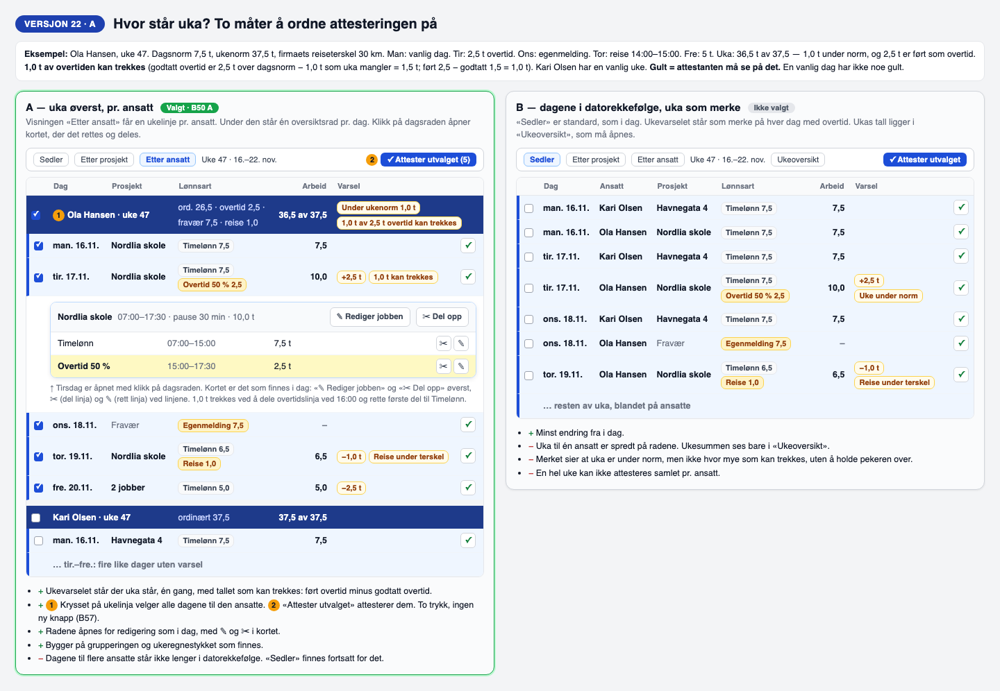
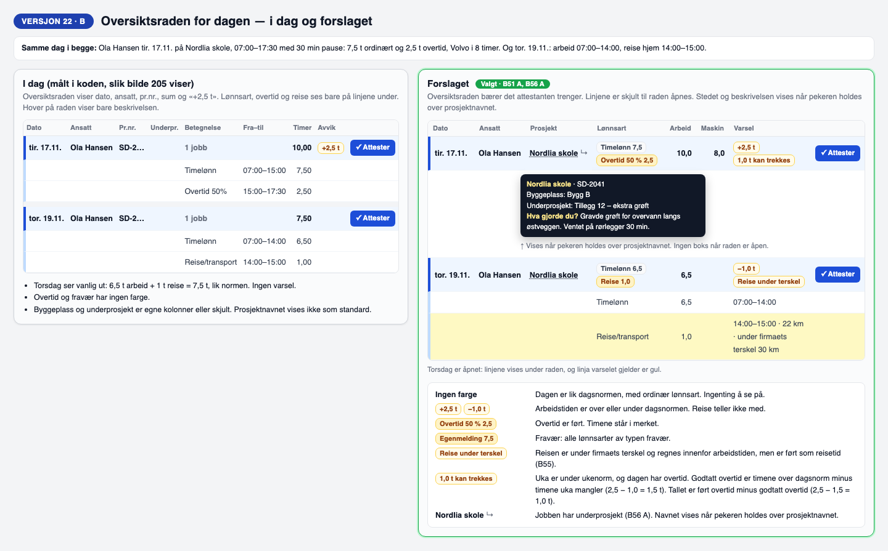
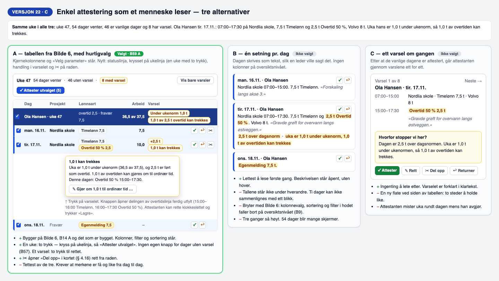

> Del av [Timeføring på web — plan med bilder](../web-timeforing-plan.md): § 4.17 innledning og del A–H. Seksjonsnumrene er de samme som før delingen.

### 4.17 Attesteringen: oversiktsrader, gule varsler og ukekontroll (versjon 22)

🟡 **Vedtatt retning 2026-11-23, ikke bestilt, ikke bygget.** Bestilt av Kenneth 2026-11-22: «nå føler jeg at vi
har kontroll på timeregistrering -> la fabel planlegge attestering.» Kenneth har svart på B50–B62 (§ 8.27)
og på B53 og B79–B85 (2026-11-24, § 8.28). Svarene er ført inn under og merket med spørsmålets nummer.
Åpne: B65–B67 (konflikt ved «Del opp», del I), B86 og B87 (§ 8). Bare web. Timeregistreringen (dagssiden), mobil og firmavalget dagskort-modus røres ikke.

Kilde: `skisser-web-timeforing/skisser-v22.html` (arkene `#uke`, `#rad` og `#enkel`). Bildene er skisser, ikke
skjermbilder. Tegnet om 2026-11-24 etter Kenneths svar: alternativene han valgte er merket «Valgt».

**Kenneths poenger (ordrett):** «attestering må være strukturert.» · «vi benytter oversiktsrader som raskt gir
informasjon om dagen.» · «jeg foreslår bruk av hover, spesielt for beskrivelse».

**«Viktige ting som må fremkomme» (ordrett):**
1. «Vanlig dag etter dagsnorm -> ingen spesielle varsel»
2. «totale timer over og under dagsnorm må varsles.»
3. «merk overtid med gul»
4. «ved attestering en uke -> sjekk om arbeidstaker har ukesnorm -> spesielt varsel under norm -> da må
   eventuell overtid reduseres -> det gjør attestanten selv. men han må se hvor overtid kan trekkes.»
5. «Vis kun prosjekt hover over prosjektnavn viser byggeplass og evt underprosjekt og beskrivelse.»
6. «vis lønnsart.»
7. «vis dersom reisetid ligger innenfor normal arbeidsdag->attestant må vurdere om føringen er rett»
8. «egenmeding, permisjon, fravær i lønnsart bør også varsles med gul.»

**Tillegg fra Kenneth samme dag (ordrett):** «Be fabel være kreativ og komme opp med forslag -> enkel attestering
-> strukturert visning for menneske å lese -> det må være mulig å dele opp et kort til to kort slik vi tidligere
planla» og «minn om at vi allerede planla en del her -> Bilde 6 — attesteringen: de 11 kjernekolonnene». Svaret
står i del H (Bilde 6), del I («Del opp») og del J (enkel attestering).

#### Del A — målt mot develop @ `68f4775d`

`AT` = `apps/web/src/components/attestering/AttesteringTabell.tsx`, `MT` = `…/attestering/attestering-tabell.ts`,
`AS` = `apps/web/src/app/dashbord/attestering/page.tsx`, `TR` = `apps/web/src/components/timer/TimerRadTabell.tsx`,
`D` = `apps/api/src/routes/timer/dagsseddel.ts`, `AR` = `apps/api/src/services/timer/arbeidstid.ts`,
`OG` = `packages/shared/src/utils/overtidsgrunnlag.ts`, `ST` = `packages/db-timer/prisma/schema.prisma`,
`SK` = `packages/db/prisma/schema.prisma`. Lest i koden, ikke kjørt, der ikke annet står.

| # | Kenneths punkt | I dag | Finnes? |
|---|---|---|---|
| AM1 | 1 · vanlig dag uten varsel | Normmerket vises ikke når dagens timer er lik dagsnormen (`AT:527`). | **Delvis.** Tallet er alle timer-rader, også reise (`AT:526`, `D:6712`). 6,5 t arbeid + 1 t reise ser ut som en vanlig dag, og 7,5 t arbeid + 1 t reise gir «+1 t». § 8.22 sier at normen måles mot arbeidstid uten reise. Serveren sender alt `arbeidstimer` og `reisetimer` (`D:6716–6717`). |
| AM2 | 2 · over og under dagsnorm | Gult merke «+2,57 t» / «−1 t» på dagsraden. Hover: «Dagen: 10,07 t av dagsnorm 7,5 t» (`AT:524–533`, `:673–677`). | **Delvis.** Samme feil som AM1. Lørdag, søndag og helligdag måles mot hverdagsnormen: normen leses uten ukedag og uten helligdag (`AR:123–126`; kalenderen har typene `helligdag`, `halvdag` og `firma_fri`, `SK:3133–3139`, men de leses ikke her). Bilde 205: søn. 22.11. viser «+2,57 t». |
| AM3 | 3 · overtid gul | Overtid er en vanlig linje med lønnsartens navn i «Betegnelse» (`MT:391`). Ingen farge (`TR` har ingen). | **Mangler.** Data finnes: `Lonnsart.overtidsnivaa` (`ST:43`), og tabellen har lønnsartkatalogen (`AT:222`). |
| AM4 | 4 · uka mot ukenorm | Ukenormen er summen av firmaets dagsnorm man–fre (`packages/shared/src/utils/ukenorm.ts:71–84`). Når ført overtid er større enn beregnet, får hver overtidslinje i uka teksten «Avvik denne uka (uke 47): ført overtid under ukenorm 37,5 t» (`MT:372`, `OG:335–337`), og «Ukeoversikt» viser et merke pr. ansatt (`Avviksbadge.tsx`). | **Delvis.** Se AM9–AM13. |
| AM5 | 5 · bare prosjekt, resten ved hover | Standardkolonnene har «Pr.nr.» (66 punkter, kuttes til «SD-2…» i bilde 205) og «Underprosjekt» (`AT:104–105`). Prosjektnavn og byggeplass er valgfrie kolonner. Hover på hele oversiktsraden viser bare «Hva gjorde du?» (`AT:613`, `TR:358–375`, `BeskrivelseHover.tsx:6–9`). | **Delvis.** Prosjektnavnet vises ikke som standard. Byggeplass og underprosjekt er ikke i hoveren. |
| AM6 | 6 · vis lønnsart | Lønnsartens navn står på hver linje i kolonnen «Betegnelse», 74 punkter (`MT:391`, `AT:106`). | **Delvis.** Oversiktsraden viser ikke lønnsart. Med «Bare oversiktsrader» er lønnsarten borte. |
| AM7 | 7 · reise i normal arbeidsdag | Reiselinja har fra–til og merket «Reise ut» / «Reise retur» (`reise-merke.ts`). Ingen sammenligning med arbeidstiden. | **Mangler.** Firmaets start og slutt pr. dato finnes (`AR:45–134`, `SK:436–437`), men sendes ikke til attesteringen. Bare dagsnormen sendes (`D:6722`). ⚠️ Etter B55 leser merket firmaets reiseterskel, ikke klokkeslettene (del D). |
| AM8 | 8 · fravær gult | Fravær er en vanlig linje. Bare brudd på fraværstaket (B10) varsles, som sperre (`MT:317–318`). | **Mangler.** Fravær kjennes igjen på `Lonnsart.type = "fravaer"` (`ST:25`, `erFravaerArt` i `packages/shared/src/utils/fravaerNormtak.ts:26`). |

**Uka (punkt 4) i detalj:**

| # | Målt | Kilde |
|---|---|---|
| AM9 | **Ingen ukenorm pr. arbeidstaker.** Ukenormen er firmaets, lik for alle. Modellen har ikke stillingsprosent, deltid eller egen ukenorm på den ansatte. | `ukenorm.ts:71–84`; søk i `SK` og `ST` uten treff |
| AM10 | **Bare firma-admin ser ukeavviket.** Prosjektlederen får verken teksten på linjene eller normkolonnen. | `AS:298–301` |
| AM11 | **Varselet sier ikke hvor mye.** Teksten sier at overtid er ført under ukenorm, ikke hvor mange timer som kan trekkes. Den er en hel setning i en kolonne på 68 punkter. | `nb.json:5129`, `AT:116` |
| AM12 | **To regnestykker som ikke er like.** Skjermens ukesum (merket og teksten) teller reise med og tar med lørdag og søndag. Serverens utpeking av linjer teller ikke reise og henter bare mandag–fredag. Overtid ført i helga pekes derfor ikke ut. | skjerm: `AS:251–271`, `OG:87`, `:258–270` · server: `D:1960`, `:1977–1987`, `OG:138–142` |
| AM13 | **Varselet kommer før uka er ferdig.** Regelen sammenligner ført overtid med ukesummen så langt. Overtid ført mandag varsles hele uka, til summen passerer normen. | `OG:277–287` |
| AM14 | **Uka har ingen egen rad i tabellen.** Ukas tall står bare i «Ukeoversikt», som er lukket til knappen trykkes. I «Etter ansatt» har gruppen en overskrift med navn og sum timer. | `AT:617–628`, `:796`, `timer.md` § Attesteringstabellen |

**Annet som er målt:**

| # | Målt | Kilde |
|---|---|---|
| AM15 | **Underlinjene kjenner ikke lønnsarttypen.** Timelinja bærer lønnsartens id og navn; `lonnsartType` er `null`. Type og overtidsnivå må slås opp i katalogen. | `MT:391`, `:401`, `AT:222` |
| AM16 | **Fraværstypen har ingen undertype.** Egenmelding, permisjon, sykemelding og ferie skilles bare på navnet. `fravaerNormtak` skiller fravær med og uten tak. | `ST:25`, `:46`, `apps/api/src/services/seed/index.ts:65–74`, `:116` |
| AM17 | **Gult er i bruk som jobbfarge.** Dagens andre jobb får gul kant (bilde 205, nederste jobb). | `AT:124` |
| AM18 | **«Bare oversiktsrader» er av som standard og huskes ikke.** Registreringen åpnes likevel under raden ved klikk, også når linjene er skjult. | `AT:172`, `:602–603` |
| AM19 | **Dagsraden summerer alt, jobbraden bare arbeid.** Dagsradens «Timer» er arbeid + reise + fravær. Jobbradens er arbeid uten reise, med reisen i grått. | `AT:699`, `:557–563` |
| AM20 | **«Uten bevis»** er merket for manglende maskinførerbevis. Det står. | `MT:357–358` |

#### Del B — strukturen

**Én regel for farge:** gult betyr at attestanten må se på det. En vanlig dag har ikke noe gult. Dagens gule
kant på jobb nummer to byttes til en annen farge (AM17).

**Fire nivåer, ovenfra:**

| Nivå | Rad | Viser | Finnes i dag? |
|---|---|---|---|
| 1 | **Ukelinja**, én pr. ansatt | Navn og uke · arbeid mot ukenorm («36,5 av 37,5») · ordinært, overtid, fravær og reise · ukevarselet · kryss som velger alle dagene | Nei (AM14). Gruppeoverskriften i «Etter ansatt» bygges ut. |
| 2 | **Oversiktsraden for dagen** (dagsraden) | Dato · prosjekt · lønnsartene med timer · arbeid · maskintimer · varsler · ✓ ↩ | Ja, uten prosjektnavn, lønnsart og reise |
| 3 | **Jobbraden**, bare når dagen har flere jobber | Som nivå 2 for jobben | Ja |
| 4 | **Linjene** og registreringen | Lønnsart, fra–til, timer, maskin, varer. Rettes med ✎ i registreringen. | Ja, uendret |

**Oversiktsraden for dagen:**

| Felt | Viser | Gult når |
|---|---|---|
| Prosjekt | Prosjektets navn. Flere jobber: «2 jobber». Bare fravær: «Fravær». | — |
| Lønnsart | Ett merke pr. lønnsart med dagens timer: «Timelønn 7,5» · «Overtid 50 % 2,5» · «Egenmelding 7,5» · «Reise 1,0». Tillegg og utlegg står på linjene, som i dag. | Overtid (punkt 3) · fravær (punkt 8) · reise under terskel som er ført som reisetid (punkt 7, B55) |
| Arbeid | Arbeidstimer uten reise. Fravær teller ikke som arbeid. | — |
| Varsel | «+2,5 t» / «−1,0 t» når arbeid pluss fravær som fyller normen avviker fra dagsnormen (punkt 2) · «Reise under terskel» (B55, del D) · «1,0 t kan trekkes» (uka, se under) · merkene som finnes: «Uten bevis», «Uten timerad», «Maskin over arbeid» og sperrene | Alltid gult. Ingen merker på en vanlig dag (punkt 1). |

**Under oversiktsraden:** linjene, med gul bakgrunn på linja et varsel gjelder (overtidslinja, fraværslinja,
reiselinja). Ingenting rettes på linjene i tabellen.

**Radene åpnes for redigering som i dag.** Kenneth 2026-11-23 til `v22-uke.png`: «kan radene åpnes for redigering
slik vi har laget det, inkl splitting?» Ja. Klikk på dagsraden eller jobbraden åpner kortet under raden
(`AT:75–77`), også når linjene er skjult (B51 A). Kortet er det som er bygget: «✎ Rediger jobben»
(`apps/web/src/components/attestering/RegistreringPanel.tsx:301`), «✂ Del opp» (`:335`), og ✂ og ✎ ved
timelinjene (`:241–249`). § 4.17 endrer ikke kortet. `v22-uke.png` viser tirsdagen åpnet.

**Bare ved hover:**

| Pekeren over | Viser |
|---|---|
| Prosjektnavnet | Prosjektnummer · byggeplass · underprosjekt når jobben har det · «Hva gjorde du?» (punkt 5). Flere jobber: én blokk pr. jobb. Erstatter hoveren på hele raden fra O6 i attesteringen. Dagssidens hover røres ikke. |
| Normmerket | «Arbeid 10,0 t av dagsnorm 7,5 t · overtid ført 2,5 t · reise 1,0 t · sum i dag 11,0 t» |
| Et lønnsartmerke | Linjene bak tallet med fra–til: «15:00–15:30 0,5 t · 15:30–17:30 2,0 t» |
| «Reise under terskel» | «Reisen er 22 km. Firmaets terskel er 30 km. Under terskelen regnes reisen innenfor arbeidstiden. Den er ført som reisetid.» |
| Ukevarselet | Regnestykket: ukenorm, ukesum, timene uka mangler, timene over dagsnorm, godtatt overtid, ført overtid og timene som kan trekkes |

**Ukevarselet og hvor overtid kan trekkes (punkt 4):**

- **Regelen (Kenneth 2026-11-24, B85 ja):** gjelder når uka er under ukenorm og det er ført overtid.
  **Godtatt overtid = timene over dagsnorm − timene uka mangler. Kan trekkes = ført overtid − godtatt
  overtid.** Ingen av tallene går under 0. Timene over dagsnorm er summen av dagenes «+»-merker. Timene uka
  mangler er ukenorm − ukesum.
- **Eksempelet:** 2,5 t er over dagsnorm, og uka mangler 1,0 t (36,5 av 37,5). Godtatt overtid er 2,5 − 1,0 =
  1,5 t. Ført overtid er 2,5 t, så **1,0 t** kan trekkes. Kenneth til `v22-uke.png` 2026-11-23: «2,5 timer kan
  trekkes -> det er jo en feil påstand. 1 time kan trekkes … men det er riktig at det er totalt 2,5 timer
  overtid over normen.»
- **Etter rettingen:** attestanten har gjort om 1,0 t til ordinær tid. Ført overtid er 1,5 t og godtatt overtid
  1,5 t, så merket «kan trekkes» er borte. «Under ukenorm 1,0 t» står, fordi ukesummen ikke endres når
  lønnsarten byttes.
- ⚠️ Erstatter «det minste av ført overtid og timene uka mangler» (2026-11-23). Den ga samme tall før
  rettingen, men aldri 0 etter den. Første utgave av versjon 22 hadde «ført overtid minus beregnet overtid».
- **Overtid ført på en dag som ikke er over dagsnorm,** er ikke godtatt overtid og kommer med i tallet.
  Eksempel: uka mangler 1,0 t, 2,0 t er over dagsnorm, og 2,5 t er ført som overtid. Godtatt overtid er 1,0 t,
  og 1,5 t kan trekkes.
- **Ukesummen** er arbeid (ordinært og overtid) pluss fravær som fyller normen, uten reise. I eksempelet:
  26,5 t ordinært + 2,5 t overtid + 7,5 t egenmelding = 36,5 t.
- **Ukelinja** viser det én gang, i to merker: «Under ukenorm 1,0 t» og «1,0 t av 2,5 t overtid kan trekkes».
- **Hver dag med overtid i uka** får merket «1,0 t kan trekkes» ved siden av normmerket («+2,5 t»), og
  overtidslinja er gul. Slik ser attestanten hvor overtiden står. Dagen viser ukas tall, men aldri mer enn
  overtiden som er ført den dagen. Har flere dager overtid, kan dagenes tall til sammen være større enn ukas
  tall: attestanten velger hvor timene trekkes, og ukelinja bærer taket.
- **En uke på eller over ukenorm** gir ikke «kan trekkes», selv om det er ført overtid.
- **Attestanten retter selv:** åpner dagen og gjør om timene fra overtid til ordinær tid (del J punkt 4).
  Ingenting flyttes automatisk. Etter rettingen regnes uka på nytt.
- **Uke over norm uten ført overtid** («+2,5 t over ukenorm») finnes i dag og vises på ukelinja på samme måte.
- **Ett regnestykke:** skjermen og serveren skal regne uka likt — mandag til søndag, uten reise (retter AM12).

**Dagen og uka (B53 A).** Kenneth 2026-11-23: «b53a, men dagen skal være rett ført, og uken skal være rett ført.»
Kenneth 2026-11-24: «b53 ukevarselet er et varsel. Attestanten kan attestere uka selv om det står.»

- **Dagen:** normmerket, overtid, fravær og reise vises på dagen straks den er sendt, uavhengig av resten av
  uka. Attestanten vurderer dagen når han attesterer den.
- **Uka:** ukevarselet er gult først når uka er komplett: alle fem arbeidsdager er sendt eller har fravær,
  eller uka er over. Før det står «uka så langt» i grått, med dagene som mangler.
- **Kreves utover A:** uka må kunne rettes også når dagen med overtiden alt er attestert. Ukelinja teller
  attesterte dager; serverens ukeregnestykke gjør det i dag (`apps/api/src/routes/timer/dagsseddel.ts:2314–2326`
  @ `9533908f`: alle rader som ikke er erstattet). En attestert dag med «kan trekkes» vises under ukelinja med
  ↺, som gjenåpner den (`AttesteringTabell.tsx:272`, `:416–420` @ `9533908f`). I dag står attesterte dager bare
  på fanen «Attestert».
- **Ingen sperre** (bekreftet av Kenneth 2026-11-24): ukevarselet er et varsel. Attestanten kan attestere uka
  selv om det står.

#### Del C — Fabels forslag til fokus, rangert

1. **Uka må være komplett før varselet er gult.** Ukelinja sier hvilke arbeidsdager som mangler («tor. og fre.
   mangler»): ingen dagsseddel, utkast eller returnert. Uten det varsles all overtid fra mandag (AM13), og
   attestanten trekker overtid som blir riktig når fredagen kommer. Serveren må sende dagstatus pr. ansatt; ingen
   migrering. Se B53.
2. ⚠️ **Utgått (Kenneth 2026-11-23, B57).** ~~«Attester dager uten varsel (N)».~~ Kenneth valgte ingen ny knapp:
   «huk av Ola -> huker av hele uka-> attester utvalgte -> to trykk». Krysset på ukelinja velger alle dagene til
   den ansatte, og «Attester utvalget», som finnes, attesterer dem (`v22-uke.png`, ① og ②).
3. **Merke når jobben har underprosjekt.** Når underprosjektet bare vises ved hover, må attestanten holde
   pekeren over hver rad for å finne det. Underprosjektet styrer hva som faktureres. Et lite merke ved
   prosjektnavnet («↳») sier at det finnes. Se B56.
4. **Helg og helligdag synes på dagsraden.** Merket «Helg» eller «Helligdag», gult. I dag måles søndag mot 7,5 t
   uten at det sies (AM2). Merket er bare visning. Normen de dagene er 0 som standard (B79 ja, del L). Merket
   leveres i H1a.
5. **Timer som ikke følger firmaets tidsrunding.** Linja «0,07 t» i bilde 205 er rettet i O8, men eldre føringer
   og telefonen kan gi det samme. Gult merke «Ikke avrundet» når timene ikke går opp i firmaets tidsrunding
   (15, 30 eller 60 minutter; innstillingen finnes, `AT:228`). Anbefalt: vent. Det er få tilfeller etter O8.

Ikke foreslått: automatisk retting av overtid, sperre på attestering ved ukevarsel, og nye kolonner. Attestanten
bestemmer; systemet viser.

**Kenneths svar 2026-11-23 (§ 8.27):** punkt 1 → B53 A. Punkt 2 → utgått (B57). Punkt 3 → B56 A, med kravet om
å filtrere og ta ut timer etter underprosjekt (del K). Punkt 4 → B58 A; normen og satsene de dagene er en egen
sak (del L). Punkt 5 er ikke bestilt.

**Kenneths svar 2026-11-24 (§ 8.28):** punkt 1 → ukevarselet er et varsel, ingen sperre (B53 bekreftet).
Punkt 4 → norm 0 lørdag, søndag og helligdag (B79 ja), og firmaet setter tidsrom med lønnsart (B80 ja).
Overtid på en hverdag er timer over dagsnormen (B81 ja), og første ferdige forslag er for anleggsgartner
(B82 ja). Reise under terskel får handlingen «✎ Før som arbeidstid …» (B83 ja, del D). Prosjektlederen får
rapporten etter underprosjekt for egne prosjekter (B84 ja, del K).

#### Del D — datagrunnlaget

| Trengs | Finnes | Mangler |
|---|---|---|
| Dagsnorm pr. dato | Ja, sendes pr. dagsseddel (`D:6722`), sommertid medregnet (`AR:76–126`) | Ukedag og helligdag leses ikke (AM2) |
| Arbeid, reise og fravær pr. dag | Ja (`D:6716–6717`, `OG:80–87`) | Skjermen bruker `totaltimer` (AM1) |
| Ukenorm | Firmaets, pr. uke (`D:6640–6643`) | Pr. arbeidstaker: finnes ikke i modellen (AM9). Krever nytt felt på den ansatte — Kenneths beslutning (B52). |
| Uka pr. ansatt | Ukas rader hentes alt (`D:1949–2022`), mandag–fredag | Lørdag og søndag; dagstatus for dager som mangler; tallene til prosjektlederen (B54) |
| Overtid | `Lonnsart.overtidsnivaa` 50 / 100 (`ST:43`) | — |
| Fravær, egenmelding, permisjon | `Lonnsart.type = "fravaer"` (`ST:25`). Alle fraværsarter blir gule. | Undertype finnes ikke (AM16). Trengs ikke for punkt 8. |
| Reise | `erReise` på linja | — |
| Reise under terskel (B55) | Reiselinja bærer regelen slik den var da reisen ble ført: `reiseRegel` med terskel, enhet og `regelKategori` (`packages/shared/src/utils/reise.ts:62–80`). `regelKategori` er satt bare når arbeideren valgte noe annet enn regelen foreslo (`packages/shared/src/utils/reiseManuell.ts:121`). Attesteringen får alle feltene på raden (`dagsseddel.ts:7425–7431` @ `9533908f`). | Ingen serverendring. Reiser uten `reiseRegel` (eldre rader) får ikke merke. |

**Regelen for punkt 7 (Kenneth 2026-11-23, B55):** «reise regnes innenfor arbeidstiden når reisen er under
firmaets terskel.» ⚠️ Erstatter regelen om overlapp med firmaets klokkeslett. Alternativ A og B i B55 utgår begge.
Målt mot develop @ `9533908f` (lest, ikke kjørt):

- **Firmaets terskel** settes under Firma → Innstillinger → Reise: `reiseTerskelMin` (minutter, standard 30),
  eller `reiseTerskelM` (meter) når `reiseTerskelEnhet` er «km» (`SK:453–466`). Under terskelen gjelder
  `reiseUnderTerskelType`, standard «arbeidstid» (`SK:468`). Regelen er `klassifiserReise`
  (`reise.ts:200–216`): nøyaktig på terskelen regnes som over. Terskelen måles på firmaets kjøretid eller
  avstand for strekningen, ikke på klokkeslettene arbeideren førte (`reiseManuell.ts:543–554`).
- **På web i dag** (vedtak reisevinduet punkt 20, merget `63e7b8f6`): en ny reise under terskelen lagres ikke
  som reise. Vinduet sier «Under terskel: før tiden som arbeidstid i jobbens Fra–til» og har knappen «Før som
  reisetid likevel» (`apps/web/src/app/dashbord/timer/[id]/ReiseKort.tsx:1347–1350`, `:1469–1481`). Ført som
  arbeidstid er tiden en del av jobbens timer: ingen egen linje, og den teller i dagsnormen og
  overtidsgrunnlaget som annet arbeid (`OG:80`).
- **Merket i attesteringen** het «Reise i arbeidstiden» i første utgave. Det heter nå **«Reise under terskel»**
  og har ny regel: en reiselinje (`erReise`) der firmaets regel sa arbeidstid, og arbeideren likevel førte
  reisetid (`reiseRegel.regelKategori` er «arbeidstid»). Det er føringen attestanten må vurdere (punkt 7). Gult
  merke på oversiktsraden og gul reiselinje.
- **Får ikke merke:** reise over terskelen, uansett klokkeslett · reise under terskelen i et firma som har
  valgt «reisetid» under terskel · tid ført som arbeidstid i jobbens Fra–til (den synes ikke som reise) · eldre
  reiser ført som arbeidstid, som beholder merket «Reise · Timelønn» fra O15 uten gult
  (`AttesteringTabell.tsx:323–333` @ `9533908f`).
- **Faller bort:** serveren trenger ikke sende firmaets start og slutt, og merket avhenger ikke av at reisen
  har klokkeslett.
- **Mobil** lagrer fortsatt en arbeidstid-rad under terskelen
  (`apps/mobile/src/components/timer-detalj/ReiseKort.tsx:141–159`). Raden er ført etter regelen og får ikke
  merke. Mobil røres ikke.
- **Handlingen i varselet (Kenneth 2026-11-24, «b83 ja»):** merket «Reise under terskel» får knappen
  «✎ Før som arbeidstid …». Den åpner et vindu som viser begge endringene: reiselinja slettes, og jobbens
  Fra–til utvides med reisens tid. Attestanten trykker «Lagre». Arbeideren ser «Korrigert av». Leveranse A3b.
  🟡 Vedtatt, ikke bestilt, ikke bygget.
  - **Tilstand:** attestering, dagen er sendt, linjene venter, firmavalget «Rediger ved attestering» er på, og
    attestanten har rett til å rette dagen. Ellers vises merket med forklaring, uten knapp.
  - **Vinduet foreslår, attestanten bestemmer:** det viser reiselinja som slettes, med timer og det reisen
    bærer, og jobbens linje før og etter, som «Timelønn 07:00–14:00 · 6,5 t → 07:00–15:00 · 7,5 t». Fra og til
    kan rettes før «Lagre». Linja som utvides, er jobbens linje nærmest reisen.
  - **Uten knapp:** reisen står i et kort uten arbeid. Da finnes ingen jobb å utvide.
  - **Etter lagringen** regnes dagen og uka på nytt. Gir timene over dagsnorm, får dagen normmerket; ingenting
    gjøres om til overtid automatisk.
  - **Målt mot develop @ `7a4e8930`** (lest, ikke kjørt): ruta som retter en sendt dag, tar imot alle dagens
    ventende linjer. En linje som er utelatt, slettes med slettespor, og en linje som er endret, oppdateres på
    stedet med historikk. Alt skjer i én transaksjon (`D:3360–3904`; planen `:3700–3759`, transaksjonen
    `:3766`, slettesporet `:3776–3797`). Ruta for ett felt bygger settet på serveren (`D:8964–9140`). **Begge
    endringene kan altså gjøres i én lagring med ruta som finnes**; `splittRad` trengs ikke. Vaktene følger
    med: ikke egen dag (`:3399`), firmavalget (`:3401–3408`), overlapp, maskin innenfor arbeid og taket på
    timer.
  - **Serverkrav:** én ny mutasjon som tar reiselinjas id og jobbens nye Fra–til. Serveren bygger settet selv:
    dagens ventende linjer uten reiselinja, og jobbens linje med ny tid. Én transaksjon; feiler en vakt, er
    ingenting endret. Klienten sender aldri to kall.
  - ⚠️ Ikke målt: om reiselinja bærer noe som forsvinner med den, som kilometer eller et koblet tillegg.
    Koderen måler, og vinduet viser det som slettes.

#### Del E — leveranser

| Del | Innhold | Rører | Klar? |
|---|---|---|---|
| **A1** | **Gult på dagen.** Normmerket måles mot arbeid uten reise, med fravær som fyller normen. Lønnsartmerkene på oversiktsraden. Overtid og fravær gule, på merket og på linja. Jobbfargen gul byttes. Hover på normmerket og lønnsartmerkene. Punkt 1, 2, 3, 6 og 8. | `AT`, `MT`, `TR` (valgfri radfarge, rapporten uendret), i18n, hjelpeteksten. Ingen serverendring. | 🟡 **Bygget på branch** `feat/attestering-a1-a3` (ikke merget). Linjene er skjult som standard, og valget huskes pr. bruker (B51 A). |
| **A2** | **Prosjekt og hover.** Kolonnen «Prosjekt» med navnet erstatter «Pr.nr.» og «Underprosjekt» i standardoppsettet. Hover på prosjektnavnet med nummer, byggeplass, underprosjekt og beskrivelse. Hoveren på hele raden tas ut av attesteringen. Lagrede kolonneoppsett nullstilles én gang (ny listenøkkel, som B26 A). «Velg parameter» har fortsatt alle kolonnene. Punkt 5. ⚠️ Endrer kjernekolonnene i Bilde 6 (del H). | `AT`, ny hover-komponent i `attestering/`, i18n, hjelpeteksten. `BeskrivelseHover` og dagssiden røres ikke. | **Klar for ordre** (B56 A: merket «↳» ved prosjektnavnet når jobben har underprosjekt). |
| **A3** | **Reise under terskel** (B55, del D). Ren regel i `packages/shared` som leser `reiseRegel` på reiselinja. Merke på oversiktsraden, gul reiselinje, hover. Punkt 7. | `packages/shared`, `MT`, `AT`, i18n, hjelpeteksten. Ingen serverendring. | **Klar for ordre.** Handlingen i varselet er A3b. |
| **A3b** | **«✎ Før som arbeidstid …»** på merket «Reise under terskel» (B83 ja, del D). Vindu med begge endringene: reiselinja slettes, og jobbens Fra–til utvides. Én lagring i én transaksjon. Arbeideren ser «Korrigert av». | `D` (ny mutasjon som bygger settet og går gjennom `utforRedigerSedelRader`), `AT`, `MT`, nytt vindu i `attestering/`, i18n, hjelpeteksten. Ingen migrering. Ikke `apps/mobile`. | **Kan bestilles**, etter A3. Koderen leverer løsning med skjermbilde før kode. Regel 10 i gaten: en lønnslinje slettes, og timer flyttes. |
| **A4** | **Ukelinja.** «Etter ansatt» er standardvisningen, med ukelinje pr. ansatt (B50 A). Firmaets ukenorm for alle (B52 A). «Under ukenorm N t» og «N t av M t overtid kan trekkes» etter regelen i del B. Merket «N t kan trekkes» på dagene. Krysset som velger uka (B57). Ett regnestykke mandag–søndag uten reise. Dager som mangler, og attesterte dager med ↺ (B53 A). Prosjektlederen ser ukelinja med ukas totaltall, uten navn på andre prosjekter (B54 A). Punkt 4. | `D` (ukas rader og dagstatus), `OG`, `AS`, `AT`, `MT`, `Ukeoversikt.tsx`, i18n, hjelpeteksten | **Klar for ordre** (B85 ja, § 8.28). ⚠️ Ukeregnestykket lagres i attestert-snapshotet (`D:7503`, `:8738`). Gaten kjører regel 10 uavhengig. |
| **A5** | **Hurtigvalg** (del J, B59 A): statuslinja «54 venter · 46 uten varsel · 8 med varsel», handling i varselet (B60 A), ferdige returgrunner (B61 A), ✂ på jobbraden (B62 A). ⚠️ «Attester N uten varsel» er utgått (B57). ⚠️ Merket «Helg» / «Helligdag» (B58 A) er flyttet til H1a, der dagtypen lages. | `AT`, `MT`, i18n, hjelpeteksten | Etter A4. ✂ på raden åpner «Del opp» i kortet (§ 4.16 del G) og går etter D2a. |
| ~~**D1**~~ | ⚠️ **Utgått 2026-11-23 (B70 ja).** Vinduet «Del opp» med kort A og kort B bygges ikke. «Del opp» med begge kortene åpne går i D2a–D2f (§ 4.16 del G). | — | Konflikten mellom kort (del I: varselet, sperren i attesteringen og vakten på serveren) er ikke plassert i D2a–D2f. Den venter på B65–B67. |
| **U1** | **Timer etter underprosjekt** (del K): filter, gruppering og eksport i rapporten. Rapporten åpnes også for prosjektlederen, avgrenset til prosjektene hans (B84 ja). | `rapport.ts` (vakten og utvalget i fem ruter), `timerDetaljRader.ts`, rapportsiden og plassen dens i menyen, `timer-rapport-eksport.ts`, i18n, hjelpeteksten. Ingen migrering. | **Kan bestilles.** Egen sak, uavhengig av A1–A5. Koderen leverer løsning før kode. Regel 10 i gaten: tilgang på tvers av prosjekter og grunnlag for lønn og faktura. |
| **H1a** | **Norm pr. dagtype** (B79 ja, del L): norm 0 lørdag, søndag og helligdag som standard, egen norm for lørdag og søndag som firmaet setter, ukenorm mandag–søndag, og merket «Helg» / «Helligdag». | `packages/db-timer` (**én migrering, Kenneth**), `packages/shared`, `AR`, `D`, `OG`, innstillingssiden, `AT`, `MT`, i18n, hjelpeteksten | **Kan bestilles**, etter A4. Regel 10 i gaten. |
| **H1b** | **Tidsrom og forslag** (B80 ja, del L): firmaet setter tidsrom pr. dagtype med lønnsart, og dagssiden i prosjektkort-modus foreslår delingen etter klokkeslett. | `packages/shared`, `D` (`lagreJobbTid`), ny rute for reglene, innstillingssiden, dagssiden, i18n, hjelpeteksten | Etter H1a. Regel 10 i gaten. |
| **H1c** | **Gult ved avvik fra forslaget** (B80 ja, del L) i attesteringen. | `packages/shared`, `D`, `MT`, `AT`, i18n, hjelpeteksten | Etter H1b og A1. |
| **H1m** | **Appen regner likt** (del L). | `apps/mobile` | ⏸ Venter på web (§ 8.13). Krever OTA. |
| **T1** | **Ferdig forslag for anleggsgartner** (B82 ja, del L): «Hent forslag fra …» kopierer normer og tidsrom inn i firmaets regler. Firmaet retter etterpå; ingen kobling. | `packages/shared` (profilen som data, med kilde og dato), innstillingssiden, ruta fra H1b, i18n, hjelpeteksten. Ingen migrering. | ⏸ **Venter på avtaleteksten** fra Kenneth eller en som kjenner avtalen, og på H1b. Ingen tall føres uten kilde. |

Rekkefølge: A1 → A2 → A3 → A4 → A5 → A3b. A1–A5 og A3b rører de samme to filene (`AT`, `MT`) og går etter
hverandre hos samme koder. Ingen av dem krever migrering. A3b krever bare A3. Den står etter A5 fordi A5
bygger mønsteret «handling i varselet» (B60 A); den kan bestilles rett etter A3 hvis Kenneth vil ha den
først. «Del opp» går i D2a–D2f. U1 er en egen sak og kan gå hos en annen koder. H1a → H1b → H1c går etter A4
hos samme koder, fordi de rører `D`, `OG`, `AT` og `MT`. H1a har migreringen. T1 venter på avtaleteksten
og på H1b.

**Bevares uendret:** ✓ ↩ ↺ på dagsraden og jobbraden · avkrysning og «Attester utvalget» · registreringen og
✎ · «Del opp» (§ 4.16) · «Velg parameter», filter og sortering · fanene «Venter» og «Attestert» · ukevalget ·
visningene «Sedler», «Etter prosjekt» og «Etter ansatt» · sperrene (B10, forslag) · «Egne timer» · prosjektlederens
omfang (R13) · rapportens Detaljer (samme tabell, uten farger og merker).

#### Del F — tester som skal feile først

- **A1:** 6,5 t arbeid + 1 t reise gir «−1 t» (i dag: ingen merke). 7,5 t arbeid + 1 t reise gir ingen merke
  (i dag: «+1 t»). Egenmelding 7,5 t gir ingen normmerke og gult lønnsartmerke. En dag med 7,5 t Timelønn har
  ingen gule elementer. Overtidslinja har gul bakgrunn, og oversiktsraden har merket «Overtid 50 % 2,5».
  Rapportens Detaljer er uendret (vakt).
- **A2:** prosjektnavnet står i raden. Hoveren har byggeplass, underprosjekt og beskrivelse, og vises ikke når
  raden er åpen. Dagssidens hover er uendret (vakt).
- **A3:** en reise ført som reisetid der regelen sa arbeidstid (`regelKategori` «arbeidstid»), gir merket «Reise
  under terskel». En reise over terskelen gir ikke merket, heller ikke når den ligger midt i arbeidsdagen. En
  reise uten `reiseRegel` gir ikke merket. En reise ført som arbeidstid før punkt 20 beholder «Reise · Timelønn»
  uten gult (vakt).
- **A4:** eksempeluka gir «Under ukenorm 1,0 t» og «1,0 t av 2,5 t overtid kan trekkes» på ukelinja, og «1,0 t
  kan trekkes» bare på tirsdag. En uke på eller over ukenorm med ført overtid gir ikke merket. En uke der to
  arbeidsdager mangler, har ikke gult ukevarsel. En attestert dag med overtid står under ukelinja med ↺ når uka
  har ukevarsel. Overtid ført lørdag pekes ut. Reise teller ikke i ukesummen. En prosjektleder ser ikke navn på
  andre prosjekter. Etter at 1,0 t er gjort om til ordinær tid, er «kan trekkes» borte fra ukelinja og dagen,
  og «Under ukenorm 1,0 t» står (B85 ja). En uke som mangler 1,0 t, med 2,0 t over dagsnorm og 2,5 t ført
  som overtid, gir «1,5 t kan trekkes». Negativkontroll mot develop for hver.
- **A3b:** en dag med jobb 07:00–14:00 (6,5 t Timelønn) og reise 14:00–15:00 med merket «Reise under terskel».
  Etter «Lagre» finnes ikke reiselinja, jobbens linje er 07:00–15:00 med 7,5 t, og arbeideren ser «Korrigert
  av» på linja. Reiselinja står med slettespor. Når en vakt avviser lagringen, som overlapp med et annet kort,
  er både reiselinja og jobben uendret. Knappen vises ikke på egen dag, ikke når firmavalget er av, ikke på en
  attestert linje og ikke når reisen står i et kort uten arbeid. En bruker uten attesteringsrett på prosjektet
  avvises av serveren. Andre reiser og linjer på dagen er uendret.
- **U1:** filteret «Underprosjekt» gir bare radene til underprosjektet, også i Excel, PDF og CSV. En
  prosjektleder på prosjekt A får ikke rader, summer, prosjektnavn eller ansatte fra prosjekt B: ikke i
  rapporten, ikke i eksportene, ikke i listene over prosjekter og ansatte, og ikke når han sender prosjekt B
  sin id selv. Han får ikke fravær uten prosjekt. En ansatt uten rolle avvises. Firmaadministrator får det
  samme som før (vakt).

#### Del G — ikke målt

- Hvor mange lagrede reiser som mangler `reiseRegel` eller `regelKategori` (eldre rader). De får ikke merket
  «Reise under terskel».
- Om reiselinja bærer noe som forsvinner når den slettes i A3b, som kilometer eller et koblet tillegg
  (del D).
- Om rapporten viser satser eller beløp som prosjektlederen ikke ser i attesteringen (del K).
- ✅ Målt 2026-11-24: delingen av en linje kan sette lønnsart på den ene delen i samme lagring. Ruta som
  retter en sendt dag, tar imot flere linjer med samme opphav og lager dem i én transaksjon (`D:3700–3705`,
  `:3766`). Lest, ikke kjørt.
- ✅ Målt 2026-11-24: rapporten er bare for SiteDoc-admin og firmaadministrator (del K).
- Bredden på oversiktsraden med lønnsartmerker ved 1 440. Koderen måler i nettleser; kravet er ingen sidelengs
  rulling.
- Om varselet for lange dager (`arbeidstidVarselTimer`, `SK`) vises i tabellen i dag.
- Bilde 205 viser ikke ukeavvik på overtidslinjene. Kari er trolig ikke firma-admin (AM10), og dagen er en
  søndag (AM12). Ikke prøvd på test.

#### Del H — bygget på Bilde 6: hva står, hva endres, hva kommer i tillegg

Planen bygger på Bilde 6 med endringene i § 4.2 (B14 A), § 4.5 (K1–K14) og § 4.6. Kjernen er i dag 13 kolonner
(B13 A, `packages/shared/src/utils/timerDetaljRader.ts:745–751`).

| Bilde 6 | Bygget? | § 4.17 |
|---|---|---|
| 1 Dato («17.11.», årsvelger) | Ja | **Står.** |
| 2 Ansatt | Ja | **Står.** I «Etter ansatt» står navnet også på ukelinja (A4). |
| 3 Prosjektnr · 4 Underprosjekt | Ja | ⚠️ **Endres** av punkt 5: én kolonne «Prosjekt» med navnet. Nummer, byggeplass og underprosjekt vises ved hover. Kjernen går fra 13 til 12 kolonner. Begge finnes fortsatt i «Velg parameter». |
| 5 Lønnsart (kolonnen «Betegnelse») | Ja | **Står.** I tillegg: gul på overtid og fravær (punkt 3, 8), og lønnsartmerker på oversiktsraden der det i dag står «1 jobb» (punkt 6). |
| 6 Fra–til | Ja | **Står.** ⚠️ Reisemerket leser ikke klokkeslettene; det leser firmaets terskel (B55, del D). |
| 7 Timer | Ja | **Står.** Dagsraden viser arbeid uten reise (punkt 1, 2). Tallformat som dagssiden (§ 8.22): «7,5», ikke «7,50». Si fra hvis attesteringen skal ha to desimaler. |
| 8 Maskin · 9 Maskintimer · 10 Vare og mengde | Ja | **Står uendret.** |
| Antall · Beløp (B13 A) | Ja | **Står uendret.** |
| 11 Avvik (korte merker, forklaring ved hover) | Ja | **Står.** De nye merkene kommer her: «+2,5 t», «Reise under terskel», «1,0 t kan trekkes», «Helg». Samme komponent (`AT:966–993`). |
| ✓ og ↩ fast til høyre | Ja, på dagsraden og jobbraden (B24 B) | **Står.** ✂ i tillegg (B62 A). |
| «Velg parameter», «Tilbakestill til standard» | Ja (`AT:878`) | **Står.** Standarden får ny listenøkkel i A2. |
| Dagsrad og jobbrad (B14 A) | Ja | **Står.** Ukelinja er en ny rad over dem (A4). |
| Ett trykk åpner registreringen | Ja (w8) | **Står.** |
| Overtid som egen linje, summen på kortets linje | Ja | **Står.** Gul i tillegg. |
| «Del opp» ved klokkeslett (bilde 8) | Delvis | Se del I. |

**Ikke bygget av det som er planlagt for attesteringen:** «Del opp» med begge kortene åpne (§ 4.16 del G) →
D2a–D2f. ⚠️ Vinduet fra versjon 21 og D1 er utgått (B70 ja).
Hover-forklaring på menypunktene (§ 4.8, w11) er ikke bygget og er ikke med her. Alt annet i Bilde 6 og § 4.5
er merget (w5, w5b, w8, w10 del A og B).

**Punktene og forslagene mot kolonnene:** punkt 1, 2, 7 og merket «Helg» passer i kolonne 11. Punkt 3, 6 og 8
passer i kolonne 5. Punkt 5 endrer kolonne 3 og 4. Punkt 4 (ukelinja) og statuslinja kommer i tillegg, utenfor kolonnene. Ingen forslag legger til en kolonne.
