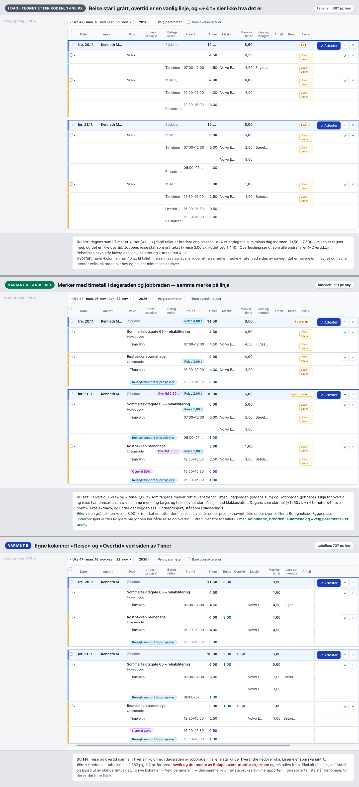

> Del av [Timeføring på web — plan med bilder](../web-timeforing-plan.md): § 4.2. Seksjonsnumrene er de samme som før delingen.

### 4.2 Dagsvisningen i attesteringen (B14) — tre alternativer

Bildet er skissen B14c (2026-11-22, Kenneths to dager fra test, uke 47). Den bygger på alternativ A og viser
[vedtak-timer-web.md § Dagsvisningen i attesteringen](../vedtak-timer-web.md) punkt 2 og 3: prosjektnavn og byggeplass
i stedet for pr.nr., og overtid og reise som merker med timetall. Variant A er anbefalt; Kenneths svar står i
vedtaksfila. Enkeltbilder: [`b14c-idag.png`](../skisser-web-timeforing/b14c-idag.png) ·
[`b14c-a.png`](../skisser-web-timeforing/b14c-a.png) · [`b14c-b.png`](../skisser-web-timeforing/b14c-b.png).
Kilde: `skisser-b14c.html`. Bildet erstatter B14-sammenlikningen (i dag, A, B og C fra 2026-11-17), som viste pr.nr.

Det opprinnelige valget mellom A, B og C står under.

Enkeltbilder: [`b14-idag.png`](../skisser-web-timeforing/b14-idag.png) · [`b14-a.png`](../skisser-web-timeforing/b14-a.png) ·
[`b14-b.png`](../skisser-web-timeforing/b14-b.png) · [`b14-c.png`](../skisser-web-timeforing/b14-c.png). Alle fire viser de
samme tre dagene: Ola 17.11. (én jobb, tre linjer), Kari 17.11. (to jobber) og Ola 18.11. (én jobb, én linje).
«I dag» er tegnet etter koden, ikke et skjermbilde.

**Kenneths tre krav** (§ 8.2): tydelig skille fra dag til dag · tydelig hvilke registreringer som hører sammen ·
oversiktlig. Flere linjer pr. dag er førstevalget; én rad pr. dag er reserven.

**Slik er det i dag (WM74–WM84):**
- Dagen begynner med en jobbrad som ser ut som alle andre rader. Det eneste dagskillet er en grå strek over
  dagsummen, sist i dagen (WM77).
- Jobbens linjer har verken innrykk, ramme eller egen farge. Annenhver linje er grå gjennom hele tabellen (WM77).
- En dag med én jobb og én linje er tre rader med samme timetall (WM75).

| | I dag | **A — dagen øverst, jobben som blokk** | B — sammenslåtte celler | C — som i dag, tydeliggjort |
|---|---|---|---|---|
| Dagskille | Svakt | **Tydelig:** egen ramme pr. dag, luft imellom, blå dagsrad først | Tydeligst: dagen er én celle over alle radene sine | Bedre: ramme og luft, men dagen har ingen egen overskrift |
| Hører sammen | Svakt | **Tydelig:** farget kant pr. jobb, jobbrad når dagen har flere jobber | Tydeligst: jobben er én celle ved linjene sine | Bedre: blå jobbrad og farget kant; dato og ansatt gjentas |
| Rader for de tre dagene | 14 | **12** | 7 | 12 |
| En dag med én jobb og én linje | 3 rader | **2 rader** | 1 rad, to–tre ganger så høy | 2 rader |
| «Velg parameter», sortering, filter | — | **Urørt** | Dato, ansatt, pr.nr. og underprosjekt kan ikke lenger flyttes, skjules eller sorteres hver for seg | Urørt |
| Rører | — | `AT` (radbyggingen), `TR` (ny valgfri radvariant), i18n, hjelpeteksten | `TR` bygges om så en dag er én enhet (WM83), `AT`, kolonnevelgeren, i18n, hjelpeteksten | `AT`, `TR` (farger), i18n, hjelpeteksten |

**Anbefaling: A.**
- A oppfyller alle tre kravene uten å røre kolonnene. Kolonnevalget ba Kenneth om å beholde (B9).
- B er tydeligst, men bryter med B9 og krever at tabellen bygges om. Knappene havner tre steder i bredden.
- C er billigst, men løser ikke dagskillet: dagen begynner fortsatt med en jobb, og «Attester» for dagen står øverst
  én dag og nederst den neste, etter hvor mange jobber dagen har.
- **Reserven «én rad pr. dag» finnes i A:** «Bare oversiktsrader» skjuler linjene, og en dag med én jobb er da én rad.

**Alternativ A i detalj — det en ordre må bære:**

1. **Dagsraden står først i dagen.** Den viser dato med ukedag, ansatt, dagens timer og maskintimer, dagens avvik og
   dagens knapper («Attester», ↩, lenke til sedelen). Den erstatter dagsummen nederst og har samme innhold og samme
   knapper (WM75, WM81).
2. **Dagen har én jobb:** jobbraden vises ikke. Prosjektnavn, byggeplass og underprosjekt står i dagsraden ([vedtak-timer-web.md § Dagsvisningen i attesteringen](../vedtak-timer-web.md) punkt 2), og jobbens ↺ står der.
   ⚠️ ✓ og ↩ «for prosjektseddelen» vises da ikke som egne knapper; dagens «Attester» og ↩ dekker de samme linjene.
3. **Dagen har flere jobber:** hver jobb får en jobbrad med prosjektnavn, byggeplass, underprosjekt, jobbens sum og ✓ ↩ ↺, og sin egen
   kantfarge. Reise og rader uten kort er egne blokker, som i dag (WM80).
4. **Dato, ansatt, prosjekt, byggeplass og underprosjekt skrives ikke på linja når de er like raden over.** Har en linje et annet
   prosjekt eller underprosjekt enn jobben, vises verdien. Ved sortering, i filter og i eksport er alt som i dag
   (WM82).
5. **Dagsnormen står én gang, i dagsraden.** Avviker dagen fra normen, står et merke («+0,5 t»), og hele setningen
   «Dagen: 8,0 t av dagsnorm 7,5 t» vises når pekeren holdes over (mønsteret fra B7). ⚠️ En dag som er lik normen,
   viser ingen normtekst. I dag står setningen én gang pr. jobb og kuttes av kolonnebredden (WM76, WM78).
   ⚠️ § 8.22: tallet mot normen er arbeidstid, uten reise. Summen for dagen er arbeid + reise (sumlinja, § 9).
6. **Hver dag har ramme, og det er luft mellom dagene.** Linjene veksler ikke mellom hvit og grå inne i en dag.
7. **«Bare oversiktsrader» består** og skjuler linjene. Da vises dagsraden, og jobbradene når dagen har flere jobber.
8. **«Etter prosjekt» får ingen dagsrad** (dagens regel: en dagsum der ville villede). Jobbraden bærer dato og
   ansatt som i dag og får dagsradens utseende. I «Etter ansatt» står dagsradene under gruppens overskrift.
9. **I prosjektets attestering gjelder dagsradens knapp bare prosjektets del,** som i dag.
10. **Registreringen åpnes under linja,** som i dag (bilde 7).
11. **Timerapporten bruker samme tabell (WM83) og skal se ut som før.** Det nye utseendet er valgfritt i komponenten.

En dag med én jobb og én linje blir om lag 75 punkter høy, mot 118 i dag (regnet fra WM84).
