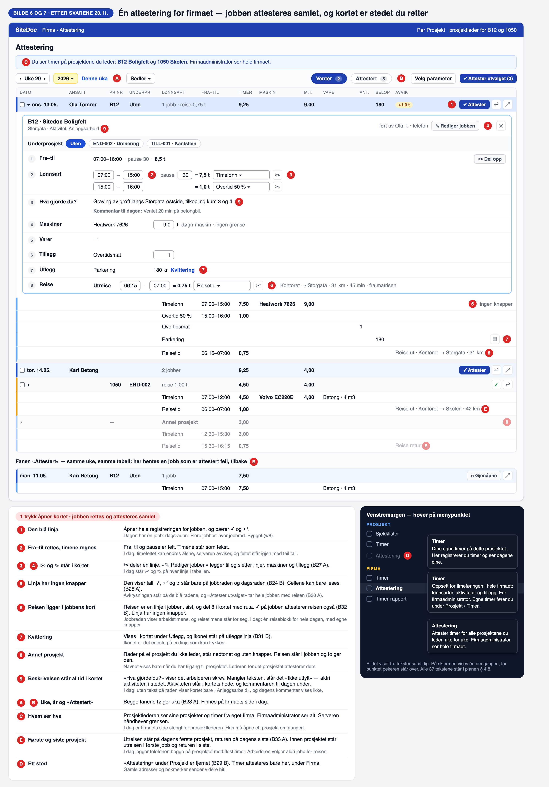

> Del av [Timeføring på web — plan med bilder](../web-timeforing-plan.md): § 4.5. Seksjonsnumrene er de samme som før delingen.

### 4.5 KS av attesteringen mot bilde 6–8 (2026-11-19) — avvik, hull og retting (w10)

Kilde: `skisser-web-timeforing/skisser-ks.html`. Bildet er en skisse, ikke et skjermbilde. Det er sist tegnet om i
versjon 11, etter Kenneths svar på B32–B34 (§ 8.10, § 8.11). Det viser firmaets attestering slik en
prosjektleder ser den (§ 4.6), med beskrivelsen i kortet (§ 4.9) og reisen som linje i jobbens kort, med
underprosjektet den er ført på (§ 4.11).

**Kenneth 2026-11-19** (test `eedbc7cd`, prosjektets attestering): *«Koden gjør ikke det Fabels opprinnelige bilder
viser i seksjon 4 bilde 6 … linjeknappenes funksjon (de ekstra ikonene) ble ikke flyttet til topplinja. I stedet ble
det introdusert en ny redigeringsmåte … vi trenger bare å åpne de blå linjene. Det bør åpne hele registreringskortet,
og da kan vi redigere direkte … Jeg kan heller ikke hente tilbake en linje som er attestert feil … Det finnes ingen
perioder å hente frem … Har planen hull, må vi tette dem, ikke rekode noe annet.»*

Målt mot develop @ `eedbc7cd`. `RP` = `apps/web/src/components/attestering/RegistreringPanel.tsx`, `PS` =
`apps/web/src/app/dashbord/[prosjektId]/timer/attestering/page.tsx`, `FS` =
`apps/web/src/app/dashbord/firma/timer/attestering/page.tsx`, `AD` = `apps/web/src/components/timer/AttesteringDetalj.tsx`.

**Er det B-spørsmålene som gjør at koden ikke viser det bildene viser? Bare delvis.** Det er tre årsaker:

1. **Bilde 6 og 7 ble ikke tegnet om etter tre vedtak som endret utseendet:** B13 A (13 kolonner), B14 A (dagsrad
   og jobbrad, med eget bilde `b14-a.png`) og § 8.6 punkt 1 (den blå linja åpner kortet). Der følger koden
   vedtakene, men bildene viser noe annet (K2, K3).
2. **Planen la kortet til som en ny måte å rette på og lot de fire gamle stå** (§ 7: «BEVARES», og § 4.1). Det er
   planens feil, ikke et B-svar. Ingen ba om fem veier (K4, K6, K8).
3. **Noe er ikke bygget, eller ikke synlig hos Kenneth:** prosjektets attestering har ikke uke, år eller
   «Attestert» (K9, K10). Brukeren hans har et lagret kolonneoppsett og ser ikke kjernekolonnene (K1). Testdagene
   er lagt inn med SQL, så maskinen står på egen linje (K12).

**Avvikslista:**

| # | Planen sier | Koden gjør | Kom fra | Vedtatt av Kenneth? | Minst som skal til |
|---|---|---|---|---|---|
| **K1** | Bilde 6: 11 kjernekolonner (13 etter B13 A) er standard. Følge 16: lagret oppsett beholdes. | Lagret oppsett vinner over standarden (`apps/web/src/hooks/useTabelloppsett.ts:56–92`; `AT:153–160`). Kenneths skjerm viser Ansattnr, Prosjekt, Byggeplass, Type, Aktivitet, Fra og Til som egne kolonner; Maskin, Vare og Avvik står utenfor skjermen (bilde 113, 117). | w5 `799ea86c`, retur 1 `9729c584` | Nei. Lagt fram som følge («si fra hvis feil»), ikke som spørsmål. | **B26 → A (§ 8.8):** attesteringslistas lagrede oppsett nullstilles én gang (ny listenøkkel, `AT:78`). |
| **K2** | Bilde 6: jobben er én tekstlinje («▸ 1042 · … · 8,0 t · maskin 4,0 t»), og hver linje gjentar dato, ansatt og pr.nr. | Dagsrad først, jobbrad bare når dagen har flere jobber, og linjene gjentar ikke det raden over viser (`AT:589–596`, `:615–753`). | w5b `4a3d9e3a` | **Ja**, B14 A 17.11. (§ 8.3), valgt etter bildet `b14-a.png`. | Ingen kodeendring. Bildet er tegnet på nytt (over). |
| **K3** | Bilde 7: «klikk på linja». | Jobbraden åpner kortet, eller dagsraden når dagen har én jobb. Timelinjene åpner ingenting (`AT:630–633`, `:664`, `:706`, `:735`). | w5 `799ea86c` → w8 `46076897` | **Ja**, 19.11. (§ 8.6 punkt 1). | Ingen. |
| **K4** | Bildet viser bare ✓ og ↩ på linja. Teksten sier at ✂ består (§ 4.1, R10) og at pennen bevares (§ 7). | ✂ og ✎ står på hver ventende linje (`AT:525–527`). | d2b-1 `ab2f58c5` (R10 og R22 i kort-id-specen). Videreført i ordrene for w5 og w8 («✓/↩/✂/penn står uendret»). | Ja 16.11. (R10: «✂ og penn står synlig»). **Snudd 19.11.:** funksjonen skal til topplinja. | ✂ og ✎ flyttes inn i kortet og tas bort fra linjene. Funksjonene er de samme. **B27 → A:** «Rediger jobben» vises med ✎. |
| **K5** | Bilde 6: ✓ og ↩ på hver linje. | ✓ og ↩ på hver ventende linje (`AT:517–521`). I tillegg ✓ ↩ på jobbraden og «Attester» ↩ på dagsraden (`AT:417–435`, `:457–507`). | d2b-1 `ab2f58c5`, w5b | Ja 16.11. (R10). Kenneths ord 19.11. kan leses begge veier. | ⚠️ **B24 → B (§ 8.8), mot anbefalingen:** ✓, ↩ og ↺ fjernes fra linjene og står bare på jobbraden og dagsraden. Jobben attesteres samlet. |
| **K6** | Bilde 7: «Hele registreringen åpnes … slik den ble ført: samme sju deler». Tegnet med felt for underprosjekt, lønnsart, maskintimer og varemengde. Fra–til er tegnet som tekst. | Kan rettes i kortet: underprosjekt (`RP:169`), lønnsart (`:225`), timer (`:236`), maskintimer (`:263`), antall på tillegg (`:295`) og «Del opp» (`:181`). Kan bare leses: fra–til og pause (`:192–200`), «Hva gjorde du?» (`:250`), hvilken maskin (`:261`), varer (`:273–284`) og utlegg (`:304–315`). Ingenting kan legges til eller slettes. | w5 `799ea86c` | Nei. Koden følger planens punkter. Planen sa ikke at fra–til skal kunne rettes i kortet. **Hull i planen.** | Fra, til og pause blir felt (serveren tar dem alt: `D:7312–7315`). «Rediger jobben» i kortet for resten (B27). ⚠️ Etter w15g (§ 8.20): feltene står i vinduet bak ✎; kortet har ingen åpne felt. |
| **K7** | Bilde 7: «Timer, maskintimer og mengde rettes i feltene, som i cellen i dag.» | Timefeltet sender bare `timer` (`RP:143–145`, `:236–241`). Serveren krever at timene stemmer med fra–til minus pause og avviser (`D:3155–3175`, `:1464–1479`). Feltet blir stående med det som ble skrevet, fordi det bare nullstilles når serveren gir ny verdi (`RP:344–346`, `:126–129`). Bilde 113: feltet viser 8, linja 7,50. Cellen «Timer» på linja går samme vei (`AT:268`, `:304`). | w5 `799ea86c` (kortet), d2b-1 (cellen) | Nei. **Feil.** Planen tok ikke hensyn til serverens regel. | Timefeltet tas ut. Fra og til rettes, timene regnes ut og sendes i samme kall. Avvist retting setter feltet tilbake. |
| **K8** | § 4.1 (R14): detaljsiden består «for redigering av hele sedelen». § 7: retting i cellen, ✂ og penn bevares. Kortet kommer i tillegg. | Fem veier til å rette: cellen (`AT:259–309`), kortet (`RP`), ✎ → vindu (`AT:526–527`, `:907`), ✂ → vindu (`AT:525`, `:903`), og ↗ → detaljsiden → «Rediger sedel» (`AT:444–451`, `AD:495–499`). Tre av dem heter «Rediger sedel»: ↗ og ✎ deler nøkkelen `timer.attestering.meny.rediger`, og knappen har `timer.rediger.knapp`. | T7-2b2 (14.05.), T7-2c2 (16.05.), T7-5d (17.05.), d2b-1 (16.11.), w5 (17.11.) | Hver for seg, ja. At alle fem skulle stå samtidig, er planens «BEVARES», ikke Kenneths valg. | Kortet er stedet å rette (K4, K6, K7). ↗ får eget navn. **B25 → A:** cellene kan bare leses. |
| **K9** | Bilde 6 A er tegnet på et prosjekt, med «Uke 47 · 2026 · Denne uka». Følge 19: prosjektets attestering «får samme årsvelger». | Prosjektets side har ingen verktøy (`PS:118`). Lista tar bare `projectId` og henter alle sendte sedler uansett dato (`D:5765–5777`). Firmaets side har uke, år og «Denne uka» (`FS:160–164`, `:345–385`). | w1 `f0a35019`, ført som «ikke bygget» i § 9.1 | Nei. Meldt i planen, aldri lagt fram for Kenneth. | ⚠️ **Erstattet 19.11. (§ 8.8):** attesteringen samles på firmaets side, som åpnes for prosjektledere (§ 4.6). **B29 → B (§ 8.9):** prosjektets side og menypunktet fjernes (§ 4.10). |
| **K10** | R23 står: gjenåpne på attestert linje og jobb. Bilde 6 har merket «Venter» øverst til høyre. | ↺ finnes på attestert linje, jobb og dag (`AT:438–442`, `:497–503`, `:523–524`, `:994`). Firmaets side har fanene «Venter på attestering» og «Attestert» (`FS:167`, `:197–220`, `:411–446`), men krever firmaadministrator (`D:5979`). Prosjektets side henter bare `status: "sent"` (`D:5776`). Når siste linje på en dag er attestert, forsvinner dagen fra siden, og det finnes ingen liste å hente den fra. | T7-5e (fanene, firma), d2b-1 (↺) | Nei. Planen sa ikke hvor attesterte linjer vises i prosjektet. **Hull i planen.** | ⚠️ **Erstattet 19.11. (§ 8.8):** fanene finnes på firmaets side, som prosjektlederen får (§ 4.6). ↺ står på jobbraden og dagsraden (B24 B). |
| **K11** | R14: detaljsiden tegner radene med samme tabell. | Tabellen ligger i en smalere ramme (`AD:216`, `max-w-6xl`). Kolonner og tekst kuttes («Anleggsarbeic», tomme kolonnehoder; bilde 114, 115, 119). Lest fra bildene og koden, ikke målt i nettleser. | d2b-2 `769e9a49`, breddene fra w5 | Nei. **Feil.** | Tabellen på detaljsiden får full bredde. |
| **K12** | Bilde 6: maskinen står på timelinja, med bare timer. | Koden gjør det for maskiner koblet til en timerad (R3). Testdagene er lagt inn med SQL uten kobling (WM93), så maskinen står på egen linje, med fra–til (bilde 117). Firmavalget for fra–til på maskin (w6) er ikke bygget (⚠️ og bygges ikke: utgått, § 8.22 punkt 1). | Testdata 17.05.; w6 ikke bestilt | — (ikke kode) | Ny testdata gjennom serverens skriveveier (§ 8.7), som nå kan bestilles fordi w9 er merget. w6 for seg. |
| **K13** | Bilde 7 har lenken «Endre» øverst i kortet. Teksten forklarer den ikke. | Finnes ikke. Kortet har bare ✕ (`RP:160–162`). | w5 `799ea86c` | Nei. **Hull i planen.** | «Endre» er «✎ Rediger jobben» (**B27 → A**). |
| **K14** | Bilde 7 viser varemengden som felt. | Varene kan bare leses (`RP:273–284`). `rettRadFelt` har ingen vare (`D:7299–7355`). | w5 `799ea86c` | Nei. Teksten i bilde 7 sa «mengde», som i cellen er maskinens mengde (WM51). **Uklart i planen.** | Ingen endring i w10. Varemengden følger w3, der varen føres på jobben. |

**De fire punktene:**

- **(a) Hvorfor har hver linje knapper og blyant?** ✓ ↩ ✂ ✎ på hver linje ble vedtatt 16.11. (R10 og R22 i
  kort-id-specen) og bygget i d2b-1. Planen videreførte dem i teksten (§ 4.1 og § 7), selv om bilde 6 bare viser
  ✓ og ↩. Kenneths ord 19.11. ble ført som «klikket flyttes til toppraden» (§ 8.6 punkt 1). Ordren for w8 ba
  uttrykkelig om at knappene skulle stå. At knappenes funksjon skulle følge med til toppraden, ble ikke ført noe
  sted. Koden følger altså ordren, og ordren fulgte planen. Det er planen som er feil (K4).
- **(b) Hvorfor åpner ikke den blå linja et kort der alt kan rettes?** Den blå linja åpner kortet (w8). Kortet har
  ikke felt for fra–til og kan ikke legge til eller slette noe (K6). Det eneste stedet som retter alt, er
  detaljsiden → «Rediger sedel». Planen lot den veien stå «for redigering av hele sedelen» (R14). Ikonet ↗ på den
  blå linja heter «Rediger sedel», men åpner bare detaljsiden. Derfor fire trykk (K8).
- **(c) Gjenåpning, oversikt over attesterte linjer og periode.** Gjenåpning er bygget for linje, jobb og dag.
  Oversikten med uke og år finnes bare på firmaets side og krever firmaadministrator. Prosjektets side viser bare
  det som venter, uten periode. Der forsvinner en dag i det siste linje er attestert. Planen tegnet uke og år på
  et prosjekt, men w1 bygde det bare for firmaet og førte resten som «ikke bygget» (K9, K10).
- **(d) Kortet lar deg endre timer uten fra–til.** Feltet finnes, men serveren godtar aldri timer som ikke stemmer
  med klokkeslettene. Rettingen avvises, og feltet blir stående med tallet som ble skrevet (K7).

**Slik gjelder bilde 6–8 fra nå** (hullene tettet; rettet i versjon 8 etter Kenneths svar i § 8.8):

1. **Den blå linja åpner kortet.** Det er jobbraden, eller dagsraden når dagen har én jobb. Timelinjene åpner
   ingenting. Dette er bygget (w8).
2. **Kortet er stedet å rette, og det eneste** (B25 A). ⚠️ **Snudd av w15g (§ 8.20):** kortet har ingen åpne
   felt. Timelinja, maskinlinja, tilleggslinja og reiselinja er tekst med ✎. ✎ åpner et vindu med feltene, og
   «Lagre» lagrer. Underprosjekt-knappene for hele jobben står. Sto slik: underprosjekt, fra, til, pause,
   lønnsart, maskintimer og antall på tillegg er felt i kortet, og hver retting lagres med en gang. Cellene på
   linja kan bare leses.
3. **Timer rettes aldri alene.** Fra og til rettes, og timene regnes ut med samme regel som serveren
   (`effektiveTimerFraSpenn`, `packages/shared/src/utils/pauseBeregning.ts:94`). Timene står som tekst. Avviser
   serveren, går feltet tilbake til det som er lagret, og grunnen står ved feltet (⚠️ etter w15g: i vinduet bak
   ✎, som blir stående).
4. **✂ og ✎ står i kortet, ikke på linjene** (B27 A). ✂ står ved hver timelinje i kortet og deler den linja
   (vinduet som finnes). «✎ Rediger jobben» står øverst i kortet og åpner vinduet pennen åpner i dag, for hele
   jobben: legge til og slette linjer, maskiner og tillegg, bytte maskin og aktivitet. «Del opp» ved klokkeslett
   står som i bilde 8.
5. **Jobben attesteres samlet** (⚠️ B24 B, snur R10 og R22 fra 16.11.). ✓ og ↩ står på jobbraden og på
   dagsraden, ikke på linjene. ↺ følger samme regel: på jobbraden, og som «Gjenåpne» på dagsraden i fanen
   «Attestert». Linjene viser tall og har ingen knapper. Kenneth: «det gir ingen mening å attestere timer dersom
   maskintimene har feil». Følgene:
   - Ordinær tid og overtid på samme jobb kan ikke lenger attesteres eller returneres hver for seg. Er én linje
     feil, rettes den i kortet, eller hele jobben returneres med kommentar.
   - En jobb som alt er delvis attestert (eldre data, eller rader attestert fra telefonen), viser ✓ og ↩
     for linjene som venter og ↺ for dem som er attestert, slik jobbraden gjør i dag (`AT:417–442`).
   - Hver linje hører til en blå rad: jobben (kort-id), blokken «Reise» (§ 4.7) eller blokken for rader uten
     kort-id (`attestering-tabell.ts:490–502`). Ingen linje blir stående uten vei til ✓. ⚠️ Etter w12 og w15c
     står reisen i kortet sitt: i jobben, eller som egen registrering med egen rad «Reise». Den gamle
     reiseblokken har bare reise uten kort-id.
   - En sortert tabell er en flat liste uten blå rader (WM82). Der kan det leses og letes, men ikke attesteres pr.
     jobb. «Attester utvalget» virker der også, og tar da alle jobbene som vises (B30 A).
   - Serverens kall for enkeltrader (`attesterRader`, `returnerRader`, `gjenaapneRader`) står. Telefonen bruker de
     to første (`AttesteringDetaljMobil.tsx:77`, `ReturnerModal.tsx:28`).
   - **Avkrysningen står på de blå radene, ikke på linjene** (B30 A, § 8.9). Den står på jobbraden, på raden
     «Reise» og på dagsraden. Et kryss på dagsraden velger alle jobbene på dagen. «Attester utvalget» tar hele
     jobber: de avkryssede, eller alle jobbene som vises når ingen er krysset av. En jobb der filteret skjuler noen
     linjer, attesteres likevel hel. Knappen teller jobber, ikke linjer. I dag teller og sender den linjer
     (`AT:212–217`, `:866–875`). 🟡 Ikke bygget; w10 del A.
   - **Kvitteringsikonet står på utleggslinja** (B31 B, § 8.9). Det er det eneste på en linje som kan trykkes.
     Kvitteringen vises også i kortet under «Utlegg», med samme komponent (`Kvitteringer`, `AT:1018–1045`).
     🟡 Kortet viser ikke kvitteringen i dag (`RP:304–315`); w10 del A.
6. **Attesteringen ligger på firmaets side, også for prosjektledere** (Kenneth 19.11., § 4.6). Siden har uke, år,
   «Denne uka» og fanene «Venter» og «Attestert». Begge fanene følger uka (B28 A); slik virker firmaets side alt
   (`FS:196–215`).
7. **↗ på den blå linja heter «Åpne dagsseddelen».** Detaljsiden står for forslaget (V19), vedlegg og historikk.
   «Rediger sedel» der står urørt til w3 er bygget.
8. **Beskrivelsen står alltid i kortet** (Kenneth 2026-11-20, § 4.9). Del 3 «Hva gjorde du?» viser det arbeideren
   skrev, aldri aktiviteten i stedet. Mangler teksten, står det «Ikke utfylt». Dagens «Kommentar» vises under.
   Beskrivelsen, varer og utlegg kan leses i kortet, ikke rettes. Varemengden følger w3.
9. **Kjernekolonnene er det attestanten ser** (B26 A). Lagrede oppsett for attesteringslista settes til kjernen
   én gang.
10. **«Attestering» under Prosjekt fjernes** (B29 B, § 8.9). Timer attesteres ett sted på PC: Firma ›
    Attestering. Gamle adresser sender videre dit. Hva som blir dødt, og rekkefølgen, står i § 4.10.
11. ⚠️ **Utgått (B32 B, § 8.10).** Reisen står i kortet sitt (§ 4.11; regelen i § 4.15 del E). Sto slik: reisen
    står som blå rad «Reise» under prosjektet den hører til (§ 4.7); hvordan, er B32.

**Ikke målt:**
- Dagsraden for 13.05. er om lag tre ganger så høy som dagsraden for 14.05., og maskinlinja er dobbelt så høy som
  de andre (bilde 113–115). Årsaken er ikke funnet i koden; koderen måler i nettleser.
- Om en prosjektleder uten firmaadministrator-rolle kan åpne en ferdig attestert seddel på detaljsiden hvis han
  har adressen.
- Om `vareforbruk.oppdater` slipper inn en attestant (K14).
- K7 for cellen på linja og K11 er lest, ikke kjørt.
