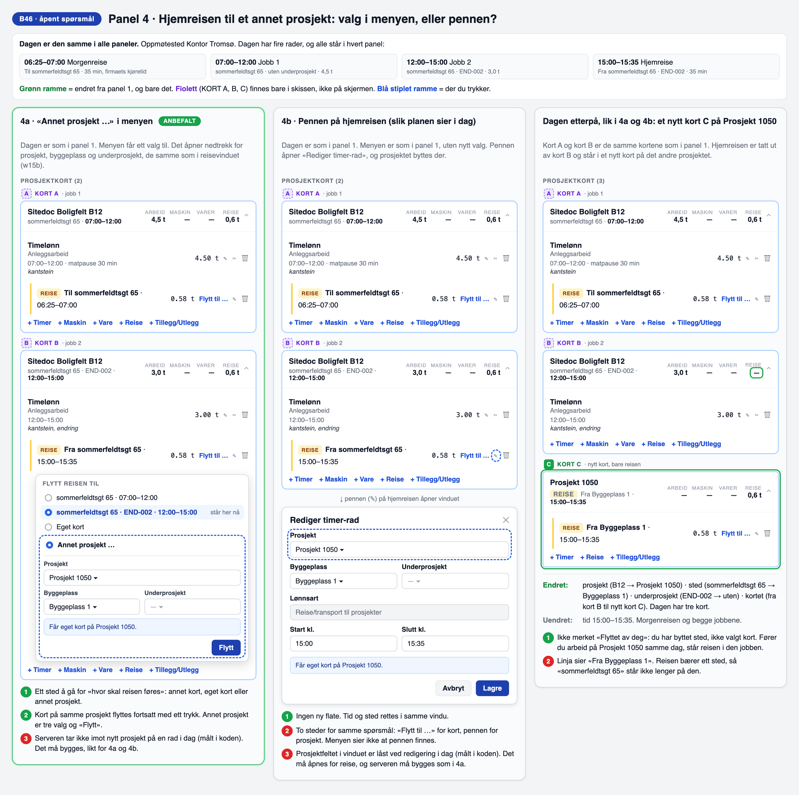

> Del av [Timeføring på web — plan med bilder](../web-timeforing-plan.md): § 8.20–8.28. Seksjonsnumrene er de samme som før delingen.

### 8.20 Kenneths svar på B47 og B48, 2026-11-21

- **B47 → A**, med Kenneths ord: «men jeg savner mulighet til å endre tidspunkter». Ingen firmainnstilling for hvor returen hjem føres nå; forslaget er jobben man drar fra. Tidene på en reise skal kunne rettes med pennen på reiselinja etter at den er ført (w15d). Reisevinduet: se [vedtak-timer-web.md § Reisevinduet](../vedtak-timer-web.md). ✅ Bygget: w15b (`cee0c03e`), w15d (`94fe0b77`) og w15f (`bda2aae4`).
- **B48 → A.** Reise uten underprosjekt står i jobben på byggeplassen; linja viser «Uten underprosjekt». ✅ Bygget: w15c og w15d er merget.
- **B46 B, Kenneths merknad:** «eneste svakheten jeg ser er at det ser ut til at det er lite dynamisk angående valg av reise til? -> mangler det nedtreksmeny?» ⚠️ Utgått samme dag: «Flytt til …» og w15e bygges ikke (punktet under). Sto slik: ⏳ Kontrollspørsmål til Kenneth 2026-11-21 (hvilken del av «Flytt til …» han mener); w15e venter på svaret.
- **Kenneth 2026-11-21 etter skissen `v16b-flytt*.png` — forenkling (styrende for w15c–w15e):** «nå begynner du å komplisere problemet istedenfor å forenkle. jeg trenger valgmuligheter -> enkle linjer. vi trenger ikke mange forskjellige varianter av kort. jeg trenger å kunne endre tider på reisen og jeg trenger å endre prosjektet reisen går til/fra. jeg trenger mulighet å redigere disse linjene ved attestering». Krav: (1) tider på reisen kan rettes, (2) prosjektet reisen går til/fra kan byttes, (3) begge kan rettes ved attestering. Orkestrators forslag samme dag, **Kenneth: «ja»** (2026-11-21):
  - **Reisen er én linje.** Pennen på dagssiden og reisedelen i attesteringen har de samme feltene: start, slutt, prosjekt, byggeplass, underprosjekt. Målt på develop `d82e635d`: tid, byggeplass og underprosjekt kan alt rettes på dagssiden (pennen) og tid + underprosjekt ved attestering (`RegistreringPanel.tsx:22–33`, `rettRadFelt`, `flyttTimerRadEco`; tid krever firmavalget «rediger ved attestering»). **Prosjekt er låst begge steder** (`page.tsx` prosjektfeltet `disabled={!!rad}`; `oppdaterTimerRad` tar ikke prosjekt) — det er det nye som bygges, web + server.
  - **Kortet følger av prosjekt og sted** (regelen i del E uten punkt «valgt kort»). Arbeideren velger aldri kort.
  - **Utgår:** «Flytt til …»-menyen, «Eget kort», «Følg forslaget», merket «Flyttet av deg», kolonnen `valgt_kort_id` og prosedyren for den, panel 4 (4a/4b) og leveransen **w15e**. B46 B er snudd (se § 8.19).
  - **Konsekvens Kenneth har godtatt:** hjemreisen står i jobben man drar fra; den kan ikke legges i en annen jobb på samme sted uten å bytte prosjekt, byggeplass eller underprosjekt.
  - ✅ Bygget: w15c (`a690363d`) og w15f (`bda2aae4`) er merget. Del E–H ble revidert i versjon 17.
- **Revidert i versjon 17:** § 4.15 del E (reiselinja med fem felt i pennen, regelen uten valgt kort), del F (F46–F63, hva som bygges for prosjektbyttet, kortet uten åpne felt og varselet; lagringen av valget strøket), del G (w15c uten kolonne, w15e utgått, nye w15f og w15g) og del H. Bildet er `v17-reiselinje.png`. Målt på develop `afdaa7ac`: attesteringens `rettRadFelt` tar alt imot prosjekt på en timerad og krever attesteringsrett på begge prosjektene og firmavalget «rediger ved attestering» (F48, F49); pennens `oppdaterTimerRad` tar ikke prosjekt (F47). Firmavalget (B10) er ikke endret: er det av, kan attestanten bare rette underprosjektet på reisen.
- **Kenneth 2026-11-21 om retting ved attestering:** «hva er vitsen med attestering hvis redigering ikke kan forekomme -> men bruker skal varsles ved redigering». I dag krever retting ved attestering at firmaet har «rediger ved attestering» på (B10, R21), og arbeideren varsles ikke (ikke målt fullt — Fabel måler i versjon 17). Varsel til arbeideren ved hver retting er vedtatt. **Kenneth 2026-11-21, presisering:** «jeg sa at den som attesterer må ha MULIGHET til å redigere. det er ikke det samme som at alt er redigerbart hele tiden. Derfor skal pennen være der på et kort». Betyr: attestanten retter via pennen (✎) på kortet, som på dagssiden — ingen åpne felt i visningen. Firmavalget «rediger ved attestering» endres ikke i denne omgang. ✅ Bygget: w15f (`bda2aae4`) og w15g (`4e2680ce`).
  - **Målt i versjon 17 (§ 4.15 del F, F57–F63):** firmavalget ligger i firmainnstillingene og sjekkes tre steder på serveren (retting i kortet og «Rediger jobben», «Del opp», ✂); underprosjekt, attester og returner sjekker det ikke. Arbeideren varsles ikke i dag: rettingen skrives i aktivitetsloggen og radhistorikken, men gir verken merke, e-post eller push. E-post finnes (invitasjoner, dokumentflyt); push har rør uten kallere, og appen registrerer ikke token. Attesteringskortet har i dag åpne felt som lagres med en gang (fra, til, pause, lønnsart, maskintimer, antall) og ingen penn på linjene; «✎ Rediger jobben» står øverst i kortet (F63). **Bygget:** pennen på reiselinja i attesteringen i w15f; resten av kortet uten åpne felt (⚠️ snur w10 A1) og varselet (merket «Rettet» på linja og i Mine timer, e-post pr. dagsseddel) i ny **w15g** (⚠️ merket heter «Korrigert av» og e-posten er utgått; svaret på B49 under). Firmavalget endres ikke.
- **Kenneth 2026-11-21, svar om pennen i attesteringskortet (w15g):** «hva er statusen til attesteringskortet? er det i informasjonsstatus -> ja jeg ønsker pennen. er kortet allerede åpnet for redigering -> nei -> da trenger jeg ikke pennen». Betyr: kortet har to tilstander. I informasjonsstatus er linjene tekst med ✎. Er kortet åpnet for redigering, står feltene åpne og pennen trengs ikke. ✅ Bygget: w15g er merget (`4e2680ce`).
  - **Målt og arbeidet inn (§ 4.15 del F, F64–F68; develop `fae0e363`):** kortet har i dag ingen tilstand «åpnet for redigering». Det er lukket eller åpent, og feltene står åpne med en gang det åpnes; dagens åpne felt (`RegistreringPanel.tsx:245–283`, `:402–408`, `:437–443`) hører til informasjonsstatus. Det eneste attestanten åpner for redigering, er vinduet «Rediger arbeid» bak «✎ Rediger jobben». **Fabels forslag (✅ ja, punkt 1 under):** kortet er informasjonsstatus med tekst og ✎; vinduet er jobben åpnet for redigering, med feltene åpne og uten penn; ett varsel pr. lagring, også én e-post pr. lagring (⚠️ e-posten er utgått, svaret på B49 under). Ingen nye kort eller visninger. Bilde: `v17-kortet-to-tilstander.png`. ⚠️ F68: vinduet ser ut til å tømme byggeplassen på radene ved lagring (lest, ikke kjørt); anbefalt rettet for seg før w15c er deployet. ✅ F68 er merget (`6ab36520`).
- **Kenneth 2026-11-21, ramme for resten av w15:** «husk, vi skal holde oss tett til planen og de kortene som er laget. det er hva som er redigerbart vi skal rette opp. nå begynner data å henge sammen, det er det viktigste. nå er det å få de siste detaljer på plass». Betyr: ingen nye korttyper eller visninger; gjenstående arbeid er hvilke felt som kan rettes (tid, prosjekt, byggeplass, underprosjekt) på kortene som finnes. **Versjon 17 holder seg til det:** ingen nye kort, paneler eller visninger. Planen sier hvilke felt som kan rettes på kortene som finnes (pennen på dagssiden, pennen i attesteringen, reisevinduet), og hva serveren må tåle (prosjektbytte, varsel). Det eneste nye arbeideren ser, er merket på en linje som er rettet («Korrigert av [navn]»; het «Rettet» til versjon 19).
- **Kenneth 2026-11-21, svar på Fabels forslag til w15g (to spørsmål, hvert i sin tilstand):**
  1. Spørsmålet: «Attestanten ser en jobb som venter, og firmavalget er på. Skal kortet vise tekst med ✎, og hele jobben redigeres i vinduet bak «✎ Rediger jobben»?» Svar: **«ja»**. Forslaget i del F er vedtatt: kortet er informasjonsstatus (linjene som tekst med ✎), og vinduet «Rediger arbeid» er jobben åpnet for redigering (feltene åpne, ingen penn). ✅ Bygget: w15g er merget (`4e2680ce`).
  2. Spørsmålet: «Attestanten retter fem linjer på samme dagsseddel, én om gangen. Skal arbeideren få fem e-poster, eller én samlet?» Svar: **«én samlet e-post»**. ⚠️ Snur «én e-post pr. lagring» i del F (raden «E-post») og del H punkt 30: arbeideren får én e-post for dagsseddelen med alle rettingene. Merket på linja (⚠️ het «Rettet»; heter «Korrigert av») står fortsatt pr. lagring. Koden har ikke noe som heter økt (del F), så hva som utløser den samlede e-posten er ikke bestemt. Fabel foreslår det i versjon 18 før w15g bestilles. ⚠️ Snudd av svaret på B49 (under): ingen e-post.
  - **Arbeidet inn i versjon 18 (§ 4.15 del F–H, F69–F78; develop `6163086f`):** målt at retting bare er mulig mens dagsseddelen venter, at attestering og retur skjer pr. rad og ikke sender noe i dag, at fire kall attesterer eller returnerer («Attester dagen» går en egen vei), og at API-et ikke har jobbkø, men et fast mønster for løkker i bakgrunnen. **Fabels forslag (⚠️ utgått: Kenneth svarte uten e-post, punktet under):** e-posten går når attestanten trykker ✓ eller ↩ på noe på dagsseddelen, med alle rettingene siden forrige e-post; en retting som blir stående 24 timer uten ✓ eller ↩, sendes av en løkke. Merket (⚠️ het «Rettet»; heter «Korrigert av») settes fortsatt ved hver lagring. Funn: prosjekt, byggeplass og underprosjekt regnes ikke som rettede felt i dag (F77), og bytte av underprosjekt skriver ikke i historikken (F78); begge bygges i w15g.
- **Kenneth 2026-11-21, svar på B49 (når den samlede e-posten skal gå):** «jeg vil ikke varsle med e-post. Kan vi ikke varsle i appen/web. Vi varsler at timer er korrigert "Redigert/Korrigert av ...." i timelisten». ⚠️ Snur svar 2 over («én samlet e-post») og B49: **ingen e-post** ved retting i attesteringen, og ingen løkke for 24 timer. Arbeideren varsles bare i timelisten, på web og i appen, med teksten «… av <navn>» på linja som er rettet. Merket settes ved hver lagring, som i del F. Ordet: Kenneth 2026-11-21 **«Korrigert av»**, altså «Korrigert av <navn>» med tidspunkt, i stedet for «Rettet». Appen følger når web er ferdig (mobil venter på web). ✅ Bygget: w15g er merget (`4e2680ce`).
  - **Arbeidet inn i versjon 19 (§ 4.15 del F–H, F79–F83; develop `d4c0eecd`):** e-posten, utløseren ved ✓ og ↩, nettet etter 24 timer og merket «sendt» i loggen er tatt ut av del F, G og H. Merket heter «Korrigert av [navn]» med tidspunkt på linja på dagen, og «Korrigert av [navn]» på dagen i Mine timer («m.fl.» når flere har korrigert; «Korrigert ved attestering» uten navn). Målt: ingen tekst i koden heter «Rettet» (F79); korrigerte felt går bare til attesteringens lesere, så arbeiderens `hentMedId` og `list` må få dem (F80); appen viser timelisten tre steder og får ingen korrigerte felt fra serveren (F82). Uten e-post regner arbeiderens merke fra første korrigering på linja, så hele endringen står ett sted (F76). Appen er w15gm i § 9, «venter på web». F77 og F78 står og bygges i w15g. ✅ w15g er merget (`4e2680ce`); w15gm venter på web.
- **Skissen er tegnet på nytt 2026-11-21** (`v16b-flytt.png` og `v16b-flytt-prosjekt.png` under, kilde `skisser-v16b.html`) etter Kenneths ord om `v16-flytt.png`: «reise til jobb kan aldri være bare 7 minutter. eksemplene var ikke konsistent med hvilke tider som føres.» Dagen er den samme i alle paneler, alle kort er åpne, og grønn ramme viser det som er endret fra panel 1. Spørsmålet som sto igjen, var panel 4: skal «Flytt til …» ha valget «Annet prosjekt …» (4a, anbefalt av Fabel), eller byttes prosjekt med pennen (4b)? ⚠️ Utgått samme dag: Kenneth valgte enkle linjer (punktet over). Prosjektet byttes i feltet på reisen, i pennen og i attesteringen (w15f). Målt på develop `f95ba905`: ingen av veiene finnes i dag (`WS:4275` låser prosjektfeltet ved redigering, og `oppdaterTimerRad` i `D:4185` tar ikke imot prosjekt).

### 8.21 Kenneth om dagskortet og prosjektkortene, 2026-11-21

Kenneths ord, sagt etter spørsmålet om reise skal telle mot normen:
«jeg har sakt følgende -> et dagskort -> bedre skille i dagskortet mellom de forskjellige prosjektkort -> redigering av dakskort foregår på prosjektkortnivå. 1.en endring som går inn i tiden til et annet prosjektkort -> må da justeres automatisk. f.eks et prosjektkort forlenges dra kl 10 til kl 11. da betyr det at et annet prosjektkort er påvirket av endringen. 2.en endring/oppdeling av et prosjektkort-> slik planen viser -> da deler vi opp et prosjektkort til to prosjektkort der et underprosjekt eller ny byggeplass er skilt ut i samme prosjekt. evt nytt prosjekt. maskintimer varer med mere hører med i opprinnelig registrert kort. nytt kort registrerer varer, maskiner med mere for seg»

- **Ett dagskort** for dagen, med tydeligere skille mellom prosjektkortene. Redigering skjer på prosjektkortnivå.
- ⚠️ **Punkt 1 — UTGÅTT samme dag, bygges ikke** (Kenneths presisering under; orkestrators ordre om versjon 20 med automatisk justering er trukket). Sto slik: en tidsendring på ett prosjektkort som går inn i tiden til et annet prosjektkort, justerer det andre automatisk. Kenneths eksempel: et kort forlenges fra kl. 10 til kl. 11, og kortet som begynte kl. 10, blir påvirket. Målt: planen har ingen automatisk justering. Overlapp er en sperre i dag: lagring avvises i skjermen og på serveren (w15b: `ReiseKort.tsx:189–211`).
- **Punkt 2, som planen viser:** oppdeling gir to prosjektkort. Det nye kortet får et annet underprosjekt eller en annen byggeplass i samme prosjekt, eventuelt et annet prosjekt. Maskintimer, varer og resten blir i kortet de opprinnelig ble registrert i. Det nye kortet registrerer sine egne. 🟡 Måles mot «Del opp» og ✂ (WM48, WM53, WM97).
- ⚠️ **Kenneth 2026-11-21, presisering etter orkestrators forslag om automatisk justering:** «jeg er forundret over at dere klarer å komme opp med nye problemstillinger og justeringer istedenfor å simplifisere. klarer dere å forstå at en registrering (prosjektkort eller et kort) denne er "låst" og behandles samlet for seg selv inni dagskortet. registreringer her er en samlet informasjon som skal henge sammen. reise -> hvis den registreres i et prosjektkort -> da er den en del av kortet. reise- > hvis denne registreres på et annet prosjekt enn det som først ble registrert. -> da er det et tydelig skille i dagskortet at her er det en annen registrering -> reisetid skal summeres -> arbeidstid 7,5t maskintimer 5t reisetid 3t totalt 10,5t». Bekreftet samme dag på orkestrators gjengivelse, med tillegget: «her glemte du tillegg/utlegg -> noe mer som er uteglemt? Jeg tar ikke lenger forgitt at selv om det ikke sies, så er det en selvfølge at allt er med» og «reisetid legges til fordi det er lønnet arbeid, men behandles ulikt iht arbeidsmiljøloven i forhold til arbeidstid». Betyr:
  - **Et prosjektkort er én registrering.** Den er låst og behandles samlet i dagskortet. Alt som er registrert i kortet, hører sammen: arbeid, maskin, varer, reise, tillegg og utlegg (lista målt i koden 2026-11-21, rettet av Kenneth samme dag):
    - **Arbeid** (timerad): prosjekt, byggeplass, underprosjekt, lønnsart, aktivitet, fra–til, pause og «Hva gjorde du?».
    - **Reise:** timerad merket som reise.
    - **Maskin:** maskin og timer. Ingen fra–til, heller ikke som firmainnstilling (⚠️ rettet av Kenneth samme dag, § 8.22 punkt 1; B38 A står, w6 utgår).
    - **Varer:** vare, mengde og enhet.
    - **Tillegg** (vakttillegg, brøytevakt o.l.): Kenneth: «det benyttes ingen bilde eller kvitering på tillegg». ⚠️ Funn: koden har vedlegg på tillegg (`SheetTilleggVedlegg`, `packages/db-timer/prisma/schema.prisma:450–469`, funn #2 2026-06-21). Ikke bestilt.
    - **Utlegg:** beløp og mva, med kvittering.
    - Fravær har eget kort uten prosjekt. GPS-forslag og korrigeringer er ikke registreringer.
  - **Reise registrert i kortet er del av kortet.** Reise registrert på et annet prosjekt er en egen registrering med tydelig skille.
  - **Summen:** arbeid + reise = totalt (7,5 + 3 = 10,5 t). Maskintimer vises, men legges ikke til, fordi de er en del av arbeidstiden. Reisetid legges til fordi den er lønnet arbeid, men den er ikke arbeidstid etter arbeidsmiljøloven. ⚠️ Snur sumlinja fra 2026-11-14 (`9c3a5a8f`, «teller ikke reise mot normen»), som tok reisen ut av summen. Regelen om at reise ikke er overtid (`foreslaOvertidSplitt`, V1) står.
  - **Utgår:** punkt 1 over om automatisk justering, og orkestrators ordre om versjon 20. 🟡 Summen er vedtatt og bestilt (sumlinja, § 9), ikke bygget.

### 8.22 Kenneth rydder i begreper og fire motstrider, 2026-11-21

Orkestrator la fram en gjennomgang av planen (tre lesere, 78 funn) og fire motstrider. Kenneths svar, ordrett:

- **Begrepene:** «Dagskort -> dette er beskrivelsen av alle registreringer en dag. den inneholder en eller flere (prosjektkort/kort/jobber/registereringer)-> for meg betyr disse ordene kun et kort med en samling registeringer som må høre sammen for å gi en beskrivelse av hva en arbeider gjorde i et gitt tidsrom på dagen» og «ordene har lik verdi og representerer lik verdi i et dagskort. de er en del av dagskortet. innholdet må være samlet». Betyr: **dagskortet** er dagen med alle registreringene. **Prosjektkort = kort = jobb = registrering** er samme ting. Der planen mener firmavalget som koden kaller dagskort-modus, skrives «firmavalget dagskort-modus» for å skille det fra Kenneths dagskort.
- **Summen og normen:** «Norm =arbeidstid->8,0 av 7,5 Sum i dag 11 timer, hvis 3 timer er reise. Jeg tror det er viktig å vise dette». Betyr: bunnlinja viser begge. **Arbeidstid mot normen** («8,0 av 7,5») og **sum i dag** = arbeid + reise («11 t»). Maskintimer vises, men legges ikke til (§ 8.21). ✅ Bygget (merget `c03aa0e6`, ikke deployet).
- **Punkt 1, fra–til på maskin:** «årsaken til dette er fordi at jeg hele tiden har sakt at tra/til på maskin ønskes ikke. så har du tilført denne gjentatte ganger og argumentert for at den må være med. Det er ikke mitt ønske å ha den der. det er umulig for en arbeider som benytter maskinen 4 av 7,5 timer å si når den ble brukt innenfor tidsrommet -> det er maskinførers skjønn som gjelder -> han beregner at han benyttet maskinen ca så mange timer.» Betyr: **maskin føres bare med antall timer, etter maskinførerens skjønn.** Ingen fra–til, heller ikke som firmainnstilling. B38 A står, og B5 og w6 er utgått. «Firmainnstilling» i § 8.21 var orkestrators feil og er rettet.
- **Punkt 2, kjøring mellom to prosjekter i arbeidstiden:** «enig» med V9: det er arbeid. Reise er kjøringen til første sted og fra siste sted. Kenneth la til: «men når vi først starter med overføring mellom avdelinger -> da ble dette for komplisert. fordi den overføringen kan skje etter påbegynt arbeidsdag av ulike årsaker». Kontrollspørsmål samme dag: «Skal kjøring til annet kontor følge samme regel som all annen kjøring?» Kenneth: «Ja, samme regel». Betyr: **overføring til annet kontor eller avdeling har ingen egen regel.** Kjøring i arbeidstiden er arbeid (V9) og føres på kortet for det nye stedet. Kjøring før første sted eller etter siste sted er reise. Reisevinduet: se [vedtak-timer-web.md § Reisevinduet](../vedtak-timer-web.md). ✅ Merget `e4b1208f` (`feat/web-timer-forenkle`).
- **Punkt 3, reisens kort:** «enig» i at de tre særreglene strykes: reisen flyttes ikke automatisk når en annen registrering føres eller slettes, reise uten byggeplass følger ikke klokka, og kortet for reise til annet kontor er ikke en egen variant. Kortet til reisen avgjøres bare av reisens egne felt (prosjekt, byggeplass, underprosjekt) og flyttes bare når noen retter dem via ✎. Kenneth: «fjern kode som er død». ✅ Merget `e4b1208f` (`feat/web-timer-forenkle`).
- **Punkt 4, vedlegg på tillegg:** «la stå inntil videre. vi kan vurdere å ta det bort senere». Vedlegget på tillegg står.
- **Etter Fabels rydding (versjon 20), to oppfølgingsspørsmål samme dag:** (1) «Skal fra–til på maskin også fjernes i firmavalget dagskort-modus (maskinvinduet på PC og telefonens maskinseksjon)?» → «ja». (2) «Skal «Del opp» la maskin og varer bli i det opprinnelige kortet (i dag flytter `delJobb` maskin og vare koblet til en rad som går til del B, `dagsseddel.ts`)?» → «ja». Betyr: **maskin har ingen fra–til noe sted**, heller ikke i firmavalget dagskort-modus. **«Del opp» flytter arbeidet og deler maskintimene mellom A og B**; varer blir i kortet de ble registrert i (§ 4.16; maskin snudd 2026-11-22, Kenneth «s2.ja»). ✅ Web merget `e4b1208f` (`feat/web-timer-forenkle`); telefonens maskinseksjon etter web (§ 8.13). Funn i gate (126): attesteringens maskinrader hadde fortsatt fra–til. ✅ Merget `2ed0259a` (`feat/web-timer-maskin-uten-fratil`): fra–til ut av `RedigerMaskinRad` («Del opp», «Rediger sedel») og `KompaktMaskinRad` («Rediger arbeid»), også av maskinens referanse i «Splitt maskin-rad». Lagret fra–til på eksisterende maskinrader endres ikke (sendes uendret ved lagring); en ny del i «Splitt» får ingen.
- **«Del opp» viser begge kortene, Kenneth samme dag:** «ved del opp er det viktig at begge kortene kan justeres samtidig» og «det er også viktig at attestang kan se begge kortene ved oppdeling». **Det som gjelder (Kenneth 2026-11-23: «B68 ja, B69 ja, B70 ja, B71 ja»; § 4.16 del G):** «✂ Del opp» er blokka i kortet med klokkeslett, underprosjekt for B og maskintimer for A og B (✅ O15 `6cf48d6e`; Kenneth 2026-11-22 «s2.ja»). Etter delingen står kort A og kort B åpne og redigerbare side om side, uten kobling i data (ingen automatisk justering, § 8.21). Linjer (reise, varer, maskin, utlegg og tillegg) kan flyttes mellom kortene, og attestanten kan legge til nye linjer under oppdelingen. Arbeideren har ikke «Del opp» på web. 🟡 Vedtatt, ikke bestilt. Snudd 2026-11-23: vinduet med begge kortene før lagring og ett «Lagre» (alternativ A, 2026-11-21), «varer, tillegg, utlegg og reise blir i A» («s3.nei», 2026-11-22) og «attestanten fører ingenting nytt» (2026-11-21).
- **Etter web-timer-w5s løsning for forenklingen, to svar samme dag («1A, 2A»):** (1) Reisevinduet: se [vedtak-timer-web.md § Reisevinduet](../vedtak-timer-web.md). (2) **Reise ført alene før arbeidet blir i sitt eget kort** til noen retter den med ✎; ingen regel flytter den inn når jobben føres. Reise og arbeid som lagres i samme skriving (synk, «+ Registrer timer») havner i samme kort. Fra–til fjernes i hele maskinvinduet på web, også prosjektkort-modus uten jobb (følger «ingen fra–til noe sted»). ✅ Merget `e4b1208f` (`feat/web-timer-forenkle`).
- **Tallformat på dagssiden, også dagskort-modus (Kenneth samme dag, «A»):** timer, antall og mengde vises med desimalkomma, minst 1 og høyst 2 desimaler («7,5 t», «8,0 t»); beløp med to («45,00 kr»). Gjelder også banneret og gruppesummene i firmavalget dagskort-modus — et uttrykkelig unntak fra «Dagskort isolert», begrenset til tallformat. ✅ Merget `cface3e4`.
- **Etter test-deploy `3fa1bf2b`, Kenneth samme dag — «+ Registrer timer» snur B41 A:** «jeg trykker på +registrer timer -> neste åpner et ferdig utfylt kort -> men jeg må trykke en knapp til for å legge inn riktig tid. Jeg ønsker å gå rett til et åpent redigerbart kort. det er ingen selvfølge at den ansatte kun er på et prosjekt pr dag. det er heller uvanlig. Jeg må kunne justere fra/til med en gang, evt hvor mange timer jeg starter med.» Betyr: etter «+ Registrer timer» står arbeideren rett i et redigerbart vindu for den nye jobben (fra–til og antall timer), likt for første og neste jobb — B41 snus fra A til B (§ 8.18). ✅ Merget i L3a `f28b4c4b` (2026-11-21): «+ Registrer timer» åpner et nytt utkast i jobbskjemaet. Kenneth 2026-11-23 om at knappen alltid gir en ny jobb også når dagen finnes: «ikke endre noe nå» (§ 9.7).
- **Samme dag:** «+ Timer» (Legg til timer-rad) er OK. Maskinvinduet (Legg til maskinbruk) er for lite — utstyrslista klippes; vinduet skal vokse med innholdet (dynamisk høyde). ✅ L1 merget `080fce48` (`feat/web-timer-maskinliste-hoyde`): `MaskinVelger` med `iVindu` legger lista i flyten uten høydetak, vinduet vokser til skjermhøyden og ruller inni; på i prosjektkort-modus (`MaskinRadDialog`, maskindelen i `TimerRadDialog`). Dagskort-modus uendret.
- **Samme dag, svar på w5s løsning — målet er Bilde 2 (§ 3):** Kenneth viste Bilde 2 og skrev: «dette er vedtatt. fra + registrer timer skal vi hit. I dag er det ikke ferdig -> ingen merknad på jobben er registerert. timer er vill gjetting uten snev av grunnlag.» Betyr: «+ Registrer timer» lander i jobben slik Bilde 2 tegner den — åpen og redigerbar, med fra–til etter Bilde 2s kilder (Alt 1 innsjekk, Alt 2 firmaets arbeidstid) og «Hva gjorde du?» tom og påkrevd (B6). En jobb uten beskrivelse vises ikke som ferdig. w5s forslag om å åpne vinduet «Legg til timer» (TimerRadDialog) er derfor ikke målet. ✅ Merget: L3a `f28b4c4b` (skjemaet i kortet) og L3b `af91e7e0` (underprosjekt i hodet). Alt 1 (innsjekk-tid, L4) er ikke bestilt.
- **Samme dag:** maskinlista som klippes, rettes også i attesteringen og «Del opp» (Kenneth «ja»). ✅ L1 merget `080fce48` (`feat/web-timer-maskinliste-hoyde`): `RedigerMaskinRad` (dekker «Del opp» og `AttesteringDetalj_Edit`) og `RedigerRadModal` sender `iVindu`, for begge firmavalg.
- **Samme dag — reise under terskel.** Reisevinduet: se [vedtak-timer-web.md § Reisevinduet](../vedtak-timer-web.md).
- **Samme dag — Bilde 2 delt i L1–L4, Kenneth «Ja, alle fire»** (w5s løsning runde 2, `relay/inbox-orkestrator.md` «## LØSNING (w5) runde 2 — Bilde 2»): (1) en jobb arbeideren går fra uten å fylle ut, står lagret som utkast merket «Mangler beskrivelse», og dagen kan ikke sendes før den er fylt ut eller slettet; (2) sperren i «Send dagen» gjelder bare prosjektkort-modus — dagskort-modus urørt; (3) bytte av dato i jobbens hode tas senere; (4) rekkefølge L1 maskinlista (✅ merget `080fce48`) → L2 «ikke ferdig» (merke + sperre, klient og server) → L3 Bilde 2-jobben med Alt 2 (skjema i kortet, overtidslinje, underprosjekt i hodet, kilde-merke, «+ Registrer timer» lander der) → L4 Alt 1 innsjekk-tid (egen sikkerhetsvurdering). ✅ Merget: L1 `080fce48`, L2 `7965ffb0`, L3a `f28b4c4b` og L3b `af91e7e0`. L4 er ikke bestilt.
- **L2 «ikke ferdig» — ✅ merget `7965ffb0` (`feat/web-timer-l2-ikke-ferdig`):** delt regel `jobbManglerBeskrivelse`/`jobberSomManglerBeskrivelse` (ett kort = én beskrivelse; reise i et kort med arbeid teller ikke, men et kort med bare reise får merket «Mangler beskrivelse», og «Send dagen» stopper til reisen har «Hva gjorde du?» — Kenneth 2026-11-22: «systemet tillater at en reise alene står i dagskortet uten beskrivelse», «s4 ja»; ✅ O14: `jobbManglerBeskrivelse` (`erReiseRad`), «Hva gjorde du?» i «Reise» (`reise-beskrivelse`, påkrevd bare når reisen står alene i kortet), `o14-penn-reise.test.tsx` «O14 pkt 4», 🟡 `feat/web-timer-o14-reise` ikke merget); merket «Mangler beskrivelse» i kortets hode også lukket; «Send dagen» åpner første jobb som mangler; «Hva gjorde du?» påkrevd i `TimerRadDialog` på arbeid; serveren avviser `send` — alt bare i prosjektkort-modus. Mobil sender via `syncBatch` og berøres ikke. Detalj: timer.md § «Ikke ferdig». L3 er merget (linja over). L4 er ikke bestilt.
- **Samme dag — L3, Kenneth «Jeg godtar alle anbefalingene»** (w5s løsning, `relay/inbox-orkestrator.md` «## LØSNING (w5) — L3 Bilde 2-jobben», skisser `l3-a/b/c.png` i w5-treet, committes med koden): (1) skisse A–C er retningen; (2) neste jobb samme dag lagres ikke før Til er fylt — går arbeideren fra den uten Til, forsvinner den (en rad uten sluttid kan ikke lagres); avviker bevisst fra L2-punktet «utkast»; (3) radene 6 Reise og 7 Tillegg/utlegg samlet; (4) L3 deles: L3a skjema + tid + overtid + «+ Registrer timer» lander i skjemaet + kilde-merke (`lagreJobbTid`, blur-lagring), L3b underprosjekt i hodet (`flyttJobbEco`, egen gate); (5) funnet at arbeiderens `tilfoyTimerRad`/`oppdaterTimerRad` godtar lukket underprosjekt (`krevEcoerIProsjekt`, `byggeplass-rad.ts:103–108`) blir egen ordre. ✅ L3a merget `f28b4c4b` 2026-11-21 (gate (129)); ✅ L3b merget `af91e7e0` 2026-11-21 (gate (130)).
- **L3a — ✅ merget `f28b4c4b`, deployet test `68e1e637` (`feat/web-timer-l3-jobbskjema`):** `JobbSkjema.tsx` i prosjektkort-modus på redigerbar dag; blur-lagring via ny `dagsseddel.lagreJobbTid` (én transaksjon, serveren regner overtid med delt `regnJobbTid`, byttet lønnsart beholdes, dagskort-firma avvises); «Ikke lagret — prøv igjen» sperrer «Send dagen» og spør ved `beforeunload`; «+ Registrer timer» lander i skjemaet (ny dag: gule felt fra firmaets tider; neste jobb: Fra = forrige slutt, Til tom når firmaets slutt er tidligere; ingen rad før Til er fylt); kilde-merke. Sendt dag viser dagens visning. Ingen migrering. Ikke i L3a: underprosjekt i hodet (L3b), lukket underprosjekt, dato-bytte, innsjekk-tid (L4). Detalj: timer.md § Jobbskjemaet.
- **L3b — ✅ merget `af91e7e0` (gate (130) runde 2) (`feat/web-timer-l3b-underprosjekt`):** underprosjekt i jobbskjemaets hode — knapper ved ≤ 6 åpne, ellers søkbar nedtrekk, «Uten» forvalgt, raden skjult uten åpne underprosjekter; valget flytter hele jobben via ny arbeiderprosedyre `dagsseddel.flyttJobbEco` (kjernen fra `flyttHeleJobben`, kort-id beholdes, reise røres ikke, lukket underprosjekt avvises, dagskort-firma avvises). Ny jobb sender valget med når raden lages. Blyanten for linje 1 står som «Sted og aktivitet». Ingen migrering. Ikke i L3b: byggeplass for hele jobben i hodet (skissens «Endre» krever ny semantikk — meldt orkestrator), lukket underprosjekt via arbeiderens rad-API (egen ordre). Detalj: timer.md § Jobbskjemaet.
- **Samme dag — Kenneths test av L3a på test (`68e1e637`), skjermbilder i chat:** «dette er bra», med disse vedtakene (status står på hvert punkt):
  1. **Antall timer styrer klokka:** i jobbskjemaet skal arbeideren kunne skrive antall timer (f.eks. 3), og Til regnes ut (Fra + timer + pause). Funksjonen finnes i timevinduet («Antall timer»), men mangler i skjemaet. Kenneths skisse: «= 8,0 t» skal kunne redigeres der det står. ✅ merget i O2 `d815c465` 2026-11-21 (gate (132)).
  2. **Tidsfeltene:** «1600» skal tolkes som 16:00, ikke gi feilmelding; klokkevelger med 15-minutters sprang som i timevinduet. ✅ merget i O2 `d815c465` 2026-11-21 (gate (132)).
  3. **Maskin i «Legg til timer-rad» starter tom:** en maskin som registreres sammen med timer, tilhører bare den registreringen — jobbens andre maskiner skal ikke forhåndsvises der. Maskintimer foreslås ikke ut fra annet enn radens egne timer (Kenneth: 1,5 t ble 2,5 t og 7,5 t da Heatwork ble valgt — «ulogisk»). Maskin har fortsatt aldri fra–til. ✅ merget i O3 `8b858340` 2026-11-21 (gate (133)) — timer.md § «Legg til timer-rad»: maskin og underprosjekt. «+ Maskin» bruker samme forslag (jobbens arbeid / høyst), ikke endret.
  4. **Underprosjekt i «Legg til timer-rad»:** mangler; skal kunne velges der. ✅ merget i O4 `8b858340` (punkt 7).
  5. Reisevinduet: se [vedtak-timer-web.md § Reisevinduet](../vedtak-timer-web.md).
  6. **Maskin i «Rediger timer-rad»** (Kenneth samme kveld, svar på O3-spørsmålet): «ja» — også «Rediger» viser bare maskinene som hører til den raden, som «Legg til» (pkt. 3). «ikke endre noe enda her»: 🟡 vedtatt, ikke bestilt før Kenneth sier fra.
  7. **Underprosjekt i «Legg til timer-rad»** (samme kveld, svar på O4): vises som nedtrekk, forvalgt «—» (uten underprosjekt) — ikke jobbens underprosjekt. Velges et annet underprosjekt enn jobbens, blir raden en egen jobb (registreringer slås aldri sammen). ✅ merget i O4 `8b858340` 2026-11-21 (gate (133)): annen kort-nøkkel → ny kort-id (regel 1); «—» på en jobb med underprosjekt gir derfor egen jobb.
  - **Feil funnet (🔴, ikke vedtak):** (a) en time reise ført i skjemaet ga «✓ Lagret», men reisen vises ikke på kortet og kan ikke redigeres; (b) første jobb (07:00–15:00, 7,5 t) står etterpå som 07:00–17:04 / 8,57 t uten at arbeideren har endret den; (c) dagens maskintimer for høye. (a) og (b): rotårsak målt og rettet i O1 `5ec7f1e0` (tur under terskel havnet i eldste jobb). (c) er maskinforslaget i «Legg til timer-rad» (O3).
  - **O1 (✅ merget `5ec7f1e0`, retter a+b):** rotårsak målt — en tur under terskel er arbeid uten kort-id, og serveren la den i eldste jobb med samme nøkkel (jobb 1). `ReiseKort` sender nå jobbens kort-id når nøkkelen er lik (`arbeidsreiseKortId`), og linja sier «føres som arbeidstid (…) på denne jobben». Integrasjonstest: jobb 1 står 7,5 t / 07:00–15:00, turen i jobb 2 (før: 8,57 t / 07:00–17:04). Mobil har samme svakhet (meldt, ikke rettet). TILLEGG (Kenneth samme dag): Reisevinduet: se [vedtak-timer-web.md § Reisevinduet](../vedtak-timer-web.md). Mobil har verken valg, tider eller antall (meldt, ikke rettet) — timer.md § Reise-kort.
- **Samme kveld — «Slett dagsseddel» sletter alt** (Kenneth, ved test på `d4bec43e`: et kort med bare varer «4 tonn» og uten timer sto igjen etter sletting): «jeg mener at vi sletter alt fra kortet. samtidig kan det være en fare at vi sletter ved et uhell. men det gjør vi delvis allerede. det gir ikke mening å beholde 20% av registreringer». Vedtak: «Slett dagsseddel» sletter alt som er ført på dagsseddelen — timer, maskin, varer, tillegg, utlegg og reise. Ingenting blir liggende igjen. Bekreftelsen i modal (ui-standarder) er vernet mot uhell. Rotårsak (Fabel, inbox-orkestrator.md:40281): varer (eget skjema), vedlegg på tillegg og kvitteringer på utlegg slettes ikke; varer leses etter bruker+dato og dukker opp på ny dag. **K4 → A, skjerpet** (Kenneth samme kveld: «returnert dag bør kun redigeres»): en returnert dag kan ikke slettes, heller ikke når ingen rader er attestert — den rettes og sendes på nytt. «Slett dagsseddel» gjelder bare utkast (sendt/godkjent avvises allerede). **K3 → nei** (Kenneth): rester fra tidligere slettinger på test ryddes ikke. ✅ Merget `d35af35c` 2026-11-21 (gate (135)). Radhistorikken står når et utkast slettes (Kenneth 2026-11-21 «enig»). 🟡 Oppfølger, ikke bestilt: mobil skjuler slett-knappen på returnert dag (venter til web er ferdig). Bygd: `slettSedelMedAlt` + `slettOversikt` (`apps/api/src/routes/timer/dagsseddel.ts`), `SlettDagModal` (web) — detalj i `timer.md` § «Slett dagsseddel» sletter alt.
- **Samme kveld — Kenneths test på `d4bec43e` (O1, O2; O3+O4 ikke deployet), bilder `relay/bilder/l3a-test/o2-test-170…174.webp`:**
  1. **«+ Maskin», maskin nr. 2:** «da foreslås alle maskintimer. jeg foretrekker at de første maskintimene allerede er trukket fra.» Vedtak: forslaget i «+ Maskin» = jobbens arbeid minus maskintimer som alt er ført på jobben (aldri under 0), for alle maskintyper. Åpent felt, arbeideren retter. ✅ O5 A merget `25b40350` 2026-11-21 (gate (134)) — timer.md § «+ Maskin» og overtid i timer-raden (O5).
  2. **Overtid må synes i kortet:** «uten å dele raden manuelt kommer det ikke frem på dagskortet at det er ført overtid … enten ved konsekvent å dele raden automatisk eller ved å vise overtiden for seg … du kan velge. men overtid må fremgå». Orkestrators valg (delegert): **raden deles automatisk** ved lagring når jobben går over dagsnormen — samme serverregel som jobbskjemaet (`regnJobbTid`). Begrunnelse: lønnen følger lønnsarten på raden; en overtid som bare vises, ville ikke blitt betalt. Overtidsdelen står som egen linje i kortet, og arbeideren kan bytte lønnsart etterpå (bevisst bytte beholdes, L3a). Gjelder prosjektkort-modus på web; dagskort-modus og mobil urørt. ✅ O5 B merget `25b40350` 2026-11-21 (gate (134)) — timer.md § «+ Maskin» og overtid i timer-raden (O5); gul boks erstattet av en opplysning.
  3. «Legg til timer-rad» uten underprosjekt og med jobbens maskiner forhåndsfylt: er O3+O4, merget `8b858340`, ikke deployet ved testen.

- **2026-11-22 — Kenneths test på `73aec65d` (O3–O5, S1)**, bilder 175–186 i økta: «Mye bra nå». Overtidsdelingen i jobbskjemaet vises (12:30–15:00 Timelønn + 15:00–15:30 Overtid 50 %).
  1. Reisevinduet: se [vedtak-timer-web.md § Reisevinduet](../vedtak-timer-web.md).
  2. **Beskrivelsen ved hover på sammenslått kort:** «det hadde vært bra med en hover som forteller beskrivelsen den ansatte la inn … så kan du lese hva han gjorde uten å åpne kortet» + «kan brukes i attestering også». ✅ O6 merget `87272320` 2026-11-22 (gate (136)) — timer.md § «Reise og beskrivelse ved hover (O6)».
  3. **Rediger reise-rad viser maskinseksjonen** (jobbens maskiner 2 og 3 + tom rad «Velg utstyr» med 1) etter at lønnsart ble byttet til Reise/transport. Hører til L4 («Rediger timer-rad» viser jobbens maskiner), som Kenneth tidligere sa «ikke endre noe enda» om. Kenneth 2026-11-22 «ja»: maskinseksjonen skjules når raden er en reise (ikke hele L4). ✅ O7 merget `99b5b9b2` 2026-11-22 (gate (137)) (`timer.md` § O7).
  4. Reisevinduet: se [vedtak-timer-web.md § Reisevinduet](../vedtak-timer-web.md).
- **2026-11-22 — Kenneths test på `4bfc7a84` (O6, O7; O5/S1 fra forrige runde)**, bilder 187–200 i økta. Godkjent: «Til byggeplass» 1 t → 06:00–07:00; rettet Start 06:30 → Slutt står, 0,5 t; «Fra byggeplass» som før; hover på timer-siden og i attestering; dagsnormen deles; maskintimer trekkes fra; «Slett dagsseddel» («fungerer perfekt»).
  1. **Timer-rad med maskin kan ikke bli reise — beholdes:** «jeg er enig i programmets oppsett -> ingen endring … en timerad som er registrert som arbeid, lagret med maskin, bør ikke omgjøres til reise.» En firmabil på raden som gjøres om til reise aksepteres. Ingen endring.
  2. Reisevinduet: se [vedtak-timer-web.md § Reisevinduet](../vedtak-timer-web.md). Svaret på inventaret O8 gjaldt også andre vinduer (Kenneth 2026-11-22: «S1 ja, S2 nei (behold avrundingen, rett teksten), S3 ja, S4 ja, S5 ja, S6 ja»): S4 = byggeplass velges automatisk når en jobb flyttes til et prosjekt med én byggeplass; S5 = varer som fulgte en flyttet jobb til et prosjekt uten varelager, kan endres og slettes; S6 = underprosjekt blir nedtrekk når knappene ikke får plass. S1–S3 gjelder reisevinduet og står i vedtaksfila. Inventaret: `relay/inbox-orkestrator.md` «SVAR Kontrollør — INVENTAR O8».
  3. **Underprosjekt-valget blir nedtrekk når det er for mange (✅ besvart og merget, se slutten av punktet):** Kenneths beskrivelse på kortet 21.11.: «spesielt dersom underprosjekt bytter til nedtreksrad dersom det blir for mange underprosjekter slik at disse ikke kan vises lenger slik de gjør nå.» Kenneth 2026-11-22 «jeg er enig»: knappene står så lenge alle får plass på én linje, ellers nedtrekk (grense = plass, ikke antall). ✅ Merget i O8 `fbe4aff2` — timer.md § O8.
  4. **🔴 Ny jobb i annet prosjekt kan ikke velges** (Kenneth 2026-11-22, bilde 203): «registrere timer i annet prosjekt -> jeg kan ikke velge det prosjektet. prosjekt og byggeplass kan ikke endres». Målt: jobbskjemaet for ny jobb (`page.tsx` `utkastSkjema` ~:1146) får prosjektet fra `nyJobbUtkast.projectId` og byggeplassen fra toppbaren, og har ingen `onAapneVindu` («Sted og aktivitet», `JobbSkjema.tsx:414`) — lagrede jobber har den (`page.tsx:1141`). «+ Registrer timer · neste jobb, samme eller annet prosjekt» lover altså noe skjemaet ikke kan. Kenneth: «få retting med i w5». ✅ Merget i O8 `fbe4aff2` — timer.md § O8 punkt 4.
  5. **Grunnregel + slett jobbkort** (Kenneth 2026-11-22, bilde 204): «egentlig bør samme funksjon være i alle registrer timer -> vi hadde den med tidligere. Bruker skal kunne rette opp automatiske forslag -> grunnregel» og «vi kan ikke slette feilført kort heller.» + «pass på å ikke skade andre funksjoner som nå er fungerende enn de som er flagget». Betyr: prosjekt og byggeplass kan velges og rettes i alle veier inn til «registrer timer» (ny jobb og lagret jobb; i «Rediger timer-rad» er Prosjekt i dag grået ut), og et feilført jobbkort kan slettes. 🟡 Bestilt som tillegg 2 til RETUR O8. **Presisert samme dag:** «vi skal kun endre de funksjoner som er flagget uten at vi tilfører eller fjerner på andre flater» — bestilt er bare (a) prosjekt/byggeplass valgbart på ny jobb via «+ Registrer timer» og (b) slett feilført jobbkort. Flytting av lagret jobb til annet prosjekt er ikke bestilt. ✅ Merget i O8 `fbe4aff2` — (a) timer.md § O8 punkt 4, (b) punkt 5. ⚠️ (a) gjelder ikke første jobb fra «+ Registrer timer» på en ny dag med prosjekt i toppbaren: serveren lager den jobben direkte (lagret, prosjektet låst) — meldt, ikke bygget.
  6. **Beslutninger etter leveransen `2415d9dc`** (Kenneth 2026-11-22, «ja» på alle tre): (a) første jobb på ny dag starter også som utkast (prosjekt/byggeplass velges før lagring) — ~~bestilt som TILLEGG 3~~ **trukket** (KORREKSJON samme dag, erstattet av D, se punktet «O8 tillegg 3» nedenfor); (b) «Slett jobben» sletter hele kortet (timer, maskin, varer, reise, tillegg, utlegg) — som levert; mobilens «Slett kort» avviker (reise/tillegg/utlegg står), ikke bestilt; (c) Kontrollør migrerer sin lokale sandkasse og kjører integrasjonstesten i gaten.

### 8.23 Kenneths svar på B68–B71, 2026-11-23

Kenneth: «B68 ja, B69 ja, B70 ja, B71 ja». B71 er mot Fabels anbefaling (nei).

- **B68 ja:** linjer (reise, varer, maskin, utlegg og tillegg) kan flyttes mellom kort A og kort B.
- **B69 ja:** etter «Del opp» står begge kortene åpne og redigerbare side om side. Kortene har ingen kobling i
  data.
- **B70 ja:** vinduet fra 21.11. utgår.
- **B71 ja:** attestanten kan legge til nye linjer under oppdelingen. ⚠️ Rettet samme dag til «hver gang et kort redigeres»
  (§ 8.24).

🟡 Vedtatt, ikke bestilt. Det som gjelder, står i § 4.16 del G.

### 8.24 Kenneths svar på B72 og B73 og på de tre lesningene, 2026-11-23

Kenneth: «B72 ja, 73 ja -> den som korrigerer skal alltid få denne, kun brukeren selv slipper.» Om lesningen
«＋ bare i paret»: «et kort som redigeres må kunne redigere alle linjer, også etter at de er lukket en gang.»

- **B72 ja, for både varer og utlegg:** alle som kan attestere prosjektet, får «＋» under Varer og Utlegg.
- **B73 ja, med presisering:** alle som legger til eller retter en linje på en annens dag, får merket «Lagt til
  av» eller «Korrigert av». Bare brukeren selv slipper. Det gjelder alle linjetyper og alle steder linja kan
  endres, ikke bare «Del opp». Én migrering med en tom kolonne; Kenneth kjører den.
- **Maskinlinja får «→ Kort B»:** står.
- **«＋» bare i paret:** rettet. «＋» og redigering av alle linjene gjelder hver gang et kort redigeres, også
  når det åpnes alene og etter at det er lukket en gang.
- **Merket vises også i attesteringskortet:** står.

🟡 Vedtatt, ikke bestilt. Det som gjelder, står i § 4.16 del G.

### 8.25 Kenneths svar på B74, 2026-11-23

Spørsmålet: «Skal en linje kunne flyttes til et annet kort på dagen også når kortet åpnes alene?» Fabel
anbefalte ja. Kenneths svar, slik orkestrator førte det: «B74 ja (7A)».

- **B74 ja:** en linje kan flyttes til et annet kort på dagen også når kortet åpnes alene, og også etter at
  det har vært lukket. Bytter ut «→ Kort B står bare i paret» (versjon 23, før svaret).

🟡 Vedtatt, ikke bestilt. Det som gjelder, står i § 4.16 del G punkt 5. Knappen bygges i D2b.

### 8.26 Kenneth om slettede linjer (S1, S2) og svarene på B76–B78, 2026-11-23

Kenneth, slik orkestrator førte det i ordre F14: «s1 nei -> det hører ikke til i attesteringen som da blir griset
til. skal være egen visning» og «s2 ja-skal være egen visning».

- **S1 nei:** slettede linjer vises ikke i attesteringskortet. De får en egen visning.
- **S2 ja:** varer og utlegg skal med i sporet og i visningen.

Kenneth 2026-11-23, ordrett: «B76: ja · B77: nei · B78: ja».

| # | Spørsmål | Svar | Følge |
|---|---|---|---|
| B76 | Skal dagsraden i attesteringen få et merke («3 slettet») som åpner siden på den dagen? Ja = variant C, nei = variant A. | **Ja** | Variant C: lenken øverst i Attestering, og merket «N slettet» på dagsraden. |
| B77 | Skal siden også vise det arbeideren rettet, ikke bare slettet, på en returnert dag? Det krever et nytt spor (SV6). | **Nei** | Arbeiderens egne rettinger på en returnert dag spores ikke og vises ikke. |
| B78 | Skal arbeideren se siden for sine egne dager? | **Ja** | Arbeideren får lenken «Slettet og korrigert» i Mine timer. |

🟡 Vedtatt 2026-11-23, ikke bygget, ikke bestilt. Siden står i § 4.18 del B, leveransene SL1 og SL2 i del C.

### 8.27 Kenneths svar på B50–B62 og to kommentarer til `v22-uke.png`, 2026-11-23

Kenneth, ordrett: «b50 a · b51 a · b52a · b53a, men dagen skal være rett ført, og uken skal være rett ført. ·
b54a · b55. reise regnes innenfor arbeidstiden når reisen er under firmaets terskel. · b56a -> vi må kunne
filtrere og ta ut timer etter underprosjekt. · b57 -> som vist i bilde 22A,A -> huk av Ola -> huker av hele
uka-> attester utvalgte -> to trykk · b58 Helg utbetales normalt som overtid. jeg tror vi trenger at firmaet
definerer tidspunkter for overtid, lørdag og søndag og bevegelige helligdager. Bør vi prøve å utlede noen regler
som tilpasses ulike tariffer? · b59a · b60a · b61a · b62a»

| # | Spørsmål | Svar | Følge |
|---|---|---|---|
| B50 | Hvor skal uka stå i attesteringen? | **A** | «Etter ansatt» er standardvisningen, med en ukelinje pr. ansatt og dagene under. «Sedler» finnes fortsatt. Leveranse A4. |
| B51 | Skal linjene være skjult til attestanten åpner dagen? | **A** | Skjult som standard; valget huskes pr. bruker. A1. |
| B52 | Hvem sin ukenorm gjelder? | **A** | Firmaets ukenorm for alle. Egen ukenorm pr. ansatt er ikke bestilt. |
| B53 | Når skal «under ukenorm» være gult? | **A**, «men dagen skal være rett ført, og uken skal være rett ført» | Dagsvarselet vises straks; ukevarselet er gult først når uka er komplett. Lesningen står i § 4.17 del B («Dagen og uka»): attesterte dager teller i uka og kan gjenåpnes derfra; ingen sperre. Bekreftet av Kenneth 2026-11-24 (§ 8.28). A4. |
| B54 | Skal prosjektlederen se ukekontrollen? | **A** | Ukelinja med ukas totaltall, uten navn på andre prosjekter. Han retter bare linjer på sine egne. A4. |
| B55 | Når ligger en reise «innenfor normal arbeidsdag»? | Verken A eller B: «reise regnes innenfor arbeidstiden når reisen er under firmaets terskel.» | Regelen om overlapp med klokkeslett utgår. Merket heter «Reise under terskel» og gjelder en reise som regelen sa var arbeidstid, og som er ført som reisetid (§ 4.17 del D). A3. Handlingen i varselet er A3b (B83 ja, § 8.28). |
| B56 | Skal raden si at jobben har underprosjekt? | **A**, og «vi må kunne filtrere og ta ut timer etter underprosjekt» | «↳» ved prosjektnavnet, A2. Kravet er målt i § 4.17 del K: filter finnes for én uke i attesteringen; filter, gruppering og avgrenset eksport mangler i rapporten. Leveranse U1, også for prosjektlederen på egne prosjekter (B84 ja, § 8.28). |
| B57 | Skal alle dager uten varsel kunne attesteres med ett trykk? | Ingen ny knapp: «huk av Ola -> huker av hele uka-> attester utvalgte -> to trykk» | Knappen «Attester N uten varsel» utgår. Krysset på ukelinja (A4) og «Attester utvalget», som finnes. |
| B58 | Lørdag, søndag og helligdag måles mot hverdagsnormen. | A som visning. Nytt tema: firmaet definerer tidspunkter for overtid, lørdag, søndag og bevegelige helligdager, og regler tilpasset tariffer. | Merket «Helg» / «Helligdag» i H1a. Modellen står i § 4.17 del L, leveransene H1a–H1c, H1m og T1. B79–B82 er besvart med ja (§ 8.28). |
| B59 | Hvilken visning skal attesteringen ha? | **A** | Tabellen fra Bilde 6 med statuslinje og hurtigvalg. A5. |
| B60 | Skal varselet ha en handling? | **A** | «✎ Gjør om 1,0 t til ordinær tid …» (§ 4.17 del J punkt 4). A5. |
| B61 | Skal retur ha ferdige grunner? | **A** | Lista i § 4.17 del J punkt 5. A5. |
| B62 | Skal ✂ «Del opp» stå på jobbraden? | **A** | ✂ på jobbraden åpner «Del opp» i kortet (§ 4.16 del G). Etter D2a. |
| B63 | Hvem bygger opp kort 2 etter «Del opp», og hvor? | Ikke besvart. **Dekket.** | B68 ja (linjer flyttes mellom kortene), B71 og B72 ja (attestanten legger til linjer, også varer og utlegg). § 4.16 del G. |
| B64 | Gjelder koblingen mellom kort 1 og kort 2 bare i vinduet? | Ikke besvart. **Dekket.** | B69 ja (ingen kobling i data), B70 ja (vinduet er utgått). |

**To kommentarer til `v22-uke.png` (A), ordrett:**

1. «kan radene åpnes for redigering slik vi har laget det, inkl splitting?» Ja. Klikk på dagsraden åpner kortet
   med «✎ Rediger jobben», «✂ Del opp» og ✂ og ✎ ved linjene, som i dag (§ 4.17 del B). Bildet viser tirsdagen
   åpnet.
2. «2,5 timer kan trekkes -> det er jo en feil påstand. 1 time kan trekkes … men det er riktig at det er totalt
   2,5 timer overtid over normen.» Regelen: kan trekkes er ført overtid minus godtatt overtid (B85 ja,
   § 8.28). Ola: godtatt overtid er 2,5 − 1,0 = 1,5 t, og 2,5 − 1,5 = 1,0 t kan trekkes. Ført i § 4.17 del B,
   E, F og J og i bildene `v22-uke.png` og `v22-oversiktsrad.png`.

B65–B67 er ikke besvart og står åpne (§ 8). Nye spørsmål etter svarene: B79–B85, alle besvart 2026-11-24
(§ 8.28).

🟡 Vedtatt retning 2026-11-23, ikke bygget, ikke bestilt. Bildene er tegnet om 2026-11-24.

### 8.28 Kenneths svar på B53 og B79–B85, 2026-11-24

Kenneth, ordrett, i to meldinger: «b85 ja · b53 ukevarselet er et varsel. Attestanten kan attestere uka selv
om det står. · b79 ja · b80 ja» og «b81ja · b82ja, anleggsgartner · b83 ja · b84ja»

| # | Spørsmål | Svar | Følge |
|---|---|---|---|
| B85 | Er uka rett ført når det er trukket like mange timer som uka mangler? | **Ja** | Godtatt overtid = timene over dagsnorm − timene uka mangler. Kan trekkes = ført overtid − godtatt overtid. Ola: 2,5 − 1,0 = 1,5 t godtatt, og 2,5 − 1,5 = 1,0 t kan trekkes. Etter at 1,0 t er gjort om, er merket borte, og «Under ukenorm 1,0 t» står. Erstatter «det minste av ført overtid og timene uka mangler». § 4.17 del B, E, F og J. Tallet i bildene er det samme; forklaringsteksten i `v22-uke.png` og regeltabellen i `v22-oversiktsrad.png` er rettet. **A4 kan bestilles.** |
| B53 | Kan uka attesteres når ukevarselet står? | «ukevarselet er et varsel. Attestanten kan attestere uka selv om det står.» | Fabels lesning av «uken skal være rett ført» er bekreftet: ingen sperre. § 4.17 del B («Dagen og uka»). |
| B79 | Skal normen være 0 på lørdag, søndag og helligdag? | **Ja** | Norm 0 lørdag, søndag og helligdag som standard. Firmaet kan sette lørdag eller søndag som arbeidsdag med egen norm. En helligdag er en dag i firmakalenderen. § 4.17 del L, leveranse H1a. Merket «Helg» / «Helligdag» flyttes fra A5 til H1a. |
| B80 | Skal firmaet sette klokkeslett for satsen på overtid? | **Ja** | Firmaet setter tidsrom pr. dagtype med lønnsarten som foreslås. Dagssiden foreslår delingen etter klokkeslett (H1b), og attesteringen viser gult ved avvik (H1c). Én migrering, i H1a; Kenneth kjører den. Appen i H1m. § 4.17 del L. |
| B81 | Skal overtid på en hverdag fortsatt regnes av timer over dagsnormen? | **Ja** | Overtid på en hverdag er timer over dagsnormen. Tidsrommene fra B80 bestemmer bare lønnsarten på timene over normen. Overtid utløst av klokkeslett bygges ikke. Ukekontrollen i § 4.17 del B står. § 4.17 del L. |
| B82 | Skal SiteDoc ha ferdige forslag fra tariffavtaler som firmaet tar inn og retter? | **Ja**, «anleggsgartner» | Første forslag er for anleggsgartnerfaget. Verdiene kopieres inn og rettes; ingen kobling etterpå. Ingen tall, klokkeslett eller satser føres uten kilde: Kenneth, eller en som kjenner avtalen, leverer avtaleteksten. Verdiene som må hentes, står i § 4.17 del L. Leveranse T1, etter H1b. |
| B83 | Skal attestanten få en handling for en reise under terskel som er ført som reisetid? | **Ja** (mot Fabels anbefaling «nei nå») | «✎ Før som arbeidstid …» på merket «Reise under terskel». Vinduet viser begge endringene: reiselinja slettes, og jobbens Fra–til utvides. «Lagre». Arbeideren ser «Korrigert av». Målt: ruta som finnes, gjør begge endringene i én transaksjon. § 4.17 del D, leveranse A3b. |
| B84 | Skal prosjektlederen kunne ta ut timer etter underprosjekt? | **Ja** (mot Fabels anbefaling «nei nå») | Rapporten med filter, gruppering og eksport etter underprosjekt åpnes også for prosjektlederen, avgrenset til prosjektene hans. Målt: rapporten er i dag bare for firmaadministrator, og siden ligger under Firma. Grensen settes på serveren. § 4.17 del K, leveranse U1. |

Åpne etter svarene: B65–B67 og de nye B86 (halvdag og firma-fri) og B87 (dagskort-modus).

🟡 Vedtatt 2026-11-24, ikke bygget, ikke bestilt.
